# Сюжетные автоматы для игры в соцсеть

> **Граница review04.11:** [текущий scope#192 и приоритет правил](implementation-boundary.md). Корпус20.10сохранён для контентного ревью, не является работающим backend.

Версия `review-2026-10-20.6`. Предложение для [#192](https://github.com/Stepami/golden-mouth/issues/192), [#195](https://github.com/Stepami/golden-mouth/issues/195), [PR #196](https://github.com/Stepami/golden-mouth/pull/196). Исполнитель сюжетов, новые журналы и управление запуском ещё не реализованы. Это содержание и контракт для ревью, не описание готового API.

Технический контракт после обновления ветки: [база API и миграции 2.5.0](technical-baseline.md). Редакторские названия историй не являются HTTP WorldId.

[Пресеты](presets.md) · [Прокачка](progression.md) · [Отношения и конфликты](relationships.md) · [Знания героев](knowledge.md) · [Стоимость и проверка](balance-check.md) · [Референсы](similarity.md)

## Принципы

Игрок пишет посты и отвечает героям. Узнаваемые сцены уже произошли и дают повод для общения. Сюжет не двигает машину, фигуру, палочку или армию по факту отправки текста. Цель описывает разговор, который игрок хочет открыть, и ответ конкретного NPC, который можно увидеть в ленте.

Свободный текст остаётся свободным. Публикация не доказывает честность, ответ — поддержку адресата, разговор с обеими сторонами — примирение. Автомат проверяет участие и последовательность; решения NPC о продолжении разговора сохраняет серверная политика. LLM оформляет реплики, но не назначает факт согласия, дружбы или выполненной цели.

В этой версии нет обязательного выбора поступка рядом с текстом, скрытого распознавания намерений и социальных договоров о «правильной» публикации. Для точного выбора стороны и согласий игрока пока недостаточно данных существующих действий; граница явно вынесена в открытые вопросы.

## Что существует и что потребуется

Публикация игрока, корневой комментарий под NPC-постом и ответ на конкретный комментарий NPC уже есть. Их обычные энергия, подписчики, опыт и модерация сохраняются. Стабильная роль, запуск, гарантированные сюжетные NPC-реплики, журнал снимков/событий, политики отношений и описанные ниже story_ref — будущие данные исполнителя. Случайный планировщик ленты не гарантирует нужного автора и не заменяет этот исполнитель.

Новый композер, репост игрока, голосование, календарь, личка, совместное авторство и выбор «поддержать/предать» для прохождения не требуются. Начать/приостановить историю и явно привязать обычный ход к текущему этапу всё же нужно; минимальный UI этого управления является зависимостью будущей реализации, не уже существующей функцией.

## Запуск, режим и роль

Ключ запуска `(WorldId, PlayerId, story_id, version, run_id)`. Одновременно один ACTIVE на экземпляр мира. Роль — сохранённый `own` или ID выбранного героя; не угадывать по имени или отсутствию NPC. Выбранный герой остаётся автором P (`Player_…`), не возвращается в `Star_…`. Сейчас отдельный стабильный ключ в CreateWorldRequest не хранится; старому миру нужен достоверный выбор роли до запуска.

Запуск проверяет стандартный пресет, разрешённый состав и доступность якорей. Собственным и изменённым мирам история не навязывается. Версия содержания закрепляется до конца запуска. Каждая квитанция записывает действующую ревизию баланса; цены и начисления берутся из обычной экономики, запуск не сохраняет старые цены после обновления конфигурации. Пороги scope читаются из ревизии последнего обязательного оплаченного хода и сохраняются вместе с его снимком. После обновления данных уже начатая история продолжает свою версию; переход версии отдельно согласуется и не обнуляет прогресс. Старые публикации не подбираются.

Сюжет доброволен. story_ref содержит run_id, state_version и одноразовый token на конкретную операцию и якорь; choice_id и карточки поступка отсутствуют. Она выдаётся из текущего шага и явно видна в обычном редакторе как «Для истории». Её можно снять и отправить свободно; на следующий текст она не переносится. При возвращении к черновику нужны повторная проверка и подтверждение привязки. Это предлагаемый контракт, UI ещё не сделан.

Без story_ref пост/ответ не двигает автомат, даже под сюжетным постом. Обычная экономика действует. Адресные контакты могут пополнять общую память мира, но свободные действия не закрывают сюжет задним числом. При паузе/возврате текущая память и политика читаются без сброса. История может учитывать последствия свободной игры в следующей явной проверке, не списывая новые действия за старые.

## Факты и привязки

| Примитив | Точное условие |
| --- | --- |
| PUB(p) | Новая успешно сохранённая публикация P этого мира после входа в этап, с валидной story_ref. ID сохраняется как p. Редактирование, повтор и старый пост не подходят; содержание не проверяется на сюжетный смысл. |
| ROOT(q,npc,r,c) | q — конкретный сохранённый NPC-пост запуска. Новый r от P имеет PostId = q и ParentCommentId = null. В той же подтверждённой операции основной ответ c от npc имеет ParentCommentId = r.Id и PostId = q, адресат P. Автор NPC состоит в мире. Дополнительный случайный NPC не заменяет основного. |
| CHILD(q,npc,parent,r,c) | Как ROOT, но r отвечает именно сохранённой реплике parent данного npc в посте q; основной c того же npc отвечает r. Пост q может принадлежать P. Чужая ветка и другая реплика не подходят. |
| NPC(alias…) | Сохранены все перечисленные подготовленные объекты: POST от указанного NPC либо COMMENT с точным PostId/родителем. Для COMMENT без отдельного parent указан корневой комментарий NPC с ParentCommentId = null. Их алиасы, авторы, run, context_version и решение политики совпадают; отсутствующий объект не считается сохранённым. Затем этап продвигается один раз. Это внутренний шаг без энергии игрока. |
| EVAL | Серверная проверка зафиксированных данных. Таблица перечисляет все непересекающиеся исходы; ошибка чтения остаётся ожиданием, не превращается в false/отказ. |
| CANCEL | Явная отмена запуска без ухудшения отношений за сам выход. Не отменяет опубликованные действия и обычную экономику. |
| PAUSE/RESUME | Управляющий статус, а не оплаченный сюжетный ход. PAUSED не принимает story_ref; после RESUME проверяются текущие состав, якоря, отношения и новая версия этапа. |

Для основного автомата каждый PUB/ROOT/CHILD требует story_ref, auth-владельца, мира, версии этапа, server token и успешно сохранённой операции. Клиент не присылает выбранный исход. Журнал хранит operation/request ID, seq коммита, входной этап, связанные объекты, фактические списание/прирост, навыки после операции и подписчиков. Один r+c — один оплаченный ход. A — количество разных принятых ходов; E — сумма их реальных списаний, а не A, умноженное на угаданную цену.

В карточках BOTH раскрывается в две ветки: можно сначала поговорить с A или с B, но нужны оба разных контакта. Повтор с A не заменяет B. Это свобода порядка, не скрытый выбор стороны. В матрице все неописанные условия относятся к OTHER.

## Подготовленные реплики и решения NPC

NPC-публикации и комментарии используют существующий формат ленты. POST имеет конкретного автора; COMMENT — также точный пост и при необходимости родителя. P исполнитель не публикует. NPC-шаг не даёт игроку энергии, XP, подписчиков, достижений и числового Relation.

Для реплики, запланированной сразу после PUB, нужен один закреплённый слот реакции. Предлагаемый исполнитель использует этот слот вместо второго случайного комментария того же назначения. Обычный планировщик не создаёт параллельно дубль. Для нескольких NPC слот и алиас у каждого отдельные. Случайную уже пришедшую реплику нельзя задним числом объявить нужным сюжетным фактом. Это зависимость интеграции с текущими генераторами, не изменение runtime этим PR.

У ROOT/CHILD основной ответ уже создаёт текущая операция; его ID закрепляется вместе с r. Согласие/отказ на участие в новом обсуждении — отдельный серверный enum и явная реплика NPC. Дополнительный текст генератора не может объявить противоположное решение, приписать игроку поддержку или будущие знания. Одинаковые состояние, версия политики и факты дают одинаковый enum. При ошибке модерации/генерации не публиковать и не списывать; автоматической перегенерации нет.

Политика отказа означает ограничение текущего общения. Она не объявляет текст игрока плохим, не меняет его чувства и не делает отказ доказательством ненависти. Если NPC отвечает по обычной механике, но не хочет общей темы, это разные факты: адресный ответ состоялся, совместный разговор не открыт.

## Пауза, ошибки и повторы

Порядок — seq успешных коммитов, не часы клиента или доставка очереди. Состояние, журнал, обычные эффекты и привязки подтверждаются атомарно с контролем версии; повтор request ID возвращает прежний результат. Из двух параллельных сюжетных операций одной версии только одна продвигает этап; вторая получает конфликт до списания. Неверный токен не превращается в свободную отправку. Текст остаётся в черновике, доступны обновление этапа или явная свободная отправка.

Операция, закоммиченная до PAUSE, учитывается. Начатая до PAUSE, но ещё не сохранённая, отклоняется повторной проверкой перед списанием. CHECK_READY фиксирует snapshot_id и версии готовности/пары. S_POLICY, S_SCOPE и публикация результата используют этот снимок. Перед публикацией версии готовности/пары перепроверяются: при изменении результат не публикуется, срабатывает внутренний POLICY_STALE → S_POLICY с новым снимком; это служебная инвалидизация, а не ход игрока. Снимок подписчиков после последнего оплаченного хода остаётся прежним. После коммита результата исход неизменяем; новые решения действуют на будущие встречи. Для внутренних NPC-шагов pause также проверяется перед коммитом; уже сохранённые объекты остаются. Техническая ошибка ставит WAITING_RETRY, без дублирования действия и без ложного отказа NPC. Недоступный NPC или якорь даёт PAUSED с причиной CONTEXT_LOST; запрещены восстановление удалённого героя и подмена похожим постом. Можно явно отменить историю без штрафа. Удаление аккаунта удаляет данные штатно.

Нет общего календарного дедлайна, обязательного роста +10, заданного emoji или залёта. Смена дня/мира не сбрасывает A/E и прогресс. Конечные F_* и CANCELLED поглощают события основного автомата; независимый модуль q_skill живёт по правилам ниже. Завершение не перезапускает историю само; новый запуск явный, без наград за повтор и без стирания памяти.

## Навыки, аудитория и варианты

Все 16 основных путей доступны с навыками 1 и любым числом подписчиков. У каждого есть хотя бы одна публикация и конкретные разговоры. Навыки не классифицируют свободный текст и не гарантируют согласия NPC.

В каждой карточке заполнено одно дополнительное NPC-обращение из [девяти возможностей уровней 3/6/9](progression.md#девять-возможностей). Оно открывается после указанного события карточки (обычно первой PUB; B3 после адресного разговора и повторной PUB, у Меркантила после METRICS), если нужный навык достиг порога и политика автора допускает контакт. Иначе остаётся основной путь. Это необязательный новый пост NPC в ленте без новой кнопки типа публикации. Игрок может обычным ROOT ответить ему, получить конкретное продолжение и запись capability_used для следующих сцен. Сам по себе уровень не выдаёт новый тип пользовательского поста или бонус.

Модуль возможности: LOCKED → OFFERED по EVAL eligible и сохранённому q_skill; OFFERED → USED по ROOT(q_skill, author, r_skill, c_skill). При отсутствии eligibility состояние LOCKED сохраняется до следующего явного сюжетного хода; на нём проверка повторяется по новому снимку. После завершения основного эпизода текущий q_skill доступен в свободной игре, но новые возможности этого запуска уже не создаются. Один offer на запуск/код, один учтённый ответ, повтор не даёт нового эффекта. Дополнительные обычные ответы разрешены и имеют лишь обычные эффекты. Этот независимый модуль не двигает основной этап и не расходует дополнительную энергию в той же операции. Его ROOT — отдельный необязательный оплаченный ход с повторной проверкой текущей готовности автора по progression.md. Это исключение из требования story_ref только для независимого модуля: свободный ответ на уже существующий q_skill может отметить USED при ACTIVE, PAUSED или после финала, но не продвигает основной автомат. CANCELLED не создаёт новые offers; уже опубликованная ветка остаётся обычным общением без дальнейшего эффекта модуля.

Подписчики меняют видимость ответа, а не истинность мнений. Снимок после последнего обязательного действия определяет scope по действующим порогам stages: до 1000 — ответ NPC в комментариях p_last; от 1000 — отдельный NPC-пост с отсылкой к обсуждению; от 5000 — также реакция второго участника, если он есть в разрешённом составе; от 10000 — отдельный следующий вопрос NPC. Точные варианты и отсутствие новых экономических множителей описаны в progression.md. Никакого изменения Views/подписчиков за эту сцену не предполагается.

## Цели и длина эпизодов

Заполнены 16 вводных эпизодов — один для выбранной роли, не четыре подряд. Основной путь занимает 3–4 оплаченных действия; точная стоимость и XP приведены в [проверке баланса](balance-check.md). Необязательный ответ на q_skill добавляет один ход. Внутренние NPC-шаги и EVAL бесплатны. Это не измеренное среднее время игры.

Для одиночного собеседника итог может быть F_ANSWER (предусмотренный публичный ответ получен) либо F_DISTANCE (только отдельный ответ без продолжения, если политика закрыла новый контакт). Для двух NPC: F_DIALOGUE означает, что оба самостоятельно согласились обсуждать тему; F_SEPARATE — позиции собраны, но совместный разговор не открыт. Последнее не называется примирением. ROI имеет три равноправных результата: F_POST/F_REPLY/F_TIE. goal_met задаётся отдельно по факту нужного результата; отмена и пауза не означают проигрыш.

## Следующие главы и свободная игра

После финала канал, лента и ответы работают дальше. Память контактов, принятых NPC решений, открытых фактов и использованных возможностей остаётся в мире. Свободное общение не превращается в новую главу автоматически. В каждой карточке ниже заполнена конкретная зацепка продолжения, но для неё ещё нет полного автомата и стоимости.

8 глав по 6–8 действий (48–64) остаются предложением на обсуждение. Сейчас готово только одно вступление на роль и необязательный контакт по навыку. Нельзя обещать 64 хода контента или бесконечную сюжетку. Перед расширением нужны план глав, повторные встречи с последствиями, проверка первых двух глав на игроках и согласование темпа XP. Длинную кампанию не растягивать одинаковыми постами.

## Открытые вопросы

1. Как фиксировать именно поддержку стороны, нарушение обещания, личную дружбу и согласие игрока на романтику без обязательных вариантов поступка и без смыслового судьи? В текущих постах/ответах таких данных нет. Основные автоматы этого не требуют; такие переходы нельзя реализовывать по догадке.
2. Согласовать предлагаемые применения навыков 3/6/9 и scope аудитории. Это будущие NPC-возможности, не полная реализация прежних названий приёмов. Множители острого поста, репост игрока и полноценное событие потребуют отдельных решений; они не включены молча.
3. Подтвердить политику готовности NPC и изменения NPC ↔ NPC. Совместный разговор не равен дружбе/перемирию. Проверить, понятны ли цели и достаточно ли различаются роли; реальную увлекательность нельзя доказать таблицей переходов.
4. Согласовать темп XP при смешанной игре и способ показывать старый числовой Relation рядом с новой памятью контактов. Цены и начисления в этом PR не меняются.
5. Подтвердить минимальный UI запуска/паузы/привязки обычного хода и интеграцию гарантированной NPC-реплики без дубля планировщика. Это существующий формат постов/ответов, но новый исполнитель и управляющие данные.
6. База знаний предложена отдельно: общий паспорт + разрешённые факты эпизода + открытые игровые факты. Минимум для 12 NPC заполнен в knowledge.md. Согласовать схему хранения и наполнение следующих глав; полный канон сейчас не подготовлен.
7. Согласовать объём кампании и следующие главы. Пока не считать пакет безусловно готовым к backend-реализации целиком; открытые продуктовые решения перечислены явно.

## Карточки

### Бейсбол до первого чужака

| Паспорт | Значение |
| --- | --- |
| story_id / version | `evening_own_01` / `review-2026-10-20.6` |
| Мир / роль | `evening` / `own` |
| Цель | Дай Изабелле самой рассказать о сорванном бейсболе: собери её и Эдуарда в обсуждении своего канала. |
| Участники NPC | eduard, isabella |
| Референс | «Сумерки» (2008): гроза скрывает удары бит; пришедшие вампиры замечают человека среди игроков. |
| Хронология и знания | Изабелла знает природу Эдуарда. Обсуждение после ухода с поляны; Яков не свидетель бейсбола. Незнакомцы — фон, не новые NPC. |
| Начальный контекст | После грозового бейсбола чужаки заметили человека. Изабелла уже уехала с поляны; Эдуард говорит об опасности, она — о том, что за неё опять решают. |
| Начальное состояние | S0 |

| Алиас | Объект / автор / якорь | Текст NPC |
| --- | --- | --- |
| q_ed | POST / eduard | Чужаки заметили человека. Я боюсь, что обсуждение снова сделает Изабеллу мишенью. |
| q_bella | POST / isabella | Все рассказывают, как меня увезли с поляны. Я тоже могу говорить о том, что со мной произошло. |
| c_isabella | COMMENT / isabella / p1 | Я расскажу от своего имени. Это не значит, что Эдуард решает за меня. |
| c_eduard | COMMENT / eduard / p1 | Услышал, что ты хочешь говорить сама. Моё опасение насчёт чужаков остаётся. |

| Привязка операции | Объект | После события |
| --- | --- | --- |
| r_ed | Ответ P под q_ed | R_ED |
| c_ed | Основной ответ eduard на r_ed | R_ED |
| r_bella | Ответ P под q_bella | R_BELLA |
| c_bella | Основной ответ isabella на r_bella | R_BELLA |
| p1 | Пост P | P_DISCUSS |

| Из | Событие | В | Условие | Видимое последствие | Ходов P |
| --- | --- | --- | --- | --- | --- |
| S0 | OPEN | S1 | NPC(q_ed,q_bella) | Открыты две разные позиции после бейсбола. | 0 |
| S1 | R_ED | S2_A | ROOT(q_ed,eduard,r_ed,c_ed) | Поговори с обоими; порядок свободный. Это внимание к позициям, не поддержка стороны. | 1 |
| S1 | R_BELLA | S2_B | ROOT(q_bella,isabella,r_bella,c_bella) | Поговори с обоими; порядок свободный. Это внимание к позициям, не поддержка стороны. | 1 |
| S2_A | R_BELLA | S2 | ROOT(q_bella,isabella,r_bella,c_bella) | Поговори с обоими; порядок свободный. Это внимание к позициям, не поддержка стороны. | 1 |
| S2_B | R_ED | S2 | ROOT(q_ed,eduard,r_ed,c_ed) | Поговори с обоими; порядок свободный. Это внимание к позициям, не поддержка стороны. | 1 |
| S2 | P_DISCUSS | S3 | PUB(p1) | Открой общую тему в своём канале после двух адресных разговоров. | 1 |
| S3 | JOIN | S4 | NPC(c_isabella,c_eduard) | Оба NPC публикуют собственные позиции под общей темой; решение об обсуждении проверяется отдельно. | 0 |
| S4 | CHECK_READY | S_POLICY | EVAL: взять актуальные версии готовности участников и контакты этого запуска | Зафиксированы входы политики, не смысл текста. В S_POLICY решение выводится политиками relationships.md по этим входам. | 0 |
| S_POLICY | BOTH_ACCEPT | S_SCOPE | EVAL: decision_A = TALK и decision_B = TALK; pair_state допускает DIALOGUE | outcome = DIALOGUE; публикация двух согласий ещё ожидается, pair_state пока DISPUTE. | 0 |
| S_POLICY | ANY_REFUSE | S_SCOPE | EVAL: хотя бы один decision = SEPARATE (включая запрет pair_state) | outcome = SEPARATE; позиции не названы примирением. | 0 |
| S_SCOPE | SCOPE_LOCAL | S_LOCAL | EVAL: subs < stages.views.from | scope = LOCAL по сохранённому снимку; новые экономические эффекты не создаются. | 0 |
| S_LOCAL | RESULT_DIALOGUE | F_DIALOGUE | NPC: версии политик актуальны; outcome = DIALOGUE; все result_alias выбранного scope сохранены с нужными авторами и ссылками | Публичный исход подтверждён; только при DIALOGUE пара DISPUTE/RIVALRY/DIALOGUE → DIALOGUE по двум сохранённым согласиям (TRUCE сохраняется); в остальных случаях пара не меняется; goal_met = true. | 0 |
| S_LOCAL | RESULT_SEPARATE | F_SEPARATE | NPC: версии политик актуальны; outcome = SEPARATE; все result_alias выбранного scope сохранены с нужными авторами и ссылками | Публичный исход подтверждён; только при DIALOGUE пара DISPUTE/RIVALRY/DIALOGUE → DIALOGUE по двум сохранённым согласиям (TRUCE сохраняется); в остальных случаях пара не меняется; goal_met = false. | 0 |
| S_SCOPE | SCOPE_FEED | S_FEED | EVAL: stages.views.from <= subs < stages.strike.from | scope = FEED по сохранённому снимку; новые экономические эффекты не создаются. | 0 |
| S_FEED | RESULT_DIALOGUE | F_DIALOGUE | NPC: версии политик актуальны; outcome = DIALOGUE; все result_alias выбранного scope сохранены с нужными авторами и ссылками | Публичный исход подтверждён; только при DIALOGUE пара DISPUTE/RIVALRY/DIALOGUE → DIALOGUE по двум сохранённым согласиям (TRUCE сохраняется); в остальных случаях пара не меняется; goal_met = true. | 0 |
| S_FEED | RESULT_SEPARATE | F_SEPARATE | NPC: версии политик актуальны; outcome = SEPARATE; все result_alias выбранного scope сохранены с нужными авторами и ссылками | Публичный исход подтверждён; только при DIALOGUE пара DISPUTE/RIVALRY/DIALOGUE → DIALOGUE по двум сохранённым согласиям (TRUCE сохраняется); в остальных случаях пара не меняется; goal_met = false. | 0 |
| S_SCOPE | SCOPE_WIDE | S_WIDE | EVAL: stages.strike.from <= subs < stages.new_line.from | scope = WIDE по сохранённому снимку; новые экономические эффекты не создаются. | 0 |
| S_WIDE | RESULT_DIALOGUE | F_DIALOGUE | NPC: версии политик актуальны; outcome = DIALOGUE; все result_alias выбранного scope сохранены с нужными авторами и ссылками | Публичный исход подтверждён; только при DIALOGUE пара DISPUTE/RIVALRY/DIALOGUE → DIALOGUE по двум сохранённым согласиям (TRUCE сохраняется); в остальных случаях пара не меняется; goal_met = true. | 0 |
| S_WIDE | RESULT_SEPARATE | F_SEPARATE | NPC: версии политик актуальны; outcome = SEPARATE; все result_alias выбранного scope сохранены с нужными авторами и ссылками | Публичный исход подтверждён; только при DIALOGUE пара DISPUTE/RIVALRY/DIALOGUE → DIALOGUE по двум сохранённым согласиям (TRUCE сохраняется); в остальных случаях пара не меняется; goal_met = false. | 0 |
| S_SCOPE | SCOPE_NEXT | S_NEXT | EVAL: subs >= stages.new_line.from | scope = NEXT по сохранённому снимку; новые экономические эффекты не создаются. | 0 |
| S_NEXT | RESULT_DIALOGUE | F_DIALOGUE | NPC: версии политик актуальны; outcome = DIALOGUE; все result_alias выбранного scope сохранены с нужными авторами и ссылками | Публичный исход подтверждён; только при DIALOGUE пара DISPUTE/RIVALRY/DIALOGUE → DIALOGUE по двум сохранённым согласиям (TRUCE сохраняется); в остальных случаях пара не меняется; goal_met = true. | 0 |
| S_NEXT | RESULT_SEPARATE | F_SEPARATE | NPC: версии политик актуальны; outcome = SEPARATE; все result_alias выбранного scope сохранены с нужными авторами и ссылками | Публичный исход подтверждён; только при DIALOGUE пара DISPUTE/RIVALRY/DIALOGUE → DIALOGUE по двум сохранённым согласиям (TRUCE сохраняется); в остальных случаях пара не меняется; goal_met = false. | 0 |
| S_POLICY | POLICY_STALE | S_POLICY | EVAL: версия готовности/пары отличается от snapshot_id; результат ещё не опубликован | Новый снимок политики; scope подписчиков и оплаченные действия сохраняются. | 0 |
| S_SCOPE | POLICY_STALE | S_POLICY | EVAL: версия готовности/пары отличается от snapshot_id; результат ещё не опубликован | Новый снимок политики; scope подписчиков и оплаченные действия сохраняются. | 0 |
| S_LOCAL | POLICY_STALE | S_POLICY | EVAL: версия готовности/пары отличается от snapshot_id; результат ещё не опубликован | Новый снимок политики; scope подписчиков и оплаченные действия сохраняются. | 0 |
| S_FEED | POLICY_STALE | S_POLICY | EVAL: версия готовности/пары отличается от snapshot_id; результат ещё не опубликован | Новый снимок политики; scope подписчиков и оплаченные действия сохраняются. | 0 |
| S_WIDE | POLICY_STALE | S_POLICY | EVAL: версия готовности/пары отличается от snapshot_id; результат ещё не опубликован | Новый снимок политики; scope подписчиков и оплаченные действия сохраняются. | 0 |
| S_NEXT | POLICY_STALE | S_POLICY | EVAL: версия готовности/пары отличается от snapshot_id; результат ещё не опубликован | Новый снимок политики; scope подписчиков и оплаченные действия сохраняются. | 0 |

| Состояние | Следующий шаг |
| --- | --- |
| S0 | Ожидание внутреннего шага: OPEN |
| S1 | ROOT(q_ed,eduard,r_ed,c_ed) / ROOT(q_bella,isabella,r_bella,c_bella) |
| S2 | PUB(p1) |
| S2_A | ROOT(q_bella,isabella,r_bella,c_bella) |
| S2_B | ROOT(q_ed,eduard,r_ed,c_ed) |
| S3 | Ожидание внутреннего шага: JOIN |
| S4 | Ожидание внутреннего шага: CHECK_READY |
| S_POLICY | Ожидание внутреннего шага: BOTH_ACCEPT, ANY_REFUSE, POLICY_STALE |
| S_SCOPE | Ожидание внутреннего шага: SCOPE_LOCAL, SCOPE_FEED, SCOPE_WIDE, SCOPE_NEXT, POLICY_STALE |
| S_LOCAL | Ожидание внутреннего шага: RESULT_DIALOGUE, RESULT_SEPARATE, POLICY_STALE |
| S_FEED | Ожидание внутреннего шага: RESULT_DIALOGUE, RESULT_SEPARATE, POLICY_STALE |
| S_WIDE | Ожидание внутреннего шага: RESULT_DIALOGUE, RESULT_SEPARATE, POLICY_STALE |
| S_NEXT | Ожидание внутреннего шага: RESULT_DIALOGUE, RESULT_SEPARATE, POLICY_STALE |
| F_DIALOGUE | Оба NPC опубликовали готовность продолжить общую тему. |
| F_SEPARATE | Хотя бы один NPC сохранил отдельную позицию; совместный разговор не открыт. |
| CANCELLED | Запуск отменён |

| Состояние | OPEN | R_ED | R_BELLA | P_DISCUSS | JOIN | CHECK_READY | BOTH_ACCEPT | ANY_REFUSE | SCOPE_LOCAL | RESULT_DIALOGUE | RESULT_SEPARATE | SCOPE_FEED | SCOPE_WIDE | SCOPE_NEXT | POLICY_STALE | OTHER | CANCEL |
| --- | --- | --- | --- | --- | --- | --- | --- | --- | --- | --- | --- | --- | --- | --- | --- | --- | --- |
| S0 | S1 | S0 | S0 | S0 | S0 | S0 | S0 | S0 | S0 | S0 | S0 | S0 | S0 | S0 | S0 | S0 | CANCELLED |
| S1 | S1 | S2_A | S2_B | S1 | S1 | S1 | S1 | S1 | S1 | S1 | S1 | S1 | S1 | S1 | S1 | S1 | CANCELLED |
| S2 | S2 | S2 | S2 | S3 | S2 | S2 | S2 | S2 | S2 | S2 | S2 | S2 | S2 | S2 | S2 | S2 | CANCELLED |
| S2_A | S2_A | S2_A | S2 | S2_A | S2_A | S2_A | S2_A | S2_A | S2_A | S2_A | S2_A | S2_A | S2_A | S2_A | S2_A | S2_A | CANCELLED |
| S2_B | S2_B | S2 | S2_B | S2_B | S2_B | S2_B | S2_B | S2_B | S2_B | S2_B | S2_B | S2_B | S2_B | S2_B | S2_B | S2_B | CANCELLED |
| S3 | S3 | S3 | S3 | S3 | S4 | S3 | S3 | S3 | S3 | S3 | S3 | S3 | S3 | S3 | S3 | S3 | CANCELLED |
| S4 | S4 | S4 | S4 | S4 | S4 | S_POLICY | S4 | S4 | S4 | S4 | S4 | S4 | S4 | S4 | S4 | S4 | CANCELLED |
| S_POLICY | S_POLICY | S_POLICY | S_POLICY | S_POLICY | S_POLICY | S_POLICY | S_SCOPE | S_SCOPE | S_POLICY | S_POLICY | S_POLICY | S_POLICY | S_POLICY | S_POLICY | S_POLICY | S_POLICY | CANCELLED |
| S_SCOPE | S_SCOPE | S_SCOPE | S_SCOPE | S_SCOPE | S_SCOPE | S_SCOPE | S_SCOPE | S_SCOPE | S_LOCAL | S_SCOPE | S_SCOPE | S_FEED | S_WIDE | S_NEXT | S_POLICY | S_SCOPE | CANCELLED |
| S_LOCAL | S_LOCAL | S_LOCAL | S_LOCAL | S_LOCAL | S_LOCAL | S_LOCAL | S_LOCAL | S_LOCAL | S_LOCAL | F_DIALOGUE | F_SEPARATE | S_LOCAL | S_LOCAL | S_LOCAL | S_POLICY | S_LOCAL | CANCELLED |
| S_FEED | S_FEED | S_FEED | S_FEED | S_FEED | S_FEED | S_FEED | S_FEED | S_FEED | S_FEED | F_DIALOGUE | F_SEPARATE | S_FEED | S_FEED | S_FEED | S_POLICY | S_FEED | CANCELLED |
| S_WIDE | S_WIDE | S_WIDE | S_WIDE | S_WIDE | S_WIDE | S_WIDE | S_WIDE | S_WIDE | S_WIDE | F_DIALOGUE | F_SEPARATE | S_WIDE | S_WIDE | S_WIDE | S_POLICY | S_WIDE | CANCELLED |
| S_NEXT | S_NEXT | S_NEXT | S_NEXT | S_NEXT | S_NEXT | S_NEXT | S_NEXT | S_NEXT | S_NEXT | F_DIALOGUE | F_SEPARATE | S_NEXT | S_NEXT | S_NEXT | S_POLICY | S_NEXT | CANCELLED |
| F_DIALOGUE | F_DIALOGUE | F_DIALOGUE | F_DIALOGUE | F_DIALOGUE | F_DIALOGUE | F_DIALOGUE | F_DIALOGUE | F_DIALOGUE | F_DIALOGUE | F_DIALOGUE | F_DIALOGUE | F_DIALOGUE | F_DIALOGUE | F_DIALOGUE | F_DIALOGUE | F_DIALOGUE | F_DIALOGUE |
| F_SEPARATE | F_SEPARATE | F_SEPARATE | F_SEPARATE | F_SEPARATE | F_SEPARATE | F_SEPARATE | F_SEPARATE | F_SEPARATE | F_SEPARATE | F_SEPARATE | F_SEPARATE | F_SEPARATE | F_SEPARATE | F_SEPARATE | F_SEPARATE | F_SEPARATE | F_SEPARATE |
| CANCELLED | CANCELLED | CANCELLED | CANCELLED | CANCELLED | CANCELLED | CANCELLED | CANCELLED | CANCELLED | CANCELLED | CANCELLED | CANCELLED | CANCELLED | CANCELLED | CANCELLED | CANCELLED | CANCELLED | CANCELLED |

OTHER не меняет этап: не тот автор, мир, пост, родитель, версия, порядок, повтор или свободный ход. Неверный запрос отклоняется до списания; self-loop не означает платную обработку ошибки. PAUSED/WAITING_RETRY — статусы поверх состояния, не дополнительные сюжетные переходы.

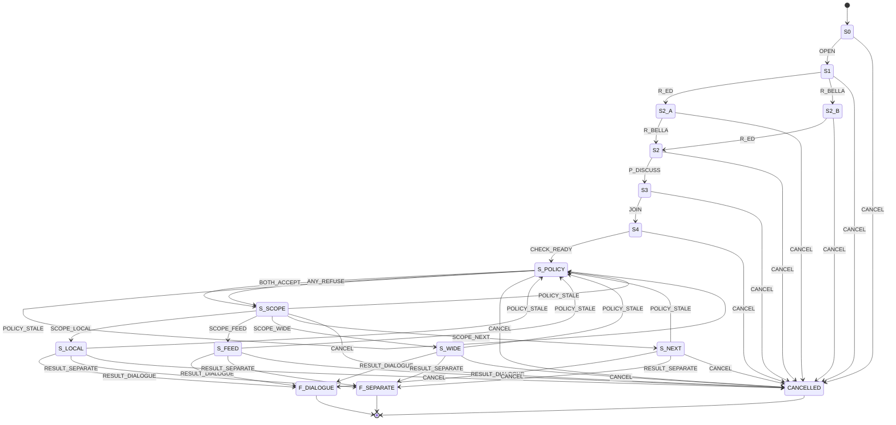

| Исход | Результат | goal_met |
| --- | --- | --- |
| F_DIALOGUE | Оба NPC опубликовали готовность продолжить общую тему. | true |
| F_SEPARATE | Хотя бы один NPC сохранил отдельную позицию; совместный разговор не открыт. | false |

Результат TALK от isabella: «Хочу рассказать свою часть сама. Готова отвечать здесь; Эдуард может объяснить, чего опасается.» Для SEPARATE используется нейтральный отказ от продолжения; род и голос реплики берутся из паспорта NPC. У пары eduard ↔ isabella причина спора: Кто решает, что можно рассказывать после поляны. Политики CAUTIOUS/OPEN; в DIALOGUE оба публикуют собственное «готов продолжить эту тему», в SEPARATE каждый публикует свой фактический TALK/SEPARATE. Дружба, поддержка игроком стороны и перемирие не назначаются. Якорь локального результата — p1. В FEED/WIDE/NEXT создаётся новый NPC-пост с отсылкой к этому обсуждению; выбранный игроком герой автором NPC-объекта не становится.

| Прокачка и память | Заполненный вариант |
| --- | --- |
| Возможность | T3 / isabella / после P_DISCUSS |
| q_skill | Мне важно рассказать, что я видела сама. Публикую собственную версию, а не чужое решение за меня. |
| c_skill | На поляне я первой почувствовала, что стала для чужаков добычей. Хочу, чтобы в рассказе оставался и мой голос, а не только объяснение тех, кто меня увёз. |
| Контакт по навыку | Необязательный ROOT(q_skill,isabella,r_skill,c_skill); зафиксировать capability_used, не соглашение P с текстом NPC. |
| Следующая встреча | Канал Изабеллы получает вопросы о чужаках; Эдуард хочет ограничить огласку. Вернувшийся собеседник увидит обе позиции без повторного знакомства. |

### Ладонь на фургоне

| Паспорт | Значение |
| --- | --- |
| story_id / version | `evening_isabella_01` / `review-2026-10-20.6` |
| Мир / роль | `evening` / `isabella` |
| Цель | Добейся публичного ответа Эдуарда о спасении на парковке, которое он предлагает считать обычной случайностью. |
| Участники NPC | eduard |
| Референс | «Сумерки» (2008): Эдвард останавливает фургон ладонью и пытается скрыть, откуда успел прибежать. |
| Хронология и знания | Игрок является Изабеллой. О вампирах она ещё не знает. Якова на парковке нет. |
| Начальный контекст | Фургон уже остановлен, на металле вмятина. Изабелла не знает о вампирах. Ей нужен ответ самого спасителя, а не автоматическое раскрытие тайны. |
| Начальное состояние | S0 |

| Алиас | Объект / автор / якорь | Текст NPC |
| --- | --- | --- |
| c0 | COMMENT / eduard / p1 | Ты была перед фургоном, а я оказался рядом. Что именно ты хочешь выяснить? |

| Привязка операции | Объект | После события |
| --- | --- | --- |
| p1 | Пост P | P_PARK |
| r1 | Ответ P под p1 | R_ASK |
| c1 | Основной ответ eduard на r1 | R_ASK |
| p2 | Пост P | P_RETURN |

| Из | Событие | В | Условие | Видимое последствие | Ходов P |
| --- | --- | --- | --- | --- | --- |
| S0 | P_PARK | S1 | PUB(p1) | Опубликуй пост после происшествия на парковке. | 1 |
| S1 | ED_COMMENT | S2 | NPC(c0) | Эдуард сам входит в обсуждение. Его ответ не доказывает согласие со всеми выводами игрока. | 0 |
| S2 | R_ASK | S3 | CHILD(p1,eduard,c0,r1,c1) | Продолжи разговор с Эдуардом под его точной репликой. | 1 |
| S3 | P_RETURN | S4 | PUB(p2) | Верни разговор в свой канал после ответа Эдуарда. | 1 |
| S4 | CHECK_READY | S_POLICY | EVAL: взять актуальные версии готовности участников и контакты этого запуска | Зафиксированы входы политики, не смысл текста. В S_POLICY решение выводится политиками relationships.md по этим входам. | 0 |
| S_POLICY | NPC_TALKS | S_SCOPE | EVAL: decision = TALK | outcome = ANSWER; предусмотренный ответ готовится. | 0 |
| S_POLICY | NPC_SEPARATE | S_SCOPE | EVAL: decision = SEPARATE | outcome = DISTANCE; публикуется отказ от продолжения, не обрыв без объяснения. | 0 |
| S_SCOPE | SCOPE_LOCAL | S_LOCAL | EVAL: subs < stages.views.from | scope = LOCAL по сохранённому снимку; новые экономические эффекты не создаются. | 0 |
| S_LOCAL | RESULT_ANSWER | F_ANSWER | NPC: версии политик актуальны; outcome = ANSWER; все result_alias выбранного scope сохранены с нужными авторами и ссылками | Публичный исход подтверждён; только при DIALOGUE пара DISPUTE/RIVALRY/DIALOGUE → DIALOGUE по двум сохранённым согласиям (TRUCE сохраняется); в остальных случаях пара не меняется; goal_met = true. | 0 |
| S_LOCAL | RESULT_DISTANCE | F_DISTANCE | NPC: версии политик актуальны; outcome = DISTANCE; все result_alias выбранного scope сохранены с нужными авторами и ссылками | Публичный исход подтверждён; только при DIALOGUE пара DISPUTE/RIVALRY/DIALOGUE → DIALOGUE по двум сохранённым согласиям (TRUCE сохраняется); в остальных случаях пара не меняется; goal_met = false. | 0 |
| S_SCOPE | SCOPE_FEED | S_FEED | EVAL: stages.views.from <= subs < stages.strike.from | scope = FEED по сохранённому снимку; новые экономические эффекты не создаются. | 0 |
| S_FEED | RESULT_ANSWER | F_ANSWER | NPC: версии политик актуальны; outcome = ANSWER; все result_alias выбранного scope сохранены с нужными авторами и ссылками | Публичный исход подтверждён; только при DIALOGUE пара DISPUTE/RIVALRY/DIALOGUE → DIALOGUE по двум сохранённым согласиям (TRUCE сохраняется); в остальных случаях пара не меняется; goal_met = true. | 0 |
| S_FEED | RESULT_DISTANCE | F_DISTANCE | NPC: версии политик актуальны; outcome = DISTANCE; все result_alias выбранного scope сохранены с нужными авторами и ссылками | Публичный исход подтверждён; только при DIALOGUE пара DISPUTE/RIVALRY/DIALOGUE → DIALOGUE по двум сохранённым согласиям (TRUCE сохраняется); в остальных случаях пара не меняется; goal_met = false. | 0 |
| S_SCOPE | SCOPE_WIDE | S_WIDE | EVAL: stages.strike.from <= subs < stages.new_line.from | scope = WIDE по сохранённому снимку; новые экономические эффекты не создаются. | 0 |
| S_WIDE | RESULT_ANSWER | F_ANSWER | NPC: версии политик актуальны; outcome = ANSWER; все result_alias выбранного scope сохранены с нужными авторами и ссылками | Публичный исход подтверждён; только при DIALOGUE пара DISPUTE/RIVALRY/DIALOGUE → DIALOGUE по двум сохранённым согласиям (TRUCE сохраняется); в остальных случаях пара не меняется; goal_met = true. | 0 |
| S_WIDE | RESULT_DISTANCE | F_DISTANCE | NPC: версии политик актуальны; outcome = DISTANCE; все result_alias выбранного scope сохранены с нужными авторами и ссылками | Публичный исход подтверждён; только при DIALOGUE пара DISPUTE/RIVALRY/DIALOGUE → DIALOGUE по двум сохранённым согласиям (TRUCE сохраняется); в остальных случаях пара не меняется; goal_met = false. | 0 |
| S_SCOPE | SCOPE_NEXT | S_NEXT | EVAL: subs >= stages.new_line.from | scope = NEXT по сохранённому снимку; новые экономические эффекты не создаются. | 0 |
| S_NEXT | RESULT_ANSWER | F_ANSWER | NPC: версии политик актуальны; outcome = ANSWER; все result_alias выбранного scope сохранены с нужными авторами и ссылками | Публичный исход подтверждён; только при DIALOGUE пара DISPUTE/RIVALRY/DIALOGUE → DIALOGUE по двум сохранённым согласиям (TRUCE сохраняется); в остальных случаях пара не меняется; goal_met = true. | 0 |
| S_NEXT | RESULT_DISTANCE | F_DISTANCE | NPC: версии политик актуальны; outcome = DISTANCE; все result_alias выбранного scope сохранены с нужными авторами и ссылками | Публичный исход подтверждён; только при DIALOGUE пара DISPUTE/RIVALRY/DIALOGUE → DIALOGUE по двум сохранённым согласиям (TRUCE сохраняется); в остальных случаях пара не меняется; goal_met = false. | 0 |
| S_POLICY | POLICY_STALE | S_POLICY | EVAL: версия готовности/пары отличается от snapshot_id; результат ещё не опубликован | Новый снимок политики; scope подписчиков и оплаченные действия сохраняются. | 0 |
| S_SCOPE | POLICY_STALE | S_POLICY | EVAL: версия готовности/пары отличается от snapshot_id; результат ещё не опубликован | Новый снимок политики; scope подписчиков и оплаченные действия сохраняются. | 0 |
| S_LOCAL | POLICY_STALE | S_POLICY | EVAL: версия готовности/пары отличается от snapshot_id; результат ещё не опубликован | Новый снимок политики; scope подписчиков и оплаченные действия сохраняются. | 0 |
| S_FEED | POLICY_STALE | S_POLICY | EVAL: версия готовности/пары отличается от snapshot_id; результат ещё не опубликован | Новый снимок политики; scope подписчиков и оплаченные действия сохраняются. | 0 |
| S_WIDE | POLICY_STALE | S_POLICY | EVAL: версия готовности/пары отличается от snapshot_id; результат ещё не опубликован | Новый снимок политики; scope подписчиков и оплаченные действия сохраняются. | 0 |
| S_NEXT | POLICY_STALE | S_POLICY | EVAL: версия готовности/пары отличается от snapshot_id; результат ещё не опубликован | Новый снимок политики; scope подписчиков и оплаченные действия сохраняются. | 0 |

| Состояние | Следующий шаг |
| --- | --- |
| S0 | PUB(p1) |
| S1 | Ожидание внутреннего шага: ED_COMMENT |
| S2 | CHILD(p1,eduard,c0,r1,c1) |
| S3 | PUB(p2) |
| S4 | Ожидание внутреннего шага: CHECK_READY |
| S_POLICY | Ожидание внутреннего шага: NPC_TALKS, NPC_SEPARATE, POLICY_STALE |
| S_SCOPE | Ожидание внутреннего шага: SCOPE_LOCAL, SCOPE_FEED, SCOPE_WIDE, SCOPE_NEXT, POLICY_STALE |
| S_LOCAL | Ожидание внутреннего шага: RESULT_ANSWER, RESULT_DISTANCE, POLICY_STALE |
| S_FEED | Ожидание внутреннего шага: RESULT_ANSWER, RESULT_DISTANCE, POLICY_STALE |
| S_WIDE | Ожидание внутреннего шага: RESULT_ANSWER, RESULT_DISTANCE, POLICY_STALE |
| S_NEXT | Ожидание внутреннего шага: RESULT_ANSWER, RESULT_DISTANCE, POLICY_STALE |
| F_ANSWER | Получен предусмотренный публичный ответ NPC. |
| F_DISTANCE | NPC ответил об отказе продолжать тему; желаемый контакт не открыт. |
| CANCELLED | Запуск отменён |

| Состояние | P_PARK | ED_COMMENT | R_ASK | P_RETURN | CHECK_READY | NPC_TALKS | NPC_SEPARATE | SCOPE_LOCAL | RESULT_ANSWER | RESULT_DISTANCE | SCOPE_FEED | SCOPE_WIDE | SCOPE_NEXT | POLICY_STALE | OTHER | CANCEL |
| --- | --- | --- | --- | --- | --- | --- | --- | --- | --- | --- | --- | --- | --- | --- | --- | --- |
| S0 | S1 | S0 | S0 | S0 | S0 | S0 | S0 | S0 | S0 | S0 | S0 | S0 | S0 | S0 | S0 | CANCELLED |
| S1 | S1 | S2 | S1 | S1 | S1 | S1 | S1 | S1 | S1 | S1 | S1 | S1 | S1 | S1 | S1 | CANCELLED |
| S2 | S2 | S2 | S3 | S2 | S2 | S2 | S2 | S2 | S2 | S2 | S2 | S2 | S2 | S2 | S2 | CANCELLED |
| S3 | S3 | S3 | S3 | S4 | S3 | S3 | S3 | S3 | S3 | S3 | S3 | S3 | S3 | S3 | S3 | CANCELLED |
| S4 | S4 | S4 | S4 | S4 | S_POLICY | S4 | S4 | S4 | S4 | S4 | S4 | S4 | S4 | S4 | S4 | CANCELLED |
| S_POLICY | S_POLICY | S_POLICY | S_POLICY | S_POLICY | S_POLICY | S_SCOPE | S_SCOPE | S_POLICY | S_POLICY | S_POLICY | S_POLICY | S_POLICY | S_POLICY | S_POLICY | S_POLICY | CANCELLED |
| S_SCOPE | S_SCOPE | S_SCOPE | S_SCOPE | S_SCOPE | S_SCOPE | S_SCOPE | S_SCOPE | S_LOCAL | S_SCOPE | S_SCOPE | S_FEED | S_WIDE | S_NEXT | S_POLICY | S_SCOPE | CANCELLED |
| S_LOCAL | S_LOCAL | S_LOCAL | S_LOCAL | S_LOCAL | S_LOCAL | S_LOCAL | S_LOCAL | S_LOCAL | F_ANSWER | F_DISTANCE | S_LOCAL | S_LOCAL | S_LOCAL | S_POLICY | S_LOCAL | CANCELLED |
| S_FEED | S_FEED | S_FEED | S_FEED | S_FEED | S_FEED | S_FEED | S_FEED | S_FEED | F_ANSWER | F_DISTANCE | S_FEED | S_FEED | S_FEED | S_POLICY | S_FEED | CANCELLED |
| S_WIDE | S_WIDE | S_WIDE | S_WIDE | S_WIDE | S_WIDE | S_WIDE | S_WIDE | S_WIDE | F_ANSWER | F_DISTANCE | S_WIDE | S_WIDE | S_WIDE | S_POLICY | S_WIDE | CANCELLED |
| S_NEXT | S_NEXT | S_NEXT | S_NEXT | S_NEXT | S_NEXT | S_NEXT | S_NEXT | S_NEXT | F_ANSWER | F_DISTANCE | S_NEXT | S_NEXT | S_NEXT | S_POLICY | S_NEXT | CANCELLED |
| F_ANSWER | F_ANSWER | F_ANSWER | F_ANSWER | F_ANSWER | F_ANSWER | F_ANSWER | F_ANSWER | F_ANSWER | F_ANSWER | F_ANSWER | F_ANSWER | F_ANSWER | F_ANSWER | F_ANSWER | F_ANSWER | F_ANSWER |
| F_DISTANCE | F_DISTANCE | F_DISTANCE | F_DISTANCE | F_DISTANCE | F_DISTANCE | F_DISTANCE | F_DISTANCE | F_DISTANCE | F_DISTANCE | F_DISTANCE | F_DISTANCE | F_DISTANCE | F_DISTANCE | F_DISTANCE | F_DISTANCE | F_DISTANCE |
| CANCELLED | CANCELLED | CANCELLED | CANCELLED | CANCELLED | CANCELLED | CANCELLED | CANCELLED | CANCELLED | CANCELLED | CANCELLED | CANCELLED | CANCELLED | CANCELLED | CANCELLED | CANCELLED | CANCELLED |

OTHER не меняет этап: не тот автор, мир, пост, родитель, версия, порядок, повтор или свободный ход. Неверный запрос отклоняется до списания; self-loop не означает платную обработку ошибки. PAUSED/WAITING_RETRY — статусы поверх состояния, не дополнительные сюжетные переходы.

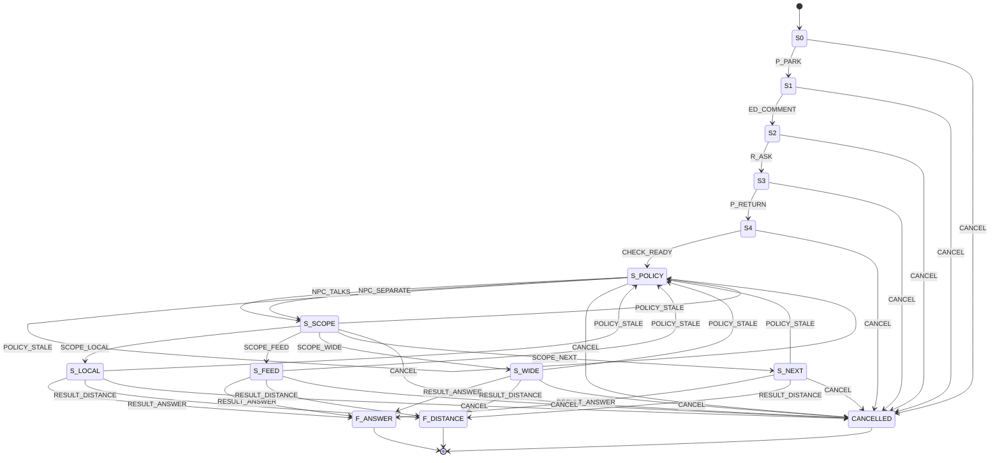

| Исход | Результат | goal_met |
| --- | --- | --- |
| F_ANSWER | Получен предусмотренный публичный ответ NPC. | true |
| F_DISTANCE | NPC ответил об отказе продолжать тему; желаемый контакт не открыт. | false |

Результат TALK от eduard: «Подтверждаю: фургон шёл на тебя. Ты не выдумала опасность; мои возможности — другой разговор.» Для SEPARATE используется нейтральный отказ от продолжения; род и голос реплики берутся из паспорта NPC. Якорь локального результата — p2. В FEED/WIDE/NEXT создаётся новый NPC-пост с отсылкой к этому обсуждению; выбранный игроком герой автором NPC-объекта не становится.

| Прокачка и память | Заполненный вариант |
| --- | --- |
| Возможность | B3 / eduard / после P_RETURN |
| q_skill | Отвечу отдельно: опасность на парковке была реальной. Объяснение того, как я успел, пока оставлю при себе. |
| c_skill | На металле остался след моей ладони. Опасность ты не выдумала; объяснение моей скорости я пока не дам. |
| Контакт по навыку | Необязательный ROOT(q_skill,eduard,r_skill,c_skill); зафиксировать capability_used, не соглашение P с текстом NPC. |
| Следующая встреча | После ответа на парковке появляется приглашение к разговору в лесу. Знания о вампирах открываются только в следующем эпизоде, не задним числом. |

### На солнце без объяснений

| Паспорт | Значение |
| --- | --- |
| story_id / version | `evening_eduard_01` / `review-2026-10-20.6` |
| Мир / роль | `evening` / `eduard` |
| Цель | Верни Изабеллу в разговор после признания на солнце и узнай её собственное решение о дальнейшем общении. |
| Участники NPC | isabella |
| Референс | «Сумерки» (2008): лесная поляна, сияющая кожа Эдварда и решение Беллы остаться рядом. |
| Хронология и знания | Игрок является Эдуардом. Изабелла уже догадалась о вампирской природе и впервые видит его на солнце. Якова рядом нет. |
| Начальный контекст | Изабелла уже увидела кожу на солнце и знает природу Эдуарда. История проверяет открытость разговора, не назначает ей любовь. |
| Начальное состояние | S0 |

| Алиас | Объект / автор / якорь | Текст NPC |
| --- | --- | --- |
| q_bella | POST / isabella | Я видела тебя на солнце. Не хочу, чтобы решение оставаться рядом приняли за меня. |
| c2 | COMMENT / isabella / p1 | Я здесь. Ты хочешь продолжить разговор со мной или говорить обо мне без меня? |

| Привязка операции | Объект | После события |
| --- | --- | --- |
| r1 | Ответ P под q_bella | R_BELLA |
| c1 | Основной ответ isabella на r1 | R_BELLA |
| p1 | Пост P | P_AFTER |
| r2 | Ответ P под p1 | R_RETURN |
| c3 | Основной ответ isabella на r2 | R_RETURN |

| Из | Событие | В | Условие | Видимое последствие | Ходов P |
| --- | --- | --- | --- | --- | --- |
| S0 | BELLA_POST | S1 | NPC(q_bella) | Изабелла формулирует собственный вопрос. | 0 |
| S1 | R_BELLA | S2 | ROOT(q_bella,isabella,r1,c1) | Ответь на её вопрос в её канале. | 1 |
| S2 | P_AFTER | S3 | PUB(p1) | Опубликуй свой пост после разговора; текст остаётся свободным. | 1 |
| S3 | BELLA_RETURN | S4 | NPC(c2) | Она возвращается к разговору по собственной политике готовности. | 0 |
| S4 | R_RETURN | S5 | CHILD(p1,isabella,c2,r2,c3) | Ответь Изабелле в новой ветке, если хочешь продолжить историю. | 1 |
| S5 | CHECK_READY | S_POLICY | EVAL: взять актуальные версии готовности участников и контакты этого запуска | Зафиксированы входы политики, не смысл текста. В S_POLICY решение выводится политиками relationships.md по этим входам. | 0 |
| S_POLICY | NPC_TALKS | S_SCOPE | EVAL: decision = TALK | outcome = ANSWER; предусмотренный ответ готовится. | 0 |
| S_POLICY | NPC_SEPARATE | S_SCOPE | EVAL: decision = SEPARATE | outcome = DISTANCE; публикуется отказ от продолжения, не обрыв без объяснения. | 0 |
| S_SCOPE | SCOPE_LOCAL | S_LOCAL | EVAL: subs < stages.views.from | scope = LOCAL по сохранённому снимку; новые экономические эффекты не создаются. | 0 |
| S_LOCAL | RESULT_ANSWER | F_ANSWER | NPC: версии политик актуальны; outcome = ANSWER; все result_alias выбранного scope сохранены с нужными авторами и ссылками | Публичный исход подтверждён; только при DIALOGUE пара DISPUTE/RIVALRY/DIALOGUE → DIALOGUE по двум сохранённым согласиям (TRUCE сохраняется); в остальных случаях пара не меняется; goal_met = true. | 0 |
| S_LOCAL | RESULT_DISTANCE | F_DISTANCE | NPC: версии политик актуальны; outcome = DISTANCE; все result_alias выбранного scope сохранены с нужными авторами и ссылками | Публичный исход подтверждён; только при DIALOGUE пара DISPUTE/RIVALRY/DIALOGUE → DIALOGUE по двум сохранённым согласиям (TRUCE сохраняется); в остальных случаях пара не меняется; goal_met = false. | 0 |
| S_SCOPE | SCOPE_FEED | S_FEED | EVAL: stages.views.from <= subs < stages.strike.from | scope = FEED по сохранённому снимку; новые экономические эффекты не создаются. | 0 |
| S_FEED | RESULT_ANSWER | F_ANSWER | NPC: версии политик актуальны; outcome = ANSWER; все result_alias выбранного scope сохранены с нужными авторами и ссылками | Публичный исход подтверждён; только при DIALOGUE пара DISPUTE/RIVALRY/DIALOGUE → DIALOGUE по двум сохранённым согласиям (TRUCE сохраняется); в остальных случаях пара не меняется; goal_met = true. | 0 |
| S_FEED | RESULT_DISTANCE | F_DISTANCE | NPC: версии политик актуальны; outcome = DISTANCE; все result_alias выбранного scope сохранены с нужными авторами и ссылками | Публичный исход подтверждён; только при DIALOGUE пара DISPUTE/RIVALRY/DIALOGUE → DIALOGUE по двум сохранённым согласиям (TRUCE сохраняется); в остальных случаях пара не меняется; goal_met = false. | 0 |
| S_SCOPE | SCOPE_WIDE | S_WIDE | EVAL: stages.strike.from <= subs < stages.new_line.from | scope = WIDE по сохранённому снимку; новые экономические эффекты не создаются. | 0 |
| S_WIDE | RESULT_ANSWER | F_ANSWER | NPC: версии политик актуальны; outcome = ANSWER; все result_alias выбранного scope сохранены с нужными авторами и ссылками | Публичный исход подтверждён; только при DIALOGUE пара DISPUTE/RIVALRY/DIALOGUE → DIALOGUE по двум сохранённым согласиям (TRUCE сохраняется); в остальных случаях пара не меняется; goal_met = true. | 0 |
| S_WIDE | RESULT_DISTANCE | F_DISTANCE | NPC: версии политик актуальны; outcome = DISTANCE; все result_alias выбранного scope сохранены с нужными авторами и ссылками | Публичный исход подтверждён; только при DIALOGUE пара DISPUTE/RIVALRY/DIALOGUE → DIALOGUE по двум сохранённым согласиям (TRUCE сохраняется); в остальных случаях пара не меняется; goal_met = false. | 0 |
| S_SCOPE | SCOPE_NEXT | S_NEXT | EVAL: subs >= stages.new_line.from | scope = NEXT по сохранённому снимку; новые экономические эффекты не создаются. | 0 |
| S_NEXT | RESULT_ANSWER | F_ANSWER | NPC: версии политик актуальны; outcome = ANSWER; все result_alias выбранного scope сохранены с нужными авторами и ссылками | Публичный исход подтверждён; только при DIALOGUE пара DISPUTE/RIVALRY/DIALOGUE → DIALOGUE по двум сохранённым согласиям (TRUCE сохраняется); в остальных случаях пара не меняется; goal_met = true. | 0 |
| S_NEXT | RESULT_DISTANCE | F_DISTANCE | NPC: версии политик актуальны; outcome = DISTANCE; все result_alias выбранного scope сохранены с нужными авторами и ссылками | Публичный исход подтверждён; только при DIALOGUE пара DISPUTE/RIVALRY/DIALOGUE → DIALOGUE по двум сохранённым согласиям (TRUCE сохраняется); в остальных случаях пара не меняется; goal_met = false. | 0 |
| S_POLICY | POLICY_STALE | S_POLICY | EVAL: версия готовности/пары отличается от snapshot_id; результат ещё не опубликован | Новый снимок политики; scope подписчиков и оплаченные действия сохраняются. | 0 |
| S_SCOPE | POLICY_STALE | S_POLICY | EVAL: версия готовности/пары отличается от snapshot_id; результат ещё не опубликован | Новый снимок политики; scope подписчиков и оплаченные действия сохраняются. | 0 |
| S_LOCAL | POLICY_STALE | S_POLICY | EVAL: версия готовности/пары отличается от snapshot_id; результат ещё не опубликован | Новый снимок политики; scope подписчиков и оплаченные действия сохраняются. | 0 |
| S_FEED | POLICY_STALE | S_POLICY | EVAL: версия готовности/пары отличается от snapshot_id; результат ещё не опубликован | Новый снимок политики; scope подписчиков и оплаченные действия сохраняются. | 0 |
| S_WIDE | POLICY_STALE | S_POLICY | EVAL: версия готовности/пары отличается от snapshot_id; результат ещё не опубликован | Новый снимок политики; scope подписчиков и оплаченные действия сохраняются. | 0 |
| S_NEXT | POLICY_STALE | S_POLICY | EVAL: версия готовности/пары отличается от snapshot_id; результат ещё не опубликован | Новый снимок политики; scope подписчиков и оплаченные действия сохраняются. | 0 |

| Состояние | Следующий шаг |
| --- | --- |
| S0 | Ожидание внутреннего шага: BELLA_POST |
| S1 | ROOT(q_bella,isabella,r1,c1) |
| S2 | PUB(p1) |
| S3 | Ожидание внутреннего шага: BELLA_RETURN |
| S4 | CHILD(p1,isabella,c2,r2,c3) |
| S5 | Ожидание внутреннего шага: CHECK_READY |
| S_POLICY | Ожидание внутреннего шага: NPC_TALKS, NPC_SEPARATE, POLICY_STALE |
| S_SCOPE | Ожидание внутреннего шага: SCOPE_LOCAL, SCOPE_FEED, SCOPE_WIDE, SCOPE_NEXT, POLICY_STALE |
| S_LOCAL | Ожидание внутреннего шага: RESULT_ANSWER, RESULT_DISTANCE, POLICY_STALE |
| S_FEED | Ожидание внутреннего шага: RESULT_ANSWER, RESULT_DISTANCE, POLICY_STALE |
| S_WIDE | Ожидание внутреннего шага: RESULT_ANSWER, RESULT_DISTANCE, POLICY_STALE |
| S_NEXT | Ожидание внутреннего шага: RESULT_ANSWER, RESULT_DISTANCE, POLICY_STALE |
| F_ANSWER | Получен предусмотренный публичный ответ NPC. |
| F_DISTANCE | NPC ответил об отказе продолжать тему; желаемый контакт не открыт. |
| CANCELLED | Запуск отменён |

| Состояние | BELLA_POST | R_BELLA | P_AFTER | BELLA_RETURN | R_RETURN | CHECK_READY | NPC_TALKS | NPC_SEPARATE | SCOPE_LOCAL | RESULT_ANSWER | RESULT_DISTANCE | SCOPE_FEED | SCOPE_WIDE | SCOPE_NEXT | POLICY_STALE | OTHER | CANCEL |
| --- | --- | --- | --- | --- | --- | --- | --- | --- | --- | --- | --- | --- | --- | --- | --- | --- | --- |
| S0 | S1 | S0 | S0 | S0 | S0 | S0 | S0 | S0 | S0 | S0 | S0 | S0 | S0 | S0 | S0 | S0 | CANCELLED |
| S1 | S1 | S2 | S1 | S1 | S1 | S1 | S1 | S1 | S1 | S1 | S1 | S1 | S1 | S1 | S1 | S1 | CANCELLED |
| S2 | S2 | S2 | S3 | S2 | S2 | S2 | S2 | S2 | S2 | S2 | S2 | S2 | S2 | S2 | S2 | S2 | CANCELLED |
| S3 | S3 | S3 | S3 | S4 | S3 | S3 | S3 | S3 | S3 | S3 | S3 | S3 | S3 | S3 | S3 | S3 | CANCELLED |
| S4 | S4 | S4 | S4 | S4 | S5 | S4 | S4 | S4 | S4 | S4 | S4 | S4 | S4 | S4 | S4 | S4 | CANCELLED |
| S5 | S5 | S5 | S5 | S5 | S5 | S_POLICY | S5 | S5 | S5 | S5 | S5 | S5 | S5 | S5 | S5 | S5 | CANCELLED |
| S_POLICY | S_POLICY | S_POLICY | S_POLICY | S_POLICY | S_POLICY | S_POLICY | S_SCOPE | S_SCOPE | S_POLICY | S_POLICY | S_POLICY | S_POLICY | S_POLICY | S_POLICY | S_POLICY | S_POLICY | CANCELLED |
| S_SCOPE | S_SCOPE | S_SCOPE | S_SCOPE | S_SCOPE | S_SCOPE | S_SCOPE | S_SCOPE | S_SCOPE | S_LOCAL | S_SCOPE | S_SCOPE | S_FEED | S_WIDE | S_NEXT | S_POLICY | S_SCOPE | CANCELLED |
| S_LOCAL | S_LOCAL | S_LOCAL | S_LOCAL | S_LOCAL | S_LOCAL | S_LOCAL | S_LOCAL | S_LOCAL | S_LOCAL | F_ANSWER | F_DISTANCE | S_LOCAL | S_LOCAL | S_LOCAL | S_POLICY | S_LOCAL | CANCELLED |
| S_FEED | S_FEED | S_FEED | S_FEED | S_FEED | S_FEED | S_FEED | S_FEED | S_FEED | S_FEED | F_ANSWER | F_DISTANCE | S_FEED | S_FEED | S_FEED | S_POLICY | S_FEED | CANCELLED |
| S_WIDE | S_WIDE | S_WIDE | S_WIDE | S_WIDE | S_WIDE | S_WIDE | S_WIDE | S_WIDE | S_WIDE | F_ANSWER | F_DISTANCE | S_WIDE | S_WIDE | S_WIDE | S_POLICY | S_WIDE | CANCELLED |
| S_NEXT | S_NEXT | S_NEXT | S_NEXT | S_NEXT | S_NEXT | S_NEXT | S_NEXT | S_NEXT | S_NEXT | F_ANSWER | F_DISTANCE | S_NEXT | S_NEXT | S_NEXT | S_POLICY | S_NEXT | CANCELLED |
| F_ANSWER | F_ANSWER | F_ANSWER | F_ANSWER | F_ANSWER | F_ANSWER | F_ANSWER | F_ANSWER | F_ANSWER | F_ANSWER | F_ANSWER | F_ANSWER | F_ANSWER | F_ANSWER | F_ANSWER | F_ANSWER | F_ANSWER | F_ANSWER |
| F_DISTANCE | F_DISTANCE | F_DISTANCE | F_DISTANCE | F_DISTANCE | F_DISTANCE | F_DISTANCE | F_DISTANCE | F_DISTANCE | F_DISTANCE | F_DISTANCE | F_DISTANCE | F_DISTANCE | F_DISTANCE | F_DISTANCE | F_DISTANCE | F_DISTANCE | F_DISTANCE |
| CANCELLED | CANCELLED | CANCELLED | CANCELLED | CANCELLED | CANCELLED | CANCELLED | CANCELLED | CANCELLED | CANCELLED | CANCELLED | CANCELLED | CANCELLED | CANCELLED | CANCELLED | CANCELLED | CANCELLED | CANCELLED |

OTHER не меняет этап: не тот автор, мир, пост, родитель, версия, порядок, повтор или свободный ход. Неверный запрос отклоняется до списания; self-loop не означает платную обработку ошибки. PAUSED/WAITING_RETRY — статусы поверх состояния, не дополнительные сюжетные переходы.

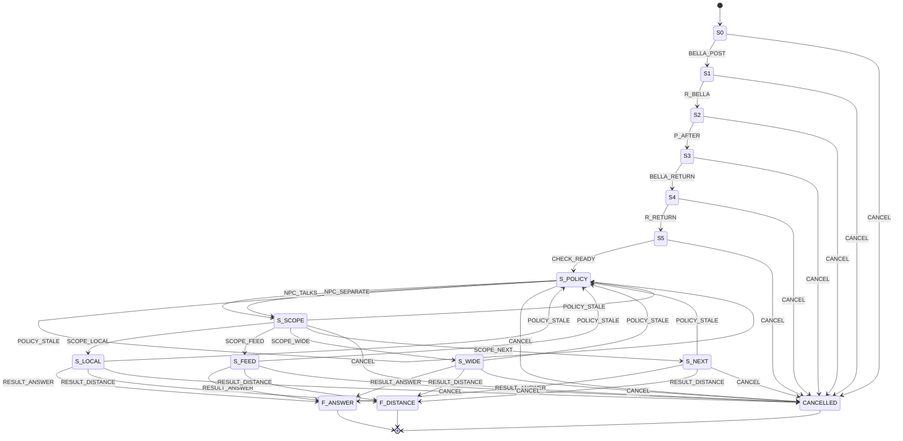

| Исход | Результат | goal_met |
| --- | --- | --- |
| F_ANSWER | Получен предусмотренный публичный ответ NPC. | true |
| F_DISTANCE | NPC ответил об отказе продолжать тему; желаемый контакт не открыт. | false |

Результат TALK от isabella: «Продолжать разговор я готова. Это мой выбор, не объявление о паре.» Для SEPARATE используется нейтральный отказ от продолжения; род и голос реплики берутся из паспорта NPC. Якорь локального результата — p1. В FEED/WIDE/NEXT создаётся новый NPC-пост с отсылкой к этому обсуждению; выбранный игроком герой автором NPC-объекта не становится.

| Прокачка и память | Заполненный вариант |
| --- | --- |
| Возможность | H3 / isabella / после P_AFTER |
| q_skill | Про блёстки ты ещё услышишь от меня шутки. Но серьёзный вопрос остаётся: как мы будем общаться дальше? |
| c_skill | Про блёстки шутить буду. Но за шуткой не исчезает мой вопрос: можно ли разговаривать, не принимая решения за другого? |
| Контакт по навыку | Необязательный ROOT(q_skill,isabella,r_skill,c_skill); зафиксировать capability_used, не соглашение P с текстом NPC. |
| Следующая встреча | В общем разговоре возникает вопрос об опасности для Изабеллы. Продолжение читает её прежний ответ и не назначает роман автоматически. |

### Холодные люди у берега

| Паспорт | Значение |
| --- | --- |
| story_id / version | `evening_yakov_01` / `review-2026-10-20.6` |
| Мир / роль | `evening` / `yakov` |
| Цель | Стань собеседником, к которому Изабелла возвращается с вопросами о холодных людях и старом договоре. |
| Участники NPC | isabella |
| Референс | «Сумерки» (2008): разговор на пляже Ла-Пуш о холодных людях и старом договоре. |
| Хронология и знания | Игрок является Яковом, обычным человеком. Изабелла ещё не знает тайну Эдуарда. Яков пересказывает предание, а не подтверждённое знание о вампирах. |
| Начальный контекст | После разговора на берегу Яков публикует предание общины. Он человек и не располагает доказательством природы семьи Эдуарда. |
| Начальное состояние | S0 |

| Алиас | Объект / автор / якорь | Текст NPC |
| --- | --- | --- |
| c0 | COMMENT / isabella / p1 | Ты говорил о холодных людях. Что в этой истории известно общине, а что ты только предполагаешь? |
| q_followup | POST / isabella | После разговора о береговом договоре вопросов стало больше. Хочу продолжить их с Яковом, не выдавая легенду за факт. |

| Привязка операции | Объект | После события |
| --- | --- | --- |
| p1 | Пост P | P_LEGEND |
| r1 | Ответ P под p1 | R_LEGEND |
| c1 | Основной ответ isabella на r1 | R_LEGEND |
| r2 | Ответ P под q_followup | R_FOLLOWUP |
| c2 | Основной ответ isabella на r2 | R_FOLLOWUP |

| Из | Событие | В | Условие | Видимое последствие | Ходов P |
| --- | --- | --- | --- | --- | --- |
| S0 | P_LEGEND | S1 | PUB(p1) | Начни обсуждение предания в своём канале. | 1 |
| S1 | BELLA_QUESTION | S2 | NPC(c0) | Изабелла отделяет вопросы от подтверждённых фактов. | 0 |
| S2 | R_LEGEND | S3 | CHILD(p1,isabella,c0,r1,c1) | Ответь на её вопрос под этим постом. | 1 |
| S3 | BELLA_FOLLOWUP | S4 | NPC(q_followup) | Появляется самостоятельное обращение Изабеллы, а не назначенный статус дружбы. | 0 |
| S4 | R_FOLLOWUP | S5 | ROOT(q_followup,isabella,r2,c2) | Вернись к новому обращению Изабеллы. | 1 |
| S5 | CHECK_READY | S_POLICY | EVAL: взять актуальные версии готовности участников и контакты этого запуска | Зафиксированы входы политики, не смысл текста. В S_POLICY решение выводится политиками relationships.md по этим входам. | 0 |
| S_POLICY | NPC_TALKS | S_SCOPE | EVAL: decision = TALK | outcome = ANSWER; предусмотренный ответ готовится. | 0 |
| S_POLICY | NPC_SEPARATE | S_SCOPE | EVAL: decision = SEPARATE | outcome = DISTANCE; публикуется отказ от продолжения, не обрыв без объяснения. | 0 |
| S_SCOPE | SCOPE_LOCAL | S_LOCAL | EVAL: subs < stages.views.from | scope = LOCAL по сохранённому снимку; новые экономические эффекты не создаются. | 0 |
| S_LOCAL | RESULT_ANSWER | F_ANSWER | NPC: версии политик актуальны; outcome = ANSWER; все result_alias выбранного scope сохранены с нужными авторами и ссылками | Публичный исход подтверждён; только при DIALOGUE пара DISPUTE/RIVALRY/DIALOGUE → DIALOGUE по двум сохранённым согласиям (TRUCE сохраняется); в остальных случаях пара не меняется; goal_met = true. | 0 |
| S_LOCAL | RESULT_DISTANCE | F_DISTANCE | NPC: версии политик актуальны; outcome = DISTANCE; все result_alias выбранного scope сохранены с нужными авторами и ссылками | Публичный исход подтверждён; только при DIALOGUE пара DISPUTE/RIVALRY/DIALOGUE → DIALOGUE по двум сохранённым согласиям (TRUCE сохраняется); в остальных случаях пара не меняется; goal_met = false. | 0 |
| S_SCOPE | SCOPE_FEED | S_FEED | EVAL: stages.views.from <= subs < stages.strike.from | scope = FEED по сохранённому снимку; новые экономические эффекты не создаются. | 0 |
| S_FEED | RESULT_ANSWER | F_ANSWER | NPC: версии политик актуальны; outcome = ANSWER; все result_alias выбранного scope сохранены с нужными авторами и ссылками | Публичный исход подтверждён; только при DIALOGUE пара DISPUTE/RIVALRY/DIALOGUE → DIALOGUE по двум сохранённым согласиям (TRUCE сохраняется); в остальных случаях пара не меняется; goal_met = true. | 0 |
| S_FEED | RESULT_DISTANCE | F_DISTANCE | NPC: версии политик актуальны; outcome = DISTANCE; все result_alias выбранного scope сохранены с нужными авторами и ссылками | Публичный исход подтверждён; только при DIALOGUE пара DISPUTE/RIVALRY/DIALOGUE → DIALOGUE по двум сохранённым согласиям (TRUCE сохраняется); в остальных случаях пара не меняется; goal_met = false. | 0 |
| S_SCOPE | SCOPE_WIDE | S_WIDE | EVAL: stages.strike.from <= subs < stages.new_line.from | scope = WIDE по сохранённому снимку; новые экономические эффекты не создаются. | 0 |
| S_WIDE | RESULT_ANSWER | F_ANSWER | NPC: версии политик актуальны; outcome = ANSWER; все result_alias выбранного scope сохранены с нужными авторами и ссылками | Публичный исход подтверждён; только при DIALOGUE пара DISPUTE/RIVALRY/DIALOGUE → DIALOGUE по двум сохранённым согласиям (TRUCE сохраняется); в остальных случаях пара не меняется; goal_met = true. | 0 |
| S_WIDE | RESULT_DISTANCE | F_DISTANCE | NPC: версии политик актуальны; outcome = DISTANCE; все result_alias выбранного scope сохранены с нужными авторами и ссылками | Публичный исход подтверждён; только при DIALOGUE пара DISPUTE/RIVALRY/DIALOGUE → DIALOGUE по двум сохранённым согласиям (TRUCE сохраняется); в остальных случаях пара не меняется; goal_met = false. | 0 |
| S_SCOPE | SCOPE_NEXT | S_NEXT | EVAL: subs >= stages.new_line.from | scope = NEXT по сохранённому снимку; новые экономические эффекты не создаются. | 0 |
| S_NEXT | RESULT_ANSWER | F_ANSWER | NPC: версии политик актуальны; outcome = ANSWER; все result_alias выбранного scope сохранены с нужными авторами и ссылками | Публичный исход подтверждён; только при DIALOGUE пара DISPUTE/RIVALRY/DIALOGUE → DIALOGUE по двум сохранённым согласиям (TRUCE сохраняется); в остальных случаях пара не меняется; goal_met = true. | 0 |
| S_NEXT | RESULT_DISTANCE | F_DISTANCE | NPC: версии политик актуальны; outcome = DISTANCE; все result_alias выбранного scope сохранены с нужными авторами и ссылками | Публичный исход подтверждён; только при DIALOGUE пара DISPUTE/RIVALRY/DIALOGUE → DIALOGUE по двум сохранённым согласиям (TRUCE сохраняется); в остальных случаях пара не меняется; goal_met = false. | 0 |
| S_POLICY | POLICY_STALE | S_POLICY | EVAL: версия готовности/пары отличается от snapshot_id; результат ещё не опубликован | Новый снимок политики; scope подписчиков и оплаченные действия сохраняются. | 0 |
| S_SCOPE | POLICY_STALE | S_POLICY | EVAL: версия готовности/пары отличается от snapshot_id; результат ещё не опубликован | Новый снимок политики; scope подписчиков и оплаченные действия сохраняются. | 0 |
| S_LOCAL | POLICY_STALE | S_POLICY | EVAL: версия готовности/пары отличается от snapshot_id; результат ещё не опубликован | Новый снимок политики; scope подписчиков и оплаченные действия сохраняются. | 0 |
| S_FEED | POLICY_STALE | S_POLICY | EVAL: версия готовности/пары отличается от snapshot_id; результат ещё не опубликован | Новый снимок политики; scope подписчиков и оплаченные действия сохраняются. | 0 |
| S_WIDE | POLICY_STALE | S_POLICY | EVAL: версия готовности/пары отличается от snapshot_id; результат ещё не опубликован | Новый снимок политики; scope подписчиков и оплаченные действия сохраняются. | 0 |
| S_NEXT | POLICY_STALE | S_POLICY | EVAL: версия готовности/пары отличается от snapshot_id; результат ещё не опубликован | Новый снимок политики; scope подписчиков и оплаченные действия сохраняются. | 0 |

| Состояние | Следующий шаг |
| --- | --- |
| S0 | PUB(p1) |
| S1 | Ожидание внутреннего шага: BELLA_QUESTION |
| S2 | CHILD(p1,isabella,c0,r1,c1) |
| S3 | Ожидание внутреннего шага: BELLA_FOLLOWUP |
| S4 | ROOT(q_followup,isabella,r2,c2) |
| S5 | Ожидание внутреннего шага: CHECK_READY |
| S_POLICY | Ожидание внутреннего шага: NPC_TALKS, NPC_SEPARATE, POLICY_STALE |
| S_SCOPE | Ожидание внутреннего шага: SCOPE_LOCAL, SCOPE_FEED, SCOPE_WIDE, SCOPE_NEXT, POLICY_STALE |
| S_LOCAL | Ожидание внутреннего шага: RESULT_ANSWER, RESULT_DISTANCE, POLICY_STALE |
| S_FEED | Ожидание внутреннего шага: RESULT_ANSWER, RESULT_DISTANCE, POLICY_STALE |
| S_WIDE | Ожидание внутреннего шага: RESULT_ANSWER, RESULT_DISTANCE, POLICY_STALE |
| S_NEXT | Ожидание внутреннего шага: RESULT_ANSWER, RESULT_DISTANCE, POLICY_STALE |
| F_ANSWER | Получен предусмотренный публичный ответ NPC. |
| F_DISTANCE | NPC ответил об отказе продолжать тему; желаемый контакт не открыт. |
| CANCELLED | Запуск отменён |

| Состояние | P_LEGEND | BELLA_QUESTION | R_LEGEND | BELLA_FOLLOWUP | R_FOLLOWUP | CHECK_READY | NPC_TALKS | NPC_SEPARATE | SCOPE_LOCAL | RESULT_ANSWER | RESULT_DISTANCE | SCOPE_FEED | SCOPE_WIDE | SCOPE_NEXT | POLICY_STALE | OTHER | CANCEL |
| --- | --- | --- | --- | --- | --- | --- | --- | --- | --- | --- | --- | --- | --- | --- | --- | --- | --- |
| S0 | S1 | S0 | S0 | S0 | S0 | S0 | S0 | S0 | S0 | S0 | S0 | S0 | S0 | S0 | S0 | S0 | CANCELLED |
| S1 | S1 | S2 | S1 | S1 | S1 | S1 | S1 | S1 | S1 | S1 | S1 | S1 | S1 | S1 | S1 | S1 | CANCELLED |
| S2 | S2 | S2 | S3 | S2 | S2 | S2 | S2 | S2 | S2 | S2 | S2 | S2 | S2 | S2 | S2 | S2 | CANCELLED |
| S3 | S3 | S3 | S3 | S4 | S3 | S3 | S3 | S3 | S3 | S3 | S3 | S3 | S3 | S3 | S3 | S3 | CANCELLED |
| S4 | S4 | S4 | S4 | S4 | S5 | S4 | S4 | S4 | S4 | S4 | S4 | S4 | S4 | S4 | S4 | S4 | CANCELLED |
| S5 | S5 | S5 | S5 | S5 | S5 | S_POLICY | S5 | S5 | S5 | S5 | S5 | S5 | S5 | S5 | S5 | S5 | CANCELLED |
| S_POLICY | S_POLICY | S_POLICY | S_POLICY | S_POLICY | S_POLICY | S_POLICY | S_SCOPE | S_SCOPE | S_POLICY | S_POLICY | S_POLICY | S_POLICY | S_POLICY | S_POLICY | S_POLICY | S_POLICY | CANCELLED |
| S_SCOPE | S_SCOPE | S_SCOPE | S_SCOPE | S_SCOPE | S_SCOPE | S_SCOPE | S_SCOPE | S_SCOPE | S_LOCAL | S_SCOPE | S_SCOPE | S_FEED | S_WIDE | S_NEXT | S_POLICY | S_SCOPE | CANCELLED |
| S_LOCAL | S_LOCAL | S_LOCAL | S_LOCAL | S_LOCAL | S_LOCAL | S_LOCAL | S_LOCAL | S_LOCAL | S_LOCAL | F_ANSWER | F_DISTANCE | S_LOCAL | S_LOCAL | S_LOCAL | S_POLICY | S_LOCAL | CANCELLED |
| S_FEED | S_FEED | S_FEED | S_FEED | S_FEED | S_FEED | S_FEED | S_FEED | S_FEED | S_FEED | F_ANSWER | F_DISTANCE | S_FEED | S_FEED | S_FEED | S_POLICY | S_FEED | CANCELLED |
| S_WIDE | S_WIDE | S_WIDE | S_WIDE | S_WIDE | S_WIDE | S_WIDE | S_WIDE | S_WIDE | S_WIDE | F_ANSWER | F_DISTANCE | S_WIDE | S_WIDE | S_WIDE | S_POLICY | S_WIDE | CANCELLED |
| S_NEXT | S_NEXT | S_NEXT | S_NEXT | S_NEXT | S_NEXT | S_NEXT | S_NEXT | S_NEXT | S_NEXT | F_ANSWER | F_DISTANCE | S_NEXT | S_NEXT | S_NEXT | S_POLICY | S_NEXT | CANCELLED |
| F_ANSWER | F_ANSWER | F_ANSWER | F_ANSWER | F_ANSWER | F_ANSWER | F_ANSWER | F_ANSWER | F_ANSWER | F_ANSWER | F_ANSWER | F_ANSWER | F_ANSWER | F_ANSWER | F_ANSWER | F_ANSWER | F_ANSWER | F_ANSWER |
| F_DISTANCE | F_DISTANCE | F_DISTANCE | F_DISTANCE | F_DISTANCE | F_DISTANCE | F_DISTANCE | F_DISTANCE | F_DISTANCE | F_DISTANCE | F_DISTANCE | F_DISTANCE | F_DISTANCE | F_DISTANCE | F_DISTANCE | F_DISTANCE | F_DISTANCE | F_DISTANCE |
| CANCELLED | CANCELLED | CANCELLED | CANCELLED | CANCELLED | CANCELLED | CANCELLED | CANCELLED | CANCELLED | CANCELLED | CANCELLED | CANCELLED | CANCELLED | CANCELLED | CANCELLED | CANCELLED | CANCELLED | CANCELLED |

OTHER не меняет этап: не тот автор, мир, пост, родитель, версия, порядок, повтор или свободный ход. Неверный запрос отклоняется до списания; self-loop не означает платную обработку ошибки. PAUSED/WAITING_RETRY — статусы поверх состояния, не дополнительные сюжетные переходы.

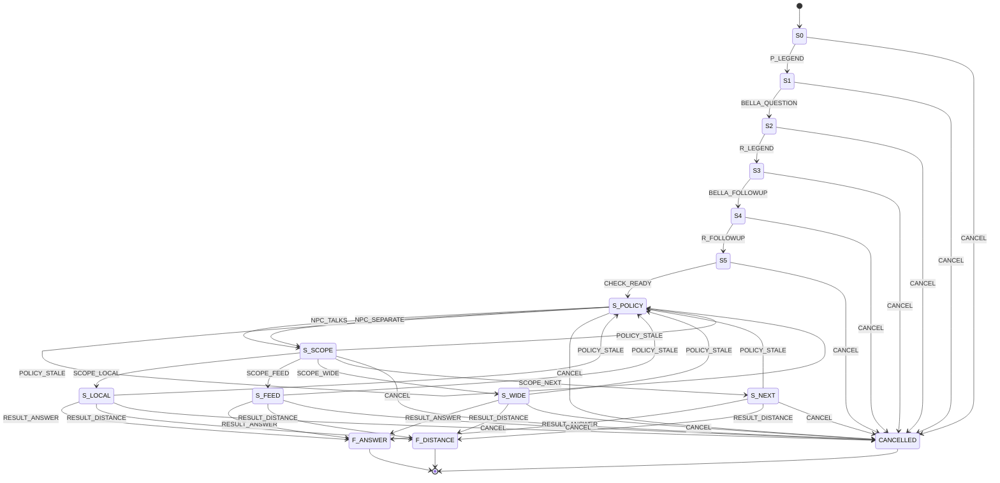

| Исход | Результат | goal_met |
| --- | --- | --- |
| F_ANSWER | Получен предусмотренный публичный ответ NPC. | true |
| F_DISTANCE | NPC ответил об отказе продолжать тему; желаемый контакт не открыт. | false |

Результат TALK от isabella: «Хочу ещё расспросить тебя о договоре. Услышанное остаётся преданием, а не доказанным обвинением.» Для SEPARATE используется нейтральный отказ от продолжения; род и голос реплики берутся из паспорта NPC. Якорь локального результата — p1. В FEED/WIDE/NEXT создаётся новый NPC-пост с отсылкой к этому обсуждению; выбранный игроком герой автором NPC-объекта не становится.

| Прокачка и память | Заполненный вариант |
| --- | --- |
| Возможность | T3 / isabella / после P_LEGEND |
| q_skill | У меня появился ещё один вопрос о договоре: почему он касается именно этой семьи? Это вопрос, не подтверждение легенды. |
| c_skill | Историю про холодных людей я услышала как семейное предание. Совпадения заставляют спрашивать дальше, но сами по себе ещё не доказывают ответ. |
| Контакт по навыку | Необязательный ROOT(q_skill,isabella,r_skill,c_skill); зафиксировать capability_used, не соглашение P с текстом NPC. |
| Следующая встреча | Изабелла сопоставляет предание с собственными наблюдениями. Яков остаётся человеком и не получает знания сиквелов. |

### Тролль не знает расписания

| Паспорт | Значение |
| --- | --- |
| story_id / version | `sorcerers_own_01` / `review-2026-10-20.6` |
| Мир / роль | `sorcerers` / `own` |
| Цель | Собери Гошу, Романа и Георгину в одном школьном обсуждении после тролля: пусть каждый расскажет свою часть истории. |
| Участники NPC | gosha, roman, georgina |
| Референс | «Гарри Поттер и философский камень» (2001): тролль в уборной, поднятая дубина и начало дружбы троицы. |
| Хронология и знания | Обсуждение после тролля. Гоша, Роман и Георгина уже прикрыли друг друга перед преподавателем; игрок не получает статус их друга задним числом. |
| Начальный контекст | Тролль побеждён, дубина поднята заклинанием, троица прикрыла друг друга перед преподавателем. В ленте спорят, кому досталась слава. |
| Начальное состояние | S0 |

| Алиас | Объект / автор / якорь | Текст NPC |
| --- | --- | --- |
| q_geo | POST / georgina | После тролля все обсуждают уборную. Я тоже была там и могу рассказать свою часть. |
| c_gosha | COMMENT / gosha / p1 | Я отвлекал тролля. Про дубину лучше спросить Романа. |
| c_roman | COMMENT / roman / p1 | Все хотят снова разобрать, кто что сделал. Я бы рассказал только про тролля и дубину; Георгина хочет обсудить ещё и нашу версию для преподавателя. |

| Привязка операции | Объект | После события |
| --- | --- | --- |
| r1 | Ответ P под q_geo | R_GEO |
| c1 | Основной ответ georgina на r1 | R_GEO |
| p1 | Пост P | P_COMMON |
| r_gosha | Ответ P под p1 | R_GOSHA |
| c_gosha_reply | Основной ответ gosha на r_gosha | R_GOSHA |
| r_roman | Ответ P под p1 | R_ROMAN |
| c_roman_reply | Основной ответ roman на r_roman | R_ROMAN |

| Из | Событие | В | Условие | Видимое последствие | Ходов P |
| --- | --- | --- | --- | --- | --- |
| S0 | GEO_POST | S1 | NPC(q_geo) | Георгина сама задаёт тему. | 0 |
| S1 | R_GEO | S2 | ROOT(q_geo,georgina,r1,c1) | Начни с разговора с Георгиной. | 1 |
| S2 | P_COMMON | S3 | PUB(p1) | Открой школьное обсуждение в своём канале. | 1 |
| S3 | TRIO_JOIN | S4 | NPC(c_gosha,c_roman) | Гоша и Роман внесли отдельные свидетельства; их тексты не приписываются игроку. | 0 |
| S4 | R_GOSHA | S5_A | CHILD(p1,gosha,c_gosha,r_gosha,c_gosha_reply) | Продолжи обе ветки под своим постом; порядок свободный. | 1 |
| S4 | R_ROMAN | S5_B | CHILD(p1,roman,c_roman,r_roman,c_roman_reply) | Продолжи обе ветки под своим постом; порядок свободный. | 1 |
| S5_A | R_ROMAN | S5 | CHILD(p1,roman,c_roman,r_roman,c_roman_reply) | Продолжи обе ветки под своим постом; порядок свободный. | 1 |
| S5_B | R_GOSHA | S5 | CHILD(p1,gosha,c_gosha,r_gosha,c_gosha_reply) | Продолжи обе ветки под своим постом; порядок свободный. | 1 |
| S5 | CHECK_READY | S_POLICY | EVAL: взять актуальные версии готовности участников и контакты этого запуска | Зафиксированы входы политики, не смысл текста. В S_POLICY решение выводится политиками relationships.md по этим входам. | 0 |
| S_POLICY | BOTH_ACCEPT | S_SCOPE | EVAL: decision_A = TALK и decision_B = TALK; pair_state допускает DIALOGUE | outcome = DIALOGUE; публикация двух согласий ещё ожидается, pair_state пока DISPUTE. | 0 |
| S_POLICY | ANY_REFUSE | S_SCOPE | EVAL: хотя бы один decision = SEPARATE (включая запрет pair_state) | outcome = SEPARATE; позиции не названы примирением. | 0 |
| S_SCOPE | SCOPE_LOCAL | S_LOCAL | EVAL: subs < stages.views.from | scope = LOCAL по сохранённому снимку; новые экономические эффекты не создаются. | 0 |
| S_LOCAL | RESULT_DIALOGUE | F_DIALOGUE | NPC: версии политик актуальны; outcome = DIALOGUE; все result_alias выбранного scope сохранены с нужными авторами и ссылками | Публичный исход подтверждён; только при DIALOGUE пара DISPUTE/RIVALRY/DIALOGUE → DIALOGUE по двум сохранённым согласиям (TRUCE сохраняется); в остальных случаях пара не меняется; goal_met = true. | 0 |
| S_LOCAL | RESULT_SEPARATE | F_SEPARATE | NPC: версии политик актуальны; outcome = SEPARATE; все result_alias выбранного scope сохранены с нужными авторами и ссылками | Публичный исход подтверждён; только при DIALOGUE пара DISPUTE/RIVALRY/DIALOGUE → DIALOGUE по двум сохранённым согласиям (TRUCE сохраняется); в остальных случаях пара не меняется; goal_met = false. | 0 |
| S_SCOPE | SCOPE_FEED | S_FEED | EVAL: stages.views.from <= subs < stages.strike.from | scope = FEED по сохранённому снимку; новые экономические эффекты не создаются. | 0 |
| S_FEED | RESULT_DIALOGUE | F_DIALOGUE | NPC: версии политик актуальны; outcome = DIALOGUE; все result_alias выбранного scope сохранены с нужными авторами и ссылками | Публичный исход подтверждён; только при DIALOGUE пара DISPUTE/RIVALRY/DIALOGUE → DIALOGUE по двум сохранённым согласиям (TRUCE сохраняется); в остальных случаях пара не меняется; goal_met = true. | 0 |
| S_FEED | RESULT_SEPARATE | F_SEPARATE | NPC: версии политик актуальны; outcome = SEPARATE; все result_alias выбранного scope сохранены с нужными авторами и ссылками | Публичный исход подтверждён; только при DIALOGUE пара DISPUTE/RIVALRY/DIALOGUE → DIALOGUE по двум сохранённым согласиям (TRUCE сохраняется); в остальных случаях пара не меняется; goal_met = false. | 0 |
| S_SCOPE | SCOPE_WIDE | S_WIDE | EVAL: stages.strike.from <= subs < stages.new_line.from | scope = WIDE по сохранённому снимку; новые экономические эффекты не создаются. | 0 |
| S_WIDE | RESULT_DIALOGUE | F_DIALOGUE | NPC: версии политик актуальны; outcome = DIALOGUE; все result_alias выбранного scope сохранены с нужными авторами и ссылками | Публичный исход подтверждён; только при DIALOGUE пара DISPUTE/RIVALRY/DIALOGUE → DIALOGUE по двум сохранённым согласиям (TRUCE сохраняется); в остальных случаях пара не меняется; goal_met = true. | 0 |
| S_WIDE | RESULT_SEPARATE | F_SEPARATE | NPC: версии политик актуальны; outcome = SEPARATE; все result_alias выбранного scope сохранены с нужными авторами и ссылками | Публичный исход подтверждён; только при DIALOGUE пара DISPUTE/RIVALRY/DIALOGUE → DIALOGUE по двум сохранённым согласиям (TRUCE сохраняется); в остальных случаях пара не меняется; goal_met = false. | 0 |
| S_SCOPE | SCOPE_NEXT | S_NEXT | EVAL: subs >= stages.new_line.from | scope = NEXT по сохранённому снимку; новые экономические эффекты не создаются. | 0 |
| S_NEXT | RESULT_DIALOGUE | F_DIALOGUE | NPC: версии политик актуальны; outcome = DIALOGUE; все result_alias выбранного scope сохранены с нужными авторами и ссылками | Публичный исход подтверждён; только при DIALOGUE пара DISPUTE/RIVALRY/DIALOGUE → DIALOGUE по двум сохранённым согласиям (TRUCE сохраняется); в остальных случаях пара не меняется; goal_met = true. | 0 |
| S_NEXT | RESULT_SEPARATE | F_SEPARATE | NPC: версии политик актуальны; outcome = SEPARATE; все result_alias выбранного scope сохранены с нужными авторами и ссылками | Публичный исход подтверждён; только при DIALOGUE пара DISPUTE/RIVALRY/DIALOGUE → DIALOGUE по двум сохранённым согласиям (TRUCE сохраняется); в остальных случаях пара не меняется; goal_met = false. | 0 |
| S_POLICY | POLICY_STALE | S_POLICY | EVAL: версия готовности/пары отличается от snapshot_id; результат ещё не опубликован | Новый снимок политики; scope подписчиков и оплаченные действия сохраняются. | 0 |
| S_SCOPE | POLICY_STALE | S_POLICY | EVAL: версия готовности/пары отличается от snapshot_id; результат ещё не опубликован | Новый снимок политики; scope подписчиков и оплаченные действия сохраняются. | 0 |
| S_LOCAL | POLICY_STALE | S_POLICY | EVAL: версия готовности/пары отличается от snapshot_id; результат ещё не опубликован | Новый снимок политики; scope подписчиков и оплаченные действия сохраняются. | 0 |
| S_FEED | POLICY_STALE | S_POLICY | EVAL: версия готовности/пары отличается от snapshot_id; результат ещё не опубликован | Новый снимок политики; scope подписчиков и оплаченные действия сохраняются. | 0 |
| S_WIDE | POLICY_STALE | S_POLICY | EVAL: версия готовности/пары отличается от snapshot_id; результат ещё не опубликован | Новый снимок политики; scope подписчиков и оплаченные действия сохраняются. | 0 |
| S_NEXT | POLICY_STALE | S_POLICY | EVAL: версия готовности/пары отличается от snapshot_id; результат ещё не опубликован | Новый снимок политики; scope подписчиков и оплаченные действия сохраняются. | 0 |

| Состояние | Следующий шаг |
| --- | --- |
| S0 | Ожидание внутреннего шага: GEO_POST |
| S1 | ROOT(q_geo,georgina,r1,c1) |
| S2 | PUB(p1) |
| S3 | Ожидание внутреннего шага: TRIO_JOIN |
| S4 | CHILD(p1,gosha,c_gosha,r_gosha,c_gosha_reply) / CHILD(p1,roman,c_roman,r_roman,c_roman_reply) |
| S5 | Ожидание внутреннего шага: CHECK_READY |
| S5_A | CHILD(p1,roman,c_roman,r_roman,c_roman_reply) |
| S5_B | CHILD(p1,gosha,c_gosha,r_gosha,c_gosha_reply) |
| S_POLICY | Ожидание внутреннего шага: BOTH_ACCEPT, ANY_REFUSE, POLICY_STALE |
| S_SCOPE | Ожидание внутреннего шага: SCOPE_LOCAL, SCOPE_FEED, SCOPE_WIDE, SCOPE_NEXT, POLICY_STALE |
| S_LOCAL | Ожидание внутреннего шага: RESULT_DIALOGUE, RESULT_SEPARATE, POLICY_STALE |
| S_FEED | Ожидание внутреннего шага: RESULT_DIALOGUE, RESULT_SEPARATE, POLICY_STALE |
| S_WIDE | Ожидание внутреннего шага: RESULT_DIALOGUE, RESULT_SEPARATE, POLICY_STALE |
| S_NEXT | Ожидание внутреннего шага: RESULT_DIALOGUE, RESULT_SEPARATE, POLICY_STALE |
| F_DIALOGUE | Оба NPC опубликовали готовность продолжить общую тему. |
| F_SEPARATE | Хотя бы один NPC сохранил отдельную позицию; совместный разговор не открыт. |
| CANCELLED | Запуск отменён |

| Состояние | GEO_POST | R_GEO | P_COMMON | TRIO_JOIN | R_GOSHA | R_ROMAN | CHECK_READY | BOTH_ACCEPT | ANY_REFUSE | SCOPE_LOCAL | RESULT_DIALOGUE | RESULT_SEPARATE | SCOPE_FEED | SCOPE_WIDE | SCOPE_NEXT | POLICY_STALE | OTHER | CANCEL |
| --- | --- | --- | --- | --- | --- | --- | --- | --- | --- | --- | --- | --- | --- | --- | --- | --- | --- | --- |
| S0 | S1 | S0 | S0 | S0 | S0 | S0 | S0 | S0 | S0 | S0 | S0 | S0 | S0 | S0 | S0 | S0 | S0 | CANCELLED |
| S1 | S1 | S2 | S1 | S1 | S1 | S1 | S1 | S1 | S1 | S1 | S1 | S1 | S1 | S1 | S1 | S1 | S1 | CANCELLED |
| S2 | S2 | S2 | S3 | S2 | S2 | S2 | S2 | S2 | S2 | S2 | S2 | S2 | S2 | S2 | S2 | S2 | S2 | CANCELLED |
| S3 | S3 | S3 | S3 | S4 | S3 | S3 | S3 | S3 | S3 | S3 | S3 | S3 | S3 | S3 | S3 | S3 | S3 | CANCELLED |
| S4 | S4 | S4 | S4 | S4 | S5_A | S5_B | S4 | S4 | S4 | S4 | S4 | S4 | S4 | S4 | S4 | S4 | S4 | CANCELLED |
| S5 | S5 | S5 | S5 | S5 | S5 | S5 | S_POLICY | S5 | S5 | S5 | S5 | S5 | S5 | S5 | S5 | S5 | S5 | CANCELLED |
| S5_A | S5_A | S5_A | S5_A | S5_A | S5_A | S5 | S5_A | S5_A | S5_A | S5_A | S5_A | S5_A | S5_A | S5_A | S5_A | S5_A | S5_A | CANCELLED |
| S5_B | S5_B | S5_B | S5_B | S5_B | S5 | S5_B | S5_B | S5_B | S5_B | S5_B | S5_B | S5_B | S5_B | S5_B | S5_B | S5_B | S5_B | CANCELLED |
| S_POLICY | S_POLICY | S_POLICY | S_POLICY | S_POLICY | S_POLICY | S_POLICY | S_POLICY | S_SCOPE | S_SCOPE | S_POLICY | S_POLICY | S_POLICY | S_POLICY | S_POLICY | S_POLICY | S_POLICY | S_POLICY | CANCELLED |
| S_SCOPE | S_SCOPE | S_SCOPE | S_SCOPE | S_SCOPE | S_SCOPE | S_SCOPE | S_SCOPE | S_SCOPE | S_SCOPE | S_LOCAL | S_SCOPE | S_SCOPE | S_FEED | S_WIDE | S_NEXT | S_POLICY | S_SCOPE | CANCELLED |
| S_LOCAL | S_LOCAL | S_LOCAL | S_LOCAL | S_LOCAL | S_LOCAL | S_LOCAL | S_LOCAL | S_LOCAL | S_LOCAL | S_LOCAL | F_DIALOGUE | F_SEPARATE | S_LOCAL | S_LOCAL | S_LOCAL | S_POLICY | S_LOCAL | CANCELLED |
| S_FEED | S_FEED | S_FEED | S_FEED | S_FEED | S_FEED | S_FEED | S_FEED | S_FEED | S_FEED | S_FEED | F_DIALOGUE | F_SEPARATE | S_FEED | S_FEED | S_FEED | S_POLICY | S_FEED | CANCELLED |
| S_WIDE | S_WIDE | S_WIDE | S_WIDE | S_WIDE | S_WIDE | S_WIDE | S_WIDE | S_WIDE | S_WIDE | S_WIDE | F_DIALOGUE | F_SEPARATE | S_WIDE | S_WIDE | S_WIDE | S_POLICY | S_WIDE | CANCELLED |
| S_NEXT | S_NEXT | S_NEXT | S_NEXT | S_NEXT | S_NEXT | S_NEXT | S_NEXT | S_NEXT | S_NEXT | S_NEXT | F_DIALOGUE | F_SEPARATE | S_NEXT | S_NEXT | S_NEXT | S_POLICY | S_NEXT | CANCELLED |
| F_DIALOGUE | F_DIALOGUE | F_DIALOGUE | F_DIALOGUE | F_DIALOGUE | F_DIALOGUE | F_DIALOGUE | F_DIALOGUE | F_DIALOGUE | F_DIALOGUE | F_DIALOGUE | F_DIALOGUE | F_DIALOGUE | F_DIALOGUE | F_DIALOGUE | F_DIALOGUE | F_DIALOGUE | F_DIALOGUE | F_DIALOGUE |
| F_SEPARATE | F_SEPARATE | F_SEPARATE | F_SEPARATE | F_SEPARATE | F_SEPARATE | F_SEPARATE | F_SEPARATE | F_SEPARATE | F_SEPARATE | F_SEPARATE | F_SEPARATE | F_SEPARATE | F_SEPARATE | F_SEPARATE | F_SEPARATE | F_SEPARATE | F_SEPARATE | F_SEPARATE |
| CANCELLED | CANCELLED | CANCELLED | CANCELLED | CANCELLED | CANCELLED | CANCELLED | CANCELLED | CANCELLED | CANCELLED | CANCELLED | CANCELLED | CANCELLED | CANCELLED | CANCELLED | CANCELLED | CANCELLED | CANCELLED | CANCELLED |

OTHER не меняет этап: не тот автор, мир, пост, родитель, версия, порядок, повтор или свободный ход. Неверный запрос отклоняется до списания; self-loop не означает платную обработку ошибки. PAUSED/WAITING_RETRY — статусы поверх состояния, не дополнительные сюжетные переходы.

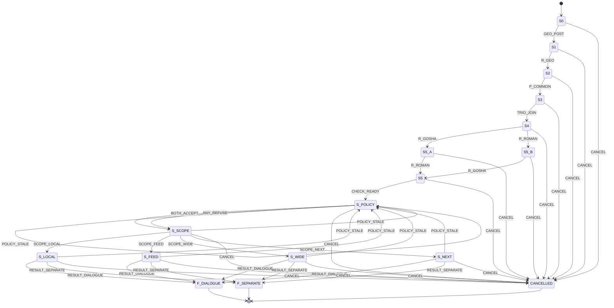

| Исход | Результат | goal_met |
| --- | --- | --- |
| F_DIALOGUE | Оба NPC опубликовали готовность продолжить общую тему. | true |
| F_SEPARATE | Хотя бы один NPC сохранил отдельную позицию; совместный разговор не открыт. | false |

Результат TALK от georgina: «Разбор открыт для всех троих. Я расскажу свою часть, а не буду персонажем чужой шутки.» Для SEPARATE используется нейтральный отказ от продолжения; род и голос реплики берутся из паспорта NPC. У пары roman ↔ georgina причина спора: Рассказ о спасении вытеснил голос Георгины. Политики OPEN/CAUTIOUS; в DIALOGUE оба публикуют собственное «готов продолжить эту тему», в SEPARATE каждый публикует свой фактический TALK/SEPARATE. Дружба, поддержка игроком стороны и перемирие не назначаются. Якорь локального результата — p1. В FEED/WIDE/NEXT создаётся новый NPC-пост с отсылкой к этому обсуждению; выбранный игроком герой автором NPC-объекта не становится.

| Прокачка и память | Заполненный вариант |
| --- | --- |
| Возможность | T6 / georgina / после P_COMMON |
| q_skill | Предлагаю отдельный общий разбор: Гоша расскажет про отвлечение тролля, Роман — про дубину, я — почему мы дали преподавателю такую версию. |
| c_skill | В общем разборе я начну с версии, которую мы дали преподавателю. Она тоже часть истории; рассказ не заканчивается дубиной. |
| Контакт по навыку | Необязательный ROOT(q_skill,georgina,r_skill,c_skill); зафиксировать capability_used, не соглашение P с текстом NPC. |
| Следующая встреча | Роман и Георгина спорят, кто первым предложил школьный разбор. Их готовность снова обсуждать вместе зависит от сохранённого результата. |

### Первый полёт за чужой вещью

| Паспорт | Значение |
| --- | --- |
| story_id / version | `sorcerers_gosha_01` / `review-2026-10-20.6` |
| Мир / роль | `sorcerers` / `gosha` |
| Цель | Выведи спор о полёте за напоминалкой в общий разговор с Романом и Георгиной: пусть оба ответят на твоём канале. |
| Участники NPC | roman, georgina |
| Референс | «Гарри Поттер и философский камень» (2001): первый урок полётов и пойманная напоминалка. |
| Хронология и знания | Игрок является Гошей. Летающий ученик и преподаватель остаются фоновыми лицами. Спортивное назначение не превращается в автоматическую награду. |
| Начальный контекст | Напоминалка уже поймана. Роман восхищён перехватом, Георгина напоминает о запрете летать; игрок не получает автоматической спортивной награды. |
| Начальное состояние | S0 |

| Алиас | Объект / автор / якорь | Текст NPC |
| --- | --- | --- |
| c_roman | COMMENT / roman / p1 | Ты поймал напоминалку в полёте! Не понимаю, как после этого можно говорить только о запрете. |
| c_geo | COMMENT / georgina / p1 | Перехват был ловким. Но запрет летать никуда не исчез. |

| Привязка операции | Объект | После события |
| --- | --- | --- |
| p1 | Пост P | P_FLIGHT |
| r_roman | Ответ P под p1 | R_ROMAN |
| c_r_reply | Основной ответ roman на r_roman | R_ROMAN |
| r_geo | Ответ P под p1 | R_GEO |
| c_g_reply | Основной ответ georgina на r_geo | R_GEO |
| p2 | Пост P | P_REOPEN |

| Из | Событие | В | Условие | Видимое последствие | Ходов P |
| --- | --- | --- | --- | --- | --- |
| S0 | P_FLIGHT | S1 | PUB(p1) | Открой обсуждение после урока полётов. | 1 |
| S1 | TWO_VOICES | S2 | NPC(c_roman,c_geo) | Появились два конкретных возражающих друг другу NPC. | 0 |
| S2 | R_ROMAN | S3_A | CHILD(p1,roman,c_roman,r_roman,c_r_reply) | Ответь каждому в его ветке. | 1 |
| S2 | R_GEO | S3_B | CHILD(p1,georgina,c_geo,r_geo,c_g_reply) | Ответь каждому в его ветке. | 1 |
| S3_A | R_GEO | S3 | CHILD(p1,georgina,c_geo,r_geo,c_g_reply) | Ответь каждому в его ветке. | 1 |
| S3_B | R_ROMAN | S3 | CHILD(p1,roman,c_roman,r_roman,c_r_reply) | Ответь каждому в его ветке. | 1 |
| S3 | P_REOPEN | S4 | PUB(p2) | После обоих разговоров верни тему в канал; это предложение формата, не доказательство примирения. | 1 |
| S4 | CHECK_READY | S_POLICY | EVAL: взять актуальные версии готовности участников и контакты этого запуска | Зафиксированы входы политики, не смысл текста. В S_POLICY решение выводится политиками relationships.md по этим входам. | 0 |
| S_POLICY | BOTH_ACCEPT | S_SCOPE | EVAL: decision_A = TALK и decision_B = TALK; pair_state допускает DIALOGUE | outcome = DIALOGUE; публикация двух согласий ещё ожидается, pair_state пока DISPUTE. | 0 |
| S_POLICY | ANY_REFUSE | S_SCOPE | EVAL: хотя бы один decision = SEPARATE (включая запрет pair_state) | outcome = SEPARATE; позиции не названы примирением. | 0 |
| S_SCOPE | SCOPE_LOCAL | S_LOCAL | EVAL: subs < stages.views.from | scope = LOCAL по сохранённому снимку; новые экономические эффекты не создаются. | 0 |
| S_LOCAL | RESULT_DIALOGUE | F_DIALOGUE | NPC: версии политик актуальны; outcome = DIALOGUE; все result_alias выбранного scope сохранены с нужными авторами и ссылками | Публичный исход подтверждён; только при DIALOGUE пара DISPUTE/RIVALRY/DIALOGUE → DIALOGUE по двум сохранённым согласиям (TRUCE сохраняется); в остальных случаях пара не меняется; goal_met = true. | 0 |
| S_LOCAL | RESULT_SEPARATE | F_SEPARATE | NPC: версии политик актуальны; outcome = SEPARATE; все result_alias выбранного scope сохранены с нужными авторами и ссылками | Публичный исход подтверждён; только при DIALOGUE пара DISPUTE/RIVALRY/DIALOGUE → DIALOGUE по двум сохранённым согласиям (TRUCE сохраняется); в остальных случаях пара не меняется; goal_met = false. | 0 |
| S_SCOPE | SCOPE_FEED | S_FEED | EVAL: stages.views.from <= subs < stages.strike.from | scope = FEED по сохранённому снимку; новые экономические эффекты не создаются. | 0 |
| S_FEED | RESULT_DIALOGUE | F_DIALOGUE | NPC: версии политик актуальны; outcome = DIALOGUE; все result_alias выбранного scope сохранены с нужными авторами и ссылками | Публичный исход подтверждён; только при DIALOGUE пара DISPUTE/RIVALRY/DIALOGUE → DIALOGUE по двум сохранённым согласиям (TRUCE сохраняется); в остальных случаях пара не меняется; goal_met = true. | 0 |
| S_FEED | RESULT_SEPARATE | F_SEPARATE | NPC: версии политик актуальны; outcome = SEPARATE; все result_alias выбранного scope сохранены с нужными авторами и ссылками | Публичный исход подтверждён; только при DIALOGUE пара DISPUTE/RIVALRY/DIALOGUE → DIALOGUE по двум сохранённым согласиям (TRUCE сохраняется); в остальных случаях пара не меняется; goal_met = false. | 0 |
| S_SCOPE | SCOPE_WIDE | S_WIDE | EVAL: stages.strike.from <= subs < stages.new_line.from | scope = WIDE по сохранённому снимку; новые экономические эффекты не создаются. | 0 |
| S_WIDE | RESULT_DIALOGUE | F_DIALOGUE | NPC: версии политик актуальны; outcome = DIALOGUE; все result_alias выбранного scope сохранены с нужными авторами и ссылками | Публичный исход подтверждён; только при DIALOGUE пара DISPUTE/RIVALRY/DIALOGUE → DIALOGUE по двум сохранённым согласиям (TRUCE сохраняется); в остальных случаях пара не меняется; goal_met = true. | 0 |
| S_WIDE | RESULT_SEPARATE | F_SEPARATE | NPC: версии политик актуальны; outcome = SEPARATE; все result_alias выбранного scope сохранены с нужными авторами и ссылками | Публичный исход подтверждён; только при DIALOGUE пара DISPUTE/RIVALRY/DIALOGUE → DIALOGUE по двум сохранённым согласиям (TRUCE сохраняется); в остальных случаях пара не меняется; goal_met = false. | 0 |
| S_SCOPE | SCOPE_NEXT | S_NEXT | EVAL: subs >= stages.new_line.from | scope = NEXT по сохранённому снимку; новые экономические эффекты не создаются. | 0 |
| S_NEXT | RESULT_DIALOGUE | F_DIALOGUE | NPC: версии политик актуальны; outcome = DIALOGUE; все result_alias выбранного scope сохранены с нужными авторами и ссылками | Публичный исход подтверждён; только при DIALOGUE пара DISPUTE/RIVALRY/DIALOGUE → DIALOGUE по двум сохранённым согласиям (TRUCE сохраняется); в остальных случаях пара не меняется; goal_met = true. | 0 |
| S_NEXT | RESULT_SEPARATE | F_SEPARATE | NPC: версии политик актуальны; outcome = SEPARATE; все result_alias выбранного scope сохранены с нужными авторами и ссылками | Публичный исход подтверждён; только при DIALOGUE пара DISPUTE/RIVALRY/DIALOGUE → DIALOGUE по двум сохранённым согласиям (TRUCE сохраняется); в остальных случаях пара не меняется; goal_met = false. | 0 |
| S_POLICY | POLICY_STALE | S_POLICY | EVAL: версия готовности/пары отличается от snapshot_id; результат ещё не опубликован | Новый снимок политики; scope подписчиков и оплаченные действия сохраняются. | 0 |
| S_SCOPE | POLICY_STALE | S_POLICY | EVAL: версия готовности/пары отличается от snapshot_id; результат ещё не опубликован | Новый снимок политики; scope подписчиков и оплаченные действия сохраняются. | 0 |
| S_LOCAL | POLICY_STALE | S_POLICY | EVAL: версия готовности/пары отличается от snapshot_id; результат ещё не опубликован | Новый снимок политики; scope подписчиков и оплаченные действия сохраняются. | 0 |
| S_FEED | POLICY_STALE | S_POLICY | EVAL: версия готовности/пары отличается от snapshot_id; результат ещё не опубликован | Новый снимок политики; scope подписчиков и оплаченные действия сохраняются. | 0 |
| S_WIDE | POLICY_STALE | S_POLICY | EVAL: версия готовности/пары отличается от snapshot_id; результат ещё не опубликован | Новый снимок политики; scope подписчиков и оплаченные действия сохраняются. | 0 |
| S_NEXT | POLICY_STALE | S_POLICY | EVAL: версия готовности/пары отличается от snapshot_id; результат ещё не опубликован | Новый снимок политики; scope подписчиков и оплаченные действия сохраняются. | 0 |

| Состояние | Следующий шаг |
| --- | --- |
| S0 | PUB(p1) |
| S1 | Ожидание внутреннего шага: TWO_VOICES |
| S2 | CHILD(p1,roman,c_roman,r_roman,c_r_reply) / CHILD(p1,georgina,c_geo,r_geo,c_g_reply) |
| S3 | PUB(p2) |
| S3_A | CHILD(p1,georgina,c_geo,r_geo,c_g_reply) |
| S3_B | CHILD(p1,roman,c_roman,r_roman,c_r_reply) |
| S4 | Ожидание внутреннего шага: CHECK_READY |
| S_POLICY | Ожидание внутреннего шага: BOTH_ACCEPT, ANY_REFUSE, POLICY_STALE |
| S_SCOPE | Ожидание внутреннего шага: SCOPE_LOCAL, SCOPE_FEED, SCOPE_WIDE, SCOPE_NEXT, POLICY_STALE |
| S_LOCAL | Ожидание внутреннего шага: RESULT_DIALOGUE, RESULT_SEPARATE, POLICY_STALE |
| S_FEED | Ожидание внутреннего шага: RESULT_DIALOGUE, RESULT_SEPARATE, POLICY_STALE |
| S_WIDE | Ожидание внутреннего шага: RESULT_DIALOGUE, RESULT_SEPARATE, POLICY_STALE |
| S_NEXT | Ожидание внутреннего шага: RESULT_DIALOGUE, RESULT_SEPARATE, POLICY_STALE |
| F_DIALOGUE | Оба NPC опубликовали готовность продолжить общую тему. |
| F_SEPARATE | Хотя бы один NPC сохранил отдельную позицию; совместный разговор не открыт. |
| CANCELLED | Запуск отменён |

| Состояние | P_FLIGHT | TWO_VOICES | R_ROMAN | R_GEO | P_REOPEN | CHECK_READY | BOTH_ACCEPT | ANY_REFUSE | SCOPE_LOCAL | RESULT_DIALOGUE | RESULT_SEPARATE | SCOPE_FEED | SCOPE_WIDE | SCOPE_NEXT | POLICY_STALE | OTHER | CANCEL |
| --- | --- | --- | --- | --- | --- | --- | --- | --- | --- | --- | --- | --- | --- | --- | --- | --- | --- |
| S0 | S1 | S0 | S0 | S0 | S0 | S0 | S0 | S0 | S0 | S0 | S0 | S0 | S0 | S0 | S0 | S0 | CANCELLED |
| S1 | S1 | S2 | S1 | S1 | S1 | S1 | S1 | S1 | S1 | S1 | S1 | S1 | S1 | S1 | S1 | S1 | CANCELLED |
| S2 | S2 | S2 | S3_A | S3_B | S2 | S2 | S2 | S2 | S2 | S2 | S2 | S2 | S2 | S2 | S2 | S2 | CANCELLED |
| S3 | S3 | S3 | S3 | S3 | S4 | S3 | S3 | S3 | S3 | S3 | S3 | S3 | S3 | S3 | S3 | S3 | CANCELLED |
| S3_A | S3_A | S3_A | S3_A | S3 | S3_A | S3_A | S3_A | S3_A | S3_A | S3_A | S3_A | S3_A | S3_A | S3_A | S3_A | S3_A | CANCELLED |
| S3_B | S3_B | S3_B | S3 | S3_B | S3_B | S3_B | S3_B | S3_B | S3_B | S3_B | S3_B | S3_B | S3_B | S3_B | S3_B | S3_B | CANCELLED |
| S4 | S4 | S4 | S4 | S4 | S4 | S_POLICY | S4 | S4 | S4 | S4 | S4 | S4 | S4 | S4 | S4 | S4 | CANCELLED |
| S_POLICY | S_POLICY | S_POLICY | S_POLICY | S_POLICY | S_POLICY | S_POLICY | S_SCOPE | S_SCOPE | S_POLICY | S_POLICY | S_POLICY | S_POLICY | S_POLICY | S_POLICY | S_POLICY | S_POLICY | CANCELLED |
| S_SCOPE | S_SCOPE | S_SCOPE | S_SCOPE | S_SCOPE | S_SCOPE | S_SCOPE | S_SCOPE | S_SCOPE | S_LOCAL | S_SCOPE | S_SCOPE | S_FEED | S_WIDE | S_NEXT | S_POLICY | S_SCOPE | CANCELLED |
| S_LOCAL | S_LOCAL | S_LOCAL | S_LOCAL | S_LOCAL | S_LOCAL | S_LOCAL | S_LOCAL | S_LOCAL | S_LOCAL | F_DIALOGUE | F_SEPARATE | S_LOCAL | S_LOCAL | S_LOCAL | S_POLICY | S_LOCAL | CANCELLED |
| S_FEED | S_FEED | S_FEED | S_FEED | S_FEED | S_FEED | S_FEED | S_FEED | S_FEED | S_FEED | F_DIALOGUE | F_SEPARATE | S_FEED | S_FEED | S_FEED | S_POLICY | S_FEED | CANCELLED |
| S_WIDE | S_WIDE | S_WIDE | S_WIDE | S_WIDE | S_WIDE | S_WIDE | S_WIDE | S_WIDE | S_WIDE | F_DIALOGUE | F_SEPARATE | S_WIDE | S_WIDE | S_WIDE | S_POLICY | S_WIDE | CANCELLED |
| S_NEXT | S_NEXT | S_NEXT | S_NEXT | S_NEXT | S_NEXT | S_NEXT | S_NEXT | S_NEXT | S_NEXT | F_DIALOGUE | F_SEPARATE | S_NEXT | S_NEXT | S_NEXT | S_POLICY | S_NEXT | CANCELLED |
| F_DIALOGUE | F_DIALOGUE | F_DIALOGUE | F_DIALOGUE | F_DIALOGUE | F_DIALOGUE | F_DIALOGUE | F_DIALOGUE | F_DIALOGUE | F_DIALOGUE | F_DIALOGUE | F_DIALOGUE | F_DIALOGUE | F_DIALOGUE | F_DIALOGUE | F_DIALOGUE | F_DIALOGUE | F_DIALOGUE |
| F_SEPARATE | F_SEPARATE | F_SEPARATE | F_SEPARATE | F_SEPARATE | F_SEPARATE | F_SEPARATE | F_SEPARATE | F_SEPARATE | F_SEPARATE | F_SEPARATE | F_SEPARATE | F_SEPARATE | F_SEPARATE | F_SEPARATE | F_SEPARATE | F_SEPARATE | F_SEPARATE |
| CANCELLED | CANCELLED | CANCELLED | CANCELLED | CANCELLED | CANCELLED | CANCELLED | CANCELLED | CANCELLED | CANCELLED | CANCELLED | CANCELLED | CANCELLED | CANCELLED | CANCELLED | CANCELLED | CANCELLED | CANCELLED |

OTHER не меняет этап: не тот автор, мир, пост, родитель, версия, порядок, повтор или свободный ход. Неверный запрос отклоняется до списания; self-loop не означает платную обработку ошибки. PAUSED/WAITING_RETRY — статусы поверх состояния, не дополнительные сюжетные переходы.

| Исход | Результат | goal_met |
| --- | --- | --- |
| F_DIALOGUE | Оба NPC опубликовали готовность продолжить общую тему. | true |
| F_SEPARATE | Хотя бы один NPC сохранил отдельную позицию; совместный разговор не открыт. | false |

Результат TALK от roman: «Перехват признаю, риск тоже обсуждать буду. Можно спорить об этом здесь, не делая несогласие личной враждой.» Для SEPARATE используется нейтральный отказ от продолжения; род и голос реплики берутся из паспорта NPC. У пары roman ↔ georgina причина спора: Талант и нарушение запрета после первого полёта. Политики OPEN/OPEN; в DIALOGUE оба публикуют собственное «готов продолжить эту тему», в SEPARATE каждый публикует свой фактический TALK/SEPARATE. Дружба, поддержка игроком стороны и перемирие не назначаются. Якорь локального результата — p2. В FEED/WIDE/NEXT создаётся новый NPC-пост с отсылкой к этому обсуждению; выбранный игроком герой автором NPC-объекта не становится.

| Прокачка и память | Заполненный вариант |
| --- | --- |
| Возможность | H6 / roman / после P_FLIGHT |
| q_skill | Школьная пародия дня: метла летает быстрее, чем мы успеваем дочитать правила. Перехват и запрет всё равно придётся обсудить. |
| c_skill | Школьный свод полётов: сначала нельзя подниматься, потом все смотрят на пойманную напоминалку. Я смеюсь над разницей правил и оваций, а не говорю за Георгину. |
| Контакт по навыку | Необязательный ROOT(q_skill,roman,r_skill,c_skill); зафиксировать capability_used, не соглашение P с текстом NPC. |
| Следующая встреча | Школьная известность после полёта приводит к отдельному обсуждению спортивного приглашения; публикация не выдаёт назначение игроку. |

### Перо должно взлететь

| Паспорт | Значение |
| --- | --- |
| story_id / version | `sorcerers_georgina_01` / `review-2026-10-20.6` |
| Мир / роль | `sorcerers` / `georgina` |
| Цель | Добейся, чтобы Роман вернулся к разговору о левитации и показал собственную попытку вместо очередной ссоры о поправке. |
| Участники NPC | roman |
| Референс | «Гарри Поттер и философский камень» (2001): урок левитации, поправка Романа и первое поднятое перо. |
| Хронология и знания | Игрок является Георгиной. Это урок до ссоры и спасения от тролля; отношения с Романом ещё напряжённые. |
| Начальный контекст | Перо уже поднялось на уроке, Роман раздражён публичной поправкой. Его следующая публикация о попытке — действие NPC в ленте, не физический результат комментария. |
| Начальное состояние | S0 |

| Алиас | Объект / автор / якорь | Текст NPC |
| --- | --- | --- |
| c0 | COMMENT / roman / p1 | Поправка верная, но выступать перед классом в роли того, кто ничего не умеет, не хочется. |
| q_attempt | POST / roman | Снова пробую движение из урока с пером. Расскажу свою попытку здесь, не как чужое доказательство моей глупости. |

| Привязка операции | Объект | После события |
| --- | --- | --- |
| p1 | Пост P | P_FEATHER |
| r1 | Ответ P под p1 | R_ROMAN |
| c1 | Основной ответ roman на r1 | R_ROMAN |
| r2 | Ответ P под q_attempt | R_ATTEMPT |
| c2 | Основной ответ roman на r2 | R_ATTEMPT |

| Из | Событие | В | Условие | Видимое последствие | Ходов P |
| --- | --- | --- | --- | --- | --- |
| S0 | P_FEATHER | S1 | PUB(p1) | Открой тему о прошедшем уроке левитации. | 1 |
| S1 | ROMAN_OBJECTION | S2 | NPC(c0) | Роман сам обозначил своё возражение. | 0 |
| S2 | R_ROMAN | S3 | CHILD(p1,roman,c0,r1,c1) | Поговори с Романом в этой ветке. | 1 |
| S3 | ROMAN_ATTEMPT | S4 | NPC(q_attempt) | Роман публикует собственный отчёт; сервер не симулирует палочку. | 0 |
| S4 | R_ATTEMPT | S5 | ROOT(q_attempt,roman,r2,c2) | Продолжи разговор под его новым постом. | 1 |
| S5 | CHECK_READY | S_POLICY | EVAL: взять актуальные версии готовности участников и контакты этого запуска | Зафиксированы входы политики, не смысл текста. В S_POLICY решение выводится политиками relationships.md по этим входам. | 0 |
| S_POLICY | NPC_TALKS | S_SCOPE | EVAL: decision = TALK | outcome = ANSWER; предусмотренный ответ готовится. | 0 |
| S_POLICY | NPC_SEPARATE | S_SCOPE | EVAL: decision = SEPARATE | outcome = DISTANCE; публикуется отказ от продолжения, не обрыв без объяснения. | 0 |
| S_SCOPE | SCOPE_LOCAL | S_LOCAL | EVAL: subs < stages.views.from | scope = LOCAL по сохранённому снимку; новые экономические эффекты не создаются. | 0 |
| S_LOCAL | RESULT_ANSWER | F_ANSWER | NPC: версии политик актуальны; outcome = ANSWER; все result_alias выбранного scope сохранены с нужными авторами и ссылками | Публичный исход подтверждён; только при DIALOGUE пара DISPUTE/RIVALRY/DIALOGUE → DIALOGUE по двум сохранённым согласиям (TRUCE сохраняется); в остальных случаях пара не меняется; goal_met = true. | 0 |
| S_LOCAL | RESULT_DISTANCE | F_DISTANCE | NPC: версии политик актуальны; outcome = DISTANCE; все result_alias выбранного scope сохранены с нужными авторами и ссылками | Публичный исход подтверждён; только при DIALOGUE пара DISPUTE/RIVALRY/DIALOGUE → DIALOGUE по двум сохранённым согласиям (TRUCE сохраняется); в остальных случаях пара не меняется; goal_met = false. | 0 |
| S_SCOPE | SCOPE_FEED | S_FEED | EVAL: stages.views.from <= subs < stages.strike.from | scope = FEED по сохранённому снимку; новые экономические эффекты не создаются. | 0 |
| S_FEED | RESULT_ANSWER | F_ANSWER | NPC: версии политик актуальны; outcome = ANSWER; все result_alias выбранного scope сохранены с нужными авторами и ссылками | Публичный исход подтверждён; только при DIALOGUE пара DISPUTE/RIVALRY/DIALOGUE → DIALOGUE по двум сохранённым согласиям (TRUCE сохраняется); в остальных случаях пара не меняется; goal_met = true. | 0 |
| S_FEED | RESULT_DISTANCE | F_DISTANCE | NPC: версии политик актуальны; outcome = DISTANCE; все result_alias выбранного scope сохранены с нужными авторами и ссылками | Публичный исход подтверждён; только при DIALOGUE пара DISPUTE/RIVALRY/DIALOGUE → DIALOGUE по двум сохранённым согласиям (TRUCE сохраняется); в остальных случаях пара не меняется; goal_met = false. | 0 |
| S_SCOPE | SCOPE_WIDE | S_WIDE | EVAL: stages.strike.from <= subs < stages.new_line.from | scope = WIDE по сохранённому снимку; новые экономические эффекты не создаются. | 0 |
| S_WIDE | RESULT_ANSWER | F_ANSWER | NPC: версии политик актуальны; outcome = ANSWER; все result_alias выбранного scope сохранены с нужными авторами и ссылками | Публичный исход подтверждён; только при DIALOGUE пара DISPUTE/RIVALRY/DIALOGUE → DIALOGUE по двум сохранённым согласиям (TRUCE сохраняется); в остальных случаях пара не меняется; goal_met = true. | 0 |
| S_WIDE | RESULT_DISTANCE | F_DISTANCE | NPC: версии политик актуальны; outcome = DISTANCE; все result_alias выбранного scope сохранены с нужными авторами и ссылками | Публичный исход подтверждён; только при DIALOGUE пара DISPUTE/RIVALRY/DIALOGUE → DIALOGUE по двум сохранённым согласиям (TRUCE сохраняется); в остальных случаях пара не меняется; goal_met = false. | 0 |
| S_SCOPE | SCOPE_NEXT | S_NEXT | EVAL: subs >= stages.new_line.from | scope = NEXT по сохранённому снимку; новые экономические эффекты не создаются. | 0 |
| S_NEXT | RESULT_ANSWER | F_ANSWER | NPC: версии политик актуальны; outcome = ANSWER; все result_alias выбранного scope сохранены с нужными авторами и ссылками | Публичный исход подтверждён; только при DIALOGUE пара DISPUTE/RIVALRY/DIALOGUE → DIALOGUE по двум сохранённым согласиям (TRUCE сохраняется); в остальных случаях пара не меняется; goal_met = true. | 0 |
| S_NEXT | RESULT_DISTANCE | F_DISTANCE | NPC: версии политик актуальны; outcome = DISTANCE; все result_alias выбранного scope сохранены с нужными авторами и ссылками | Публичный исход подтверждён; только при DIALOGUE пара DISPUTE/RIVALRY/DIALOGUE → DIALOGUE по двум сохранённым согласиям (TRUCE сохраняется); в остальных случаях пара не меняется; goal_met = false. | 0 |
| S_POLICY | POLICY_STALE | S_POLICY | EVAL: версия готовности/пары отличается от snapshot_id; результат ещё не опубликован | Новый снимок политики; scope подписчиков и оплаченные действия сохраняются. | 0 |
| S_SCOPE | POLICY_STALE | S_POLICY | EVAL: версия готовности/пары отличается от snapshot_id; результат ещё не опубликован | Новый снимок политики; scope подписчиков и оплаченные действия сохраняются. | 0 |
| S_LOCAL | POLICY_STALE | S_POLICY | EVAL: версия готовности/пары отличается от snapshot_id; результат ещё не опубликован | Новый снимок политики; scope подписчиков и оплаченные действия сохраняются. | 0 |
| S_FEED | POLICY_STALE | S_POLICY | EVAL: версия готовности/пары отличается от snapshot_id; результат ещё не опубликован | Новый снимок политики; scope подписчиков и оплаченные действия сохраняются. | 0 |
| S_WIDE | POLICY_STALE | S_POLICY | EVAL: версия готовности/пары отличается от snapshot_id; результат ещё не опубликован | Новый снимок политики; scope подписчиков и оплаченные действия сохраняются. | 0 |
| S_NEXT | POLICY_STALE | S_POLICY | EVAL: версия готовности/пары отличается от snapshot_id; результат ещё не опубликован | Новый снимок политики; scope подписчиков и оплаченные действия сохраняются. | 0 |

| Состояние | Следующий шаг |
| --- | --- |
| S0 | PUB(p1) |
| S1 | Ожидание внутреннего шага: ROMAN_OBJECTION |
| S2 | CHILD(p1,roman,c0,r1,c1) |
| S3 | Ожидание внутреннего шага: ROMAN_ATTEMPT |
| S4 | ROOT(q_attempt,roman,r2,c2) |
| S5 | Ожидание внутреннего шага: CHECK_READY |
| S_POLICY | Ожидание внутреннего шага: NPC_TALKS, NPC_SEPARATE, POLICY_STALE |
| S_SCOPE | Ожидание внутреннего шага: SCOPE_LOCAL, SCOPE_FEED, SCOPE_WIDE, SCOPE_NEXT, POLICY_STALE |
| S_LOCAL | Ожидание внутреннего шага: RESULT_ANSWER, RESULT_DISTANCE, POLICY_STALE |
| S_FEED | Ожидание внутреннего шага: RESULT_ANSWER, RESULT_DISTANCE, POLICY_STALE |
| S_WIDE | Ожидание внутреннего шага: RESULT_ANSWER, RESULT_DISTANCE, POLICY_STALE |
| S_NEXT | Ожидание внутреннего шага: RESULT_ANSWER, RESULT_DISTANCE, POLICY_STALE |
| F_ANSWER | Получен предусмотренный публичный ответ NPC. |
| F_DISTANCE | NPC ответил об отказе продолжать тему; желаемый контакт не открыт. |
| CANCELLED | Запуск отменён |

| Состояние | P_FEATHER | ROMAN_OBJECTION | R_ROMAN | ROMAN_ATTEMPT | R_ATTEMPT | CHECK_READY | NPC_TALKS | NPC_SEPARATE | SCOPE_LOCAL | RESULT_ANSWER | RESULT_DISTANCE | SCOPE_FEED | SCOPE_WIDE | SCOPE_NEXT | POLICY_STALE | OTHER | CANCEL |
| --- | --- | --- | --- | --- | --- | --- | --- | --- | --- | --- | --- | --- | --- | --- | --- | --- | --- |
| S0 | S1 | S0 | S0 | S0 | S0 | S0 | S0 | S0 | S0 | S0 | S0 | S0 | S0 | S0 | S0 | S0 | CANCELLED |
| S1 | S1 | S2 | S1 | S1 | S1 | S1 | S1 | S1 | S1 | S1 | S1 | S1 | S1 | S1 | S1 | S1 | CANCELLED |
| S2 | S2 | S2 | S3 | S2 | S2 | S2 | S2 | S2 | S2 | S2 | S2 | S2 | S2 | S2 | S2 | S2 | CANCELLED |
| S3 | S3 | S3 | S3 | S4 | S3 | S3 | S3 | S3 | S3 | S3 | S3 | S3 | S3 | S3 | S3 | S3 | CANCELLED |
| S4 | S4 | S4 | S4 | S4 | S5 | S4 | S4 | S4 | S4 | S4 | S4 | S4 | S4 | S4 | S4 | S4 | CANCELLED |
| S5 | S5 | S5 | S5 | S5 | S5 | S_POLICY | S5 | S5 | S5 | S5 | S5 | S5 | S5 | S5 | S5 | S5 | CANCELLED |
| S_POLICY | S_POLICY | S_POLICY | S_POLICY | S_POLICY | S_POLICY | S_POLICY | S_SCOPE | S_SCOPE | S_POLICY | S_POLICY | S_POLICY | S_POLICY | S_POLICY | S_POLICY | S_POLICY | S_POLICY | CANCELLED |
| S_SCOPE | S_SCOPE | S_SCOPE | S_SCOPE | S_SCOPE | S_SCOPE | S_SCOPE | S_SCOPE | S_SCOPE | S_LOCAL | S_SCOPE | S_SCOPE | S_FEED | S_WIDE | S_NEXT | S_POLICY | S_SCOPE | CANCELLED |
| S_LOCAL | S_LOCAL | S_LOCAL | S_LOCAL | S_LOCAL | S_LOCAL | S_LOCAL | S_LOCAL | S_LOCAL | S_LOCAL | F_ANSWER | F_DISTANCE | S_LOCAL | S_LOCAL | S_LOCAL | S_POLICY | S_LOCAL | CANCELLED |
| S_FEED | S_FEED | S_FEED | S_FEED | S_FEED | S_FEED | S_FEED | S_FEED | S_FEED | S_FEED | F_ANSWER | F_DISTANCE | S_FEED | S_FEED | S_FEED | S_POLICY | S_FEED | CANCELLED |
| S_WIDE | S_WIDE | S_WIDE | S_WIDE | S_WIDE | S_WIDE | S_WIDE | S_WIDE | S_WIDE | S_WIDE | F_ANSWER | F_DISTANCE | S_WIDE | S_WIDE | S_WIDE | S_POLICY | S_WIDE | CANCELLED |
| S_NEXT | S_NEXT | S_NEXT | S_NEXT | S_NEXT | S_NEXT | S_NEXT | S_NEXT | S_NEXT | S_NEXT | F_ANSWER | F_DISTANCE | S_NEXT | S_NEXT | S_NEXT | S_POLICY | S_NEXT | CANCELLED |
| F_ANSWER | F_ANSWER | F_ANSWER | F_ANSWER | F_ANSWER | F_ANSWER | F_ANSWER | F_ANSWER | F_ANSWER | F_ANSWER | F_ANSWER | F_ANSWER | F_ANSWER | F_ANSWER | F_ANSWER | F_ANSWER | F_ANSWER | F_ANSWER |
| F_DISTANCE | F_DISTANCE | F_DISTANCE | F_DISTANCE | F_DISTANCE | F_DISTANCE | F_DISTANCE | F_DISTANCE | F_DISTANCE | F_DISTANCE | F_DISTANCE | F_DISTANCE | F_DISTANCE | F_DISTANCE | F_DISTANCE | F_DISTANCE | F_DISTANCE | F_DISTANCE |
| CANCELLED | CANCELLED | CANCELLED | CANCELLED | CANCELLED | CANCELLED | CANCELLED | CANCELLED | CANCELLED | CANCELLED | CANCELLED | CANCELLED | CANCELLED | CANCELLED | CANCELLED | CANCELLED | CANCELLED | CANCELLED |

OTHER не меняет этап: не тот автор, мир, пост, родитель, версия, порядок, повтор или свободный ход. Неверный запрос отклоняется до списания; self-loop не означает платную обработку ошибки. PAUSED/WAITING_RETRY — статусы поверх состояния, не дополнительные сюжетные переходы.

| Исход | Результат | goal_met |
| --- | --- | --- |
| F_ANSWER | Получен предусмотренный публичный ответ NPC. | true |
| F_DISTANCE | NPC ответил об отказе продолжать тему; желаемый контакт не открыт. | false |

Результат TALK от roman: «Вернусь к обсуждению своей попытки. Поправка к движению пригодилась; результат расскажу от своего имени.» Для SEPARATE используется нейтральный отказ от продолжения; род и голос реплики берутся из паспорта NPC. Якорь локального результата — p1. В FEED/WIDE/NEXT создаётся новый NPC-пост с отсылкой к этому обсуждению; выбранный игроком герой автором NPC-объекта не становится.

| Прокачка и память | Заполненный вариант |
| --- | --- |
| Возможность | H3 / roman / после P_FEATHER |
| q_skill | Если перо опять не взлетит, хотя бы школьная шутка получится. Про движение всё-таки хочу разобраться. |
| c_skill | Перо хоть и маленькое, а спор вышел на всю аудиторию. Мою попытку я опишу сам; чужую поправку при этом вычёркивать не собираюсь. |
| Контакт по навыку | Необязательный ROOT(q_skill,roman,r_skill,c_skill); зафиксировать capability_used, не соглашение P с текстом NPC. |
| Следующая встреча | Роман сам приглашает к разбору следующего урока либо сохраняет дистанцию. Нельзя объявить его другом по одному ответу. |

### Конь, которого придётся отдать

| Паспорт | Значение |
| --- | --- |
| story_id / version | `sorcerers_roman_01` / `review-2026-10-20.6` |
| Мир / роль | `sorcerers` / `roman` |
| Цель | Выйди из тени Гоши после шахмат: добейся, чтобы в ленте прозвучали твоя комбинация и вклад всей команды. |
| Участники NPC | gosha, georgina |
| Референс | «Гарри Поттер и философский камень» (2001): гигантские шахматы и жертва коня ради прохода друзей. |
| Хронология и знания | Обсуждение после завершения шахмат и возвращения друзей. Проход Гоши и помощь Георгины — прошлые факты; игроку не приписываются прежние игровые статусы пары. |
| Начальный контекст | Партия завершена, конь принял удар, друзья вернулись. Роман обсуждает признание своего вклада, не двигает фигуры новым постом. |
| Начальное состояние | S0 |

| Алиас | Объект / автор / якорь | Текст NPC |
| --- | --- | --- |
| c0 | COMMENT / gosha / p1 | Без твоего хода я бы не прошёл. Георгина осталась помогать тебе после удара. |
| q_geo | POST / georgina | В шахматной партии у каждого был свой ход. После удара коня я осталась с Романом; Гоша прошёл дальше. |

| Привязка операции | Объект | После события |
| --- | --- | --- |
| p1 | Пост P | P_CHESS |
| r1 | Ответ P под p1 | R_GOSHA |
| c1 | Основной ответ gosha на r1 | R_GOSHA |
| r2 | Ответ P под q_geo | R_GEO |
| c2 | Основной ответ georgina на r2 | R_GEO |

| Из | Событие | В | Условие | Видимое последствие | Ходов P |
| --- | --- | --- | --- | --- | --- |
| S0 | P_CHESS | S1 | PUB(p1) | Открой тему о сыгранной партии. | 1 |
| S1 | GOSHA_COMMENT | S2 | NPC(c0) | Гоша сам признаёт факты прошедшей партии. | 0 |
| S2 | R_GOSHA | S3 | CHILD(p1,gosha,c0,r1,c1) | Продолжи разговор с Гошей. | 1 |
| S3 | GEO_WITNESS | S4 | NPC(q_geo) | Есть независимая публикация второго участника. | 0 |
| S4 | R_GEO | S5 | ROOT(q_geo,georgina,r2,c2) | Поговори с Георгиной под её свидетельством. | 1 |
| S5 | CHECK_READY | S_POLICY | EVAL: взять актуальные версии готовности участников и контакты этого запуска | Зафиксированы входы политики, не смысл текста. В S_POLICY решение выводится политиками relationships.md по этим входам. | 0 |
| S_POLICY | NPC_TALKS | S_SCOPE | EVAL: decision = TALK | outcome = ANSWER; предусмотренный ответ готовится. | 0 |
| S_POLICY | NPC_SEPARATE | S_SCOPE | EVAL: decision = SEPARATE | outcome = DISTANCE; публикуется отказ от продолжения, не обрыв без объяснения. | 0 |
| S_SCOPE | SCOPE_LOCAL | S_LOCAL | EVAL: subs < stages.views.from | scope = LOCAL по сохранённому снимку; новые экономические эффекты не создаются. | 0 |
| S_LOCAL | RESULT_ANSWER | F_ANSWER | NPC: версии политик актуальны; outcome = ANSWER; все result_alias выбранного scope сохранены с нужными авторами и ссылками | Публичный исход подтверждён; только при DIALOGUE пара DISPUTE/RIVALRY/DIALOGUE → DIALOGUE по двум сохранённым согласиям (TRUCE сохраняется); в остальных случаях пара не меняется; goal_met = true. | 0 |
| S_LOCAL | RESULT_DISTANCE | F_DISTANCE | NPC: версии политик актуальны; outcome = DISTANCE; все result_alias выбранного scope сохранены с нужными авторами и ссылками | Публичный исход подтверждён; только при DIALOGUE пара DISPUTE/RIVALRY/DIALOGUE → DIALOGUE по двум сохранённым согласиям (TRUCE сохраняется); в остальных случаях пара не меняется; goal_met = false. | 0 |
| S_SCOPE | SCOPE_FEED | S_FEED | EVAL: stages.views.from <= subs < stages.strike.from | scope = FEED по сохранённому снимку; новые экономические эффекты не создаются. | 0 |
| S_FEED | RESULT_ANSWER | F_ANSWER | NPC: версии политик актуальны; outcome = ANSWER; все result_alias выбранного scope сохранены с нужными авторами и ссылками | Публичный исход подтверждён; только при DIALOGUE пара DISPUTE/RIVALRY/DIALOGUE → DIALOGUE по двум сохранённым согласиям (TRUCE сохраняется); в остальных случаях пара не меняется; goal_met = true. | 0 |
| S_FEED | RESULT_DISTANCE | F_DISTANCE | NPC: версии политик актуальны; outcome = DISTANCE; все result_alias выбранного scope сохранены с нужными авторами и ссылками | Публичный исход подтверждён; только при DIALOGUE пара DISPUTE/RIVALRY/DIALOGUE → DIALOGUE по двум сохранённым согласиям (TRUCE сохраняется); в остальных случаях пара не меняется; goal_met = false. | 0 |
| S_SCOPE | SCOPE_WIDE | S_WIDE | EVAL: stages.strike.from <= subs < stages.new_line.from | scope = WIDE по сохранённому снимку; новые экономические эффекты не создаются. | 0 |
| S_WIDE | RESULT_ANSWER | F_ANSWER | NPC: версии политик актуальны; outcome = ANSWER; все result_alias выбранного scope сохранены с нужными авторами и ссылками | Публичный исход подтверждён; только при DIALOGUE пара DISPUTE/RIVALRY/DIALOGUE → DIALOGUE по двум сохранённым согласиям (TRUCE сохраняется); в остальных случаях пара не меняется; goal_met = true. | 0 |
| S_WIDE | RESULT_DISTANCE | F_DISTANCE | NPC: версии политик актуальны; outcome = DISTANCE; все result_alias выбранного scope сохранены с нужными авторами и ссылками | Публичный исход подтверждён; только при DIALOGUE пара DISPUTE/RIVALRY/DIALOGUE → DIALOGUE по двум сохранённым согласиям (TRUCE сохраняется); в остальных случаях пара не меняется; goal_met = false. | 0 |
| S_SCOPE | SCOPE_NEXT | S_NEXT | EVAL: subs >= stages.new_line.from | scope = NEXT по сохранённому снимку; новые экономические эффекты не создаются. | 0 |
| S_NEXT | RESULT_ANSWER | F_ANSWER | NPC: версии политик актуальны; outcome = ANSWER; все result_alias выбранного scope сохранены с нужными авторами и ссылками | Публичный исход подтверждён; только при DIALOGUE пара DISPUTE/RIVALRY/DIALOGUE → DIALOGUE по двум сохранённым согласиям (TRUCE сохраняется); в остальных случаях пара не меняется; goal_met = true. | 0 |
| S_NEXT | RESULT_DISTANCE | F_DISTANCE | NPC: версии политик актуальны; outcome = DISTANCE; все result_alias выбранного scope сохранены с нужными авторами и ссылками | Публичный исход подтверждён; только при DIALOGUE пара DISPUTE/RIVALRY/DIALOGUE → DIALOGUE по двум сохранённым согласиям (TRUCE сохраняется); в остальных случаях пара не меняется; goal_met = false. | 0 |
| S_POLICY | POLICY_STALE | S_POLICY | EVAL: версия готовности/пары отличается от snapshot_id; результат ещё не опубликован | Новый снимок политики; scope подписчиков и оплаченные действия сохраняются. | 0 |
| S_SCOPE | POLICY_STALE | S_POLICY | EVAL: версия готовности/пары отличается от snapshot_id; результат ещё не опубликован | Новый снимок политики; scope подписчиков и оплаченные действия сохраняются. | 0 |
| S_LOCAL | POLICY_STALE | S_POLICY | EVAL: версия готовности/пары отличается от snapshot_id; результат ещё не опубликован | Новый снимок политики; scope подписчиков и оплаченные действия сохраняются. | 0 |
| S_FEED | POLICY_STALE | S_POLICY | EVAL: версия готовности/пары отличается от snapshot_id; результат ещё не опубликован | Новый снимок политики; scope подписчиков и оплаченные действия сохраняются. | 0 |
| S_WIDE | POLICY_STALE | S_POLICY | EVAL: версия готовности/пары отличается от snapshot_id; результат ещё не опубликован | Новый снимок политики; scope подписчиков и оплаченные действия сохраняются. | 0 |
| S_NEXT | POLICY_STALE | S_POLICY | EVAL: версия готовности/пары отличается от snapshot_id; результат ещё не опубликован | Новый снимок политики; scope подписчиков и оплаченные действия сохраняются. | 0 |

| Состояние | Следующий шаг |
| --- | --- |
| S0 | PUB(p1) |
| S1 | Ожидание внутреннего шага: GOSHA_COMMENT |
| S2 | CHILD(p1,gosha,c0,r1,c1) |
| S3 | Ожидание внутреннего шага: GEO_WITNESS |
| S4 | ROOT(q_geo,georgina,r2,c2) |
| S5 | Ожидание внутреннего шага: CHECK_READY |
| S_POLICY | Ожидание внутреннего шага: NPC_TALKS, NPC_SEPARATE, POLICY_STALE |
| S_SCOPE | Ожидание внутреннего шага: SCOPE_LOCAL, SCOPE_FEED, SCOPE_WIDE, SCOPE_NEXT, POLICY_STALE |
| S_LOCAL | Ожидание внутреннего шага: RESULT_ANSWER, RESULT_DISTANCE, POLICY_STALE |
| S_FEED | Ожидание внутреннего шага: RESULT_ANSWER, RESULT_DISTANCE, POLICY_STALE |
| S_WIDE | Ожидание внутреннего шага: RESULT_ANSWER, RESULT_DISTANCE, POLICY_STALE |
| S_NEXT | Ожидание внутреннего шага: RESULT_ANSWER, RESULT_DISTANCE, POLICY_STALE |
| F_ANSWER | Получен предусмотренный публичный ответ NPC. |
| F_DISTANCE | NPC ответил об отказе продолжать тему; желаемый контакт не открыт. |
| CANCELLED | Запуск отменён |

| Состояние | P_CHESS | GOSHA_COMMENT | R_GOSHA | GEO_WITNESS | R_GEO | CHECK_READY | NPC_TALKS | NPC_SEPARATE | SCOPE_LOCAL | RESULT_ANSWER | RESULT_DISTANCE | SCOPE_FEED | SCOPE_WIDE | SCOPE_NEXT | POLICY_STALE | OTHER | CANCEL |
| --- | --- | --- | --- | --- | --- | --- | --- | --- | --- | --- | --- | --- | --- | --- | --- | --- | --- |
| S0 | S1 | S0 | S0 | S0 | S0 | S0 | S0 | S0 | S0 | S0 | S0 | S0 | S0 | S0 | S0 | S0 | CANCELLED |
| S1 | S1 | S2 | S1 | S1 | S1 | S1 | S1 | S1 | S1 | S1 | S1 | S1 | S1 | S1 | S1 | S1 | CANCELLED |
| S2 | S2 | S2 | S3 | S2 | S2 | S2 | S2 | S2 | S2 | S2 | S2 | S2 | S2 | S2 | S2 | S2 | CANCELLED |
| S3 | S3 | S3 | S3 | S4 | S3 | S3 | S3 | S3 | S3 | S3 | S3 | S3 | S3 | S3 | S3 | S3 | CANCELLED |
| S4 | S4 | S4 | S4 | S4 | S5 | S4 | S4 | S4 | S4 | S4 | S4 | S4 | S4 | S4 | S4 | S4 | CANCELLED |
| S5 | S5 | S5 | S5 | S5 | S5 | S_POLICY | S5 | S5 | S5 | S5 | S5 | S5 | S5 | S5 | S5 | S5 | CANCELLED |
| S_POLICY | S_POLICY | S_POLICY | S_POLICY | S_POLICY | S_POLICY | S_POLICY | S_SCOPE | S_SCOPE | S_POLICY | S_POLICY | S_POLICY | S_POLICY | S_POLICY | S_POLICY | S_POLICY | S_POLICY | CANCELLED |
| S_SCOPE | S_SCOPE | S_SCOPE | S_SCOPE | S_SCOPE | S_SCOPE | S_SCOPE | S_SCOPE | S_SCOPE | S_LOCAL | S_SCOPE | S_SCOPE | S_FEED | S_WIDE | S_NEXT | S_POLICY | S_SCOPE | CANCELLED |
| S_LOCAL | S_LOCAL | S_LOCAL | S_LOCAL | S_LOCAL | S_LOCAL | S_LOCAL | S_LOCAL | S_LOCAL | S_LOCAL | F_ANSWER | F_DISTANCE | S_LOCAL | S_LOCAL | S_LOCAL | S_POLICY | S_LOCAL | CANCELLED |
| S_FEED | S_FEED | S_FEED | S_FEED | S_FEED | S_FEED | S_FEED | S_FEED | S_FEED | S_FEED | F_ANSWER | F_DISTANCE | S_FEED | S_FEED | S_FEED | S_POLICY | S_FEED | CANCELLED |
| S_WIDE | S_WIDE | S_WIDE | S_WIDE | S_WIDE | S_WIDE | S_WIDE | S_WIDE | S_WIDE | S_WIDE | F_ANSWER | F_DISTANCE | S_WIDE | S_WIDE | S_WIDE | S_POLICY | S_WIDE | CANCELLED |
| S_NEXT | S_NEXT | S_NEXT | S_NEXT | S_NEXT | S_NEXT | S_NEXT | S_NEXT | S_NEXT | S_NEXT | F_ANSWER | F_DISTANCE | S_NEXT | S_NEXT | S_NEXT | S_POLICY | S_NEXT | CANCELLED |
| F_ANSWER | F_ANSWER | F_ANSWER | F_ANSWER | F_ANSWER | F_ANSWER | F_ANSWER | F_ANSWER | F_ANSWER | F_ANSWER | F_ANSWER | F_ANSWER | F_ANSWER | F_ANSWER | F_ANSWER | F_ANSWER | F_ANSWER | F_ANSWER |
| F_DISTANCE | F_DISTANCE | F_DISTANCE | F_DISTANCE | F_DISTANCE | F_DISTANCE | F_DISTANCE | F_DISTANCE | F_DISTANCE | F_DISTANCE | F_DISTANCE | F_DISTANCE | F_DISTANCE | F_DISTANCE | F_DISTANCE | F_DISTANCE | F_DISTANCE | F_DISTANCE |
| CANCELLED | CANCELLED | CANCELLED | CANCELLED | CANCELLED | CANCELLED | CANCELLED | CANCELLED | CANCELLED | CANCELLED | CANCELLED | CANCELLED | CANCELLED | CANCELLED | CANCELLED | CANCELLED | CANCELLED | CANCELLED |

OTHER не меняет этап: не тот автор, мир, пост, родитель, версия, порядок, повтор или свободный ход. Неверный запрос отклоняется до списания; self-loop не означает платную обработку ошибки. PAUSED/WAITING_RETRY — статусы поверх состояния, не дополнительные сюжетные переходы.

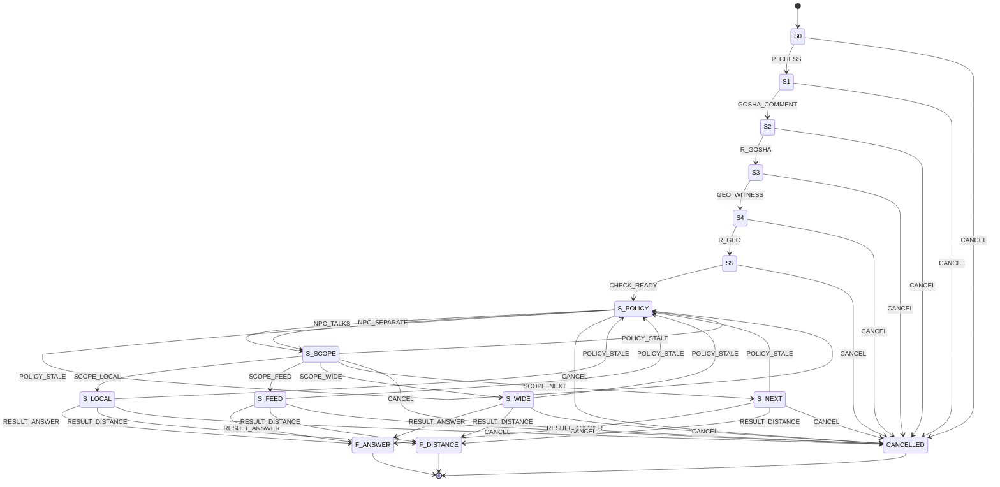

| Исход | Результат | goal_met |
| --- | --- | --- |
| F_ANSWER | Получен предусмотренный публичный ответ NPC. | true |
| F_DISTANCE | NPC ответил об отказе продолжать тему; желаемый контакт не открыт. | false |

Результат TALK от gosha: «Комбинация с конём была твоей. Мы прошли вместе; я не хочу присваивать эту историю.» Для SEPARATE используется нейтральный отказ от продолжения; род и голос реплики берутся из паспорта NPC. Якорь локального результата — p1. В FEED/WIDE/NEXT создаётся новый NPC-пост с отсылкой к этому обсуждению; выбранный игроком герой автором NPC-объекта не становится.

| Прокачка и память | Заполненный вариант |
| --- | --- |
| Возможность | B6 / gosha / после P_CHESS |
| q_skill | Начну отдельный спор о том, кому достаётся слава: без комбинации Романа прохода не было. Это не отменяет остальных участников. |
| c_skill | Когда обсуждают только меня, шахматная партия становится нечестной задним числом. Расскажу со своей стороны о ходе конём и о том, почему один я бы дальше не прошёл. |
| Контакт по навыку | Необязательный ROOT(q_skill,gosha,r_skill,c_skill); зафиксировать capability_used, не соглашение P с текстом NPC. |
| Следующая встреча | Гоша публикует свой рассказ о следующем событии. Участие Романа упоминается по прежним сохранённым фактам, не по предположению LLM. |

### Мертвец в ящике

| Паспорт | Значение |
| --- | --- |
| story_id / version | `houses_own_01` / `review-2026-10-20.6` |
| Мир / роль | `houses` / `own` |
| Цель | Сведи Джона и Джеймса в обсуждении угрозы мёртвых на своём канале — и выясни, готовы ли они обсуждать совместный ответ. |
| Участники NPC | jon, james, diana |
| Референс | «Игра престолов», 7×07, The Dragon and the Wolf: доказательство угрозы в Драконьем Логове. |
| Хронология и знания | Джон и Диана союзники. У Дианы два живых дракона, один уже погиб за Стеной. Джон не знает своего происхождения. Джеймс носит протез правой кисти. Диана и правительница противников присутствуют в сцене; их ответы не требуются. |
| Начальный контекст | Пленного мертвеца уже показали в Драконьем Логове. Игрок — автор канала малого дома; личная готовность к разговору не означает обещание армии. |
| Начальное состояние | S0 |

| Алиас | Объект / автор / якорь | Текст NPC |
| --- | --- | --- |
| q_jon | POST / jon | Мертвеца увидели своими глазами. Ответ на общую угрозу нужен независимо от титулов. |
| q_james | POST / james | Угрозу признаю. Личную позицию нельзя выдавать за приказ всему моему дому. |
| c_diana | COMMENT / diana / p1 | Я готова обсуждать угрозу. Но поддержку разговора нельзя путать с чужой присягой. |

| Привязка операции | Объект | После события |
| --- | --- | --- |
| r_jon | Ответ P под q_jon | R_JON |
| c_jon | Основной ответ jon на r_jon | R_JON |
| r_james | Ответ P под q_james | R_JAMES |
| c_james | Основной ответ james на r_james | R_JAMES |
| p1 | Пост P | P_COUNCIL |

| Из | Событие | В | Условие | Видимое последствие | Ходов P |
| --- | --- | --- | --- | --- | --- |
| S0 | TWO_POSTS | S1 | NPC(q_jon,q_james) | Позиции сторон доступны раздельно. | 0 |
| S1 | R_JON | S2_A | ROOT(q_jon,jon,r_jon,c_jon) | Поговори с обеими сторонами. | 1 |
| S1 | R_JAMES | S2_B | ROOT(q_james,james,r_james,c_james) | Поговори с обеими сторонами. | 1 |
| S2_A | R_JAMES | S2 | ROOT(q_james,james,r_james,c_james) | Поговори с обеими сторонами. | 1 |
| S2_B | R_JON | S2 | ROOT(q_jon,jon,r_jon,c_jon) | Поговори с обеими сторонами. | 1 |
| S2 | P_COUNCIL | S3 | PUB(p1) | Открой общее обсуждение после двух разговоров. | 1 |
| S3 | DIANA_COMMENT | S4 | NPC(c_diana) | Диана присутствует как третий участник, не разрешает конфликт за других. | 0 |
| S4 | CHECK_READY | S_POLICY | EVAL: взять актуальные версии готовности участников и контакты этого запуска | Зафиксированы входы политики, не смысл текста. В S_POLICY решение выводится политиками relationships.md по этим входам. | 0 |
| S_POLICY | BOTH_ACCEPT | S_SCOPE | EVAL: decision_A = TALK и decision_B = TALK; pair_state допускает DIALOGUE | outcome = DIALOGUE; публикация двух согласий ещё ожидается, pair_state пока DISPUTE. | 0 |
| S_POLICY | ANY_REFUSE | S_SCOPE | EVAL: хотя бы один decision = SEPARATE (включая запрет pair_state) | outcome = SEPARATE; позиции не названы примирением. | 0 |
| S_SCOPE | SCOPE_LOCAL | S_LOCAL | EVAL: subs < stages.views.from | scope = LOCAL по сохранённому снимку; новые экономические эффекты не создаются. | 0 |
| S_LOCAL | RESULT_DIALOGUE | F_DIALOGUE | NPC: версии политик актуальны; outcome = DIALOGUE; все result_alias выбранного scope сохранены с нужными авторами и ссылками | Публичный исход подтверждён; только при DIALOGUE пара DISPUTE/RIVALRY/DIALOGUE → DIALOGUE по двум сохранённым согласиям (TRUCE сохраняется); в остальных случаях пара не меняется; goal_met = true. | 0 |
| S_LOCAL | RESULT_SEPARATE | F_SEPARATE | NPC: версии политик актуальны; outcome = SEPARATE; все result_alias выбранного scope сохранены с нужными авторами и ссылками | Публичный исход подтверждён; только при DIALOGUE пара DISPUTE/RIVALRY/DIALOGUE → DIALOGUE по двум сохранённым согласиям (TRUCE сохраняется); в остальных случаях пара не меняется; goal_met = false. | 0 |
| S_SCOPE | SCOPE_FEED | S_FEED | EVAL: stages.views.from <= subs < stages.strike.from | scope = FEED по сохранённому снимку; новые экономические эффекты не создаются. | 0 |
| S_FEED | RESULT_DIALOGUE | F_DIALOGUE | NPC: версии политик актуальны; outcome = DIALOGUE; все result_alias выбранного scope сохранены с нужными авторами и ссылками | Публичный исход подтверждён; только при DIALOGUE пара DISPUTE/RIVALRY/DIALOGUE → DIALOGUE по двум сохранённым согласиям (TRUCE сохраняется); в остальных случаях пара не меняется; goal_met = true. | 0 |
| S_FEED | RESULT_SEPARATE | F_SEPARATE | NPC: версии политик актуальны; outcome = SEPARATE; все result_alias выбранного scope сохранены с нужными авторами и ссылками | Публичный исход подтверждён; только при DIALOGUE пара DISPUTE/RIVALRY/DIALOGUE → DIALOGUE по двум сохранённым согласиям (TRUCE сохраняется); в остальных случаях пара не меняется; goal_met = false. | 0 |
| S_SCOPE | SCOPE_WIDE | S_WIDE | EVAL: stages.strike.from <= subs < stages.new_line.from | scope = WIDE по сохранённому снимку; новые экономические эффекты не создаются. | 0 |
| S_WIDE | RESULT_DIALOGUE | F_DIALOGUE | NPC: версии политик актуальны; outcome = DIALOGUE; все result_alias выбранного scope сохранены с нужными авторами и ссылками | Публичный исход подтверждён; только при DIALOGUE пара DISPUTE/RIVALRY/DIALOGUE → DIALOGUE по двум сохранённым согласиям (TRUCE сохраняется); в остальных случаях пара не меняется; goal_met = true. | 0 |
| S_WIDE | RESULT_SEPARATE | F_SEPARATE | NPC: версии политик актуальны; outcome = SEPARATE; все result_alias выбранного scope сохранены с нужными авторами и ссылками | Публичный исход подтверждён; только при DIALOGUE пара DISPUTE/RIVALRY/DIALOGUE → DIALOGUE по двум сохранённым согласиям (TRUCE сохраняется); в остальных случаях пара не меняется; goal_met = false. | 0 |
| S_SCOPE | SCOPE_NEXT | S_NEXT | EVAL: subs >= stages.new_line.from | scope = NEXT по сохранённому снимку; новые экономические эффекты не создаются. | 0 |
| S_NEXT | RESULT_DIALOGUE | F_DIALOGUE | NPC: версии политик актуальны; outcome = DIALOGUE; все result_alias выбранного scope сохранены с нужными авторами и ссылками | Публичный исход подтверждён; только при DIALOGUE пара DISPUTE/RIVALRY/DIALOGUE → DIALOGUE по двум сохранённым согласиям (TRUCE сохраняется); в остальных случаях пара не меняется; goal_met = true. | 0 |
| S_NEXT | RESULT_SEPARATE | F_SEPARATE | NPC: версии политик актуальны; outcome = SEPARATE; все result_alias выбранного scope сохранены с нужными авторами и ссылками | Публичный исход подтверждён; только при DIALOGUE пара DISPUTE/RIVALRY/DIALOGUE → DIALOGUE по двум сохранённым согласиям (TRUCE сохраняется); в остальных случаях пара не меняется; goal_met = false. | 0 |
| S_POLICY | POLICY_STALE | S_POLICY | EVAL: версия готовности/пары отличается от snapshot_id; результат ещё не опубликован | Новый снимок политики; scope подписчиков и оплаченные действия сохраняются. | 0 |
| S_SCOPE | POLICY_STALE | S_POLICY | EVAL: версия готовности/пары отличается от snapshot_id; результат ещё не опубликован | Новый снимок политики; scope подписчиков и оплаченные действия сохраняются. | 0 |
| S_LOCAL | POLICY_STALE | S_POLICY | EVAL: версия готовности/пары отличается от snapshot_id; результат ещё не опубликован | Новый снимок политики; scope подписчиков и оплаченные действия сохраняются. | 0 |
| S_FEED | POLICY_STALE | S_POLICY | EVAL: версия готовности/пары отличается от snapshot_id; результат ещё не опубликован | Новый снимок политики; scope подписчиков и оплаченные действия сохраняются. | 0 |
| S_WIDE | POLICY_STALE | S_POLICY | EVAL: версия готовности/пары отличается от snapshot_id; результат ещё не опубликован | Новый снимок политики; scope подписчиков и оплаченные действия сохраняются. | 0 |
| S_NEXT | POLICY_STALE | S_POLICY | EVAL: версия готовности/пары отличается от snapshot_id; результат ещё не опубликован | Новый снимок политики; scope подписчиков и оплаченные действия сохраняются. | 0 |

| Состояние | Следующий шаг |
| --- | --- |
| S0 | Ожидание внутреннего шага: TWO_POSTS |
| S1 | ROOT(q_jon,jon,r_jon,c_jon) / ROOT(q_james,james,r_james,c_james) |
| S2 | PUB(p1) |
| S2_A | ROOT(q_james,james,r_james,c_james) |
| S2_B | ROOT(q_jon,jon,r_jon,c_jon) |
| S3 | Ожидание внутреннего шага: DIANA_COMMENT |
| S4 | Ожидание внутреннего шага: CHECK_READY |
| S_POLICY | Ожидание внутреннего шага: BOTH_ACCEPT, ANY_REFUSE, POLICY_STALE |
| S_SCOPE | Ожидание внутреннего шага: SCOPE_LOCAL, SCOPE_FEED, SCOPE_WIDE, SCOPE_NEXT, POLICY_STALE |
| S_LOCAL | Ожидание внутреннего шага: RESULT_DIALOGUE, RESULT_SEPARATE, POLICY_STALE |
| S_FEED | Ожидание внутреннего шага: RESULT_DIALOGUE, RESULT_SEPARATE, POLICY_STALE |
| S_WIDE | Ожидание внутреннего шага: RESULT_DIALOGUE, RESULT_SEPARATE, POLICY_STALE |
| S_NEXT | Ожидание внутреннего шага: RESULT_DIALOGUE, RESULT_SEPARATE, POLICY_STALE |
| F_DIALOGUE | Оба NPC опубликовали готовность продолжить общую тему. |
| F_SEPARATE | Хотя бы один NPC сохранил отдельную позицию; совместный разговор не открыт. |
| CANCELLED | Запуск отменён |

| Состояние | TWO_POSTS | R_JON | R_JAMES | P_COUNCIL | DIANA_COMMENT | CHECK_READY | BOTH_ACCEPT | ANY_REFUSE | SCOPE_LOCAL | RESULT_DIALOGUE | RESULT_SEPARATE | SCOPE_FEED | SCOPE_WIDE | SCOPE_NEXT | POLICY_STALE | OTHER | CANCEL |
| --- | --- | --- | --- | --- | --- | --- | --- | --- | --- | --- | --- | --- | --- | --- | --- | --- | --- |
| S0 | S1 | S0 | S0 | S0 | S0 | S0 | S0 | S0 | S0 | S0 | S0 | S0 | S0 | S0 | S0 | S0 | CANCELLED |
| S1 | S1 | S2_A | S2_B | S1 | S1 | S1 | S1 | S1 | S1 | S1 | S1 | S1 | S1 | S1 | S1 | S1 | CANCELLED |
| S2 | S2 | S2 | S2 | S3 | S2 | S2 | S2 | S2 | S2 | S2 | S2 | S2 | S2 | S2 | S2 | S2 | CANCELLED |
| S2_A | S2_A | S2_A | S2 | S2_A | S2_A | S2_A | S2_A | S2_A | S2_A | S2_A | S2_A | S2_A | S2_A | S2_A | S2_A | S2_A | CANCELLED |
| S2_B | S2_B | S2 | S2_B | S2_B | S2_B | S2_B | S2_B | S2_B | S2_B | S2_B | S2_B | S2_B | S2_B | S2_B | S2_B | S2_B | CANCELLED |
| S3 | S3 | S3 | S3 | S3 | S4 | S3 | S3 | S3 | S3 | S3 | S3 | S3 | S3 | S3 | S3 | S3 | CANCELLED |
| S4 | S4 | S4 | S4 | S4 | S4 | S_POLICY | S4 | S4 | S4 | S4 | S4 | S4 | S4 | S4 | S4 | S4 | CANCELLED |
| S_POLICY | S_POLICY | S_POLICY | S_POLICY | S_POLICY | S_POLICY | S_POLICY | S_SCOPE | S_SCOPE | S_POLICY | S_POLICY | S_POLICY | S_POLICY | S_POLICY | S_POLICY | S_POLICY | S_POLICY | CANCELLED |
| S_SCOPE | S_SCOPE | S_SCOPE | S_SCOPE | S_SCOPE | S_SCOPE | S_SCOPE | S_SCOPE | S_SCOPE | S_LOCAL | S_SCOPE | S_SCOPE | S_FEED | S_WIDE | S_NEXT | S_POLICY | S_SCOPE | CANCELLED |
| S_LOCAL | S_LOCAL | S_LOCAL | S_LOCAL | S_LOCAL | S_LOCAL | S_LOCAL | S_LOCAL | S_LOCAL | S_LOCAL | F_DIALOGUE | F_SEPARATE | S_LOCAL | S_LOCAL | S_LOCAL | S_POLICY | S_LOCAL | CANCELLED |
| S_FEED | S_FEED | S_FEED | S_FEED | S_FEED | S_FEED | S_FEED | S_FEED | S_FEED | S_FEED | F_DIALOGUE | F_SEPARATE | S_FEED | S_FEED | S_FEED | S_POLICY | S_FEED | CANCELLED |
| S_WIDE | S_WIDE | S_WIDE | S_WIDE | S_WIDE | S_WIDE | S_WIDE | S_WIDE | S_WIDE | S_WIDE | F_DIALOGUE | F_SEPARATE | S_WIDE | S_WIDE | S_WIDE | S_POLICY | S_WIDE | CANCELLED |
| S_NEXT | S_NEXT | S_NEXT | S_NEXT | S_NEXT | S_NEXT | S_NEXT | S_NEXT | S_NEXT | S_NEXT | F_DIALOGUE | F_SEPARATE | S_NEXT | S_NEXT | S_NEXT | S_POLICY | S_NEXT | CANCELLED |
| F_DIALOGUE | F_DIALOGUE | F_DIALOGUE | F_DIALOGUE | F_DIALOGUE | F_DIALOGUE | F_DIALOGUE | F_DIALOGUE | F_DIALOGUE | F_DIALOGUE | F_DIALOGUE | F_DIALOGUE | F_DIALOGUE | F_DIALOGUE | F_DIALOGUE | F_DIALOGUE | F_DIALOGUE | F_DIALOGUE |
| F_SEPARATE | F_SEPARATE | F_SEPARATE | F_SEPARATE | F_SEPARATE | F_SEPARATE | F_SEPARATE | F_SEPARATE | F_SEPARATE | F_SEPARATE | F_SEPARATE | F_SEPARATE | F_SEPARATE | F_SEPARATE | F_SEPARATE | F_SEPARATE | F_SEPARATE | F_SEPARATE |
| CANCELLED | CANCELLED | CANCELLED | CANCELLED | CANCELLED | CANCELLED | CANCELLED | CANCELLED | CANCELLED | CANCELLED | CANCELLED | CANCELLED | CANCELLED | CANCELLED | CANCELLED | CANCELLED | CANCELLED | CANCELLED |

OTHER не меняет этап: не тот автор, мир, пост, родитель, версия, порядок, повтор или свободный ход. Неверный запрос отклоняется до списания; self-loop не означает платную обработку ошибки. PAUSED/WAITING_RETRY — статусы поверх состояния, не дополнительные сюжетные переходы.

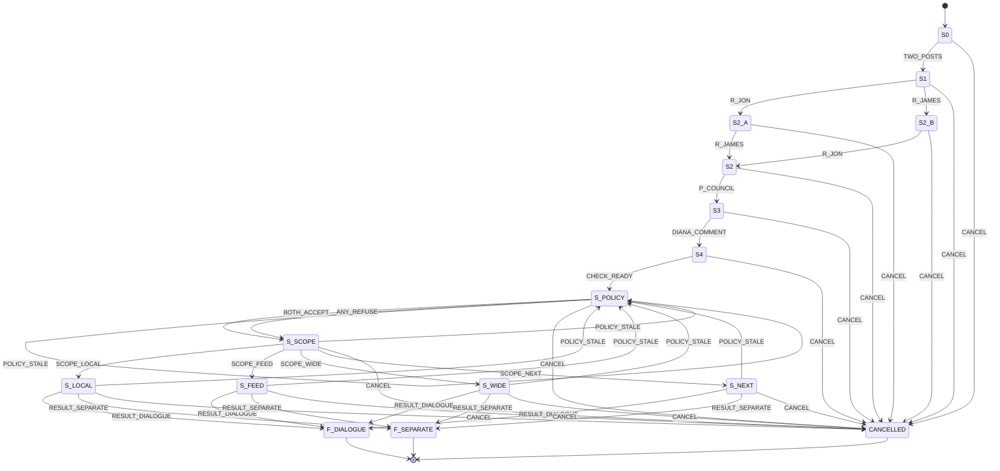

| Исход | Результат | goal_met |
| --- | --- | --- |
| F_DIALOGUE | Оба NPC опубликовали готовность продолжить общую тему. | true |
| F_SEPARATE | Хотя бы один NPC сохранил отдельную позицию; совместный разговор не открыт. | false |

Результат TALK от james: «Обсуждать личный вклад готов. Это не приказ армии моего дома.» Для SEPARATE используется нейтральный отказ от продолжения; род и голос реплики берутся из паспорта NPC. У пары jon ↔ james причина спора: Общая угроза против прежней войны домов. Политики OPEN/CAUTIOUS; в DIALOGUE оба публикуют собственное «готов продолжить эту тему», в SEPARATE каждый публикует свой фактический TALK/SEPARATE. Дружба, поддержка игроком стороны и перемирие не назначаются. Якорь локального результата — p1. В FEED/WIDE/NEXT создаётся новый NPC-пост с отсылкой к этому обсуждению; выбранный игроком герой автором NPC-объекта не становится.

| Прокачка и память | Заполненный вариант |
| --- | --- |
| Возможность | T6 / james / после P_COUNCIL |
| q_skill | Готов к отдельному обсуждению с Джоном о личной помощи. За решение правительницы и всю армию не отвечаю. |
| c_skill | Я видел доказательство угрозы. Обсуждать общий ответ готов от своего имени; решения всего моего дома у меня на руках нет. |
| Контакт по навыку | Необязательный ROOT(q_skill,james,r_skill,c_skill); зафиксировать capability_used, не соглашение P с текстом NPC. |
| Следующая встреча | Джеймс возвращается без армии. Новая сцена читает личное обещание и прежнюю готовность к разговору; от имени всего дома гарантий нет. |

### Королева по собственному выбору

| Паспорт | Значение |
| --- | --- |
| story_id / version | `houses_diana_01` / `review-2026-10-20.6` |
| Мир / роль | `houses` / `diana` |
| Цель | Получи от Джона публичное подтверждение его личной поддержки после потери дракона, не присягу за весь Север. |
| Участники NPC | jon |
| Референс | «Игра престолов», 7×06, Beyond the Wall: после спасения за Стеной Джон признаёт Дейенерис своей королевой; цена помощи — погибший дракон. |
| Хронология и знания | Диана и Джон уже знакомы и возвращаются с Севера. У Дианы два живых дракона. Джон ещё не знает происхождения. Личная поддержка не означает присягу всех северян. Романтика этой пары запрещена справочником родства. |
| Начальный контекст | После вылазки за Стену один дракон погиб. Джон лично назвал Диану своей королевой; нужно выяснить, что он готов повторить публично. |
| Начальное состояние | S0 |

| Алиас | Объект / автор / якорь | Текст NPC |
| --- | --- | --- |
| c0 | COMMENT / jon / p1 | Я сказал, что признаю тебя своей королевой. Этот выбор мой, не каждого человека на Севере. |
| q_jon | POST / jon | Готов объяснить свою личную поддержку после вылазки. Общая угроза остаётся; мнение всех северян за них не определяю. |

| Привязка операции | Объект | После события |
| --- | --- | --- |
| p1 | Пост P | P_LOSS |
| r1 | Ответ P под p1 | R_JON |
| c1 | Основной ответ jon на r1 | R_JON |
| r2 | Ответ P под q_jon | R_PUBLIC |
| c2 | Основной ответ jon на r2 | R_PUBLIC |

| Из | Событие | В | Условие | Видимое последствие | Ходов P |
| --- | --- | --- | --- | --- | --- |
| S0 | P_LOSS | S1 | PUB(p1) | Открой разговор после возвращения с Севера. | 1 |
| S1 | JON_COMMENT | S2 | NPC(c0) | Есть точное личное заявление Джона. | 0 |
| S2 | R_JON | S3 | CHILD(p1,jon,c0,r1,c1) | Ответь на его заявление в этой ветке. | 1 |
| S3 | JON_POST | S4 | NPC(q_jon) | Джон вынес собственную позицию в свой канал. | 0 |
| S4 | R_PUBLIC | S5 | ROOT(q_jon,jon,r2,c2) | Продолжи обсуждение под его публичной записью. | 1 |
| S5 | CHECK_READY | S_POLICY | EVAL: взять актуальные версии готовности участников и контакты этого запуска | Зафиксированы входы политики, не смысл текста. В S_POLICY решение выводится политиками relationships.md по этим входам. | 0 |
| S_POLICY | NPC_TALKS | S_SCOPE | EVAL: decision = TALK | outcome = ANSWER; предусмотренный ответ готовится. | 0 |
| S_POLICY | NPC_SEPARATE | S_SCOPE | EVAL: decision = SEPARATE | outcome = DISTANCE; публикуется отказ от продолжения, не обрыв без объяснения. | 0 |
| S_SCOPE | SCOPE_LOCAL | S_LOCAL | EVAL: subs < stages.views.from | scope = LOCAL по сохранённому снимку; новые экономические эффекты не создаются. | 0 |
| S_LOCAL | RESULT_ANSWER | F_ANSWER | NPC: версии политик актуальны; outcome = ANSWER; все result_alias выбранного scope сохранены с нужными авторами и ссылками | Публичный исход подтверждён; только при DIALOGUE пара DISPUTE/RIVALRY/DIALOGUE → DIALOGUE по двум сохранённым согласиям (TRUCE сохраняется); в остальных случаях пара не меняется; goal_met = true. | 0 |
| S_LOCAL | RESULT_DISTANCE | F_DISTANCE | NPC: версии политик актуальны; outcome = DISTANCE; все result_alias выбранного scope сохранены с нужными авторами и ссылками | Публичный исход подтверждён; только при DIALOGUE пара DISPUTE/RIVALRY/DIALOGUE → DIALOGUE по двум сохранённым согласиям (TRUCE сохраняется); в остальных случаях пара не меняется; goal_met = false. | 0 |
| S_SCOPE | SCOPE_FEED | S_FEED | EVAL: stages.views.from <= subs < stages.strike.from | scope = FEED по сохранённому снимку; новые экономические эффекты не создаются. | 0 |
| S_FEED | RESULT_ANSWER | F_ANSWER | NPC: версии политик актуальны; outcome = ANSWER; все result_alias выбранного scope сохранены с нужными авторами и ссылками | Публичный исход подтверждён; только при DIALOGUE пара DISPUTE/RIVALRY/DIALOGUE → DIALOGUE по двум сохранённым согласиям (TRUCE сохраняется); в остальных случаях пара не меняется; goal_met = true. | 0 |
| S_FEED | RESULT_DISTANCE | F_DISTANCE | NPC: версии политик актуальны; outcome = DISTANCE; все result_alias выбранного scope сохранены с нужными авторами и ссылками | Публичный исход подтверждён; только при DIALOGUE пара DISPUTE/RIVALRY/DIALOGUE → DIALOGUE по двум сохранённым согласиям (TRUCE сохраняется); в остальных случаях пара не меняется; goal_met = false. | 0 |
| S_SCOPE | SCOPE_WIDE | S_WIDE | EVAL: stages.strike.from <= subs < stages.new_line.from | scope = WIDE по сохранённому снимку; новые экономические эффекты не создаются. | 0 |
| S_WIDE | RESULT_ANSWER | F_ANSWER | NPC: версии политик актуальны; outcome = ANSWER; все result_alias выбранного scope сохранены с нужными авторами и ссылками | Публичный исход подтверждён; только при DIALOGUE пара DISPUTE/RIVALRY/DIALOGUE → DIALOGUE по двум сохранённым согласиям (TRUCE сохраняется); в остальных случаях пара не меняется; goal_met = true. | 0 |
| S_WIDE | RESULT_DISTANCE | F_DISTANCE | NPC: версии политик актуальны; outcome = DISTANCE; все result_alias выбранного scope сохранены с нужными авторами и ссылками | Публичный исход подтверждён; только при DIALOGUE пара DISPUTE/RIVALRY/DIALOGUE → DIALOGUE по двум сохранённым согласиям (TRUCE сохраняется); в остальных случаях пара не меняется; goal_met = false. | 0 |
| S_SCOPE | SCOPE_NEXT | S_NEXT | EVAL: subs >= stages.new_line.from | scope = NEXT по сохранённому снимку; новые экономические эффекты не создаются. | 0 |
| S_NEXT | RESULT_ANSWER | F_ANSWER | NPC: версии политик актуальны; outcome = ANSWER; все result_alias выбранного scope сохранены с нужными авторами и ссылками | Публичный исход подтверждён; только при DIALOGUE пара DISPUTE/RIVALRY/DIALOGUE → DIALOGUE по двум сохранённым согласиям (TRUCE сохраняется); в остальных случаях пара не меняется; goal_met = true. | 0 |
| S_NEXT | RESULT_DISTANCE | F_DISTANCE | NPC: версии политик актуальны; outcome = DISTANCE; все result_alias выбранного scope сохранены с нужными авторами и ссылками | Публичный исход подтверждён; только при DIALOGUE пара DISPUTE/RIVALRY/DIALOGUE → DIALOGUE по двум сохранённым согласиям (TRUCE сохраняется); в остальных случаях пара не меняется; goal_met = false. | 0 |
| S_POLICY | POLICY_STALE | S_POLICY | EVAL: версия готовности/пары отличается от snapshot_id; результат ещё не опубликован | Новый снимок политики; scope подписчиков и оплаченные действия сохраняются. | 0 |
| S_SCOPE | POLICY_STALE | S_POLICY | EVAL: версия готовности/пары отличается от snapshot_id; результат ещё не опубликован | Новый снимок политики; scope подписчиков и оплаченные действия сохраняются. | 0 |
| S_LOCAL | POLICY_STALE | S_POLICY | EVAL: версия готовности/пары отличается от snapshot_id; результат ещё не опубликован | Новый снимок политики; scope подписчиков и оплаченные действия сохраняются. | 0 |
| S_FEED | POLICY_STALE | S_POLICY | EVAL: версия готовности/пары отличается от snapshot_id; результат ещё не опубликован | Новый снимок политики; scope подписчиков и оплаченные действия сохраняются. | 0 |
| S_WIDE | POLICY_STALE | S_POLICY | EVAL: версия готовности/пары отличается от snapshot_id; результат ещё не опубликован | Новый снимок политики; scope подписчиков и оплаченные действия сохраняются. | 0 |
| S_NEXT | POLICY_STALE | S_POLICY | EVAL: версия готовности/пары отличается от snapshot_id; результат ещё не опубликован | Новый снимок политики; scope подписчиков и оплаченные действия сохраняются. | 0 |

| Состояние | Следующий шаг |
| --- | --- |
| S0 | PUB(p1) |
| S1 | Ожидание внутреннего шага: JON_COMMENT |
| S2 | CHILD(p1,jon,c0,r1,c1) |
| S3 | Ожидание внутреннего шага: JON_POST |
| S4 | ROOT(q_jon,jon,r2,c2) |
| S5 | Ожидание внутреннего шага: CHECK_READY |
| S_POLICY | Ожидание внутреннего шага: NPC_TALKS, NPC_SEPARATE, POLICY_STALE |
| S_SCOPE | Ожидание внутреннего шага: SCOPE_LOCAL, SCOPE_FEED, SCOPE_WIDE, SCOPE_NEXT, POLICY_STALE |
| S_LOCAL | Ожидание внутреннего шага: RESULT_ANSWER, RESULT_DISTANCE, POLICY_STALE |
| S_FEED | Ожидание внутреннего шага: RESULT_ANSWER, RESULT_DISTANCE, POLICY_STALE |
| S_WIDE | Ожидание внутреннего шага: RESULT_ANSWER, RESULT_DISTANCE, POLICY_STALE |
| S_NEXT | Ожидание внутреннего шага: RESULT_ANSWER, RESULT_DISTANCE, POLICY_STALE |
| F_ANSWER | Получен предусмотренный публичный ответ NPC. |
| F_DISTANCE | NPC ответил об отказе продолжать тему; желаемый контакт не открыт. |
| CANCELLED | Запуск отменён |

| Состояние | P_LOSS | JON_COMMENT | R_JON | JON_POST | R_PUBLIC | CHECK_READY | NPC_TALKS | NPC_SEPARATE | SCOPE_LOCAL | RESULT_ANSWER | RESULT_DISTANCE | SCOPE_FEED | SCOPE_WIDE | SCOPE_NEXT | POLICY_STALE | OTHER | CANCEL |
| --- | --- | --- | --- | --- | --- | --- | --- | --- | --- | --- | --- | --- | --- | --- | --- | --- | --- |
| S0 | S1 | S0 | S0 | S0 | S0 | S0 | S0 | S0 | S0 | S0 | S0 | S0 | S0 | S0 | S0 | S0 | CANCELLED |
| S1 | S1 | S2 | S1 | S1 | S1 | S1 | S1 | S1 | S1 | S1 | S1 | S1 | S1 | S1 | S1 | S1 | CANCELLED |
| S2 | S2 | S2 | S3 | S2 | S2 | S2 | S2 | S2 | S2 | S2 | S2 | S2 | S2 | S2 | S2 | S2 | CANCELLED |
| S3 | S3 | S3 | S3 | S4 | S3 | S3 | S3 | S3 | S3 | S3 | S3 | S3 | S3 | S3 | S3 | S3 | CANCELLED |
| S4 | S4 | S4 | S4 | S4 | S5 | S4 | S4 | S4 | S4 | S4 | S4 | S4 | S4 | S4 | S4 | S4 | CANCELLED |
| S5 | S5 | S5 | S5 | S5 | S5 | S_POLICY | S5 | S5 | S5 | S5 | S5 | S5 | S5 | S5 | S5 | S5 | CANCELLED |
| S_POLICY | S_POLICY | S_POLICY | S_POLICY | S_POLICY | S_POLICY | S_POLICY | S_SCOPE | S_SCOPE | S_POLICY | S_POLICY | S_POLICY | S_POLICY | S_POLICY | S_POLICY | S_POLICY | S_POLICY | CANCELLED |
| S_SCOPE | S_SCOPE | S_SCOPE | S_SCOPE | S_SCOPE | S_SCOPE | S_SCOPE | S_SCOPE | S_SCOPE | S_LOCAL | S_SCOPE | S_SCOPE | S_FEED | S_WIDE | S_NEXT | S_POLICY | S_SCOPE | CANCELLED |
| S_LOCAL | S_LOCAL | S_LOCAL | S_LOCAL | S_LOCAL | S_LOCAL | S_LOCAL | S_LOCAL | S_LOCAL | S_LOCAL | F_ANSWER | F_DISTANCE | S_LOCAL | S_LOCAL | S_LOCAL | S_POLICY | S_LOCAL | CANCELLED |
| S_FEED | S_FEED | S_FEED | S_FEED | S_FEED | S_FEED | S_FEED | S_FEED | S_FEED | S_FEED | F_ANSWER | F_DISTANCE | S_FEED | S_FEED | S_FEED | S_POLICY | S_FEED | CANCELLED |
| S_WIDE | S_WIDE | S_WIDE | S_WIDE | S_WIDE | S_WIDE | S_WIDE | S_WIDE | S_WIDE | S_WIDE | F_ANSWER | F_DISTANCE | S_WIDE | S_WIDE | S_WIDE | S_POLICY | S_WIDE | CANCELLED |
| S_NEXT | S_NEXT | S_NEXT | S_NEXT | S_NEXT | S_NEXT | S_NEXT | S_NEXT | S_NEXT | S_NEXT | F_ANSWER | F_DISTANCE | S_NEXT | S_NEXT | S_NEXT | S_POLICY | S_NEXT | CANCELLED |
| F_ANSWER | F_ANSWER | F_ANSWER | F_ANSWER | F_ANSWER | F_ANSWER | F_ANSWER | F_ANSWER | F_ANSWER | F_ANSWER | F_ANSWER | F_ANSWER | F_ANSWER | F_ANSWER | F_ANSWER | F_ANSWER | F_ANSWER | F_ANSWER |
| F_DISTANCE | F_DISTANCE | F_DISTANCE | F_DISTANCE | F_DISTANCE | F_DISTANCE | F_DISTANCE | F_DISTANCE | F_DISTANCE | F_DISTANCE | F_DISTANCE | F_DISTANCE | F_DISTANCE | F_DISTANCE | F_DISTANCE | F_DISTANCE | F_DISTANCE | F_DISTANCE |
| CANCELLED | CANCELLED | CANCELLED | CANCELLED | CANCELLED | CANCELLED | CANCELLED | CANCELLED | CANCELLED | CANCELLED | CANCELLED | CANCELLED | CANCELLED | CANCELLED | CANCELLED | CANCELLED | CANCELLED | CANCELLED |

OTHER не меняет этап: не тот автор, мир, пост, родитель, версия, порядок, повтор или свободный ход. Неверный запрос отклоняется до списания; self-loop не означает платную обработку ошибки. PAUSED/WAITING_RETRY — статусы поверх состояния, не дополнительные сюжетные переходы.

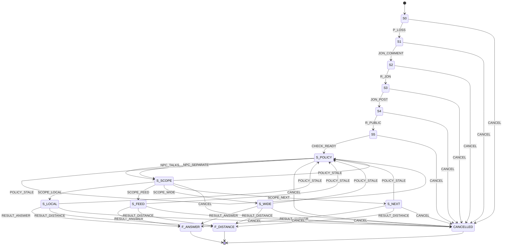

| Исход | Результат | goal_met |
| --- | --- | --- |
| F_ANSWER | Получен предусмотренный публичный ответ NPC. | true |
| F_DISTANCE | NPC ответил об отказе продолжать тему; желаемый контакт не открыт. | false |

Результат TALK от jon: «Подтверждаю свой личный выбор поддержать тебя в борьбе с мёртвыми. За весь Север я не присягал.» Для SEPARATE используется нейтральный отказ от продолжения; род и голос реплики берутся из паспорта NPC. Якорь локального результата — p1. В FEED/WIDE/NEXT создаётся новый NPC-пост с отсылкой к этому обсуждению; выбранный игроком герой автором NPC-объекта не становится.

| Прокачка и память | Заполненный вариант |
| --- | --- |
| Возможность | B6 / jon / после P_LOSS |
| q_skill | Скажу отдельно и прямо: мой выбор поддержать тебя не даёт мне права решать за каждого северянина. |
| c_skill | Объясню, что именно называю своим выбором: я поддержал тебя после того, что ты сделала за Стеной. Согласие каждого северянина из этого не следует. |
| Контакт по навыку | Необязательный ROOT(q_skill,jon,r_skill,c_skill); зафиксировать capability_used, не соглашение P с текстом NPC. |
| Следующая встреча | Реакция северян на личную поддержку Джона становится новым спором. Происхождение Джона здесь ещё не открыто. |

### Разговор без преклонённого колена

| Паспорт | Значение |
| --- | --- |
| story_id / version | `houses_jon_01` / `review-2026-10-20.6` |
| Мир / роль | `houses` / `jon` |
| Цель | Переведи разговор с Дианой с преклонённого колена на угрозу за Стеной и получи её публичный ответ. |
| Участники NPC | diana |
| Референс | «Игра престолов», 7×03, The Queens Justice: первая аудиенция на Драконьем Камне, требование преклонить колено и спор об угрозе мёртвых. |
| Хронология и знания | Первая встреча Джона и Дианы. У неё три живых дракона. Джон не знает происхождения; Диана ещё не видела мёртвых. Это отдельный ранний запуск, не продолжение эпизода 7×06. Романтика запрещена справочником родства. |
| Начальный контекст | Первая встреча на острове. Диана требует признания, Джон просит обсуждать мёртвых. Она их ещё не видела, войска и драконы Северу не обещаны. |
| Начальное состояние | S0 |

| Алиас | Объект / автор / якорь | Текст NPC |
| --- | --- | --- |
| q_diana | POST / diana | Посланник Севера просит говорить о мёртвых. Сначала хочу понять, почему он отказывается признать моё право на трон. |
| c0 | COMMENT / diana / p1 | У меня нет твоего опыта за Стеной. Готова задать вопросы об этой угрозе. |

| Привязка операции | Объект | После события |
| --- | --- | --- |
| r1 | Ответ P под q_diana | R_AUDIENCE |
| c1 | Основной ответ diana на r1 | R_AUDIENCE |
| p1 | Пост P | P_NORTH |
| r2 | Ответ P под p1 | R_THREAT |
| c2 | Основной ответ diana на r2 | R_THREAT |

| Из | Событие | В | Условие | Видимое последствие | Ходов P |
| --- | --- | --- | --- | --- | --- |
| S0 | DIANA_POST | S1 | NPC(q_diana) | Началась публичная полемика о титуле и общей угрозе. | 0 |
| S1 | R_AUDIENCE | S2 | ROOT(q_diana,diana,r1,c1) | Ответь Диане под её вопросом. | 1 |
| S2 | P_NORTH | S3 | PUB(p1) | Верни тему в свой канал после аудиенции. | 1 |
| S3 | DIANA_QUESTION | S4 | NPC(c0) | Диана сама обозначила готовность к вопросам, не уверенность в выводе. | 0 |
| S4 | R_THREAT | S5 | CHILD(p1,diana,c0,r2,c2) | Продолжи разговор о заявленной угрозе в её ветке. | 1 |
| S5 | CHECK_READY | S_POLICY | EVAL: взять актуальные версии готовности участников и контакты этого запуска | Зафиксированы входы политики, не смысл текста. В S_POLICY решение выводится политиками relationships.md по этим входам. | 0 |
| S_POLICY | NPC_TALKS | S_SCOPE | EVAL: decision = TALK | outcome = ANSWER; предусмотренный ответ готовится. | 0 |
| S_POLICY | NPC_SEPARATE | S_SCOPE | EVAL: decision = SEPARATE | outcome = DISTANCE; публикуется отказ от продолжения, не обрыв без объяснения. | 0 |
| S_SCOPE | SCOPE_LOCAL | S_LOCAL | EVAL: subs < stages.views.from | scope = LOCAL по сохранённому снимку; новые экономические эффекты не создаются. | 0 |
| S_LOCAL | RESULT_ANSWER | F_ANSWER | NPC: версии политик актуальны; outcome = ANSWER; все result_alias выбранного scope сохранены с нужными авторами и ссылками | Публичный исход подтверждён; только при DIALOGUE пара DISPUTE/RIVALRY/DIALOGUE → DIALOGUE по двум сохранённым согласиям (TRUCE сохраняется); в остальных случаях пара не меняется; goal_met = true. | 0 |
| S_LOCAL | RESULT_DISTANCE | F_DISTANCE | NPC: версии политик актуальны; outcome = DISTANCE; все result_alias выбранного scope сохранены с нужными авторами и ссылками | Публичный исход подтверждён; только при DIALOGUE пара DISPUTE/RIVALRY/DIALOGUE → DIALOGUE по двум сохранённым согласиям (TRUCE сохраняется); в остальных случаях пара не меняется; goal_met = false. | 0 |
| S_SCOPE | SCOPE_FEED | S_FEED | EVAL: stages.views.from <= subs < stages.strike.from | scope = FEED по сохранённому снимку; новые экономические эффекты не создаются. | 0 |
| S_FEED | RESULT_ANSWER | F_ANSWER | NPC: версии политик актуальны; outcome = ANSWER; все result_alias выбранного scope сохранены с нужными авторами и ссылками | Публичный исход подтверждён; только при DIALOGUE пара DISPUTE/RIVALRY/DIALOGUE → DIALOGUE по двум сохранённым согласиям (TRUCE сохраняется); в остальных случаях пара не меняется; goal_met = true. | 0 |
| S_FEED | RESULT_DISTANCE | F_DISTANCE | NPC: версии политик актуальны; outcome = DISTANCE; все result_alias выбранного scope сохранены с нужными авторами и ссылками | Публичный исход подтверждён; только при DIALOGUE пара DISPUTE/RIVALRY/DIALOGUE → DIALOGUE по двум сохранённым согласиям (TRUCE сохраняется); в остальных случаях пара не меняется; goal_met = false. | 0 |
| S_SCOPE | SCOPE_WIDE | S_WIDE | EVAL: stages.strike.from <= subs < stages.new_line.from | scope = WIDE по сохранённому снимку; новые экономические эффекты не создаются. | 0 |
| S_WIDE | RESULT_ANSWER | F_ANSWER | NPC: версии политик актуальны; outcome = ANSWER; все result_alias выбранного scope сохранены с нужными авторами и ссылками | Публичный исход подтверждён; только при DIALOGUE пара DISPUTE/RIVALRY/DIALOGUE → DIALOGUE по двум сохранённым согласиям (TRUCE сохраняется); в остальных случаях пара не меняется; goal_met = true. | 0 |
| S_WIDE | RESULT_DISTANCE | F_DISTANCE | NPC: версии политик актуальны; outcome = DISTANCE; все result_alias выбранного scope сохранены с нужными авторами и ссылками | Публичный исход подтверждён; только при DIALOGUE пара DISPUTE/RIVALRY/DIALOGUE → DIALOGUE по двум сохранённым согласиям (TRUCE сохраняется); в остальных случаях пара не меняется; goal_met = false. | 0 |
| S_SCOPE | SCOPE_NEXT | S_NEXT | EVAL: subs >= stages.new_line.from | scope = NEXT по сохранённому снимку; новые экономические эффекты не создаются. | 0 |
| S_NEXT | RESULT_ANSWER | F_ANSWER | NPC: версии политик актуальны; outcome = ANSWER; все result_alias выбранного scope сохранены с нужными авторами и ссылками | Публичный исход подтверждён; только при DIALOGUE пара DISPUTE/RIVALRY/DIALOGUE → DIALOGUE по двум сохранённым согласиям (TRUCE сохраняется); в остальных случаях пара не меняется; goal_met = true. | 0 |
| S_NEXT | RESULT_DISTANCE | F_DISTANCE | NPC: версии политик актуальны; outcome = DISTANCE; все result_alias выбранного scope сохранены с нужными авторами и ссылками | Публичный исход подтверждён; только при DIALOGUE пара DISPUTE/RIVALRY/DIALOGUE → DIALOGUE по двум сохранённым согласиям (TRUCE сохраняется); в остальных случаях пара не меняется; goal_met = false. | 0 |
| S_POLICY | POLICY_STALE | S_POLICY | EVAL: версия готовности/пары отличается от snapshot_id; результат ещё не опубликован | Новый снимок политики; scope подписчиков и оплаченные действия сохраняются. | 0 |
| S_SCOPE | POLICY_STALE | S_POLICY | EVAL: версия готовности/пары отличается от snapshot_id; результат ещё не опубликован | Новый снимок политики; scope подписчиков и оплаченные действия сохраняются. | 0 |
| S_LOCAL | POLICY_STALE | S_POLICY | EVAL: версия готовности/пары отличается от snapshot_id; результат ещё не опубликован | Новый снимок политики; scope подписчиков и оплаченные действия сохраняются. | 0 |
| S_FEED | POLICY_STALE | S_POLICY | EVAL: версия готовности/пары отличается от snapshot_id; результат ещё не опубликован | Новый снимок политики; scope подписчиков и оплаченные действия сохраняются. | 0 |
| S_WIDE | POLICY_STALE | S_POLICY | EVAL: версия готовности/пары отличается от snapshot_id; результат ещё не опубликован | Новый снимок политики; scope подписчиков и оплаченные действия сохраняются. | 0 |
| S_NEXT | POLICY_STALE | S_POLICY | EVAL: версия готовности/пары отличается от snapshot_id; результат ещё не опубликован | Новый снимок политики; scope подписчиков и оплаченные действия сохраняются. | 0 |

| Состояние | Следующий шаг |
| --- | --- |
| S0 | Ожидание внутреннего шага: DIANA_POST |
| S1 | ROOT(q_diana,diana,r1,c1) |
| S2 | PUB(p1) |
| S3 | Ожидание внутреннего шага: DIANA_QUESTION |
| S4 | CHILD(p1,diana,c0,r2,c2) |
| S5 | Ожидание внутреннего шага: CHECK_READY |
| S_POLICY | Ожидание внутреннего шага: NPC_TALKS, NPC_SEPARATE, POLICY_STALE |
| S_SCOPE | Ожидание внутреннего шага: SCOPE_LOCAL, SCOPE_FEED, SCOPE_WIDE, SCOPE_NEXT, POLICY_STALE |
| S_LOCAL | Ожидание внутреннего шага: RESULT_ANSWER, RESULT_DISTANCE, POLICY_STALE |
| S_FEED | Ожидание внутреннего шага: RESULT_ANSWER, RESULT_DISTANCE, POLICY_STALE |
| S_WIDE | Ожидание внутреннего шага: RESULT_ANSWER, RESULT_DISTANCE, POLICY_STALE |
| S_NEXT | Ожидание внутреннего шага: RESULT_ANSWER, RESULT_DISTANCE, POLICY_STALE |
| F_ANSWER | Получен предусмотренный публичный ответ NPC. |
| F_DISTANCE | NPC ответил об отказе продолжать тему; желаемый контакт не открыт. |
| CANCELLED | Запуск отменён |

| Состояние | DIANA_POST | R_AUDIENCE | P_NORTH | DIANA_QUESTION | R_THREAT | CHECK_READY | NPC_TALKS | NPC_SEPARATE | SCOPE_LOCAL | RESULT_ANSWER | RESULT_DISTANCE | SCOPE_FEED | SCOPE_WIDE | SCOPE_NEXT | POLICY_STALE | OTHER | CANCEL |
| --- | --- | --- | --- | --- | --- | --- | --- | --- | --- | --- | --- | --- | --- | --- | --- | --- | --- |
| S0 | S1 | S0 | S0 | S0 | S0 | S0 | S0 | S0 | S0 | S0 | S0 | S0 | S0 | S0 | S0 | S0 | CANCELLED |
| S1 | S1 | S2 | S1 | S1 | S1 | S1 | S1 | S1 | S1 | S1 | S1 | S1 | S1 | S1 | S1 | S1 | CANCELLED |
| S2 | S2 | S2 | S3 | S2 | S2 | S2 | S2 | S2 | S2 | S2 | S2 | S2 | S2 | S2 | S2 | S2 | CANCELLED |
| S3 | S3 | S3 | S3 | S4 | S3 | S3 | S3 | S3 | S3 | S3 | S3 | S3 | S3 | S3 | S3 | S3 | CANCELLED |
| S4 | S4 | S4 | S4 | S4 | S5 | S4 | S4 | S4 | S4 | S4 | S4 | S4 | S4 | S4 | S4 | S4 | CANCELLED |
| S5 | S5 | S5 | S5 | S5 | S5 | S_POLICY | S5 | S5 | S5 | S5 | S5 | S5 | S5 | S5 | S5 | S5 | CANCELLED |
| S_POLICY | S_POLICY | S_POLICY | S_POLICY | S_POLICY | S_POLICY | S_POLICY | S_SCOPE | S_SCOPE | S_POLICY | S_POLICY | S_POLICY | S_POLICY | S_POLICY | S_POLICY | S_POLICY | S_POLICY | CANCELLED |
| S_SCOPE | S_SCOPE | S_SCOPE | S_SCOPE | S_SCOPE | S_SCOPE | S_SCOPE | S_SCOPE | S_SCOPE | S_LOCAL | S_SCOPE | S_SCOPE | S_FEED | S_WIDE | S_NEXT | S_POLICY | S_SCOPE | CANCELLED |
| S_LOCAL | S_LOCAL | S_LOCAL | S_LOCAL | S_LOCAL | S_LOCAL | S_LOCAL | S_LOCAL | S_LOCAL | S_LOCAL | F_ANSWER | F_DISTANCE | S_LOCAL | S_LOCAL | S_LOCAL | S_POLICY | S_LOCAL | CANCELLED |
| S_FEED | S_FEED | S_FEED | S_FEED | S_FEED | S_FEED | S_FEED | S_FEED | S_FEED | S_FEED | F_ANSWER | F_DISTANCE | S_FEED | S_FEED | S_FEED | S_POLICY | S_FEED | CANCELLED |
| S_WIDE | S_WIDE | S_WIDE | S_WIDE | S_WIDE | S_WIDE | S_WIDE | S_WIDE | S_WIDE | S_WIDE | F_ANSWER | F_DISTANCE | S_WIDE | S_WIDE | S_WIDE | S_POLICY | S_WIDE | CANCELLED |
| S_NEXT | S_NEXT | S_NEXT | S_NEXT | S_NEXT | S_NEXT | S_NEXT | S_NEXT | S_NEXT | S_NEXT | F_ANSWER | F_DISTANCE | S_NEXT | S_NEXT | S_NEXT | S_POLICY | S_NEXT | CANCELLED |
| F_ANSWER | F_ANSWER | F_ANSWER | F_ANSWER | F_ANSWER | F_ANSWER | F_ANSWER | F_ANSWER | F_ANSWER | F_ANSWER | F_ANSWER | F_ANSWER | F_ANSWER | F_ANSWER | F_ANSWER | F_ANSWER | F_ANSWER | F_ANSWER |
| F_DISTANCE | F_DISTANCE | F_DISTANCE | F_DISTANCE | F_DISTANCE | F_DISTANCE | F_DISTANCE | F_DISTANCE | F_DISTANCE | F_DISTANCE | F_DISTANCE | F_DISTANCE | F_DISTANCE | F_DISTANCE | F_DISTANCE | F_DISTANCE | F_DISTANCE | F_DISTANCE |
| CANCELLED | CANCELLED | CANCELLED | CANCELLED | CANCELLED | CANCELLED | CANCELLED | CANCELLED | CANCELLED | CANCELLED | CANCELLED | CANCELLED | CANCELLED | CANCELLED | CANCELLED | CANCELLED | CANCELLED | CANCELLED |

OTHER не меняет этап: не тот автор, мир, пост, родитель, версия, порядок, повтор или свободный ход. Неверный запрос отклоняется до списания; self-loop не означает платную обработку ошибки. PAUSED/WAITING_RETRY — статусы поверх состояния, не дополнительные сюжетные переходы.

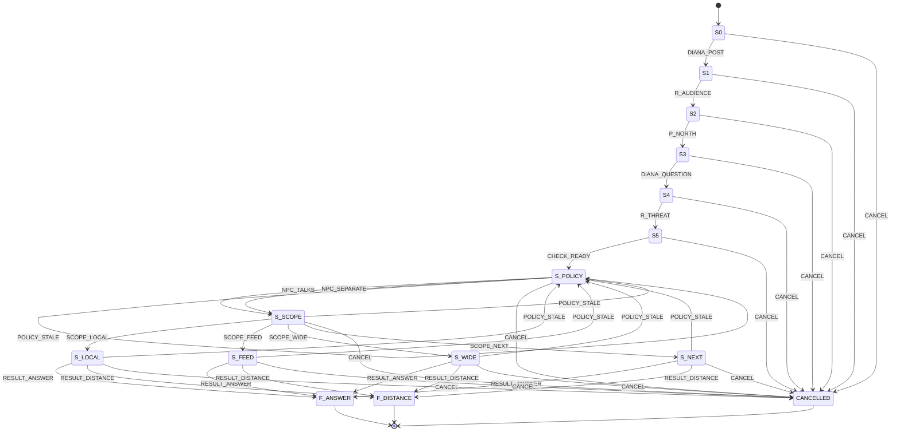

| Исход | Результат | goal_met |
| --- | --- | --- |
| F_ANSWER | Получен предусмотренный публичный ответ NPC. | true |
| F_DISTANCE | NPC ответил об отказе продолжать тему; желаемый контакт не открыт. | false |

Результат TALK от diana: «Угрозу готова обсуждать без предварительной присяги. Помощь армии пока не обещаю.» Для SEPARATE используется нейтральный отказ от продолжения; род и голос реплики берутся из паспорта NPC. Якорь локального результата — p1. В FEED/WIDE/NEXT создаётся новый NPC-пост с отсылкой к этому обсуждению; выбранный игроком герой автором NPC-объекта не становится.

| Прокачка и память | Заполненный вариант |
| --- | --- |
| Возможность | T9 / diana / после P_NORTH |
| q_skill | Открою отдельное обсуждение свидетельств с Севера. Это возможность задать вопросы, не обещание похода моей армии. |
| c_skill | Первый вопрос к рассказу с Севера — что ты видел сам. Второй — что в этом рассказе можно предъявить остальным. Пока я задаю вопросы, а не обещаю поход. |
| Контакт по навыку | Необязательный ROOT(q_skill,diana,r_skill,c_skill); зафиксировать capability_used, не соглашение P с текстом NPC. |
| Следующая встреча | Появляется отдельное обсуждение драконьего стекла; доступ к сведениям не равен физической добыче ресурса. |

### Один перед прежними врагами

| Паспорт | Значение |
| --- | --- |
| story_id / version | `houses_james_01` / `review-2026-10-20.6` |
| Мир / роль | `houses` / `james` |
| Цель | Добейся публичного ответа Дианы и Джона на своё участие в обороне, приехав без обещанной армии семьи. |
| Участники NPC | diana, jon |
| Референс | «Игра престолов», 8×02, A Knight of the Seven Kingdoms: Джейме приехал один и отвечает за прошлое перед прежними врагами. |
| Хронология и знания | Игрок является Джеймсом. Протез справа. Обещанная армия не пришла. Диана потеряла отца от его руки. Джон уже знает происхождение. Поручительство Бриенны является фоном без нового интерактивного NPC. |
| Начальный контекст | Джеймс приехал один. Диана помнит гибель отца, Джон настаивает на общей обороне; право голоса не означает полного прощения. |
| Начальное состояние | S0 |

| Алиас | Объект / автор / якорь | Текст NPC |
| --- | --- | --- |
| c_diana | COMMENT / diana / p1 | Ты приехал один. Мне есть что спросить о прошлом, прежде чем обсуждать доверие. |
| c_jon | COMMENT / jon / p1 | Общая битва близко. Личный вклад обсуждать нужно, но обещанной армии здесь нет. |

| Привязка операции | Объект | После события |
| --- | --- | --- |
| p1 | Пост P | P_ALONE |
| r_diana | Ответ P под p1 | R_DIANA |
| c_diana_reply | Основной ответ diana на r_diana | R_DIANA |
| r_jon | Ответ P под p1 | R_JON |
| c_jon_reply | Основной ответ jon на r_jon | R_JON |
| p2 | Пост P | P_DEFENCE |

| Из | Событие | В | Условие | Видимое последствие | Ходов P |
| --- | --- | --- | --- | --- | --- |
| S0 | P_ALONE | S1 | PUB(p1) | Открой тему от собственного имени после приезда без армии. | 1 |
| S1 | TWO_REPLIES | S2 | NPC(c_diana,c_jon) | Два NPC отвечают за собственные позиции. | 0 |
| S2 | R_DIANA | S3_A | CHILD(p1,diana,c_diana,r_diana,c_diana_reply) | Ответь обоим в их ветках; мнение Дианы не подменяется мнением Джона. | 1 |
| S2 | R_JON | S3_B | CHILD(p1,jon,c_jon,r_jon,c_jon_reply) | Ответь обоим в их ветках; мнение Дианы не подменяется мнением Джона. | 1 |
| S3_A | R_JON | S3 | CHILD(p1,jon,c_jon,r_jon,c_jon_reply) | Ответь обоим в их ветках; мнение Дианы не подменяется мнением Джона. | 1 |
| S3_B | R_DIANA | S3 | CHILD(p1,diana,c_diana,r_diana,c_diana_reply) | Ответь обоим в их ветках; мнение Дианы не подменяется мнением Джона. | 1 |
| S3 | P_DEFENCE | S4 | PUB(p2) | Верни вопрос личного участия в свой канал после обеих реплик. | 1 |
| S4 | CHECK_READY | S_POLICY | EVAL: взять актуальные версии готовности участников и контакты этого запуска | Зафиксированы входы политики, не смысл текста. В S_POLICY решение выводится политиками relationships.md по этим входам. | 0 |
| S_POLICY | BOTH_ACCEPT | S_SCOPE | EVAL: decision_A = TALK и decision_B = TALK; pair_state допускает DIALOGUE | outcome = DIALOGUE; публикация двух согласий ещё ожидается, pair_state пока DISPUTE. | 0 |
| S_POLICY | ANY_REFUSE | S_SCOPE | EVAL: хотя бы один decision = SEPARATE (включая запрет pair_state) | outcome = SEPARATE; позиции не названы примирением. | 0 |
| S_SCOPE | SCOPE_LOCAL | S_LOCAL | EVAL: subs < stages.views.from | scope = LOCAL по сохранённому снимку; новые экономические эффекты не создаются. | 0 |
| S_LOCAL | RESULT_DIALOGUE | F_DIALOGUE | NPC: версии политик актуальны; outcome = DIALOGUE; все result_alias выбранного scope сохранены с нужными авторами и ссылками | Публичный исход подтверждён; только при DIALOGUE пара DISPUTE/RIVALRY/DIALOGUE → DIALOGUE по двум сохранённым согласиям (TRUCE сохраняется); в остальных случаях пара не меняется; goal_met = true. | 0 |
| S_LOCAL | RESULT_SEPARATE | F_SEPARATE | NPC: версии политик актуальны; outcome = SEPARATE; все result_alias выбранного scope сохранены с нужными авторами и ссылками | Публичный исход подтверждён; только при DIALOGUE пара DISPUTE/RIVALRY/DIALOGUE → DIALOGUE по двум сохранённым согласиям (TRUCE сохраняется); в остальных случаях пара не меняется; goal_met = false. | 0 |
| S_SCOPE | SCOPE_FEED | S_FEED | EVAL: stages.views.from <= subs < stages.strike.from | scope = FEED по сохранённому снимку; новые экономические эффекты не создаются. | 0 |
| S_FEED | RESULT_DIALOGUE | F_DIALOGUE | NPC: версии политик актуальны; outcome = DIALOGUE; все result_alias выбранного scope сохранены с нужными авторами и ссылками | Публичный исход подтверждён; только при DIALOGUE пара DISPUTE/RIVALRY/DIALOGUE → DIALOGUE по двум сохранённым согласиям (TRUCE сохраняется); в остальных случаях пара не меняется; goal_met = true. | 0 |
| S_FEED | RESULT_SEPARATE | F_SEPARATE | NPC: версии политик актуальны; outcome = SEPARATE; все result_alias выбранного scope сохранены с нужными авторами и ссылками | Публичный исход подтверждён; только при DIALOGUE пара DISPUTE/RIVALRY/DIALOGUE → DIALOGUE по двум сохранённым согласиям (TRUCE сохраняется); в остальных случаях пара не меняется; goal_met = false. | 0 |
| S_SCOPE | SCOPE_WIDE | S_WIDE | EVAL: stages.strike.from <= subs < stages.new_line.from | scope = WIDE по сохранённому снимку; новые экономические эффекты не создаются. | 0 |
| S_WIDE | RESULT_DIALOGUE | F_DIALOGUE | NPC: версии политик актуальны; outcome = DIALOGUE; все result_alias выбранного scope сохранены с нужными авторами и ссылками | Публичный исход подтверждён; только при DIALOGUE пара DISPUTE/RIVALRY/DIALOGUE → DIALOGUE по двум сохранённым согласиям (TRUCE сохраняется); в остальных случаях пара не меняется; goal_met = true. | 0 |
| S_WIDE | RESULT_SEPARATE | F_SEPARATE | NPC: версии политик актуальны; outcome = SEPARATE; все result_alias выбранного scope сохранены с нужными авторами и ссылками | Публичный исход подтверждён; только при DIALOGUE пара DISPUTE/RIVALRY/DIALOGUE → DIALOGUE по двум сохранённым согласиям (TRUCE сохраняется); в остальных случаях пара не меняется; goal_met = false. | 0 |
| S_SCOPE | SCOPE_NEXT | S_NEXT | EVAL: subs >= stages.new_line.from | scope = NEXT по сохранённому снимку; новые экономические эффекты не создаются. | 0 |
| S_NEXT | RESULT_DIALOGUE | F_DIALOGUE | NPC: версии политик актуальны; outcome = DIALOGUE; все result_alias выбранного scope сохранены с нужными авторами и ссылками | Публичный исход подтверждён; только при DIALOGUE пара DISPUTE/RIVALRY/DIALOGUE → DIALOGUE по двум сохранённым согласиям (TRUCE сохраняется); в остальных случаях пара не меняется; goal_met = true. | 0 |
| S_NEXT | RESULT_SEPARATE | F_SEPARATE | NPC: версии политик актуальны; outcome = SEPARATE; все result_alias выбранного scope сохранены с нужными авторами и ссылками | Публичный исход подтверждён; только при DIALOGUE пара DISPUTE/RIVALRY/DIALOGUE → DIALOGUE по двум сохранённым согласиям (TRUCE сохраняется); в остальных случаях пара не меняется; goal_met = false. | 0 |
| S_POLICY | POLICY_STALE | S_POLICY | EVAL: версия готовности/пары отличается от snapshot_id; результат ещё не опубликован | Новый снимок политики; scope подписчиков и оплаченные действия сохраняются. | 0 |
| S_SCOPE | POLICY_STALE | S_POLICY | EVAL: версия готовности/пары отличается от snapshot_id; результат ещё не опубликован | Новый снимок политики; scope подписчиков и оплаченные действия сохраняются. | 0 |
| S_LOCAL | POLICY_STALE | S_POLICY | EVAL: версия готовности/пары отличается от snapshot_id; результат ещё не опубликован | Новый снимок политики; scope подписчиков и оплаченные действия сохраняются. | 0 |
| S_FEED | POLICY_STALE | S_POLICY | EVAL: версия готовности/пары отличается от snapshot_id; результат ещё не опубликован | Новый снимок политики; scope подписчиков и оплаченные действия сохраняются. | 0 |
| S_WIDE | POLICY_STALE | S_POLICY | EVAL: версия готовности/пары отличается от snapshot_id; результат ещё не опубликован | Новый снимок политики; scope подписчиков и оплаченные действия сохраняются. | 0 |
| S_NEXT | POLICY_STALE | S_POLICY | EVAL: версия готовности/пары отличается от snapshot_id; результат ещё не опубликован | Новый снимок политики; scope подписчиков и оплаченные действия сохраняются. | 0 |

| Состояние | Следующий шаг |
| --- | --- |
| S0 | PUB(p1) |
| S1 | Ожидание внутреннего шага: TWO_REPLIES |
| S2 | CHILD(p1,diana,c_diana,r_diana,c_diana_reply) / CHILD(p1,jon,c_jon,r_jon,c_jon_reply) |
| S3 | PUB(p2) |
| S3_A | CHILD(p1,jon,c_jon,r_jon,c_jon_reply) |
| S3_B | CHILD(p1,diana,c_diana,r_diana,c_diana_reply) |
| S4 | Ожидание внутреннего шага: CHECK_READY |
| S_POLICY | Ожидание внутреннего шага: BOTH_ACCEPT, ANY_REFUSE, POLICY_STALE |
| S_SCOPE | Ожидание внутреннего шага: SCOPE_LOCAL, SCOPE_FEED, SCOPE_WIDE, SCOPE_NEXT, POLICY_STALE |
| S_LOCAL | Ожидание внутреннего шага: RESULT_DIALOGUE, RESULT_SEPARATE, POLICY_STALE |
| S_FEED | Ожидание внутреннего шага: RESULT_DIALOGUE, RESULT_SEPARATE, POLICY_STALE |
| S_WIDE | Ожидание внутреннего шага: RESULT_DIALOGUE, RESULT_SEPARATE, POLICY_STALE |
| S_NEXT | Ожидание внутреннего шага: RESULT_DIALOGUE, RESULT_SEPARATE, POLICY_STALE |
| F_DIALOGUE | Оба NPC опубликовали готовность продолжить общую тему. |
| F_SEPARATE | Хотя бы один NPC сохранил отдельную позицию; совместный разговор не открыт. |
| CANCELLED | Запуск отменён |

| Состояние | P_ALONE | TWO_REPLIES | R_DIANA | R_JON | P_DEFENCE | CHECK_READY | BOTH_ACCEPT | ANY_REFUSE | SCOPE_LOCAL | RESULT_DIALOGUE | RESULT_SEPARATE | SCOPE_FEED | SCOPE_WIDE | SCOPE_NEXT | POLICY_STALE | OTHER | CANCEL |
| --- | --- | --- | --- | --- | --- | --- | --- | --- | --- | --- | --- | --- | --- | --- | --- | --- | --- |
| S0 | S1 | S0 | S0 | S0 | S0 | S0 | S0 | S0 | S0 | S0 | S0 | S0 | S0 | S0 | S0 | S0 | CANCELLED |
| S1 | S1 | S2 | S1 | S1 | S1 | S1 | S1 | S1 | S1 | S1 | S1 | S1 | S1 | S1 | S1 | S1 | CANCELLED |
| S2 | S2 | S2 | S3_A | S3_B | S2 | S2 | S2 | S2 | S2 | S2 | S2 | S2 | S2 | S2 | S2 | S2 | CANCELLED |
| S3 | S3 | S3 | S3 | S3 | S4 | S3 | S3 | S3 | S3 | S3 | S3 | S3 | S3 | S3 | S3 | S3 | CANCELLED |
| S3_A | S3_A | S3_A | S3_A | S3 | S3_A | S3_A | S3_A | S3_A | S3_A | S3_A | S3_A | S3_A | S3_A | S3_A | S3_A | S3_A | CANCELLED |
| S3_B | S3_B | S3_B | S3 | S3_B | S3_B | S3_B | S3_B | S3_B | S3_B | S3_B | S3_B | S3_B | S3_B | S3_B | S3_B | S3_B | CANCELLED |
| S4 | S4 | S4 | S4 | S4 | S4 | S_POLICY | S4 | S4 | S4 | S4 | S4 | S4 | S4 | S4 | S4 | S4 | CANCELLED |
| S_POLICY | S_POLICY | S_POLICY | S_POLICY | S_POLICY | S_POLICY | S_POLICY | S_SCOPE | S_SCOPE | S_POLICY | S_POLICY | S_POLICY | S_POLICY | S_POLICY | S_POLICY | S_POLICY | S_POLICY | CANCELLED |
| S_SCOPE | S_SCOPE | S_SCOPE | S_SCOPE | S_SCOPE | S_SCOPE | S_SCOPE | S_SCOPE | S_SCOPE | S_LOCAL | S_SCOPE | S_SCOPE | S_FEED | S_WIDE | S_NEXT | S_POLICY | S_SCOPE | CANCELLED |
| S_LOCAL | S_LOCAL | S_LOCAL | S_LOCAL | S_LOCAL | S_LOCAL | S_LOCAL | S_LOCAL | S_LOCAL | S_LOCAL | F_DIALOGUE | F_SEPARATE | S_LOCAL | S_LOCAL | S_LOCAL | S_POLICY | S_LOCAL | CANCELLED |
| S_FEED | S_FEED | S_FEED | S_FEED | S_FEED | S_FEED | S_FEED | S_FEED | S_FEED | S_FEED | F_DIALOGUE | F_SEPARATE | S_FEED | S_FEED | S_FEED | S_POLICY | S_FEED | CANCELLED |
| S_WIDE | S_WIDE | S_WIDE | S_WIDE | S_WIDE | S_WIDE | S_WIDE | S_WIDE | S_WIDE | S_WIDE | F_DIALOGUE | F_SEPARATE | S_WIDE | S_WIDE | S_WIDE | S_POLICY | S_WIDE | CANCELLED |
| S_NEXT | S_NEXT | S_NEXT | S_NEXT | S_NEXT | S_NEXT | S_NEXT | S_NEXT | S_NEXT | S_NEXT | F_DIALOGUE | F_SEPARATE | S_NEXT | S_NEXT | S_NEXT | S_POLICY | S_NEXT | CANCELLED |
| F_DIALOGUE | F_DIALOGUE | F_DIALOGUE | F_DIALOGUE | F_DIALOGUE | F_DIALOGUE | F_DIALOGUE | F_DIALOGUE | F_DIALOGUE | F_DIALOGUE | F_DIALOGUE | F_DIALOGUE | F_DIALOGUE | F_DIALOGUE | F_DIALOGUE | F_DIALOGUE | F_DIALOGUE | F_DIALOGUE |
| F_SEPARATE | F_SEPARATE | F_SEPARATE | F_SEPARATE | F_SEPARATE | F_SEPARATE | F_SEPARATE | F_SEPARATE | F_SEPARATE | F_SEPARATE | F_SEPARATE | F_SEPARATE | F_SEPARATE | F_SEPARATE | F_SEPARATE | F_SEPARATE | F_SEPARATE | F_SEPARATE |
| CANCELLED | CANCELLED | CANCELLED | CANCELLED | CANCELLED | CANCELLED | CANCELLED | CANCELLED | CANCELLED | CANCELLED | CANCELLED | CANCELLED | CANCELLED | CANCELLED | CANCELLED | CANCELLED | CANCELLED | CANCELLED |

OTHER не меняет этап: не тот автор, мир, пост, родитель, версия, порядок, повтор или свободный ход. Неверный запрос отклоняется до списания; self-loop не означает платную обработку ошибки. PAUSED/WAITING_RETRY — статусы поверх состояния, не дополнительные сюжетные переходы.

| Исход | Результат | goal_met |
| --- | --- | --- |
| F_DIALOGUE | Оба NPC опубликовали готовность продолжить общую тему. | true |
| F_SEPARATE | Хотя бы один NPC сохранил отдельную позицию; совместный разговор не открыт. | false |

Результат TALK от diana: «Твою личную помощь можно обсуждать. Это не прощение прошлого и не поддержка твоего дома.» Для SEPARATE используется нейтральный отказ от продолжения; род и голос реплики берутся из паспорта NPC. У пары diana ↔ jon причина спора: Допуск прежнего врага к обсуждению общей обороны. Политики CAUTIOUS/OPEN; в DIALOGUE оба публикуют собственное «готов продолжить эту тему», в SEPARATE каждый публикует свой фактический TALK/SEPARATE. Дружба, поддержка игроком стороны и перемирие не назначаются. Якорь локального результата — p2. В FEED/WIDE/NEXT создаётся новый NPC-пост с отсылкой к этому обсуждению; выбранный игроком герой автором NPC-объекта не становится.

| Прокачка и память | Заполненный вариант |
| --- | --- |
| Возможность | B3 / diana / после P_DEFENCE |
| q_skill | Отвечу на твоё личное участие отдельно. Приезд без армии и прошлое твоего дома я не забуду. |
| c_skill | Мой вопрос к тебе остаётся прежним: почему приехал один. Готовность выслушать ответ не отменяет ни прошлого твоего дома, ни отсутствия обещанной армии. |
| Контакт по навыку | Необязательный ROOT(q_skill,diana,r_skill,c_skill); зафиксировать capability_used, не соглашение P с текстом NPC. |
| Следующая встреча | Обсуждается распределение личных ролей в обороне. Открытый диалог не превращается в полное прощение семьи. |

### Первый разбор «Смены»

| Паспорт | Значение |
| --- | --- |
| story_id / version | `it_own_01` / `review-2026-10-20.6` |
| Мир / роль | `it` / `own` |
| Цель | Собери вокруг своего разбора «Смены» спор Меркантила, Куляша и Бургера: о цене обещаний, проверке и громком заголовке. |
| Участники NPC | greedy_wolf, alexey_nl, 2kotleti_news |
| Референс | Исходные образы #195: расчёт выгоды Меркантила, инженерная проверка Куляша и эфир Бургера. Сервис «Смена» вымышленный. |
| Хронология и знания | Есть только анонс сервиса. Результаты теста ещё не подтверждены. Реальные компании и авторы каналов не являются участниками. |
| Начальный контекст | Есть анонс и демо вымышленного сервиса, независимого повтора нет. Содержимое поста игрока не проверяет реальную производительность AI. |
| Начальное состояние | S0 |

| Алиас | Объект / автор / якорь | Текст NPC |
| --- | --- | --- |
| c_merk | COMMENT / greedy_wolf / p1 | Давайте сначала считать цену исправлений и времени: даже повторяемая «Смена» может оказаться невыгодной. |
| c_kul | COMMENT / alexey_nl / p1 | С расчётом выгоды спешить рано: без входных данных и независимого повтора неясно, что мы вообще оцениваем. |
| c_burger | COMMENT / 2kotleti_news / p2 | Для эфира тут уже две котлеты: обещание заменить команду и спор о том, как это вообще проверять. |

| Привязка операции | Объект | После события |
| --- | --- | --- |
| p1 | Пост P | P_ANNOUNCE |
| r_merk | Ответ P под p1 | R_MERK |
| c_merk_reply | Основной ответ greedy_wolf на r_merk | R_MERK |
| r_kul | Ответ P под p1 | R_KUL |
| c_kul_reply | Основной ответ alexey_nl на r_kul | R_KUL |
| p2 | Пост P | P_DISCUSSION |

| Из | Событие | В | Условие | Видимое последствие | Ходов P |
| --- | --- | --- | --- | --- | --- |
| S0 | P_ANNOUNCE | S1 | PUB(p1) | Начни обсуждение «Смены» в своём канале. | 1 |
| S1 | TWO_COMMENTS | S2 | NPC(c_merk,c_kul) | Меркантил и Куляш поставили разные вопросы. | 0 |
| S2 | R_MERK | S3_A | CHILD(p1,greedy_wolf,c_merk,r_merk,c_merk_reply) | Поговори с обоими по их конкретным вопросам. | 1 |
| S2 | R_KUL | S3_B | CHILD(p1,alexey_nl,c_kul,r_kul,c_kul_reply) | Поговори с обоими по их конкретным вопросам. | 1 |
| S3_A | R_KUL | S3 | CHILD(p1,alexey_nl,c_kul,r_kul,c_kul_reply) | Поговори с обоими по их конкретным вопросам. | 1 |
| S3_B | R_MERK | S3 | CHILD(p1,greedy_wolf,c_merk,r_merk,c_merk_reply) | Поговори с обоими по их конкретным вопросам. | 1 |
| S3 | P_DISCUSSION | S4 | PUB(p2) | Верни тему в канал после двух разговоров. | 1 |
| S4 | BURGER_JOINS | S5 | NPC(c_burger) | Бургер подключился к обсуждению, не подтвердил результат теста. | 0 |
| S5 | CHECK_READY | S_POLICY | EVAL: взять актуальные версии готовности участников и контакты этого запуска | Зафиксированы входы политики, не смысл текста. В S_POLICY решение выводится политиками relationships.md по этим входам. | 0 |
| S_POLICY | BOTH_ACCEPT | S_SCOPE | EVAL: decision_A = TALK и decision_B = TALK; pair_state допускает DIALOGUE | outcome = DIALOGUE; публикация двух согласий ещё ожидается, pair_state пока DISPUTE. | 0 |
| S_POLICY | ANY_REFUSE | S_SCOPE | EVAL: хотя бы один decision = SEPARATE (включая запрет pair_state) | outcome = SEPARATE; позиции не названы примирением. | 0 |
| S_SCOPE | SCOPE_LOCAL | S_LOCAL | EVAL: subs < stages.views.from | scope = LOCAL по сохранённому снимку; новые экономические эффекты не создаются. | 0 |
| S_LOCAL | RESULT_DIALOGUE | F_DIALOGUE | NPC: версии политик актуальны; outcome = DIALOGUE; все result_alias выбранного scope сохранены с нужными авторами и ссылками | Публичный исход подтверждён; только при DIALOGUE пара DISPUTE/RIVALRY/DIALOGUE → DIALOGUE по двум сохранённым согласиям (TRUCE сохраняется); в остальных случаях пара не меняется; goal_met = true. | 0 |
| S_LOCAL | RESULT_SEPARATE | F_SEPARATE | NPC: версии политик актуальны; outcome = SEPARATE; все result_alias выбранного scope сохранены с нужными авторами и ссылками | Публичный исход подтверждён; только при DIALOGUE пара DISPUTE/RIVALRY/DIALOGUE → DIALOGUE по двум сохранённым согласиям (TRUCE сохраняется); в остальных случаях пара не меняется; goal_met = false. | 0 |
| S_SCOPE | SCOPE_FEED | S_FEED | EVAL: stages.views.from <= subs < stages.strike.from | scope = FEED по сохранённому снимку; новые экономические эффекты не создаются. | 0 |
| S_FEED | RESULT_DIALOGUE | F_DIALOGUE | NPC: версии политик актуальны; outcome = DIALOGUE; все result_alias выбранного scope сохранены с нужными авторами и ссылками | Публичный исход подтверждён; только при DIALOGUE пара DISPUTE/RIVALRY/DIALOGUE → DIALOGUE по двум сохранённым согласиям (TRUCE сохраняется); в остальных случаях пара не меняется; goal_met = true. | 0 |
| S_FEED | RESULT_SEPARATE | F_SEPARATE | NPC: версии политик актуальны; outcome = SEPARATE; все result_alias выбранного scope сохранены с нужными авторами и ссылками | Публичный исход подтверждён; только при DIALOGUE пара DISPUTE/RIVALRY/DIALOGUE → DIALOGUE по двум сохранённым согласиям (TRUCE сохраняется); в остальных случаях пара не меняется; goal_met = false. | 0 |
| S_SCOPE | SCOPE_WIDE | S_WIDE | EVAL: stages.strike.from <= subs < stages.new_line.from | scope = WIDE по сохранённому снимку; новые экономические эффекты не создаются. | 0 |
| S_WIDE | RESULT_DIALOGUE | F_DIALOGUE | NPC: версии политик актуальны; outcome = DIALOGUE; все result_alias выбранного scope сохранены с нужными авторами и ссылками | Публичный исход подтверждён; только при DIALOGUE пара DISPUTE/RIVALRY/DIALOGUE → DIALOGUE по двум сохранённым согласиям (TRUCE сохраняется); в остальных случаях пара не меняется; goal_met = true. | 0 |
| S_WIDE | RESULT_SEPARATE | F_SEPARATE | NPC: версии политик актуальны; outcome = SEPARATE; все result_alias выбранного scope сохранены с нужными авторами и ссылками | Публичный исход подтверждён; только при DIALOGUE пара DISPUTE/RIVALRY/DIALOGUE → DIALOGUE по двум сохранённым согласиям (TRUCE сохраняется); в остальных случаях пара не меняется; goal_met = false. | 0 |
| S_SCOPE | SCOPE_NEXT | S_NEXT | EVAL: subs >= stages.new_line.from | scope = NEXT по сохранённому снимку; новые экономические эффекты не создаются. | 0 |
| S_NEXT | RESULT_DIALOGUE | F_DIALOGUE | NPC: версии политик актуальны; outcome = DIALOGUE; все result_alias выбранного scope сохранены с нужными авторами и ссылками | Публичный исход подтверждён; только при DIALOGUE пара DISPUTE/RIVALRY/DIALOGUE → DIALOGUE по двум сохранённым согласиям (TRUCE сохраняется); в остальных случаях пара не меняется; goal_met = true. | 0 |
| S_NEXT | RESULT_SEPARATE | F_SEPARATE | NPC: версии политик актуальны; outcome = SEPARATE; все result_alias выбранного scope сохранены с нужными авторами и ссылками | Публичный исход подтверждён; только при DIALOGUE пара DISPUTE/RIVALRY/DIALOGUE → DIALOGUE по двум сохранённым согласиям (TRUCE сохраняется); в остальных случаях пара не меняется; goal_met = false. | 0 |
| S_POLICY | POLICY_STALE | S_POLICY | EVAL: версия готовности/пары отличается от snapshot_id; результат ещё не опубликован | Новый снимок политики; scope подписчиков и оплаченные действия сохраняются. | 0 |
| S_SCOPE | POLICY_STALE | S_POLICY | EVAL: версия готовности/пары отличается от snapshot_id; результат ещё не опубликован | Новый снимок политики; scope подписчиков и оплаченные действия сохраняются. | 0 |
| S_LOCAL | POLICY_STALE | S_POLICY | EVAL: версия готовности/пары отличается от snapshot_id; результат ещё не опубликован | Новый снимок политики; scope подписчиков и оплаченные действия сохраняются. | 0 |
| S_FEED | POLICY_STALE | S_POLICY | EVAL: версия готовности/пары отличается от snapshot_id; результат ещё не опубликован | Новый снимок политики; scope подписчиков и оплаченные действия сохраняются. | 0 |
| S_WIDE | POLICY_STALE | S_POLICY | EVAL: версия готовности/пары отличается от snapshot_id; результат ещё не опубликован | Новый снимок политики; scope подписчиков и оплаченные действия сохраняются. | 0 |
| S_NEXT | POLICY_STALE | S_POLICY | EVAL: версия готовности/пары отличается от snapshot_id; результат ещё не опубликован | Новый снимок политики; scope подписчиков и оплаченные действия сохраняются. | 0 |

| Состояние | Следующий шаг |
| --- | --- |
| S0 | PUB(p1) |
| S1 | Ожидание внутреннего шага: TWO_COMMENTS |
| S2 | CHILD(p1,greedy_wolf,c_merk,r_merk,c_merk_reply) / CHILD(p1,alexey_nl,c_kul,r_kul,c_kul_reply) |
| S3 | PUB(p2) |
| S3_A | CHILD(p1,alexey_nl,c_kul,r_kul,c_kul_reply) |
| S3_B | CHILD(p1,greedy_wolf,c_merk,r_merk,c_merk_reply) |
| S4 | Ожидание внутреннего шага: BURGER_JOINS |
| S5 | Ожидание внутреннего шага: CHECK_READY |
| S_POLICY | Ожидание внутреннего шага: BOTH_ACCEPT, ANY_REFUSE, POLICY_STALE |
| S_SCOPE | Ожидание внутреннего шага: SCOPE_LOCAL, SCOPE_FEED, SCOPE_WIDE, SCOPE_NEXT, POLICY_STALE |
| S_LOCAL | Ожидание внутреннего шага: RESULT_DIALOGUE, RESULT_SEPARATE, POLICY_STALE |
| S_FEED | Ожидание внутреннего шага: RESULT_DIALOGUE, RESULT_SEPARATE, POLICY_STALE |
| S_WIDE | Ожидание внутреннего шага: RESULT_DIALOGUE, RESULT_SEPARATE, POLICY_STALE |
| S_NEXT | Ожидание внутреннего шага: RESULT_DIALOGUE, RESULT_SEPARATE, POLICY_STALE |
| F_DIALOGUE | Оба NPC опубликовали готовность продолжить общую тему. |
| F_SEPARATE | Хотя бы один NPC сохранил отдельную позицию; совместный разговор не открыт. |
| CANCELLED | Запуск отменён |

| Состояние | P_ANNOUNCE | TWO_COMMENTS | R_MERK | R_KUL | P_DISCUSSION | BURGER_JOINS | CHECK_READY | BOTH_ACCEPT | ANY_REFUSE | SCOPE_LOCAL | RESULT_DIALOGUE | RESULT_SEPARATE | SCOPE_FEED | SCOPE_WIDE | SCOPE_NEXT | POLICY_STALE | OTHER | CANCEL |
| --- | --- | --- | --- | --- | --- | --- | --- | --- | --- | --- | --- | --- | --- | --- | --- | --- | --- | --- |
| S0 | S1 | S0 | S0 | S0 | S0 | S0 | S0 | S0 | S0 | S0 | S0 | S0 | S0 | S0 | S0 | S0 | S0 | CANCELLED |
| S1 | S1 | S2 | S1 | S1 | S1 | S1 | S1 | S1 | S1 | S1 | S1 | S1 | S1 | S1 | S1 | S1 | S1 | CANCELLED |
| S2 | S2 | S2 | S3_A | S3_B | S2 | S2 | S2 | S2 | S2 | S2 | S2 | S2 | S2 | S2 | S2 | S2 | S2 | CANCELLED |
| S3 | S3 | S3 | S3 | S3 | S4 | S3 | S3 | S3 | S3 | S3 | S3 | S3 | S3 | S3 | S3 | S3 | S3 | CANCELLED |
| S3_A | S3_A | S3_A | S3_A | S3 | S3_A | S3_A | S3_A | S3_A | S3_A | S3_A | S3_A | S3_A | S3_A | S3_A | S3_A | S3_A | S3_A | CANCELLED |
| S3_B | S3_B | S3_B | S3 | S3_B | S3_B | S3_B | S3_B | S3_B | S3_B | S3_B | S3_B | S3_B | S3_B | S3_B | S3_B | S3_B | S3_B | CANCELLED |
| S4 | S4 | S4 | S4 | S4 | S4 | S5 | S4 | S4 | S4 | S4 | S4 | S4 | S4 | S4 | S4 | S4 | S4 | CANCELLED |
| S5 | S5 | S5 | S5 | S5 | S5 | S5 | S_POLICY | S5 | S5 | S5 | S5 | S5 | S5 | S5 | S5 | S5 | S5 | CANCELLED |
| S_POLICY | S_POLICY | S_POLICY | S_POLICY | S_POLICY | S_POLICY | S_POLICY | S_POLICY | S_SCOPE | S_SCOPE | S_POLICY | S_POLICY | S_POLICY | S_POLICY | S_POLICY | S_POLICY | S_POLICY | S_POLICY | CANCELLED |
| S_SCOPE | S_SCOPE | S_SCOPE | S_SCOPE | S_SCOPE | S_SCOPE | S_SCOPE | S_SCOPE | S_SCOPE | S_SCOPE | S_LOCAL | S_SCOPE | S_SCOPE | S_FEED | S_WIDE | S_NEXT | S_POLICY | S_SCOPE | CANCELLED |
| S_LOCAL | S_LOCAL | S_LOCAL | S_LOCAL | S_LOCAL | S_LOCAL | S_LOCAL | S_LOCAL | S_LOCAL | S_LOCAL | S_LOCAL | F_DIALOGUE | F_SEPARATE | S_LOCAL | S_LOCAL | S_LOCAL | S_POLICY | S_LOCAL | CANCELLED |
| S_FEED | S_FEED | S_FEED | S_FEED | S_FEED | S_FEED | S_FEED | S_FEED | S_FEED | S_FEED | S_FEED | F_DIALOGUE | F_SEPARATE | S_FEED | S_FEED | S_FEED | S_POLICY | S_FEED | CANCELLED |
| S_WIDE | S_WIDE | S_WIDE | S_WIDE | S_WIDE | S_WIDE | S_WIDE | S_WIDE | S_WIDE | S_WIDE | S_WIDE | F_DIALOGUE | F_SEPARATE | S_WIDE | S_WIDE | S_WIDE | S_POLICY | S_WIDE | CANCELLED |
| S_NEXT | S_NEXT | S_NEXT | S_NEXT | S_NEXT | S_NEXT | S_NEXT | S_NEXT | S_NEXT | S_NEXT | S_NEXT | F_DIALOGUE | F_SEPARATE | S_NEXT | S_NEXT | S_NEXT | S_POLICY | S_NEXT | CANCELLED |
| F_DIALOGUE | F_DIALOGUE | F_DIALOGUE | F_DIALOGUE | F_DIALOGUE | F_DIALOGUE | F_DIALOGUE | F_DIALOGUE | F_DIALOGUE | F_DIALOGUE | F_DIALOGUE | F_DIALOGUE | F_DIALOGUE | F_DIALOGUE | F_DIALOGUE | F_DIALOGUE | F_DIALOGUE | F_DIALOGUE | F_DIALOGUE |
| F_SEPARATE | F_SEPARATE | F_SEPARATE | F_SEPARATE | F_SEPARATE | F_SEPARATE | F_SEPARATE | F_SEPARATE | F_SEPARATE | F_SEPARATE | F_SEPARATE | F_SEPARATE | F_SEPARATE | F_SEPARATE | F_SEPARATE | F_SEPARATE | F_SEPARATE | F_SEPARATE | F_SEPARATE |
| CANCELLED | CANCELLED | CANCELLED | CANCELLED | CANCELLED | CANCELLED | CANCELLED | CANCELLED | CANCELLED | CANCELLED | CANCELLED | CANCELLED | CANCELLED | CANCELLED | CANCELLED | CANCELLED | CANCELLED | CANCELLED | CANCELLED |

OTHER не меняет этап: не тот автор, мир, пост, родитель, версия, порядок, повтор или свободный ход. Неверный запрос отклоняется до списания; self-loop не означает платную обработку ошибки. PAUSED/WAITING_RETRY — статусы поверх состояния, не дополнительные сюжетные переходы.

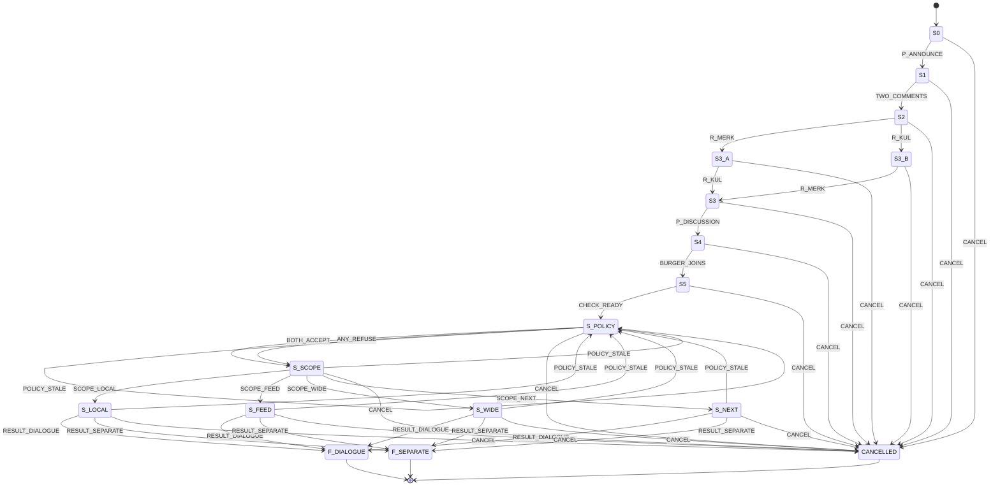

| Исход | Результат | goal_met |
| --- | --- | --- |
| F_DIALOGUE | Оба NPC опубликовали готовность продолжить общую тему. | true |
| F_SEPARATE | Хотя бы один NPC сохранил отдельную позицию; совместный разговор не открыт. | false |

Результат TALK от alexey_nl: «К спору добавлены условия будущей проверки. Демо остаётся демо; результата независимого повтора нет.» Для SEPARATE используется нейтральный отказ от продолжения; род и голос реплики берутся из паспорта NPC. У пары greedy_wolf ↔ alexey_nl причина спора: Что считать достаточным разбором: цена времени или повторяемость. Политики OPEN/OPEN; в DIALOGUE оба публикуют собственное «готов продолжить эту тему», в SEPARATE каждый публикует свой фактический TALK/SEPARATE. Дружба, поддержка игроком стороны и перемирие не назначаются. Якорь локального результата — p2. В FEED/WIDE/NEXT создаётся новый NPC-пост с отсылкой к этому обсуждению; выбранный игроком герой автором NPC-объекта не становится.

| Прокачка и память | Заполненный вариант |
| --- | --- |
| Возможность | T9 / alexey_nl / после P_ANNOUNCE |
| q_skill | Открою отдельную ветку условий будущего повтора. Для участия не нужно делать вид, что результат уже доказан. |
| c_skill | Для будущего повтора нужны одинаковые входные данные, среда и явный учёт исправлений. Сейчас это условия проверки, а не готовый отчёт о её успехе. |
| Контакт по навыку | Необязательный ROOT(q_skill,alexey_nl,r_skill,c_skill); зафиксировать capability_used, не соглашение P с текстом NPC. |
| Следующая встреча | Бургер выпускает заголовок по спору. Меркантил и Куляш сохраняют разные критерии; готовность к новой общей теме зависит от прошлого диалога. |

### Сколько стоит внимание

| Паспорт | Значение |
| --- | --- |
| story_id / version | `it_greedy_wolf_01` / `review-2026-10-20.6` |
| Мир / роль | `it` / `greedy_wolf` |
| Цель | Устрой с Куляшем публичное сравнение: что выгоднее твоему каналу на единицу энергии — пост или ответ в чужом обсуждении. |
| Участники NPC | alexey_nl |
| Референс | Меркантил: выгода, стоимость ресурса и волчья самоирония из исходной постановки #195. Сюжет вымышленный. |
| Хронология и знания | Игрок является Меркантилом. Сравнивается отдача двух действий внутри игры, не реальная производительность AI или доход автора канала. |
| Начальный контекст | Измеряются две реальные игровые операции. Сравнение не доказывает эффективность «Смены» и ничего не говорит о доходах прототипов. |
| Начальное состояние | S0 |

| Алиас | Объект / автор / якорь | Текст NPC |
| --- | --- | --- |
| q_kul | POST / alexey_nl | Второй образец — ответ под этим постом. После него сравним фактический прирост и расход энергии каждой операции. |
| q_metrics | POST / alexey_nl | Сравнение: пост {Gp} подписчиков / {Cp} энергии; ответ {Gr} / {Cr}. D = {D}. {roi_result}. Это игровые операции, не тест сервиса. |

| Привязка операции | Объект | После события |
| --- | --- | --- |
| p1 | Пост P | P_SAMPLE |
| r1 | Ответ P под q_kul | R_SAMPLE |
| c1 | Основной ответ alexey_nl на r1 | R_SAMPLE |
| r2 | Ответ P под q_metrics | R_COMPARE |
| c2 | Основной ответ alexey_nl на r2 | R_COMPARE |

| Из | Событие | В | Условие | Видимое последствие | Ходов P |
| --- | --- | --- | --- | --- | --- |
| S0 | P_SAMPLE | S1 | PUB(p1) | Опубликуй первый пост сравнения; сохранить фактические Gp и Cp. | 1 |
| S1 | KUL_SAMPLE | S2 | NPC(q_kul) | Открыта конкретная ветка для второго измерения. | 0 |
| S2 | R_SAMPLE | S3 | ROOT(q_kul,alexey_nl,r1,c1) | Ответь Куляшу; сохранить реальные Gr и Cr одной транзакции. | 1 |
| S3 | METRICS | S4 | NPC(q_metrics) | Обе квитанции публикует NPC по сохранённым числам; текст игрока не подставляет результат. | 0 |
| S4 | R_COMPARE | S5 | ROOT(q_metrics,alexey_nl,r2,c2) | Обсуди уже опубликованное сравнение под точным постом с квитанциями. | 1 |
| S5 | CHECK_READY | S_POLICY | EVAL: взять актуальные версии готовности участников и контакты этого запуска | Зафиксированы входы политики, не смысл текста. В S_POLICY решение выводится политиками relationships.md по этим входам. | 0 |
| S_POLICY | ROI_POST | S_SCOPE | EVAL: D = Gp*Cr - Gr*Cp > 0 | outcome = POST; выгоднее публикация по этим двум квитанциям. | 0 |
| S_POLICY | ROI_REPLY | S_SCOPE | EVAL: D < 0 | outcome = REPLY; выгоднее ответ. | 0 |
| S_POLICY | ROI_TIE | S_SCOPE | EVAL: D = 0 | outcome = TIE; одинаковая отдача. | 0 |
| S_SCOPE | SCOPE_LOCAL | S_LOCAL | EVAL: subs < stages.views.from | scope = LOCAL по сохранённому снимку; новые экономические эффекты не создаются. | 0 |
| S_LOCAL | RESULT_POST | F_POST | NPC: версии политик актуальны; outcome = POST; все result_alias выбранного scope сохранены с нужными авторами и ссылками | Публичный исход подтверждён; только при DIALOGUE пара DISPUTE/RIVALRY/DIALOGUE → DIALOGUE по двум сохранённым согласиям (TRUCE сохраняется); в остальных случаях пара не меняется; goal_met = true. | 0 |
| S_LOCAL | RESULT_REPLY | F_REPLY | NPC: версии политик актуальны; outcome = REPLY; все result_alias выбранного scope сохранены с нужными авторами и ссылками | Публичный исход подтверждён; только при DIALOGUE пара DISPUTE/RIVALRY/DIALOGUE → DIALOGUE по двум сохранённым согласиям (TRUCE сохраняется); в остальных случаях пара не меняется; goal_met = true. | 0 |
| S_LOCAL | RESULT_TIE | F_TIE | NPC: версии политик актуальны; outcome = TIE; все result_alias выбранного scope сохранены с нужными авторами и ссылками | Публичный исход подтверждён; только при DIALOGUE пара DISPUTE/RIVALRY/DIALOGUE → DIALOGUE по двум сохранённым согласиям (TRUCE сохраняется); в остальных случаях пара не меняется; goal_met = true. | 0 |
| S_SCOPE | SCOPE_FEED | S_FEED | EVAL: stages.views.from <= subs < stages.strike.from | scope = FEED по сохранённому снимку; новые экономические эффекты не создаются. | 0 |
| S_FEED | RESULT_POST | F_POST | NPC: версии политик актуальны; outcome = POST; все result_alias выбранного scope сохранены с нужными авторами и ссылками | Публичный исход подтверждён; только при DIALOGUE пара DISPUTE/RIVALRY/DIALOGUE → DIALOGUE по двум сохранённым согласиям (TRUCE сохраняется); в остальных случаях пара не меняется; goal_met = true. | 0 |
| S_FEED | RESULT_REPLY | F_REPLY | NPC: версии политик актуальны; outcome = REPLY; все result_alias выбранного scope сохранены с нужными авторами и ссылками | Публичный исход подтверждён; только при DIALOGUE пара DISPUTE/RIVALRY/DIALOGUE → DIALOGUE по двум сохранённым согласиям (TRUCE сохраняется); в остальных случаях пара не меняется; goal_met = true. | 0 |
| S_FEED | RESULT_TIE | F_TIE | NPC: версии политик актуальны; outcome = TIE; все result_alias выбранного scope сохранены с нужными авторами и ссылками | Публичный исход подтверждён; только при DIALOGUE пара DISPUTE/RIVALRY/DIALOGUE → DIALOGUE по двум сохранённым согласиям (TRUCE сохраняется); в остальных случаях пара не меняется; goal_met = true. | 0 |
| S_SCOPE | SCOPE_WIDE | S_WIDE | EVAL: stages.strike.from <= subs < stages.new_line.from | scope = WIDE по сохранённому снимку; новые экономические эффекты не создаются. | 0 |
| S_WIDE | RESULT_POST | F_POST | NPC: версии политик актуальны; outcome = POST; все result_alias выбранного scope сохранены с нужными авторами и ссылками | Публичный исход подтверждён; только при DIALOGUE пара DISPUTE/RIVALRY/DIALOGUE → DIALOGUE по двум сохранённым согласиям (TRUCE сохраняется); в остальных случаях пара не меняется; goal_met = true. | 0 |
| S_WIDE | RESULT_REPLY | F_REPLY | NPC: версии политик актуальны; outcome = REPLY; все result_alias выбранного scope сохранены с нужными авторами и ссылками | Публичный исход подтверждён; только при DIALOGUE пара DISPUTE/RIVALRY/DIALOGUE → DIALOGUE по двум сохранённым согласиям (TRUCE сохраняется); в остальных случаях пара не меняется; goal_met = true. | 0 |
| S_WIDE | RESULT_TIE | F_TIE | NPC: версии политик актуальны; outcome = TIE; все result_alias выбранного scope сохранены с нужными авторами и ссылками | Публичный исход подтверждён; только при DIALOGUE пара DISPUTE/RIVALRY/DIALOGUE → DIALOGUE по двум сохранённым согласиям (TRUCE сохраняется); в остальных случаях пара не меняется; goal_met = true. | 0 |
| S_SCOPE | SCOPE_NEXT | S_NEXT | EVAL: subs >= stages.new_line.from | scope = NEXT по сохранённому снимку; новые экономические эффекты не создаются. | 0 |
| S_NEXT | RESULT_POST | F_POST | NPC: версии политик актуальны; outcome = POST; все result_alias выбранного scope сохранены с нужными авторами и ссылками | Публичный исход подтверждён; только при DIALOGUE пара DISPUTE/RIVALRY/DIALOGUE → DIALOGUE по двум сохранённым согласиям (TRUCE сохраняется); в остальных случаях пара не меняется; goal_met = true. | 0 |
| S_NEXT | RESULT_REPLY | F_REPLY | NPC: версии политик актуальны; outcome = REPLY; все result_alias выбранного scope сохранены с нужными авторами и ссылками | Публичный исход подтверждён; только при DIALOGUE пара DISPUTE/RIVALRY/DIALOGUE → DIALOGUE по двум сохранённым согласиям (TRUCE сохраняется); в остальных случаях пара не меняется; goal_met = true. | 0 |
| S_NEXT | RESULT_TIE | F_TIE | NPC: версии политик актуальны; outcome = TIE; все result_alias выбранного scope сохранены с нужными авторами и ссылками | Публичный исход подтверждён; только при DIALOGUE пара DISPUTE/RIVALRY/DIALOGUE → DIALOGUE по двум сохранённым согласиям (TRUCE сохраняется); в остальных случаях пара не меняется; goal_met = true. | 0 |
| S_POLICY | POLICY_STALE | S_POLICY | EVAL: версия готовности/пары отличается от snapshot_id; результат ещё не опубликован | Новый снимок политики; scope подписчиков и оплаченные действия сохраняются. | 0 |
| S_SCOPE | POLICY_STALE | S_POLICY | EVAL: версия готовности/пары отличается от snapshot_id; результат ещё не опубликован | Новый снимок политики; scope подписчиков и оплаченные действия сохраняются. | 0 |
| S_LOCAL | POLICY_STALE | S_POLICY | EVAL: версия готовности/пары отличается от snapshot_id; результат ещё не опубликован | Новый снимок политики; scope подписчиков и оплаченные действия сохраняются. | 0 |
| S_FEED | POLICY_STALE | S_POLICY | EVAL: версия готовности/пары отличается от snapshot_id; результат ещё не опубликован | Новый снимок политики; scope подписчиков и оплаченные действия сохраняются. | 0 |
| S_WIDE | POLICY_STALE | S_POLICY | EVAL: версия готовности/пары отличается от snapshot_id; результат ещё не опубликован | Новый снимок политики; scope подписчиков и оплаченные действия сохраняются. | 0 |
| S_NEXT | POLICY_STALE | S_POLICY | EVAL: версия готовности/пары отличается от snapshot_id; результат ещё не опубликован | Новый снимок политики; scope подписчиков и оплаченные действия сохраняются. | 0 |

| Состояние | Следующий шаг |
| --- | --- |
| S0 | PUB(p1) |
| S1 | Ожидание внутреннего шага: KUL_SAMPLE |
| S2 | ROOT(q_kul,alexey_nl,r1,c1) |
| S3 | Ожидание внутреннего шага: METRICS |
| S4 | ROOT(q_metrics,alexey_nl,r2,c2) |
| S5 | Ожидание внутреннего шага: CHECK_READY |
| S_POLICY | Ожидание внутреннего шага: ROI_POST, ROI_REPLY, ROI_TIE, POLICY_STALE |
| S_SCOPE | Ожидание внутреннего шага: SCOPE_LOCAL, SCOPE_FEED, SCOPE_WIDE, SCOPE_NEXT, POLICY_STALE |
| S_LOCAL | Ожидание внутреннего шага: RESULT_POST, RESULT_REPLY, RESULT_TIE, POLICY_STALE |
| S_FEED | Ожидание внутреннего шага: RESULT_POST, RESULT_REPLY, RESULT_TIE, POLICY_STALE |
| S_WIDE | Ожидание внутреннего шага: RESULT_POST, RESULT_REPLY, RESULT_TIE, POLICY_STALE |
| S_NEXT | Ожидание внутреннего шага: RESULT_POST, RESULT_REPLY, RESULT_TIE, POLICY_STALE |
| F_POST | Сравнение опубликовано: выгоднее пост. |
| F_REPLY | Сравнение опубликовано: выгоднее ответ. |
| F_TIE | Сравнение опубликовано: одинаково. |
| CANCELLED | Запуск отменён |

| Состояние | P_SAMPLE | KUL_SAMPLE | R_SAMPLE | METRICS | R_COMPARE | CHECK_READY | ROI_POST | ROI_REPLY | ROI_TIE | SCOPE_LOCAL | RESULT_POST | RESULT_REPLY | RESULT_TIE | SCOPE_FEED | SCOPE_WIDE | SCOPE_NEXT | POLICY_STALE | OTHER | CANCEL |
| --- | --- | --- | --- | --- | --- | --- | --- | --- | --- | --- | --- | --- | --- | --- | --- | --- | --- | --- | --- |
| S0 | S1 | S0 | S0 | S0 | S0 | S0 | S0 | S0 | S0 | S0 | S0 | S0 | S0 | S0 | S0 | S0 | S0 | S0 | CANCELLED |
| S1 | S1 | S2 | S1 | S1 | S1 | S1 | S1 | S1 | S1 | S1 | S1 | S1 | S1 | S1 | S1 | S1 | S1 | S1 | CANCELLED |
| S2 | S2 | S2 | S3 | S2 | S2 | S2 | S2 | S2 | S2 | S2 | S2 | S2 | S2 | S2 | S2 | S2 | S2 | S2 | CANCELLED |
| S3 | S3 | S3 | S3 | S4 | S3 | S3 | S3 | S3 | S3 | S3 | S3 | S3 | S3 | S3 | S3 | S3 | S3 | S3 | CANCELLED |
| S4 | S4 | S4 | S4 | S4 | S5 | S4 | S4 | S4 | S4 | S4 | S4 | S4 | S4 | S4 | S4 | S4 | S4 | S4 | CANCELLED |
| S5 | S5 | S5 | S5 | S5 | S5 | S_POLICY | S5 | S5 | S5 | S5 | S5 | S5 | S5 | S5 | S5 | S5 | S5 | S5 | CANCELLED |
| S_POLICY | S_POLICY | S_POLICY | S_POLICY | S_POLICY | S_POLICY | S_POLICY | S_SCOPE | S_SCOPE | S_SCOPE | S_POLICY | S_POLICY | S_POLICY | S_POLICY | S_POLICY | S_POLICY | S_POLICY | S_POLICY | S_POLICY | CANCELLED |
| S_SCOPE | S_SCOPE | S_SCOPE | S_SCOPE | S_SCOPE | S_SCOPE | S_SCOPE | S_SCOPE | S_SCOPE | S_SCOPE | S_LOCAL | S_SCOPE | S_SCOPE | S_SCOPE | S_FEED | S_WIDE | S_NEXT | S_POLICY | S_SCOPE | CANCELLED |
| S_LOCAL | S_LOCAL | S_LOCAL | S_LOCAL | S_LOCAL | S_LOCAL | S_LOCAL | S_LOCAL | S_LOCAL | S_LOCAL | S_LOCAL | F_POST | F_REPLY | F_TIE | S_LOCAL | S_LOCAL | S_LOCAL | S_POLICY | S_LOCAL | CANCELLED |
| S_FEED | S_FEED | S_FEED | S_FEED | S_FEED | S_FEED | S_FEED | S_FEED | S_FEED | S_FEED | S_FEED | F_POST | F_REPLY | F_TIE | S_FEED | S_FEED | S_FEED | S_POLICY | S_FEED | CANCELLED |
| S_WIDE | S_WIDE | S_WIDE | S_WIDE | S_WIDE | S_WIDE | S_WIDE | S_WIDE | S_WIDE | S_WIDE | S_WIDE | F_POST | F_REPLY | F_TIE | S_WIDE | S_WIDE | S_WIDE | S_POLICY | S_WIDE | CANCELLED |
| S_NEXT | S_NEXT | S_NEXT | S_NEXT | S_NEXT | S_NEXT | S_NEXT | S_NEXT | S_NEXT | S_NEXT | S_NEXT | F_POST | F_REPLY | F_TIE | S_NEXT | S_NEXT | S_NEXT | S_POLICY | S_NEXT | CANCELLED |
| F_POST | F_POST | F_POST | F_POST | F_POST | F_POST | F_POST | F_POST | F_POST | F_POST | F_POST | F_POST | F_POST | F_POST | F_POST | F_POST | F_POST | F_POST | F_POST | F_POST |
| F_REPLY | F_REPLY | F_REPLY | F_REPLY | F_REPLY | F_REPLY | F_REPLY | F_REPLY | F_REPLY | F_REPLY | F_REPLY | F_REPLY | F_REPLY | F_REPLY | F_REPLY | F_REPLY | F_REPLY | F_REPLY | F_REPLY | F_REPLY |
| F_TIE | F_TIE | F_TIE | F_TIE | F_TIE | F_TIE | F_TIE | F_TIE | F_TIE | F_TIE | F_TIE | F_TIE | F_TIE | F_TIE | F_TIE | F_TIE | F_TIE | F_TIE | F_TIE | F_TIE |
| CANCELLED | CANCELLED | CANCELLED | CANCELLED | CANCELLED | CANCELLED | CANCELLED | CANCELLED | CANCELLED | CANCELLED | CANCELLED | CANCELLED | CANCELLED | CANCELLED | CANCELLED | CANCELLED | CANCELLED | CANCELLED | CANCELLED | CANCELLED |

OTHER не меняет этап: не тот автор, мир, пост, родитель, версия, порядок, повтор или свободный ход. Неверный запрос отклоняется до списания; self-loop не означает платную обработку ошибки. PAUSED/WAITING_RETRY — статусы поверх состояния, не дополнительные сюжетные переходы.

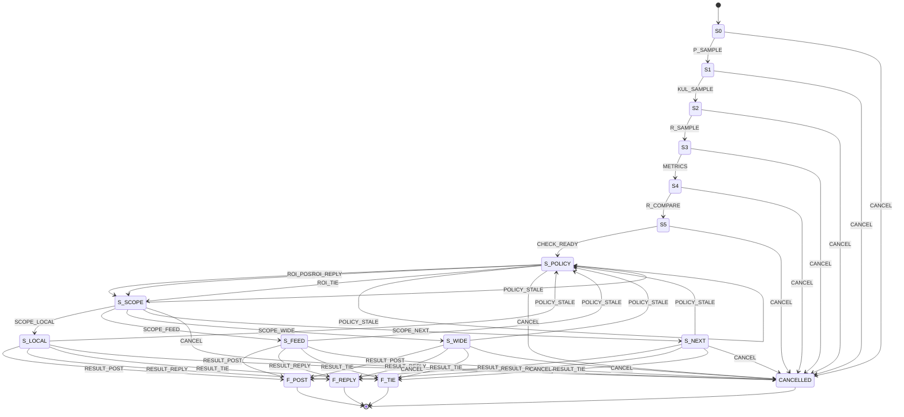

| Исход | Результат | goal_met |
| --- | --- | --- |
| F_POST | Сравнение опубликовано: выгоднее пост. | true |
| F_REPLY | Сравнение опубликовано: выгоднее ответ. | true |
| F_TIE | Сравнение опубликовано: одинаково. | true |

Результат TALK от alexey_nl: «Обе игровые квитанции доступны. Вывод считаем по приросту на энергию, не по громкости обещания.» Для SEPARATE используется нейтральный отказ от продолжения; род и голос реплики берутся из паспорта NPC. Якорь локального результата — p1. В FEED/WIDE/NEXT создаётся новый NPC-пост с отсылкой к этому обсуждению; выбранный игроком герой автором NPC-объекта не становится.

| Прокачка и память | Заполненный вариант |
| --- | --- |
| Возможность | B9 / alexey_nl / после METRICS |
| q_skill | Разберу обе квитанции рядом. Если абсолютный прирост и отдача на энергию дают разные выводы, покажу это явно. |
| c_skill | Абсолютные приросты — Gp и Gr. Для сравнения цены внимания нужны ещё Cp и Cr: вывод задаёт знак Gp×Cr−Gr×Cp. Более громкий пост не меняет арифметику. |
| Контакт по навыку | Необязательный ROOT(q_skill,alexey_nl,r_skill,c_skill); зафиксировать capability_used, не соглашение P с текстом NPC. |
| Следующая встреча | Новый расход энергии может изменить выгодный формат. Старые квитанции не пересчитываются; второе сравнение требует новых операций. |

### Двойная котлета для анонса

| Паспорт | Значение |
| --- | --- |
| story_id / version | `it_2kotleti_news_01` / `review-2026-10-20.6` |
| Мир / роль | `it` / `2kotleti_news` |
| Цель | Собери второй слой новости о «Смене»: добейся, чтобы Меркантил и Куляш публично поспорили под твоим следующим выпуском. |
| Участники NPC | greedy_wolf, alexey_nl |
| Референс | Бургер в Декабре: новости, эфиры и двойная котлета из Decembrist IT News. Сюжет вымышленный. |
| Хронология и знания | Игрок является Бургером. Известны анонс и первое демо «Смены»; независимого повтора ещё нет. |
| Начальный контекст | Первый анонс уже есть. Для следующего выпуска нужны разные голоса, но разговор сам по себе не подтверждает реальный тест. |
| Начальное состояние | S0 |

| Алиас | Объект / автор / якорь | Текст NPC |
| --- | --- | --- |
| q_merk | POST / greedy_wolf | В анонсе «Смены» обещали сэкономить команду. Кто посчитал исправления и стоимость самого перехода? |
| c_kul | COMMENT / alexey_nl / p1 | Вторая котлета — вопрос о повторе. Где условия, на которых анонс можно проверить? |
| c_merk | COMMENT / greedy_wolf / p1 | И цену повторного запуска посчитайте. Вопрос инженера не отменяет вопроса о выгоде. |

| Привязка операции | Объект | После события |
| --- | --- | --- |
| r1 | Ответ P под q_merk | R_PRICE |
| c1 | Основной ответ greedy_wolf на r1 | R_PRICE |
| p1 | Пост P | P_NEXT |
| r2 | Ответ P под p1 | R_REPEAT |
| c2 | Основной ответ alexey_nl на r2 | R_REPEAT |

| Из | Событие | В | Условие | Видимое последствие | Ходов P |
| --- | --- | --- | --- | --- | --- |
| S0 | MERK_POST | S1 | NPC(q_merk) | Есть исходный вопрос о цене. | 0 |
| S1 | R_PRICE | S2 | ROOT(q_merk,greedy_wolf,r1,c1) | Поговори с Меркантилом под его вопросом. | 1 |
| S2 | P_NEXT | S3 | PUB(p1) | Открой следующий выпуск в своём канале. | 1 |
| S3 | KUL_COMMENT | S4 | NPC(c_kul) | Куляш внёс свой вопрос в выпуск. | 0 |
| S4 | R_REPEAT | S5 | CHILD(p1,alexey_nl,c_kul,r2,c2) | Продолжи разговор с Куляшем под выпуском. | 1 |
| S5 | MERK_RETURNS | S6 | NPC(c_merk) | Меркантил вернулся; обе позиции теперь присутствуют под одним выпуском. | 0 |
| S6 | CHECK_READY | S_POLICY | EVAL: взять актуальные версии готовности участников и контакты этого запуска | Зафиксированы входы политики, не смысл текста. В S_POLICY решение выводится политиками relationships.md по этим входам. | 0 |
| S_POLICY | BOTH_ACCEPT | S_SCOPE | EVAL: decision_A = TALK и decision_B = TALK; pair_state допускает DIALOGUE | outcome = DIALOGUE; публикация двух согласий ещё ожидается, pair_state пока DISPUTE. | 0 |
| S_POLICY | ANY_REFUSE | S_SCOPE | EVAL: хотя бы один decision = SEPARATE (включая запрет pair_state) | outcome = SEPARATE; позиции не названы примирением. | 0 |
| S_SCOPE | SCOPE_LOCAL | S_LOCAL | EVAL: subs < stages.views.from | scope = LOCAL по сохранённому снимку; новые экономические эффекты не создаются. | 0 |
| S_LOCAL | RESULT_DIALOGUE | F_DIALOGUE | NPC: версии политик актуальны; outcome = DIALOGUE; все result_alias выбранного scope сохранены с нужными авторами и ссылками | Публичный исход подтверждён; только при DIALOGUE пара DISPUTE/RIVALRY/DIALOGUE → DIALOGUE по двум сохранённым согласиям (TRUCE сохраняется); в остальных случаях пара не меняется; goal_met = true. | 0 |
| S_LOCAL | RESULT_SEPARATE | F_SEPARATE | NPC: версии политик актуальны; outcome = SEPARATE; все result_alias выбранного scope сохранены с нужными авторами и ссылками | Публичный исход подтверждён; только при DIALOGUE пара DISPUTE/RIVALRY/DIALOGUE → DIALOGUE по двум сохранённым согласиям (TRUCE сохраняется); в остальных случаях пара не меняется; goal_met = false. | 0 |
| S_SCOPE | SCOPE_FEED | S_FEED | EVAL: stages.views.from <= subs < stages.strike.from | scope = FEED по сохранённому снимку; новые экономические эффекты не создаются. | 0 |
| S_FEED | RESULT_DIALOGUE | F_DIALOGUE | NPC: версии политик актуальны; outcome = DIALOGUE; все result_alias выбранного scope сохранены с нужными авторами и ссылками | Публичный исход подтверждён; только при DIALOGUE пара DISPUTE/RIVALRY/DIALOGUE → DIALOGUE по двум сохранённым согласиям (TRUCE сохраняется); в остальных случаях пара не меняется; goal_met = true. | 0 |
| S_FEED | RESULT_SEPARATE | F_SEPARATE | NPC: версии политик актуальны; outcome = SEPARATE; все result_alias выбранного scope сохранены с нужными авторами и ссылками | Публичный исход подтверждён; только при DIALOGUE пара DISPUTE/RIVALRY/DIALOGUE → DIALOGUE по двум сохранённым согласиям (TRUCE сохраняется); в остальных случаях пара не меняется; goal_met = false. | 0 |
| S_SCOPE | SCOPE_WIDE | S_WIDE | EVAL: stages.strike.from <= subs < stages.new_line.from | scope = WIDE по сохранённому снимку; новые экономические эффекты не создаются. | 0 |
| S_WIDE | RESULT_DIALOGUE | F_DIALOGUE | NPC: версии политик актуальны; outcome = DIALOGUE; все result_alias выбранного scope сохранены с нужными авторами и ссылками | Публичный исход подтверждён; только при DIALOGUE пара DISPUTE/RIVALRY/DIALOGUE → DIALOGUE по двум сохранённым согласиям (TRUCE сохраняется); в остальных случаях пара не меняется; goal_met = true. | 0 |
| S_WIDE | RESULT_SEPARATE | F_SEPARATE | NPC: версии политик актуальны; outcome = SEPARATE; все result_alias выбранного scope сохранены с нужными авторами и ссылками | Публичный исход подтверждён; только при DIALOGUE пара DISPUTE/RIVALRY/DIALOGUE → DIALOGUE по двум сохранённым согласиям (TRUCE сохраняется); в остальных случаях пара не меняется; goal_met = false. | 0 |
| S_SCOPE | SCOPE_NEXT | S_NEXT | EVAL: subs >= stages.new_line.from | scope = NEXT по сохранённому снимку; новые экономические эффекты не создаются. | 0 |
| S_NEXT | RESULT_DIALOGUE | F_DIALOGUE | NPC: версии политик актуальны; outcome = DIALOGUE; все result_alias выбранного scope сохранены с нужными авторами и ссылками | Публичный исход подтверждён; только при DIALOGUE пара DISPUTE/RIVALRY/DIALOGUE → DIALOGUE по двум сохранённым согласиям (TRUCE сохраняется); в остальных случаях пара не меняется; goal_met = true. | 0 |
| S_NEXT | RESULT_SEPARATE | F_SEPARATE | NPC: версии политик актуальны; outcome = SEPARATE; все result_alias выбранного scope сохранены с нужными авторами и ссылками | Публичный исход подтверждён; только при DIALOGUE пара DISPUTE/RIVALRY/DIALOGUE → DIALOGUE по двум сохранённым согласиям (TRUCE сохраняется); в остальных случаях пара не меняется; goal_met = false. | 0 |
| S_POLICY | POLICY_STALE | S_POLICY | EVAL: версия готовности/пары отличается от snapshot_id; результат ещё не опубликован | Новый снимок политики; scope подписчиков и оплаченные действия сохраняются. | 0 |
| S_SCOPE | POLICY_STALE | S_POLICY | EVAL: версия готовности/пары отличается от snapshot_id; результат ещё не опубликован | Новый снимок политики; scope подписчиков и оплаченные действия сохраняются. | 0 |
| S_LOCAL | POLICY_STALE | S_POLICY | EVAL: версия готовности/пары отличается от snapshot_id; результат ещё не опубликован | Новый снимок политики; scope подписчиков и оплаченные действия сохраняются. | 0 |
| S_FEED | POLICY_STALE | S_POLICY | EVAL: версия готовности/пары отличается от snapshot_id; результат ещё не опубликован | Новый снимок политики; scope подписчиков и оплаченные действия сохраняются. | 0 |
| S_WIDE | POLICY_STALE | S_POLICY | EVAL: версия готовности/пары отличается от snapshot_id; результат ещё не опубликован | Новый снимок политики; scope подписчиков и оплаченные действия сохраняются. | 0 |
| S_NEXT | POLICY_STALE | S_POLICY | EVAL: версия готовности/пары отличается от snapshot_id; результат ещё не опубликован | Новый снимок политики; scope подписчиков и оплаченные действия сохраняются. | 0 |

| Состояние | Следующий шаг |
| --- | --- |
| S0 | Ожидание внутреннего шага: MERK_POST |
| S1 | ROOT(q_merk,greedy_wolf,r1,c1) |
| S2 | PUB(p1) |
| S3 | Ожидание внутреннего шага: KUL_COMMENT |
| S4 | CHILD(p1,alexey_nl,c_kul,r2,c2) |
| S5 | Ожидание внутреннего шага: MERK_RETURNS |
| S6 | Ожидание внутреннего шага: CHECK_READY |
| S_POLICY | Ожидание внутреннего шага: BOTH_ACCEPT, ANY_REFUSE, POLICY_STALE |
| S_SCOPE | Ожидание внутреннего шага: SCOPE_LOCAL, SCOPE_FEED, SCOPE_WIDE, SCOPE_NEXT, POLICY_STALE |
| S_LOCAL | Ожидание внутреннего шага: RESULT_DIALOGUE, RESULT_SEPARATE, POLICY_STALE |
| S_FEED | Ожидание внутреннего шага: RESULT_DIALOGUE, RESULT_SEPARATE, POLICY_STALE |
| S_WIDE | Ожидание внутреннего шага: RESULT_DIALOGUE, RESULT_SEPARATE, POLICY_STALE |
| S_NEXT | Ожидание внутреннего шага: RESULT_DIALOGUE, RESULT_SEPARATE, POLICY_STALE |
| F_DIALOGUE | Оба NPC опубликовали готовность продолжить общую тему. |
| F_SEPARATE | Хотя бы один NPC сохранил отдельную позицию; совместный разговор не открыт. |
| CANCELLED | Запуск отменён |

| Состояние | MERK_POST | R_PRICE | P_NEXT | KUL_COMMENT | R_REPEAT | MERK_RETURNS | CHECK_READY | BOTH_ACCEPT | ANY_REFUSE | SCOPE_LOCAL | RESULT_DIALOGUE | RESULT_SEPARATE | SCOPE_FEED | SCOPE_WIDE | SCOPE_NEXT | POLICY_STALE | OTHER | CANCEL |
| --- | --- | --- | --- | --- | --- | --- | --- | --- | --- | --- | --- | --- | --- | --- | --- | --- | --- | --- |
| S0 | S1 | S0 | S0 | S0 | S0 | S0 | S0 | S0 | S0 | S0 | S0 | S0 | S0 | S0 | S0 | S0 | S0 | CANCELLED |
| S1 | S1 | S2 | S1 | S1 | S1 | S1 | S1 | S1 | S1 | S1 | S1 | S1 | S1 | S1 | S1 | S1 | S1 | CANCELLED |
| S2 | S2 | S2 | S3 | S2 | S2 | S2 | S2 | S2 | S2 | S2 | S2 | S2 | S2 | S2 | S2 | S2 | S2 | CANCELLED |
| S3 | S3 | S3 | S3 | S4 | S3 | S3 | S3 | S3 | S3 | S3 | S3 | S3 | S3 | S3 | S3 | S3 | S3 | CANCELLED |
| S4 | S4 | S4 | S4 | S4 | S5 | S4 | S4 | S4 | S4 | S4 | S4 | S4 | S4 | S4 | S4 | S4 | S4 | CANCELLED |
| S5 | S5 | S5 | S5 | S5 | S5 | S6 | S5 | S5 | S5 | S5 | S5 | S5 | S5 | S5 | S5 | S5 | S5 | CANCELLED |
| S6 | S6 | S6 | S6 | S6 | S6 | S6 | S_POLICY | S6 | S6 | S6 | S6 | S6 | S6 | S6 | S6 | S6 | S6 | CANCELLED |
| S_POLICY | S_POLICY | S_POLICY | S_POLICY | S_POLICY | S_POLICY | S_POLICY | S_POLICY | S_SCOPE | S_SCOPE | S_POLICY | S_POLICY | S_POLICY | S_POLICY | S_POLICY | S_POLICY | S_POLICY | S_POLICY | CANCELLED |
| S_SCOPE | S_SCOPE | S_SCOPE | S_SCOPE | S_SCOPE | S_SCOPE | S_SCOPE | S_SCOPE | S_SCOPE | S_SCOPE | S_LOCAL | S_SCOPE | S_SCOPE | S_FEED | S_WIDE | S_NEXT | S_POLICY | S_SCOPE | CANCELLED |
| S_LOCAL | S_LOCAL | S_LOCAL | S_LOCAL | S_LOCAL | S_LOCAL | S_LOCAL | S_LOCAL | S_LOCAL | S_LOCAL | S_LOCAL | F_DIALOGUE | F_SEPARATE | S_LOCAL | S_LOCAL | S_LOCAL | S_POLICY | S_LOCAL | CANCELLED |
| S_FEED | S_FEED | S_FEED | S_FEED | S_FEED | S_FEED | S_FEED | S_FEED | S_FEED | S_FEED | S_FEED | F_DIALOGUE | F_SEPARATE | S_FEED | S_FEED | S_FEED | S_POLICY | S_FEED | CANCELLED |
| S_WIDE | S_WIDE | S_WIDE | S_WIDE | S_WIDE | S_WIDE | S_WIDE | S_WIDE | S_WIDE | S_WIDE | S_WIDE | F_DIALOGUE | F_SEPARATE | S_WIDE | S_WIDE | S_WIDE | S_POLICY | S_WIDE | CANCELLED |
| S_NEXT | S_NEXT | S_NEXT | S_NEXT | S_NEXT | S_NEXT | S_NEXT | S_NEXT | S_NEXT | S_NEXT | S_NEXT | F_DIALOGUE | F_SEPARATE | S_NEXT | S_NEXT | S_NEXT | S_POLICY | S_NEXT | CANCELLED |
| F_DIALOGUE | F_DIALOGUE | F_DIALOGUE | F_DIALOGUE | F_DIALOGUE | F_DIALOGUE | F_DIALOGUE | F_DIALOGUE | F_DIALOGUE | F_DIALOGUE | F_DIALOGUE | F_DIALOGUE | F_DIALOGUE | F_DIALOGUE | F_DIALOGUE | F_DIALOGUE | F_DIALOGUE | F_DIALOGUE | F_DIALOGUE |
| F_SEPARATE | F_SEPARATE | F_SEPARATE | F_SEPARATE | F_SEPARATE | F_SEPARATE | F_SEPARATE | F_SEPARATE | F_SEPARATE | F_SEPARATE | F_SEPARATE | F_SEPARATE | F_SEPARATE | F_SEPARATE | F_SEPARATE | F_SEPARATE | F_SEPARATE | F_SEPARATE | F_SEPARATE |
| CANCELLED | CANCELLED | CANCELLED | CANCELLED | CANCELLED | CANCELLED | CANCELLED | CANCELLED | CANCELLED | CANCELLED | CANCELLED | CANCELLED | CANCELLED | CANCELLED | CANCELLED | CANCELLED | CANCELLED | CANCELLED | CANCELLED |

OTHER не меняет этап: не тот автор, мир, пост, родитель, версия, порядок, повтор или свободный ход. Неверный запрос отклоняется до списания; self-loop не означает платную обработку ошибки. PAUSED/WAITING_RETRY — статусы поверх состояния, не дополнительные сюжетные переходы.

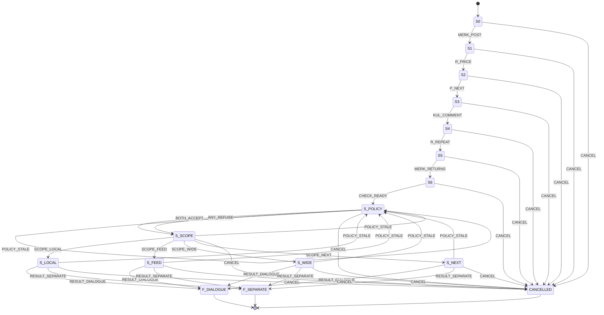

| Исход | Результат | goal_met |
| --- | --- | --- |
| F_DIALOGUE | Оба NPC опубликовали готовность продолжить общую тему. | true |
| F_SEPARATE | Хотя бы один NPC сохранил отдельную позицию; совместный разговор не открыт. | false |

Результат TALK от alexey_nl: «Готов обсуждать вопросы проверки под выпуском. Мой комментарий не означает, что сервис прошёл тест.» Для SEPARATE используется нейтральный отказ от продолжения; род и голос реплики берутся из паспорта NPC. У пары greedy_wolf ↔ alexey_nl причина спора: Новостной эффект против стоимости и воспроизводимости. Политики OPEN/OPEN; в DIALOGUE оба публикуют собственное «готов продолжить эту тему», в SEPARATE каждый публикует свой фактический TALK/SEPARATE. Дружба, поддержка игроком стороны и перемирие не назначаются. Якорь локального результата — p1. В FEED/WIDE/NEXT создаётся новый NPC-пост с отсылкой к этому обсуждению; выбранный игроком герой автором NPC-объекта не становится.

| Прокачка и память | Заполненный вариант |
| --- | --- |
| Возможность | H9 / alexey_nl / после P_NEXT |
| q_skill | Отдельный мемный пост от меня: громкий заголовок бежит быстрее второго запуска. Ни один тест от этой шутки не появился. |
| c_skill | Мемная сводка: заголовок уже заменил команду, а второй запуск всё ещё собирает входные данные. Это шутка о разнице обещания и проверки, не результат испытания. |
| Контакт по навыку | Необязательный ROOT(q_skill,alexey_nl,r_skill,c_skill); зафиксировать capability_used, не соглашение P с текстом NPC. |
| Следующая встреча | Следующий анонс проверяет, вернутся ли оба критика к выпуску. Нет автоматической реальной проверки сервиса. |

### Ещё один запуск из Нидерландов

| Паспорт | Значение |
| --- | --- |
| story_id / version | `it_alexey_nl_01` / `review-2026-10-20.6` |
| Мир / роль | `it` / `alexey_nl` |
| Цель | Добейся публичного ответа Бургера об условиях повторного запуска «Смены» и продолжи спор после его заголовка. |
| Участники NPC | 2kotleti_news |
| Референс | Куляш AI: инженерная полемика «Кулешов разгоняет AI» и мемная маска «Алексей из Нидерландов», заданная Степаном. |
| Хронология и знания | Игрок является Куляшем AI. Нидерланды являются частью вымышленного образа. Настоящего повторного теста сервиса в данных игры нет. |
| Начальный контекст | Бургер опубликовал громкий анонс после одного демо. Куляш может поставить вопрос и добиться ответа, но не объявить настоящий повтор выполненным. |
| Начальное состояние | S0 |

| Алиас | Объект / автор / якорь | Текст NPC |
| --- | --- | --- |
| q_burger | POST / 2kotleti_news | «Смена» обещает заменить команду за вечер. После одного демо заголовок уже просится в эфир. |
| c0 | COMMENT / 2kotleti_news / p1 | Какие вопросы к повторному запуску стоит поставить рядом с анонсом? Это не значит, что я уже провёл тест. |

| Привязка операции | Объект | После события |
| --- | --- | --- |
| r1 | Ответ P под q_burger | R_HEADLINE |
| c1 | Основной ответ 2kotleti_news на r1 | R_HEADLINE |
| p1 | Пост P | P_CONDITIONS |
| r2 | Ответ P под p1 | R_CONDITIONS |
| c2 | Основной ответ 2kotleti_news на r2 | R_CONDITIONS |

| Из | Событие | В | Условие | Видимое последствие | Ходов P |
| --- | --- | --- | --- | --- | --- |
| S0 | BURGER_POST | S1 | NPC(q_burger) | Есть конкретный публичный анонс, с которым можно спорить. | 0 |
| S1 | R_HEADLINE | S2 | ROOT(q_burger,2kotleti_news,r1,c1) | Ответь на анонс в канале Бургера. | 1 |
| S2 | P_CONDITIONS | S3 | PUB(p1) | Открой в своём канале разговор после ответа Бургера. | 1 |
| S3 | BURGER_QUESTION | S4 | NPC(c0) | Бургер сам обозначает предмет дальнейшего разговора. | 0 |
| S4 | R_CONDITIONS | S5 | CHILD(p1,2kotleti_news,c0,r2,c2) | Продолжи разговор под его вопросом. | 1 |
| S5 | CHECK_READY | S_POLICY | EVAL: взять актуальные версии готовности участников и контакты этого запуска | Зафиксированы входы политики, не смысл текста. В S_POLICY решение выводится политиками relationships.md по этим входам. | 0 |
| S_POLICY | NPC_TALKS | S_SCOPE | EVAL: decision = TALK | outcome = ANSWER; предусмотренный ответ готовится. | 0 |
| S_POLICY | NPC_SEPARATE | S_SCOPE | EVAL: decision = SEPARATE | outcome = DISTANCE; публикуется отказ от продолжения, не обрыв без объяснения. | 0 |
| S_SCOPE | SCOPE_LOCAL | S_LOCAL | EVAL: subs < stages.views.from | scope = LOCAL по сохранённому снимку; новые экономические эффекты не создаются. | 0 |
| S_LOCAL | RESULT_ANSWER | F_ANSWER | NPC: версии политик актуальны; outcome = ANSWER; все result_alias выбранного scope сохранены с нужными авторами и ссылками | Публичный исход подтверждён; только при DIALOGUE пара DISPUTE/RIVALRY/DIALOGUE → DIALOGUE по двум сохранённым согласиям (TRUCE сохраняется); в остальных случаях пара не меняется; goal_met = true. | 0 |
| S_LOCAL | RESULT_DISTANCE | F_DISTANCE | NPC: версии политик актуальны; outcome = DISTANCE; все result_alias выбранного scope сохранены с нужными авторами и ссылками | Публичный исход подтверждён; только при DIALOGUE пара DISPUTE/RIVALRY/DIALOGUE → DIALOGUE по двум сохранённым согласиям (TRUCE сохраняется); в остальных случаях пара не меняется; goal_met = false. | 0 |
| S_SCOPE | SCOPE_FEED | S_FEED | EVAL: stages.views.from <= subs < stages.strike.from | scope = FEED по сохранённому снимку; новые экономические эффекты не создаются. | 0 |
| S_FEED | RESULT_ANSWER | F_ANSWER | NPC: версии политик актуальны; outcome = ANSWER; все result_alias выбранного scope сохранены с нужными авторами и ссылками | Публичный исход подтверждён; только при DIALOGUE пара DISPUTE/RIVALRY/DIALOGUE → DIALOGUE по двум сохранённым согласиям (TRUCE сохраняется); в остальных случаях пара не меняется; goal_met = true. | 0 |
| S_FEED | RESULT_DISTANCE | F_DISTANCE | NPC: версии политик актуальны; outcome = DISTANCE; все result_alias выбранного scope сохранены с нужными авторами и ссылками | Публичный исход подтверждён; только при DIALOGUE пара DISPUTE/RIVALRY/DIALOGUE → DIALOGUE по двум сохранённым согласиям (TRUCE сохраняется); в остальных случаях пара не меняется; goal_met = false. | 0 |
| S_SCOPE | SCOPE_WIDE | S_WIDE | EVAL: stages.strike.from <= subs < stages.new_line.from | scope = WIDE по сохранённому снимку; новые экономические эффекты не создаются. | 0 |
| S_WIDE | RESULT_ANSWER | F_ANSWER | NPC: версии политик актуальны; outcome = ANSWER; все result_alias выбранного scope сохранены с нужными авторами и ссылками | Публичный исход подтверждён; только при DIALOGUE пара DISPUTE/RIVALRY/DIALOGUE → DIALOGUE по двум сохранённым согласиям (TRUCE сохраняется); в остальных случаях пара не меняется; goal_met = true. | 0 |
| S_WIDE | RESULT_DISTANCE | F_DISTANCE | NPC: версии политик актуальны; outcome = DISTANCE; все result_alias выбранного scope сохранены с нужными авторами и ссылками | Публичный исход подтверждён; только при DIALOGUE пара DISPUTE/RIVALRY/DIALOGUE → DIALOGUE по двум сохранённым согласиям (TRUCE сохраняется); в остальных случаях пара не меняется; goal_met = false. | 0 |
| S_SCOPE | SCOPE_NEXT | S_NEXT | EVAL: subs >= stages.new_line.from | scope = NEXT по сохранённому снимку; новые экономические эффекты не создаются. | 0 |
| S_NEXT | RESULT_ANSWER | F_ANSWER | NPC: версии политик актуальны; outcome = ANSWER; все result_alias выбранного scope сохранены с нужными авторами и ссылками | Публичный исход подтверждён; только при DIALOGUE пара DISPUTE/RIVALRY/DIALOGUE → DIALOGUE по двум сохранённым согласиям (TRUCE сохраняется); в остальных случаях пара не меняется; goal_met = true. | 0 |
| S_NEXT | RESULT_DISTANCE | F_DISTANCE | NPC: версии политик актуальны; outcome = DISTANCE; все result_alias выбранного scope сохранены с нужными авторами и ссылками | Публичный исход подтверждён; только при DIALOGUE пара DISPUTE/RIVALRY/DIALOGUE → DIALOGUE по двум сохранённым согласиям (TRUCE сохраняется); в остальных случаях пара не меняется; goal_met = false. | 0 |
| S_POLICY | POLICY_STALE | S_POLICY | EVAL: версия готовности/пары отличается от snapshot_id; результат ещё не опубликован | Новый снимок политики; scope подписчиков и оплаченные действия сохраняются. | 0 |
| S_SCOPE | POLICY_STALE | S_POLICY | EVAL: версия готовности/пары отличается от snapshot_id; результат ещё не опубликован | Новый снимок политики; scope подписчиков и оплаченные действия сохраняются. | 0 |
| S_LOCAL | POLICY_STALE | S_POLICY | EVAL: версия готовности/пары отличается от snapshot_id; результат ещё не опубликован | Новый снимок политики; scope подписчиков и оплаченные действия сохраняются. | 0 |
| S_FEED | POLICY_STALE | S_POLICY | EVAL: версия готовности/пары отличается от snapshot_id; результат ещё не опубликован | Новый снимок политики; scope подписчиков и оплаченные действия сохраняются. | 0 |
| S_WIDE | POLICY_STALE | S_POLICY | EVAL: версия готовности/пары отличается от snapshot_id; результат ещё не опубликован | Новый снимок политики; scope подписчиков и оплаченные действия сохраняются. | 0 |
| S_NEXT | POLICY_STALE | S_POLICY | EVAL: версия готовности/пары отличается от snapshot_id; результат ещё не опубликован | Новый снимок политики; scope подписчиков и оплаченные действия сохраняются. | 0 |

| Состояние | Следующий шаг |
| --- | --- |
| S0 | Ожидание внутреннего шага: BURGER_POST |
| S1 | ROOT(q_burger,2kotleti_news,r1,c1) |
| S2 | PUB(p1) |
| S3 | Ожидание внутреннего шага: BURGER_QUESTION |
| S4 | CHILD(p1,2kotleti_news,c0,r2,c2) |
| S5 | Ожидание внутреннего шага: CHECK_READY |
| S_POLICY | Ожидание внутреннего шага: NPC_TALKS, NPC_SEPARATE, POLICY_STALE |
| S_SCOPE | Ожидание внутреннего шага: SCOPE_LOCAL, SCOPE_FEED, SCOPE_WIDE, SCOPE_NEXT, POLICY_STALE |
| S_LOCAL | Ожидание внутреннего шага: RESULT_ANSWER, RESULT_DISTANCE, POLICY_STALE |
| S_FEED | Ожидание внутреннего шага: RESULT_ANSWER, RESULT_DISTANCE, POLICY_STALE |
| S_WIDE | Ожидание внутреннего шага: RESULT_ANSWER, RESULT_DISTANCE, POLICY_STALE |
| S_NEXT | Ожидание внутреннего шага: RESULT_ANSWER, RESULT_DISTANCE, POLICY_STALE |
| F_ANSWER | Получен предусмотренный публичный ответ NPC. |
| F_DISTANCE | NPC ответил об отказе продолжать тему; желаемый контакт не открыт. |
| CANCELLED | Запуск отменён |

| Состояние | BURGER_POST | R_HEADLINE | P_CONDITIONS | BURGER_QUESTION | R_CONDITIONS | CHECK_READY | NPC_TALKS | NPC_SEPARATE | SCOPE_LOCAL | RESULT_ANSWER | RESULT_DISTANCE | SCOPE_FEED | SCOPE_WIDE | SCOPE_NEXT | POLICY_STALE | OTHER | CANCEL |
| --- | --- | --- | --- | --- | --- | --- | --- | --- | --- | --- | --- | --- | --- | --- | --- | --- | --- |
| S0 | S1 | S0 | S0 | S0 | S0 | S0 | S0 | S0 | S0 | S0 | S0 | S0 | S0 | S0 | S0 | S0 | CANCELLED |
| S1 | S1 | S2 | S1 | S1 | S1 | S1 | S1 | S1 | S1 | S1 | S1 | S1 | S1 | S1 | S1 | S1 | CANCELLED |
| S2 | S2 | S2 | S3 | S2 | S2 | S2 | S2 | S2 | S2 | S2 | S2 | S2 | S2 | S2 | S2 | S2 | CANCELLED |
| S3 | S3 | S3 | S3 | S4 | S3 | S3 | S3 | S3 | S3 | S3 | S3 | S3 | S3 | S3 | S3 | S3 | CANCELLED |
| S4 | S4 | S4 | S4 | S4 | S5 | S4 | S4 | S4 | S4 | S4 | S4 | S4 | S4 | S4 | S4 | S4 | CANCELLED |
| S5 | S5 | S5 | S5 | S5 | S5 | S_POLICY | S5 | S5 | S5 | S5 | S5 | S5 | S5 | S5 | S5 | S5 | CANCELLED |
| S_POLICY | S_POLICY | S_POLICY | S_POLICY | S_POLICY | S_POLICY | S_POLICY | S_SCOPE | S_SCOPE | S_POLICY | S_POLICY | S_POLICY | S_POLICY | S_POLICY | S_POLICY | S_POLICY | S_POLICY | CANCELLED |
| S_SCOPE | S_SCOPE | S_SCOPE | S_SCOPE | S_SCOPE | S_SCOPE | S_SCOPE | S_SCOPE | S_SCOPE | S_LOCAL | S_SCOPE | S_SCOPE | S_FEED | S_WIDE | S_NEXT | S_POLICY | S_SCOPE | CANCELLED |
| S_LOCAL | S_LOCAL | S_LOCAL | S_LOCAL | S_LOCAL | S_LOCAL | S_LOCAL | S_LOCAL | S_LOCAL | S_LOCAL | F_ANSWER | F_DISTANCE | S_LOCAL | S_LOCAL | S_LOCAL | S_POLICY | S_LOCAL | CANCELLED |
| S_FEED | S_FEED | S_FEED | S_FEED | S_FEED | S_FEED | S_FEED | S_FEED | S_FEED | S_FEED | F_ANSWER | F_DISTANCE | S_FEED | S_FEED | S_FEED | S_POLICY | S_FEED | CANCELLED |
| S_WIDE | S_WIDE | S_WIDE | S_WIDE | S_WIDE | S_WIDE | S_WIDE | S_WIDE | S_WIDE | S_WIDE | F_ANSWER | F_DISTANCE | S_WIDE | S_WIDE | S_WIDE | S_POLICY | S_WIDE | CANCELLED |
| S_NEXT | S_NEXT | S_NEXT | S_NEXT | S_NEXT | S_NEXT | S_NEXT | S_NEXT | S_NEXT | S_NEXT | F_ANSWER | F_DISTANCE | S_NEXT | S_NEXT | S_NEXT | S_POLICY | S_NEXT | CANCELLED |
| F_ANSWER | F_ANSWER | F_ANSWER | F_ANSWER | F_ANSWER | F_ANSWER | F_ANSWER | F_ANSWER | F_ANSWER | F_ANSWER | F_ANSWER | F_ANSWER | F_ANSWER | F_ANSWER | F_ANSWER | F_ANSWER | F_ANSWER | F_ANSWER |
| F_DISTANCE | F_DISTANCE | F_DISTANCE | F_DISTANCE | F_DISTANCE | F_DISTANCE | F_DISTANCE | F_DISTANCE | F_DISTANCE | F_DISTANCE | F_DISTANCE | F_DISTANCE | F_DISTANCE | F_DISTANCE | F_DISTANCE | F_DISTANCE | F_DISTANCE | F_DISTANCE |
| CANCELLED | CANCELLED | CANCELLED | CANCELLED | CANCELLED | CANCELLED | CANCELLED | CANCELLED | CANCELLED | CANCELLED | CANCELLED | CANCELLED | CANCELLED | CANCELLED | CANCELLED | CANCELLED | CANCELLED | CANCELLED |

OTHER не меняет этап: не тот автор, мир, пост, родитель, версия, порядок, повтор или свободный ход. Неверный запрос отклоняется до списания; self-loop не означает платную обработку ошибки. PAUSED/WAITING_RETRY — статусы поверх состояния, не дополнительные сюжетные переходы.

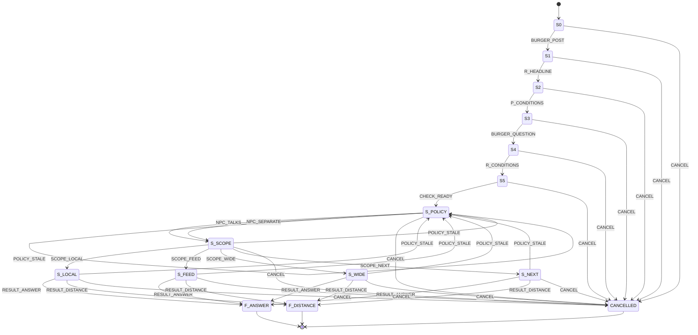

| Исход | Результат | goal_met |
| --- | --- | --- |
| F_ANSWER | Получен предусмотренный публичный ответ NPC. | true |
| F_DISTANCE | NPC ответил об отказе продолжать тему; желаемый контакт не открыт. | false |

Результат TALK от 2kotleti_news: «Отдельно отмечаю: условия повтора обсуждаем, сам независимый запуск ещё не состоялся.» Для SEPARATE используется нейтральный отказ от продолжения; род и голос реплики берутся из паспорта NPC. Якорь локального результата — p1. В FEED/WIDE/NEXT создаётся новый NPC-пост с отсылкой к этому обсуждению; выбранный игроком герой автором NPC-объекта не становится.

| Прокачка и память | Заполненный вариант |
| --- | --- |
| Возможность | T6 / 2kotleti_news / после P_CONDITIONS |
| q_skill | Готов открыть отдельный выпуск с вопросами к повтору: входные данные, среда, стоимость. Это ещё не результаты испытания. |
| c_skill | Открою отдельную ветку вопросов к повтору. В её анонсе прямо оставлю статус: обсуждаем условия, независимого результата пока нет. |
| Контакт по навыку | Необязательный ROOT(q_skill,2kotleti_news,r_skill,c_skill); зафиксировать capability_used, не соглашение P с текстом NPC. |
| Следующая встреча | Бургер публикует уточнение анонса. Следующий эпизод может обсуждать заранее заданные вымышленные результаты, но их нужно отдельно заполнить. |
