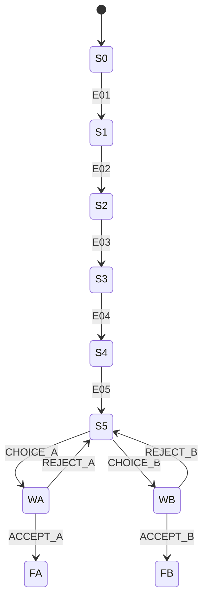
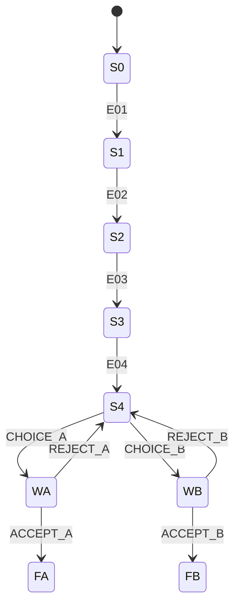

# 16 сюжетных автоматов для #192

Версия содержания: **review-2026-10-19.2**. Передано на содержательное и техническое ревью Stepami по поручению @edtechhacker. Передача на ревью не разрешает реализацию. Код, миграции и работающая игра не изменены.

[Задача #192](https://github.com/Stepami/golden-mouth/issues/192) · [Содержание #195 той же версии](presets.md) · [Источники и сходство](similarity.md)

Это заполненные сценарии и требования к их будущему исполнению. История остаётся добровольной: неподходящий для сюжета пост не блокирует публикацию, обычную генерацию или развитие канала. Собственный мир и изменённый состав без нужных NPC не получают такой сценарий автоматически. Если необходимый NPC удалён после старта, сюжет приостанавливается с объяснением; герой не возвращается сам, ложный финал не выдаётся. Действующая игра не проверяет эти этапы. Каждый мир имеет вариант для своего персонажа и три варианта готовых героев.

| Мир | Роль игрока | Сюжет |
| --- | --- | --- |
| Вечерело | own | [Один вечер без охоты за тайнами](#evening_own_01) |
| Вечерело | isabella | [Забота без запрета](#evening_isabella_01) |
| Вечерело | eduard | [Не исчезать вместо ответа](#evening_eduard_01) |
| Вечерело | yakov | [Надёжность без соревнования](#evening_yakov_01) |
| Школа чародеев | own | [Приглашение к закрытой двери](#sorcerers_own_01) |
| Школа чародеев | gosha | [Известное имя под чужим вызовом](#sorcerers_gosha_01) |
| Школа чародеев | georgina | [Правило, которое никто не слушает](#sorcerers_georgina_01) |
| Школа чародеев | roman | [План третьего друга](#sorcerers_roman_01) |
| Игра домов | own | [Две печати на одной дороге](#houses_own_01) |
| Игра домов | diana | [Приглашение без коленопреклонения](#houses_diana_01) |
| Игра домов | jon | [Помощь Северу без пустой клятвы](#houses_jon_01) |
| Игра домов | james | [Слово рыцаря и приказ двора](#houses_james_01) |
| Айти-тусовка | own | [Команда за один вечер](#it_own_01) |
| Айти-тусовка | greedy_wolf | [Выгода после ручной проверки](#it_greedy_wolf_01) |
| Айти-тусовка | 2kotleti_news | [Две котлеты и один заголовок](#it_2kotleti_news_01) |
| Айти-тусовка | alexey_nl | [Демо выдерживает второй запуск?](#it_alexey_nl_01) |

## Общий контракт событий

Состояния и категории образуют детерминированную таблицу. Привязки ID делают исполняемую модель расширенным автоматом с памятью, а не чистым ДКА. [Определение ДКА](https://neerc.ifmo.ru/wiki/index.php?title=Детерминированные_конечные_автоматы).

- Область: конкретный экземпляр мира, игрок, `story_id`, версия `review-2026-10-19.2` и запуск. Ключ роли — идентификатор пресета, автор действий игрока — его реальный `PlayerId`, а не `StarId` выбранного героя.
- `POST`: новый сохранённый пост игрока в своём канале. `p0` — исходное обсуждение; `pa`/`pb` — отдельный новый пост с окончательным предложением. Простой комментарий не заменяет этот пост.
- `NPC`: сохранённый комментарий указанного NPC под привязанным постом. Допустим корневой комментарий или потомок в том же посте; автор и ID поста проверяются явно. NPC не обязан физически находиться рядом с игроком.
- `REPLY`: сохранённый ответ игрока **непосредственно** на `c0` (`ParentCommentId = c0`) в `p0`. Корневой комментарий, пересказ чужого ответа и ответ соседней ветке не подходят.
- Переход возможен только после сохранения факта и успешной проверки смысла. Удалённый/скрытый факт на момент проверки не засчитывается. Последующее удаление не откатывает уже подтверждённую историю автоматически.
- Проверка ограничена текущим этапом и его открытыми категориями. Полное совпадение всех структурных и смысловых условий даёт одну категорию. Две подходящие категории, противоречивое согласие или «может быть» дают `OTHER`: этап тот же, нужна ясная формулировка. Порядок строк не определяет победителя.
- Сбой классификации — `pending`, не `OTHER`: факт повторно проверяется после восстановления, состояние и эффект пока не меняются. Следующие факты этого запуска ждут разрешения pending; они не обгоняют его и не теряются. Чужой автор, мир, пост, родитель либо неподходящий смысл — `OTHER`.
- Обработка последовательная: пост раньше комментариев, родитель раньше ответа. Одно сохранённое событие не проходит два этапа. Ключ повтора: экземпляр мира + запуск + тип объекта + ID. Повтор доставки уже обработанного факта не даёт нового эффекта.
- Порядок определяется сохранённой последовательностью событий, а не сравнением часов: у комментария сейчас нет отдельного времени создания. Упорядочивание и номер открытия этапа — требования к будущей реализации. Факт должен находиться в этой последовательности после открытия нужного этапа. Более ранние ответы не подбираются из истории задним числом. В одном сохранении пост и ответы обрабатываются по порядку, но произвольный порядок нескольких NPC в одном ответе сервера не гарантирует прохождение всех этапов.
- `REJECT_A/B`: выбранный для финала NPC прямо отказывается от предложения в `pa/pb`. Условное «согласен, только если…» без принятия всех условий не считается согласием. Явный отказ возвращает к выбору; прочая неопределённость оставляет ожидание. При новой попытке привязка поста перезаписывается новым ID, старые комментарии её не закрывают.
- Терминальные `FA/FB` поглощают любые события. Итог — подтверждённая договорённость или позиция, а не состоявшаяся поездка, проведённый эфир или автоматически изменённые отношения. Награды, подписчики, энергия и достижения не добавляются. Обычные действия оплачиваются по действующим правилам продукта.

До старта закрепляется версия содержания; начатая история не переводится на новую версию автоматически. Неизвестную/повреждённую версию нельзя молча сбрасывать. Политика выдачи следующей истории и повторного старта в этот пакет не входит.

## Что ещё требуется от бэкенда

Сейчас существуют посты, комментарии, авторы, `ParentCommentId` и привязка к миру/посту. Но отсутствуют подтверждённые контрактом этой задачи хранилище сюжетного состояния, классификатор условий и гарантированный запрос нужного NPC для текущего этапа. Текущая случайная генерация реакции не обеспечивает эти сценарии.

Для исполнения нужны: сохранение состояния и привязок; последовательная и идемпотентная обработка; повтор классификации при сбое; передача текущего этапа в контекст генерации; возможность получить ответ указанного героя без публикации бесконечных постов на удачу; показ цели/ожидания и итогового результата. Сначала Степан оценивает эти зависимости после согласования содержания. #192 готовит справочники, а не разрешает реализацию движка. Новые задачи здесь не создаются.

Подсказки в таблицах — готовые тексты для будущего отображения. Нужный NPC может спорить; генерация не должна подменять отсутствие согласия автоматически выставленным успехом. Примеры ниже проверяют смысл, а не буквальное совпадение строки. Сюжетные факты, включая появление писем и сервиса «Смена», — новые игровые ситуации, не утверждения о каноне или реальных людях.

## Один вечер без охоты за тайнами

| Паспорт | Значение |
| --- | --- |
| story_id / version | evening_own_01 / review-2026-10-19.2 |
| world_key / player_role | evening / own |
| Завязка | Оборванное видео у лесной дороги стало приглашением на ночную вылазку. Твой канал оказался местом, где спорят о том, кто пойдёт первым. |
| Цель | Собрать разобщённых знакомых вокруг другого плана на вечер и не превратить любопытство в травлю. |
| Начало / исходы | S0 / FA, FB |
| Зависимость содержания | presets.md#evening |

| NPC | Роль | Интерес |
| --- | --- | --- |
| isabella — Изабелла Лебедева | Ученица и автор личного дневника | Добиться разговора, в котором её мнение имеет такой же вес, как чужое желание защитить. |
| eduard — Эдуард Калинин | Сдержанный ученик с тайной | Уберечь близких, не превращая их жизнь в расписание запретов. |
| yakov — Яков Чернов | Механик и защитник своей общины | Доказать надёжность без соревнования за чужое решение. |

### Состояния

| ID | Подтверждённые факты | Следующая цель | Подсказка | Конец |
| --- | --- | --- | --- | --- |
| S0 | Сюжет открыт; факты разговора ещё не подтверждены. | Перевести спор в предложение | Следующая цель: Перевести спор в предложение. | нет |
| S1 | Обсуждение видео открыто без назначения виновного. Предыдущие подтверждённые факты сохраняются. | Услышать мнение Изабеллы | Нужен ответ в исходном обсуждении. Персонаж: «Изабелла Лебедева». Услышать мнение Изабеллы. | нет |
| S2 | Изабелла согласна на городскую встречу при свободном выборе участников. Предыдущие подтверждённые факты сохраняются. | Оставить выбор за участниками | Следующая цель: Оставить выбор за участниками. | нет |
| S3 | Условие добровольного участия принято игроком. Предыдущие подтверждённые факты сохраняются. | Получить условие Эдуарда | Нужен ответ в исходном обсуждении. Персонаж: «Эдуард Калинин». Получить условие Эдуарда. | нет |
| S4 | Эдуард допускает совместную встречу в городе. Предыдущие подтверждённые факты сохраняются. | Получить условие Якова | Нужен ответ в исходном обсуждении. Персонаж: «Яков Чернов». Получить условие Якова. | нет |
| S5 | Оба места встречи доступны; Яков не ставит личного ультиматума. Предыдущие подтверждённые факты сохраняются. | Выбрать один из двух вариантов завершения отдельным постом. | Опубликуй один ясный план: День у мастерской или Разговор в кафе. | нет |
| WA | Предложение «День у мастерской» опубликовано; согласия пока нет. | Получить ответ: Яков Чернов | План предложен. Дождись ответа под этим постом. Персонаж: «Яков Чернов». | нет |
| FA | Встреча у мастерской подтверждена. Вечерняя погоня за автором видео не стала планом канала. | Завершено | Встреча у мастерской подтверждена. Вечерняя погоня за автором видео не стала планом канала. | да |
| WB | Предложение «Разговор в кафе» опубликовано; согласия пока нет. | Получить ответ: Эдуард Калинин | План предложен. Дождись ответа под этим постом. Персонаж: «Эдуард Калинин». | нет |
| FB | Городская встреча подтверждена. Разговор можно продолжить без раскрытия чужих тайн. | Завершено | Городская встреча подтверждена. Разговор можно продолжить без раскрытия чужих тайн. | да |

### Алфавит и условия

Общие проверки мира, времени, автора, поста и родителя обязательны для каждой строки. Для всех смысловых условий неоднозначный пример «Возможно, но пока не решено» не двигает этап.

| Код | Источник | Автор | Связь | Критерий | Засчитать | Не засчитать | Сохранить ID |
| --- | --- | --- | --- | --- | --- | --- | --- |
| E01 | POST | player | channel | Игрок обсуждает оборванную запись, не объявляет человека в кадре преступником и предлагает обсудить другой способ провести встречу. | Запись обрывается. Давайте сначала поговорим в городе, прежде чем идти за кем-то в лес. | На записи точно преступник; идём искать его дом. | p0 |
| E02 | NPC | isabella | p0 | Изабелла хочет обычной встречи в городе и просит не решать за неё, с кем ей общаться. | Я бы пришла на встречу в городе. Только не выбирайте за меня, с кем мне разговаривать. | Мне всё равно, решайте за меня. | c0 |
| E03 | REPLY | player | c0 | Игрок признаёт право Изабеллы выбирать собеседников и предлагает добровольное приглашение без раскрытия чужих тайн. | Позовём всех, а каждый решит сам. Чужие секреты обсуждать не будем. | Тогда я скажу всем, что скрывают твои друзья. | r0 |
| E04 | NPC | eduard | p0 | Эдуард готов к встрече в людном месте и не требует исключить Якова. | В городе я приду. Якову приглашение тоже можно отправить. | Я приду, только если Якова не будет. | c1 |
| E05 | NPC | yakov | p0 | Яков согласен не превращать встречу в спор об Изабелле и предлагает либо мастерскую днём, либо городское кафе. | Можно у мастерской днём или в кафе. И да, обойдёмся без соревнования, кто лучше её защищает. | Выберите меня вместо Эдуарда. | c2 |
| CHOICE_A | POST | player | channel | Выбрать дневную встречу у мастерской; приглашение добровольное, без ночной вылазки. | Встречаемся днём у мастерской. Приходят те, кто хочет; поход к лесу отменяем. | Может, мастерская, а может, сразу в лес — решите сами. | pa |
| ACCEPT_A | NPC | yakov | pa | Яков прямо подтверждает встречу у мастерской и готовность принять приглашённых без исключения Эдуарда. | Договорились, днём у мастерской. Приглашение для всех остаётся в силе. | Я пока не согласен на этот план. | final_a |
| REJECT_A | NPC | yakov | pa | Прямой отказ от предложения; нет одновременного полного согласия. | Нет, это предложение я не принимаю. | Я принимаю все названные условия. | refusal_a |
| CHOICE_B | POST | player | channel | Выбрать встречу в городском кафе; не включать расследование личной жизни героев в программу. | Давайте в кафе. Каждый приходит по желанию, личные тайны в программу не входят. | В кафе будем допрашивать Эдуарда, пока не признается. | pb |
| ACCEPT_B | NPC | eduard | pb | Эдуард подтверждает встречу в кафе и принимает условие свободного участия. | Я приду в кафе. Пусть каждый сам решит, хочет ли присоединиться. | Я пока не согласен на этот план. | final_b |
| REJECT_B | NPC | eduard | pb | Прямой отказ от предложения; нет одновременного полного согласия. | Нет, это предложение я не принимаю. | Я принимаю все названные условия. | refusal_b |
| OTHER | любой | любой | любая | Нет единственного подходящего события текущего этапа. | Может быть. Подумаю. | Полное однозначное совпадение открытого события. | — |

### Переходы

| ID | Из | Событие | Условие по смыслу | В | Привязка | Эффект |
| --- | --- | --- | --- | --- | --- | --- |
| T01 | S0 | E01 | Игрок обсуждает оборванную запись, не объявляет человека в кадре преступником и предлагает обсудить другой способ провести встречу. | S1 | p0 | Обсуждение видео открыто без назначения виновного. |
| T02 | S1 | E02 | Изабелла хочет обычной встречи в городе и просит не решать за неё, с кем ей общаться. | S2 | c0 | Изабелла согласна на городскую встречу при свободном выборе участников. |
| T03 | S2 | E03 | Игрок признаёт право Изабеллы выбирать собеседников и предлагает добровольное приглашение без раскрытия чужих тайн. | S3 | r0 | Условие добровольного участия принято игроком. |
| T04 | S3 | E04 | Эдуард готов к встрече в людном месте и не требует исключить Якова. | S4 | c1 | Эдуард допускает совместную встречу в городе. |
| T05 | S4 | E05 | Яков согласен не превращать встречу в спор об Изабелле и предлагает либо мастерскую днём, либо городское кафе. | S5 | c2 | Оба места встречи доступны; Яков не ставит личного ультиматума. |
| T_CHOICE_A | S5 | CHOICE_A | Выбрать дневную встречу у мастерской; приглашение добровольное, без ночной вылазки. | WA | pa := новый ID | Предложение опубликовано; согласие ожидается. |
| T_ACCEPT_A | WA | ACCEPT_A | Яков прямо подтверждает встречу у мастерской и готовность принять приглашённых без исключения Эдуарда. | FA | final_a | Встреча у мастерской подтверждена. Вечерняя погоня за автором видео не стала планом канала. |
| T_REJECT_A | WA | REJECT_A | Прямой отказ выбранного NPC | S5 | refusal_a; pa/pb больше не активны | Предложение отклонено. Можно опубликовать новый вариант. |
| T_CHOICE_B | S5 | CHOICE_B | Выбрать встречу в городском кафе; не включать расследование личной жизни героев в программу. | WB | pb := новый ID | Предложение опубликовано; согласие ожидается. |
| T_ACCEPT_B | WB | ACCEPT_B | Эдуард подтверждает встречу в кафе и принимает условие свободного участия. | FB | final_b | Городская встреча подтверждена. Разговор можно продолжить без раскрытия чужих тайн. |
| T_REJECT_B | WB | REJECT_B | Прямой отказ выбранного NPC | S5 | refusal_b; pa/pb больше не активны | Предложение отклонено. Можно опубликовать новый вариант. |

Все остальные пары сохраняют состояние и ничего не записывают. `p0` и комментарии основного обсуждения сохраняются после отказа; заново проходить знакомство не нужно.

### Полная матрица

| Состояние | E01 | E02 | E03 | E04 | E05 | CHOICE_A | ACCEPT_A | REJECT_A | CHOICE_B | ACCEPT_B | REJECT_B | OTHER |
| --- | --- | --- | --- | --- | --- | --- | --- | --- | --- | --- | --- | --- |
| S0 | S1 | S0 | S0 | S0 | S0 | S0 | S0 | S0 | S0 | S0 | S0 | S0 |
| S1 | S1 | S2 | S1 | S1 | S1 | S1 | S1 | S1 | S1 | S1 | S1 | S1 |
| S2 | S2 | S2 | S3 | S2 | S2 | S2 | S2 | S2 | S2 | S2 | S2 | S2 |
| S3 | S3 | S3 | S3 | S4 | S3 | S3 | S3 | S3 | S3 | S3 | S3 | S3 |
| S4 | S4 | S4 | S4 | S4 | S5 | S4 | S4 | S4 | S4 | S4 | S4 | S4 |
| S5 | S5 | S5 | S5 | S5 | S5 | WA | S5 | S5 | WB | S5 | S5 | S5 |
| WA | WA | WA | WA | WA | WA | WA | FA | S5 | WA | WA | WA | WA |
| WB | WB | WB | WB | WB | WB | WB | WB | WB | WB | FB | S5 | WB |
| FA | FA | FA | FA | FA | FA | FA | FA | FA | FA | FA | FA | FA |
| FB | FB | FB | FB | FB | FB | FB | FB | FB | FB | FB | FB | FB |

### Граф

Петли без эффекта опущены; они полностью перечислены в матрице.

### Проверочные прогоны

В положительных шагах используются примеры из алфавита с правильными ID и временем. Ниже ожидаемое поведение будущего исполнения; это не результаты теста действующего AI.

| Случай | Начало | Факты | Ожидание |
| --- | --- | --- | --- |
| Исход A | S0 | E01 → E02 → E03 → E04 → E05 → CHOICE_A → ACCEPT_A | FA; один итог, без наград |
| Исход B | S0 | E01 → E02 → E03 → E04 → E05 → CHOICE_B → ACCEPT_B | FB; один итог, без наград |
| Отказ и другой выбор | S5 | CHOICE_A → REJECT_A → CHOICE_B → ACCEPT_B | FB; отказ не завершает историю |
| Повтор попытки | S5 | CHOICE_A → REJECT_A → CHOICE_A с новым ID → ACCEPT_A | FA; старый ответ не закрывает новую попытку |
| Чужой автор/мир/пост | S1 | Пример E02 с чужим автором, другим миром или postId | S1; OTHER, c0 не записан |
| Неверный родитель | S2 | Пример E03 с ParentCommentId соседнего комментария | S2; OTHER, r0 не записан |
| Контрпример по смыслу | S0 | Контрпример E01 | S0; OTHER |
| Ранний факт | S0 | Согласие из E02 до публикации p0, затем E01 | S1; старое согласие не засчитывается |
| Повтор доставки | S0 | E01 → тот же тип и ID E01 повторно | S1; p0 и эффект записаны один раз |
| Сбой проверки | S0 | E01 сохранён; классификатор недоступен; затем успешная повторная проверка | S0 pending → S1; один эффект |
| Две альтернативы сразу | S5 | В одном посте выбрать оба несовместимых плана без предпочтения | То же состояние; OTHER; уточнить выбор |
| Согласие игрока вместо NPC | WA | Игрок пишет, что NPC уже согласился | WA; OTHER |
| Неоднозначный ответ | WA | Нужный NPC: «Может быть, подумаю» | WA; OTHER |
| События после финала | FA | Любые категории, включая новый CHOICE_B | FA; нет нового эффекта |

## Забота без запрета

| Паспорт | Значение |
| --- | --- |
| story_id / version | evening_isabella_01 / review-2026-10-19.2 |
| world_key / player_role | evening / isabella |
| Завязка | Ты играешь за Изабеллу. После видео из леса Эдуард и Яков спорят, кто должен сопровождать тебя. Спросить тебя они забыли. |
| Цель | Назвать собственный план и получить уважение к нему без выбора победителя между друзьями. |
| Начало / исходы | S0 / FA, FB |
| Зависимость содержания | presets.md#evening |

| NPC | Роль | Интерес |
| --- | --- | --- |
| eduard — Эдуард Калинин | Сдержанный ученик с тайной | Уберечь близких, не превращая их жизнь в расписание запретов. |
| yakov — Яков Чернов | Механик и защитник своей общины | Доказать надёжность без соревнования за чужое решение. |

### Состояния

| ID | Подтверждённые факты | Следующая цель | Подсказка | Конец |
| --- | --- | --- | --- | --- |
| S0 | Сюжет открыт; факты разговора ещё не подтверждены. | Назвать свою границу | Следующая цель: Назвать свою границу. | нет |
| S1 | Изабелла обозначила, что решение о встрече принимает сама. Предыдущие подтверждённые факты сохраняются. | Понять страх Эдуарда | Нужен ответ в исходном обсуждении. Персонаж: «Эдуард Калинин». Понять страх Эдуарда. | нет |
| S2 | Эдуард назвал страх и признал отсутствие согласования. Предыдущие подтверждённые факты сохраняются. | Предложить договорённость | Следующая цель: Предложить договорённость. | нет |
| S3 | Игрок предложил правило разговора вместо ответного ультиматума. Предыдущие подтверждённые факты сохраняются. | Отказаться от соревнования | Нужен ответ в исходном обсуждении. Персонаж: «Яков Чернов». Отказаться от соревнования. | нет |
| S4 | Яков готов к дружеской встрече без условия предпочесть его Эдуарду. Предыдущие подтверждённые факты сохраняются. | Выбрать один из двух вариантов завершения отдельным постом. | Опубликуй один ясный план: Встреча с обоими или Сначала время для себя. | нет |
| WA | Предложение «Встреча с обоими» опубликовано; согласия пока нет. | Получить ответ: Эдуард Калинин | План предложен. Дождись ответа под этим постом. Персонаж: «Эдуард Калинин». | нет |
| FA | Общий план принят; симпатии не превращены в конкурс за право распоряжаться Изабеллой. | Завершено | Общий план принят; симпатии не превращены в конкурс за право распоряжаться Изабеллой. | да |
| WB | Предложение «Сначала время для себя» опубликовано; согласия пока нет. | Получить ответ: Яков Чернов | План предложен. Дождись ответа под этим постом. Персонаж: «Яков Чернов». | нет |
| FB | Право на паузу признано; отношения не объявлены разорванными. | Завершено | Право на паузу признано; отношения не объявлены разорванными. | да |

### Алфавит и условия

Общие проверки мира, времени, автора, поста и родителя обязательны для каждой строки. Для всех смысловых условий неоднозначный пример «Возможно, но пока не решено» не двигает этап.

| Код | Источник | Автор | Связь | Критерий | Засчитать | Не засчитать | Сохранить ID |
| --- | --- | --- | --- | --- | --- | --- | --- |
| E01 | POST | player | channel | Игрок от лица Изабеллы говорит, что хочет участвовать в решении, и не объявляет одного друга своей наградой или собственностью. | Мне важно ваше беспокойство, но планы на мой вечер я хочу обсуждать вместе с вами. | Пусть победитель спора решит, куда мне идти. | p0 |
| E02 | NPC | eduard | p0 | Эдуард признаёт страх за Изабеллу и то, что не спросил её; не требует обещания никогда видеть Якова. | Я испугался и начал решать за тебя. Надо было сначала спросить. | Я лучше знаю, поэтому обсуждать нечего. | c0 |
| E03 | REPLY | player | c0 | Изабелла просит обсуждать ограничения заранее и не выдавать заботу за запрет. | Скажи, чего боишься, а не запрещай встречу. План обсудим вместе. | В наказание я вообще больше ничего тебе не скажу. | r0 |
| E04 | NPC | yakov | p0 | Яков признаёт, что его обида не даёт права ставить Изабеллу перед выбором друзей. | Я могу злиться, но ты не обязана доказывать дружбу отказом от него. | Или он, или я. | c1 |
| CHOICE_A | POST | player | channel | Изабелла выбирает общую городскую встречу и прямо просит обоих не решать за неё. | Хочу увидеться с вами обоими в городе, без спора о том, кто за меня отвечает. | Сама не знаю: пусть вы оба ещё поспорите. | pa |
| ACCEPT_A | NPC | eduard | pa | Эдуард принимает общий план без попытки исключить Якова. | Хорошо. Приходи с тем, с кем хочешь; я не буду менять твой план. | Я пока не согласен на этот план. | final_a |
| REJECT_A | NPC | eduard | pa | Прямой отказ от предложения; нет одновременного полного согласия. | Нет, это предложение я не принимаю. | Я принимаю все названные условия. | refusal_a |
| CHOICE_B | POST | player | channel | Изабелла выбирает провести этот вечер самостоятельно в городе и предлагает вернуться к встрече позже; это не разрыв дружбы. | Сегодня мне нужен свой вечер. Я не отказываюсь от дружбы, давайте встретимся позже. | Если вы друзья, вы обязаны немедленно исчезнуть из моей жизни. | pb |
| ACCEPT_B | NPC | yakov | pb | Яков принимает паузу без давления и требования доказательств дружбы. | Понял. Без проверки на дружбу. Когда захочешь — договоримся. | Я пока не согласен на этот план. | final_b |
| REJECT_B | NPC | yakov | pb | Прямой отказ от предложения; нет одновременного полного согласия. | Нет, это предложение я не принимаю. | Я принимаю все названные условия. | refusal_b |
| OTHER | любой | любой | любая | Нет единственного подходящего события текущего этапа. | Может быть. Подумаю. | Полное однозначное совпадение открытого события. | — |

### Переходы

| ID | Из | Событие | Условие по смыслу | В | Привязка | Эффект |
| --- | --- | --- | --- | --- | --- | --- |
| T01 | S0 | E01 | Игрок от лица Изабеллы говорит, что хочет участвовать в решении, и не объявляет одного друга своей наградой или собственностью. | S1 | p0 | Изабелла обозначила, что решение о встрече принимает сама. |
| T02 | S1 | E02 | Эдуард признаёт страх за Изабеллу и то, что не спросил её; не требует обещания никогда видеть Якова. | S2 | c0 | Эдуард назвал страх и признал отсутствие согласования. |
| T03 | S2 | E03 | Изабелла просит обсуждать ограничения заранее и не выдавать заботу за запрет. | S3 | r0 | Игрок предложил правило разговора вместо ответного ультиматума. |
| T04 | S3 | E04 | Яков признаёт, что его обида не даёт права ставить Изабеллу перед выбором друзей. | S4 | c1 | Яков готов к дружеской встрече без условия предпочесть его Эдуарду. |
| T_CHOICE_A | S4 | CHOICE_A | Изабелла выбирает общую городскую встречу и прямо просит обоих не решать за неё. | WA | pa := новый ID | Предложение опубликовано; согласие ожидается. |
| T_ACCEPT_A | WA | ACCEPT_A | Эдуард принимает общий план без попытки исключить Якова. | FA | final_a | Общий план принят; симпатии не превращены в конкурс за право распоряжаться Изабеллой. |
| T_REJECT_A | WA | REJECT_A | Прямой отказ выбранного NPC | S4 | refusal_a; pa/pb больше не активны | Предложение отклонено. Можно опубликовать новый вариант. |
| T_CHOICE_B | S4 | CHOICE_B | Изабелла выбирает провести этот вечер самостоятельно в городе и предлагает вернуться к встрече позже; это не разрыв дружбы. | WB | pb := новый ID | Предложение опубликовано; согласие ожидается. |
| T_ACCEPT_B | WB | ACCEPT_B | Яков принимает паузу без давления и требования доказательств дружбы. | FB | final_b | Право на паузу признано; отношения не объявлены разорванными. |
| T_REJECT_B | WB | REJECT_B | Прямой отказ выбранного NPC | S4 | refusal_b; pa/pb больше не активны | Предложение отклонено. Можно опубликовать новый вариант. |

Все остальные пары сохраняют состояние и ничего не записывают. `p0` и комментарии основного обсуждения сохраняются после отказа; заново проходить знакомство не нужно.

### Полная матрица

| Состояние | E01 | E02 | E03 | E04 | CHOICE_A | ACCEPT_A | REJECT_A | CHOICE_B | ACCEPT_B | REJECT_B | OTHER |
| --- | --- | --- | --- | --- | --- | --- | --- | --- | --- | --- | --- |
| S0 | S1 | S0 | S0 | S0 | S0 | S0 | S0 | S0 | S0 | S0 | S0 |
| S1 | S1 | S2 | S1 | S1 | S1 | S1 | S1 | S1 | S1 | S1 | S1 |
| S2 | S2 | S2 | S3 | S2 | S2 | S2 | S2 | S2 | S2 | S2 | S2 |
| S3 | S3 | S3 | S3 | S4 | S3 | S3 | S3 | S3 | S3 | S3 | S3 |
| S4 | S4 | S4 | S4 | S4 | WA | S4 | S4 | WB | S4 | S4 | S4 |
| WA | WA | WA | WA | WA | WA | FA | S4 | WA | WA | WA | WA |
| WB | WB | WB | WB | WB | WB | WB | WB | WB | FB | S4 | WB |
| FA | FA | FA | FA | FA | FA | FA | FA | FA | FA | FA | FA |
| FB | FB | FB | FB | FB | FB | FB | FB | FB | FB | FB | FB |

### Граф

Петли без эффекта опущены; они полностью перечислены в матрице.

### Проверочные прогоны

В положительных шагах используются примеры из алфавита с правильными ID и временем. Ниже ожидаемое поведение будущего исполнения; это не результаты теста действующего AI.

| Случай | Начало | Факты | Ожидание |
| --- | --- | --- | --- |
| Исход A | S0 | E01 → E02 → E03 → E04 → CHOICE_A → ACCEPT_A | FA; один итог, без наград |
| Исход B | S0 | E01 → E02 → E03 → E04 → CHOICE_B → ACCEPT_B | FB; один итог, без наград |
| Отказ и другой выбор | S4 | CHOICE_A → REJECT_A → CHOICE_B → ACCEPT_B | FB; отказ не завершает историю |
| Повтор попытки | S4 | CHOICE_A → REJECT_A → CHOICE_A с новым ID → ACCEPT_A | FA; старый ответ не закрывает новую попытку |
| Чужой автор/мир/пост | S1 | Пример E02 с чужим автором, другим миром или postId | S1; OTHER, c0 не записан |
| Неверный родитель | S2 | Пример E03 с ParentCommentId соседнего комментария | S2; OTHER, r0 не записан |
| Контрпример по смыслу | S0 | Контрпример E01 | S0; OTHER |
| Ранний факт | S0 | Согласие из E02 до публикации p0, затем E01 | S1; старое согласие не засчитывается |
| Повтор доставки | S0 | E01 → тот же тип и ID E01 повторно | S1; p0 и эффект записаны один раз |
| Сбой проверки | S0 | E01 сохранён; классификатор недоступен; затем успешная повторная проверка | S0 pending → S1; один эффект |
| Две альтернативы сразу | S4 | В одном посте выбрать оба несовместимых плана без предпочтения | То же состояние; OTHER; уточнить выбор |
| Согласие игрока вместо NPC | WA | Игрок пишет, что NPC уже согласился | WA; OTHER |
| Неоднозначный ответ | WA | Нужный NPC: «Может быть, подумаю» | WA; OTHER |
| События после финала | FA | Любые категории, включая новый CHOICE_B | FA; нет нового эффекта |

## Не исчезать вместо ответа

| Паспорт | Значение |
| --- | --- |
| story_id / version | evening_eduard_01 / review-2026-10-19.2 |
| world_key / player_role | evening / eduard |
| Завязка | Ты играешь за Эдуарда. После слуха о видео ты хочешь снова отойти в сторону ради безопасности Изабеллы. Она видит в этом очередное решение за неё. |
| Цель | Объяснить страх и договориться о границе заботы, оставаясь участником разговора. |
| Начало / исходы | S0 / FA, FB |
| Зависимость содержания | presets.md#evening |

| NPC | Роль | Интерес |
| --- | --- | --- |
| isabella — Изабелла Лебедева | Ученица и автор личного дневника | Добиться разговора, в котором её мнение имеет такой же вес, как чужое желание защитить. |
| yakov — Яков Чернов | Механик и защитник своей общины | Доказать надёжность без соревнования за чужое решение. |

### Состояния

| ID | Подтверждённые факты | Следующая цель | Подсказка | Конец |
| --- | --- | --- | --- | --- |
| S0 | Сюжет открыт; факты разговора ещё не подтверждены. | Объяснить молчание | Следующая цель: Объяснить молчание. | нет |
| S1 | Причина молчания названа; решение ещё обсуждается. Предыдущие подтверждённые факты сохраняются. | Услышать возражение | Нужен ответ в исходном обсуждении. Персонаж: «Изабелла Лебедева». Услышать возражение. | нет |
| S2 | Названа цена молчания для Изабеллы. Предыдущие подтверждённые факты сохраняются. | Взять ответственность за разговор | Следующая цель: Взять ответственность за разговор. | нет |
| S3 | Эдуард взял обязательство говорить до решения, а не после него. Предыдущие подтверждённые факты сохраняются. | Найти практическую помощь | Нужен ответ в исходном обсуждении. Персонаж: «Яков Чернов». Найти практическую помощь. | нет |
| S4 | Помощь Якова предложена без личного торга. Предыдущие подтверждённые факты сохраняются. | Выбрать один из двух вариантов завершения отдельным постом. | Опубликуй один ясный план: Совместная помощь или Прямой разговор. | нет |
| WA | Предложение «Совместная помощь» опубликовано; согласия пока нет. | Получить ответ: Яков Чернов | План предложен. Дождись ответа под этим постом. Персонаж: «Яков Чернов». | нет |
| FA | Соперники договорились о конкретном совместном действии. | Завершено | Соперники договорились о конкретном совместном действии. | да |
| WB | Предложение «Прямой разговор» опубликовано; согласия пока нет. | Получить ответ: Изабелла Лебедева | План предложен. Дождись ответа под этим постом. Персонаж: «Изабелла Лебедева». | нет |
| FB | Изабелла согласилась на разговор, не отдав Эдуарду право решить за неё. | Завершено | Изабелла согласилась на разговор, не отдав Эдуарду право решить за неё. | да |

### Алфавит и условия

Общие проверки мира, времени, автора, поста и родителя обязательны для каждой строки. Для всех смысловых условий неоднозначный пример «Возможно, но пока не решено» не двигает этап.

| Код | Источник | Автор | Связь | Критерий | Засчитать | Не засчитать | Сохранить ID |
| --- | --- | --- | --- | --- | --- | --- | --- |
| E01 | POST | player | channel | Эдуард признаёт желание дистанцироваться из страха и предлагает обсудить это, не объявляя исчезновение уже решённым. | Мне хочется отойти, потому что я боюсь подвергнуть вас опасности. Но сначала хочу выслушать вас. | Я исчезну, потому что так для всех лучше. | p0 |
| E02 | NPC | isabella | p0 | Изабелла говорит, что неизвестность и отсутствие выбора ранят её; просит не принимать решение без разговора. | Когда ты всё решаешь молча, мне больно от неизвестности. Поговори со мной, прежде чем решать за нас обоих. | Я не имею права возражать. | c0 |
| E03 | REPLY | player | c0 | Эдуард признаёт, что защита не оправдывает исчезновение без объяснения, и обещает обсуждать собственные действия. | Страх не даёт мне права оставлять тебя без объяснения. Буду обсуждать с тобой решение заранее. | Ты всё равно не поймёшь, поэтому разговор бессмыслен. | r0 |
| E04 | NPC | yakov | p0 | Яков предлагает помочь с обычной городской встречей без использования этого как доказательства своего превосходства. | Могу помочь со встречей в городе. Это не спор, кто из нас нужнее. | Я помогу, если ты исчезнешь навсегда. | c1 |
| CHOICE_A | POST | player | channel | Эдуард принимает практическую помощь Якова, оставляя Изабелле выбор участия. | Давай поможем организовать встречу. Изабелла сама решит, придёт ли. | Теперь ты будешь следить за ней вместо меня. | pa |
| ACCEPT_A | NPC | yakov | pa | Яков подтверждает ограниченную помощь и отсутствие требования решить романтический спор. | Помогу. И никто никому за это ничего не должен. | Я пока не согласен на этот план. | final_a |
| REJECT_A | NPC | yakov | pa | Прямой отказ от предложения; нет одновременного полного согласия. | Нет, это предложение я не принимаю. | Я принимаю все названные условия. | refusal_a |
| CHOICE_B | POST | player | channel | Эдуард выбирает сначала обсудить с Изабеллой свои намерения без посредничества и обещает не исчезать без ответа. | Сначала хочу поговорить с тобой. Не прошу заранее соглашаться и не исчезну вместо ответа. | Поговорим, только если ты обещаешь согласиться. | pb |
| ACCEPT_B | NPC | isabella | pb | Изабелла принимает предложение разговора при сохранении своего права не согласиться. | Поговорим. Но я могу ответить иначе, чем ты надеешься. | Я пока не согласен на этот план. | final_b |
| REJECT_B | NPC | isabella | pb | Прямой отказ от предложения; нет одновременного полного согласия. | Нет, это предложение я не принимаю. | Я принимаю все названные условия. | refusal_b |
| OTHER | любой | любой | любая | Нет единственного подходящего события текущего этапа. | Может быть. Подумаю. | Полное однозначное совпадение открытого события. | — |

### Переходы

| ID | Из | Событие | Условие по смыслу | В | Привязка | Эффект |
| --- | --- | --- | --- | --- | --- | --- |
| T01 | S0 | E01 | Эдуард признаёт желание дистанцироваться из страха и предлагает обсудить это, не объявляя исчезновение уже решённым. | S1 | p0 | Причина молчания названа; решение ещё обсуждается. |
| T02 | S1 | E02 | Изабелла говорит, что неизвестность и отсутствие выбора ранят её; просит не принимать решение без разговора. | S2 | c0 | Названа цена молчания для Изабеллы. |
| T03 | S2 | E03 | Эдуард признаёт, что защита не оправдывает исчезновение без объяснения, и обещает обсуждать собственные действия. | S3 | r0 | Эдуард взял обязательство говорить до решения, а не после него. |
| T04 | S3 | E04 | Яков предлагает помочь с обычной городской встречей без использования этого как доказательства своего превосходства. | S4 | c1 | Помощь Якова предложена без личного торга. |
| T_CHOICE_A | S4 | CHOICE_A | Эдуард принимает практическую помощь Якова, оставляя Изабелле выбор участия. | WA | pa := новый ID | Предложение опубликовано; согласие ожидается. |
| T_ACCEPT_A | WA | ACCEPT_A | Яков подтверждает ограниченную помощь и отсутствие требования решить романтический спор. | FA | final_a | Соперники договорились о конкретном совместном действии. |
| T_REJECT_A | WA | REJECT_A | Прямой отказ выбранного NPC | S4 | refusal_a; pa/pb больше не активны | Предложение отклонено. Можно опубликовать новый вариант. |
| T_CHOICE_B | S4 | CHOICE_B | Эдуард выбирает сначала обсудить с Изабеллой свои намерения без посредничества и обещает не исчезать без ответа. | WB | pb := новый ID | Предложение опубликовано; согласие ожидается. |
| T_ACCEPT_B | WB | ACCEPT_B | Изабелла принимает предложение разговора при сохранении своего права не согласиться. | FB | final_b | Изабелла согласилась на разговор, не отдав Эдуарду право решить за неё. |
| T_REJECT_B | WB | REJECT_B | Прямой отказ выбранного NPC | S4 | refusal_b; pa/pb больше не активны | Предложение отклонено. Можно опубликовать новый вариант. |

Все остальные пары сохраняют состояние и ничего не записывают. `p0` и комментарии основного обсуждения сохраняются после отказа; заново проходить знакомство не нужно.

### Полная матрица

| Состояние | E01 | E02 | E03 | E04 | CHOICE_A | ACCEPT_A | REJECT_A | CHOICE_B | ACCEPT_B | REJECT_B | OTHER |
| --- | --- | --- | --- | --- | --- | --- | --- | --- | --- | --- | --- |
| S0 | S1 | S0 | S0 | S0 | S0 | S0 | S0 | S0 | S0 | S0 | S0 |
| S1 | S1 | S2 | S1 | S1 | S1 | S1 | S1 | S1 | S1 | S1 | S1 |
| S2 | S2 | S2 | S3 | S2 | S2 | S2 | S2 | S2 | S2 | S2 | S2 |
| S3 | S3 | S3 | S3 | S4 | S3 | S3 | S3 | S3 | S3 | S3 | S3 |
| S4 | S4 | S4 | S4 | S4 | WA | S4 | S4 | WB | S4 | S4 | S4 |
| WA | WA | WA | WA | WA | WA | FA | S4 | WA | WA | WA | WA |
| WB | WB | WB | WB | WB | WB | WB | WB | WB | FB | S4 | WB |
| FA | FA | FA | FA | FA | FA | FA | FA | FA | FA | FA | FA |
| FB | FB | FB | FB | FB | FB | FB | FB | FB | FB | FB | FB |

### Граф

Петли без эффекта опущены; они полностью перечислены в матрице.

### Проверочные прогоны

В положительных шагах используются примеры из алфавита с правильными ID и временем. Ниже ожидаемое поведение будущего исполнения; это не результаты теста действующего AI.

| Случай | Начало | Факты | Ожидание |
| --- | --- | --- | --- |
| Исход A | S0 | E01 → E02 → E03 → E04 → CHOICE_A → ACCEPT_A | FA; один итог, без наград |
| Исход B | S0 | E01 → E02 → E03 → E04 → CHOICE_B → ACCEPT_B | FB; один итог, без наград |
| Отказ и другой выбор | S4 | CHOICE_A → REJECT_A → CHOICE_B → ACCEPT_B | FB; отказ не завершает историю |
| Повтор попытки | S4 | CHOICE_A → REJECT_A → CHOICE_A с новым ID → ACCEPT_A | FA; старый ответ не закрывает новую попытку |
| Чужой автор/мир/пост | S1 | Пример E02 с чужим автором, другим миром или postId | S1; OTHER, c0 не записан |
| Неверный родитель | S2 | Пример E03 с ParentCommentId соседнего комментария | S2; OTHER, r0 не записан |
| Контрпример по смыслу | S0 | Контрпример E01 | S0; OTHER |
| Ранний факт | S0 | Согласие из E02 до публикации p0, затем E01 | S1; старое согласие не засчитывается |
| Повтор доставки | S0 | E01 → тот же тип и ID E01 повторно | S1; p0 и эффект записаны один раз |
| Сбой проверки | S0 | E01 сохранён; классификатор недоступен; затем успешная повторная проверка | S0 pending → S1; один эффект |
| Две альтернативы сразу | S4 | В одном посте выбрать оба несовместимых плана без предпочтения | То же состояние; OTHER; уточнить выбор |
| Согласие игрока вместо NPC | WA | Игрок пишет, что NPC уже согласился | WA; OTHER |
| Неоднозначный ответ | WA | Нужный NPC: «Может быть, подумаю» | WA; OTHER |
| События после финала | FA | Любые категории, включая новый CHOICE_B | FA; нет нового эффекта |

## Надёжность без соревнования

| Паспорт | Значение |
| --- | --- |
| story_id / version | evening_yakov_01 / review-2026-10-19.2 |
| world_key / player_role | evening / yakov |
| Завязка | Ты играешь за Якова. В комментариях тебя подталкивают доказать, что ты надёжнее Эдуарда, и первым отправиться к лесу. |
| Цель | Помочь близким своим способом и перестать измерять дружбу победой над соперником. |
| Начало / исходы | S0 / FA, FB |
| Зависимость содержания | presets.md#evening |

| NPC | Роль | Интерес |
| --- | --- | --- |
| isabella — Изабелла Лебедева | Ученица и автор личного дневника | Добиться разговора, в котором её мнение имеет такой же вес, как чужое желание защитить. |
| eduard — Эдуард Калинин | Сдержанный ученик с тайной | Уберечь близких, не превращая их жизнь в расписание запретов. |

### Состояния

| ID | Подтверждённые факты | Следующая цель | Подсказка | Конец |
| --- | --- | --- | --- | --- |
| S0 | Сюжет открыт; факты разговора ещё не подтверждены. | Отказаться от показательной вылазки | Следующая цель: Отказаться от показательной вылазки. | нет |
| S1 | Яков предложил действие вместо состязания. Предыдущие подтверждённые факты сохраняются. | Услышать просьбу подруги | Нужен ответ в исходном обсуждении. Персонаж: «Изабелла Лебедева». Услышать просьбу подруги. | нет |
| S2 | Изабелла обозначила ценность дружбы без соперничества. Предыдущие подтверждённые факты сохраняются. | Отделить помощь от ожиданий | Следующая цель: Отделить помощь от ожиданий. | нет |
| S3 | Яков согласился помогать без встречного личного требования. Предыдущие подтверждённые факты сохраняются. | Получить признание соперника | Нужен ответ в исходном обсуждении. Персонаж: «Эдуард Калинин». Получить признание соперника. | нет |
| S4 | Эдуард признал вклад Якова без требования уйти. Предыдущие подтверждённые факты сохраняются. | Выбрать один из двух вариантов завершения отдельным постом. | Опубликуй один ясный план: Открытая мастерская или Общее предупреждение. | нет |
| WA | Предложение «Открытая мастерская» опубликовано; согласия пока нет. | Получить ответ: Изабелла Лебедева | План предложен. Дождись ответа под этим постом. Персонаж: «Изабелла Лебедева». | нет |
| FA | Дружеская встреча принята; Яков получил признание без победы над кем-то. | Завершено | Дружеская встреча принята; Яков получил признание без победы над кем-то. | да |
| WB | Предложение «Общее предупреждение» опубликовано; согласия пока нет. | Получить ответ: Эдуард Калинин | План предложен. Дождись ответа под этим постом. Персонаж: «Эдуард Калинин». | нет |
| FB | Подготовлен совместный ответ двух соперников; их разногласия не исчезли, но не помешали делу. | Завершено | Подготовлен совместный ответ двух соперников; их разногласия не исчезли, но не помешали делу. | да |

### Алфавит и условия

Общие проверки мира, времени, автора, поста и родителя обязательны для каждой строки. Для всех смысловых условий неоднозначный пример «Возможно, но пока не решено» не двигает этап.

| Код | Источник | Автор | Связь | Критерий | Засчитать | Не засчитать | Сохранить ID |
| --- | --- | --- | --- | --- | --- | --- | --- |
| E01 | POST | player | channel | Яков не принимает ночную вылазку как проверку смелости и предлагает практическую помощь в городе. | Если нужна помощь — помогу. Бежать в лес ради сравнений с Эдуардом не собираюсь. | Пойду первым и докажу, что он хуже. | p0 |
| E02 | NPC | isabella | p0 | Изабелла хочет обычного общения и просит не превращать каждую помощь в доказательство чувств. | Я хочу просто побыть с другом. Не превращай помощь в доказательство чувств или соревнование. | Докажи, что любишь меня сильнее него. | c0 |
| E03 | REPLY | player | c0 | Яков прямо принимает дружескую встречу без обещания романтического ответа. | Хорошо. Это будет встреча друзей, а не экзамен на твои чувства. | После этого ты обязана выбрать меня. | r0 |
| E04 | NPC | eduard | p0 | Эдуард признаёт полезность практической помощи Якова и не отказывает ему в праве дружить с Изабеллой. | Ты умеешь помогать там, где я начинаю всё усложнять. Я не буду мешать вашей дружбе. | Твоя помощь не нужна никому. | c1 |
| CHOICE_A | POST | player | channel | Яков приглашает знакомых на обычную встречу у мастерской без состязания и погони за видео. | Приходите днём к мастерской. Починим велосипед и поговорим без тайных испытаний. | Пусть придут только те, кто считает меня лучше Эдуарда. | pa |
| ACCEPT_A | NPC | isabella | pa | Изабелла принимает именно дружеское приглашение, не обещая роман. | Приду. И спасибо, что это просто встреча, а не выбор стороны. | Я пока не согласен на этот план. | final_a |
| REJECT_A | NPC | isabella | pa | Прямой отказ от предложения; нет одновременного полного согласия. | Нет, это предложение я не принимаю. | Я принимаю все названные условия. | refusal_a |
| CHOICE_B | POST | player | channel | Яков предлагает Эдуарду совместно отговорить людей от ночной вылазки, не раскрывая природу их общин. | Давай вместе объясним, почему видео не повод идти за людьми в лес. Без разговора о том, кто мы. | Давай напишем, что все жители нам обязаны подчиняться. | pb |
| ACCEPT_B | NPC | eduard | pb | Эдуард принимает совместный публичный ответ без обвинений и раскрытия тайн. | Согласен. Остановим эту идею без приказов и без чужих секретов. | Я пока не согласен на этот план. | final_b |
| REJECT_B | NPC | eduard | pb | Прямой отказ от предложения; нет одновременного полного согласия. | Нет, это предложение я не принимаю. | Я принимаю все названные условия. | refusal_b |
| OTHER | любой | любой | любая | Нет единственного подходящего события текущего этапа. | Может быть. Подумаю. | Полное однозначное совпадение открытого события. | — |

### Переходы

| ID | Из | Событие | Условие по смыслу | В | Привязка | Эффект |
| --- | --- | --- | --- | --- | --- | --- |
| T01 | S0 | E01 | Яков не принимает ночную вылазку как проверку смелости и предлагает практическую помощь в городе. | S1 | p0 | Яков предложил действие вместо состязания. |
| T02 | S1 | E02 | Изабелла хочет обычного общения и просит не превращать каждую помощь в доказательство чувств. | S2 | c0 | Изабелла обозначила ценность дружбы без соперничества. |
| T03 | S2 | E03 | Яков прямо принимает дружескую встречу без обещания романтического ответа. | S3 | r0 | Яков согласился помогать без встречного личного требования. |
| T04 | S3 | E04 | Эдуард признаёт полезность практической помощи Якова и не отказывает ему в праве дружить с Изабеллой. | S4 | c1 | Эдуард признал вклад Якова без требования уйти. |
| T_CHOICE_A | S4 | CHOICE_A | Яков приглашает знакомых на обычную встречу у мастерской без состязания и погони за видео. | WA | pa := новый ID | Предложение опубликовано; согласие ожидается. |
| T_ACCEPT_A | WA | ACCEPT_A | Изабелла принимает именно дружеское приглашение, не обещая роман. | FA | final_a | Дружеская встреча принята; Яков получил признание без победы над кем-то. |
| T_REJECT_A | WA | REJECT_A | Прямой отказ выбранного NPC | S4 | refusal_a; pa/pb больше не активны | Предложение отклонено. Можно опубликовать новый вариант. |
| T_CHOICE_B | S4 | CHOICE_B | Яков предлагает Эдуарду совместно отговорить людей от ночной вылазки, не раскрывая природу их общин. | WB | pb := новый ID | Предложение опубликовано; согласие ожидается. |
| T_ACCEPT_B | WB | ACCEPT_B | Эдуард принимает совместный публичный ответ без обвинений и раскрытия тайн. | FB | final_b | Подготовлен совместный ответ двух соперников; их разногласия не исчезли, но не помешали делу. |
| T_REJECT_B | WB | REJECT_B | Прямой отказ выбранного NPC | S4 | refusal_b; pa/pb больше не активны | Предложение отклонено. Можно опубликовать новый вариант. |

Все остальные пары сохраняют состояние и ничего не записывают. `p0` и комментарии основного обсуждения сохраняются после отказа; заново проходить знакомство не нужно.

### Полная матрица

| Состояние | E01 | E02 | E03 | E04 | CHOICE_A | ACCEPT_A | REJECT_A | CHOICE_B | ACCEPT_B | REJECT_B | OTHER |
| --- | --- | --- | --- | --- | --- | --- | --- | --- | --- | --- | --- |
| S0 | S1 | S0 | S0 | S0 | S0 | S0 | S0 | S0 | S0 | S0 | S0 |
| S1 | S1 | S2 | S1 | S1 | S1 | S1 | S1 | S1 | S1 | S1 | S1 |
| S2 | S2 | S2 | S3 | S2 | S2 | S2 | S2 | S2 | S2 | S2 | S2 |
| S3 | S3 | S3 | S3 | S4 | S3 | S3 | S3 | S3 | S3 | S3 | S3 |
| S4 | S4 | S4 | S4 | S4 | WA | S4 | S4 | WB | S4 | S4 | S4 |
| WA | WA | WA | WA | WA | WA | FA | S4 | WA | WA | WA | WA |
| WB | WB | WB | WB | WB | WB | WB | WB | WB | FB | S4 | WB |
| FA | FA | FA | FA | FA | FA | FA | FA | FA | FA | FA | FA |
| FB | FB | FB | FB | FB | FB | FB | FB | FB | FB | FB | FB |

### Граф

Петли без эффекта опущены; они полностью перечислены в матрице.

### Проверочные прогоны

В положительных шагах используются примеры из алфавита с правильными ID и временем. Ниже ожидаемое поведение будущего исполнения; это не результаты теста действующего AI.

| Случай | Начало | Факты | Ожидание |
| --- | --- | --- | --- |
| Исход A | S0 | E01 → E02 → E03 → E04 → CHOICE_A → ACCEPT_A | FA; один итог, без наград |
| Исход B | S0 | E01 → E02 → E03 → E04 → CHOICE_B → ACCEPT_B | FB; один итог, без наград |
| Отказ и другой выбор | S4 | CHOICE_A → REJECT_A → CHOICE_B → ACCEPT_B | FB; отказ не завершает историю |
| Повтор попытки | S4 | CHOICE_A → REJECT_A → CHOICE_A с новым ID → ACCEPT_A | FA; старый ответ не закрывает новую попытку |
| Чужой автор/мир/пост | S1 | Пример E02 с чужим автором, другим миром или postId | S1; OTHER, c0 не записан |
| Неверный родитель | S2 | Пример E03 с ParentCommentId соседнего комментария | S2; OTHER, r0 не записан |
| Контрпример по смыслу | S0 | Контрпример E01 | S0; OTHER |
| Ранний факт | S0 | Согласие из E02 до публикации p0, затем E01 | S1; старое согласие не засчитывается |
| Повтор доставки | S0 | E01 → тот же тип и ID E01 повторно | S1; p0 и эффект записаны один раз |
| Сбой проверки | S0 | E01 сохранён; классификатор недоступен; затем успешная повторная проверка | S0 pending → S1; один эффект |
| Две альтернативы сразу | S4 | В одном посте выбрать оба несовместимых плана без предпочтения | То же состояние; OTHER; уточнить выбор |
| Согласие игрока вместо NPC | WA | Игрок пишет, что NPC уже согласился | WA; OTHER |
| Неоднозначный ответ | WA | Нужный NPC: «Может быть, подумаю» | WA; OTHER |
| События после финала | FA | Любые категории, включая новый CHOICE_B | FA; нет нового эффекта |

## Приглашение к закрытой двери

| Паспорт | Значение |
| --- | --- |
| story_id / version | sorcerers_own_01 / review-2026-10-19.2 |
| world_key / player_role | sorcerers / own |
| Завязка | Анонимный вызов у западного коридора обещает доказать, кто в школе действительно смелый. Твой пост может сделать его модой или изменить правила игры. |
| Цель | Вывести школьную проверку из-под власти анонимного провокатора и найти своих среди троицы. |
| Начало / исходы | S0 / FA, FB |
| Зависимость содержания | presets.md#sorcerers |

| NPC | Роль | Интерес |
| --- | --- | --- |
| gosha — Гоша Гончаров | Ученик школы магии | Заслужить доверие своими поступками, а не легендой о детстве. |
| georgina — Георгина Гречихина | Исследователь заклинаний | Научиться добиваться результата вместе с друзьями, а не только исправлять их. |
| roman — Роман Ласкин | Ученик школы магии | Сделать вклад, который друзья заметят без сравнения с их талантами. |

### Состояния

| ID | Подтверждённые факты | Следующая цель | Подсказка | Конец |
| --- | --- | --- | --- | --- |
| S0 | Сюжет открыт; факты разговора ещё не подтверждены. | Попросить проверить приглашение | Следующая цель: Попросить проверить приглашение. | нет |
| S1 | Происхождение вызова поставлено под вопрос. Предыдущие подтверждённые факты сохраняются. | Заметить несоответствие | Нужен ответ в исходном обсуждении. Персонаж: «Георгина Гречихина». Заметить несоответствие. | нет |
| S2 | Приглашение использует копию школьной печати без подтверждения автора. Предыдущие подтверждённые факты сохраняются. | Предложить другой способ проверки | Следующая цель: Предложить другой способ проверки. | нет |
| S3 | Проверка приглашения отделена от насмешки над одноклассниками. Предыдущие подтверждённые факты сохраняются. | Найти союзника | Нужен ответ в исходном обсуждении. Персонаж: «Гоша Гончаров». Найти союзника. | нет |
| S4 | Гоша готов поддержать открытый ответ на вызов. Предыдущие подтверждённые факты сохраняются. | Придумать собственное испытание | Нужен ответ в исходном обсуждении. Персонаж: «Роман Ласкин». Придумать собственное испытание. | нет |
| S5 | Появилась альтернативная проверка смекалки с открытыми правилами. Предыдущие подтверждённые факты сохраняются. | Выбрать один из двух вариантов завершения отдельным постом. | Опубликуй один ясный план: Испытание по своим правилам или Ответ от имени учеников. | нет |
| WA | Предложение «Испытание по своим правилам» опубликовано; согласия пока нет. | Получить ответ: Роман Ласкин | План предложен. Дождись ответа под этим постом. Персонаж: «Роман Ласкин». | нет |
| FA | У анонимного вызова появилась открытая альтернатива, которую Роман взялся провести. | Завершено | У анонимного вызова появилась открытая альтернатива, которую Роман взялся провести. | да |
| WB | Предложение «Ответ от имени учеников» опубликовано; согласия пока нет. | Получить ответ: Гоша Гончаров | План предложен. Дождись ответа под этим постом. Персонаж: «Гоша Гончаров». | нет |
| FB | Обращение поддержано Гошей; происхождение объявления должно быть проверено школой. | Завершено | Обращение поддержано Гошей; происхождение объявления должно быть проверено школой. | да |

### Алфавит и условия

Общие проверки мира, времени, автора, поста и родителя обязательны для каждой строки. Для всех смысловых условий неоднозначный пример «Возможно, но пока не решено» не двигает этап.

| Код | Источник | Автор | Связь | Критерий | Засчитать | Не засчитать | Сохранить ID |
| --- | --- | --- | --- | --- | --- | --- | --- |
| E01 | POST | player | channel | Игрок обсуждает вызов и спрашивает об источнике школьной печати, не выдавая его за распоряжение преподавателя. | Кто-нибудь видел такое объявление у преподавателя? Печати на картинке мне пока мало. | Школа приказала идти, значит все обязаны. | p0 |
| E02 | NPC | georgina | p0 | Георгина объясняет: печать снята с расписания, а в тексте нет имени ответственного преподавателя. | Это печать с расписания. Ни преподавателя, ни занятия здесь не указали. | Если есть печать, ошибки быть не может. | c0 |
| E03 | REPLY | player | c0 | Игрок предлагает проверить происхождение объявления и не высмеивать тех, кто поверил ему. | Проверим объявление, а не будем выбирать, кто глупее за то, что поверил. | Составим список всех глупых, кто хотел прийти. | r0 |
| E04 | NPC | gosha | p0 | Гоша поддерживает проверку и предлагает выступить открыто, даже если это назовут трусостью. | Пусть зовут трусами. Я открыто подпишусь под вопросом, кто отвечает за это испытание. | Лучше промолчим и всё равно пойдём. | c1 |
| E05 | NPC | roman | p0 | Роман предлагает открытую шахматную задачу вместо закрытого коридора и готов объяснить правила. | Смелость можно проверить и за доской: объявим правила заранее и дадим каждому ход. | Нужно просто выбрать более страшную дверь. | c2 |
| CHOICE_A | POST | player | channel | Игрок выбирает открытую шахматную встречу Романа, без обязательного участия и обещания школьной награды. | Проводим встречу за доской. Роман объясняет правила, каждый участвует по желанию. | Школьные очки получит каждый, кто придёт. | pa |
| ACCEPT_A | NPC | roman | pa | Роман подтверждает готовность провести встречу по опубликованным правилам. | Я проведу. Правила выложу до начала, а не после первого проигрыша. | Я пока не согласен на этот план. | final_a |
| REJECT_A | NPC | roman | pa | Прямой отказ от предложения; нет одновременного полного согласия. | Нет, это предложение я не принимаю. | Я принимаю все названные условия. | refusal_a |
| CHOICE_B | POST | player | channel | Игрок выбирает открыто обратиться к преподавателю с вопросом об объявлении и не называть предполагаемого виновника. | Отправим преподавателю само объявление и вопрос об авторе, без списка подозреваемых. | Потребуем наказать первого, кто переслал картинку. | pb |
| ACCEPT_B | NPC | gosha | pb | Гоша подтверждает, что присоединяется к обращению без обвинения другого ученика. | Подпишусь. Пусть проверят само приглашение, а не удобного виноватого. | Я пока не согласен на этот план. | final_b |
| REJECT_B | NPC | gosha | pb | Прямой отказ от предложения; нет одновременного полного согласия. | Нет, это предложение я не принимаю. | Я принимаю все названные условия. | refusal_b |
| OTHER | любой | любой | любая | Нет единственного подходящего события текущего этапа. | Может быть. Подумаю. | Полное однозначное совпадение открытого события. | — |

### Переходы

| ID | Из | Событие | Условие по смыслу | В | Привязка | Эффект |
| --- | --- | --- | --- | --- | --- | --- |
| T01 | S0 | E01 | Игрок обсуждает вызов и спрашивает об источнике школьной печати, не выдавая его за распоряжение преподавателя. | S1 | p0 | Происхождение вызова поставлено под вопрос. |
| T02 | S1 | E02 | Георгина объясняет: печать снята с расписания, а в тексте нет имени ответственного преподавателя. | S2 | c0 | Приглашение использует копию школьной печати без подтверждения автора. |
| T03 | S2 | E03 | Игрок предлагает проверить происхождение объявления и не высмеивать тех, кто поверил ему. | S3 | r0 | Проверка приглашения отделена от насмешки над одноклассниками. |
| T04 | S3 | E04 | Гоша поддерживает проверку и предлагает выступить открыто, даже если это назовут трусостью. | S4 | c1 | Гоша готов поддержать открытый ответ на вызов. |
| T05 | S4 | E05 | Роман предлагает открытую шахматную задачу вместо закрытого коридора и готов объяснить правила. | S5 | c2 | Появилась альтернативная проверка смекалки с открытыми правилами. |
| T_CHOICE_A | S5 | CHOICE_A | Игрок выбирает открытую шахматную встречу Романа, без обязательного участия и обещания школьной награды. | WA | pa := новый ID | Предложение опубликовано; согласие ожидается. |
| T_ACCEPT_A | WA | ACCEPT_A | Роман подтверждает готовность провести встречу по опубликованным правилам. | FA | final_a | У анонимного вызова появилась открытая альтернатива, которую Роман взялся провести. |
| T_REJECT_A | WA | REJECT_A | Прямой отказ выбранного NPC | S5 | refusal_a; pa/pb больше не активны | Предложение отклонено. Можно опубликовать новый вариант. |
| T_CHOICE_B | S5 | CHOICE_B | Игрок выбирает открыто обратиться к преподавателю с вопросом об объявлении и не называть предполагаемого виновника. | WB | pb := новый ID | Предложение опубликовано; согласие ожидается. |
| T_ACCEPT_B | WB | ACCEPT_B | Гоша подтверждает, что присоединяется к обращению без обвинения другого ученика. | FB | final_b | Обращение поддержано Гошей; происхождение объявления должно быть проверено школой. |
| T_REJECT_B | WB | REJECT_B | Прямой отказ выбранного NPC | S5 | refusal_b; pa/pb больше не активны | Предложение отклонено. Можно опубликовать новый вариант. |

Все остальные пары сохраняют состояние и ничего не записывают. `p0` и комментарии основного обсуждения сохраняются после отказа; заново проходить знакомство не нужно.

### Полная матрица

| Состояние | E01 | E02 | E03 | E04 | E05 | CHOICE_A | ACCEPT_A | REJECT_A | CHOICE_B | ACCEPT_B | REJECT_B | OTHER |
| --- | --- | --- | --- | --- | --- | --- | --- | --- | --- | --- | --- | --- |
| S0 | S1 | S0 | S0 | S0 | S0 | S0 | S0 | S0 | S0 | S0 | S0 | S0 |
| S1 | S1 | S2 | S1 | S1 | S1 | S1 | S1 | S1 | S1 | S1 | S1 | S1 |
| S2 | S2 | S2 | S3 | S2 | S2 | S2 | S2 | S2 | S2 | S2 | S2 | S2 |
| S3 | S3 | S3 | S3 | S4 | S3 | S3 | S3 | S3 | S3 | S3 | S3 | S3 |
| S4 | S4 | S4 | S4 | S4 | S5 | S4 | S4 | S4 | S4 | S4 | S4 | S4 |
| S5 | S5 | S5 | S5 | S5 | S5 | WA | S5 | S5 | WB | S5 | S5 | S5 |
| WA | WA | WA | WA | WA | WA | WA | FA | S5 | WA | WA | WA | WA |
| WB | WB | WB | WB | WB | WB | WB | WB | WB | WB | FB | S5 | WB |
| FA | FA | FA | FA | FA | FA | FA | FA | FA | FA | FA | FA | FA |
| FB | FB | FB | FB | FB | FB | FB | FB | FB | FB | FB | FB | FB |

### Граф

Петли без эффекта опущены; они полностью перечислены в матрице.

### Проверочные прогоны

В положительных шагах используются примеры из алфавита с правильными ID и временем. Ниже ожидаемое поведение будущего исполнения; это не результаты теста действующего AI.

| Случай | Начало | Факты | Ожидание |
| --- | --- | --- | --- |
| Исход A | S0 | E01 → E02 → E03 → E04 → E05 → CHOICE_A → ACCEPT_A | FA; один итог, без наград |
| Исход B | S0 | E01 → E02 → E03 → E04 → E05 → CHOICE_B → ACCEPT_B | FB; один итог, без наград |
| Отказ и другой выбор | S5 | CHOICE_A → REJECT_A → CHOICE_B → ACCEPT_B | FB; отказ не завершает историю |
| Повтор попытки | S5 | CHOICE_A → REJECT_A → CHOICE_A с новым ID → ACCEPT_A | FA; старый ответ не закрывает новую попытку |
| Чужой автор/мир/пост | S1 | Пример E02 с чужим автором, другим миром или postId | S1; OTHER, c0 не записан |
| Неверный родитель | S2 | Пример E03 с ParentCommentId соседнего комментария | S2; OTHER, r0 не записан |
| Контрпример по смыслу | S0 | Контрпример E01 | S0; OTHER |
| Ранний факт | S0 | Согласие из E02 до публикации p0, затем E01 | S1; старое согласие не засчитывается |
| Повтор доставки | S0 | E01 → тот же тип и ID E01 повторно | S1; p0 и эффект записаны один раз |
| Сбой проверки | S0 | E01 сохранён; классификатор недоступен; затем успешная повторная проверка | S0 pending → S1; один эффект |
| Две альтернативы сразу | S5 | В одном посте выбрать оба несовместимых плана без предпочтения | То же состояние; OTHER; уточнить выбор |
| Согласие игрока вместо NPC | WA | Игрок пишет, что NPC уже согласился | WA; OTHER |
| Неоднозначный ответ | WA | Нужный NPC: «Может быть, подумаю» | WA; OTHER |
| События после финала | FA | Любые категории, включая новый CHOICE_B | FA; нет нового эффекта |

## Известное имя под чужим вызовом

| Паспорт | Значение |
| --- | --- |
| story_id / version | sorcerers_gosha_01 / review-2026-10-19.2 |
| world_key / player_role | sorcerers / gosha |
| Завязка | Ты играешь за Гошу. Кто-то приписал тебе авторство вызова у закрытой двери: якобы тебе мало известности и нужна новая публика. |
| Цель | Отстоять своё имя поступком и не оставить друзей отвечать за тебя. |
| Начало / исходы | S0 / FA, FB |
| Зависимость содержания | presets.md#sorcerers |

| NPC | Роль | Интерес |
| --- | --- | --- |
| georgina — Георгина Гречихина | Исследователь заклинаний | Научиться добиваться результата вместе с друзьями, а не только исправлять их. |
| roman — Роман Ласкин | Ученик школы магии | Сделать вклад, который друзья заметят без сравнения с их талантами. |

### Состояния

| ID | Подтверждённые факты | Следующая цель | Подсказка | Конец |
| --- | --- | --- | --- | --- |
| S0 | Сюжет открыт; факты разговора ещё не подтверждены. | Ответить на слух | Следующая цель: Ответить на слух. | нет |
| S1 | Гоша публично отделил себя от приглашения. Предыдущие подтверждённые факты сохраняются. | Узнать начало слуха | Нужен ответ в исходном обсуждении. Персонаж: «Роман Ласкин». Узнать начало слуха. | нет |
| S2 | Есть свидетельство о версии без подписи. Предыдущие подтверждённые факты сохраняются. | Поддержать свидетеля | Следующая цель: Поддержать свидетеля. | нет |
| S3 | Наблюдение Романа принято как свидетельство, а не повод нападать. Предыдущие подтверждённые факты сохраняются. | Найти способ исправления | Нужен ответ в исходном обсуждении. Персонаж: «Георгина Гречихина». Найти способ исправления. | нет |
| S4 | Доступны публичное исправление и обращение к преподавателю. Предыдущие подтверждённые факты сохраняются. | Выбрать один из двух вариантов завершения отдельным постом. | Опубликуй один ясный план: Открытое исправление или Совместное обращение. | нет |
| WA | Предложение «Открытое исправление» опубликовано; согласия пока нет. | Получить ответ: Георгина Гречихина | План предложен. Дождись ответа под этим постом. Персонаж: «Георгина Гречихина». | нет |
| FA | У слуха появился ясный публичный ответ, подтверждённый Георгиной. | Завершено | У слуха появился ясный публичный ответ, подтверждённый Георгиной. | да |
| WB | Предложение «Совместное обращение» опубликовано; согласия пока нет. | Получить ответ: Роман Ласкин | План предложен. Дождись ответа под этим постом. Персонаж: «Роман Ласкин». | нет |
| FB | Гоша и Роман идут разбираться вместе; друг не превращён в единственного защитника известного имени. | Завершено | Гоша и Роман идут разбираться вместе; друг не превращён в единственного защитника известного имени. | да |

### Алфавит и условия

Общие проверки мира, времени, автора, поста и родителя обязательны для каждой строки. Для всех смысловых условий неоднозначный пример «Возможно, но пока не решено» не двигает этап.

| Код | Источник | Автор | Связь | Критерий | Засчитать | Не засчитать | Сохранить ID |
| --- | --- | --- | --- | --- | --- | --- | --- |
| E01 | POST | player | channel | Гоша отрицает авторство вызова и предлагает проверить, откуда взялась подпись, без угроз тому, кто поверил. | Я этого вызова не писал. Давайте найдём первую версию с подписью, прежде чем обвинять друг друга. | Я известный человек, значит вы обязаны верить мне. | p0 |
| E02 | NPC | roman | p0 | Роман видел приглашение без имени Гоши, а подпись появилась только в пересказе. | Когда я увидел картинку, твоего имени там не было. Его дописали в пересказе. | Я точно знаю автора, но не скажу откуда. | c0 |
| E03 | REPLY | player | c0 | Гоша благодарит Романа за конкретное наблюдение и просит сохранить обе версии без травли переславших. | Спасибо. Сохраним обе версии и покажем разницу, без охоты на каждого переславшего. | Теперь назови всех, кого надо наказать. | r0 |
| E04 | NPC | georgina | p0 | Георгина предлагает либо сопоставить версии в одном посте, либо передать их преподавателю; обе версии должны остаться различимыми. | Можно показать, где появилось имя, или отдать обе версии преподавателю. Смешивать их в одну нельзя. | Удалим всё, и никто не вспомнит. | c1 |
| CHOICE_A | POST | player | channel | Гоша публикует различие двух версий и просит исправить подпись без требования поверить его славе. | Вот версия без имени и пересказ с ним. Исправьте подпись, пожалуйста; известность здесь ничего не доказывает. | Просто напишите, что я никогда не ошибаюсь. | pa |
| ACCEPT_A | NPC | georgina | pa | Георгина подтверждает корректность сопоставления и готовность ссылаться на исправление. | Различие показано верно. На этот пост уже можно ссылаться вместо слуха. | Я пока не согласен на этот план. | final_a |
| REJECT_A | NPC | georgina | pa | Прямой отказ от предложения; нет одновременного полного согласия. | Нет, это предложение я не принимаю. | Я принимаю все названные условия. | refusal_a |
| CHOICE_B | POST | player | channel | Гоша предлагает отнести версии преподавателю вместе с Романом, признавая его вклад и не перекладывая на него всё объяснение. | Пойдём вместе. Я объясню, что не писал вызов, ты — какую версию видел. | Роман, сходи и докажи за меня, мне некогда. | pb |
| ACCEPT_B | NPC | roman | pb | Роман принимает совместное обращение и подтверждает готовность рассказать своё наблюдение. | Пойдём. Только на этот раз мы оба говорим, а не один из нас за двоих. | Я пока не согласен на этот план. | final_b |
| REJECT_B | NPC | roman | pb | Прямой отказ от предложения; нет одновременного полного согласия. | Нет, это предложение я не принимаю. | Я принимаю все названные условия. | refusal_b |
| OTHER | любой | любой | любая | Нет единственного подходящего события текущего этапа. | Может быть. Подумаю. | Полное однозначное совпадение открытого события. | — |

### Переходы

| ID | Из | Событие | Условие по смыслу | В | Привязка | Эффект |
| --- | --- | --- | --- | --- | --- | --- |
| T01 | S0 | E01 | Гоша отрицает авторство вызова и предлагает проверить, откуда взялась подпись, без угроз тому, кто поверил. | S1 | p0 | Гоша публично отделил себя от приглашения. |
| T02 | S1 | E02 | Роман видел приглашение без имени Гоши, а подпись появилась только в пересказе. | S2 | c0 | Есть свидетельство о версии без подписи. |
| T03 | S2 | E03 | Гоша благодарит Романа за конкретное наблюдение и просит сохранить обе версии без травли переславших. | S3 | r0 | Наблюдение Романа принято как свидетельство, а не повод нападать. |
| T04 | S3 | E04 | Георгина предлагает либо сопоставить версии в одном посте, либо передать их преподавателю; обе версии должны остаться различимыми. | S4 | c1 | Доступны публичное исправление и обращение к преподавателю. |
| T_CHOICE_A | S4 | CHOICE_A | Гоша публикует различие двух версий и просит исправить подпись без требования поверить его славе. | WA | pa := новый ID | Предложение опубликовано; согласие ожидается. |
| T_ACCEPT_A | WA | ACCEPT_A | Георгина подтверждает корректность сопоставления и готовность ссылаться на исправление. | FA | final_a | У слуха появился ясный публичный ответ, подтверждённый Георгиной. |
| T_REJECT_A | WA | REJECT_A | Прямой отказ выбранного NPC | S4 | refusal_a; pa/pb больше не активны | Предложение отклонено. Можно опубликовать новый вариант. |
| T_CHOICE_B | S4 | CHOICE_B | Гоша предлагает отнести версии преподавателю вместе с Романом, признавая его вклад и не перекладывая на него всё объяснение. | WB | pb := новый ID | Предложение опубликовано; согласие ожидается. |
| T_ACCEPT_B | WB | ACCEPT_B | Роман принимает совместное обращение и подтверждает готовность рассказать своё наблюдение. | FB | final_b | Гоша и Роман идут разбираться вместе; друг не превращён в единственного защитника известного имени. |
| T_REJECT_B | WB | REJECT_B | Прямой отказ выбранного NPC | S4 | refusal_b; pa/pb больше не активны | Предложение отклонено. Можно опубликовать новый вариант. |

Все остальные пары сохраняют состояние и ничего не записывают. `p0` и комментарии основного обсуждения сохраняются после отказа; заново проходить знакомство не нужно.

### Полная матрица

| Состояние | E01 | E02 | E03 | E04 | CHOICE_A | ACCEPT_A | REJECT_A | CHOICE_B | ACCEPT_B | REJECT_B | OTHER |
| --- | --- | --- | --- | --- | --- | --- | --- | --- | --- | --- | --- |
| S0 | S1 | S0 | S0 | S0 | S0 | S0 | S0 | S0 | S0 | S0 | S0 |
| S1 | S1 | S2 | S1 | S1 | S1 | S1 | S1 | S1 | S1 | S1 | S1 |
| S2 | S2 | S2 | S3 | S2 | S2 | S2 | S2 | S2 | S2 | S2 | S2 |
| S3 | S3 | S3 | S3 | S4 | S3 | S3 | S3 | S3 | S3 | S3 | S3 |
| S4 | S4 | S4 | S4 | S4 | WA | S4 | S4 | WB | S4 | S4 | S4 |
| WA | WA | WA | WA | WA | WA | FA | S4 | WA | WA | WA | WA |
| WB | WB | WB | WB | WB | WB | WB | WB | WB | FB | S4 | WB |
| FA | FA | FA | FA | FA | FA | FA | FA | FA | FA | FA | FA |
| FB | FB | FB | FB | FB | FB | FB | FB | FB | FB | FB | FB |

### Граф

Петли без эффекта опущены; они полностью перечислены в матрице.

### Проверочные прогоны

В положительных шагах используются примеры из алфавита с правильными ID и временем. Ниже ожидаемое поведение будущего исполнения; это не результаты теста действующего AI.

| Случай | Начало | Факты | Ожидание |
| --- | --- | --- | --- |
| Исход A | S0 | E01 → E02 → E03 → E04 → CHOICE_A → ACCEPT_A | FA; один итог, без наград |
| Исход B | S0 | E01 → E02 → E03 → E04 → CHOICE_B → ACCEPT_B | FB; один итог, без наград |
| Отказ и другой выбор | S4 | CHOICE_A → REJECT_A → CHOICE_B → ACCEPT_B | FB; отказ не завершает историю |
| Повтор попытки | S4 | CHOICE_A → REJECT_A → CHOICE_A с новым ID → ACCEPT_A | FA; старый ответ не закрывает новую попытку |
| Чужой автор/мир/пост | S1 | Пример E02 с чужим автором, другим миром или postId | S1; OTHER, c0 не записан |
| Неверный родитель | S2 | Пример E03 с ParentCommentId соседнего комментария | S2; OTHER, r0 не записан |
| Контрпример по смыслу | S0 | Контрпример E01 | S0; OTHER |
| Ранний факт | S0 | Согласие из E02 до публикации p0, затем E01 | S1; старое согласие не засчитывается |
| Повтор доставки | S0 | E01 → тот же тип и ID E01 повторно | S1; p0 и эффект записаны один раз |
| Сбой проверки | S0 | E01 сохранён; классификатор недоступен; затем успешная повторная проверка | S0 pending → S1; один эффект |
| Две альтернативы сразу | S4 | В одном посте выбрать оба несовместимых плана без предпочтения | То же состояние; OTHER; уточнить выбор |
| Согласие игрока вместо NPC | WA | Игрок пишет, что NPC уже согласился | WA; OTHER |
| Неоднозначный ответ | WA | Нужный NPC: «Может быть, подумаю» | WA; OTHER |
| События после финала | FA | Любые категории, включая новый CHOICE_B | FA; нет нового эффекта |

## Правило, которое никто не слушает

| Паспорт | Значение |
| --- | --- |
| story_id / version | sorcerers_georgina_01 / review-2026-10-19.2 |
| world_key / player_role | sorcerers / georgina |
| Завязка | Ты играешь за Георгину. Ты заметила поддельную печать, но после твоей резкой поправки обсуждение ушло в спор о том, кто опять всё знает лучше всех. |
| Цель | Добиться, чтобы друзья услышали довод, и предложить дело, в котором их вклад тоже нужен. |
| Начало / исходы | S0 / FA, FB |
| Зависимость содержания | presets.md#sorcerers |

| NPC | Роль | Интерес |
| --- | --- | --- |
| gosha — Гоша Гончаров | Ученик школы магии | Заслужить доверие своими поступками, а не легендой о детстве. |
| roman — Роман Ласкин | Ученик школы магии | Сделать вклад, который друзья заметят без сравнения с их талантами. |

### Состояния

| ID | Подтверждённые факты | Следующая цель | Подсказка | Конец |
| --- | --- | --- | --- | --- |
| S0 | Сюжет открыт; факты разговора ещё не подтверждены. | Вернуть разговор к находке | Следующая цель: Вернуть разговор к находке. | нет |
| S1 | Довод отделён от насмешки над другими. Предыдущие подтверждённые факты сохраняются. | Услышать обиду | Нужен ответ в исходном обсуждении. Персонаж: «Роман Ласкин». Услышать обиду. | нет |
| S2 | Роман предложил собственный полезный шаг. Предыдущие подтверждённые факты сохраняются. | Принять вклад Романа | Следующая цель: Принять вклад Романа. | нет |
| S3 | Роману предложена роль в общей проверке. Предыдущие подтверждённые факты сохраняются. | Выбрать действие | Нужен ответ в исходном обсуждении. Персонаж: «Гоша Гончаров». Выбрать действие. | нет |
| S4 | У Гоши есть роль в публичном объяснении, а не только в рискованной вылазке. Предыдущие подтверждённые факты сохраняются. | Выбрать один из двух вариантов завершения отдельным постом. | Опубликуй один ясный план: Объяснение втроём или Наглядный разбор. | нет |
| WA | Предложение «Объяснение втроём» опубликовано; согласия пока нет. | Получить ответ: Роман Ласкин | План предложен. Дождись ответа под этим постом. Персонаж: «Роман Ласкин». | нет |
| FA | Общий пост согласован; знания Георгины объединили друзей, а не вытеснили их. | Завершено | Общий пост согласован; знания Георгины объединили друзей, а не вытеснили их. | да |
| WB | Предложение «Наглядный разбор» опубликовано; согласия пока нет. | Получить ответ: Гоша Гончаров | План предложен. Дождись ответа под этим постом. Персонаж: «Гоша Гончаров». | нет |
| FB | Наглядный разбор поддержан Гошей; возражение становится понятным действием. | Завершено | Наглядный разбор поддержан Гошей; возражение становится понятным действием. | да |

### Алфавит и условия

Общие проверки мира, времени, автора, поста и родителя обязательны для каждой строки. Для всех смысловых условий неоднозначный пример «Возможно, но пока не решено» не двигает этап.

| Код | Источник | Автор | Связь | Критерий | Засчитать | Не засчитать | Сохранить ID |
| --- | --- | --- | --- | --- | --- | --- | --- |
| E01 | POST | player | channel | Георгина объясняет конкретное несоответствие печати без оценки ума собеседников и признаёт резкость прежней подачи. | Я сказала это слишком резко. Важнее другое: печать скопирована с расписания, а имени преподавателя нет. | Все, кто не понял с первого раза, просто плохо учатся. | p0 |
| E02 | NPC | roman | p0 | Роман говорит, что готов разбираться, если его не выставляют глупым, и предлагает проверить, кто первым увидел объявление. | Я могу спросить ребят о первой версии. Только не начинай снова с того, что мы ничего не понимаем. | Проверка не нужна, потому что я обиделся. | c0 |
| E03 | REPLY | player | c0 | Георгина признаёт ценность поиска первой версии и просит Романа заняться этим без командного тона. | Это поможет. Ты узнаешь о первой версии, а я сопоставлю печать. | Ладно, сделай хоть что-нибудь простое. | r0 |
| E04 | NPC | gosha | p0 | Гоша готов либо поддержать спокойное объяснение в ленте, либо помочь устроить открытую демонстрацию различий; не требует идти к двери. | Могу поддержать пост или показать разницу вместе с вами. В коридор ради этого идти незачем. | Раз вы спорите, я один пойду к двери. | c1 |
| CHOICE_A | POST | player | channel | Георгина предлагает совместный пост с отдельным вкладом каждого: источник, печать и обращение к ученикам. | Соберём пост: твоя первая версия, моя проверка печати и объяснение Гоши. Подпишем вклад каждого. | Я опубликую всё от своего имени, так будет убедительнее. | pa |
| ACCEPT_A | NPC | roman | pa | Роман принимает распределение и подтверждает, что его наблюдение будет указано как его вклад. | Согласен: моё наблюдение о первой версии подпишем как мой вклад, твою проверку — как твой. Получится общее объяснение. | Я пока не согласен на этот план. | final_a |
| REJECT_A | NPC | roman | pa | Прямой отказ от предложения; нет одновременного полного согласия. | Нет, это предложение я не принимаю. | Я принимаю все названные условия. | refusal_a |
| CHOICE_B | POST | player | channel | Георгина выбирает открытую демонстрацию двух документов с Гошей и приглашает вопросы вместо проверки, кто умнее. | Покажем приглашение рядом с расписанием и ответим на вопросы. Без экзамена для одноклассников. | Пусть каждый публично признается, что поверил подделке. | pb |
| ACCEPT_B | NPC | gosha | pb | Гоша подтверждает участие в демонстрации без насмешки над поверившими. | Помогу. Начнём с документов, а не с того, кто оказался умнее. | Я пока не согласен на этот план. | final_b |
| REJECT_B | NPC | gosha | pb | Прямой отказ от предложения; нет одновременного полного согласия. | Нет, это предложение я не принимаю. | Я принимаю все названные условия. | refusal_b |
| OTHER | любой | любой | любая | Нет единственного подходящего события текущего этапа. | Может быть. Подумаю. | Полное однозначное совпадение открытого события. | — |

### Переходы

| ID | Из | Событие | Условие по смыслу | В | Привязка | Эффект |
| --- | --- | --- | --- | --- | --- | --- |
| T01 | S0 | E01 | Георгина объясняет конкретное несоответствие печати без оценки ума собеседников и признаёт резкость прежней подачи. | S1 | p0 | Довод отделён от насмешки над другими. |
| T02 | S1 | E02 | Роман говорит, что готов разбираться, если его не выставляют глупым, и предлагает проверить, кто первым увидел объявление. | S2 | c0 | Роман предложил собственный полезный шаг. |
| T03 | S2 | E03 | Георгина признаёт ценность поиска первой версии и просит Романа заняться этим без командного тона. | S3 | r0 | Роману предложена роль в общей проверке. |
| T04 | S3 | E04 | Гоша готов либо поддержать спокойное объяснение в ленте, либо помочь устроить открытую демонстрацию различий; не требует идти к двери. | S4 | c1 | У Гоши есть роль в публичном объяснении, а не только в рискованной вылазке. |
| T_CHOICE_A | S4 | CHOICE_A | Георгина предлагает совместный пост с отдельным вкладом каждого: источник, печать и обращение к ученикам. | WA | pa := новый ID | Предложение опубликовано; согласие ожидается. |
| T_ACCEPT_A | WA | ACCEPT_A | Роман принимает распределение и подтверждает, что его наблюдение будет указано как его вклад. | FA | final_a | Общий пост согласован; знания Георгины объединили друзей, а не вытеснили их. |
| T_REJECT_A | WA | REJECT_A | Прямой отказ выбранного NPC | S4 | refusal_a; pa/pb больше не активны | Предложение отклонено. Можно опубликовать новый вариант. |
| T_CHOICE_B | S4 | CHOICE_B | Георгина выбирает открытую демонстрацию двух документов с Гошей и приглашает вопросы вместо проверки, кто умнее. | WB | pb := новый ID | Предложение опубликовано; согласие ожидается. |
| T_ACCEPT_B | WB | ACCEPT_B | Гоша подтверждает участие в демонстрации без насмешки над поверившими. | FB | final_b | Наглядный разбор поддержан Гошей; возражение становится понятным действием. |
| T_REJECT_B | WB | REJECT_B | Прямой отказ выбранного NPC | S4 | refusal_b; pa/pb больше не активны | Предложение отклонено. Можно опубликовать новый вариант. |

Все остальные пары сохраняют состояние и ничего не записывают. `p0` и комментарии основного обсуждения сохраняются после отказа; заново проходить знакомство не нужно.

### Полная матрица

| Состояние | E01 | E02 | E03 | E04 | CHOICE_A | ACCEPT_A | REJECT_A | CHOICE_B | ACCEPT_B | REJECT_B | OTHER |
| --- | --- | --- | --- | --- | --- | --- | --- | --- | --- | --- | --- |
| S0 | S1 | S0 | S0 | S0 | S0 | S0 | S0 | S0 | S0 | S0 | S0 |
| S1 | S1 | S2 | S1 | S1 | S1 | S1 | S1 | S1 | S1 | S1 | S1 |
| S2 | S2 | S2 | S3 | S2 | S2 | S2 | S2 | S2 | S2 | S2 | S2 |
| S3 | S3 | S3 | S3 | S4 | S3 | S3 | S3 | S3 | S3 | S3 | S3 |
| S4 | S4 | S4 | S4 | S4 | WA | S4 | S4 | WB | S4 | S4 | S4 |
| WA | WA | WA | WA | WA | WA | FA | S4 | WA | WA | WA | WA |
| WB | WB | WB | WB | WB | WB | WB | WB | WB | FB | S4 | WB |
| FA | FA | FA | FA | FA | FA | FA | FA | FA | FA | FA | FA |
| FB | FB | FB | FB | FB | FB | FB | FB | FB | FB | FB | FB |

### Граф

Петли без эффекта опущены; они полностью перечислены в матрице.

### Проверочные прогоны

В положительных шагах используются примеры из алфавита с правильными ID и временем. Ниже ожидаемое поведение будущего исполнения; это не результаты теста действующего AI.

| Случай | Начало | Факты | Ожидание |
| --- | --- | --- | --- |
| Исход A | S0 | E01 → E02 → E03 → E04 → CHOICE_A → ACCEPT_A | FA; один итог, без наград |
| Исход B | S0 | E01 → E02 → E03 → E04 → CHOICE_B → ACCEPT_B | FB; один итог, без наград |
| Отказ и другой выбор | S4 | CHOICE_A → REJECT_A → CHOICE_B → ACCEPT_B | FB; отказ не завершает историю |
| Повтор попытки | S4 | CHOICE_A → REJECT_A → CHOICE_A с новым ID → ACCEPT_A | FA; старый ответ не закрывает новую попытку |
| Чужой автор/мир/пост | S1 | Пример E02 с чужим автором, другим миром или postId | S1; OTHER, c0 не записан |
| Неверный родитель | S2 | Пример E03 с ParentCommentId соседнего комментария | S2; OTHER, r0 не записан |
| Контрпример по смыслу | S0 | Контрпример E01 | S0; OTHER |
| Ранний факт | S0 | Согласие из E02 до публикации p0, затем E01 | S1; старое согласие не засчитывается |
| Повтор доставки | S0 | E01 → тот же тип и ID E01 повторно | S1; p0 и эффект записаны один раз |
| Сбой проверки | S0 | E01 сохранён; классификатор недоступен; затем успешная повторная проверка | S0 pending → S1; один эффект |
| Две альтернативы сразу | S4 | В одном посте выбрать оба несовместимых плана без предпочтения | То же состояние; OTHER; уточнить выбор |
| Согласие игрока вместо NPC | WA | Игрок пишет, что NPC уже согласился | WA; OTHER |
| Неоднозначный ответ | WA | Нужный NPC: «Может быть, подумаю» | WA; OTHER |
| События после финала | FA | Любые категории, включая новый CHOICE_B | FA; нет нового эффекта |

## План третьего друга

| Паспорт | Значение |
| --- | --- |
| story_id / version | sorcerers_roman_01 / review-2026-10-19.2 |
| world_key / player_role | sorcerers / roman |
| Завязка | Ты играешь за Романа. Друзья спорят о вызове у закрытой двери, перебивая твою идею открытой шахматной проверки. |
| Цель | Объяснить собственный план так, чтобы тебя выслушали, и самому принять участие в его исполнении. |
| Начало / исходы | S0 / FA, FB |
| Зависимость содержания | presets.md#sorcerers |

| NPC | Роль | Интерес |
| --- | --- | --- |
| gosha — Гоша Гончаров | Ученик школы магии | Заслужить доверие своими поступками, а не легендой о детстве. |
| georgina — Георгина Гречихина | Исследователь заклинаний | Научиться добиваться результата вместе с друзьями, а не только исправлять их. |

### Состояния

| ID | Подтверждённые факты | Следующая цель | Подсказка | Конец |
| --- | --- | --- | --- | --- |
| S0 | Сюжет открыт; факты разговора ещё не подтверждены. | Предложить понятный план | Следующая цель: Предложить понятный план. | нет |
| S1 | План Романа получил проверяемое содержание. Предыдущие подтверждённые факты сохраняются. | Уточнить правило | Нужен ответ в исходном обсуждении. Персонаж: «Георгина Гречихина». Уточнить правило. | нет |
| S2 | Вопрос относится к устройству встречи, а не к ценности Романа. Предыдущие подтверждённые факты сохраняются. | Доработать замысел | Следующая цель: Доработать замысел. | нет |
| S3 | План учитывает участников с разным опытом. Предыдущие подтверждённые факты сохраняются. | Получить поддержку | Нужен ответ в исходном обсуждении. Персонаж: «Гоша Гончаров». Получить поддержку. | нет |
| S4 | Гоша признал авторство Романа. Предыдущие подтверждённые факты сохраняются. | Выбрать один из двух вариантов завершения отдельным постом. | Опубликуй один ясный план: Вести встречу самому или Вести вместе. | нет |
| WA | Предложение «Вести встречу самому» опубликовано; согласия пока нет. | Получить ответ: Георгина Гречихина | План предложен. Дождись ответа под этим постом. Персонаж: «Георгина Гречихина». | нет |
| FA | Роман стал ведущим своей идеи и получил помощь на оговорённых условиях. | Завершено | Роман стал ведущим своей идеи и получил помощь на оговорённых условиях. | да |
| WB | Предложение «Вести вместе» опубликовано; согласия пока нет. | Получить ответ: Гоша Гончаров | План предложен. Дождись ответа под этим постом. Персонаж: «Гоша Гончаров». | нет |
| FB | Друзья распределили работу; совместность не стёрла вклад Романа. | Завершено | Друзья распределили работу; совместность не стёрла вклад Романа. | да |

### Алфавит и условия

Общие проверки мира, времени, автора, поста и родителя обязательны для каждой строки. Для всех смысловых условий неоднозначный пример «Возможно, но пока не решено» не двигает этап.

| Код | Источник | Автор | Связь | Критерий | Засчитать | Не засчитать | Сохранить ID |
| --- | --- | --- | --- | --- | --- | --- | --- |
| E01 | POST | player | channel | Роман предлагает открытую шахматную задачу вместо вызова и описывает хотя бы одно правило, а не только шутит над друзьями. | Давайте задачу за доской: положение видно всем, каждый объясняет свой ход. Это лучше неизвестной двери. | Вы всё равно без меня не справитесь, но план я не скажу. | p0 |
| E02 | NPC | georgina | p0 | Георгина признаёт идею и спрашивает, как дать шанс тем, кто хуже играет, вместо объявления плана глупым. | Идея хорошая. Как дадим участвовать тем, кто пока не умеет играть? | Это несерьёзно, потому что придумал Роман. | c0 |
| E03 | REPLY | player | c0 | Роман предлагает объяснение ходов или работу парами и не воспринимает уточнение как отказ от своего вклада. | Сначала разберём один пример, потом можно играть парами. Спасибо, это действительно нужно. | Кто не умеет, пусть не приходит. | r0 |
| E04 | NPC | gosha | p0 | Гоша поддерживает план и прямо предлагает Роману вести его самому или вместе, не забирая авторство. | Это твой план. Могу помочь, но объяснять правила должен ты — если захочешь. | Я скажу всем, что это придумал я. | c1 |
| CHOICE_A | POST | player | channel | Роман выбирает вести открытую встречу, просит помощь друзей по конкретным делам и сохраняет правила для новичков. | Я объясню задачу. Георгина, поможешь с вопросами новичков? Гоша — с приглашением. | Вы всё сделайте, а я просто получу признание. | pa |
| ACCEPT_A | NPC | georgina | pa | Георгина принимает вспомогательную роль, не перехватывая руководство. | Помогу с вопросами. Начало и объяснение задачи — за тобой. | Я пока не согласен на этот план. | final_a |
| REJECT_A | NPC | georgina | pa | Прямой отказ от предложения; нет одновременного полного согласия. | Нет, это предложение я не принимаю. | Я принимаю все названные условия. | refusal_a |
| CHOICE_B | POST | player | channel | Роман выбирает совместное ведение с Гошей, сохраняя своё авторство и собственную часть объяснения. | Проведём вместе: я объясняю задачу, ты собираешь обсуждение. Скажем, как появился план. | Просто проведи всё вместо меня и назови своим. | pb |
| ACCEPT_B | NPC | gosha | pb | Гоша принимает распределение ролей и явно признаёт исходный план Романа. | Договорились. Твоя задача, наше проведение. Я это так и скажу. | Я пока не согласен на этот план. | final_b |
| REJECT_B | NPC | gosha | pb | Прямой отказ от предложения; нет одновременного полного согласия. | Нет, это предложение я не принимаю. | Я принимаю все названные условия. | refusal_b |
| OTHER | любой | любой | любая | Нет единственного подходящего события текущего этапа. | Может быть. Подумаю. | Полное однозначное совпадение открытого события. | — |

### Переходы

| ID | Из | Событие | Условие по смыслу | В | Привязка | Эффект |
| --- | --- | --- | --- | --- | --- | --- |
| T01 | S0 | E01 | Роман предлагает открытую шахматную задачу вместо вызова и описывает хотя бы одно правило, а не только шутит над друзьями. | S1 | p0 | План Романа получил проверяемое содержание. |
| T02 | S1 | E02 | Георгина признаёт идею и спрашивает, как дать шанс тем, кто хуже играет, вместо объявления плана глупым. | S2 | c0 | Вопрос относится к устройству встречи, а не к ценности Романа. |
| T03 | S2 | E03 | Роман предлагает объяснение ходов или работу парами и не воспринимает уточнение как отказ от своего вклада. | S3 | r0 | План учитывает участников с разным опытом. |
| T04 | S3 | E04 | Гоша поддерживает план и прямо предлагает Роману вести его самому или вместе, не забирая авторство. | S4 | c1 | Гоша признал авторство Романа. |
| T_CHOICE_A | S4 | CHOICE_A | Роман выбирает вести открытую встречу, просит помощь друзей по конкретным делам и сохраняет правила для новичков. | WA | pa := новый ID | Предложение опубликовано; согласие ожидается. |
| T_ACCEPT_A | WA | ACCEPT_A | Георгина принимает вспомогательную роль, не перехватывая руководство. | FA | final_a | Роман стал ведущим своей идеи и получил помощь на оговорённых условиях. |
| T_REJECT_A | WA | REJECT_A | Прямой отказ выбранного NPC | S4 | refusal_a; pa/pb больше не активны | Предложение отклонено. Можно опубликовать новый вариант. |
| T_CHOICE_B | S4 | CHOICE_B | Роман выбирает совместное ведение с Гошей, сохраняя своё авторство и собственную часть объяснения. | WB | pb := новый ID | Предложение опубликовано; согласие ожидается. |
| T_ACCEPT_B | WB | ACCEPT_B | Гоша принимает распределение ролей и явно признаёт исходный план Романа. | FB | final_b | Друзья распределили работу; совместность не стёрла вклад Романа. |
| T_REJECT_B | WB | REJECT_B | Прямой отказ выбранного NPC | S4 | refusal_b; pa/pb больше не активны | Предложение отклонено. Можно опубликовать новый вариант. |

Все остальные пары сохраняют состояние и ничего не записывают. `p0` и комментарии основного обсуждения сохраняются после отказа; заново проходить знакомство не нужно.

### Полная матрица

| Состояние | E01 | E02 | E03 | E04 | CHOICE_A | ACCEPT_A | REJECT_A | CHOICE_B | ACCEPT_B | REJECT_B | OTHER |
| --- | --- | --- | --- | --- | --- | --- | --- | --- | --- | --- | --- |
| S0 | S1 | S0 | S0 | S0 | S0 | S0 | S0 | S0 | S0 | S0 | S0 |
| S1 | S1 | S2 | S1 | S1 | S1 | S1 | S1 | S1 | S1 | S1 | S1 |
| S2 | S2 | S2 | S3 | S2 | S2 | S2 | S2 | S2 | S2 | S2 | S2 |
| S3 | S3 | S3 | S3 | S4 | S3 | S3 | S3 | S3 | S3 | S3 | S3 |
| S4 | S4 | S4 | S4 | S4 | WA | S4 | S4 | WB | S4 | S4 | S4 |
| WA | WA | WA | WA | WA | WA | FA | S4 | WA | WA | WA | WA |
| WB | WB | WB | WB | WB | WB | WB | WB | WB | FB | S4 | WB |
| FA | FA | FA | FA | FA | FA | FA | FA | FA | FA | FA | FA |
| FB | FB | FB | FB | FB | FB | FB | FB | FB | FB | FB | FB |

### Граф

Петли без эффекта опущены; они полностью перечислены в матрице.

### Проверочные прогоны

В положительных шагах используются примеры из алфавита с правильными ID и временем. Ниже ожидаемое поведение будущего исполнения; это не результаты теста действующего AI.

| Случай | Начало | Факты | Ожидание |
| --- | --- | --- | --- |
| Исход A | S0 | E01 → E02 → E03 → E04 → CHOICE_A → ACCEPT_A | FA; один итог, без наград |
| Исход B | S0 | E01 → E02 → E03 → E04 → CHOICE_B → ACCEPT_B | FB; один итог, без наград |
| Отказ и другой выбор | S4 | CHOICE_A → REJECT_A → CHOICE_B → ACCEPT_B | FB; отказ не завершает историю |
| Повтор попытки | S4 | CHOICE_A → REJECT_A → CHOICE_A с новым ID → ACCEPT_A | FA; старый ответ не закрывает новую попытку |
| Чужой автор/мир/пост | S1 | Пример E02 с чужим автором, другим миром или postId | S1; OTHER, c0 не записан |
| Неверный родитель | S2 | Пример E03 с ParentCommentId соседнего комментария | S2; OTHER, r0 не записан |
| Контрпример по смыслу | S0 | Контрпример E01 | S0; OTHER |
| Ранний факт | S0 | Согласие из E02 до публикации p0, затем E01 | S1; старое согласие не засчитывается |
| Повтор доставки | S0 | E01 → тот же тип и ID E01 повторно | S1; p0 и эффект записаны один раз |
| Сбой проверки | S0 | E01 сохранён; классификатор недоступен; затем успешная повторная проверка | S0 pending → S1; один эффект |
| Две альтернативы сразу | S4 | В одном посте выбрать оба несовместимых плана без предпочтения | То же состояние; OTHER; уточнить выбор |
| Согласие игрока вместо NPC | WA | Игрок пишет, что NPC уже согласился | WA; OTHER |
| Неоднозначный ответ | WA | Нужный NPC: «Может быть, подумаю» | WA; OTHER |
| События после финала | FA | Любые категории, включая новый CHOICE_B | FA; нет нового эффекта |

## Две печати на одной дороге

| Паспорт | Значение |
| --- | --- |
| story_id / version | houses_own_01 / review-2026-10-19.2 |
| world_key / player_role | houses / own |
| Завязка | В твоём канале появились два письма: одно обещает северным послам безопасный проход, другое требует задержать их. Каждая сторона ждёт, что ты назовёшь чужую печать подделкой. |
| Цель | Добиться проверяемых условий встречи, не обещая от чужого имени ни верности, ни капитуляции. |
| Начало / исходы | S0 / FA, FB |
| Зависимость содержания | presets.md#houses |

| NPC | Роль | Интерес |
| --- | --- | --- |
| diana — Диана ШтормоРождённая | Наследница династии | Получить признание власти, не разрушив возможность добровольного союза. |
| jon — Джон Винтер | Защитник Севера | Получить действующую помощь, не сводя разговор к требованию верить ему на слово. |
| james — Джеймс Левлистер | КороноУбийца | Вернуть смысл своей клятве и решить, за какое обещание отвечать лично. |

### Состояния

| ID | Подтверждённые факты | Следующая цель | Подсказка | Конец |
| --- | --- | --- | --- | --- |
| S0 | Сюжет открыт; факты разговора ещё не подтверждены. | Опубликовать противоречие | Следующая цель: Опубликовать противоречие. | нет |
| S1 | Спор о письмах стал открытым запросом условий. Предыдущие подтверждённые факты сохраняются. | Услышать Север | Нужен ответ в исходном обсуждении. Персонаж: «Джон Винтер». Услышать Север. | нет |
| S2 | Север обозначил цену, которую не заплатит. Предыдущие подтверждённые факты сохраняются. | Разделить проход и союз | Следующая цель: Разделить проход и союз. | нет |
| S3 | Условия безопасности отделены от подчинения. Предыдущие подтверждённые факты сохраняются. | Получить встречное условие | Нужен ответ в исходном обсуждении. Персонаж: «Диана ШтормоРождённая». Получить встречное условие. | нет |
| S4 | Диана готова говорить при ограничении охраны. Предыдущие подтверждённые факты сохраняются. | Назвать предел обещания | Нужен ответ в исходном обсуждении. Персонаж: «Джеймс Левлистер». Назвать предел обещания. | нет |
| S5 | Личная гарантия Джеймса имеет явные границы. Предыдущие подтверждённые факты сохраняются. | Выбрать один из двух вариантов завершения отдельным постом. | Опубликуй один ясный план: Переговоры под двумя подписями или Сначала безопасный участок. | нет |
| WA | Предложение «Переговоры под двумя подписями» опубликовано; согласия пока нет. | Получить ответ: Диана ШтормоРождённая | План предложен. Дождись ответа под этим постом. Персонаж: «Диана ШтормоРождённая». | нет |
| FA | Диана согласовала свою часть приглашения; отправка послов ещё не состоялась. | Завершено | Диана согласовала свою часть приглашения; отправка послов ещё не состоялась. | да |
| WB | Предложение «Сначала безопасный участок» опубликовано; согласия пока нет. | Получить ответ: Джеймс Левлистер | План предложен. Дождись ответа под этим постом. Персонаж: «Джеймс Левлистер». | нет |
| FB | Джеймс взял ограниченное обязательство; весь путь не объявлен безопасным. | Завершено | Джеймс взял ограниченное обязательство; весь путь не объявлен безопасным. | да |

### Алфавит и условия

Общие проверки мира, времени, автора, поста и родителя обязательны для каждой строки. Для всех смысловых условий неоднозначный пример «Возможно, но пока не решено» не двигает этап.

| Код | Источник | Автор | Связь | Критерий | Засчитать | Не засчитать | Сохранить ID |
| --- | --- | --- | --- | --- | --- | --- | --- |
| E01 | POST | player | channel | Назвать оба несовместимых приказа и запросить условия прохода, не объявляя письмо поддельным без доказательств. | Одно письмо обещает проход, другое — задержание. Кто готов назвать свои условия вслух? | Печать выглядит странно, значит письмо точно поддельное. | p0 |
| E02 | NPC | jon | p0 | Джон требует возвращения послов и отказывается платить за проход клятвой верности. | Мои люди должны вернуться. Их жизнь не будет залогом моей присяги. | Ради дороги я подпишу любую присягу. | c0 |
| E03 | REPLY | player | c0 | Игрок предлагает обсуждать пропуск отдельно от политического союза. | Сначала дорога и возвращение послов. Союз обсудите отдельно, без заложников. | Присяга — просто формальность, пусть подпишут. | r0 |
| E04 | NPC | diana | p0 | Диана допускает переговоры без немедленной присяги, но требует оговорённого числа вооружённой охраны. | Могу выслушать без присяги у двери. Но сколько мечей прибудет с ними — решим заранее. | Пусть сначала поклянутся, потом назову условия. | c1 |
| E05 | NPC | james | p0 | Джеймс готов поручиться за свой отряд, но не выдаёт это за отмену всех королевских приказов. | Мой отряд их не задержит. За каждый приказ столицы я ручаться не могу. | Я отменил все приказы, потому что так удобнее. | c2 |
| CHOICE_A | POST | player | channel | Выбрать совместное письменное приглашение Севера и Дианы с ограничением охраны и правом возвращения, без присяги. | Предлагаю две подписи, согласованную охрану и свободное возвращение. Присяги в приглашении нет. | Отправим послов сейчас, подписи получим потом. | pa |
| ACCEPT_A | NPC | diana | pa | Диана принимает эти условия и готова подписать свою часть приглашения. | Свою часть подпишу: оговорённая охрана, право вернуться, без присяги на входе. | Я пока не согласен на этот план. | final_a |
| REJECT_A | NPC | diana | pa | Прямой отказ от предложения; нет одновременного полного согласия. | Нет, это предложение я не принимаю. | Я принимаю все названные условия. | refusal_a |
| CHOICE_B | POST | player | channel | Выбрать ограниченный участок под защитой отряда Джеймса; остальной путь и союз пока не считать согласованными. | Начнём с участка твоего отряда. Назови границы; остальной путь не обещаем. | Если один отряд согласен, вся дорога безопасна. | pb |
| ACCEPT_B | NPC | james | pb | Джеймс подтверждает только защиту названного участка и готов сообщить границы охраны. | За участок моего отряда ручаюсь. Границы укажу, за остальную дорогу обещать не стану. | Я пока не согласен на этот план. | final_b |
| REJECT_B | NPC | james | pb | Прямой отказ от предложения; нет одновременного полного согласия. | Нет, это предложение я не принимаю. | Я принимаю все названные условия. | refusal_b |
| OTHER | любой | любой | любая | Нет единственного подходящего события текущего этапа. | Может быть. Подумаю. | Полное однозначное совпадение открытого события. | — |

### Переходы

| ID | Из | Событие | Условие по смыслу | В | Привязка | Эффект |
| --- | --- | --- | --- | --- | --- | --- |
| T01 | S0 | E01 | Назвать оба несовместимых приказа и запросить условия прохода, не объявляя письмо поддельным без доказательств. | S1 | p0 | Спор о письмах стал открытым запросом условий. |
| T02 | S1 | E02 | Джон требует возвращения послов и отказывается платить за проход клятвой верности. | S2 | c0 | Север обозначил цену, которую не заплатит. |
| T03 | S2 | E03 | Игрок предлагает обсуждать пропуск отдельно от политического союза. | S3 | r0 | Условия безопасности отделены от подчинения. |
| T04 | S3 | E04 | Диана допускает переговоры без немедленной присяги, но требует оговорённого числа вооружённой охраны. | S4 | c1 | Диана готова говорить при ограничении охраны. |
| T05 | S4 | E05 | Джеймс готов поручиться за свой отряд, но не выдаёт это за отмену всех королевских приказов. | S5 | c2 | Личная гарантия Джеймса имеет явные границы. |
| T_CHOICE_A | S5 | CHOICE_A | Выбрать совместное письменное приглашение Севера и Дианы с ограничением охраны и правом возвращения, без присяги. | WA | pa := новый ID | Предложение опубликовано; согласие ожидается. |
| T_ACCEPT_A | WA | ACCEPT_A | Диана принимает эти условия и готова подписать свою часть приглашения. | FA | final_a | Диана согласовала свою часть приглашения; отправка послов ещё не состоялась. |
| T_REJECT_A | WA | REJECT_A | Прямой отказ выбранного NPC | S5 | refusal_a; pa/pb больше не активны | Предложение отклонено. Можно опубликовать новый вариант. |
| T_CHOICE_B | S5 | CHOICE_B | Выбрать ограниченный участок под защитой отряда Джеймса; остальной путь и союз пока не считать согласованными. | WB | pb := новый ID | Предложение опубликовано; согласие ожидается. |
| T_ACCEPT_B | WB | ACCEPT_B | Джеймс подтверждает только защиту названного участка и готов сообщить границы охраны. | FB | final_b | Джеймс взял ограниченное обязательство; весь путь не объявлен безопасным. |
| T_REJECT_B | WB | REJECT_B | Прямой отказ выбранного NPC | S5 | refusal_b; pa/pb больше не активны | Предложение отклонено. Можно опубликовать новый вариант. |

Все остальные пары сохраняют состояние и ничего не записывают. `p0` и комментарии основного обсуждения сохраняются после отказа; заново проходить знакомство не нужно.

### Полная матрица

| Состояние | E01 | E02 | E03 | E04 | E05 | CHOICE_A | ACCEPT_A | REJECT_A | CHOICE_B | ACCEPT_B | REJECT_B | OTHER |
| --- | --- | --- | --- | --- | --- | --- | --- | --- | --- | --- | --- | --- |
| S0 | S1 | S0 | S0 | S0 | S0 | S0 | S0 | S0 | S0 | S0 | S0 | S0 |
| S1 | S1 | S2 | S1 | S1 | S1 | S1 | S1 | S1 | S1 | S1 | S1 | S1 |
| S2 | S2 | S2 | S3 | S2 | S2 | S2 | S2 | S2 | S2 | S2 | S2 | S2 |
| S3 | S3 | S3 | S3 | S4 | S3 | S3 | S3 | S3 | S3 | S3 | S3 | S3 |
| S4 | S4 | S4 | S4 | S4 | S5 | S4 | S4 | S4 | S4 | S4 | S4 | S4 |
| S5 | S5 | S5 | S5 | S5 | S5 | WA | S5 | S5 | WB | S5 | S5 | S5 |
| WA | WA | WA | WA | WA | WA | WA | FA | S5 | WA | WA | WA | WA |
| WB | WB | WB | WB | WB | WB | WB | WB | WB | WB | FB | S5 | WB |
| FA | FA | FA | FA | FA | FA | FA | FA | FA | FA | FA | FA | FA |
| FB | FB | FB | FB | FB | FB | FB | FB | FB | FB | FB | FB | FB |

### Граф

Петли без эффекта опущены; они полностью перечислены в матрице.

### Проверочные прогоны

В положительных шагах используются примеры из алфавита с правильными ID и временем. Ниже ожидаемое поведение будущего исполнения; это не результаты теста действующего AI.

| Случай | Начало | Факты | Ожидание |
| --- | --- | --- | --- |
| Исход A | S0 | E01 → E02 → E03 → E04 → E05 → CHOICE_A → ACCEPT_A | FA; один итог, без наград |
| Исход B | S0 | E01 → E02 → E03 → E04 → E05 → CHOICE_B → ACCEPT_B | FB; один итог, без наград |
| Отказ и другой выбор | S5 | CHOICE_A → REJECT_A → CHOICE_B → ACCEPT_B | FB; отказ не завершает историю |
| Повтор попытки | S5 | CHOICE_A → REJECT_A → CHOICE_A с новым ID → ACCEPT_A | FA; старый ответ не закрывает новую попытку |
| Чужой автор/мир/пост | S1 | Пример E02 с чужим автором, другим миром или postId | S1; OTHER, c0 не записан |
| Неверный родитель | S2 | Пример E03 с ParentCommentId соседнего комментария | S2; OTHER, r0 не записан |
| Контрпример по смыслу | S0 | Контрпример E01 | S0; OTHER |
| Ранний факт | S0 | Согласие из E02 до публикации p0, затем E01 | S1; старое согласие не засчитывается |
| Повтор доставки | S0 | E01 → тот же тип и ID E01 повторно | S1; p0 и эффект записаны один раз |
| Сбой проверки | S0 | E01 сохранён; классификатор недоступен; затем успешная повторная проверка | S0 pending → S1; один эффект |
| Две альтернативы сразу | S5 | В одном посте выбрать оба несовместимых плана без предпочтения | То же состояние; OTHER; уточнить выбор |
| Согласие игрока вместо NPC | WA | Игрок пишет, что NPC уже согласился | WA; OTHER |
| Неоднозначный ответ | WA | Нужный NPC: «Может быть, подумаю» | WA; OTHER |
| События после финала | FA | Любые категории, включая новый CHOICE_B | FA; нет нового эффекта |

## Приглашение без коленопреклонения

| Паспорт | Значение |
| --- | --- |
| story_id / version | houses_diana_01 / review-2026-10-19.2 |
| world_key / player_role | houses / diana |
| Завязка | Ты играешь за Диану. Север просит встречи, но в копии твоего приглашения проход связан с присягой. Ты ещё не знаешь, кто добавил условие. |
| Цель | Выбрать, как вести переговоры о власти и общей угрозе, не подменяя приглашение ловушкой. |
| Начало / исходы | S0 / FA, FB |
| Зависимость содержания | presets.md#houses |

| NPC | Роль | Интерес |
| --- | --- | --- |
| jon — Джон Винтер | Защитник Севера | Получить действующую помощь, не сводя разговор к требованию верить ему на слово. |
| james — Джеймс Левлистер | КороноУбийца | Вернуть смысл своей клятве и решить, за какое обещание отвечать лично. |

### Состояния

| ID | Подтверждённые факты | Следующая цель | Подсказка | Конец |
| --- | --- | --- | --- | --- |
| S0 | Сюжет открыт; факты разговора ещё не подтверждены. | Уточнить собственный приказ | Следующая цель: Уточнить собственный приказ. | нет |
| S1 | Диана открыла возможность изменить условия приглашения. Предыдущие подтверждённые факты сохраняются. | Услышать условие гостя | Нужен ответ в исходном обсуждении. Персонаж: «Джон Винтер». Услышать условие гостя. | нет |
| S2 | Джон допускает встречу при праве свободного возвращения. Предыдущие подтверждённые факты сохраняются. | Ответить на условие | Следующая цель: Ответить на условие. | нет |
| S3 | Право возвращения не связано с признанием короны. Предыдущие подтверждённые факты сохраняются. | Проверить обещание властью | Нужен ответ в исходном обсуждении. Персонаж: «Джеймс Левлистер». Проверить обещание властью. | нет |
| S4 | У обещания появился способ исполнения — приказ охране. Предыдущие подтверждённые факты сохраняются. | Выбрать один из двух вариантов завершения отдельным постом. | Опубликуй один ясный план: Открыть переговоры или Сначала проверить приказ. | нет |
| WA | Предложение «Открыть переговоры» опубликовано; согласия пока нет. | Получить ответ: Джон Винтер | План предложен. Дождись ответа под этим постом. Персонаж: «Джон Винтер». | нет |
| FA | Условия встречи приняты Севером; вопрос союза открыт. | Завершено | Условия встречи приняты Севером; вопрос союза открыт. | да |
| WB | Предложение «Сначала проверить приказ» опубликовано; согласия пока нет. | Получить ответ: Джеймс Левлистер | План предложен. Дождись ответа под этим постом. Персонаж: «Джеймс Левлистер». | нет |
| FB | Сверка писем согласована; опасная поездка не выдана за решённый вопрос. | Завершено | Сверка писем согласована; опасная поездка не выдана за решённый вопрос. | да |

### Алфавит и условия

Общие проверки мира, времени, автора, поста и родителя обязательны для каждой строки. Для всех смысловых условий неоднозначный пример «Возможно, но пока не решено» не двигает этап.

| Код | Источник | Автор | Связь | Критерий | Засчитать | Не засчитать | Сохранить ID |
| --- | --- | --- | --- | --- | --- | --- | --- |
| E01 | POST | player | channel | Диана заявляет, что спорное требование присяги нуждается в проверке, и предлагает обсудить проход отдельно. | Требование присяги в этой копии проверю. Условия приезда обсудим отдельно. | Любое письмо с моей печатью верно, даже если я его не видела. | p0 |
| E02 | NPC | jon | p0 | Джон готов обсуждать северную угрозу, если послы смогут уйти без присяги. | О Севере поговорю. Но мои послы должны уйти так же свободно, как пришли. | Послы останутся заложниками, это нормально. | c0 |
| E03 | REPLY | player | c0 | Диана признаёт право послов вернуться и не объявляет это признанием своей власти Севером. | Право уйти будет записано. Это ещё не ваша присяга и не наш союз. | Если выйдете живыми, значит признали меня королевой. | r0 |
| E04 | NPC | james | p0 | Джеймс требует отличать личное слово Дианы от приказа её охране и предлагает подписанный пропуск. | Слово услышали мы. У ворот стоит стража; ей нужен подписанный тобой пропуск с этими условиями. | Стража сама догадается, что ты имела в виду. | c1 |
| CHOICE_A | POST | player | channel | Диана выбирает подписанный пропуск без присяги, с оговорённой охраной и правом возвращения. | Выдам пропуск с правом возвращения. Число охраны согласуем; союз не предрешён. | Пропуск выдадим после присяги. | pa |
| ACCEPT_A | NPC | jon | pa | Джон принимает условия прибытия, не обещая союза заранее. | На таких условиях готов обсуждать встречу. Это ещё не союз. | Я пока не согласен на этот план. | final_a |
| REJECT_A | NPC | jon | pa | Прямой отказ от предложения; нет одновременного полного согласия. | Нет, это предложение я не принимаю. | Я принимаю все названные условия. | refusal_a |
| CHOICE_B | POST | player | channel | Диана откладывает личную встречу и просит сверить версии письма; послов не отправлять до общего текста. | Сначала сверим копии. До единого текста послов не отправляем. | Назначим виновного сейчас, копии посмотрим потом. | pb |
| ACCEPT_B | NPC | james | pb | Джеймс соглашается сверить доступные ему копии без обещания подчинить столицу. | Сверю копии, которые есть у меня. За решения столицы не обещаю. | Я пока не согласен на этот план. | final_b |
| REJECT_B | NPC | james | pb | Прямой отказ от предложения; нет одновременного полного согласия. | Нет, это предложение я не принимаю. | Я принимаю все названные условия. | refusal_b |
| OTHER | любой | любой | любая | Нет единственного подходящего события текущего этапа. | Может быть. Подумаю. | Полное однозначное совпадение открытого события. | — |

### Переходы

| ID | Из | Событие | Условие по смыслу | В | Привязка | Эффект |
| --- | --- | --- | --- | --- | --- | --- |
| T01 | S0 | E01 | Диана заявляет, что спорное требование присяги нуждается в проверке, и предлагает обсудить проход отдельно. | S1 | p0 | Диана открыла возможность изменить условия приглашения. |
| T02 | S1 | E02 | Джон готов обсуждать северную угрозу, если послы смогут уйти без присяги. | S2 | c0 | Джон допускает встречу при праве свободного возвращения. |
| T03 | S2 | E03 | Диана признаёт право послов вернуться и не объявляет это признанием своей власти Севером. | S3 | r0 | Право возвращения не связано с признанием короны. |
| T04 | S3 | E04 | Джеймс требует отличать личное слово Дианы от приказа её охране и предлагает подписанный пропуск. | S4 | c1 | У обещания появился способ исполнения — приказ охране. |
| T_CHOICE_A | S4 | CHOICE_A | Диана выбирает подписанный пропуск без присяги, с оговорённой охраной и правом возвращения. | WA | pa := новый ID | Предложение опубликовано; согласие ожидается. |
| T_ACCEPT_A | WA | ACCEPT_A | Джон принимает условия прибытия, не обещая союза заранее. | FA | final_a | Условия встречи приняты Севером; вопрос союза открыт. |
| T_REJECT_A | WA | REJECT_A | Прямой отказ выбранного NPC | S4 | refusal_a; pa/pb больше не активны | Предложение отклонено. Можно опубликовать новый вариант. |
| T_CHOICE_B | S4 | CHOICE_B | Диана откладывает личную встречу и просит сверить версии письма; послов не отправлять до общего текста. | WB | pb := новый ID | Предложение опубликовано; согласие ожидается. |
| T_ACCEPT_B | WB | ACCEPT_B | Джеймс соглашается сверить доступные ему копии без обещания подчинить столицу. | FB | final_b | Сверка писем согласована; опасная поездка не выдана за решённый вопрос. |
| T_REJECT_B | WB | REJECT_B | Прямой отказ выбранного NPC | S4 | refusal_b; pa/pb больше не активны | Предложение отклонено. Можно опубликовать новый вариант. |

Все остальные пары сохраняют состояние и ничего не записывают. `p0` и комментарии основного обсуждения сохраняются после отказа; заново проходить знакомство не нужно.

### Полная матрица

| Состояние | E01 | E02 | E03 | E04 | CHOICE_A | ACCEPT_A | REJECT_A | CHOICE_B | ACCEPT_B | REJECT_B | OTHER |
| --- | --- | --- | --- | --- | --- | --- | --- | --- | --- | --- | --- |
| S0 | S1 | S0 | S0 | S0 | S0 | S0 | S0 | S0 | S0 | S0 | S0 |
| S1 | S1 | S2 | S1 | S1 | S1 | S1 | S1 | S1 | S1 | S1 | S1 |
| S2 | S2 | S2 | S3 | S2 | S2 | S2 | S2 | S2 | S2 | S2 | S2 |
| S3 | S3 | S3 | S3 | S4 | S3 | S3 | S3 | S3 | S3 | S3 | S3 |
| S4 | S4 | S4 | S4 | S4 | WA | S4 | S4 | WB | S4 | S4 | S4 |
| WA | WA | WA | WA | WA | WA | FA | S4 | WA | WA | WA | WA |
| WB | WB | WB | WB | WB | WB | WB | WB | WB | FB | S4 | WB |
| FA | FA | FA | FA | FA | FA | FA | FA | FA | FA | FA | FA |
| FB | FB | FB | FB | FB | FB | FB | FB | FB | FB | FB | FB |

### Граф

Петли без эффекта опущены; они полностью перечислены в матрице.

### Проверочные прогоны

В положительных шагах используются примеры из алфавита с правильными ID и временем. Ниже ожидаемое поведение будущего исполнения; это не результаты теста действующего AI.

| Случай | Начало | Факты | Ожидание |
| --- | --- | --- | --- |
| Исход A | S0 | E01 → E02 → E03 → E04 → CHOICE_A → ACCEPT_A | FA; один итог, без наград |
| Исход B | S0 | E01 → E02 → E03 → E04 → CHOICE_B → ACCEPT_B | FB; один итог, без наград |
| Отказ и другой выбор | S4 | CHOICE_A → REJECT_A → CHOICE_B → ACCEPT_B | FB; отказ не завершает историю |
| Повтор попытки | S4 | CHOICE_A → REJECT_A → CHOICE_A с новым ID → ACCEPT_A | FA; старый ответ не закрывает новую попытку |
| Чужой автор/мир/пост | S1 | Пример E02 с чужим автором, другим миром или postId | S1; OTHER, c0 не записан |
| Неверный родитель | S2 | Пример E03 с ParentCommentId соседнего комментария | S2; OTHER, r0 не записан |
| Контрпример по смыслу | S0 | Контрпример E01 | S0; OTHER |
| Ранний факт | S0 | Согласие из E02 до публикации p0, затем E01 | S1; старое согласие не засчитывается |
| Повтор доставки | S0 | E01 → тот же тип и ID E01 повторно | S1; p0 и эффект записаны один раз |
| Сбой проверки | S0 | E01 сохранён; классификатор недоступен; затем успешная повторная проверка | S0 pending → S1; один эффект |
| Две альтернативы сразу | S4 | В одном посте выбрать оба несовместимых плана без предпочтения | То же состояние; OTHER; уточнить выбор |
| Согласие игрока вместо NPC | WA | Игрок пишет, что NPC уже согласился | WA; OTHER |
| Неоднозначный ответ | WA | Нужный NPC: «Может быть, подумаю» | WA; OTHER |
| События после финала | FA | Любые категории, включая новый CHOICE_B | FA; нет нового эффекта |

## Помощь Северу без пустой клятвы

| Паспорт | Значение |
| --- | --- |
| story_id / version | houses_jon_01 / review-2026-10-19.2 |
| world_key / player_role | houses / jon |
| Завязка | Ты играешь за Джона. Для обороны Севера нужна помощь, а два письма превращают поездку послов в возможную ловушку. |
| Цель | Получить конкретный следующий шаг к помощи и сохранить право Севера решать вопрос союза. |
| Начало / исходы | S0 / FA, FB |
| Зависимость содержания | presets.md#houses |

| NPC | Роль | Интерес |
| --- | --- | --- |
| diana — Диана ШтормоРождённая | Наследница династии | Получить признание власти, не разрушив возможность добровольного союза. |
| james — Джеймс Левлистер | КороноУбийца | Вернуть смысл своей клятве и решить, за какое обещание отвечать лично. |

### Состояния

| ID | Подтверждённые факты | Следующая цель | Подсказка | Конец |
| --- | --- | --- | --- | --- |
| S0 | Сюжет открыт; факты разговора ещё не подтверждены. | Сформулировать просьбу | Следующая цель: Сформулировать просьбу. | нет |
| S1 | Просьба Севера определена без незаявленной клятвы. Предыдущие подтверждённые факты сохраняются. | Услышать требование доказательства | Нужен ответ в исходном обсуждении. Персонаж: «Диана ШтормоРождённая». Услышать требование доказательства. | нет |
| S2 | Предложен обмен сведениями до решения о помощи. Предыдущие подтверждённые факты сохраняются. | Назвать доступные свидетельства | Следующая цель: Назвать доступные свидетельства. | нет |
| S3 | Предложен доступный пакет сведений без нового канонического события. Предыдущие подтверждённые факты сохраняются. | Получить узкое обязательство | Нужен ответ в исходном обсуждении. Персонаж: «Джеймс Левлистер». Получить узкое обязательство. | нет |
| S4 | Доступен ограниченный канал передачи. Предыдущие подтверждённые факты сохраняются. | Выбрать один из двух вариантов завершения отдельным постом. | Опубликуй один ясный план: Передать сведения или Подготовить безопасную встречу. | нет |
| WA | Предложение «Передать сведения» опубликовано; согласия пока нет. | Получить ответ: Диана ШтормоРождённая | План предложен. Дождись ответа под этим постом. Персонаж: «Диана ШтормоРождённая». | нет |
| FA | Диана согласилась рассмотреть свидетельства; помощь ещё не обещана. | Завершено | Диана согласилась рассмотреть свидетельства; помощь ещё не обещана. | да |
| WB | Предложение «Подготовить безопасную встречу» опубликовано; согласия пока нет. | Получить ответ: Джеймс Левлистер | План предложен. Дождись ответа под этим постом. Персонаж: «Джеймс Левлистер». | нет |
| FB | Подготовка участка согласована; послы ещё не отправлены. | Завершено | Подготовка участка согласована; послы ещё не отправлены. | да |

### Алфавит и условия

Общие проверки мира, времени, автора, поста и родителя обязательны для каждой строки. Для всех смысловых условий неоднозначный пример «Возможно, но пока не решено» не двигает этап.

| Код | Источник | Автор | Связь | Критерий | Засчитать | Не засчитать | Сохранить ID |
| --- | --- | --- | --- | --- | --- | --- | --- |
| E01 | POST | player | channel | Джон просит обсудить помощь против северной угрозы и прямо отделяет её от обещания присяги. | Нужна помощь против угрозы с Севера. Обсудим её, но присягу заранее я не обещаю. | Я обещаю любую присягу, детали потом. | p0 |
| E02 | NPC | diana | p0 | Диана просит представить свидетельства угрозы и не требует их признать заранее. | Покажи, на чём основана твоя просьба. Решение о помощи приму после разговора. | Верю всему, отправляю все силы немедленно. | c0 |
| E03 | REPLY | player | c0 | Джон предлагает показания дозорных или записи наблюдений; не объявляет выдуманную доставку пленённого мертвеца уже свершившейся. | Передам записи наблюдений и показания дозорных. Это то, чем могу отвечать сейчас. | Я уже привёз живого мертвеца, хотя никто об этом не знает. | r0 |
| E04 | NPC | james | p0 | Джеймс предлагает защищённую передачу сведений своим отрядом, не обещая поддержки всей столицы. | Могу обеспечить передачу записей через свой отряд. За союз столицы это не выдавай. | Вся столица уже поддерживает тебя. | c1 |
| CHOICE_A | POST | player | channel | Джон выбирает передачу записей Диане через согласованный канал без присяги и без обещания немедленной помощи. | Передам записи по согласованному каналу. Прошу рассмотреть их, а не заранее обещать войско. | Раз записи отправлены, твои войска уже мои. | pa |
| ACCEPT_A | NPC | diana | pa | Диана соглашается принять и рассмотреть сведения до решения о помощи. | Приму и рассмотрю. Решение о помощи будет после этого. | Я пока не согласен на этот план. | final_a |
| REJECT_A | NPC | diana | pa | Прямой отказ от предложения; нет одновременного полного согласия. | Нет, это предложение я не принимаю. | Я принимаю все названные условия. | refusal_a |
| CHOICE_B | POST | player | channel | Джон выбирает подготовку маршрута с отрядом Джеймса; отправка только после согласования всего пути. | Подготовим твой участок. До согласования остального пути послы остаются на месте. | Отправляю сейчас, раз твой участок безопасен. | pb |
| ACCEPT_B | NPC | james | pb | Джеймс подтверждает подготовку своего участка без гарантии за остальные. | Свою часть подготовлю и сообщу границы. За остальной путь не ручаюсь. | Я пока не согласен на этот план. | final_b |
| REJECT_B | NPC | james | pb | Прямой отказ от предложения; нет одновременного полного согласия. | Нет, это предложение я не принимаю. | Я принимаю все названные условия. | refusal_b |
| OTHER | любой | любой | любая | Нет единственного подходящего события текущего этапа. | Может быть. Подумаю. | Полное однозначное совпадение открытого события. | — |

### Переходы

| ID | Из | Событие | Условие по смыслу | В | Привязка | Эффект |
| --- | --- | --- | --- | --- | --- | --- |
| T01 | S0 | E01 | Джон просит обсудить помощь против северной угрозы и прямо отделяет её от обещания присяги. | S1 | p0 | Просьба Севера определена без незаявленной клятвы. |
| T02 | S1 | E02 | Диана просит представить свидетельства угрозы и не требует их признать заранее. | S2 | c0 | Предложен обмен сведениями до решения о помощи. |
| T03 | S2 | E03 | Джон предлагает показания дозорных или записи наблюдений; не объявляет выдуманную доставку пленённого мертвеца уже свершившейся. | S3 | r0 | Предложен доступный пакет сведений без нового канонического события. |
| T04 | S3 | E04 | Джеймс предлагает защищённую передачу сведений своим отрядом, не обещая поддержки всей столицы. | S4 | c1 | Доступен ограниченный канал передачи. |
| T_CHOICE_A | S4 | CHOICE_A | Джон выбирает передачу записей Диане через согласованный канал без присяги и без обещания немедленной помощи. | WA | pa := новый ID | Предложение опубликовано; согласие ожидается. |
| T_ACCEPT_A | WA | ACCEPT_A | Диана соглашается принять и рассмотреть сведения до решения о помощи. | FA | final_a | Диана согласилась рассмотреть свидетельства; помощь ещё не обещана. |
| T_REJECT_A | WA | REJECT_A | Прямой отказ выбранного NPC | S4 | refusal_a; pa/pb больше не активны | Предложение отклонено. Можно опубликовать новый вариант. |
| T_CHOICE_B | S4 | CHOICE_B | Джон выбирает подготовку маршрута с отрядом Джеймса; отправка только после согласования всего пути. | WB | pb := новый ID | Предложение опубликовано; согласие ожидается. |
| T_ACCEPT_B | WB | ACCEPT_B | Джеймс подтверждает подготовку своего участка без гарантии за остальные. | FB | final_b | Подготовка участка согласована; послы ещё не отправлены. |
| T_REJECT_B | WB | REJECT_B | Прямой отказ выбранного NPC | S4 | refusal_b; pa/pb больше не активны | Предложение отклонено. Можно опубликовать новый вариант. |

Все остальные пары сохраняют состояние и ничего не записывают. `p0` и комментарии основного обсуждения сохраняются после отказа; заново проходить знакомство не нужно.

### Полная матрица

| Состояние | E01 | E02 | E03 | E04 | CHOICE_A | ACCEPT_A | REJECT_A | CHOICE_B | ACCEPT_B | REJECT_B | OTHER |
| --- | --- | --- | --- | --- | --- | --- | --- | --- | --- | --- | --- |
| S0 | S1 | S0 | S0 | S0 | S0 | S0 | S0 | S0 | S0 | S0 | S0 |
| S1 | S1 | S2 | S1 | S1 | S1 | S1 | S1 | S1 | S1 | S1 | S1 |
| S2 | S2 | S2 | S3 | S2 | S2 | S2 | S2 | S2 | S2 | S2 | S2 |
| S3 | S3 | S3 | S3 | S4 | S3 | S3 | S3 | S3 | S3 | S3 | S3 |
| S4 | S4 | S4 | S4 | S4 | WA | S4 | S4 | WB | S4 | S4 | S4 |
| WA | WA | WA | WA | WA | WA | FA | S4 | WA | WA | WA | WA |
| WB | WB | WB | WB | WB | WB | WB | WB | WB | FB | S4 | WB |
| FA | FA | FA | FA | FA | FA | FA | FA | FA | FA | FA | FA |
| FB | FB | FB | FB | FB | FB | FB | FB | FB | FB | FB | FB |

### Граф

Петли без эффекта опущены; они полностью перечислены в матрице.

### Проверочные прогоны

В положительных шагах используются примеры из алфавита с правильными ID и временем. Ниже ожидаемое поведение будущего исполнения; это не результаты теста действующего AI.

| Случай | Начало | Факты | Ожидание |
| --- | --- | --- | --- |
| Исход A | S0 | E01 → E02 → E03 → E04 → CHOICE_A → ACCEPT_A | FA; один итог, без наград |
| Исход B | S0 | E01 → E02 → E03 → E04 → CHOICE_B → ACCEPT_B | FB; один итог, без наград |
| Отказ и другой выбор | S4 | CHOICE_A → REJECT_A → CHOICE_B → ACCEPT_B | FB; отказ не завершает историю |
| Повтор попытки | S4 | CHOICE_A → REJECT_A → CHOICE_A с новым ID → ACCEPT_A | FA; старый ответ не закрывает новую попытку |
| Чужой автор/мир/пост | S1 | Пример E02 с чужим автором, другим миром или postId | S1; OTHER, c0 не записан |
| Неверный родитель | S2 | Пример E03 с ParentCommentId соседнего комментария | S2; OTHER, r0 не записан |
| Контрпример по смыслу | S0 | Контрпример E01 | S0; OTHER |
| Ранний факт | S0 | Согласие из E02 до публикации p0, затем E01 | S1; старое согласие не засчитывается |
| Повтор доставки | S0 | E01 → тот же тип и ID E01 повторно | S1; p0 и эффект записаны один раз |
| Сбой проверки | S0 | E01 сохранён; классификатор недоступен; затем успешная повторная проверка | S0 pending → S1; один эффект |
| Две альтернативы сразу | S4 | В одном посте выбрать оба несовместимых плана без предпочтения | То же состояние; OTHER; уточнить выбор |
| Согласие игрока вместо NPC | WA | Игрок пишет, что NPC уже согласился | WA; OTHER |
| Неоднозначный ответ | WA | Нужный NPC: «Может быть, подумаю» | WA; OTHER |
| События после финала | FA | Любые категории, включая новый CHOICE_B | FA; нет нового эффекта |

## Слово рыцаря и приказ двора

| Паспорт | Значение |
| --- | --- |
| story_id / version | houses_james_01 / review-2026-10-19.2 |
| world_key / player_role | houses / james |
| Завязка | Ты играешь за Джеймса. Твоя печать оказалась рядом с приказом задержать северных послов. Выполнить всё, чего ждёт двор, и сохранить своё слово одновременно не выйдет. |
| Цель | Выбрать обязательство, за которое можешь отвечать лично, и назвать его цену. |
| Начало / исходы | S0 / FA, FB |
| Зависимость содержания | presets.md#houses |

| NPC | Роль | Интерес |
| --- | --- | --- |
| diana — Диана ШтормоРождённая | Наследница династии | Получить признание власти, не разрушив возможность добровольного союза. |
| jon — Джон Винтер | Защитник Севера | Получить действующую помощь, не сводя разговор к требованию верить ему на слово. |

### Состояния

| ID | Подтверждённые факты | Следующая цель | Подсказка | Конец |
| --- | --- | --- | --- | --- |
| S0 | Сюжет открыт; факты разговора ещё не подтверждены. | Назвать границы своего приказа | Следующая цель: Назвать границы своего приказа. | нет |
| S1 | Конфликт объявлен; предел власти Джеймса назван. Предыдущие подтверждённые факты сохраняются. | Ответить за обещание | Нужен ответ в исходном обсуждении. Персонаж: «Джон Винтер». Ответить за обещание. | нет |
| S2 | Север требует проверяемого личного обязательства. Предыдущие подтверждённые факты сохраняются. | Дать ограниченную гарантию | Следующая цель: Дать ограниченную гарантию. | нет |
| S3 | Личная гарантия Джеймса сформулирована явно. Предыдущие подтверждённые факты сохраняются. | Услышать цену доверия | Нужен ответ в исходном обсуждении. Персонаж: «Диана ШтормоРождённая». Услышать цену доверия. | нет |
| S4 | Для доверия требуется подтверждённый приказ подчинённым. Предыдущие подтверждённые факты сохраняются. | Выбрать один из двух вариантов завершения отдельным постом. | Опубликуй один ясный план: Открытый приказ или Отложить проход. | нет |
| WA | Предложение «Открытый приказ» опубликовано; согласия пока нет. | Получить ответ: Джон Винтер | План предложен. Дождись ответа под этим постом. Персонаж: «Джон Винтер». | нет |
| FA | Север принял личную гарантию; конфликт Джеймса с двором не исчез. | Завершено | Север принял личную гарантию; конфликт Джеймса с двором не исчез. | да |
| WB | Предложение «Отложить проход» опубликовано; согласия пока нет. | Получить ответ: Диана ШтормоРождённая | План предложен. Дождись ответа под этим постом. Персонаж: «Диана ШтормоРождённая». | нет |
| FB | Стороны согласовали отсрочку; противоречие приказов не скрыто. | Завершено | Стороны согласовали отсрочку; противоречие приказов не скрыто. | да |

### Алфавит и условия

Общие проверки мира, времени, автора, поста и родителя обязательны для каждой строки. Для всех смысловых условий неоднозначный пример «Возможно, но пока не решено» не двигает этап.

| Код | Источник | Автор | Связь | Критерий | Засчитать | Не засчитать | Сохранить ID |
| --- | --- | --- | --- | --- | --- | --- | --- |
| E01 | POST | player | channel | Джеймс признаёт конфликт приказа и обещания прохода и не утверждает, что управляет всеми силами столицы. | Мой отряд получил несовместимые указания. Я отвечаю за него, но не за каждую печать столицы. | Любой приказ столицы можно забыть, я всё контролирую. | p0 |
| E02 | NPC | jon | p0 | Джон просит ясное слово о поведении отряда и отказывается гадать о намерениях двора. | Скажи, задержит ли твой отряд моих людей. Намёков двора мне недостаточно. | Достаточно намекнуть, что всё будет хорошо. | c0 |
| E03 | REPLY | player | c0 | Джеймс обещает не задерживать послов своим отрядом и не обещает безопасности за пределами его участка. | Мой отряд их не задержит. Дальше нашего участка нужна отдельная договорённость. | Никто нигде их не тронет, хотя я этого не знаю. | r0 |
| E04 | NPC | diana | p0 | Диана требует передать обещание как приказ отряду, чтобы слово не осталось только в переписке. | Пусть твои люди получат этот приказ. Иначе у ворот снова будут два разных ответа. | Достаточно красивого обещания, отряду можно не говорить. | c1 |
| CHOICE_A | POST | player | channel | Джеймс выбирает открыто подтвердить приказ своему отряду и признаёт возможный конфликт с двором. | Подтвержу приказ отряду открыто. Спор с двором — моя ответственность, остальной путь ещё согласуем. | Мой приказ автоматически отменит всё, что решил двор. | pa |
| ACCEPT_A | NPC | jon | pa | Джон принимает ограниченную гарантию как условие дальнейшей подготовки, без объявления всего пути безопасным. | Принимаю гарантию за твой участок. Остальной путь будем согласовывать отдельно. | Я пока не согласен на этот план. | final_a |
| REJECT_A | NPC | jon | pa | Прямой отказ от предложения; нет одновременного полного согласия. | Нет, это предложение я не принимаю. | Я принимаю все названные условия. | refusal_a |
| CHOICE_B | POST | player | channel | Джеймс выбирает предупредить об отсрочке до единого письменного приказа, сохраняя запрет задержания своим отрядом. | Проход отложим до единого текста. Мой отряд послов не задерживает; раньше согласования их не отправляем. | Пусть едут, а на месте решим, кого слушать. | pb |
| ACCEPT_B | NPC | diana | pb | Диана принимает отсрочку и согласна сверить условия до отправки послов. | Согласна сверить условия до отправки. Отсрочку объявим прямо. | Я пока не согласен на этот план. | final_b |
| REJECT_B | NPC | diana | pb | Прямой отказ от предложения; нет одновременного полного согласия. | Нет, это предложение я не принимаю. | Я принимаю все названные условия. | refusal_b |
| OTHER | любой | любой | любая | Нет единственного подходящего события текущего этапа. | Может быть. Подумаю. | Полное однозначное совпадение открытого события. | — |

### Переходы

| ID | Из | Событие | Условие по смыслу | В | Привязка | Эффект |
| --- | --- | --- | --- | --- | --- | --- |
| T01 | S0 | E01 | Джеймс признаёт конфликт приказа и обещания прохода и не утверждает, что управляет всеми силами столицы. | S1 | p0 | Конфликт объявлен; предел власти Джеймса назван. |
| T02 | S1 | E02 | Джон просит ясное слово о поведении отряда и отказывается гадать о намерениях двора. | S2 | c0 | Север требует проверяемого личного обязательства. |
| T03 | S2 | E03 | Джеймс обещает не задерживать послов своим отрядом и не обещает безопасности за пределами его участка. | S3 | r0 | Личная гарантия Джеймса сформулирована явно. |
| T04 | S3 | E04 | Диана требует передать обещание как приказ отряду, чтобы слово не осталось только в переписке. | S4 | c1 | Для доверия требуется подтверждённый приказ подчинённым. |
| T_CHOICE_A | S4 | CHOICE_A | Джеймс выбирает открыто подтвердить приказ своему отряду и признаёт возможный конфликт с двором. | WA | pa := новый ID | Предложение опубликовано; согласие ожидается. |
| T_ACCEPT_A | WA | ACCEPT_A | Джон принимает ограниченную гарантию как условие дальнейшей подготовки, без объявления всего пути безопасным. | FA | final_a | Север принял личную гарантию; конфликт Джеймса с двором не исчез. |
| T_REJECT_A | WA | REJECT_A | Прямой отказ выбранного NPC | S4 | refusal_a; pa/pb больше не активны | Предложение отклонено. Можно опубликовать новый вариант. |
| T_CHOICE_B | S4 | CHOICE_B | Джеймс выбирает предупредить об отсрочке до единого письменного приказа, сохраняя запрет задержания своим отрядом. | WB | pb := новый ID | Предложение опубликовано; согласие ожидается. |
| T_ACCEPT_B | WB | ACCEPT_B | Диана принимает отсрочку и согласна сверить условия до отправки послов. | FB | final_b | Стороны согласовали отсрочку; противоречие приказов не скрыто. |
| T_REJECT_B | WB | REJECT_B | Прямой отказ выбранного NPC | S4 | refusal_b; pa/pb больше не активны | Предложение отклонено. Можно опубликовать новый вариант. |

Все остальные пары сохраняют состояние и ничего не записывают. `p0` и комментарии основного обсуждения сохраняются после отказа; заново проходить знакомство не нужно.

### Полная матрица

| Состояние | E01 | E02 | E03 | E04 | CHOICE_A | ACCEPT_A | REJECT_A | CHOICE_B | ACCEPT_B | REJECT_B | OTHER |
| --- | --- | --- | --- | --- | --- | --- | --- | --- | --- | --- | --- |
| S0 | S1 | S0 | S0 | S0 | S0 | S0 | S0 | S0 | S0 | S0 | S0 |
| S1 | S1 | S2 | S1 | S1 | S1 | S1 | S1 | S1 | S1 | S1 | S1 |
| S2 | S2 | S2 | S3 | S2 | S2 | S2 | S2 | S2 | S2 | S2 | S2 |
| S3 | S3 | S3 | S3 | S4 | S3 | S3 | S3 | S3 | S3 | S3 | S3 |
| S4 | S4 | S4 | S4 | S4 | WA | S4 | S4 | WB | S4 | S4 | S4 |
| WA | WA | WA | WA | WA | WA | FA | S4 | WA | WA | WA | WA |
| WB | WB | WB | WB | WB | WB | WB | WB | WB | FB | S4 | WB |
| FA | FA | FA | FA | FA | FA | FA | FA | FA | FA | FA | FA |
| FB | FB | FB | FB | FB | FB | FB | FB | FB | FB | FB | FB |

### Граф

Петли без эффекта опущены; они полностью перечислены в матрице.

### Проверочные прогоны

В положительных шагах используются примеры из алфавита с правильными ID и временем. Ниже ожидаемое поведение будущего исполнения; это не результаты теста действующего AI.

| Случай | Начало | Факты | Ожидание |
| --- | --- | --- | --- |
| Исход A | S0 | E01 → E02 → E03 → E04 → CHOICE_A → ACCEPT_A | FA; один итог, без наград |
| Исход B | S0 | E01 → E02 → E03 → E04 → CHOICE_B → ACCEPT_B | FB; один итог, без наград |
| Отказ и другой выбор | S4 | CHOICE_A → REJECT_A → CHOICE_B → ACCEPT_B | FB; отказ не завершает историю |
| Повтор попытки | S4 | CHOICE_A → REJECT_A → CHOICE_A с новым ID → ACCEPT_A | FA; старый ответ не закрывает новую попытку |
| Чужой автор/мир/пост | S1 | Пример E02 с чужим автором, другим миром или postId | S1; OTHER, c0 не записан |
| Неверный родитель | S2 | Пример E03 с ParentCommentId соседнего комментария | S2; OTHER, r0 не записан |
| Контрпример по смыслу | S0 | Контрпример E01 | S0; OTHER |
| Ранний факт | S0 | Согласие из E02 до публикации p0, затем E01 | S1; старое согласие не засчитывается |
| Повтор доставки | S0 | E01 → тот же тип и ID E01 повторно | S1; p0 и эффект записаны один раз |
| Сбой проверки | S0 | E01 сохранён; классификатор недоступен; затем успешная повторная проверка | S0 pending → S1; один эффект |
| Две альтернативы сразу | S4 | В одном посте выбрать оба несовместимых плана без предпочтения | То же состояние; OTHER; уточнить выбор |
| Согласие игрока вместо NPC | WA | Игрок пишет, что NPC уже согласился | WA; OTHER |
| Неоднозначный ответ | WA | Нужный NPC: «Может быть, подумаю» | WA; OTHER |
| События после финала | FA | Любые категории, включая новый CHOICE_B | FA; нет нового эффекта |

## Команда за один вечер

| Паспорт | Значение |
| --- | --- |
| story_id / version | it_own_01 / review-2026-10-19.2 |
| world_key / player_role | it / own |
| Завязка | Сервис «Смена» обещает заменить рабочую команду за вечер. Ты приносишь в канал свой пример задачи; три знакомых сразу видят три разных повода поспорить. |
| Цель | Выбрать формат проверки громкого обещания и собрать участников с понятными ролями. |
| Начало / исходы | S0 / FA, FB |
| Зависимость содержания | presets.md#it |

| NPC | Роль | Интерес |
| --- | --- | --- |
| greedy_wolf — Меркантил | @greedy_wolf · айти-блогер | Проверить, экономит ли «Смена» время на конкретной задаче с учётом ручных исправлений. |
| 2kotleti_news — Бургер в Декабре | @2kotleti_news · новости тусовки | Собрать понятный и интересный разбор обещаний «Смены», отделив анонс от результата проверки. |
| alexey_nl — Куляш AI | @alexey_nl · исследователь AI | Проверить обещание «Смены» на повторяемом примере и определить границы применения. |

### Состояния

| ID | Подтверждённые факты | Следующая цель | Подсказка | Конец |
| --- | --- | --- | --- | --- |
| S0 | Сюжет открыт; факты разговора ещё не подтверждены. | Дать задачу вместо лозунга | Следующая цель: Дать задачу вместо лозунга. | нет |
| S1 | Есть задача и критерий пользы. Предыдущие подтверждённые факты сохраняются. | Посчитать пользу | Нужен ответ в исходном обсуждении. Персонаж: «Меркантил». Посчитать пользу. | нет |
| S2 | Появился критерий с учётом ручной работы. Предыдущие подтверждённые факты сохраняются. | Задать честный замер | Следующая цель: Задать честный замер. | нет |
| S3 | Условие замера принято. Предыдущие подтверждённые факты сохраняются. | Сузить техническое обещание | Нужен ответ в исходном обсуждении. Персонаж: «Куляш AI». Сузить техническое обещание. | нет |
| S4 | Техническая проверка ограничена одним сценарием. Предыдущие подтверждённые факты сохраняются. | Придумать подачу | Нужен ответ в исходном обсуждении. Персонаж: «Бургер в Декабре». Придумать подачу. | нет |
| S5 | Доступны разбор результата и разбор обещания. Предыдущие подтверждённые факты сохраняются. | Выбрать один из двух вариантов завершения отдельным постом. | Опубликуй один ясный план: Открытый прогон или Разбор обещания. | нет |
| WA | Предложение «Открытый прогон» опубликовано; согласия пока нет. | Получить ответ: Куляш AI | План предложен. Дождись ответа под этим постом. Персонаж: «Куляш AI». | нет |
| FA | Технический разбор согласован; результат теста ещё неизвестен. | Завершено | Технический разбор согласован; результат теста ещё неизвестен. | да |
| WB | Предложение «Разбор обещания» опубликовано; согласия пока нет. | Получить ответ: Бургер в Декабре | План предложен. Дождись ответа под этим постом. Персонаж: «Бургер в Декабре». | нет |
| FB | Формат эфира согласован; рекламный тезис не выдан за измеренный результат. | Завершено | Формат эфира согласован; рекламный тезис не выдан за измеренный результат. | да |

### Алфавит и условия

Общие проверки мира, времени, автора, поста и родителя обязательны для каждой строки. Для всех смысловых условий неоднозначный пример «Возможно, но пока не решено» не двигает этап.

| Код | Источник | Автор | Связь | Критерий | Засчитать | Не засчитать | Сохранить ID |
| --- | --- | --- | --- | --- | --- | --- | --- |
| E01 | POST | player | channel | Игрок называет конкретную рабочую задачу для «Смены» и признак полезного результата; не выдаёт рекламу за проверенный опыт. | Пусть соберёт черновик отчёта из пяти заявок. Полезно, если не потеряет сроки и ответственных. | В рекламе сказали, что заменяет всех; значит так и есть. | p0 |
| E02 | NPC | greedy_wolf | p0 | Меркантил предлагает считать сэкономленное время вместе с ручной проверкой, а не только скорость генерации. | Красивый черновик не зарплата. Сколько времени сэкономишь после проверки ошибок? | Секунды генерации равны всей экономии. | c0 |
| E03 | REPLY | player | c0 | Игрок включает ручную проверку в замер и не обещает выдуманные цифры. | Посчитаю весь путь: подготовку, генерацию и проверку. Цифры — после прогона. | Напишем экономию в десять раз до теста. | r0 |
| E04 | NPC | alexey_nl | p0 | Куляш AI предлагает повторяемый прогон на одних входных данных и сохранение ошибок, не объявляя один успех доказательством замены команды. | Один набор входов, одинаковая задача, ошибки тоже в отчёт. Команду после одного прогона не увольняем. | Один раз получилось — продукт готов ко всему. | c1 |
| E05 | NPC | 2kotleti_news | p0 | Бургер предлагает две версии подачи: публичный разбор результата или эфир с разбором рекламного обещания; не приписывает ещё не проведённый тест участникам. | Либо показываем прогон, либо жарим рекламный тезис. Две котлеты — но не два выдуманных результата. | Напишем, что уже протестировали, так веселее. | c2 |
| CHOICE_A | POST | player | channel | Выбрать публичный прогон с одинаковыми входами, ручной проверкой и публикацией ограничений; Куляш отвечает за технический разбор. | Делаем открытый прогон. Куляш, разберёшь ошибки на тех же входах? Ручную проверку считаем. | Сразу опубликуем победу сервиса над всеми программистами. | pa |
| ACCEPT_A | NPC | alexey_nl | pa | Куляш принимает роль технического разборщика и условия воспроизводимости. | Разберу. Сохраняем входы и ошибки; обещания про замену команды пока убираем. | Я пока не согласен на этот план. | final_a |
| REJECT_A | NPC | alexey_nl | pa | Прямой отказ от предложения; нет одновременного полного согласия. | Нет, это предложение я не принимаю. | Я принимаю все названные условия. | refusal_a |
| CHOICE_B | POST | player | channel | Выбрать эфир о рекламном тезисе без заявления о результатах теста; Бургер ведёт, исходный пример игрока указан. | Сначала эфир о том, что именно обещает реклама. Тест мы ещё не делали; мой пример укажем. | Пусть зрители думают, что это уже результаты испытания. | pb |
| ACCEPT_B | NPC | 2kotleti_news | pb | Бургер принимает эфир как обсуждение обещания, с указанием автора примера. | Веду. На обложке — разбор обещания, внутри — твой пример, без выдуманного теста. | Я пока не согласен на этот план. | final_b |
| REJECT_B | NPC | 2kotleti_news | pb | Прямой отказ от предложения; нет одновременного полного согласия. | Нет, это предложение я не принимаю. | Я принимаю все названные условия. | refusal_b |
| OTHER | любой | любой | любая | Нет единственного подходящего события текущего этапа. | Может быть. Подумаю. | Полное однозначное совпадение открытого события. | — |

### Переходы

| ID | Из | Событие | Условие по смыслу | В | Привязка | Эффект |
| --- | --- | --- | --- | --- | --- | --- |
| T01 | S0 | E01 | Игрок называет конкретную рабочую задачу для «Смены» и признак полезного результата; не выдаёт рекламу за проверенный опыт. | S1 | p0 | Есть задача и критерий пользы. |
| T02 | S1 | E02 | Меркантил предлагает считать сэкономленное время вместе с ручной проверкой, а не только скорость генерации. | S2 | c0 | Появился критерий с учётом ручной работы. |
| T03 | S2 | E03 | Игрок включает ручную проверку в замер и не обещает выдуманные цифры. | S3 | r0 | Условие замера принято. |
| T04 | S3 | E04 | Куляш AI предлагает повторяемый прогон на одних входных данных и сохранение ошибок, не объявляя один успех доказательством замены команды. | S4 | c1 | Техническая проверка ограничена одним сценарием. |
| T05 | S4 | E05 | Бургер предлагает две версии подачи: публичный разбор результата или эфир с разбором рекламного обещания; не приписывает ещё не проведённый тест участникам. | S5 | c2 | Доступны разбор результата и разбор обещания. |
| T_CHOICE_A | S5 | CHOICE_A | Выбрать публичный прогон с одинаковыми входами, ручной проверкой и публикацией ограничений; Куляш отвечает за технический разбор. | WA | pa := новый ID | Предложение опубликовано; согласие ожидается. |
| T_ACCEPT_A | WA | ACCEPT_A | Куляш принимает роль технического разборщика и условия воспроизводимости. | FA | final_a | Технический разбор согласован; результат теста ещё неизвестен. |
| T_REJECT_A | WA | REJECT_A | Прямой отказ выбранного NPC | S5 | refusal_a; pa/pb больше не активны | Предложение отклонено. Можно опубликовать новый вариант. |
| T_CHOICE_B | S5 | CHOICE_B | Выбрать эфир о рекламном тезисе без заявления о результатах теста; Бургер ведёт, исходный пример игрока указан. | WB | pb := новый ID | Предложение опубликовано; согласие ожидается. |
| T_ACCEPT_B | WB | ACCEPT_B | Бургер принимает эфир как обсуждение обещания, с указанием автора примера. | FB | final_b | Формат эфира согласован; рекламный тезис не выдан за измеренный результат. |
| T_REJECT_B | WB | REJECT_B | Прямой отказ выбранного NPC | S5 | refusal_b; pa/pb больше не активны | Предложение отклонено. Можно опубликовать новый вариант. |

Все остальные пары сохраняют состояние и ничего не записывают. `p0` и комментарии основного обсуждения сохраняются после отказа; заново проходить знакомство не нужно.

### Полная матрица

| Состояние | E01 | E02 | E03 | E04 | E05 | CHOICE_A | ACCEPT_A | REJECT_A | CHOICE_B | ACCEPT_B | REJECT_B | OTHER |
| --- | --- | --- | --- | --- | --- | --- | --- | --- | --- | --- | --- | --- |
| S0 | S1 | S0 | S0 | S0 | S0 | S0 | S0 | S0 | S0 | S0 | S0 | S0 |
| S1 | S1 | S2 | S1 | S1 | S1 | S1 | S1 | S1 | S1 | S1 | S1 | S1 |
| S2 | S2 | S2 | S3 | S2 | S2 | S2 | S2 | S2 | S2 | S2 | S2 | S2 |
| S3 | S3 | S3 | S3 | S4 | S3 | S3 | S3 | S3 | S3 | S3 | S3 | S3 |
| S4 | S4 | S4 | S4 | S4 | S5 | S4 | S4 | S4 | S4 | S4 | S4 | S4 |
| S5 | S5 | S5 | S5 | S5 | S5 | WA | S5 | S5 | WB | S5 | S5 | S5 |
| WA | WA | WA | WA | WA | WA | WA | FA | S5 | WA | WA | WA | WA |
| WB | WB | WB | WB | WB | WB | WB | WB | WB | WB | FB | S5 | WB |
| FA | FA | FA | FA | FA | FA | FA | FA | FA | FA | FA | FA | FA |
| FB | FB | FB | FB | FB | FB | FB | FB | FB | FB | FB | FB | FB |

### Граф

Петли без эффекта опущены; они полностью перечислены в матрице.

### Проверочные прогоны

В положительных шагах используются примеры из алфавита с правильными ID и временем. Ниже ожидаемое поведение будущего исполнения; это не результаты теста действующего AI.

| Случай | Начало | Факты | Ожидание |
| --- | --- | --- | --- |
| Исход A | S0 | E01 → E02 → E03 → E04 → E05 → CHOICE_A → ACCEPT_A | FA; один итог, без наград |
| Исход B | S0 | E01 → E02 → E03 → E04 → E05 → CHOICE_B → ACCEPT_B | FB; один итог, без наград |
| Отказ и другой выбор | S5 | CHOICE_A → REJECT_A → CHOICE_B → ACCEPT_B | FB; отказ не завершает историю |
| Повтор попытки | S5 | CHOICE_A → REJECT_A → CHOICE_A с новым ID → ACCEPT_A | FA; старый ответ не закрывает новую попытку |
| Чужой автор/мир/пост | S1 | Пример E02 с чужим автором, другим миром или postId | S1; OTHER, c0 не записан |
| Неверный родитель | S2 | Пример E03 с ParentCommentId соседнего комментария | S2; OTHER, r0 не записан |
| Контрпример по смыслу | S0 | Контрпример E01 | S0; OTHER |
| Ранний факт | S0 | Согласие из E02 до публикации p0, затем E01 | S1; старое согласие не засчитывается |
| Повтор доставки | S0 | E01 → тот же тип и ID E01 повторно | S1; p0 и эффект записаны один раз |
| Сбой проверки | S0 | E01 сохранён; классификатор недоступен; затем успешная повторная проверка | S0 pending → S1; один эффект |
| Две альтернативы сразу | S5 | В одном посте выбрать оба несовместимых плана без предпочтения | То же состояние; OTHER; уточнить выбор |
| Согласие игрока вместо NPC | WA | Игрок пишет, что NPC уже согласился | WA; OTHER |
| Неоднозначный ответ | WA | Нужный NPC: «Может быть, подумаю» | WA; OTHER |
| События после финала | FA | Любые категории, включая новый CHOICE_B | FA; нет нового эффекта |

## Выгода после ручной проверки

| Паспорт | Значение |
| --- | --- |
| story_id / version | it_greedy_wolf_01 / review-2026-10-19.2 |
| world_key / player_role | it / greedy_wolf |
| Завязка | Ты играешь за Меркантила. В споре о «Смене» от тебя ждут громкой цифры экономии. Реальный расчёт выглядит менее эффектно, зато его можно объяснить. |
| Цель | Сохранить деловую подачу и выбрать обещание, за которое можешь отвечать. |
| Начало / исходы | S0 / FA, FB |
| Зависимость содержания | presets.md#it |

| NPC | Роль | Интерес |
| --- | --- | --- |
| 2kotleti_news — Бургер в Декабре | @2kotleti_news · новости тусовки | Собрать понятный и интересный разбор обещаний «Смены», отделив анонс от результата проверки. |
| alexey_nl — Куляш AI | @alexey_nl · исследователь AI | Проверить обещание «Смены» на повторяемом примере и определить границы применения. |

### Состояния

| ID | Подтверждённые факты | Следующая цель | Подсказка | Конец |
| --- | --- | --- | --- | --- |
| S0 | Сюжет открыт; факты разговора ещё не подтверждены. | Задать единицу выгоды | Следующая цель: Задать единицу выгоды. | нет |
| S1 | Экономика привязана к задаче. Предыдущие подтверждённые факты сохраняются. | Услышать скрытую работу | Нужен ответ в исходном обсуждении. Персонаж: «Куляш AI». Услышать скрытую работу. | нет |
| S2 | В расчёте названы скрытые этапы. Предыдущие подтверждённые факты сохраняются. | Исправить расчёт | Следующая цель: Исправить расчёт. | нет |
| S3 | Расчёт допускает отрицательный результат. Предыдущие подтверждённые факты сохраняются. | Выбрать честный заголовок | Нужен ответ в исходном обсуждении. Персонаж: «Бургер в Декабре». Выбрать честный заголовок. | нет |
| S4 | У материала есть выразительная подача без ложного результата. Предыдущие подтверждённые факты сохраняются. | Выбрать один из двух вариантов завершения отдельным постом. | Опубликуй один ясный план: Разобрать расчёт публично или Эфир о цене обещания. | нет |
| WA | Предложение «Разобрать расчёт публично» опубликовано; согласия пока нет. | Получить ответ: Куляш AI | План предложен. Дождись ответа под этим постом. Персонаж: «Куляш AI». | нет |
| FA | Проверка состава расчёта согласована; прибыль не заявлена заранее. | Завершено | Проверка состава расчёта согласована; прибыль не заявлена заранее. | да |
| WB | Предложение «Эфир о цене обещания» опубликовано; согласия пока нет. | Получить ответ: Бургер в Декабре | План предложен. Дождись ответа под этим постом. Персонаж: «Бургер в Декабре». | нет |
| FB | Тема эфира согласована; личный образ сохранён без выдуманной продажи. | Завершено | Тема эфира согласована; личный образ сохранён без выдуманной продажи. | да |

### Алфавит и условия

Общие проверки мира, времени, автора, поста и родителя обязательны для каждой строки. Для всех смысловых условий неоднозначный пример «Возможно, но пока не решено» не двигает этап.

| Код | Источник | Автор | Связь | Критерий | Засчитать | Не засчитать | Сохранить ID |
| --- | --- | --- | --- | --- | --- | --- | --- |
| E01 | POST | player | channel | Меркантил предлагает считать конкретную экономию времени или денег на названной задаче, включая ручную проверку. | Считаем не магию, а время на отчёт — вместе с исправлениями. Потом переведём в стоимость часа. | Если есть AI, расходы автоматически нулевые. | p0 |
| E02 | NPC | alexey_nl | p0 | Куляш указывает на подготовку данных и исправление ошибок как отдельные затраты. | Данные сами не подготовятся, ошибки сами не исправятся. Добавь оба этапа. | Подготовка и ошибки никогда ничего не стоят. | c0 |
| E03 | REPLY | player | c0 | Меркантил включает названные этапы и признаёт, что итог может оказаться без экономии. | Добавляю подготовку и исправления. Если выгоды нет — так и напишем. | Тогда скроем лишние этапы, иначе не продать. | r0 |
| E04 | NPC | 2kotleti_news | p0 | Бургер предлагает заголовок о цене обещания, а не о доказанной замене команды. | Назовём «Сколько стоит бесплатная команда». Цифру экономии без замера не рисуем. | Напишем «всех заменили», проверку потом. | c1 |
| CHOICE_A | POST | player | channel | Меркантил выбирает публичную таблицу затрат с неизвестными значениями до замера и приглашает Куляша проверить состав этапов. | Покажу таблицу этапов, неизвестные цифры оставлю пустыми. Проверь, ничего ли не забыли. | Заполним неизвестные значения красивыми цифрами. | pa |
| ACCEPT_A | NPC | alexey_nl | pa | Куляш принимает проверку этапов без обещания положительной экономии. | Проверю этапы. Положительный итог заранее не обещаем. | Я пока не согласен на этот план. | final_a |
| REJECT_A | NPC | alexey_nl | pa | Прямой отказ от предложения; нет одновременного полного согласия. | Нет, это предложение я не принимаю. | Я принимаю все названные условия. | refusal_a |
| CHOICE_B | POST | player | channel | Меркантил выбирает совместный эфир с Бургером: стоимость проверки и пределы обещания, без вымышленного кейса клиента. | Проведём эфир о цене обещания. Никакого клиента, которого мы якобы уже спасли. | Придумаем довольного клиента для убедительности. | pb |
| ACCEPT_B | NPC | 2kotleti_news | pb | Бургер принимает тему и отказывается выдавать обсуждение за состоявшийся клиентский результат. | Договорились. Заголовок острый, клиент выдуманным свидетелем не будет. | Я пока не согласен на этот план. | final_b |
| REJECT_B | NPC | 2kotleti_news | pb | Прямой отказ от предложения; нет одновременного полного согласия. | Нет, это предложение я не принимаю. | Я принимаю все названные условия. | refusal_b |
| OTHER | любой | любой | любая | Нет единственного подходящего события текущего этапа. | Может быть. Подумаю. | Полное однозначное совпадение открытого события. | — |

### Переходы

| ID | Из | Событие | Условие по смыслу | В | Привязка | Эффект |
| --- | --- | --- | --- | --- | --- | --- |
| T01 | S0 | E01 | Меркантил предлагает считать конкретную экономию времени или денег на названной задаче, включая ручную проверку. | S1 | p0 | Экономика привязана к задаче. |
| T02 | S1 | E02 | Куляш указывает на подготовку данных и исправление ошибок как отдельные затраты. | S2 | c0 | В расчёте названы скрытые этапы. |
| T03 | S2 | E03 | Меркантил включает названные этапы и признаёт, что итог может оказаться без экономии. | S3 | r0 | Расчёт допускает отрицательный результат. |
| T04 | S3 | E04 | Бургер предлагает заголовок о цене обещания, а не о доказанной замене команды. | S4 | c1 | У материала есть выразительная подача без ложного результата. |
| T_CHOICE_A | S4 | CHOICE_A | Меркантил выбирает публичную таблицу затрат с неизвестными значениями до замера и приглашает Куляша проверить состав этапов. | WA | pa := новый ID | Предложение опубликовано; согласие ожидается. |
| T_ACCEPT_A | WA | ACCEPT_A | Куляш принимает проверку этапов без обещания положительной экономии. | FA | final_a | Проверка состава расчёта согласована; прибыль не заявлена заранее. |
| T_REJECT_A | WA | REJECT_A | Прямой отказ выбранного NPC | S4 | refusal_a; pa/pb больше не активны | Предложение отклонено. Можно опубликовать новый вариант. |
| T_CHOICE_B | S4 | CHOICE_B | Меркантил выбирает совместный эфир с Бургером: стоимость проверки и пределы обещания, без вымышленного кейса клиента. | WB | pb := новый ID | Предложение опубликовано; согласие ожидается. |
| T_ACCEPT_B | WB | ACCEPT_B | Бургер принимает тему и отказывается выдавать обсуждение за состоявшийся клиентский результат. | FB | final_b | Тема эфира согласована; личный образ сохранён без выдуманной продажи. |
| T_REJECT_B | WB | REJECT_B | Прямой отказ выбранного NPC | S4 | refusal_b; pa/pb больше не активны | Предложение отклонено. Можно опубликовать новый вариант. |

Все остальные пары сохраняют состояние и ничего не записывают. `p0` и комментарии основного обсуждения сохраняются после отказа; заново проходить знакомство не нужно.

### Полная матрица

| Состояние | E01 | E02 | E03 | E04 | CHOICE_A | ACCEPT_A | REJECT_A | CHOICE_B | ACCEPT_B | REJECT_B | OTHER |
| --- | --- | --- | --- | --- | --- | --- | --- | --- | --- | --- | --- |
| S0 | S1 | S0 | S0 | S0 | S0 | S0 | S0 | S0 | S0 | S0 | S0 |
| S1 | S1 | S2 | S1 | S1 | S1 | S1 | S1 | S1 | S1 | S1 | S1 |
| S2 | S2 | S2 | S3 | S2 | S2 | S2 | S2 | S2 | S2 | S2 | S2 |
| S3 | S3 | S3 | S3 | S4 | S3 | S3 | S3 | S3 | S3 | S3 | S3 |
| S4 | S4 | S4 | S4 | S4 | WA | S4 | S4 | WB | S4 | S4 | S4 |
| WA | WA | WA | WA | WA | WA | FA | S4 | WA | WA | WA | WA |
| WB | WB | WB | WB | WB | WB | WB | WB | WB | FB | S4 | WB |
| FA | FA | FA | FA | FA | FA | FA | FA | FA | FA | FA | FA |
| FB | FB | FB | FB | FB | FB | FB | FB | FB | FB | FB | FB |

### Граф

Петли без эффекта опущены; они полностью перечислены в матрице.

### Проверочные прогоны

В положительных шагах используются примеры из алфавита с правильными ID и временем. Ниже ожидаемое поведение будущего исполнения; это не результаты теста действующего AI.

| Случай | Начало | Факты | Ожидание |
| --- | --- | --- | --- |
| Исход A | S0 | E01 → E02 → E03 → E04 → CHOICE_A → ACCEPT_A | FA; один итог, без наград |
| Исход B | S0 | E01 → E02 → E03 → E04 → CHOICE_B → ACCEPT_B | FB; один итог, без наград |
| Отказ и другой выбор | S4 | CHOICE_A → REJECT_A → CHOICE_B → ACCEPT_B | FB; отказ не завершает историю |
| Повтор попытки | S4 | CHOICE_A → REJECT_A → CHOICE_A с новым ID → ACCEPT_A | FA; старый ответ не закрывает новую попытку |
| Чужой автор/мир/пост | S1 | Пример E02 с чужим автором, другим миром или postId | S1; OTHER, c0 не записан |
| Неверный родитель | S2 | Пример E03 с ParentCommentId соседнего комментария | S2; OTHER, r0 не записан |
| Контрпример по смыслу | S0 | Контрпример E01 | S0; OTHER |
| Ранний факт | S0 | Согласие из E02 до публикации p0, затем E01 | S1; старое согласие не засчитывается |
| Повтор доставки | S0 | E01 → тот же тип и ID E01 повторно | S1; p0 и эффект записаны один раз |
| Сбой проверки | S0 | E01 сохранён; классификатор недоступен; затем успешная повторная проверка | S0 pending → S1; один эффект |
| Две альтернативы сразу | S4 | В одном посте выбрать оба несовместимых плана без предпочтения | То же состояние; OTHER; уточнить выбор |
| Согласие игрока вместо NPC | WA | Игрок пишет, что NPC уже согласился | WA; OTHER |
| Неоднозначный ответ | WA | Нужный NPC: «Может быть, подумаю» | WA; OTHER |
| События после финала | FA | Любые категории, включая новый CHOICE_B | FA; нет нового эффекта |

## Две котлеты и один заголовок

| Паспорт | Значение |
| --- | --- |
| story_id / version | it_2kotleti_news_01 / review-2026-10-19.2 |
| world_key / player_role | it / 2kotleti_news |
| Завязка | Ты играешь за Бургера. Заголовок о «Смене» уже просится в канал, но смешной пересказ легко превращается в новость о тесте, которого не было. |
| Цель | Сделать узнаваемый материал и сохранить различие между шуткой, обещанием и результатом. |
| Начало / исходы | S0 / FA, FB |
| Зависимость содержания | presets.md#it |

| NPC | Роль | Интерес |
| --- | --- | --- |
| greedy_wolf — Меркантил | @greedy_wolf · айти-блогер | Проверить, экономит ли «Смена» время на конкретной задаче с учётом ручных исправлений. |
| alexey_nl — Куляш AI | @alexey_nl · исследователь AI | Проверить обещание «Смены» на повторяемом примере и определить границы применения. |

### Состояния

| ID | Подтверждённые факты | Следующая цель | Подсказка | Конец |
| --- | --- | --- | --- | --- |
| S0 | Сюжет открыт; факты разговора ещё не подтверждены. | Обозначить предмет шутки | Следующая цель: Обозначить предмет шутки. | нет |
| S1 | Шутка направлена на рекламу; тест не заявлен. Предыдущие подтверждённые факты сохраняются. | Услышать вопрос о пользе | Нужен ответ в исходном обсуждении. Персонаж: «Меркантил». Услышать вопрос о пользе. | нет |
| S2 | У материала появился практический вопрос. Предыдущие подтверждённые факты сохраняются. | Добавить вопрос читателю | Следующая цель: Добавить вопрос читателю. | нет |
| S3 | У читателя есть проверяемый вопрос. Предыдущие подтверждённые факты сохраняются. | Отделить демонстрацию от доказательства | Нужен ответ в исходном обсуждении. Персонаж: «Куляш AI». Отделить демонстрацию от доказательства. | нет |
| S4 | Для технической части оговорены границы. Предыдущие подтверждённые факты сохраняются. | Выбрать один из двух вариантов завершения отдельным постом. | Опубликуй один ясный план: Пост с разбором заголовка или Эфир с одной демонстрацией. | нет |
| WA | Предложение «Пост с разбором заголовка» опубликовано; согласия пока нет. | Получить ответ: Меркантил | План предложен. Дождись ответа под этим постом. Персонаж: «Меркантил». | нет |
| FA | Подача поста согласована; рекомендация сервиса не приписана Меркантилу. | Завершено | Подача поста согласована; рекомендация сервиса не приписана Меркантилу. | да |
| WB | Предложение «Эфир с одной демонстрацией» опубликовано; согласия пока нет. | Получить ответ: Куляш AI | План предложен. Дождись ответа под этим постом. Персонаж: «Куляш AI». | нет |
| FB | Формат демонстрации согласован; её результат не предрешён. | Завершено | Формат демонстрации согласован; её результат не предрешён. | да |

### Алфавит и условия

Общие проверки мира, времени, автора, поста и родителя обязательны для каждой строки. Для всех смысловых условий неоднозначный пример «Возможно, но пока не решено» не двигает этап.

| Код | Источник | Автор | Связь | Критерий | Засчитать | Не засчитать | Сохранить ID |
| --- | --- | --- | --- | --- | --- | --- | --- |
| E01 | POST | player | channel | Бургер высмеивает рекламное обещание заменить команду, прямо называя его обещанием сервиса, а не собственным тестом. | «Команда за вечер» — обещание рекламы. Пока у нас две котлеты скепсиса и ни одного прогона. | Мы проверили: всех можно заменить за вечер. | p0 |
| E02 | NPC | greedy_wolf | p0 | Меркантил просит дать читателю конкретный вопрос о выгоде вместо одной насмешки. | Смешно. А читатель что проверит у себя — время, цену, качество? | Шутка обязана заменить любой расчёт. | c0 |
| E03 | REPLY | player | c0 | Бургер предлагает проверить время с учётом правок или качество на одной задаче; не призывает увольнять людей по рекламе. | Проверьте одну задачу: сколько времени остаётся после правок? Об увольнении команды речи нет. | Попробуйте сразу уволить отдел, тогда увидим. | r0 |
| E04 | NPC | alexey_nl | p0 | Куляш предлагает пометить показ как ограниченную демонстрацию и сохранить входные данные. | Если показываем — называем демонстрацией одного случая. Входы оставляем, чудес не рисуем. | Один красивый экран доказывает всё. | c1 |
| CHOICE_A | POST | player | channel | Бургер выбирает пост: рекламное обещание, шутка и практический вопрос явно разделены; Меркантил проверяет вопрос о выгоде. | Разделю обещание, шутку и вопрос о выгоде. Проверь вопрос, а не рекомендуй сервис заочно. | Поставлю твоё имя как гарантию, что сервис окупится. | pa |
| ACCEPT_A | NPC | greedy_wolf | pa | Меркантил принимает проверку формулировки вопроса без выдуманной рекомендации продукта. | Вопрос проверю. Рекомендацию продукта от моего имени не добавляй. | Я пока не согласен на этот план. | final_a |
| REJECT_A | NPC | greedy_wolf | pa | Прямой отказ от предложения; нет одновременного полного согласия. | Нет, это предложение я не принимаю. | Я принимаю все названные условия. | refusal_a |
| CHOICE_B | POST | player | channel | Бургер выбирает эфир с Куляшем: один пример, сохранённые входы, ошибки видны, выводы ограничены этим случаем. | Покажем один пример вместе. Ошибки оставим в эфире, входы сохраним, выводы — только об этом случае. | Неудачные ответы вырежем и назовём универсальным решением. | pb |
| ACCEPT_B | NPC | alexey_nl | pb | Куляш принимает участие в ограниченной демонстрации с показом ошибок. | Участвую. Один случай, видимые ошибки и никаких выводов за всю индустрию. | Я пока не согласен на этот план. | final_b |
| REJECT_B | NPC | alexey_nl | pb | Прямой отказ от предложения; нет одновременного полного согласия. | Нет, это предложение я не принимаю. | Я принимаю все названные условия. | refusal_b |
| OTHER | любой | любой | любая | Нет единственного подходящего события текущего этапа. | Может быть. Подумаю. | Полное однозначное совпадение открытого события. | — |

### Переходы

| ID | Из | Событие | Условие по смыслу | В | Привязка | Эффект |
| --- | --- | --- | --- | --- | --- | --- |
| T01 | S0 | E01 | Бургер высмеивает рекламное обещание заменить команду, прямо называя его обещанием сервиса, а не собственным тестом. | S1 | p0 | Шутка направлена на рекламу; тест не заявлен. |
| T02 | S1 | E02 | Меркантил просит дать читателю конкретный вопрос о выгоде вместо одной насмешки. | S2 | c0 | У материала появился практический вопрос. |
| T03 | S2 | E03 | Бургер предлагает проверить время с учётом правок или качество на одной задаче; не призывает увольнять людей по рекламе. | S3 | r0 | У читателя есть проверяемый вопрос. |
| T04 | S3 | E04 | Куляш предлагает пометить показ как ограниченную демонстрацию и сохранить входные данные. | S4 | c1 | Для технической части оговорены границы. |
| T_CHOICE_A | S4 | CHOICE_A | Бургер выбирает пост: рекламное обещание, шутка и практический вопрос явно разделены; Меркантил проверяет вопрос о выгоде. | WA | pa := новый ID | Предложение опубликовано; согласие ожидается. |
| T_ACCEPT_A | WA | ACCEPT_A | Меркантил принимает проверку формулировки вопроса без выдуманной рекомендации продукта. | FA | final_a | Подача поста согласована; рекомендация сервиса не приписана Меркантилу. |
| T_REJECT_A | WA | REJECT_A | Прямой отказ выбранного NPC | S4 | refusal_a; pa/pb больше не активны | Предложение отклонено. Можно опубликовать новый вариант. |
| T_CHOICE_B | S4 | CHOICE_B | Бургер выбирает эфир с Куляшем: один пример, сохранённые входы, ошибки видны, выводы ограничены этим случаем. | WB | pb := новый ID | Предложение опубликовано; согласие ожидается. |
| T_ACCEPT_B | WB | ACCEPT_B | Куляш принимает участие в ограниченной демонстрации с показом ошибок. | FB | final_b | Формат демонстрации согласован; её результат не предрешён. |
| T_REJECT_B | WB | REJECT_B | Прямой отказ выбранного NPC | S4 | refusal_b; pa/pb больше не активны | Предложение отклонено. Можно опубликовать новый вариант. |

Все остальные пары сохраняют состояние и ничего не записывают. `p0` и комментарии основного обсуждения сохраняются после отказа; заново проходить знакомство не нужно.

### Полная матрица

| Состояние | E01 | E02 | E03 | E04 | CHOICE_A | ACCEPT_A | REJECT_A | CHOICE_B | ACCEPT_B | REJECT_B | OTHER |
| --- | --- | --- | --- | --- | --- | --- | --- | --- | --- | --- | --- |
| S0 | S1 | S0 | S0 | S0 | S0 | S0 | S0 | S0 | S0 | S0 | S0 |
| S1 | S1 | S2 | S1 | S1 | S1 | S1 | S1 | S1 | S1 | S1 | S1 |
| S2 | S2 | S2 | S3 | S2 | S2 | S2 | S2 | S2 | S2 | S2 | S2 |
| S3 | S3 | S3 | S3 | S4 | S3 | S3 | S3 | S3 | S3 | S3 | S3 |
| S4 | S4 | S4 | S4 | S4 | WA | S4 | S4 | WB | S4 | S4 | S4 |
| WA | WA | WA | WA | WA | WA | FA | S4 | WA | WA | WA | WA |
| WB | WB | WB | WB | WB | WB | WB | WB | WB | FB | S4 | WB |
| FA | FA | FA | FA | FA | FA | FA | FA | FA | FA | FA | FA |
| FB | FB | FB | FB | FB | FB | FB | FB | FB | FB | FB | FB |

### Граф

Петли без эффекта опущены; они полностью перечислены в матрице.

### Проверочные прогоны

В положительных шагах используются примеры из алфавита с правильными ID и временем. Ниже ожидаемое поведение будущего исполнения; это не результаты теста действующего AI.

| Случай | Начало | Факты | Ожидание |
| --- | --- | --- | --- |
| Исход A | S0 | E01 → E02 → E03 → E04 → CHOICE_A → ACCEPT_A | FA; один итог, без наград |
| Исход B | S0 | E01 → E02 → E03 → E04 → CHOICE_B → ACCEPT_B | FB; один итог, без наград |
| Отказ и другой выбор | S4 | CHOICE_A → REJECT_A → CHOICE_B → ACCEPT_B | FB; отказ не завершает историю |
| Повтор попытки | S4 | CHOICE_A → REJECT_A → CHOICE_A с новым ID → ACCEPT_A | FA; старый ответ не закрывает новую попытку |
| Чужой автор/мир/пост | S1 | Пример E02 с чужим автором, другим миром или postId | S1; OTHER, c0 не записан |
| Неверный родитель | S2 | Пример E03 с ParentCommentId соседнего комментария | S2; OTHER, r0 не записан |
| Контрпример по смыслу | S0 | Контрпример E01 | S0; OTHER |
| Ранний факт | S0 | Согласие из E02 до публикации p0, затем E01 | S1; старое согласие не засчитывается |
| Повтор доставки | S0 | E01 → тот же тип и ID E01 повторно | S1; p0 и эффект записаны один раз |
| Сбой проверки | S0 | E01 сохранён; классификатор недоступен; затем успешная повторная проверка | S0 pending → S1; один эффект |
| Две альтернативы сразу | S4 | В одном посте выбрать оба несовместимых плана без предпочтения | То же состояние; OTHER; уточнить выбор |
| Согласие игрока вместо NPC | WA | Игрок пишет, что NPC уже согласился | WA; OTHER |
| Неоднозначный ответ | WA | Нужный NPC: «Может быть, подумаю» | WA; OTHER |
| События после финала | FA | Любые категории, включая новый CHOICE_B | FA; нет нового эффекта |

## Демо выдерживает второй запуск?

| Паспорт | Значение |
| --- | --- |
| story_id / version | it_alexey_nl_01 / review-2026-10-19.2 |
| world_key / player_role | it / alexey_nl |
| Завязка | Ты играешь за Куляша AI. Красивое демо «Смены» зовут революцией. Тебе предлагают проверить, где именно заканчиваются возможности показанного примера. |
| Цель | Превратить резкий технический спор в проверку с ясными границами и понятной подачей. |
| Начало / исходы | S0 / FA, FB |
| Зависимость содержания | presets.md#it |

| NPC | Роль | Интерес |
| --- | --- | --- |
| greedy_wolf — Меркантил | @greedy_wolf · айти-блогер | Проверить, экономит ли «Смена» время на конкретной задаче с учётом ручных исправлений. |
| 2kotleti_news — Бургер в Декабре | @2kotleti_news · новости тусовки | Собрать понятный и интересный разбор обещаний «Смены», отделив анонс от результата проверки. |

### Состояния

| ID | Подтверждённые факты | Следующая цель | Подсказка | Конец |
| --- | --- | --- | --- | --- |
| S0 | Сюжет открыт; факты разговора ещё не подтверждены. | Назвать проверяемое сомнение | Следующая цель: Назвать проверяемое сомнение. | нет |
| S1 | Критика касается поведения сервиса, а не ценности людей. Предыдущие подтверждённые факты сохраняются. | Связать проверку с работой | Нужен ответ в исходном обсуждении. Персонаж: «Меркантил». Связать проверку с работой. | нет |
| S2 | Проверка получила деловой критерий. Предыдущие подтверждённые факты сохраняются. | Добавить цену ошибки | Следующая цель: Добавить цену ошибки. | нет |
| S3 | Оценка отличает ограничение от полного отказа продукта. Предыдущие подтверждённые факты сохраняются. | Сделать разбор понятным | Нужен ответ в исходном обсуждении. Персонаж: «Бургер в Декабре». Сделать разбор понятным. | нет |
| S4 | Появился понятный формат сравнения. Предыдущие подтверждённые факты сохраняются. | Выбрать один из двух вариантов завершения отдельным постом. | Опубликуй один ясный план: Воспроизводимый разбор или Узкий рабочий сценарий. | нет |
| WA | Предложение «Воспроизводимый разбор» опубликовано; согласия пока нет. | Получить ответ: Бургер в Декабре | План предложен. Дождись ответа под этим постом. Персонаж: «Бургер в Декабре». | нет |
| FA | Формат разбора согласован; ошибок и ограничений не прячут ради заголовка. | Завершено | Формат разбора согласован; ошибок и ограничений не прячут ради заголовка. | да |
| WB | Предложение «Узкий рабочий сценарий» опубликовано; согласия пока нет. | Получить ответ: Меркантил | План предложен. Дождись ответа под этим постом. Персонаж: «Меркантил». | нет |
| FB | Сценарий оценки согласован; универсальная замена команды не обещана. | Завершено | Сценарий оценки согласован; универсальная замена команды не обещана. | да |

### Алфавит и условия

Общие проверки мира, времени, автора, поста и родителя обязательны для каждой строки. Для всех смысловых условий неоднозначный пример «Возможно, но пока не решено» не двигает этап.

| Код | Источник | Автор | Связь | Критерий | Засчитать | Не засчитать | Сохранить ID |
| --- | --- | --- | --- | --- | --- | --- | --- |
| E01 | POST | player | channel | Куляш критикует конкретное обещание воспроизводимости или обработки ошибок и предлагает повторить одну задачу. | Повторим задачу на тех же входах и посмотрим ошибки. Один удачный экран ещё не система. | Кто поверил рекламе, тот ни на что не годен. | p0 |
| E02 | NPC | greedy_wolf | p0 | Меркантил просит показать стоимость исправлений на реальной категории задач, а не только техническую изящность. | Ошибка интересная. Сколько ручной работы она добавит в отчёте или разборе заявок? | Любая техническая ошибка автоматически делает продукт бесполезным. | c0 |
| E03 | REPLY | player | c0 | Куляш включает ручное исправление в оценку и не объявляет любую ошибку полной бесполезностью продукта. | Добавим время на исправление. Ошибка может сузить применение, а не обнулить весь сервис. | Одна ошибка — и обсуждать больше нечего. | r0 |
| E04 | NPC | 2kotleti_news | p0 | Бургер предлагает показать вход, результат и правку рядом, сохраняя техническую оговорку. | Три колонки: что дали, что получили, что исправили. Твою оговорку оставим, даже если она длиннее мема. | Оговорки выкинем, читатель не заметит. | c1 |
| CHOICE_A | POST | player | channel | Куляш выбирает публикацию входов, результата и ручных правок; Бургер помогает с подачей без удаления ограничений. | Делаем три колонки и оставляем ограничения. Помоги с подачей, не с маскировкой ошибок. | Красивый результат оставим, входы и ошибки уберём. | pa |
| ACCEPT_A | NPC | 2kotleti_news | pa | Бургер принимает формат и сохранение оговорок. | Помогу. Три колонки, ограничения на месте, мем отдельно от вывода. | Я пока не согласен на этот план. | final_a |
| REJECT_A | NPC | 2kotleti_news | pa | Прямой отказ от предложения; нет одновременного полного согласия. | Нет, это предложение я не принимаю. | Я принимаю все названные условия. | refusal_a |
| CHOICE_B | POST | player | channel | Куляш выбирает совместно с Меркантилом оценить один сценарий с ручной проверкой, без обещания заменить команду. | Возьмём один отчёт и посчитаем пользу вместе с проверкой. За всю команду обещать не будем. | Назовём один отчёт доказательством, что люди больше не нужны. | pb |
| ACCEPT_B | NPC | greedy_wolf | pb | Меркантил принимает узкую оценку пользы с учётом стоимости проверки. | Согласен. Один сценарий, все затраты, вывод только в его пределах. | Я пока не согласен на этот план. | final_b |
| REJECT_B | NPC | greedy_wolf | pb | Прямой отказ от предложения; нет одновременного полного согласия. | Нет, это предложение я не принимаю. | Я принимаю все названные условия. | refusal_b |
| OTHER | любой | любой | любая | Нет единственного подходящего события текущего этапа. | Может быть. Подумаю. | Полное однозначное совпадение открытого события. | — |

### Переходы

| ID | Из | Событие | Условие по смыслу | В | Привязка | Эффект |
| --- | --- | --- | --- | --- | --- | --- |
| T01 | S0 | E01 | Куляш критикует конкретное обещание воспроизводимости или обработки ошибок и предлагает повторить одну задачу. | S1 | p0 | Критика касается поведения сервиса, а не ценности людей. |
| T02 | S1 | E02 | Меркантил просит показать стоимость исправлений на реальной категории задач, а не только техническую изящность. | S2 | c0 | Проверка получила деловой критерий. |
| T03 | S2 | E03 | Куляш включает ручное исправление в оценку и не объявляет любую ошибку полной бесполезностью продукта. | S3 | r0 | Оценка отличает ограничение от полного отказа продукта. |
| T04 | S3 | E04 | Бургер предлагает показать вход, результат и правку рядом, сохраняя техническую оговорку. | S4 | c1 | Появился понятный формат сравнения. |
| T_CHOICE_A | S4 | CHOICE_A | Куляш выбирает публикацию входов, результата и ручных правок; Бургер помогает с подачей без удаления ограничений. | WA | pa := новый ID | Предложение опубликовано; согласие ожидается. |
| T_ACCEPT_A | WA | ACCEPT_A | Бургер принимает формат и сохранение оговорок. | FA | final_a | Формат разбора согласован; ошибок и ограничений не прячут ради заголовка. |
| T_REJECT_A | WA | REJECT_A | Прямой отказ выбранного NPC | S4 | refusal_a; pa/pb больше не активны | Предложение отклонено. Можно опубликовать новый вариант. |
| T_CHOICE_B | S4 | CHOICE_B | Куляш выбирает совместно с Меркантилом оценить один сценарий с ручной проверкой, без обещания заменить команду. | WB | pb := новый ID | Предложение опубликовано; согласие ожидается. |
| T_ACCEPT_B | WB | ACCEPT_B | Меркантил принимает узкую оценку пользы с учётом стоимости проверки. | FB | final_b | Сценарий оценки согласован; универсальная замена команды не обещана. |
| T_REJECT_B | WB | REJECT_B | Прямой отказ выбранного NPC | S4 | refusal_b; pa/pb больше не активны | Предложение отклонено. Можно опубликовать новый вариант. |

Все остальные пары сохраняют состояние и ничего не записывают. `p0` и комментарии основного обсуждения сохраняются после отказа; заново проходить знакомство не нужно.

### Полная матрица

| Состояние | E01 | E02 | E03 | E04 | CHOICE_A | ACCEPT_A | REJECT_A | CHOICE_B | ACCEPT_B | REJECT_B | OTHER |
| --- | --- | --- | --- | --- | --- | --- | --- | --- | --- | --- | --- |
| S0 | S1 | S0 | S0 | S0 | S0 | S0 | S0 | S0 | S0 | S0 | S0 |
| S1 | S1 | S2 | S1 | S1 | S1 | S1 | S1 | S1 | S1 | S1 | S1 |
| S2 | S2 | S2 | S3 | S2 | S2 | S2 | S2 | S2 | S2 | S2 | S2 |
| S3 | S3 | S3 | S3 | S4 | S3 | S3 | S3 | S3 | S3 | S3 | S3 |
| S4 | S4 | S4 | S4 | S4 | WA | S4 | S4 | WB | S4 | S4 | S4 |
| WA | WA | WA | WA | WA | WA | FA | S4 | WA | WA | WA | WA |
| WB | WB | WB | WB | WB | WB | WB | WB | WB | FB | S4 | WB |
| FA | FA | FA | FA | FA | FA | FA | FA | FA | FA | FA | FA |
| FB | FB | FB | FB | FB | FB | FB | FB | FB | FB | FB | FB |

### Граф

Петли без эффекта опущены; они полностью перечислены в матрице.

### Проверочные прогоны

В положительных шагах используются примеры из алфавита с правильными ID и временем. Ниже ожидаемое поведение будущего исполнения; это не результаты теста действующего AI.

| Случай | Начало | Факты | Ожидание |
| --- | --- | --- | --- |
| Исход A | S0 | E01 → E02 → E03 → E04 → CHOICE_A → ACCEPT_A | FA; один итог, без наград |
| Исход B | S0 | E01 → E02 → E03 → E04 → CHOICE_B → ACCEPT_B | FB; один итог, без наград |
| Отказ и другой выбор | S4 | CHOICE_A → REJECT_A → CHOICE_B → ACCEPT_B | FB; отказ не завершает историю |
| Повтор попытки | S4 | CHOICE_A → REJECT_A → CHOICE_A с новым ID → ACCEPT_A | FA; старый ответ не закрывает новую попытку |
| Чужой автор/мир/пост | S1 | Пример E02 с чужим автором, другим миром или postId | S1; OTHER, c0 не записан |
| Неверный родитель | S2 | Пример E03 с ParentCommentId соседнего комментария | S2; OTHER, r0 не записан |
| Контрпример по смыслу | S0 | Контрпример E01 | S0; OTHER |
| Ранний факт | S0 | Согласие из E02 до публикации p0, затем E01 | S1; старое согласие не засчитывается |
| Повтор доставки | S0 | E01 → тот же тип и ID E01 повторно | S1; p0 и эффект записаны один раз |
| Сбой проверки | S0 | E01 сохранён; классификатор недоступен; затем успешная повторная проверка | S0 pending → S1; один эффект |
| Две альтернативы сразу | S4 | В одном посте выбрать оба несовместимых плана без предпочтения | То же состояние; OTHER; уточнить выбор |
| Согласие игрока вместо NPC | WA | Игрок пишет, что NPC уже согласился | WA; OTHER |
| Неоднозначный ответ | WA | Нужный NPC: «Может быть, подумаю» | WA; OTHER |
| События после финала | FA | Любые категории, включая новый CHOICE_B | FA; нет нового эффекта |

## Проверка этого документа

Проверены все 16 составов NPC, отсутствие выбранного героя среди собеседников, уникальность ключей, полнота матриц, достижимость всех состояний и обоих исходов, возврат после отказа. Матрицы и графы построены из тех же переходов, что таблицы. Семантические примеры требуют последующей проверки классификатора: она не имитировалась и не объявляется выполненной.

### Повторное ревью пакета 19.10.2026

Сверены условия публикации, публичные комментарии, исключение героя игрока из NPC, добровольный сюжетный ориентир и отсутствие новых наград с `docs/game-flow.md` и `docs/config/balance.json`. Обновление самих завязок в этих источниках относится к будущей согласованной реализации #195; сейчас документы описывают предлагаемое содержание, а не действующую игру.

Исправлены неполные положительные примеры реплик, определён порядок событий без несуществующего времени комментария, ожидание при сбое классификации и приостановка при удалении нужного NPC. Независимо проверены опубликованные Markdown-таблицы: составы, привязки, полнота матриц, соответствие графам, достижимость состояний и поглощающие финалы. Для всех четырёх IT-сюжетов интересы NPC приведены к обновлённым биографиям #195.

Остаются предметом ревью: игровая привлекательность самих сюжетов и стоимость технического исполнения. Реальные ответы AI, миграция БД и интерфейс прохождения не реализованы и не тестировались. Юридическая допустимость узнаваемых образов не подтверждена этим техническим ревью.
