# Справочники сюжетных автоматов

Версия: `review-2026-10-20.4`. Содержание для [#192](https://github.com/Stepami/golden-mouth/issues/192) и [PR #196](https://github.com/Stepami/golden-mouth/pull/196). Это спецификация данных; движок, API, UI и миграции не реализованы.

[Биографии и пресеты](presets.md) · [Референсы](similarity.md) · [Проверка баланса](balance-check.md) · [Отношения и доверие](relationships.md)

## Как работает история

Для каждого мира заполнены четыре автомата: свой герой и три готовых. История развивается от публикаций и разговоров в выбранном мире. Сцены фильма или сериала задают участников и ситуацию; участие игрока проверяется по действиям соцсети. Тема поста или обещание в комментарии по смыслу не оцениваются. Сюжетные действия отмечаются явно; свободная игра доступна независимо от истории. Ни один переход не требует, чтобы LLM признала текст смешным, убедительным или доброжелательным.

Общего срока нет. Историю можно продолжить после перерыва, смены мира или пополнения энергии. Календарь не переводит её в «не выполнено». Сюжет не расходует энергию сам, не выдаёт новых наград и не отменяет обычные эффекты постов и ответов.

Автоматы различаются механикой: разговоры с несколькими героями, несколько ходов в одной ветке, две публикации по порядку, короткие пути по уже открытому приёму, развилки по фактическому приросту и сравнение отдачи двух действий. Во всех вариантах есть путь для нового игрока без открытых достижений и высоких навыков.

## Контракт фактов

### Запуск и роль

Ключ запуска: `(WorldId, PlayerId, story_id, version, run_id)`. На старте фиксируются роль, версия, порядок активации `seq0` и снимок достижений текущего мира `a0`. В одном экземпляре мира у игрока может быть один активный запуск. Повтор команды запуска возвращает его, не создавая новых сцен. Завершённая история не запускается заново автоматически; новый запуск возможен по явному выбору игрока. Старые публикации не подбираются задним числом. Переходы используют факты только этого владельца, экземпляра мира и запуска. В другом мире тот же NPC ID не подходит.

Роль является стабильным ключом: `own` либо ID выбранного героя. Сейчас отдельный стабильный ключ выбора героя в `CreateWorldRequest` не сохраняется: фронт переносит его имя и роль в обычные поля и удаляет его из NPC. Будущая реализация должна сохранить ключ при выборе. Вычислять его из имени, суффикса описания или отсутствующего NPC нельзя: пользователь мог их изменить. Для старого мира без достоверной роли автомат не запускается по догадке. Нужны явный выбор роли и проверка состава до активации; код этого выбора здесь не реализуется.

`P` обозначает настоящего автора игрока `Player_…`. Выбранный герой не становится `Star_…` и не остаётся в NPC. Остальные ID разрешаются в звёзд конкретного мира. Новые герои не создаются.

На старте проверяются участники карточки и соответствие стандартному пресету #195. Для собственного либо изменённого мира история не назначается автоматически. Версия закреплена до конца; изменение справочника не переписывает начатый запуск.

### Публикация и разговор

Коды в таблицах являются именами внутренних событий автомата. Игрок использует публикации и ответы; для сюжетного хода добавляется выданная сервером явная `story_ref`. Она связывает обычное действие с запуском и этапом, не превращает текст в физическую команду «спасти» или «пожертвовать фигурой». UI показывает следующую цель и конкретный пост/ответ. Контракт выбора режима описан ниже.

| Обозначение | Вычисляемое условие и привязки |
| --- | --- |
| `PUB(p)` | Первая новая успешно сохранённая публикация P с валидной story_ref текущего этапа в своём канале этого мира после открытия состояния. Её ID закрепляется как p. Повтор запроса, правка и публикация из прошлого не подходят. Разные имена p1/p2 требуют разных ID. |
| `ROOT(q, npc, r, c)` | Ход имеет валидную story_ref текущего этапа. q является привязанным постом указанного NPC. Новый комментарий r игрока имеет `ParentCommentId = null`, пост q и автор P. В том же успешном AI-ходе сохранён основной ответ c: автор npc, `ParentCommentId = r.Id`, пост q. Адресат ответа NPC равен P. Сохраняются r и c. |
| `CHILD(q, npc, parent, r, c)` | Ход имеет валидную story_ref текущего этапа. Новый ответ r игрока имеет пост q, автор P и `ParentCommentId = parent.Id`. parent является указанной репликой этого NPC. Основной ответ c от npc в том же сохранённом ходе имеет `ParentCommentId = r.Id`. Соседняя ветка и ответ другому автору не подходят. |
| `EVAL` | Внутренняя проверка сохранённых снимков и привязок после входа в состояние. Не требует публикации, энергии, таймера или текста LLM. Для каждой проверки в карточке перечислены все взаимно исключающие исходы. |
| `SEED` | Подтверждённое сохранение подготовленного поста NPC этого запуска, с указанным автором и фазой. Само по себе не является действием игрока. |

Окно PUB/ROOT/CHILD начинается после сохранённого входа в состояние и заканчивается при первом принятом переходе из него. Верхнего календарного срока нет. Допустимость определяется порядком коммитов, не временем клиента. Объект, созданный до открытия этапа, не закрывает его, даже если доставлен позже. В одном AI-ходе r и c сохраняются вместе и дают одно событие разговора, а не два последовательных перехода.

Если в состоянии ожидается PUB, учитывается первая новая публикация с явной story_ref, независимо от текста. Без story_ref публикация остаётся свободной и не закрывает этап. Выбор «Для истории» должен быть виден до отправки. Обычные эффекты публикации сохраняются. Разговор учитывается только по указанному q и parent; похожее обсуждение под чужим постом не подходит. Личка не используется.

### Подготовленные сцены

q в карточке является новым постом существующего NPC. После входа в указанное состояние будущий исполнитель публикует готовый текст из таблицы и сохраняет ID в запуске. До успешного сохранения состояние отображается как «Сцена готовится», действия не подбираются по случайным постам из ленты. Создание идемпотентно по `(run_id, alias)`.

Эти посты имеют автора NPC и проходят обычные проверки продукта. Они не вызывают калькулятор публикации игрока, не расходуют его энергию, не дают ему опыт, подписчиков или награды. Выбранный игроком герой никогда не публикуется исполнителем как NPC. Для одиночных сцен рассказ и развязка хранятся в состоянии истории; поддельный пост от P не создаётся.

На обычный ответ игрока отвечает основной NPC по действующей политике `ReplyTurnPolicy`. Его фактическая реплика сохраняется и может быть свободной. Автомат проверяет автора, пост и родителя, а не согласие или эмоциональный смысл. Дополнительная случайная реплика другого NPC не заменяет основную.

Нужна возможность создавать подготовленный пост и связывать его с запуском. Текущий случайный планировщик ленты этой гарантии не даёт. Ошибка генерации, статический отказ или ошибка коммита обычного хода не продвигают историю и не списывают энергию; повтор следует существующему флоу. Автоматическая перегенерация небезопасного ответа не добавляется.

### Снимки и показатели

| Символ | Источник и точный смысл |
| --- | --- |
| `k.brave`, `k.humor`, `k.topic` | `PlayerProfile.Skills[id].Level` после последнего принятого действия игрока. Снимок сохраняется вместе с фактом. Навыки профиля общие для миров; ранее полученный уровень допустим, новое действие всё равно должно быть в текущем запуске. |
| `L_brave` | Единственный уровень в `skills.unlocks.brave`, открывающий `hater_reply`. Сейчас 3. |
| `L_humor` | Единственный уровень в `skills.unlocks.humor`, открывающий `meme`. Сейчас 3. |
| `L_topic` | Единственный уровень в `skills.unlocks.topic`, открывающий `insider`. Сейчас 3. |
| `a0.first_viral` | `World.Player.Achievements[Id = first_viral].IsOpen` на старте. Отсутствие записи считается false. Автомат не открывает достижение сам. |
| `p.SubscriberDelta` | Сохранённый результат именно этой публикации из `GamePost`, без бонусов последующих ответов и роста других постов. Граница 0 отделяет неотрицательный результат от оттока, а не задаёт целевой рост. |
| `thumb(r, npc)` | В снимке сохранённого хода на комментарии r есть `CommentReaction` с автором npc и emoji ровно `👍` (U+1F44D). Чужой автор, другой комментарий или другой emoji дают false. Эмоциональное значение текста не проверяется. |
| `A` | Число разных принятых оплаченных действий игрока в этом запуске. Публикация равна одному действию, весь ход ROOT/CHILD тоже одному. |
| `E` | Сумма фактически списанной энергии этих действий по квитанциям коммита. Это отдельная величина, не пересчёт A и не `PlayerProfile.EnergyUsed`, который сбрасывается утром и учитывает все миры. |

Уровни L читаются из [balance.json](../config/balance.json) при активации и сохраняются с ревизией баланса. Их отсутствие или неоднозначность является ошибкой конфигурации, не поводом угадать уровень. Если навык ниже порога, используется явно описанный обычный путь. Ни один навык не требуется обязательно повысить внутри истории. Ответы в треде не дают опыт навыкам; это учтено в путях.

Квитанция действия содержит ID операции, мира, объектов, фактически списанную энергию и изменение подписчиков именно этой транзакции. Списание и результат действия подтверждаются вместе; квитанция не вычисляется как разность текущего баланса после других запросов. Сейчас отдельного журнала таких квитанций для сюжетов нет. Его добавление является частью будущего исполнения, а не новой механикой наград.

В истории Меркантила `Gp/Cp` обозначает прирост на энергию у p1, `Gr/Cr` у r1. G равна фактическому изменению подписчиков в соответствующей транзакции, C равна её положительному списанию энергии. Сравнение выполняется целыми числами: `D = Gp × Cr - Gr × Cp`. Значения D > 0, D < 0 и D = 0 исчерпывают все случаи. При оттоке, нулевом бонусе треда и разной стоимости действий опыт также завершается. Не сравниваем реальную производительность «Смены» по игровым подписчикам.

### Порядок, повторы и состояние

Будущий журнал фактов хранит монотонный seq на запуск и seq входа в состояние. Порядок закрепляется при коммите операции, а не при доставке сообщения обработчику. Для факта сохраняется версия этапа, в котором началась операция. Две операции одного этапа не закрывают два последовательных этапа: принимается первая допустимая; второе явно сюжетное действие отклоняется по конфликту версии до списания, не превращаясь молча в свободное. Обработчик сериализует принятие фактов одного запуска; поздняя доставка не меняет закреплённый порядок. Идемпотентность публикации и ответа использует существующий request/publication ID. Один ход, повторённый после обрыва SSE, учитывается один раз. Новая версия поста из-за добавленного комментария не создаёт новую публикацию. r/c проверяются как пара одной подтверждённой операции. Переход и привязки сохраняются с контролем версии состояния.

Сначала действие фиксируется в журнале, затем вычисляется его один переход. После перехода в состояние EVAL ставится отдельная внутренняя проверка по закреплённому снимку. Она не использует более поздний уровень навыка или текущее число подписчиков. Сбой чтения/сохранения оставляет проверку ожидающей; false по ошибке не подставляется. Публикация NPC на входе в следующее состояние имеет seq после открытия этого состояния.

В каждой матрице OTHER обозначает событие, не прошедшее условия текущего состояния: неверный мир, автор, объект, родитель, порядок либо повтор. OTHER не меняет состояние. Неожидаемые коды также оставляют состояние. Графы показывают основные переходы; петли OTHER и отмена перечислены в полных матрицах. Матрицы полные; приоритет строк для разрешения пересекающихся условий не нужен. Конечные состояния поглощают все события.

Режим запуска хранится отдельно от сюжетного состояния. ACTIVE разрешает переходы. PAUSED сохраняет состояние и привязки, но не учитывает новые действия до восстановления причин паузы. Пауза применяется при отсутствии участника карточки, удалении/скрытии нужного якорного объекта или несоответствии настроек мира. Ничего не завершается автоматически. При восстановлении контекста обработка продолжается после seq возобновления; события из паузы задним числом не учитываются. Если объект восстановить нельзя, игрок может добровольно отменить запуск и начать новый при подходящем составе. Предыдущие обычные списания и награды не откатываются.

Игрок может явно поставить историю на PAUSED с причиной USER и продолжить свободно. Действия без story_ref разрешены и при ACTIVE. Смена мира и отсутствие энергии не обнуляют историю; после возвращения показывается сохранённая цель. Смена дня не сбрасывает A/E. CANCEL применяется только по явной отмене игрока и даёт CANCELLED, без вывода «провалено по времени». Завершённые F_* имеют статус «выполнено»; отменённый запуск «отменено». На незавершённом этапе условие ещё не выполнено, сам запуск остаётся в работе. Удаление аккаунта удаляет данные штатным способом; журнал не является исключением.

## Цели и длина эпизодов

Сейчас заполнены 16 самостоятельных эпизодов: по одному для своего героя и каждого из трёх готовых героев в четырёх мирах. Для выбранного персонажа доступен один эпизод, а не все четыре подряд. Следующих глав, общей кампании и бесконечной генерации сюжетов в этом справочнике нет. После развязки обычные публикации и разговоры в мире могут продолжаться, но сюжетный автомат завершён.

«Цель» в паспорте описывает желаемую сцену и конфликт героя. «Следующая цель» состояния показывает конкретный доступный шаг в соцсети. Физические результаты задаются подготовленной сценой; содержание поста не становится новым условием и не оценивается LLM. Основной эпизод не обещает согласия всех участников или доказанной эффективности сервиса. Дружба, конфликт и романтика развиваются отдельным [автоматом пары](relationships.md), связанным с карточкой через REL_OFFER; один сюжетный ответ не означает любовь или предательство.

Длина одного эпизода — 1–3 успешных действия игрока, из них 0–2 публикации и 0–3 ответа. Для нового профиля с навыками 1, без first_viral и без нужного emoji обычные пути составляют 40 действий на 16 отдельных вариантов: 15 публикаций и 25 ответов. При равном весе вариантов это 2,5 действия на эпизод, а не измеренное среднее время игры. Точные диапазоны по каждому варианту приведены в [проверке баланса](balance-check.md#стоимость-прохождения).

Публикация и ответ являются отдельными AI-ходами продукта; ответ в комментариях не считается новой публикацией канала. Число ходов не равно числу внутренних запросов к модели: есть повторы при ошибках и особенности генерации. Подготовленные NPC-посты и внутренние проверки не считаются ходами игрока. Это объём основного вводного эпизода, без необязательных социальных ходов. Линия пары сохраняется после развязки и между будущими главами. Ниже предложен объём кампании; следующие главы пока не заполнены.

## Сюжет и свободная игра

Свободная игра доступна полностью: свои посты, разговоры, выбор собеседников и развитие отношений без обязательного сюжета. На входе история предлагается, но не запускается автоматически. Начать, приостановить, возобновить и отменить её можно явно и без сюжетного штрафа. Обычная энергия, прогрессия и модерация действуют в обоих режимах.

| Действие | Что сохраняется | Влияние на историю |
| --- | --- | --- |
| Обычная публикация/ответ | Обычная операция; story_ref отсутствует | Нет, даже при ACTIVE и под сюжетным NPC-постом |
| «Продолжить историю» → публикация/ответ «Для истории» | Операция и валидная story_ref | Один допустимый переход |
| Явный социальный выбор в любом режиме | Валидная social_ref и социальный факт | Меняет пару; сам по себе этап истории не закрывает |
| Сюжетный ход с социальным выбором | story_ref и social_ref в одной операции | Один сюжетный переход и один социальный факт; одно списание |
| Пауза / свободный ход / отказ от эпизода | Причина USER, состояние и привязки сохранены | Без сброса, оттока и ухудшения доверия за сам выход |
| Возобновление | Проверка версии, состава, якорей и текущих отношений | Показ сохранённой цели; события паузы задним числом не подходят |

Предлагаемое поле story_ref содержит run_id, state_version, action_id и одноразовый server-issued token, связанный с actor/world/операцией/якорями. Это новые данные будущего API, не существующий контракт. Для PUB action_id определяется единственным ожидаемым событием; для ROOT/CHILD сервер также закрепляет q и parent. Клиент не передаёт вычисленный исход и не выбирает произвольный код перехода.

story_ref отсутствует по умолчанию. Она выдаётся только из текущей цели при явном выборе «Продолжить историю». В редакторе видна отметка «Для истории» с действием «Отправить свободно», снимающим привязку. После отправки или выхода из редактора привязка не переносится на следующий пост. Черновик хранит её отдельно; при возвращении требуется повторная проверка и подтверждение. Ответ на сюжетный пост не становится сюжетным автоматически. Обычное приложение без поддержки новых полей продолжает свободную игру.

Сервер проверяет токен до генерации и повторно в транзакции перед списанием. Истёкшая версия, пауза, неверный автор, мир или якорь дают структурированную ошибку без публикации, списания и перехода; текст остаётся в черновике. Предлагается обновить цель либо явно отправить свободно, без скрытого превращения одного режима в другой. Ошибка social_ref аналогична; вся операция откатывается, частичного сюжетного успеха нет. Повтор request_id возвращает прежний результат и не расходует токен дважды.

Пауза и операция сериализуются по сохранённому порядку: ход, закоммиченный до паузы, учитывается; начатый до паузы, но ещё не закоммиченный, отклоняется при повторной проверке. В свободном режиме нет story_ref, поэтому пауза не мешает публикации. Два одновременных сюжетных хода одной версии не закрывают два этапа: второй получает конфликт версии до списания. Это уточняет прежнюю обработку гонок без молчаливого принятия второго хода как свободного.

Отношения — общий слой мира, а не отдельная копия внутри истории. В свободной игре сохраняются поступки и социальные выборы. На возврате сюжет читает актуальную пару. Дружба не восстанавливается по стартовому тексту карточки вопреки сохранённой вражде. Каноническая физическая сцена остаётся сценой; доверие и романтика показываются только по фактическому состоянию пары. Для раннего эпизода не загружаются знания позднего.

## Объём дальнейшего сюжета

Предложение для обсуждения: одна линия персонажа из 8 глав по 6–8 значимых AI-ходов игрока, всего 48–64 хода основного сюжета. Текущий вступительный эпизод нужно расширить до первой такой главы; его 1–3 хода не выдаются за готовую главу этого размера. Полная кампания пока не написана. Это ориентир содержания, не новый лимит, гарантия удержания или обязательство пройти за срок.

| Главы | Для чего нужны |
| --- | --- |
| 1–2 | Узнаваемая завязка, знакомство, первое совместное дело и развилка сотрудничества/соперничества |
| 3–4 | Последствия выбора, первый конфликт, разрыв либо укрепление союза |
| 5–6 | Проверка доверия поступком; дружеская или допустимая романтическая ветка, возможность примирения |
| 7–8 | Кульминация с опорой на накопленные отношения и развязка выбранной линии |

В каждой главе нужен хотя бы один явный выбор с разными последующими сценами. Не увеличивать длину повтором одинаковых публикаций или обязательной прокачкой. Дополнительные разговоры и свободные посты не требуются для счётчика. После финала мир остаётся доступным; новая арка начинается только по выбору игрока.

Перед разработкой кампании следует подготовить план всех 8 глав для каждой роли и полностью заполнить первые две: события, пары, ветки и последствия. Переносить одну и ту же последовательность на 16 героев нельзя; узнаваемость и хронология сохраняются. Эта рекомендация не означает, что ещё 128 глав уже готовы в PR.

При текущем запасе 10 энергии и цене хода 1, если условно выделять сюжету 3–5 ходов за заход, 48–64 хода дают примерно 10–22 захода. Это арифметический сценарий, а не прогноз дней или возврата: запас общий для миров, энергия может закончиться, игрок может играть иначе. Пауза не ограничена. Проверка на игроках должна показать, понятны ли последствия, хочется ли продолжать и где глава ощущается повтором.

## Карточки

### Бейсбол до первого чужака

| Паспорт | Значение |
| --- | --- |
| story_id / version | `evening_own_01` / `review-2026-10-20.4` |
| Мир / роль | `evening` / `own` |
| Референс | «Сумерки» (2008): гроза скрывает удары бит; пришедшие вампиры замечают человека среди игроков. |
| Участники NPC | `eduard`, `isabella` |
| Хронология и знания | Изабелла уже знает, что Эдуард вампир. Яков на поляне отсутствует. Незнакомцы являются фоновыми участниками. |
| Начальный контекст | Игра прервалась. Чужак распознал человека, Эдуард прикрывает Изабеллу. Ты стоишь у края поляны. |
| Цель | Помоги Изабелле уйти с поляны после того, как чужаки распознали в ней человека. |
| Начальное состояние | S0 |

| Пост | Автор | При входе в состояние | Готовый текст |
| --- | --- | --- | --- |
| q_ed | eduard | S0 | На поляне чужие. Они заметили Изабеллу. Держитесь ближе к машине. |
| q_bella | isabella | S_BELLA | Я у края поляны. Вижу машину, но не понимаю, что происходит за спиной. |

| Состояние | Следующая цель |
| --- | --- |
| S0 | Ответь Эдуарду под его предупреждением |
| S_REACH | Проверка известности канала |
| S_POST | Опубликуй предупреждение в своём канале |
| S_BELLA | Ответь Изабелле под сообщением об уходе с поляны |
| F_SAFE | История выполнена |

| Событие | Проверяемое условие |
| --- | --- |
| R_ED | `ROOT(q_ed, eduard, r1, c1)` |
| KNOWN | `EVAL: a0.first_viral = true` |
| NEW | `EVAL: a0.first_viral = false` |
| P_WARN | `PUB(p1)` |
| R_BELLA | `ROOT(q_bella, isabella, r2, c2)` |

| Из | Событие | В | Что сохранить | Момент сцены / последствие |
| --- | --- | --- | --- | --- |
| S0 | R_ED | S_REACH | r1, c1; квитанция ответа; снимок k | Эдуард получил обращение свидетеля и остаётся между Изабеллой и чужаками. |
| S_REACH | KNOWN | S_BELLA | Нет новых привязок | Для уже заметного канала предупреждение переходит к Изабелле без дополнительного поста. |
| S_REACH | NEW | S_POST | Нет новых привязок | Новому каналу нужно отдельно опубликовать предупреждение. |
| S_POST | P_WARN | S_BELLA | p1; квитанция публикации; снимок k | В ленте появляется предупреждение о чужаках; Изабелла выходит из игры. |
| S_BELLA | R_BELLA | F_SAFE | r2, c2; квитанция ответа; снимок k | Изабелла получила обращение, добралась до машины и ответила игроку. |

| Состояние | R_ED | KNOWN | NEW | P_WARN | R_BELLA | OTHER | CANCEL |
| --- | --- | --- | --- | --- | --- | --- | --- |
| S0 | S_REACH | S0 | S0 | S0 | S0 | S0 | CANCELLED |
| S_REACH | S_REACH | S_BELLA | S_POST | S_REACH | S_REACH | S_REACH | CANCELLED |
| S_POST | S_POST | S_POST | S_POST | S_BELLA | S_POST | S_POST | CANCELLED |
| S_BELLA | S_BELLA | S_BELLA | S_BELLA | S_BELLA | F_SAFE | S_BELLA | CANCELLED |
| F_SAFE | F_SAFE | F_SAFE | F_SAFE | F_SAFE | F_SAFE | F_SAFE | F_SAFE |
| CANCELLED | CANCELLED | CANCELLED | CANCELLED | CANCELLED | CANCELLED | CANCELLED | CANCELLED |

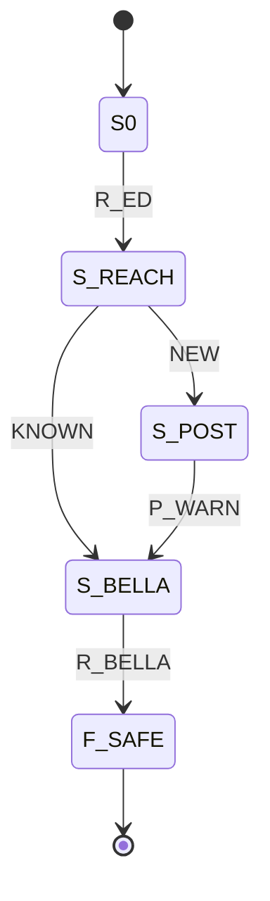

| Исход | Результат |
| --- | --- |
| F_SAFE | Изабелла добралась до машины под защитой Эдуарда. Незнакомцы уже заметили её; опасность на этом не исчезла. |

#### Отношения этого эпизода

| Пара | После сохранённого события | Если пары ещё нет | Линия | Предмет совместного разбора |
| --- | --- | --- | --- | --- |
| P ↔ eduard | R_ED | ACQUAINTED / UNTESTED | FRIEND_ONLY | как вывести Изабеллу с поляны |
| P ↔ isabella | R_BELLA | ACQUAINTED / UNTESTED | OWN_OPTIONAL | что было видно у машины после ухода |

После указанного события открывается REL_OFFER по [общему контракту](relationships.md#встраивание-в-16-автоматов). Дальнейшие варианты: нейтральный разговор, поддержка, договор с общим авторством либо соперничество. Выполнение/нарушение договора меняет доверие и следующие предложения; примирение сохраняет память. Основной сюжет не требует принимать договор.

### Ладонь на фургоне

| Паспорт | Значение |
| --- | --- |
| story_id / version | `evening_isabella_01` / `review-2026-10-20.4` |
| Мир / роль | `evening` / `isabella` |
| Референс | «Сумерки» (2008): Эдвард останавливает фургон ладонью и пытается скрыть, откуда успел прибежать. |
| Участники NPC | `eduard` |
| Хронология и знания | Игрок является Изабеллой. О вампирах она ещё не знает. Якова на парковке нет. |
| Начальный контекст | Фургон уже остановлен. На металле осталась вмятина, а ты помнишь Эдуарда у другой машины. |
| Цель | Не дай замять невозможное спасение: вынеси случай на парковке в публичное обсуждение с Эдуардом. |
| Начальное состояние | S0 |

| Пост | Автор | При входе в состояние | Готовый текст |
| --- | --- | --- | --- |
| q_public | eduard | S_PUBLIC | Про парковку уже говорят. Я был рядом, когда фургон занесло. |
| q_doubt | eduard | S_DOUBT | Я видел твою запись про парковку. Ты могла не заметить, где я стоял. |

| Состояние | Следующая цель |
| --- | --- |
| S0 | Опубликуй запись после аварии |
| S_REACH | Проверка результата публикации |
| S_PUBLIC | Ответь Эдуарду в открывшемся обсуждении |
| S_DOUBT | Ответь Эдуарду после спорной публикации |
| F_PUBLIC | История выполнена |
| F_DOUBT | История выполнена |

| Событие | Проверяемое условие |
| --- | --- |
| P_ACCIDENT | `PUB(p1)` |
| GAIN | `EVAL: p1.SubscriberDelta >= 0` |
| LOSS | `EVAL: p1.SubscriberDelta < 0` |
| R_PUBLIC | `ROOT(q_public, eduard, r1, c1)` |
| R_DOUBT | `ROOT(q_doubt, eduard, r1, c1)` |

| Из | Событие | В | Что сохранить | Момент сцены / последствие |
| --- | --- | --- | --- | --- |
| S0 | P_ACCIDENT | S_REACH | p1; квитанция публикации; снимок k | Изабелла делает случившееся публичным; авария не выводится из качества её текста. |
| S_REACH | GAIN | S_PUBLIC | Нет новых привязок | Обсуждение пришло вместе с приростом аудитории. |
| S_REACH | LOSS | S_DOUBT | Нет новых привязок | Обсуждение продолжается несмотря на отток; повторный пост не требуется. |
| S_PUBLIC | R_PUBLIC | F_PUBLIC | r1, c1; квитанция ответа; снимок k | Эдуард отвечает свидетельнице аварии, но не обязан подтвердить свою природу. |
| S_DOUBT | R_DOUBT | F_DOUBT | r1, c1; квитанция ответа; снимок k | Изабелла обращается к Эдуарду напрямую, независимо от реакции аудитории. |

| Состояние | P_ACCIDENT | GAIN | LOSS | R_PUBLIC | R_DOUBT | OTHER | CANCEL |
| --- | --- | --- | --- | --- | --- | --- | --- |
| S0 | S_REACH | S0 | S0 | S0 | S0 | S0 | CANCELLED |
| S_REACH | S_REACH | S_PUBLIC | S_DOUBT | S_REACH | S_REACH | S_REACH | CANCELLED |
| S_PUBLIC | S_PUBLIC | S_PUBLIC | S_PUBLIC | F_PUBLIC | S_PUBLIC | S_PUBLIC | CANCELLED |
| S_DOUBT | S_DOUBT | S_DOUBT | S_DOUBT | S_DOUBT | F_DOUBT | S_DOUBT | CANCELLED |
| F_PUBLIC | F_PUBLIC | F_PUBLIC | F_PUBLIC | F_PUBLIC | F_PUBLIC | F_PUBLIC | F_PUBLIC |
| F_DOUBT | F_DOUBT | F_DOUBT | F_DOUBT | F_DOUBT | F_DOUBT | F_DOUBT | F_DOUBT |
| CANCELLED | CANCELLED | CANCELLED | CANCELLED | CANCELLED | CANCELLED | CANCELLED | CANCELLED |

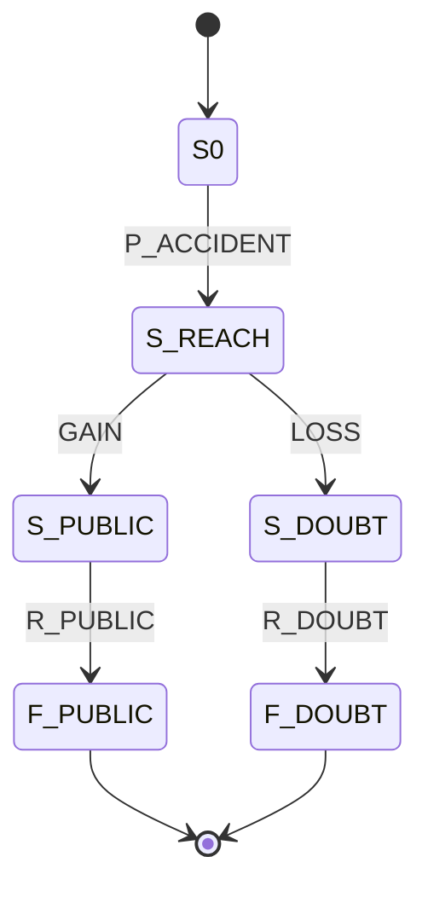

| Исход | Результат |
| --- | --- |
| F_PUBLIC | Запись получила неотрицательный прирост, Эдуард ответил Изабелле. Его тайна ещё не раскрыта. |
| F_DOUBT | Запись потеряла подписчиков, но Изабелла всё равно получила ответ Эдуарда. Отток не отменяет замеченную ею вмятину. |

#### Отношения этого эпизода

| Пара | После сохранённого события | Если пары ещё нет | Линия | Предмет совместного разбора |
| --- | --- | --- | --- | --- |
| P ↔ eduard | R_PUBLIC или R_DOUBT | ACQUAINTED / UNTESTED | ROMANCE_OPTIONAL | что произошло на школьной парковке |

После указанного события открывается REL_OFFER по [общему контракту](relationships.md#встраивание-в-16-автоматов). Дальнейшие варианты: нейтральный разговор, поддержка, договор с общим авторством либо соперничество. Выполнение/нарушение договора меняет доверие и следующие предложения; примирение сохраняет память. Основной сюжет не требует принимать договор.

### На солнце без объяснений

| Паспорт | Значение |
| --- | --- |
| story_id / version | `evening_eduard_01` / `review-2026-10-20.4` |
| Мир / роль | `evening` / `eduard` |
| Референс | «Сумерки» (2008): лесная поляна, сияющая кожа Эдварда и решение Беллы остаться рядом. |
| Участники NPC | `isabella` |
| Хронология и знания | Игрок является Эдуардом. Изабелла уже догадалась о вампирской природе и впервые видит его на солнце. Якова рядом нет. |
| Начальный контекст | Ты вышел из тени. Изабелла увидела кожу на солнце и осталась на поляне. |
| Цель | Сохрани связь с Изабеллой после того, как она увидела тебя на солнце. |
| Начальное состояние | S0 |

| Пост | Автор | При входе в состояние | Готовый текст |
| --- | --- | --- | --- |
| q_bella | isabella | S0 | Теперь я вижу, что ты скрывал от солнца. Хочу услышать тебя, а не чужую легенду. |

| Состояние | Следующая цель |
| --- | --- |
| S0 | Ответь Изабелле под её вопросом |
| S_BRAVE | Проверка смелости |
| S_TALK | Ответь на следующую реплику Изабеллы в той же ветке |
| S_POST | Опубликуй запись после встречи |
| F_MEADOW | История выполнена |

| Событие | Проверяемое условие |
| --- | --- |
| R_FIRST | `ROOT(q_bella, isabella, r1, c1)` |
| BRAVE | `EVAL: k.brave >= L_brave` |
| CALM | `EVAL: k.brave < L_brave` |
| R_SECOND | `CHILD(q_bella, isabella, c1, r2, c2)` |
| P_AFTER | `PUB(p1)` |

| Из | Событие | В | Что сохранить | Момент сцены / последствие |
| --- | --- | --- | --- | --- |
| S0 | R_FIRST | S_BRAVE | r1, c1; квитанция ответа; снимок k | Изабелла задаёт вопрос после раскрытия тайны на поляне. |
| S_BRAVE | BRAVE | S_POST | Нет новых привязок | Открытый приём смелости даёт короткий путь к публичной записи. |
| S_BRAVE | CALM | S_TALK | Нет новых привязок | Без приёма остаётся ещё один ход разговора; прокачивать навык до порога не требуется. |
| S_TALK | R_SECOND | S_POST | r2, c2; квитанция ответа; снимок k | Эдуард и Изабелла продолжают разговор об опасности близости. |
| S_POST | P_AFTER | F_MEADOW | p1; квитанция публикации; снимок k | После встречи появляется запись Эдуарда. Содержание любовного согласия не оценивается. |

| Состояние | R_FIRST | BRAVE | CALM | R_SECOND | P_AFTER | OTHER | CANCEL |
| --- | --- | --- | --- | --- | --- | --- | --- |
| S0 | S_BRAVE | S0 | S0 | S0 | S0 | S0 | CANCELLED |
| S_BRAVE | S_BRAVE | S_POST | S_TALK | S_BRAVE | S_BRAVE | S_BRAVE | CANCELLED |
| S_TALK | S_TALK | S_TALK | S_TALK | S_POST | S_TALK | S_TALK | CANCELLED |
| S_POST | S_POST | S_POST | S_POST | S_POST | F_MEADOW | S_POST | CANCELLED |
| F_MEADOW | F_MEADOW | F_MEADOW | F_MEADOW | F_MEADOW | F_MEADOW | F_MEADOW | F_MEADOW |
| CANCELLED | CANCELLED | CANCELLED | CANCELLED | CANCELLED | CANCELLED | CANCELLED | CANCELLED |

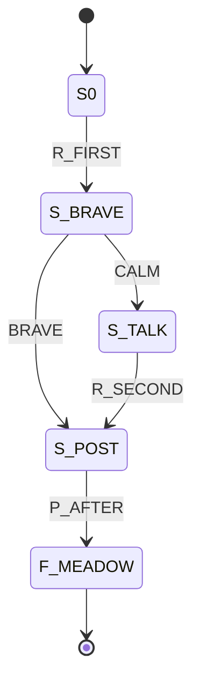

| Исход | Результат |
| --- | --- |
| F_MEADOW | Изабелла остаётся рядом с Эдуардом, увидев его на солнце. Разговор состоялся; автомат не приписывает игроку признание в любви по смыслу поста. |

#### Отношения этого эпизода

| Пара | После сохранённого события | Если пары ещё нет | Линия | Предмет совместного разбора |
| --- | --- | --- | --- | --- |
| P ↔ isabella | P_AFTER | ACQUAINTED / UNTESTED | ROMANCE_OPTIONAL | опасность встречи на солнце |

После указанного события открывается REL_OFFER по [общему контракту](relationships.md#встраивание-в-16-автоматов). Дальнейшие варианты: нейтральный разговор, поддержка, договор с общим авторством либо соперничество. Выполнение/нарушение договора меняет доверие и следующие предложения; примирение сохраняет память. Основной сюжет не требует принимать договор.

### Холодные люди у берега

| Паспорт | Значение |
| --- | --- |
| story_id / version | `evening_yakov_01` / `review-2026-10-20.4` |
| Мир / роль | `evening` / `yakov` |
| Референс | «Сумерки» (2008): разговор на пляже Ла-Пуш о холодных людях и старом договоре. |
| Участники NPC | `isabella` |
| Хронология и знания | Игрок является Яковом, обычным человеком. Изабелла ещё не знает тайну Эдуарда. Яков пересказывает предание, а не подтверждённое знание о вампирах. |
| Начальный контекст | Изабелла спрашивает, почему семью Эдуарда не ждут на земле общины. |
| Цель | Открой Изабелле след холодных людей через предание о договоре у берега. |
| Начальное состояние | S0 |

| Пост | Автор | При входе в состояние | Готовый текст |
| --- | --- | --- | --- |
| q_bella | isabella | S0 | Почему семья Эдуарда никогда не приезжает на этот берег? Ты обещал рассказать историю. |

| Состояние | Следующая цель |
| --- | --- |
| S0 | Ответь Изабелле под вопросом о договоре |
| S_TOPIC | Проверка навыка «в тему» |
| S_MORE | Ответь Изабелле ещё раз в той же ветке |
| F_LEGEND | История выполнена |

| Событие | Проверяемое условие |
| --- | --- |
| R_LEGEND | `ROOT(q_bella, isabella, r1, c1)` |
| INSIDER | `EVAL: k.topic >= L_topic` |
| LEARN | `EVAL: k.topic < L_topic` |
| R_MORE | `CHILD(q_bella, isabella, c1, r2, c2)` |

| Из | Событие | В | Что сохранить | Момент сцены / последствие |
| --- | --- | --- | --- | --- |
| S0 | R_LEGEND | S_TOPIC | r1, c1; квитанция ответа; снимок k | Разговор касается предания и границы договора. |
| S_TOPIC | INSIDER | F_LEGEND | Нет новых привязок | Открытый приём инсайда завершает короткую версию разговора. |
| S_TOPIC | LEARN | S_MORE | Нет новых привязок | Изабелла задаёт дополнительный вопрос; достаточно ещё одного ответа. |
| S_MORE | R_MORE | F_LEGEND | r2, c2; квитанция ответа; снимок k | Уточнение о договоре завершает разговор у берега. |

| Состояние | R_LEGEND | INSIDER | LEARN | R_MORE | OTHER | CANCEL |
| --- | --- | --- | --- | --- | --- | --- |
| S0 | S_TOPIC | S0 | S0 | S0 | S0 | CANCELLED |
| S_TOPIC | S_TOPIC | F_LEGEND | S_MORE | S_TOPIC | S_TOPIC | CANCELLED |
| S_MORE | S_MORE | S_MORE | S_MORE | F_LEGEND | S_MORE | CANCELLED |
| F_LEGEND | F_LEGEND | F_LEGEND | F_LEGEND | F_LEGEND | F_LEGEND | F_LEGEND |
| CANCELLED | CANCELLED | CANCELLED | CANCELLED | CANCELLED | CANCELLED | CANCELLED |

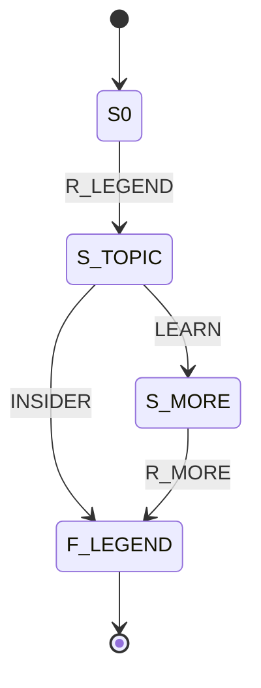

| Исход | Результат |
| --- | --- |
| F_LEGEND | Изабелла услышала предание и получила зацепку для собственного поиска. Яков остаётся человеком и не получает знания будущих фильмов. |

#### Отношения этого эпизода

| Пара | После сохранённого события | Если пары ещё нет | Линия | Предмет совместного разбора |
| --- | --- | --- | --- | --- |
| P ↔ isabella | R_LEGEND | ACQUAINTED / UNTESTED | FRIEND_ONLY | предание о холодных людях и договоре |

После указанного события открывается REL_OFFER по [общему контракту](relationships.md#встраивание-в-16-автоматов). Дальнейшие варианты: нейтральный разговор, поддержка, договор с общим авторством либо соперничество. Выполнение/нарушение договора меняет доверие и следующие предложения; примирение сохраняет память. Основной сюжет не требует принимать договор.

### Тролль не знает расписания

| Паспорт | Значение |
| --- | --- |
| story_id / version | `sorcerers_own_01` / `review-2026-10-20.4` |
| Мир / роль | `sorcerers` / `own` |
| Референс | «Гарри Поттер и философский камень» (2001): тролль в уборной, поднятая дубина и начало дружбы троицы. |
| Участники NPC | `gosha`, `georgina`, `roman` |
| Хронология и знания | Троица ещё не стала друзьями. Георгина не слышала предупреждения. Роман участвует в сцене как существующий герой мира; ответ от него не требуется. |
| Начальный контекст | Во время пира объявили о тролле. Георгины за столом нет. Ты заметил, куда повернули Гоша и Роман. |
| Цель | Помоги Гоше найти Георгину во время тревоги и встреть её после спасения от тролля. |
| Начальное состояние | S0 |

| Пост | Автор | При входе в состояние | Готовый текст |
| --- | --- | --- | --- |
| q_gosha | gosha | S0 | Георгина не слышала предупреждения. Мы с Романом идём обратно. Кто видел её последним? |
| q_geo | georgina | S_AFTER | Я выбралась. Дубина упала на тролля. Если преподаватели спросят, я сама пошла его искать. |

| Состояние | Следующая цель |
| --- | --- |
| S0 | Ответь Гоше под сообщением о поиске Георгины |
| S_AFTER | Ответь Георгине под её сообщением после опасности |
| F_TRIO | История выполнена |

| Событие | Проверяемое условие |
| --- | --- |
| R_FIND | `ROOT(q_gosha, gosha, r1, c1)` |
| R_AFTER | `ROOT(q_geo, georgina, r2, c2)` |

| Из | Событие | В | Что сохранить | Момент сцены / последствие |
| --- | --- | --- | --- | --- |
| S0 | R_FIND | S_AFTER | r1, c1; квитанция ответа; снимок k | Гоша получает обращение; сцена спасения с Романом переходит к развязке. |
| S_AFTER | R_AFTER | F_TRIO | r2, c2; квитанция ответа; снимок k | Георгина отвечает после спасения и принятого ею решения прикрыть друзей. |

| Состояние | R_FIND | R_AFTER | OTHER | CANCEL |
| --- | --- | --- | --- | --- |
| S0 | S_AFTER | S0 | S0 | CANCELLED |
| S_AFTER | S_AFTER | F_TRIO | S_AFTER | CANCELLED |
| F_TRIO | F_TRIO | F_TRIO | F_TRIO | F_TRIO |
| CANCELLED | CANCELLED | CANCELLED | CANCELLED | CANCELLED |

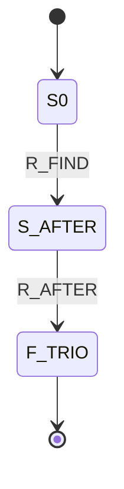

| Исход | Результат |
| --- | --- |
| F_TRIO | Роман обезвредил тролля поднятой дубиной. Георгина прикрыла ребят перед преподавателями. Общая опасность связала троицу; свободный герой сохранил собственную биографию. |

#### Отношения этого эпизода

| Пара | После сохранённого события | Если пары ещё нет | Линия | Предмет совместного разбора |
| --- | --- | --- | --- | --- |
| P ↔ gosha | R_FIND | ACQUAINTED / UNTESTED | FRIEND_ONLY | куда исчезла Георгина во время тревоги |
| P ↔ georgina | R_AFTER | ACQUAINTED / UNTESTED | FRIEND_ONLY | события после спасения от тролля |

После указанного события открывается REL_OFFER по [общему контракту](relationships.md#встраивание-в-16-автоматов). Дальнейшие варианты: нейтральный разговор, поддержка, договор с общим авторством либо соперничество. Выполнение/нарушение договора меняет доверие и следующие предложения; примирение сохраняет память. Основной сюжет не требует принимать договор.

### Первый полёт за чужой вещью

| Паспорт | Значение |
| --- | --- |
| story_id / version | `sorcerers_gosha_01` / `review-2026-10-20.4` |
| Мир / роль | `sorcerers` / `gosha` |
| Референс | «Гарри Поттер и философский камень» (2001): первый урок полётов и пойманная напоминалка. |
| Участники NPC | `roman`, `georgina` |
| Хронология и знания | Игрок является Гошей. Летающий ученик и преподаватель остаются фоновыми лицами. Спортивное назначение не превращается в автоматическую награду. |
| Начальный контекст | Ты уже поймал чужую напоминалку в полёте. Одни заметили удачный перехват, другие нарушение запрета. |
| Цель | Верни напоминалку после запрещённого полёта и встреть школьный спор о твоём таланте и нарушенных правилах. |
| Начальное состояние | S0 |

| Пост | Автор | При входе в состояние | Готовый текст |
| --- | --- | --- | --- |
| q_roman | roman | S_ROMAN | Вот это перехват. Кажется, преподаватель тоже видел, как ты поймал напоминалку. |
| q_geo | georgina | S_GEO | Напоминалка возвращена, но нам велели не взлетать. Ты заметил преподавателя у окна? |

| Состояние | Следующая цель |
| --- | --- |
| S0 | Опубликуй запись после полёта |
| S_REACH | Проверка результата публикации |
| S_ROMAN | Ответь Роману под сообщением о полёте |
| S_GEO | Ответь Георгине под вопросом о запрете |
| F_NOTICED | История выполнена |
| F_RULES | История выполнена |

| Событие | Проверяемое условие |
| --- | --- |
| P_FLIGHT | `PUB(p1)` |
| GAIN | `EVAL: p1.SubscriberDelta >= 0` |
| LOSS | `EVAL: p1.SubscriberDelta < 0` |
| R_ROMAN | `ROOT(q_roman, roman, r1, c1)` |
| R_GEO | `ROOT(q_geo, georgina, r1, c1)` |

| Из | Событие | В | Что сохранить | Момент сцены / последствие |
| --- | --- | --- | --- | --- |
| S0 | P_FLIGHT | S_REACH | p1; квитанция публикации; снимок k | Запись выходит после совершённого полёта, а не вычисляет его результат. |
| S_REACH | GAIN | S_ROMAN | Нет новых привязок | Обсуждение продолжает Роман. |
| S_REACH | LOSS | S_GEO | Нет новых привязок | Обсуждение продолжает Георгина; нового удачного поста не требуется. |
| S_ROMAN | R_ROMAN | F_NOTICED | r1, c1; квитанция ответа; снимок k | Гоша получает отклик Романа о замеченном полёте. |
| S_GEO | R_GEO | F_RULES | r1, c1; квитанция ответа; снимок k | Гоша обсуждает с Георгиной последствия нарушения запрета. |

| Состояние | P_FLIGHT | GAIN | LOSS | R_ROMAN | R_GEO | OTHER | CANCEL |
| --- | --- | --- | --- | --- | --- | --- | --- |
| S0 | S_REACH | S0 | S0 | S0 | S0 | S0 | CANCELLED |
| S_REACH | S_REACH | S_ROMAN | S_GEO | S_REACH | S_REACH | S_REACH | CANCELLED |
| S_ROMAN | S_ROMAN | S_ROMAN | S_ROMAN | F_NOTICED | S_ROMAN | S_ROMAN | CANCELLED |
| S_GEO | S_GEO | S_GEO | S_GEO | S_GEO | F_RULES | S_GEO | CANCELLED |
| F_NOTICED | F_NOTICED | F_NOTICED | F_NOTICED | F_NOTICED | F_NOTICED | F_NOTICED | F_NOTICED |
| F_RULES | F_RULES | F_RULES | F_RULES | F_RULES | F_RULES | F_RULES | F_RULES |
| CANCELLED | CANCELLED | CANCELLED | CANCELLED | CANCELLED | CANCELLED | CANCELLED | CANCELLED |

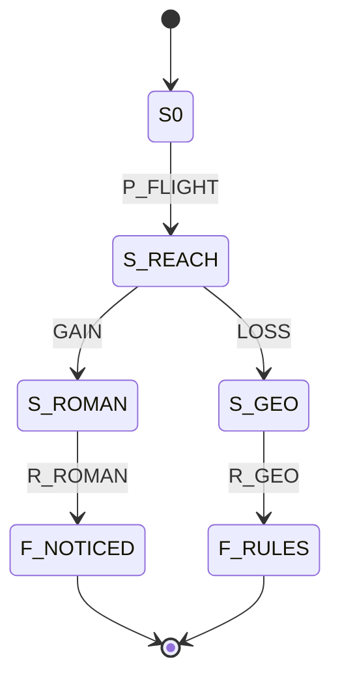

| Исход | Результат |
| --- | --- |
| F_NOTICED | Роман откликнулся на полёт, запись получила неотрицательный прирост. Напоминалка возвращена, талант замечен в сцене. |
| F_RULES | Георгина напомнила о запрете после записи с оттоком. Напоминалка всё равно возвращена; рост аудитории не определяет, поймал ли её Гоша. |

#### Отношения этого эпизода

| Пара | После сохранённого события | Если пары ещё нет | Линия | Предмет совместного разбора |
| --- | --- | --- | --- | --- |
| P ↔ roman | R_ROMAN | ACQUAINTED / UNTESTED | FRIEND_ONLY | возвращение напоминалки и нарушение правил |
| P ↔ georgina | R_GEO | ACQUAINTED / UNTESTED | FRIEND_ONLY | полет без разрешения и его последствия |

После указанного события открывается REL_OFFER по [общему контракту](relationships.md#встраивание-в-16-автоматов). Дальнейшие варианты: нейтральный разговор, поддержка, договор с общим авторством либо соперничество. Выполнение/нарушение договора меняет доверие и следующие предложения; примирение сохраняет память. Основной сюжет не требует принимать договор.

### Перо должно взлететь

| Паспорт | Значение |
| --- | --- |
| story_id / version | `sorcerers_georgina_01` / `review-2026-10-20.4` |
| Мир / роль | `sorcerers` / `georgina` |
| Референс | «Гарри Поттер и философский камень» (2001): урок левитации, поправка Романа и первое поднятое перо. |
| Участники NPC | `roman` |
| Хронология и знания | Игрок является Георгиной. Это урок до ссоры и спасения от тролля; отношения с Романом ещё напряжённые. |
| Начальный контекст | Роман повторяет заклинание всё громче. Ты заметила ошибку в движении палочки. |
| Цель | Подними перо перед классом и помоги Роману разобраться в движении, которое у него не получается. |
| Начальное состояние | S0 |

| Пост | Автор | При входе в состояние | Готовый текст |
| --- | --- | --- | --- |
| q_roman | roman | S_ROMAN | Перо поднялось. Я видел. Теперь объясни движение так, чтобы его можно было повторить. |

| Состояние | Следующая цель |
| --- | --- |
| S0 | Опубликуй заметку об уроке |
| S_TOPIC | Проверка навыка «в тему» |
| S_NOTE | Опубликуй вторую заметку о разборе движения |
| S_ROMAN | Ответь Роману под обсуждением демонстрации |
| F_FEATHER | История выполнена |

| Событие | Проверяемое условие |
| --- | --- |
| P_LESSON | `PUB(p1)` |
| INSIDER | `EVAL: k.topic >= L_topic` |
| PRACTICE | `EVAL: k.topic < L_topic` |
| P_NOTE | `PUB(p2)` |
| R_ROMAN | `ROOT(q_roman, roman, r1, c1)` |

| Из | Событие | В | Что сохранить | Момент сцены / последствие |
| --- | --- | --- | --- | --- |
| S0 | P_LESSON | S_TOPIC | p1; квитанция публикации; снимок k | Появляются записи об уроке левитации. |
| S_TOPIC | INSIDER | S_ROMAN | Нет новых привязок | При открытом инсайде можно сразу перейти к обсуждению с Романом. |
| S_TOPIC | PRACTICE | S_NOTE | Нет новых привязок | Обычный путь включает ещё одну публикацию; достижения уровня ждать не нужно. |
| S_NOTE | P_NOTE | S_ROMAN | p2; квитанция публикации; снимок k | Вторая отдельная публикация завершает подготовку к демонстрации; p2.Id отличается от p1.Id. |
| S_ROMAN | R_ROMAN | F_FEATHER | r1, c1; квитанция ответа; снимок k | Роман вступает в обсуждение после демонстрации пера. |

| Состояние | P_LESSON | INSIDER | PRACTICE | P_NOTE | R_ROMAN | OTHER | CANCEL |
| --- | --- | --- | --- | --- | --- | --- | --- |
| S0 | S_TOPIC | S0 | S0 | S0 | S0 | S0 | CANCELLED |
| S_TOPIC | S_TOPIC | S_ROMAN | S_NOTE | S_TOPIC | S_TOPIC | S_TOPIC | CANCELLED |
| S_NOTE | S_NOTE | S_NOTE | S_NOTE | S_ROMAN | S_NOTE | S_NOTE | CANCELLED |
| S_ROMAN | S_ROMAN | S_ROMAN | S_ROMAN | S_ROMAN | F_FEATHER | S_ROMAN | CANCELLED |
| F_FEATHER | F_FEATHER | F_FEATHER | F_FEATHER | F_FEATHER | F_FEATHER | F_FEATHER | F_FEATHER |
| CANCELLED | CANCELLED | CANCELLED | CANCELLED | CANCELLED | CANCELLED | CANCELLED | CANCELLED |

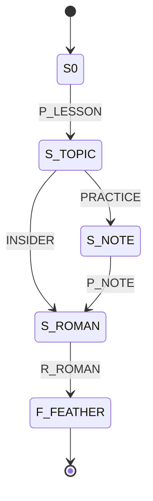

| Исход | Результат |
| --- | --- |
| F_FEATHER | В сцене перо поднялось после демонстрации Георгины. Роман ответил на обращение; автомат не объявляет его согласным или дружелюбным по тексту. |

#### Отношения этого эпизода

| Пара | После сохранённого события | Если пары ещё нет | Линия | Предмет совместного разбора |
| --- | --- | --- | --- | --- |
| P ↔ roman | R_ROMAN | ACQUAINTED / UNTESTED | FRIEND_ONLY | движение палочки на уроке левитации |

После указанного события открывается REL_OFFER по [общему контракту](relationships.md#встраивание-в-16-автоматов). Дальнейшие варианты: нейтральный разговор, поддержка, договор с общим авторством либо соперничество. Выполнение/нарушение договора меняет доверие и следующие предложения; примирение сохраняет память. Основной сюжет не требует принимать договор.

### Конь, которого придётся отдать

| Паспорт | Значение |
| --- | --- |
| story_id / version | `sorcerers_roman_01` / `review-2026-10-20.4` |
| Мир / роль | `sorcerers` / `roman` |
| Референс | «Гарри Поттер и философский камень» (2001): гигантские шахматы и жертва коня ради прохода друзей. |
| Участники NPC | `gosha`, `georgina` |
| Хронология и знания | Игрок является Романом. Троица уже дружит. Георгина присутствует в сцене и остаётся с Романом; её комментарий не требуется. |
| Начальный контекст | Ты видишь комбинацию, после которой Гоша сможет пройти. Твоей фигуре придётся принять удар. |
| Цель | Открой Гоше путь дальше, отдав под удар собственного коня. |
| Начальное состояние | S0 |

| Пост | Автор | При входе в состояние | Готовый текст |
| --- | --- | --- | --- |
| q_gosha | gosha | S0 | Фигуры не пропускают нас. Ты видишь первый ход? Я буду слушать тебя. |

| Состояние | Следующая цель |
| --- | --- |
| S0 | Ответь Гоше под вопросом о первом ходе |
| S_MOVE | Ответь на его следующую реплику в этой же ветке |
| S_TOPIC | Проверка навыка «в тему» |
| S_LAST | Заверши обсуждение третьим ответом Гоше |
| F_PASS | История выполнена |

| Событие | Проверяемое условие |
| --- | --- |
| R_FIRST | `ROOT(q_gosha, gosha, r1, c1)` |
| R_MOVE | `CHILD(q_gosha, gosha, c1, r2, c2)` |
| INSIDER | `EVAL: k.topic >= L_topic` |
| EXPLAIN | `EVAL: k.topic < L_topic` |
| R_LAST | `CHILD(q_gosha, gosha, c2, r3, c3)` |

| Из | Событие | В | Что сохранить | Момент сцены / последствие |
| --- | --- | --- | --- | --- |
| S0 | R_FIRST | S_MOVE | r1, c1; квитанция ответа; снимок k | Роман начинает обсуждение комбинации с Гошей. |
| S_MOVE | R_MOVE | S_TOPIC | r2, c2; квитанция ответа; снимок k | Второй ход обсуждения связан с жертвой фигуры. |
| S_TOPIC | INSIDER | F_PASS | Нет новых привязок | Открытый инсайд сокращает обсуждение до двух ответов. |
| S_TOPIC | EXPLAIN | S_LAST | Нет новых привязок | Для обычного пути нужен ещё один ответ, а не прокачка навыка. |
| S_LAST | R_LAST | F_PASS | r3, c3; квитанция ответа; снимок k | Третий ответ завершает обсуждение прохода для друзей. |

| Состояние | R_FIRST | R_MOVE | INSIDER | EXPLAIN | R_LAST | OTHER | CANCEL |
| --- | --- | --- | --- | --- | --- | --- | --- |
| S0 | S_MOVE | S0 | S0 | S0 | S0 | S0 | CANCELLED |
| S_MOVE | S_MOVE | S_TOPIC | S_MOVE | S_MOVE | S_MOVE | S_MOVE | CANCELLED |
| S_TOPIC | S_TOPIC | S_TOPIC | F_PASS | S_LAST | S_TOPIC | S_TOPIC | CANCELLED |
| S_LAST | S_LAST | S_LAST | S_LAST | S_LAST | F_PASS | S_LAST | CANCELLED |
| F_PASS | F_PASS | F_PASS | F_PASS | F_PASS | F_PASS | F_PASS | F_PASS |
| CANCELLED | CANCELLED | CANCELLED | CANCELLED | CANCELLED | CANCELLED | CANCELLED | CANCELLED |

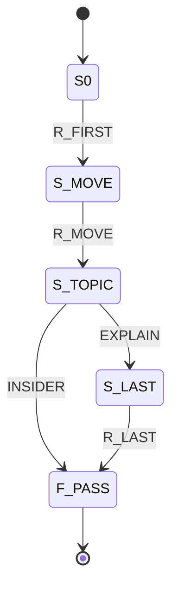

| Исход | Результат |
| --- | --- |
| F_PASS | Конь принимает удар. Георгина остаётся с Романом, Гоша получает проход. Ответы в ветке не создают отдельную шахматную механику или штраф профилю. |

#### Отношения этого эпизода

| Пара | После сохранённого события | Если пары ещё нет | Линия | Предмет совместного разбора |
| --- | --- | --- | --- | --- |
| P ↔ gosha | R_MOVE | ACQUAINTED / UNTESTED | FRIEND_ONLY | комбинация с жертвой коня |

После указанного события открывается REL_OFFER по [общему контракту](relationships.md#встраивание-в-16-автоматов). Дальнейшие варианты: нейтральный разговор, поддержка, договор с общим авторством либо соперничество. Выполнение/нарушение договора меняет доверие и следующие предложения; примирение сохраняет память. Основной сюжет не требует принимать договор.

### Мертвец в ящике

| Паспорт | Значение |
| --- | --- |
| story_id / version | `houses_own_01` / `review-2026-10-20.4` |
| Мир / роль | `houses` / `own` |
| Референс | «Игра престолов», 7×07, The Dragon and the Wolf: доказательство угрозы в Драконьем Логове. |
| Участники NPC | `jon`, `james`, `diana` |
| Хронология и знания | Джон и Диана союзники. У Дианы два живых дракона, один уже погиб за Стеной. Джон не знает своего происхождения. Джеймс носит протез правой кисти. Диана и правительница противников присутствуют в сцене; их ответы не требуются. |
| Начальный контекст | В ящике бьётся пленный мертвец. Ты посланник малого дома и видишь, как разговор о титулах уступает страху. |
| Цель | Донеси доказательство живых мертвецов до стороны Джеймса: пусть спор о престоле столкнётся с общей угрозой. |
| Начальное состояние | S0 |

| Пост | Автор | При входе в состояние | Готовый текст |
| --- | --- | --- | --- |
| q_jon | jon | S0 | Мы привезли того, кого обычный удар не останавливает. Откройте ящик и смотрите. |
| q_james | james | S_JAMES | Я видел, что вы привезли. Теперь вопрос не в том, чей герб над стеной. |

| Состояние | Следующая цель |
| --- | --- |
| S0 | Ответь Джону под сообщением о пленнике |
| S_POST | Опубликуй свидетельство после показа |
| S_JAMES | Ответь Джеймсу под обсуждением общей угрозы |
| S_REACH | Проверка результата опубликованного свидетельства |
| F_REACH | История выполнена |
| F_WITNESS | История выполнена |

| Событие | Проверяемое условие |
| --- | --- |
| R_JON | `ROOT(q_jon, jon, r1, c1)` |
| P_PROOF | `PUB(p1)` |
| R_JAMES | `ROOT(q_james, james, r2, c2)` |
| GAIN | `EVAL: p1.SubscriberDelta >= 0` |
| LOSS | `EVAL: p1.SubscriberDelta < 0` |

| Из | Событие | В | Что сохранить | Момент сцены / последствие |
| --- | --- | --- | --- | --- |
| S0 | R_JON | S_POST | r1, c1; квитанция ответа; снимок k | Пленник показан участникам встречи, Джон получил обращение свидетеля. |
| S_POST | P_PROOF | S_JAMES | p1; квитанция публикации; снимок k | Свидетельство о показе опубликовано в канале игрока. |
| S_JAMES | R_JAMES | S_REACH | r2, c2; квитанция ответа; снимок k | Джеймс отвечает после увиденного доказательства. |
| S_REACH | GAIN | F_REACH | Нет новых привязок | Свидетельство расширило аудиторию либо не изменило её. |
| S_REACH | LOSS | F_WITNESS | Нет новых привязок | Свидетельство осталось спорным для аудитории, но разговор состоялся. |

| Состояние | R_JON | P_PROOF | R_JAMES | GAIN | LOSS | OTHER | CANCEL |
| --- | --- | --- | --- | --- | --- | --- | --- |
| S0 | S_POST | S0 | S0 | S0 | S0 | S0 | CANCELLED |
| S_POST | S_POST | S_JAMES | S_POST | S_POST | S_POST | S_POST | CANCELLED |
| S_JAMES | S_JAMES | S_JAMES | S_REACH | S_JAMES | S_JAMES | S_JAMES | CANCELLED |
| S_REACH | S_REACH | S_REACH | S_REACH | F_REACH | F_WITNESS | S_REACH | CANCELLED |
| F_REACH | F_REACH | F_REACH | F_REACH | F_REACH | F_REACH | F_REACH | F_REACH |
| F_WITNESS | F_WITNESS | F_WITNESS | F_WITNESS | F_WITNESS | F_WITNESS | F_WITNESS | F_WITNESS |
| CANCELLED | CANCELLED | CANCELLED | CANCELLED | CANCELLED | CANCELLED | CANCELLED | CANCELLED |

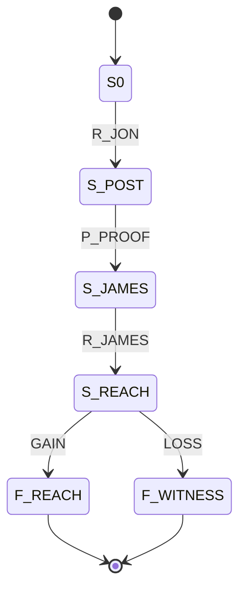

| Исход | Результат |
| --- | --- |
| F_REACH | Доказательство дошло до стороны Джеймса, запись дала неотрицательный прирост. Публичность не означает согласия всех домов или отправки армии. |
| F_WITNESS | Джеймс ответил на свидетельство, хотя запись потеряла подписчиков. Мертвец остаётся доказательством; спорная публикация не отменяет сцену. |

#### Отношения этого эпизода

| Пара | После сохранённого события | Если пары ещё нет | Линия | Предмет совместного разбора |
| --- | --- | --- | --- | --- |
| P ↔ jon | R_JON | ACQUAINTED / UNTESTED | OWN_OPTIONAL | свидетельство о мертвеце в ящике |
| P ↔ james | R_JAMES | ACQUAINTED / UNTESTED | OWN_OPTIONAL | публичное доказательство общей угрозы |

После указанного события открывается REL_OFFER по [общему контракту](relationships.md#встраивание-в-16-автоматов). Дальнейшие варианты: нейтральный разговор, поддержка, договор с общим авторством либо соперничество. Выполнение/нарушение договора меняет доверие и следующие предложения; примирение сохраняет память. Основной сюжет не требует принимать договор.

### Три яйца и рассвет

| Паспорт | Значение |
| --- | --- |
| story_id / version | `houses_diana_01` / `review-2026-10-20.4` |
| Мир / роль | `houses` / `diana` |
| Референс | «Игра престолов», 1×10, Fire and Blood: погребальный костёр и три дракона на рассвете. |
| Участники NPC | Нет |
| Хронология и знания | Игрок является Дианой. Драконы ещё не вылупились, завоёванных городов и Безупречных нет. Джон и Джеймс далеко и не участвуют. Умерший муж и оставшиеся спутники являются фоном. |
| Начальный контекст | Костёр готов. Рядом три каменных яйца. За ночь прежняя жизнь Дианы окончательно закончится. |
| Цель | Пройди через погребальный костёр и встреть рассвет с тремя живыми драконами. |
| Начальное состояние | S0 |

| Состояние | Следующая цель |
| --- | --- |
| S0 | Опубликуй запись перед костром |
| S_DAWN | Система открывает сцену рассвета без дополнительной публикации |
| F_DRAGONS | История выполнена |

| Событие | Проверяемое условие |
| --- | --- |
| P_NIGHT | `PUB(p1)` |
| DAWN | `EVAL: p1 сохранён и переход в S_DAWN подтверждён` |

| Из | Событие | В | Что сохранить | Момент сцены / последствие |
| --- | --- | --- | --- | --- |
| S0 | P_NIGHT | S_DAWN | p1; квитанция публикации; снимок k | Запись предшествует сцене входа в огонь. Число яиц является частью референса, а не требованием сделать три поста. |
| S_DAWN | DAWN | F_DRAGONS | Факт dawn для этого запуска, один раз | Исполнитель фиксирует рассвет и рождение трёх драконов. Реального ожидания ночи или таймера нет. |

| Состояние | P_NIGHT | DAWN | OTHER | CANCEL |
| --- | --- | --- | --- | --- |
| S0 | S_DAWN | S0 | S0 | CANCELLED |
| S_DAWN | S_DAWN | F_DRAGONS | S_DAWN | CANCELLED |
| F_DRAGONS | F_DRAGONS | F_DRAGONS | F_DRAGONS | F_DRAGONS |
| CANCELLED | CANCELLED | CANCELLED | CANCELLED | CANCELLED |

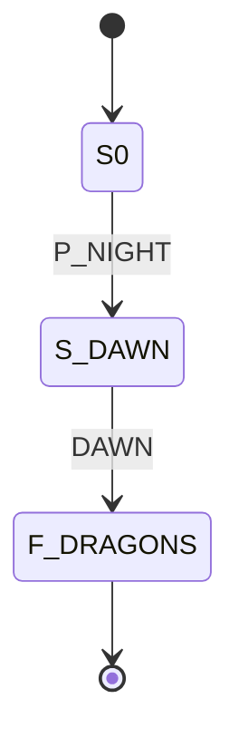

| Исход | Результат |
| --- | --- |
| F_DRAGONS | На рассвете Диана остаётся живой среди углей с тремя драконами. Спутники преклоняются перед ней. Это сюжетный факт, без новых предметов, NPC или бонуса энергии. |

#### Отношения этого эпизода

NO_CONTACT: в этой сцене нет подходящего участника из текущего состава рядом с героем. REL_OFFER внутри эпизода не создаётся; отношения не изменяются от одиночной публикации. Нельзя добавлять удалённого собеседника только ради шкалы. Существующие пары сохраняются. В свободной игре доступны отдельные социальные предложения подходящих NPC в контексте мира, без переноса будущих знаний в эту сцену.

### Сталь у причала

| Паспорт | Значение |
| --- | --- |
| story_id / version | `houses_jon_01` / `review-2026-10-20.4` |
| Мир / роль | `houses` / `jon` |
| Референс | «Игра престолов», 5×08, Hardhome: эвакуация, меч против Ходока и поднятие погибших у отплывающих лодок. |
| Участники NPC | Нет |
| Хронология и знания | Игрок является Джоном, лордом-командующим. Он не знает своего происхождения и не знаком с Дианой. Джеймса рядом нет. Беженцы и противник являются фоновыми участниками. |
| Начальный контекст | Люди бегут к лодкам. У причала появляется противник, о которого ломается обычное оружие. |
| Цель | Прикрой отход людей к лодкам и выберись с берега, где поднимаются мёртвые. |
| Начальное состояние | S0 |

| Состояние | Следующая цель |
| --- | --- |
| S0 | Опубликуй запись об эвакуации |
| S_CLASH | Система открывает сцену схватки у причала |
| S_BOAT | Опубликуй новую запись после отхода лодок |
| F_EVAC | История выполнена |

| Событие | Проверяемое условие |
| --- | --- |
| P_EVAC | `PUB(p1)` |
| CLASH | `EVAL: p1 сохранён и переход в S_CLASH подтверждён` |
| P_BOAT | `PUB(p2)` |

| Из | Событие | В | Что сохранить | Момент сцены / последствие |
| --- | --- | --- | --- | --- |
| S0 | P_EVAC | S_CLASH | p1; квитанция публикации; снимок k | Первая запись сопровождает погрузку беженцев. |
| S_CLASH | CLASH | S_BOAT | Факт clash для этого запуска, один раз | Меч выдержал удар и разбил противника; лодки отходят. Это сцена рассказа, не проверка нового боевого инвентаря. |
| S_BOAT | P_BOAT | F_EVAC | p2; квитанция публикации; снимок k | Отдельная новая запись сопровождает отход и поднятие погибших; p2.Id отличается от p1.Id. |

| Состояние | P_EVAC | CLASH | P_BOAT | OTHER | CANCEL |
| --- | --- | --- | --- | --- | --- |
| S0 | S_CLASH | S0 | S0 | S0 | CANCELLED |
| S_CLASH | S_CLASH | S_BOAT | S_CLASH | S_CLASH | CANCELLED |
| S_BOAT | S_BOAT | S_BOAT | F_EVAC | S_BOAT | CANCELLED |
| F_EVAC | F_EVAC | F_EVAC | F_EVAC | F_EVAC | F_EVAC |
| CANCELLED | CANCELLED | CANCELLED | CANCELLED | CANCELLED | CANCELLED |

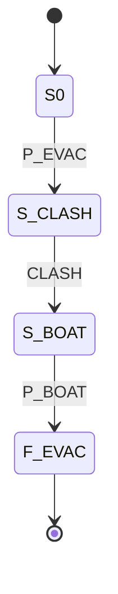

| Исход | Результат |
| --- | --- |
| F_EVAC | Меч Джона разбивает противника, часть людей эвакуирована. С лодки видны поднимающиеся погибшие. История не утверждает победу над всей армией мёртвых. |

#### Отношения этого эпизода

NO_CONTACT: в этой сцене нет подходящего участника из текущего состава рядом с героем. REL_OFFER внутри эпизода не создаётся; отношения не изменяются от одиночной публикации. Нельзя добавлять удалённого собеседника только ради шкалы. Существующие пары сохраняются. В свободной игре доступны отдельные социальные предложения подходящих NPC в контексте мира, без переноса будущих знаний в эту сцену.

### Один перед прежними врагами

| Паспорт | Значение |
| --- | --- |
| story_id / version | `houses_james_01` / `review-2026-10-20.4` |
| Мир / роль | `houses` / `james` |
| Референс | «Игра престолов», 8×02, A Knight of the Seven Kingdoms: Джейме приехал один и отвечает за прошлое перед прежними врагами. |
| Участники NPC | `diana`, `jon` |
| Хронология и знания | Игрок является Джеймсом. Протез справа. Обещанная армия не пришла. Диана потеряла отца от его руки. Джон уже знает происхождение. Поручительство Бриенны является фоном без нового интерактивного NPC. |
| Начальный контекст | Ты стоишь перед Дианой без армии семьи. Ворота закрылись за спиной; говорить придётся от собственного имени. |
| Цель | Добейся места в общей битве среди тех, кто помнит тебя врагом. |
| Начальное состояние | S0 |

| Пост | Автор | При входе в состояние | Готовый текст |
| --- | --- | --- | --- |
| q_diana | diana | S0 | Ты приехал один. Армия твоей семьи не пришла. Я хочу услышать, зачем ты здесь. |
| q_jon | jon | S_JON | До битвы осталось мало времени. Ты будешь стоять в строю с теми, кто ещё вчера был врагом? |

| Состояние | Следующая цель |
| --- | --- |
| S0 | Ответь Диане под обращением к прибывшему рыцарю |
| S_POST | Опубликуй личную позицию после разговора |
| S_BRAVE | Проверка смелости |
| S_JON | Ответь Джону под вопросом о предстоящей битве |
| F_STAY | История выполнена |

| Событие | Проверяемое условие |
| --- | --- |
| R_DIANA | `ROOT(q_diana, diana, r1, c1)` |
| P_POSITION | `PUB(p1)` |
| BRAVE | `EVAL: k.brave >= L_brave` |
| TALK | `EVAL: k.brave < L_brave` |
| R_JON | `ROOT(q_jon, jon, r2, c2)` |

| Из | Событие | В | Что сохранить | Момент сцены / последствие |
| --- | --- | --- | --- | --- |
| S0 | R_DIANA | S_POST | r1, c1; квитанция ответа; снимок k | Рыцарь получает возможность ответить перед Дианой и северянами. |
| S_POST | P_POSITION | S_BRAVE | p1; квитанция публикации; снимок k | Личная позиция опубликована после разговора; формулировка обещания не классифицируется. |
| S_BRAVE | BRAVE | F_STAY | Нет новых привязок | При открытом приёме смелости хватает уже состоявшегося разговора. |
| S_BRAVE | TALK | S_JON | Нет новых привязок | Обычный путь завершается ещё одним публичным разговором с Джоном. |
| S_JON | R_JON | F_STAY | r2, c2; квитанция ответа; снимок k | Джон отвечает перед общей битвой; сценическое поручительство завершает эпизод. |

| Состояние | R_DIANA | P_POSITION | BRAVE | TALK | R_JON | OTHER | CANCEL |
| --- | --- | --- | --- | --- | --- | --- | --- |
| S0 | S_POST | S0 | S0 | S0 | S0 | S0 | CANCELLED |
| S_POST | S_POST | S_BRAVE | S_POST | S_POST | S_POST | S_POST | CANCELLED |
| S_BRAVE | S_BRAVE | S_BRAVE | F_STAY | S_JON | S_BRAVE | S_BRAVE | CANCELLED |
| S_JON | S_JON | S_JON | S_JON | S_JON | F_STAY | S_JON | CANCELLED |
| F_STAY | F_STAY | F_STAY | F_STAY | F_STAY | F_STAY | F_STAY | F_STAY |
| CANCELLED | CANCELLED | CANCELLED | CANCELLED | CANCELLED | CANCELLED | CANCELLED | CANCELLED |

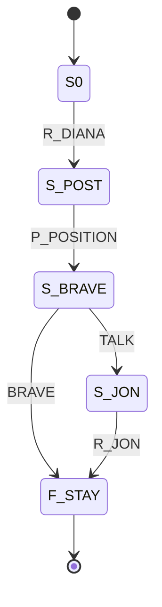

| Исход | Результат |
| --- | --- |
| F_STAY | Джеймсу разрешено остаться для битвы после поручительства. Его прошлые поступки не отменены; автомат не выводит личную клятву из текста игрока и не объявляет всю семью союзником. |

#### Отношения этого эпизода

| Пара | После сохранённого события | Если пары ещё нет | Линия | Предмет совместного разбора |
| --- | --- | --- | --- | --- |
| P ↔ diana | R_DIANA | ACQUAINTED / UNTESTED | FRIEND_ONLY | присутствие прежнего врага перед общей битвой |
| P ↔ jon | R_JON | ACQUAINTED / UNTESTED | FRIEND_ONLY | поручительство и подготовка к общей битве |

После указанного события открывается REL_OFFER по [общему контракту](relationships.md#встраивание-в-16-автоматов). Дальнейшие варианты: нейтральный разговор, поддержка, договор с общим авторством либо соперничество. Выполнение/нарушение договора меняет доверие и следующие предложения; примирение сохраняет память. Основной сюжет не требует принимать договор.

### Первый разбор «Смены»

| Паспорт | Значение |
| --- | --- |
| story_id / version | `it_own_01` / `review-2026-10-20.4` |
| Мир / роль | `it` / `own` |
| Референс | Исходные образы #195: расчёт выгоды Меркантила, инженерная проверка Куляша и эфир Бургера. Сервис «Смена» вымышленный. |
| Участники NPC | `greedy_wolf`, `alexey_nl`, `2kotleti_news` |
| Хронология и знания | Есть только анонс сервиса. Результаты теста ещё не подтверждены. Реальные компании и авторы каналов не являются участниками. |
| Начальный контекст | «Смена» обещает заменить команду за вечер. У каждого участника свой вопрос к этому обещанию. |
| Цель | Собери публичный разбор «Смены», в котором столкнутся обещания сервиса, цена работы и требование повторить результат. |
| Начальное состояние | S0 |

| Пост | Автор | При входе в состояние | Готовый текст |
| --- | --- | --- | --- |
| q_mer | greedy_wolf | S_MER | Кто оплатит вечер проверки после бесплатной замены команды? Покажите полную цену. |
| q_kul | alexey_nl | S_KUL | Один удачный запуск увидели. Теперь нужны входные данные для второго. |
| q_burger | 2kotleti_news | S_WRAP | На разборе «Смены» уже два слоя: цена ручной проверки и повтор демо. Котлета тоже будет двойная. |

| Состояние | Следующая цель |
| --- | --- |
| S0 | Опубликуй анонс разбора |
| S_MER | Ответь Меркантилу о цене проверки |
| S_KUL | Ответь Куляшу о повторном запуске |
| S_WRAP | Система публикует подводку Бургера |
| F_PANEL | История выполнена |

| Событие | Проверяемое условие |
| --- | --- |
| P_ANNOUNCE | `PUB(p1)` |
| R_MER | `ROOT(q_mer, greedy_wolf, r1, c1)` |
| R_KUL | `ROOT(q_kul, alexey_nl, r2, c2)` |
| NEWS | `SEED: q_burger сохранён, автор 2kotleti_news, запуск и этап S_WRAP совпадают` |

| Из | Событие | В | Что сохранить | Момент сцены / последствие |
| --- | --- | --- | --- | --- |
| S0 | P_ANNOUNCE | S_MER | p1; квитанция публикации; снимок k | Анонс вымышленного сервиса выходит в канал игрока. |
| S_MER | R_MER | S_KUL | r1, c1; квитанция ответа; снимок k | В разбор включён вопрос о цене времени. |
| S_KUL | R_KUL | S_WRAP | r2, c2; квитанция ответа; снимок k | В разбор включено требование повторного запуска. |
| S_WRAP | NEWS | F_PANEL | q_burger; факт публикации NPC, без эффекта экономике | Бургер публикует новостную подводку к состоявшемуся обсуждению. |

| Состояние | P_ANNOUNCE | R_MER | R_KUL | NEWS | OTHER | CANCEL |
| --- | --- | --- | --- | --- | --- | --- |
| S0 | S_MER | S0 | S0 | S0 | S0 | CANCELLED |
| S_MER | S_MER | S_KUL | S_MER | S_MER | S_MER | CANCELLED |
| S_KUL | S_KUL | S_KUL | S_WRAP | S_KUL | S_KUL | CANCELLED |
| S_WRAP | S_WRAP | S_WRAP | S_WRAP | F_PANEL | S_WRAP | CANCELLED |
| F_PANEL | F_PANEL | F_PANEL | F_PANEL | F_PANEL | F_PANEL | F_PANEL |
| CANCELLED | CANCELLED | CANCELLED | CANCELLED | CANCELLED | CANCELLED | CANCELLED |

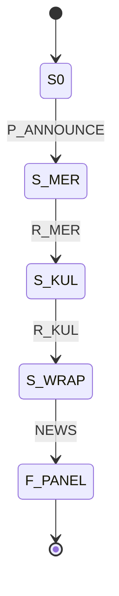

| Исход | Результат |
| --- | --- |
| F_PANEL | Разбор собрал вопрос о цене, требование повтора и новостную подводку. Качество «Смены» этим не доказано. |

#### Отношения этого эпизода

| Пара | После сохранённого события | Если пары ещё нет | Линия | Предмет совместного разбора |
| --- | --- | --- | --- | --- |
| P ↔ greedy_wolf | R_MER | ACQUAINTED / UNTESTED | OWN_OPTIONAL | цена проверки обещаний «Смены» |
| P ↔ alexey_nl | R_KUL | ACQUAINTED / UNTESTED | OWN_OPTIONAL | условия повторного запуска демо |

После указанного события открывается REL_OFFER по [общему контракту](relationships.md#встраивание-в-16-автоматов). Дальнейшие варианты: нейтральный разговор, поддержка, договор с общим авторством либо соперничество. Выполнение/нарушение договора меняет доверие и следующие предложения; примирение сохраняет память. Основной сюжет не требует принимать договор.

### Сколько стоит внимание

| Паспорт | Значение |
| --- | --- |
| story_id / version | `it_greedy_wolf_01` / `review-2026-10-20.4` |
| Мир / роль | `it` / `greedy_wolf` |
| Референс | Меркантил: выгода, стоимость ресурса и волчья самоирония из исходной постановки #195. Сюжет вымышленный. |
| Участники NPC | `alexey_nl` |
| Хронология и знания | Игрок является Меркантилом. Сравнивается отдача двух действий внутри игры, не реальная производительность AI или доход автора канала. |
| Начальный контекст | В споре о «Смене» ты предлагаешь посчитать, что выгоднее каналу: отдельный пост или ответ в чужом обсуждении. |
| Цель | Выясни на собственном канале, что выгоднее на единицу энергии: отдельный пост или ответ в чужом обсуждении. |
| Начальное состояние | S0 |

| Пост | Автор | При входе в состояние | Готовый текст |
| --- | --- | --- | --- |
| q_kul | alexey_nl | S0 | Предлагаю простой замер: один ответ в обсуждении и один пост. Энергию и прирост считаем отдельно. |

| Состояние | Следующая цель |
| --- | --- |
| S0 | Ответь Куляшу под вопросом о цене внимания |
| S_POST | Опубликуй новый пост после ответа |
| S_COMPARE | Система сравнивает две квитанции |
| F_POST | История выполнена |
| F_REPLY | История выполнена |
| F_EQUAL | История выполнена |

| Событие | Проверяемое условие |
| --- | --- |
| R_SAMPLE | `ROOT(q_kul, alexey_nl, r1, c1)` |
| P_SAMPLE | `PUB(p1)` |
| POST_WINS | `EVAL: D > 0` |
| REPLY_WINS | `EVAL: D < 0` |
| EQUAL | `EVAL: D = 0` |

| Из | Событие | В | Что сохранить | Момент сцены / последствие |
| --- | --- | --- | --- | --- |
| S0 | R_SAMPLE | S_POST | r1, c1; квитанция ответа; снимок k | Сохранён первый образец: оплаченный ответ с обычным бонусом треда. |
| S_POST | P_SAMPLE | S_COMPARE | p1; квитанция публикации; снимок k | Сохранён второй образец: оплаченный пост со своим фактическим приростом. |
| S_COMPARE | POST_WINS | F_POST | D и ID двух квитанций | Пост оказался выгоднее на единицу энергии. |
| S_COMPARE | REPLY_WINS | F_REPLY | D и ID двух квитанций | Ответ оказался выгоднее на единицу энергии. |
| S_COMPARE | EQUAL | F_EQUAL | D и ID двух квитанций | Два способа дали равную отдачу. |

| Состояние | R_SAMPLE | P_SAMPLE | POST_WINS | REPLY_WINS | EQUAL | OTHER | CANCEL |
| --- | --- | --- | --- | --- | --- | --- | --- |
| S0 | S_POST | S0 | S0 | S0 | S0 | S0 | CANCELLED |
| S_POST | S_POST | S_COMPARE | S_POST | S_POST | S_POST | S_POST | CANCELLED |
| S_COMPARE | S_COMPARE | S_COMPARE | F_POST | F_REPLY | F_EQUAL | S_COMPARE | CANCELLED |
| F_POST | F_POST | F_POST | F_POST | F_POST | F_POST | F_POST | F_POST |
| F_REPLY | F_REPLY | F_REPLY | F_REPLY | F_REPLY | F_REPLY | F_REPLY | F_REPLY |
| F_EQUAL | F_EQUAL | F_EQUAL | F_EQUAL | F_EQUAL | F_EQUAL | F_EQUAL | F_EQUAL |
| CANCELLED | CANCELLED | CANCELLED | CANCELLED | CANCELLED | CANCELLED | CANCELLED | CANCELLED |

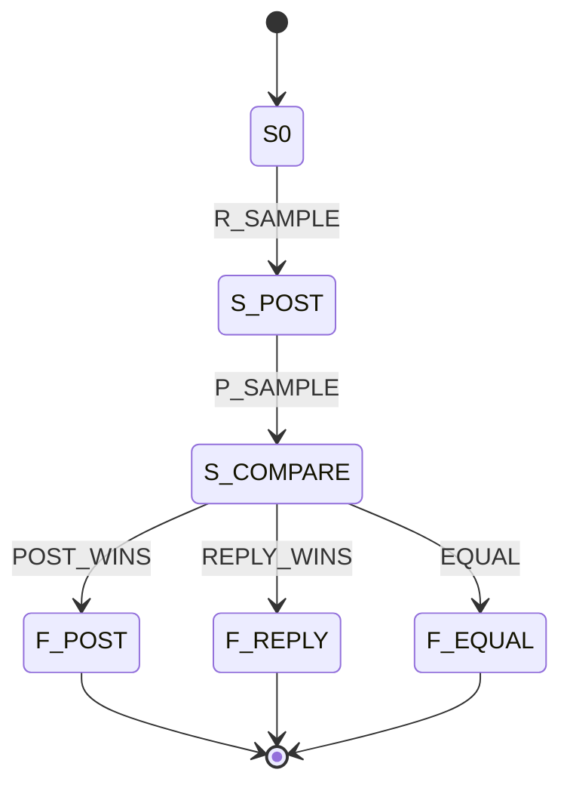

| Исход | Результат |
| --- | --- |
| F_POST | В этом опыте пост дал больше подписчиков на единицу энергии. Это результат двух игровых действий, а не доказательство выгоды «Смены». |
| F_REPLY | В этом опыте ответ дал больше подписчиков на единицу энергии. Дополнительный удачный пост для завершения не нужен. |
| F_EQUAL | Отдача поста и ответа на единицу энергии совпала. Опыт завершён без победителя и без новой награды. |

#### Отношения этого эпизода

| Пара | После сохранённого события | Если пары ещё нет | Линия | Предмет совместного разбора |
| --- | --- | --- | --- | --- |
| P ↔ alexey_nl | P_SAMPLE | ACQUAINTED / UNTESTED | FRIEND_ONLY | отдача поста и ответа на единицу энергии |

После указанного события открывается REL_OFFER по [общему контракту](relationships.md#встраивание-в-16-автоматов). Дальнейшие варианты: нейтральный разговор, поддержка, договор с общим авторством либо соперничество. Выполнение/нарушение договора меняет доверие и следующие предложения; примирение сохраняет память. Основной сюжет не требует принимать договор.

### Двойная котлета для анонса

| Паспорт | Значение |
| --- | --- |
| story_id / version | `it_2kotleti_news_01` / `review-2026-10-20.4` |
| Мир / роль | `it` / `2kotleti_news` |
| Референс | Бургер в Декабре: новости, эфиры и двойная котлета из Decembrist IT News. Сюжет вымышленный. |
| Участники NPC | `greedy_wolf`, `alexey_nl` |
| Хронология и знания | Игрок является Бургером. Известны анонс и первое демо «Смены»; независимого повтора ещё нет. |
| Начальный контекст | У анонса громкий заголовок. Для второго слоя нужны расчёт выгоды и вопрос инженера. |
| Цель | Выпусти новость с двойной котлетой: за громким анонсом покажи вопрос о цене и требование повторного запуска. |
| Начальное состояние | S0 |

| Пост | Автор | При входе в состояние | Готовый текст |
| --- | --- | --- | --- |
| q_mer | greedy_wolf | S0 | Команду заменили, проверяющий остался. Его время кто считает? |
| q_kul | alexey_nl | S_KUL | Первую демонстрацию можно поставить в заголовок. А входные данные ко второй где? |

| Состояние | Следующая цель |
| --- | --- |
| S0 | Ответь Меркантилу под вопросом о цене |
| S_KUL | Ответь Куляшу под вопросом о повторе |
| S_POST | Опубликуй подводку к разбору |
| S_FORMAT | Система выбирает доступный формат эпилога |
| F_MEME | История выполнена |
| F_NEWS | История выполнена |

| Событие | Проверяемое условие |
| --- | --- |
| R_MER | `ROOT(q_mer, greedy_wolf, r1, c1)` |
| R_KUL | `ROOT(q_kul, alexey_nl, r2, c2)` |
| P_LEAD | `PUB(p1)` |
| MEME | `EVAL: k.humor >= L_humor` |
| NEWS | `EVAL: k.humor < L_humor` |

| Из | Событие | В | Что сохранить | Момент сцены / последствие |
| --- | --- | --- | --- | --- |
| S0 | R_MER | S_KUL | r1, c1; квитанция ответа; снимок k | Бургер включается в разговор о цене обещания. |
| S_KUL | R_KUL | S_POST | r2, c2; квитанция ответа; снимок k | В обсуждении появляется инженерный вопрос о повторе. |
| S_POST | P_LEAD | S_FORMAT | p1; квитанция публикации; снимок k | Подводка опубликована после обоих разговоров. |
| S_FORMAT | MEME | F_MEME | Нет новых привязок | Открытый приём мема выбирает мемную версию эпилога. |
| S_FORMAT | NEWS | F_NEWS | Нет новых привязок | Без приёма остаётся обычная новостная версия. |

| Состояние | R_MER | R_KUL | P_LEAD | MEME | NEWS | OTHER | CANCEL |
| --- | --- | --- | --- | --- | --- | --- | --- |
| S0 | S_KUL | S0 | S0 | S0 | S0 | S0 | CANCELLED |
| S_KUL | S_KUL | S_POST | S_KUL | S_KUL | S_KUL | S_KUL | CANCELLED |
| S_POST | S_POST | S_POST | S_FORMAT | S_POST | S_POST | S_POST | CANCELLED |
| S_FORMAT | S_FORMAT | S_FORMAT | S_FORMAT | F_MEME | F_NEWS | S_FORMAT | CANCELLED |
| F_MEME | F_MEME | F_MEME | F_MEME | F_MEME | F_MEME | F_MEME | F_MEME |
| F_NEWS | F_NEWS | F_NEWS | F_NEWS | F_NEWS | F_NEWS | F_NEWS | F_NEWS |
| CANCELLED | CANCELLED | CANCELLED | CANCELLED | CANCELLED | CANCELLED | CANCELLED | CANCELLED |

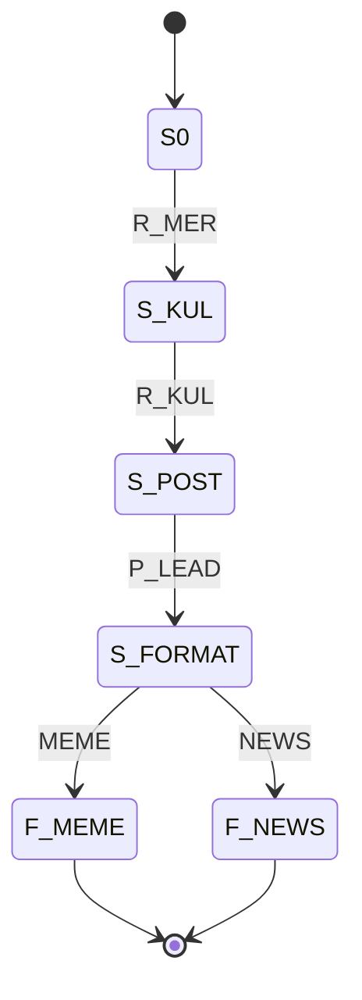

| Исход | Результат |
| --- | --- |
| F_MEME | Два ракурса собраны; открыт мемный вариант эпилога с двойной котлетой. Смешным ли был текст игрока, автомат не оценивает. |
| F_NEWS | Два ракурса собраны в обычной новостной версии эпилога. Для завершения не требуется качать юмор. |

#### Отношения этого эпизода

| Пара | После сохранённого события | Если пары ещё нет | Линия | Предмет совместного разбора |
| --- | --- | --- | --- | --- |
| P ↔ greedy_wolf | R_MER | ACQUAINTED / UNTESTED | FRIEND_ONLY | цена труда за громким AI-анонсом |
| P ↔ alexey_nl | R_KUL | ACQUAINTED / UNTESTED | FRIEND_ONLY | входные данные для повторного демо |

После указанного события открывается REL_OFFER по [общему контракту](relationships.md#встраивание-в-16-автоматов). Дальнейшие варианты: нейтральный разговор, поддержка, договор с общим авторством либо соперничество. Выполнение/нарушение договора меняет доверие и следующие предложения; примирение сохраняет память. Основной сюжет не требует принимать договор.

### Ещё один запуск из Нидерландов

| Паспорт | Значение |
| --- | --- |
| story_id / version | `it_alexey_nl_01` / `review-2026-10-20.4` |
| Мир / роль | `it` / `alexey_nl` |
| Референс | Куляш AI: инженерная полемика «Кулешов разгоняет AI» и мемная маска «Алексей из Нидерландов», заданная Степаном. |
| Участники NPC | `2kotleti_news` |
| Хронология и знания | Игрок является Куляшем AI. Нидерланды являются частью вымышленного образа. Настоящего повторного теста сервиса в данных игры нет. |
| Начальный контекст | Бургер готовит заголовок о победе AI после одного демо. Ты требуешь сначала опубликовать условия повтора. |
| Цель | Доведи требование повторить демо «Смены» до разговора с автором новости: одного громкого заголовка для проверки мало. |
| Начальное состояние | S0 |

| Пост | Автор | При входе в состояние | Готовый текст |
| --- | --- | --- | --- |
| q_burger | 2kotleti_news | S_BURGER | Вижу запрос на повтор. Команду в заголовке уже заменяем или пока ставим знак вопроса? |

| Состояние | Следующая цель |
| --- | --- |
| S0 | Опубликуй условия, которые хочешь вынести на повтор |
| S_BURGER | Ответь Бургеру под вопросом о заголовке |
| S_REACTION | Проверка зарегистрированной реакции на этот ответ |
| S_MORE | Ответь на следующую реплику Бургера в той же ветке |
| F_MARKED | История выполнена |
| F_DISCUSSION | История выполнена |

| Событие | Проверяемое условие |
| --- | --- |
| P_REPEAT | `PUB(p1)` |
| R_BURGER | `ROOT(q_burger, 2kotleti_news, r1, c1)` |
| THUMB | `EVAL: thumb(r1, 2kotleti_news) = true` |
| NO_THUMB | `EVAL: thumb(r1, 2kotleti_news) = false` |
| R_MORE | `CHILD(q_burger, 2kotleti_news, c1, r2, c2)` |

| Из | Событие | В | Что сохранить | Момент сцены / последствие |
| --- | --- | --- | --- | --- |
| S0 | P_REPEAT | S_BURGER | p1; квитанция публикации; снимок k | Условия проверки вынесены в публичную запись. Их техническая достаточность не оценивается по тексту. |
| S_BURGER | R_BURGER | S_REACTION | r1, c1; квитанция ответа; снимок k | Автор новости ответил на обращение инженера. |
| S_REACTION | THUMB | F_MARKED | Нет новых привязок | Зарегистрирован нужный emoji от Бургера на ответе игрока. |
| S_REACTION | NO_THUMB | S_MORE | Нет новых привязок | Без emoji доступен обычный второй ход, а не ожидание случайной реакции. |
| S_MORE | R_MORE | F_DISCUSSION | r2, c2; квитанция ответа; снимок k | Второй ход уточняет условия будущего повтора. |

| Состояние | P_REPEAT | R_BURGER | THUMB | NO_THUMB | R_MORE | OTHER | CANCEL |
| --- | --- | --- | --- | --- | --- | --- | --- |
| S0 | S_BURGER | S0 | S0 | S0 | S0 | S0 | CANCELLED |
| S_BURGER | S_BURGER | S_REACTION | S_BURGER | S_BURGER | S_BURGER | S_BURGER | CANCELLED |
| S_REACTION | S_REACTION | S_REACTION | F_MARKED | S_MORE | S_REACTION | S_REACTION | CANCELLED |
| S_MORE | S_MORE | S_MORE | S_MORE | S_MORE | F_DISCUSSION | S_MORE | CANCELLED |
| F_MARKED | F_MARKED | F_MARKED | F_MARKED | F_MARKED | F_MARKED | F_MARKED | F_MARKED |
| F_DISCUSSION | F_DISCUSSION | F_DISCUSSION | F_DISCUSSION | F_DISCUSSION | F_DISCUSSION | F_DISCUSSION | F_DISCUSSION |
| CANCELLED | CANCELLED | CANCELLED | CANCELLED | CANCELLED | CANCELLED | CANCELLED | CANCELLED |

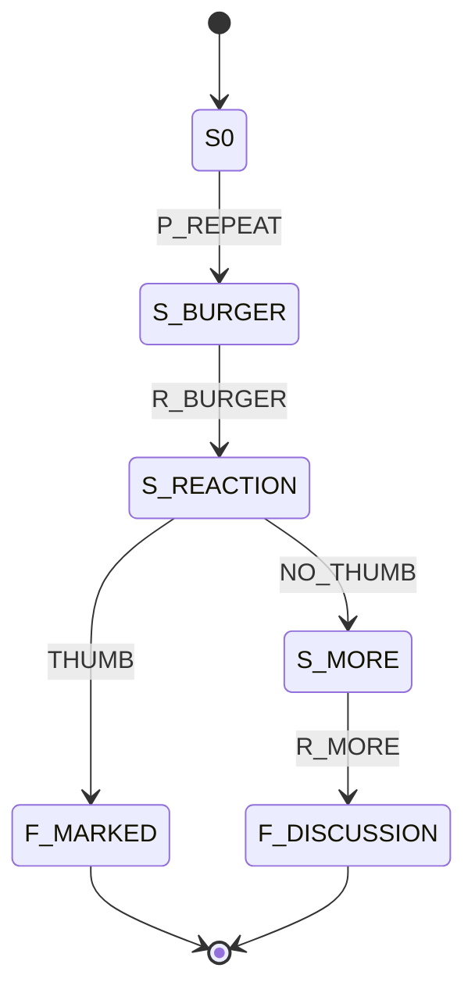

| Исход | Результат |
| --- | --- |
| F_MARKED | Бургер поставил 👍 на конкретный ответ о повторе. Это зарегистрированная реакция, без вывода о согласии со всем текстом или успешности теста. |
| F_DISCUSSION | Состоялся второй ход разговора с Бургером. Запрос на повтор обсуждён; сам успешный повтор не считается доказанным. |

#### Отношения этого эпизода

| Пара | После сохранённого события | Если пары ещё нет | Линия | Предмет совместного разбора |
| --- | --- | --- | --- | --- |
| P ↔ 2kotleti_news | R_BURGER | ACQUAINTED / UNTESTED | FRIEND_ONLY | как отличить новость о демо от проверенного повтора |

После указанного события открывается REL_OFFER по [общему контракту](relationships.md#встраивание-в-16-автоматов). Дальнейшие варианты: нейтральный разговор, поддержка, договор с общим авторством либо соперничество. Выполнение/нарушение договора меняет доверие и следующие предложения; примирение сохраняет память. Основной сюжет не требует принимать договор.

## Приёмка справочников

FRIEND_ONLY означает дружбу и конфликт без романтики. ROMANCE_OPTIONAL разрешает взаимное сближение после выполнения guards пары. OWN_OPTIONAL разрешает его только при явно известных разных M/F и совместимом контексте; при UNSPECIFIED остаётся FRIEND_ONLY. Однополые пары никогда не получают романтические offers. Ни один вариант не меняет исход автоматически по смыслу реплики.

| Проверка | Ожидаемый результат |
| --- | --- |
| Новый профиль: навыки 1, нет достижений, NPC не поставил emoji | Все 16 карточек имеют завершающий обычный путь; дополнительного достижения уровня ждать не нужно |
| Уровень L - 1 / L / L + 1 | Обычный / короткий или специальный / короткий или специальный путь |
| first_viral отсутствует / false / true | false / false / true; достижение не начисляется автоматом |
| SubscriberDelta -1 / 0 / +1 | Отток / неотрицательная ветка / неотрицательная ветка; оба пути завершаются |
| Реакция 👍 от другого NPC, на другой ответ или вне принятого хода | false; обычный путь доступен |
| Точный 👍 от указанного NPC на r1 в сохранённом ходе | true; короткий путь Куляша |
| Меркантил: D < 0 / D = 0 / D > 0 | F_REPLY / F_EQUAL / F_POST; все три означают «выполнено» |
| Стоимости поста 2 и ответа 1, приросты 12 и 9 | D = -6, выгоднее ответ; число действий при этом 2, энергия 3 |
| Провал публикации и отрицательный прирост | Действие сохранено, история продолжается, обычный отток не отменяется |
| Ошибка/отказ публикации либо ответа до коммита | Нет сюжетного факта, списания и перехода |
| Повтор requestId после потерянного SSE | Один ход, одно списание, один переход |
| Две одновременные публикации на одном этапе PUB | Только первая с валидной story_ref закрепляется; вторая сюжетная операция получает конфликт версии без списания |
| Реплика из другой ветки, старый пост или другой мир | OTHER; сюжетное состояние прежнее |
| Квалифицирующий ход ответа | Проверены и r игрока, и основной c NPC из одной операции; одного текста игрока недостаточно |
| NPC удалён либо якорь скрыт до следующего действия | PAUSED с причиной; успех не выставлен, прогресс не стёрт |
| Изменена роль/состав без подтверждённого ключа | Автомат не выбирается по имени или отсутствующему NPC |
| Нет энергии либо перерыв неделю или месяц | Можно продолжить с того же этапа после возвращения/пополнения; срока нет |
| Открыт другой мир, утром сброшен EnergyUsed | Прогресс и E запуска сохранены; чужие действия не засчитаны |
| Свободная публикация при ACTIVE, без story_ref | Этап прежний; обычные эффекты публикации сохранены |
| Обычный ответ под сюжетным q без story_ref | Не сюжетный ход; пара меняется только при отдельной валидной social_ref |
| Пауза USER и свободный социальный выбор | История стоит, отношения сохраняются в общем слое мира |
| Два сюжетных запроса одной версии этапа | Первый фиксируется; второй — конфликт без списания, не скрытый свободный ход |
| Устаревшая social_ref вместе с валидной story_ref | Вся операция отклоняется до списания; частичного успеха нет |
| Завершённый автомат получил новый факт или CANCEL | Конечное состояние прежнее |
| Ранний эпизод «Игры домов» | Не передаются знания будущих эпизодов, титулы и будущие драконы |
| IT-героя просят подтвердить настоящую личность | Собственное игровое имя; прототип и источники не выдаются за биографию NPC |

Состояния и переходы проверены по фактическим таблицам, включая обычные пути, все развилки, достижимость исходов, полные матрицы и графы. Проверка содержания не заменяет тестов будущего движка.

## Что потребуется реализовать

Нужны справочник и сохранение версии запуска, достоверная роль, журнал коммитов и снимков, привязки постов и веток, создание подготовленных NPC-постов и выдача текущей цели с якорными ID. В текущем продукте эти компоненты ещё не собраны в сюжетный исполнитель. Данные постов, ответов, реакций, навыков и достижений уже есть; журнал квитанций и метаданные запуска добавляются при реализации. Смысловая проверка не требуется. Для добровольного сюжетного действия добавляется story_ref, для социального выбора — social_ref; без них работают прежние свободные операции.

Физические события канона являются подготовленными сценами рассказа. Автомат не симулирует полёт, шахматы, неуязвимость, боевое оружие или тест AI-сервиса. Он не объявляет текст игрока доказательством любви, обещания, правильного заклинания или согласия другого персонажа. Новая награда за прохождение, метрики подписчиков NPC, личка не добавляются. Статусы отношений задаёт отдельный автомат пары; сюжет открывает его предложения только в указанных местах.
