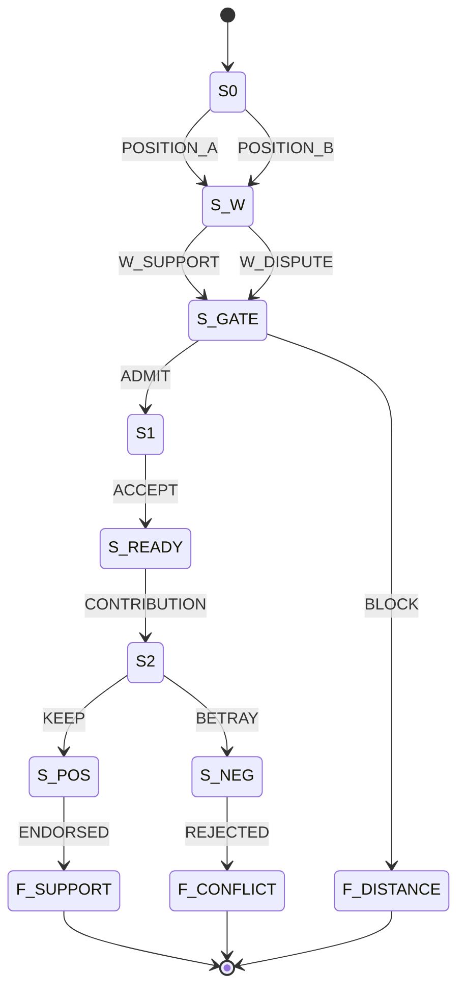
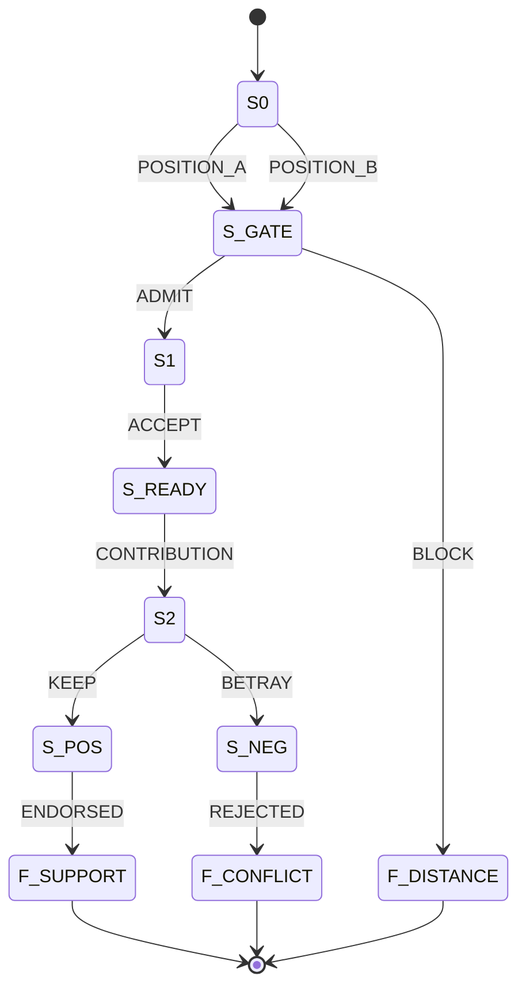

# Справочники сюжетных автоматов

Версия: `review-2026-10-20.5`. Содержание для [#192](https://github.com/Stepami/golden-mouth/issues/192), [#195](https://github.com/Stepami/golden-mouth/issues/195) и [PR #196](https://github.com/Stepami/golden-mouth/pull/196). Предлагаемая спецификация; движок, API, UI и миграции не реализованы.

[Биографии и пресеты](presets.md) · [Референсы](similarity.md) · [Проверка баланса](balance-check.md) · [Отношения и доверие](relationships.md)

## Как работает история

Игрок ведёт канал, публикует и разговаривает с героями. Поэтому цель эпизода — добиться конкретной публичной поддержки, признания вклада или рабочего союза. Бейсбол, тролль, шахматы и встреча правителей дают узнаваемый повод для общения. Комментарий не спасает человека, не двигает фигуру и не рождает драконов. Прошедшие физические события не являются результатом автомата.

По уточнению Дениса 20.10.2026 переработаны цели и переходы всех 16 карточек. Доверие теперь входит в основной исход, а не добавляется необязательным разбором после фиксированного приключения. Для Дианы и Джона выбраны другие референсные эпизоды с прямыми переговорами: 7×06 и 7×03. Хронология остальных стартов сохранена, обсуждения перенесены после соответствующей сцены.

У каждого эпизода есть желаемый исход и полноценные альтернативы: соблюсти конкретное условие и получить публичную поддержку; нарушить принятое условие и получить конфликт; отказаться без предательства. Совпадение мнений не требуется: начальную позицию можно обозначить поддержкой или возражением. Смысл свободного текста, тон, emoji и оценка LLM ничего не закрывают.

## Контракт фактов

### Запуск и роль

Ключ запуска: `(WorldId, PlayerId, story_id, version, run_id)`. На старте фиксируются роль, версия, порядок активации `seq0` и снимок достижений текущего мира `a0`. В одном экземпляре мира у игрока может быть один активный запуск. Повтор команды запуска возвращает его, не создавая новых сцен. Завершённая история не запускается заново автоматически; новый запуск возможен по явному выбору игрока. Старые публикации не подбираются задним числом. Переходы используют факты только этого владельца, экземпляра мира и запуска. В другом мире тот же NPC ID не подходит.

Роль является стабильным ключом: `own` либо ID выбранного героя. Сейчас отдельный стабильный ключ выбора героя в `CreateWorldRequest` не сохраняется: фронт переносит его имя и роль в обычные поля и удаляет его из NPC. Будущая реализация должна сохранить ключ при выборе. Вычислять его из имени, суффикса описания или отсутствующего NPC нельзя: пользователь мог их изменить. Для старого мира без достоверной роли автомат не запускается по догадке. Нужны явный выбор роли и проверка состава до активации; код этого выбора здесь не реализуется.

`P` обозначает настоящего автора игрока `Player_…`. Выбранный герой не становится `Star_…` и не остаётся в NPC. Остальные ID разрешаются в звёзд конкретного мира. Новые герои не создаются.

На старте проверяются участники карточки и соответствие стандартному пресету #195. Для собственного либо изменённого мира история не назначается автоматически. Версия закреплена до конца; изменение справочника не переписывает начатый запуск.

### Публикация и разговор

Все события ниже требуют подтверждённой операции, владельца и мира запуска, верной версии этапа, серверного токена и явно выбранного choice_id. Сам choice_id заранее выдан в offer; произвольный код от клиента не принимается. Коммит фиксирует текст, серверную карточку выбора, журнал, списание и переход вместе. Без story_ref обычная публикация остаётся свободной. Без social_ref нельзя принять, выполнить или нарушить договор.

| Обозначение | Вычисляемое условие и привязки |
| --- | --- |
| PUB(p) | Новая публикация P в своём канале с валидной story_ref, нужным choice_id и сохранённой серверной карточкой этого этапа. ID закрепляется как p; правки, старые публикации и повтор запроса не подходят. |
| ROOT(q, npc, r, c) | Валидная story_ref; q — привязанный видимый пост npc. Новый r от P: тот же q, ParentCommentId = null. В одной транзакции сохранён основной ответ c этого npc, ParentCommentId = r.Id; адресат P. Соседняя ветка/дополнительный случайный NPC не подходят. |
| CHILD(q, npc, parent, r, c) | Как ROOT, но ParentCommentId ответа r равен точной сохранённой реплике parent этого npc. Основной ответ c от того же npc имеет ParentCommentId = r.Id. Все ID связаны с одной операцией. |
| CHECK | Внутренняя проверка политики NPC по актуальной версии пары. ADMIT (допустимое доверие, нет другого активного договора) и BLOCK исчерпывают результат, без LLM, энергии и клиентского выбора результата. |
| SEED(alias) | Успешное сохранение подготовленного NPC-поста с указанным автором, alias, run_id, context_version и снимком исхода. Идемпотентность по (run_id, alias). До подтверждения этап ждёт, ошибка не становится отказом. |
| WITHDRAW | Бесплатная явная команда с версиями запуска и пары: выйти из эпизода нейтрально. Если есть активный договор, политика NPC даёт MUTUAL_CANCEL и CLOSED_NEUTRAL в той же транзакции. Никакого ухудшения доверия. |
| CANCEL | Явная отмена запуска, CANCELLED без сюжетного штрафа. При активном договоре отдельно показаны варианты оставить его для свободной игры или взаимно закрыть. Выбор пользователя сохраняется; молчаливого нарушения нет. |

Окно действия начинается после подтверждённого входа в состояние. Порядок задаётся seq коммита, не временем клиента. Один оплаченный ход создаёт только один сюжетный переход. Один receipt не закрывает соседние этапы. Обычный нейтральный ответ не продвигает этап и не меняет новые отношения; он стоит обычную энергию, о чём редактор сообщает до отправки.

### Публичный выбор и договор

Типизированный выбор отображается рядом с текстом как отдельная серверная карточка. Именно карточка, а не свободная реплика, задаёт записанную позицию, цитируемое согласие и состояние договора. Два выбора могут иметь похожие пользовательские тексты, но разные проверяемые последствия. Нельзя выдавать карточку за автоматическую проверку всех фраз пользователя. Противоречащий ей текст не переклассифицируется LLM: карточка остаётся явным действием, а текст — репликой. До отправки UI показывает оба и последствия выбранного поступка.

Для эпизода создаётся EDITORIAL_PACT с одним главным NPC, точным условием из паспорта и неизменяемыми карточками HONOR/BREAK. Это новая разновидность [договора пары](relationships.md#сюжетная-договорённость), а не общий шаблон присвоения авторства для всех миров. Договор касается публикации и представления слов собеседника: сохранить оговорку, отметить вклад, не приписать согласие. Физические обещания в него не входят.

На принятии ACCEPT_WITH_SUPPORT применяется SUPPORT и политика NPC в одном ходе; если доверие DAMAGED/BROKEN, поддержка не открывает договор заново. Перед этим CHECK без списания выдаёт BLOCK и нейтральный исход с причиной. Примирение доступно отдельно в свободной игре. При UNTESTED/RELIABLE/REBUILDING политика допускает договор при отсутствии другого активного pact этой пары, включая предварительную поддержку для CAUTIOUS/GRUDGE. Проверка повторяется перед коммитом: новая версия пары даёт конфликт, а не ложное принятие.

После принятия сохраняется q_contribution от главного NPC — его точный публичный вклад. Для ROOT-развязки он же является якорем. Для PUB-развязки social_ref связывает p2 с этим вкладом и pact_id. HONOR фиксирует выполненное условие и серверную карточку, применяет PACT_FULFILLED; BREAK фиксирует карточку нарушенного условия и PACT_BROKEN. Подстановка свободного текста вместо разрешённой карточки не даёт ни одного из событий.

Проверка цели использует факт выполненного договора, новое доверие RELIABLE и сохранённое публичное подтверждение NPC q_result. Это поддержка конкретной записи или права участвовать в обсуждении, а не безусловное прощение, полное совпадение взглядов, романтика или DEVOTED. Обратное отношение P → NPC не назначается автоматически: «считать другом» остаётся отдельным явным согласием. При восстановительном trust = REBUILDING рабочее доверие возвращается без автоматического FRIEND.

### Подготовленные посты и исход

NPC-посты подготовлены, имеют существующего автора и проходят штатные проверки продукта. Они не тратят энергию игрока, не дают ему опыт, подписчиков и награды. P не публикуется от имени игрока исполнителем. До сохранения нужного якоря состояние показывает «Обсуждение готовится»; случайный пост из ленты не подменяет сцену. Случайный планировщик нынешней игры не даёт этой гарантии, нужен будущий исполнитель.

После HONOR/BREAK запускается S_POS/S_NEG. В журнале уже лежат поступок и новое отношение, но сюжет ещё ждёт подготовленного q_result с результатом SUPPORT/REJECT. Только его сохранение даёт F_SUPPORT/F_CONFLICT. Текст q_result берётся из карточки и сохранённого enum, не из решения генератора. Повтор публикации результата не повторяет эффект пары. Новые свободные поступки не переписывают уже сохранённый факт; эпилог указывает, что поддержка была дана в момент этого договора, и показывает актуальный статус отдельно.

### Показатели и прогрессия

A — число разных успешно принятых оплаченных операций запуска, E — сумма фактически списанной энергии по их квитанциям. Ответ r+c — один ход, не два; бесплатные CHECK/SEED/управляющие команды не входят в A/E. Навыки, текущие подписчики и достижения сохраняются по обычным правилам игры. Их значения не угадываются из текста и не начисляются автоматом дополнительно.

В истории Меркантила p0 и r1 дают квитанции Gp, Cp и Gr, Cr: фактические изменения подписчиков и положительные стоимости конкретных операций. Сравнение D = Gp × Cr - Gr × Cp выполняется целыми числами. D > 0: выгоднее пост; D < 0: ответ; D = 0: одинаково. Отток и нулевой бонус допустимы. Вывод и обе квитанции закрепляются в q_contribution; любой знак позволяет выполнить договор. Условие честности — выбор HONOR с обеими серверными квитанциями, не оценка честности текста.

Рост, навыки, достижения и Relation пока не открывают разные главы или более сложные социальные предложения. Это сознательно открытая часть дизайна, а не доказанная динамика кампании. Вводные эпизоды проходимы с навыками 1 и при любом числе подписчиков. Предложение связи прокачки с будущими главами вынесено в [открытые вопросы](#открытые-вопросы); новые пороги до согласования не вводятся.

### Порядок, повторы и состояние

Будущий журнал фактов хранит монотонный seq на запуск и seq входа в состояние. Порядок закрепляется при коммите операции, а не при доставке сообщения обработчику. Для факта сохраняется версия этапа, в котором началась операция. Две операции одного этапа не закрывают два последовательных этапа: принимается первая допустимая; второе явно сюжетное действие отклоняется по конфликту версии до списания, не превращаясь молча в свободное. Обработчик сериализует принятие фактов одного запуска; поздняя доставка не меняет закреплённый порядок. Идемпотентность публикации и ответа использует существующий request/publication ID. Один ход, повторённый после обрыва SSE, учитывается один раз. Новая версия поста из-за добавленного комментария не создаёт новую публикацию. r/c проверяются как пара одной подтверждённой операции. Переход и привязки сохраняются с контролем версии состояния.

Сначала действие фиксируется в журнале, затем вычисляется его один переход. После входа в S_GATE выполняется CHECK политики с версией пары. ROI использует только квитанции p0/r1, не более поздний рост канала. В S_POS/S_NEG используется закреплённый снимок результата; новые свободные действия не переписывают его. Сбой чтения/сохранения оставляет проверку ожидающей; false по ошибке не подставляется. Публикация NPC на входе в следующее состояние имеет seq после открытия этого состояния.

В каждой матрице OTHER обозначает событие, не прошедшее условия текущего состояния: неверный мир, автор, объект, родитель, порядок либо повтор. OTHER не меняет состояние. Неожидаемые коды также оставляют состояние. Графы показывают основные переходы; петли OTHER и отмена перечислены в полных матрицах. Матрицы полные; приоритет строк для разрешения пересекающихся условий не нужен. Конечные состояния поглощают все события.

Режим запуска хранится отдельно от сюжетного состояния. ACTIVE разрешает переходы. PAUSED сохраняет состояние и привязки, но не учитывает новые действия до восстановления причин паузы. Пауза применяется при отсутствии участника карточки, удалении/скрытии нужного якорного объекта или несоответствии настроек мира. Ничего не завершается автоматически. При восстановлении контекста обработка продолжается после seq возобновления; события из паузы задним числом не учитываются. Если объект восстановить нельзя, игрок может добровольно отменить запуск и начать новый при подходящем составе. Предыдущие обычные списания и награды не откатываются.

Игрок может явно поставить историю на PAUSED с причиной USER и продолжить свободно. Действия без story_ref разрешены и при ACTIVE. Смена мира и отсутствие энергии не обнуляют историю; после возвращения показывается сохранённая цель. Смена дня не сбрасывает A/E. CANCEL применяется только по явной отмене игрока и даёт CANCELLED, без вывода «провалено по времени». Завершённые F_* имеют статус «эпизод завершён»; достижение выбранной цели хранится отдельно в goal_met; отменённый запуск «отменено». На незавершённом этапе условие ещё не выполнено, сам запуск остаётся в работе. Удаление аккаунта удаляет данные штатным способом; журнал не является исключением.

## Цели и длина эпизодов

Ниже заполнены 16 вводных эпизодов — по четыре роли в мире. Выбранной роли соответствует один эпизод, не все четыре подряд. Желаемая цель выполнена только в F_SUPPORT (goal_met = true). F_CONFLICT и F_DISTANCE тоже завершают эпизод, но goal_met = false; это выбранные последствия или отказ, не скрытая победа. CANCELLED — отмена, не завершённый сюжетный исход. Возможность продолжить свободно есть после любого исхода.

Путь к поддержке/конфликту содержит 3 оплаченных действия, многоголосый разбор — 4. Нейтральный выход доступен без дополнительного списания. Всего по 16 путям с выполненной договорённостью — 55 действий: 19 публикаций и 36 ответов; при равном весе 3,4375 на эпизод. Это объём вступлений, не измеренная средняя сессия. Максимум два обязательных ответа под одним NPC-постом. Полный разбор путей и формулы стоимости — в [проверке баланса](balance-check.md#стоимость-прохождения).

Публичная поддержка возникает только после конкретного договора и подтверждения NPC. Нельзя дописать в эпилог «все стали друзьями» по факту трёх любых комментариев. Последствия остаются в общем слое отношений между сюжетными и свободными ходами. Романтика, новые договоры, восстановление доверия и следующие главы не входят автоматически в эти 3–4 хода.

## Сюжет и свободная игра

Свободная игра доступна полностью: свои посты, разговоры, выбор собеседников и развитие отношений без обязательного сюжета. На входе история предлагается, но не запускается автоматически. Начать, приостановить, возобновить и отменить её можно явно и без сюжетного штрафа. Обычная энергия, прогрессия и модерация действуют в обоих режимах.

| Действие | Что сохраняется | Влияние на историю |
| --- | --- | --- |
| Обычная публикация/ответ | Обычная операция; story_ref отсутствует | Нет, даже при ACTIVE и под сюжетным NPC-постом |
| «Продолжить историю» → публикация/ответ «Для истории» | Операция и валидная story_ref | Один допустимый переход |
| Явный социальный выбор в любом режиме | Валидная social_ref и социальный факт | Меняет пару; сам по себе этап истории не закрывает |
| Сюжетный ход с социальным выбором | story_ref и social_ref в одной операции | Один сюжетный переход и один социальный факт; одно списание |
| Пауза / свободный ход / отказ от эпизода | Причина USER, состояние и привязки сохранены | Без сброса, оттока и ухудшения доверия за сам выход |
| Возобновление | Проверка версии, состава, якорей и текущих отношений | Показ сохранённой цели; события паузы задним числом не подходят |

Предлагаемое поле story_ref содержит run_id, state_version, action_id и одноразовый server-issued token, связанный с actor/world/операцией/якорями. Это новые данные будущего API, не существующий контракт. story_ref также содержит разрешённый choice_id из текущего предложения; это явный выбор игрока, а не присланный клиентом результат. Для ROOT/CHILD сервер закрепляет q и parent; для PUB — тип карточки и все её связи. Клиент не передаёт вычисленный исход и не выбирает произвольный код перехода.

story_ref отсутствует по умолчанию. Она выдаётся только из текущей цели при явном выборе «Продолжить историю». В редакторе видна отметка «Для истории» с действием «Отправить свободно», снимающим привязку. После отправки или выхода из редактора привязка не переносится на следующий пост. Черновик хранит её отдельно; при возвращении требуется повторная проверка и подтверждение. Ответ на сюжетный пост не становится сюжетным автоматически. Обычное приложение без поддержки новых полей продолжает свободную игру.

Сервер проверяет токен до генерации и повторно в транзакции перед списанием. Истёкшая версия, пауза, неверный автор, мир или якорь дают структурированную ошибку без публикации, списания и перехода; текст остаётся в черновике. Предлагается обновить цель либо явно отправить свободно, без скрытого превращения одного режима в другой. Ошибка social_ref аналогична; вся операция откатывается, частичного сюжетного успеха нет. Повтор request_id возвращает прежний результат и не расходует токен дважды.

Пауза и операция сериализуются по сохранённому порядку: ход, закоммиченный до паузы, учитывается; начатый до паузы, но ещё не закоммиченный, отклоняется при повторной проверке. В свободном режиме нет story_ref, поэтому пауза не мешает публикации. Два одновременных сюжетных хода одной версии не закрывают два этапа: второй получает конфликт версии до списания. Это уточняет прежнюю обработку гонок без молчаливого принятия второго хода как свободного.

Отношения — общий слой мира, а не отдельная копия внутри истории. В свободной игре сохраняются поступки и социальные выборы. На возврате сюжет читает актуальную пару. Дружба не восстанавливается по стартовому тексту карточки вопреки сохранённой вражде. Прошедшая каноническая сцена остаётся фоном; доверие и романтика показываются только по фактическому состоянию пары. Для раннего эпизода не загружаются знания позднего.

## Объём дальнейшего сюжета

Предложение для обсуждения: одна линия персонажа из 8 глав по 6–8 значимых AI-ходов игрока, всего 48–64 хода основного сюжета. Текущий вступительный эпизод нужно расширить до первой такой главы; его 3–4 хода не выдаются за готовую главу этого размера. Полная кампания пока не написана. Это ориентир содержания, не новый лимит, гарантия удержания или обязательство пройти за срок.

| Главы | Для чего нужны |
| --- | --- |
| 1–2 | Узнаваемая завязка, знакомство, первое совместное дело и развилка сотрудничества/соперничества |
| 3–4 | Последствия выбора, первый конфликт, разрыв либо укрепление союза |
| 5–6 | Проверка доверия поступком; дружеская или допустимая романтическая ветка, возможность примирения |
| 7–8 | Кульминация с опорой на накопленные отношения и развязка выбранной линии |

В каждой главе нужен хотя бы один явный выбор с разными последующими сценами. Не увеличивать длину повтором одинаковых публикаций или обязательной прокачкой. Дополнительные разговоры и свободные посты не требуются для счётчика. После финала мир остаётся доступным; новая арка начинается только по выбору игрока.

Перед разработкой кампании следует подготовить план всех 8 глав для каждой роли и полностью заполнить первые две: события, пары, ветки и последствия. Переносить одну и ту же последовательность на 16 героев нельзя; узнаваемость и хронология сохраняются. Эта рекомендация не означает, что ещё 128 глав уже готовы в PR.

При текущем запасе 10 энергии и цене хода 1, если условно выделять сюжету 3–5 ходов за заход, 48–64 хода дают примерно 10–22 захода. Это арифметический сценарий, а не прогноз дней или возврата: запас общий для миров, энергия может закончиться, игрок может играть иначе. Пауза не ограничена. Проверка на игроках должна показать, понятны ли последствия, хочется ли продолжать и где глава ощущается повтором.

## Открытые вопросы

1. База знаний: что хранить в отдельном версионируемом справочнике персонажа (биография, речь, постоянные связи), а что в автомате (знания текущей сцены, открытые факты, ограничения хронологии)? Можно ли дополнить базу после согласования автоматов и какой минимум нужен до реализации? Пока каждой карточке заданы только контекст и предел знаний; полноценная база не подготовлена.
2. Динамика прокачки: совместимость с действующими навыками/подписчиками проверена, но переход к следующим главам от них не зависит. Что должен открывать рост — новые способы ответа, доступ к публичным обсуждениям, более влиятельных союзников? Предложение: навыки дают альтернативный способ, размер канала — масштаб обсуждения, память пары — другие условия договора. Для новичка нужен основной путь без гринда. Пороги, разные цены и тексты этих альтернатив ещё не согласованы и не заполнены. Пять разговорных вступлений сейчас не требуют публикаций и сами не дают XP навыков: нужно решить, сохраняем ли такой ритм или добавляем содержательные посты в следующие главы. Не выдавать XP за комментарии без отдельного решения по балансу.
3. Долгая игра: подтвердить или заменить ориентир 8 × 6–8 ходов, затем расписать главы и конкретные последствия. Во всех вступлениях пока общий каркас «позиция → условие → соблюдение/нарушение». Нужно проверить разнообразие: какие следующие главы строить на споре за внимание, конкуренции и коалициях, а не повторять публикацию оговорки. Также проверить, интересен ли явный выбор карточки рядом со свободным текстом. 16 вступлений не подтверждают интерес длинной кампании.
4. Прототип UI: как показать поступок и его последствия, не превратив ленту в серию обязательных кнопок? Нужны редактор с выбором «Для истории», видимая карточка позиции и удобный нейтральный ответ. Макеты и проверка на игроках ещё впереди.

## Карточки

### Бейсбол до первого чужака

| Паспорт | Значение |
| --- | --- |
| story_id / version | `evening_own_01` / `review-2026-10-20.5` |
| Мир / роль | `evening` / `own` |
| Референс | «Сумерки» (2008): гроза скрывает удары бит; пришедшие вампиры замечают человека среди игроков. |
| Участники NPC | `isabella`, `eduard` |
| Хронология и знания | Изабелла знает природу Эдуарда. Обсуждение после ухода с поляны; Яков не свидетель бейсбола. Незнакомцы — фон, не новые NPC. |
| Начальный контекст | После грозового бейсбола чужаки распознали в Изабелле человека. Уход с поляны уже произошёл; игрок обсуждает последствия, а не управляет побегом. |
| Цель | Стань публичным союзником Изабеллы: поддержи её после сорванного бейсбола, не превращая её страх в зрелище для своей ленты. |
| Главная пара / линия | P ↔ isabella / OWN_OPTIONAL |
| Начальное состояние | S0 |

| Пост | Автор | При входе | Готовый текст / фиксируемый факт |
| --- | --- | --- | --- |
| q_witness | eduard | S_W | После поляны все обсуждают Изабеллу как чужую приманку. Давайте сначала спросим её саму. |
| q_offer | isabella | S_GATE | После поляны все говорят обо мне, а меня никто не спрашивает. Мне нужна поддержка, а не ещё одна история про беспомощную девочку. Для позиции A: «Вижу твою поддержку; обсудим условие». Для B: «Вижу возражение; несогласие не мешает договориться об условии». |
| q_contribution | isabella | S_READY | Я согласна обсуждать случившееся, если не стану в твоём разборе беспомощной приманкой. |
| q_result | isabella | S_POS / S_NEG | SUPPORT: «Поддерживаю твою запись. Ты не сделал из меня чужую приманку и оставил мне право говорить за себя.» REJECT: «Отзываю поддержку: ты выставил меня приманкой вопреки нашему условию.» |

| Выбор / условие | Серверная карточка или последствие |
| --- | --- |
| STANCE_A | Изабелла сама решает, что рассказывать |
| STANCE_B | Я не согласен с тем, что за неё решают другие |
| Условие EDITORIAL_PACT | В итоговой карточке поддержать право Изабеллы говорить за себя; не объявлять её беспомощной приманкой ради чужой истории. |
| HONOR | Изабелла говорит за себя; её рассказ принадлежит ей. |
| BREAK | Изабелла — беспомощная приманка; за неё решают другие. |
| WITHDRAW | Отказ от участия без принятого нарушения; поддержка не получена, доверие не ухудшается. |

| Состояние | Следующая цель |
| --- | --- |
| S0 | Обозначь позицию A или B: PUB(p0) |
| S_W | Ответь eduard под q_witness, явно поддержав или оспорив его позицию: ROOT(q_witness, eduard, r0, c0) |
| S_GATE | Проверка условий разговора с isabella |
| S1 | Прими показанное условие либо откажись: ROOT(q_offer, isabella, r1, c1) |
| S_READY | Подготовка публичного вклада NPC |
| S2 | Выбери соблюсти условие или нарушить его: PUB(p2) |
| S_POS | Подготовка подтверждения поддержки |
| S_NEG | Подготовка публичного отказа в поддержке |
| F_SUPPORT | Цель выполнена; можно продолжить свободно |
| F_CONFLICT | Эпизод завершён конфликтом; цель не выполнена |
| F_DISTANCE | Эпизод завершён без союза; цель не выполнена |

| Событие | Проверяемое условие |
| --- | --- |
| POSITION_A | PUB(p0); story choice_id = STANCE_A; сохранить карточку A и ID операции. |
| POSITION_B | PUB(p0); story choice_id = STANCE_B; сохранить карточку B и ID операции. |
| W_SUPPORT | ROOT(q_witness, eduard, r0, c0); npc = eduard; social choice_id = SUPPORT, отдельная пара P ↔ eduard. |
| W_DISPUTE | ROOT(q_witness, eduard, r0, c0); npc = eduard; social choice_id = COMPETE, отдельная пара P ↔ eduard. |
| ADMIT | CHECK: политика isabella допускает ACCEPT_WITH_SUPPORT по актуальному trust = UNTESTED/RELIABLE/REBUILDING при отсутствии другого активного pact этой пары. |
| BLOCK | CHECK: политика isabella возвращает DECLINE при trust = DAMAGED/BROKEN либо у пары есть другой активный pact; сохранить причину и показать примирение, не списывать. |
| ACCEPT | ROOT(q_offer, isabella, r1, c1); npc = isabella; story choice_id = ACCEPT, social choice_id = ACCEPT_WITH_SUPPORT, EDITORIAL_PACT этого run/пары/условия; сохранить pact_id и r1/c1. |
| CONTRIBUTION | SEED(q_contribution): тот же isabella, pact_id и условие; pact = ACTIVE → NPC_READY. |
| KEEP | PUB(p2); story и social choice_id = HONOR; тот же pact_id, разрешённая карточка HONOR и точный якорь; pact NPC_READY → FULFILLED; PACT_FULFILLED. |
| BETRAY | PUB(p2); story и social choice_id = BREAK; тот же pact_id, карточка BREAK и якорь; pact NPC_READY → BROKEN_BY_P; PACT_BROKEN. |
| ENDORSED | SEED(q_result): enum = SUPPORT, pact FULFILLED и post-effect trust RELIABLE сохранены в снимке KEEP. |
| REJECTED | SEED(q_result): enum = REJECT, pact BROKEN_BY_P сохранён в снимке BETRAY. |

| Из | Событие | В | Оплаченных ходов | Последствие |
| --- | --- | --- | --- | --- |
| S0 | POSITION_A | S_W | 1 | Сохранена публичная поддержка темы; отношения главной пары ещё не назначены. |
| S0 | POSITION_B | S_W | 1 | Сохранено публичное возражение; готовый ответ учитывает несогласие. |
| S_W | W_SUPPORT | S_GATE | 1 | SUPPORT применяется только к паре со свидетелем. |
| S_W | W_DISPUTE | S_GATE | 1 | COMPETE применяется только к паре со свидетелем; главный NPC не получает чужой факт. |
| S_GATE | ADMIT | S1 | 0 | Доступно принятие условия; в S1 ждём q_offer, если он ещё не сохранён. |
| S_GATE | BLOCK | F_DISTANCE | 0 | Принятие недоступно; показана причина: повреждённое доверие либо уже активный договор. Состояние пары сохранено. |
| S1 | ACCEPT | S_READY | 1 | SUPPORT + принятое условие; NPC согласен по политике, не по тексту LLM. |
| S_READY | CONTRIBUTION | S2 | 0 | Вклад NPC сохранён; открыты HONOR/BREAK и нейтральная отмена. |
| S2 | KEEP | S_POS | 1 | Договор выполнен; вычислены доверие и поддержка конкретного условия. |
| S2 | BETRAY | S_NEG | 1 | Первое нарушение ENEMY/DAMAGED; повторное HATE/BROKEN; память сохраняется. |
| S_POS | ENDORSED | F_SUPPORT | 0 | Публичное подтверждение сохранено; goal_met = true. |
| S_NEG | REJECTED | F_CONFLICT | 0 | Публичный отказ сохранён; goal_met = false. |

| Состояние | POSITION_A | POSITION_B | W_SUPPORT | W_DISPUTE | ADMIT | BLOCK | ACCEPT | CONTRIBUTION | KEEP | BETRAY | ENDORSED | REJECTED | WITHDRAW | OTHER | CANCEL |
| --- | --- | --- | --- | --- | --- | --- | --- | --- | --- | --- | --- | --- | --- | --- | --- |
| S0 | S_W | S_W | S0 | S0 | S0 | S0 | S0 | S0 | S0 | S0 | S0 | S0 | F_DISTANCE | S0 | CANCELLED |
| S_W | S_W | S_W | S_GATE | S_GATE | S_W | S_W | S_W | S_W | S_W | S_W | S_W | S_W | F_DISTANCE | S_W | CANCELLED |
| S_GATE | S_GATE | S_GATE | S_GATE | S_GATE | S1 | F_DISTANCE | S_GATE | S_GATE | S_GATE | S_GATE | S_GATE | S_GATE | F_DISTANCE | S_GATE | CANCELLED |
| S1 | S1 | S1 | S1 | S1 | S1 | S1 | S_READY | S1 | S1 | S1 | S1 | S1 | F_DISTANCE | S1 | CANCELLED |
| S_READY | S_READY | S_READY | S_READY | S_READY | S_READY | S_READY | S_READY | S2 | S_READY | S_READY | S_READY | S_READY | F_DISTANCE | S_READY | CANCELLED |
| S2 | S2 | S2 | S2 | S2 | S2 | S2 | S2 | S2 | S_POS | S_NEG | S2 | S2 | F_DISTANCE | S2 | CANCELLED |
| S_POS | S_POS | S_POS | S_POS | S_POS | S_POS | S_POS | S_POS | S_POS | S_POS | S_POS | F_SUPPORT | S_POS | S_POS | S_POS | CANCELLED |
| S_NEG | S_NEG | S_NEG | S_NEG | S_NEG | S_NEG | S_NEG | S_NEG | S_NEG | S_NEG | S_NEG | S_NEG | F_CONFLICT | S_NEG | S_NEG | CANCELLED |
| F_SUPPORT | F_SUPPORT | F_SUPPORT | F_SUPPORT | F_SUPPORT | F_SUPPORT | F_SUPPORT | F_SUPPORT | F_SUPPORT | F_SUPPORT | F_SUPPORT | F_SUPPORT | F_SUPPORT | F_SUPPORT | F_SUPPORT | F_SUPPORT |
| F_CONFLICT | F_CONFLICT | F_CONFLICT | F_CONFLICT | F_CONFLICT | F_CONFLICT | F_CONFLICT | F_CONFLICT | F_CONFLICT | F_CONFLICT | F_CONFLICT | F_CONFLICT | F_CONFLICT | F_CONFLICT | F_CONFLICT | F_CONFLICT |
| F_DISTANCE | F_DISTANCE | F_DISTANCE | F_DISTANCE | F_DISTANCE | F_DISTANCE | F_DISTANCE | F_DISTANCE | F_DISTANCE | F_DISTANCE | F_DISTANCE | F_DISTANCE | F_DISTANCE | F_DISTANCE | F_DISTANCE | F_DISTANCE |
| CANCELLED | CANCELLED | CANCELLED | CANCELLED | CANCELLED | CANCELLED | CANCELLED | CANCELLED | CANCELLED | CANCELLED | CANCELLED | CANCELLED | CANCELLED | CANCELLED | CANCELLED | CANCELLED |

WITHDRAW доступен до KEEP/BETRAY. В S0/S_W/S_GATE до принятия это отказ от предложения, а не отмена несуществующего договора. После сохранённого поступка S_POS/S_NEG ожидают только публикацию его результата; выход из экрана ничего не отменяет. OTHER включает обычный ответ, неверный ID/родителя/мир/версию, повтор и событие другого этапа. Внешне неверный токен отклоняется до списания; self-loop матрицы не означает платную обработку неверного запроса. CANCEL отменяет запуск, но не стирает уже совершённые поступки.

| Исход | Результат |
| --- | --- |
| F_SUPPORT | Изабелла публично называет игрока человеком, который услышал её условия; открыта следующая совместная тема. goal_met = true. |
| F_CONFLICT | Изабелла публично отказывается доверять игроку после нарушения условия о её праве говорить за себя. goal_met = false. |
| F_DISTANCE | Публичный союз не получен: явный нейтральный выход либо отказ политики из-за прежнего повреждённого доверия/другого активного договора. goal_met = false. |

Главная пара P ↔ isabella использует OWN_OPTIONAL. Существующее состояние читается без сброса. Поддержка конкретного разбора не означает романтическое согласие; дальнейшая дружба/пара требует отдельных выборов из [автомата отношений](relationships.md). Пара P ↔ eduard получает только выбранный SUPPORT/COMPETE, без обещания дружбы или согласия главного NPC. NPC ↔ NPC этим эпизодом не меняются: прошлое физическое событие не доказывает новый социальный поступок.

### Ладонь на фургоне

| Паспорт | Значение |
| --- | --- |
| story_id / version | `evening_isabella_01` / `review-2026-10-20.5` |
| Мир / роль | `evening` / `isabella` |
| Референс | «Сумерки» (2008): Эдвард останавливает фургон ладонью и пытается скрыть, откуда успел прибежать. |
| Участники NPC | `eduard` |
| Хронология и знания | Игрок является Изабеллой. О вампирах она ещё не знает. Якова на парковке нет. |
| Начальный контекст | Фургон уже остановлен, на металле вмятина. Изабелла не знает о вампирах; предмет спора — её свидетельство, не раскрытие тайны. |
| Цель | Добейся от Эдуарда публичного признания, что спасение на парковке нельзя списать на твою выдумку, сохранив возможность общаться дальше. |
| Главная пара / линия | P ↔ eduard / ROMANCE_OPTIONAL |
| Начальное состояние | S0 |

| Пост | Автор | При входе | Готовый текст / фиксируемый факт |
| --- | --- | --- | --- |
| q_offer | eduard | S_GATE | Я не согласен с твоей версией, но готов подтвердить, что ты действительно оказалась перед фургоном. Для позиции A: «Вижу твою поддержку; обсудим условие». Для B: «Вижу возражение; несогласие не мешает договориться об условии». |
| q_contribution | eduard | S_READY | Подтверждаю: фургон шёл на тебя. Признать это не значит согласиться со всеми выводами. |
| q_result | eduard | S_POS / S_NEG | SUPPORT: «Подтверждаю: опасность на парковке была реальной. Ты не выдумала фургон; почему я успел — отдельный разговор.» REJECT: «Нет, я не признавался в вампиризме. Ты приписала мне слова вопреки нашему условию.» |

| Выбор / условие | Серверная карточка или последствие |
| --- | --- |
| STANCE_A | Я помню спасение и хочу разобраться |
| STANCE_B | Я не позволю выставить меня выдумщицей |
| Условие EDITORIAL_PACT | Опубликовать согласованную запись: опасность была реальной, объяснение силы остаётся неизвестным; не приписывать Эдуарду признание в вампиризме. |
| HONOR | Эдуард подтверждает опасность; причина необычного спасения пока неизвестна. |
| BREAK | Эдуард признался, что он вампир — хотя такого признания не было. |
| WITHDRAW | Отказ от участия без принятого нарушения; поддержка не получена, доверие не ухудшается. |

| Состояние | Следующая цель |
| --- | --- |
| S0 | Обозначь позицию A или B: PUB(p0) |
| S_GATE | Проверка условий разговора с eduard |
| S1 | Прими показанное условие либо откажись: ROOT(q_offer, eduard, r1, c1) |
| S_READY | Подготовка публичного вклада NPC |
| S2 | Выбери соблюсти условие или нарушить его: ROOT(q_contribution, eduard, r2, c2) |
| S_POS | Подготовка подтверждения поддержки |
| S_NEG | Подготовка публичного отказа в поддержке |
| F_SUPPORT | Цель выполнена; можно продолжить свободно |
| F_CONFLICT | Эпизод завершён конфликтом; цель не выполнена |
| F_DISTANCE | Эпизод завершён без союза; цель не выполнена |

| Событие | Проверяемое условие |
| --- | --- |
| POSITION_A | PUB(p0); story choice_id = STANCE_A; сохранить карточку A и ID операции. |
| POSITION_B | PUB(p0); story choice_id = STANCE_B; сохранить карточку B и ID операции. |
| ADMIT | CHECK: политика eduard допускает ACCEPT_WITH_SUPPORT по актуальному trust = UNTESTED/RELIABLE/REBUILDING при отсутствии другого активного pact этой пары. |
| BLOCK | CHECK: политика eduard возвращает DECLINE при trust = DAMAGED/BROKEN либо у пары есть другой активный pact; сохранить причину и показать примирение, не списывать. |
| ACCEPT | ROOT(q_offer, eduard, r1, c1); npc = eduard; story choice_id = ACCEPT, social choice_id = ACCEPT_WITH_SUPPORT, EDITORIAL_PACT этого run/пары/условия; сохранить pact_id и r1/c1. |
| CONTRIBUTION | SEED(q_contribution): тот же eduard, pact_id и условие; pact = ACTIVE → NPC_READY. |
| KEEP | ROOT(q_contribution, eduard, r2, c2); story и social choice_id = HONOR; тот же pact_id, разрешённая карточка HONOR и точный якорь; pact NPC_READY → FULFILLED; PACT_FULFILLED. |
| BETRAY | ROOT(q_contribution, eduard, r2, c2); story и social choice_id = BREAK; тот же pact_id, карточка BREAK и якорь; pact NPC_READY → BROKEN_BY_P; PACT_BROKEN. |
| ENDORSED | SEED(q_result): enum = SUPPORT, pact FULFILLED и post-effect trust RELIABLE сохранены в снимке KEEP. |
| REJECTED | SEED(q_result): enum = REJECT, pact BROKEN_BY_P сохранён в снимке BETRAY. |

| Из | Событие | В | Оплаченных ходов | Последствие |
| --- | --- | --- | --- | --- |
| S0 | POSITION_A | S_GATE | 1 | Сохранена публичная поддержка темы; отношения главной пары ещё не назначены. |
| S0 | POSITION_B | S_GATE | 1 | Сохранено публичное возражение; готовый ответ учитывает несогласие. |
| S_GATE | ADMIT | S1 | 0 | Доступно принятие условия; в S1 ждём q_offer, если он ещё не сохранён. |
| S_GATE | BLOCK | F_DISTANCE | 0 | Принятие недоступно; показана причина: повреждённое доверие либо уже активный договор. Состояние пары сохранено. |
| S1 | ACCEPT | S_READY | 1 | SUPPORT + принятое условие; NPC согласен по политике, не по тексту LLM. |
| S_READY | CONTRIBUTION | S2 | 0 | Вклад NPC сохранён; открыты HONOR/BREAK и нейтральная отмена. |
| S2 | KEEP | S_POS | 1 | Договор выполнен; вычислены доверие и поддержка конкретного условия. |
| S2 | BETRAY | S_NEG | 1 | Первое нарушение ENEMY/DAMAGED; повторное HATE/BROKEN; память сохраняется. |
| S_POS | ENDORSED | F_SUPPORT | 0 | Публичное подтверждение сохранено; goal_met = true. |
| S_NEG | REJECTED | F_CONFLICT | 0 | Публичный отказ сохранён; goal_met = false. |

| Состояние | POSITION_A | POSITION_B | ADMIT | BLOCK | ACCEPT | CONTRIBUTION | KEEP | BETRAY | ENDORSED | REJECTED | WITHDRAW | OTHER | CANCEL |
| --- | --- | --- | --- | --- | --- | --- | --- | --- | --- | --- | --- | --- | --- |
| S0 | S_GATE | S_GATE | S0 | S0 | S0 | S0 | S0 | S0 | S0 | S0 | F_DISTANCE | S0 | CANCELLED |
| S_GATE | S_GATE | S_GATE | S1 | F_DISTANCE | S_GATE | S_GATE | S_GATE | S_GATE | S_GATE | S_GATE | F_DISTANCE | S_GATE | CANCELLED |
| S1 | S1 | S1 | S1 | S1 | S_READY | S1 | S1 | S1 | S1 | S1 | F_DISTANCE | S1 | CANCELLED |
| S_READY | S_READY | S_READY | S_READY | S_READY | S_READY | S2 | S_READY | S_READY | S_READY | S_READY | F_DISTANCE | S_READY | CANCELLED |
| S2 | S2 | S2 | S2 | S2 | S2 | S2 | S_POS | S_NEG | S2 | S2 | F_DISTANCE | S2 | CANCELLED |
| S_POS | S_POS | S_POS | S_POS | S_POS | S_POS | S_POS | S_POS | S_POS | F_SUPPORT | S_POS | S_POS | S_POS | CANCELLED |
| S_NEG | S_NEG | S_NEG | S_NEG | S_NEG | S_NEG | S_NEG | S_NEG | S_NEG | S_NEG | F_CONFLICT | S_NEG | S_NEG | CANCELLED |
| F_SUPPORT | F_SUPPORT | F_SUPPORT | F_SUPPORT | F_SUPPORT | F_SUPPORT | F_SUPPORT | F_SUPPORT | F_SUPPORT | F_SUPPORT | F_SUPPORT | F_SUPPORT | F_SUPPORT | F_SUPPORT |
| F_CONFLICT | F_CONFLICT | F_CONFLICT | F_CONFLICT | F_CONFLICT | F_CONFLICT | F_CONFLICT | F_CONFLICT | F_CONFLICT | F_CONFLICT | F_CONFLICT | F_CONFLICT | F_CONFLICT | F_CONFLICT |
| F_DISTANCE | F_DISTANCE | F_DISTANCE | F_DISTANCE | F_DISTANCE | F_DISTANCE | F_DISTANCE | F_DISTANCE | F_DISTANCE | F_DISTANCE | F_DISTANCE | F_DISTANCE | F_DISTANCE | F_DISTANCE |
| CANCELLED | CANCELLED | CANCELLED | CANCELLED | CANCELLED | CANCELLED | CANCELLED | CANCELLED | CANCELLED | CANCELLED | CANCELLED | CANCELLED | CANCELLED | CANCELLED |

WITHDRAW доступен до KEEP/BETRAY. В S0/S_W/S_GATE до принятия это отказ от предложения, а не отмена несуществующего договора. После сохранённого поступка S_POS/S_NEG ожидают только публикацию его результата; выход из экрана ничего не отменяет. OTHER включает обычный ответ, неверный ID/родителя/мир/версию, повтор и событие другого этапа. Внешне неверный токен отклоняется до списания; self-loop матрицы не означает платную обработку неверного запроса. CANCEL отменяет запуск, но не стирает уже совершённые поступки.

| Исход | Результат |
| --- | --- |
| F_SUPPORT | Эдуард подтверждает свидетельство Изабеллы и готов продолжать разговор без публичного газлайтинга. goal_met = true. |
| F_CONFLICT | Эдуард отмежёвывается от приписанного признания; прежний спор превращается в личную вражду. goal_met = false. |
| F_DISTANCE | Публичный союз не получен: явный нейтральный выход либо отказ политики из-за прежнего повреждённого доверия/другого активного договора. goal_met = false. |

Главная пара P ↔ eduard использует ROMANCE_OPTIONAL. Существующее состояние читается без сброса. Поддержка конкретного разбора не означает романтическое согласие; дальнейшая дружба/пара требует отдельных выборов из [автомата отношений](relationships.md). NPC ↔ NPC этим эпизодом не меняются: прошлое физическое событие не доказывает новый социальный поступок.

### На солнце без объяснений

| Паспорт | Значение |
| --- | --- |
| story_id / version | `evening_eduard_01` / `review-2026-10-20.5` |
| Мир / роль | `evening` / `eduard` |
| Референс | «Сумерки» (2008): лесная поляна, сияющая кожа Эдварда и решение Беллы остаться рядом. |
| Участники NPC | `isabella` |
| Хронология и знания | Игрок является Эдуардом. Изабелла уже догадалась о вампирской природе и впервые видит его на солнце. Якова рядом нет. |
| Начальный контекст | Изабелла уже увидела сияющую кожу и знает природу Эдуарда. В ленте обсуждается, останутся ли они на связи; решение девушки не предрешено физической сценой. |
| Цель | Добейся, чтобы Изабелла сама поддержала ваше общение после признания на солнце — без решения за неё и давления через публику. |
| Главная пара / линия | P ↔ isabella / ROMANCE_OPTIONAL |
| Начальное состояние | S0 |

| Пост | Автор | При входе | Готовый текст / фиксируемый факт |
| --- | --- | --- | --- |
| q_offer | isabella | S0 | Я видела тебя на солнце. Но останусь ли рядом — решать мне, а не твоему каналу. Для позиции A: «Вижу твою поддержку; обсудим условие». Для B: «Вижу возражение; несогласие не мешает договориться об условии». |
| q_contribution | isabella | S_READY | Я согласна продолжить разговор. Это согласие на общение, не обещание принадлежать тебе. |
| q_result | isabella | S_POS / S_NEG | SUPPORT: «Подтверждаю: я сама согласилась продолжить общение. Парой мы от этого не стали.» REJECT: «Я согласилась общаться, а не принадлежать тебе. Такое объявление не поддерживаю.» |

| Выбор / условие | Серверная карточка или последствие |
| --- | --- |
| STANCE_A | Решение оставаться на связи принадлежит нам обоим |
| STANCE_B | Я боюсь за неё, но не могу выбирать вместо неё |
| Условие EDITORIAL_PACT | Закрепить только согласие продолжать общение, не объявляя Изабеллу своей парой и не требуя доказательств верности. |
| HONOR | Мы оба согласны общаться дальше; это не объявление о паре. |
| BREAK | Изабелла теперь моя пара и обязана оставаться — вопреки её условию. |
| WITHDRAW | Отказ от участия без принятого нарушения; поддержка не получена, доверие не ухудшается. |

| Состояние | Следующая цель |
| --- | --- |
| S0 | Обозначь позицию A или B: ROOT(q_offer, isabella, r0, c0) |
| S_GATE | Проверка условий разговора с isabella |
| S1 | Прими показанное условие либо откажись: CHILD(q_offer, isabella, c0, r1, c1) |
| S_READY | Подготовка публичного вклада NPC |
| S2 | Выбери соблюсти условие или нарушить его: ROOT(q_contribution, isabella, r2, c2) |
| S_POS | Подготовка подтверждения поддержки |
| S_NEG | Подготовка публичного отказа в поддержке |
| F_SUPPORT | Цель выполнена; можно продолжить свободно |
| F_CONFLICT | Эпизод завершён конфликтом; цель не выполнена |
| F_DISTANCE | Эпизод завершён без союза; цель не выполнена |

| Событие | Проверяемое условие |
| --- | --- |
| POSITION_A | ROOT(q_offer, isabella, r0, c0); story choice_id = STANCE_A; сохранить карточку A и ID операции. |
| POSITION_B | ROOT(q_offer, isabella, r0, c0); story choice_id = STANCE_B; сохранить карточку B и ID операции. |
| ADMIT | CHECK: политика isabella допускает ACCEPT_WITH_SUPPORT по актуальному trust = UNTESTED/RELIABLE/REBUILDING при отсутствии другого активного pact этой пары. |
| BLOCK | CHECK: политика isabella возвращает DECLINE при trust = DAMAGED/BROKEN либо у пары есть другой активный pact; сохранить причину и показать примирение, не списывать. |
| ACCEPT | CHILD(q_offer, isabella, c0, r1, c1); npc = isabella; story choice_id = ACCEPT, social choice_id = ACCEPT_WITH_SUPPORT, EDITORIAL_PACT этого run/пары/условия; сохранить pact_id и r1/c1. |
| CONTRIBUTION | SEED(q_contribution): тот же isabella, pact_id и условие; pact = ACTIVE → NPC_READY. |
| KEEP | ROOT(q_contribution, isabella, r2, c2); story и social choice_id = HONOR; тот же pact_id, разрешённая карточка HONOR и точный якорь; pact NPC_READY → FULFILLED; PACT_FULFILLED. |
| BETRAY | ROOT(q_contribution, isabella, r2, c2); story и social choice_id = BREAK; тот же pact_id, карточка BREAK и якорь; pact NPC_READY → BROKEN_BY_P; PACT_BROKEN. |
| ENDORSED | SEED(q_result): enum = SUPPORT, pact FULFILLED и post-effect trust RELIABLE сохранены в снимке KEEP. |
| REJECTED | SEED(q_result): enum = REJECT, pact BROKEN_BY_P сохранён в снимке BETRAY. |

| Из | Событие | В | Оплаченных ходов | Последствие |
| --- | --- | --- | --- | --- |
| S0 | POSITION_A | S_GATE | 1 | Сохранена публичная поддержка темы; отношения главной пары ещё не назначены. |
| S0 | POSITION_B | S_GATE | 1 | Сохранено публичное возражение; готовый ответ учитывает несогласие. |
| S_GATE | ADMIT | S1 | 0 | Доступно принятие условия; в S1 ждём q_offer, если он ещё не сохранён. |
| S_GATE | BLOCK | F_DISTANCE | 0 | Принятие недоступно; показана причина: повреждённое доверие либо уже активный договор. Состояние пары сохранено. |
| S1 | ACCEPT | S_READY | 1 | SUPPORT + принятое условие; NPC согласен по политике, не по тексту LLM. |
| S_READY | CONTRIBUTION | S2 | 0 | Вклад NPC сохранён; открыты HONOR/BREAK и нейтральная отмена. |
| S2 | KEEP | S_POS | 1 | Договор выполнен; вычислены доверие и поддержка конкретного условия. |
| S2 | BETRAY | S_NEG | 1 | Первое нарушение ENEMY/DAMAGED; повторное HATE/BROKEN; память сохраняется. |
| S_POS | ENDORSED | F_SUPPORT | 0 | Публичное подтверждение сохранено; goal_met = true. |
| S_NEG | REJECTED | F_CONFLICT | 0 | Публичный отказ сохранён; goal_met = false. |

| Состояние | POSITION_A | POSITION_B | ADMIT | BLOCK | ACCEPT | CONTRIBUTION | KEEP | BETRAY | ENDORSED | REJECTED | WITHDRAW | OTHER | CANCEL |
| --- | --- | --- | --- | --- | --- | --- | --- | --- | --- | --- | --- | --- | --- |
| S0 | S_GATE | S_GATE | S0 | S0 | S0 | S0 | S0 | S0 | S0 | S0 | F_DISTANCE | S0 | CANCELLED |
| S_GATE | S_GATE | S_GATE | S1 | F_DISTANCE | S_GATE | S_GATE | S_GATE | S_GATE | S_GATE | S_GATE | F_DISTANCE | S_GATE | CANCELLED |
| S1 | S1 | S1 | S1 | S1 | S_READY | S1 | S1 | S1 | S1 | S1 | F_DISTANCE | S1 | CANCELLED |
| S_READY | S_READY | S_READY | S_READY | S_READY | S_READY | S2 | S_READY | S_READY | S_READY | S_READY | F_DISTANCE | S_READY | CANCELLED |
| S2 | S2 | S2 | S2 | S2 | S2 | S2 | S_POS | S_NEG | S2 | S2 | F_DISTANCE | S2 | CANCELLED |
| S_POS | S_POS | S_POS | S_POS | S_POS | S_POS | S_POS | S_POS | S_POS | F_SUPPORT | S_POS | S_POS | S_POS | CANCELLED |
| S_NEG | S_NEG | S_NEG | S_NEG | S_NEG | S_NEG | S_NEG | S_NEG | S_NEG | S_NEG | F_CONFLICT | S_NEG | S_NEG | CANCELLED |
| F_SUPPORT | F_SUPPORT | F_SUPPORT | F_SUPPORT | F_SUPPORT | F_SUPPORT | F_SUPPORT | F_SUPPORT | F_SUPPORT | F_SUPPORT | F_SUPPORT | F_SUPPORT | F_SUPPORT | F_SUPPORT |
| F_CONFLICT | F_CONFLICT | F_CONFLICT | F_CONFLICT | F_CONFLICT | F_CONFLICT | F_CONFLICT | F_CONFLICT | F_CONFLICT | F_CONFLICT | F_CONFLICT | F_CONFLICT | F_CONFLICT | F_CONFLICT |
| F_DISTANCE | F_DISTANCE | F_DISTANCE | F_DISTANCE | F_DISTANCE | F_DISTANCE | F_DISTANCE | F_DISTANCE | F_DISTANCE | F_DISTANCE | F_DISTANCE | F_DISTANCE | F_DISTANCE | F_DISTANCE |
| CANCELLED | CANCELLED | CANCELLED | CANCELLED | CANCELLED | CANCELLED | CANCELLED | CANCELLED | CANCELLED | CANCELLED | CANCELLED | CANCELLED | CANCELLED | CANCELLED |

WITHDRAW доступен до KEEP/BETRAY. В S0/S_W/S_GATE до принятия это отказ от предложения, а не отмена несуществующего договора. После сохранённого поступка S_POS/S_NEG ожидают только публикацию его результата; выход из экрана ничего не отменяет. OTHER включает обычный ответ, неверный ID/родителя/мир/версию, повтор и событие другого этапа. Внешне неверный токен отклоняется до списания; self-loop матрицы не означает платную обработку неверного запроса. CANCEL отменяет запуск, но не стирает уже совершённые поступки.

| Исход | Результат |
| --- | --- |
| F_SUPPORT | Изабелла добровольно подтверждает продолжение общения; доступна дальнейшая линия доверия, но роман ещё не назначен. goal_met = true. |
| F_CONFLICT | Изабелла отзывает поддержку публичного заявления, которое присвоило её согласие. goal_met = false. |
| F_DISTANCE | Публичный союз не получен: явный нейтральный выход либо отказ политики из-за прежнего повреждённого доверия/другого активного договора. goal_met = false. |

Главная пара P ↔ isabella использует ROMANCE_OPTIONAL. Существующее состояние читается без сброса. Поддержка конкретного разбора не означает романтическое согласие; дальнейшая дружба/пара требует отдельных выборов из [автомата отношений](relationships.md). NPC ↔ NPC этим эпизодом не меняются: прошлое физическое событие не доказывает новый социальный поступок.

### Холодные люди у берега

| Паспорт | Значение |
| --- | --- |
| story_id / version | `evening_yakov_01` / `review-2026-10-20.5` |
| Мир / роль | `evening` / `yakov` |
| Референс | «Сумерки» (2008): разговор на пляже Ла-Пуш о холодных людях и старом договоре. |
| Участники NPC | `isabella` |
| Хронология и знания | Игрок является Яковом, обычным человеком. Изабелла ещё не знает тайну Эдуарда. Яков пересказывает предание, а не подтверждённое знание о вампирах. |
| Начальный контекст | На берегу Изабелла спрашивает о семье Эдуарда и старом договоре. Яков — человек; он знает предание, а не доказанную вампирскую тайну. |
| Цель | Стань для Изабеллы доверенным собеседником о холодных людях, не выдав семейное предание за доказанное обвинение. |
| Главная пара / линия | P ↔ isabella / FRIEND_ONLY |
| Начальное состояние | S0 |

| Пост | Автор | При входе | Готовый текст / фиксируемый факт |
| --- | --- | --- | --- |
| q_offer | isabella | S0 | Ты знаешь историю о холодных людях. Я хочу её услышать, но мне важно, где предание, а где твои собственные выводы. Для позиции A: «Вижу твою поддержку; обсудим условие». Для B: «Вижу возражение; несогласие не мешает договориться об условии». |
| q_contribution | isabella | S_READY | Обсуждать легенду согласна. Подтверждением твоих подозрений меня не называй. |
| q_result | isabella | S_POS / S_NEG | SUPPORT: «Ты оставил легенду легендой и не сделал меня ложным свидетелем. Этот разговор готова продолжить.» REJECT: «Я не подтверждала твоё обвинение. Больше не доверяю тому, как ты передаёшь мои слова.» |

| Выбор / условие | Серверная карточка или последствие |
| --- | --- |
| STANCE_A | Расскажу предание с оговорками |
| STANCE_B | Я не доверяю этой семье, но доказательств у меня нет |
| Условие EDITORIAL_PACT | В публичной записи явно оставить статус предания и не называть Изабеллу источником подтверждения. |
| HONOR | Это предание общины; Изабелла его не подтверждала. |
| BREAK | Изабелла подтвердила: семья Эдуарда — холодные люди. |
| WITHDRAW | Отказ от участия без принятого нарушения; поддержка не получена, доверие не ухудшается. |

| Состояние | Следующая цель |
| --- | --- |
| S0 | Обозначь позицию A или B: ROOT(q_offer, isabella, r0, c0) |
| S_GATE | Проверка условий разговора с isabella |
| S1 | Прими показанное условие либо откажись: CHILD(q_offer, isabella, c0, r1, c1) |
| S_READY | Подготовка публичного вклада NPC |
| S2 | Выбери соблюсти условие или нарушить его: ROOT(q_contribution, isabella, r2, c2) |
| S_POS | Подготовка подтверждения поддержки |
| S_NEG | Подготовка публичного отказа в поддержке |
| F_SUPPORT | Цель выполнена; можно продолжить свободно |
| F_CONFLICT | Эпизод завершён конфликтом; цель не выполнена |
| F_DISTANCE | Эпизод завершён без союза; цель не выполнена |

| Событие | Проверяемое условие |
| --- | --- |
| POSITION_A | ROOT(q_offer, isabella, r0, c0); story choice_id = STANCE_A; сохранить карточку A и ID операции. |
| POSITION_B | ROOT(q_offer, isabella, r0, c0); story choice_id = STANCE_B; сохранить карточку B и ID операции. |
| ADMIT | CHECK: политика isabella допускает ACCEPT_WITH_SUPPORT по актуальному trust = UNTESTED/RELIABLE/REBUILDING при отсутствии другого активного pact этой пары. |
| BLOCK | CHECK: политика isabella возвращает DECLINE при trust = DAMAGED/BROKEN либо у пары есть другой активный pact; сохранить причину и показать примирение, не списывать. |
| ACCEPT | CHILD(q_offer, isabella, c0, r1, c1); npc = isabella; story choice_id = ACCEPT, social choice_id = ACCEPT_WITH_SUPPORT, EDITORIAL_PACT этого run/пары/условия; сохранить pact_id и r1/c1. |
| CONTRIBUTION | SEED(q_contribution): тот же isabella, pact_id и условие; pact = ACTIVE → NPC_READY. |
| KEEP | ROOT(q_contribution, isabella, r2, c2); story и social choice_id = HONOR; тот же pact_id, разрешённая карточка HONOR и точный якорь; pact NPC_READY → FULFILLED; PACT_FULFILLED. |
| BETRAY | ROOT(q_contribution, isabella, r2, c2); story и social choice_id = BREAK; тот же pact_id, карточка BREAK и якорь; pact NPC_READY → BROKEN_BY_P; PACT_BROKEN. |
| ENDORSED | SEED(q_result): enum = SUPPORT, pact FULFILLED и post-effect trust RELIABLE сохранены в снимке KEEP. |
| REJECTED | SEED(q_result): enum = REJECT, pact BROKEN_BY_P сохранён в снимке BETRAY. |

| Из | Событие | В | Оплаченных ходов | Последствие |
| --- | --- | --- | --- | --- |
| S0 | POSITION_A | S_GATE | 1 | Сохранена публичная поддержка темы; отношения главной пары ещё не назначены. |
| S0 | POSITION_B | S_GATE | 1 | Сохранено публичное возражение; готовый ответ учитывает несогласие. |
| S_GATE | ADMIT | S1 | 0 | Доступно принятие условия; в S1 ждём q_offer, если он ещё не сохранён. |
| S_GATE | BLOCK | F_DISTANCE | 0 | Принятие недоступно; показана причина: повреждённое доверие либо уже активный договор. Состояние пары сохранено. |
| S1 | ACCEPT | S_READY | 1 | SUPPORT + принятое условие; NPC согласен по политике, не по тексту LLM. |
| S_READY | CONTRIBUTION | S2 | 0 | Вклад NPC сохранён; открыты HONOR/BREAK и нейтральная отмена. |
| S2 | KEEP | S_POS | 1 | Договор выполнен; вычислены доверие и поддержка конкретного условия. |
| S2 | BETRAY | S_NEG | 1 | Первое нарушение ENEMY/DAMAGED; повторное HATE/BROKEN; память сохраняется. |
| S_POS | ENDORSED | F_SUPPORT | 0 | Публичное подтверждение сохранено; goal_met = true. |
| S_NEG | REJECTED | F_CONFLICT | 0 | Публичный отказ сохранён; goal_met = false. |

| Состояние | POSITION_A | POSITION_B | ADMIT | BLOCK | ACCEPT | CONTRIBUTION | KEEP | BETRAY | ENDORSED | REJECTED | WITHDRAW | OTHER | CANCEL |
| --- | --- | --- | --- | --- | --- | --- | --- | --- | --- | --- | --- | --- | --- |
| S0 | S_GATE | S_GATE | S0 | S0 | S0 | S0 | S0 | S0 | S0 | S0 | F_DISTANCE | S0 | CANCELLED |
| S_GATE | S_GATE | S_GATE | S1 | F_DISTANCE | S_GATE | S_GATE | S_GATE | S_GATE | S_GATE | S_GATE | F_DISTANCE | S_GATE | CANCELLED |
| S1 | S1 | S1 | S1 | S1 | S_READY | S1 | S1 | S1 | S1 | S1 | F_DISTANCE | S1 | CANCELLED |
| S_READY | S_READY | S_READY | S_READY | S_READY | S_READY | S2 | S_READY | S_READY | S_READY | S_READY | F_DISTANCE | S_READY | CANCELLED |
| S2 | S2 | S2 | S2 | S2 | S2 | S2 | S_POS | S_NEG | S2 | S2 | F_DISTANCE | S2 | CANCELLED |
| S_POS | S_POS | S_POS | S_POS | S_POS | S_POS | S_POS | S_POS | S_POS | F_SUPPORT | S_POS | S_POS | S_POS | CANCELLED |
| S_NEG | S_NEG | S_NEG | S_NEG | S_NEG | S_NEG | S_NEG | S_NEG | S_NEG | S_NEG | F_CONFLICT | S_NEG | S_NEG | CANCELLED |
| F_SUPPORT | F_SUPPORT | F_SUPPORT | F_SUPPORT | F_SUPPORT | F_SUPPORT | F_SUPPORT | F_SUPPORT | F_SUPPORT | F_SUPPORT | F_SUPPORT | F_SUPPORT | F_SUPPORT | F_SUPPORT |
| F_CONFLICT | F_CONFLICT | F_CONFLICT | F_CONFLICT | F_CONFLICT | F_CONFLICT | F_CONFLICT | F_CONFLICT | F_CONFLICT | F_CONFLICT | F_CONFLICT | F_CONFLICT | F_CONFLICT | F_CONFLICT |
| F_DISTANCE | F_DISTANCE | F_DISTANCE | F_DISTANCE | F_DISTANCE | F_DISTANCE | F_DISTANCE | F_DISTANCE | F_DISTANCE | F_DISTANCE | F_DISTANCE | F_DISTANCE | F_DISTANCE | F_DISTANCE |
| CANCELLED | CANCELLED | CANCELLED | CANCELLED | CANCELLED | CANCELLED | CANCELLED | CANCELLED | CANCELLED | CANCELLED | CANCELLED | CANCELLED | CANCELLED | CANCELLED |

WITHDRAW доступен до KEEP/BETRAY. В S0/S_W/S_GATE до принятия это отказ от предложения, а не отмена несуществующего договора. После сохранённого поступка S_POS/S_NEG ожидают только публикацию его результата; выход из экрана ничего не отменяет. OTHER включает обычный ответ, неверный ID/родителя/мир/версию, повтор и событие другого этапа. Внешне неверный токен отклоняется до списания; self-loop матрицы не означает платную обработку неверного запроса. CANCEL отменяет запуск, но не стирает уже совершённые поступки.

| Исход | Результат |
| --- | --- |
| F_SUPPORT | Изабелла признаёт Якова надёжным собеседником и готова возвращаться к нему с вопросами. goal_met = true. |
| F_CONFLICT | Изабелла узнаёт, что её сделали ложным свидетелем, и прекращает доверительный разговор. goal_met = false. |
| F_DISTANCE | Публичный союз не получен: явный нейтральный выход либо отказ политики из-за прежнего повреждённого доверия/другого активного договора. goal_met = false. |

Главная пара P ↔ isabella использует FRIEND_ONLY. Существующее состояние читается без сброса. Поддержка конкретного разбора не означает романтическое согласие; дальнейшая дружба/пара требует отдельных выборов из [автомата отношений](relationships.md). NPC ↔ NPC этим эпизодом не меняются: прошлое физическое событие не доказывает новый социальный поступок.

### Тролль не знает расписания

| Паспорт | Значение |
| --- | --- |
| story_id / version | `sorcerers_own_01` / `review-2026-10-20.5` |
| Мир / роль | `sorcerers` / `own` |
| Референс | «Гарри Поттер и философский камень» (2001): тролль в уборной, поднятая дубина и начало дружбы троицы. |
| Участники NPC | `georgina`, `gosha` |
| Хронология и знания | Обсуждение после тролля. Гоша, Роман и Георгина уже прикрыли друг друга перед преподавателем; игрок не получает статус их друга задним числом. |
| Начальный контекст | Тролль уже побеждён, дубина поднята заклинанием, троица прикрыла друг друга перед преподавателем. В школьной ленте обсуждают, кто виноват и кто герой. |
| Цель | Добейся доверия Георгины после истории с троллем: поддержи её перед школой, не делая из спасения повод для насмешек. |
| Главная пара / линия | P ↔ georgina / FRIEND_ONLY |
| Начальное состояние | S0 |

| Пост | Автор | При входе | Готовый текст / фиксируемый факт |
| --- | --- | --- | --- |
| q_witness | gosha | S_W | Мы с Романом и Георгиной выбрались после тролля. Уборная и дубина уже превратились в чужие шутки. |
| q_offer | georgina | S_GATE | Теперь всем нужна смешная история про уборную. Я готова рассказать, что произошло, но не хочу снова стать мишенью. Для позиции A: «Вижу твою поддержку; обсудим условие». Для B: «Вижу возражение; несогласие не мешает договориться об условии». |
| q_contribution | georgina | S_READY | Я расскажу про дубину и нашу общую попытку выбраться. Договоримся не превращать это в травлю. |
| q_result | georgina | S_POS / S_NEG | SUPPORT: «Поддерживаю разбор: мы действовали вместе, и ты не превратил меня в школьную мишень.» REJECT: «Ты обещал не делать из меня мишень, а опубликовал именно это. Поддержки не будет.» |

| Выбор / условие | Серверная карточка или последствие |
| --- | --- |
| STANCE_A | Не будем превращать Георгину в мишень |
| STANCE_B | Спасение не отменяет вопроса, почему она осталась одна |
| Условие EDITORIAL_PACT | В итоговом посте сохранить общий вклад троицы и отказ от унизительной версии про Георгину. |
| HONOR | Гоша, Роман и Георгина действовали вместе; травлю не поддерживаю. |
| BREAK | Георгина сама виновата; её унижение — главная шутка разбора. |
| WITHDRAW | Отказ от участия без принятого нарушения; поддержка не получена, доверие не ухудшается. |

| Состояние | Следующая цель |
| --- | --- |
| S0 | Обозначь позицию A или B: PUB(p0) |
| S_W | Ответь gosha под q_witness, явно поддержав или оспорив его позицию: ROOT(q_witness, gosha, r0, c0) |
| S_GATE | Проверка условий разговора с georgina |
| S1 | Прими показанное условие либо откажись: ROOT(q_offer, georgina, r1, c1) |
| S_READY | Подготовка публичного вклада NPC |
| S2 | Выбери соблюсти условие или нарушить его: PUB(p2) |
| S_POS | Подготовка подтверждения поддержки |
| S_NEG | Подготовка публичного отказа в поддержке |
| F_SUPPORT | Цель выполнена; можно продолжить свободно |
| F_CONFLICT | Эпизод завершён конфликтом; цель не выполнена |
| F_DISTANCE | Эпизод завершён без союза; цель не выполнена |

| Событие | Проверяемое условие |
| --- | --- |
| POSITION_A | PUB(p0); story choice_id = STANCE_A; сохранить карточку A и ID операции. |
| POSITION_B | PUB(p0); story choice_id = STANCE_B; сохранить карточку B и ID операции. |
| W_SUPPORT | ROOT(q_witness, gosha, r0, c0); npc = gosha; social choice_id = SUPPORT, отдельная пара P ↔ gosha. |
| W_DISPUTE | ROOT(q_witness, gosha, r0, c0); npc = gosha; social choice_id = COMPETE, отдельная пара P ↔ gosha. |
| ADMIT | CHECK: политика georgina допускает ACCEPT_WITH_SUPPORT по актуальному trust = UNTESTED/RELIABLE/REBUILDING при отсутствии другого активного pact этой пары. |
| BLOCK | CHECK: политика georgina возвращает DECLINE при trust = DAMAGED/BROKEN либо у пары есть другой активный pact; сохранить причину и показать примирение, не списывать. |
| ACCEPT | ROOT(q_offer, georgina, r1, c1); npc = georgina; story choice_id = ACCEPT, social choice_id = ACCEPT_WITH_SUPPORT, EDITORIAL_PACT этого run/пары/условия; сохранить pact_id и r1/c1. |
| CONTRIBUTION | SEED(q_contribution): тот же georgina, pact_id и условие; pact = ACTIVE → NPC_READY. |
| KEEP | PUB(p2); story и social choice_id = HONOR; тот же pact_id, разрешённая карточка HONOR и точный якорь; pact NPC_READY → FULFILLED; PACT_FULFILLED. |
| BETRAY | PUB(p2); story и social choice_id = BREAK; тот же pact_id, карточка BREAK и якорь; pact NPC_READY → BROKEN_BY_P; PACT_BROKEN. |
| ENDORSED | SEED(q_result): enum = SUPPORT, pact FULFILLED и post-effect trust RELIABLE сохранены в снимке KEEP. |
| REJECTED | SEED(q_result): enum = REJECT, pact BROKEN_BY_P сохранён в снимке BETRAY. |

| Из | Событие | В | Оплаченных ходов | Последствие |
| --- | --- | --- | --- | --- |
| S0 | POSITION_A | S_W | 1 | Сохранена публичная поддержка темы; отношения главной пары ещё не назначены. |
| S0 | POSITION_B | S_W | 1 | Сохранено публичное возражение; готовый ответ учитывает несогласие. |
| S_W | W_SUPPORT | S_GATE | 1 | SUPPORT применяется только к паре со свидетелем. |
| S_W | W_DISPUTE | S_GATE | 1 | COMPETE применяется только к паре со свидетелем; главный NPC не получает чужой факт. |
| S_GATE | ADMIT | S1 | 0 | Доступно принятие условия; в S1 ждём q_offer, если он ещё не сохранён. |
| S_GATE | BLOCK | F_DISTANCE | 0 | Принятие недоступно; показана причина: повреждённое доверие либо уже активный договор. Состояние пары сохранено. |
| S1 | ACCEPT | S_READY | 1 | SUPPORT + принятое условие; NPC согласен по политике, не по тексту LLM. |
| S_READY | CONTRIBUTION | S2 | 0 | Вклад NPC сохранён; открыты HONOR/BREAK и нейтральная отмена. |
| S2 | KEEP | S_POS | 1 | Договор выполнен; вычислены доверие и поддержка конкретного условия. |
| S2 | BETRAY | S_NEG | 1 | Первое нарушение ENEMY/DAMAGED; повторное HATE/BROKEN; память сохраняется. |
| S_POS | ENDORSED | F_SUPPORT | 0 | Публичное подтверждение сохранено; goal_met = true. |
| S_NEG | REJECTED | F_CONFLICT | 0 | Публичный отказ сохранён; goal_met = false. |

| Состояние | POSITION_A | POSITION_B | W_SUPPORT | W_DISPUTE | ADMIT | BLOCK | ACCEPT | CONTRIBUTION | KEEP | BETRAY | ENDORSED | REJECTED | WITHDRAW | OTHER | CANCEL |
| --- | --- | --- | --- | --- | --- | --- | --- | --- | --- | --- | --- | --- | --- | --- | --- |
| S0 | S_W | S_W | S0 | S0 | S0 | S0 | S0 | S0 | S0 | S0 | S0 | S0 | F_DISTANCE | S0 | CANCELLED |
| S_W | S_W | S_W | S_GATE | S_GATE | S_W | S_W | S_W | S_W | S_W | S_W | S_W | S_W | F_DISTANCE | S_W | CANCELLED |
| S_GATE | S_GATE | S_GATE | S_GATE | S_GATE | S1 | F_DISTANCE | S_GATE | S_GATE | S_GATE | S_GATE | S_GATE | S_GATE | F_DISTANCE | S_GATE | CANCELLED |
| S1 | S1 | S1 | S1 | S1 | S1 | S1 | S_READY | S1 | S1 | S1 | S1 | S1 | F_DISTANCE | S1 | CANCELLED |
| S_READY | S_READY | S_READY | S_READY | S_READY | S_READY | S_READY | S_READY | S2 | S_READY | S_READY | S_READY | S_READY | F_DISTANCE | S_READY | CANCELLED |
| S2 | S2 | S2 | S2 | S2 | S2 | S2 | S2 | S2 | S_POS | S_NEG | S2 | S2 | F_DISTANCE | S2 | CANCELLED |
| S_POS | S_POS | S_POS | S_POS | S_POS | S_POS | S_POS | S_POS | S_POS | S_POS | S_POS | F_SUPPORT | S_POS | S_POS | S_POS | CANCELLED |
| S_NEG | S_NEG | S_NEG | S_NEG | S_NEG | S_NEG | S_NEG | S_NEG | S_NEG | S_NEG | S_NEG | S_NEG | F_CONFLICT | S_NEG | S_NEG | CANCELLED |
| F_SUPPORT | F_SUPPORT | F_SUPPORT | F_SUPPORT | F_SUPPORT | F_SUPPORT | F_SUPPORT | F_SUPPORT | F_SUPPORT | F_SUPPORT | F_SUPPORT | F_SUPPORT | F_SUPPORT | F_SUPPORT | F_SUPPORT | F_SUPPORT |
| F_CONFLICT | F_CONFLICT | F_CONFLICT | F_CONFLICT | F_CONFLICT | F_CONFLICT | F_CONFLICT | F_CONFLICT | F_CONFLICT | F_CONFLICT | F_CONFLICT | F_CONFLICT | F_CONFLICT | F_CONFLICT | F_CONFLICT | F_CONFLICT |
| F_DISTANCE | F_DISTANCE | F_DISTANCE | F_DISTANCE | F_DISTANCE | F_DISTANCE | F_DISTANCE | F_DISTANCE | F_DISTANCE | F_DISTANCE | F_DISTANCE | F_DISTANCE | F_DISTANCE | F_DISTANCE | F_DISTANCE | F_DISTANCE |
| CANCELLED | CANCELLED | CANCELLED | CANCELLED | CANCELLED | CANCELLED | CANCELLED | CANCELLED | CANCELLED | CANCELLED | CANCELLED | CANCELLED | CANCELLED | CANCELLED | CANCELLED | CANCELLED |

WITHDRAW доступен до KEEP/BETRAY. В S0/S_W/S_GATE до принятия это отказ от предложения, а не отмена несуществующего договора. После сохранённого поступка S_POS/S_NEG ожидают только публикацию его результата; выход из экрана ничего не отменяет. OTHER включает обычный ответ, неверный ID/родителя/мир/версию, повтор и событие другого этапа. Внешне неверный токен отклоняется до списания; self-loop матрицы не означает платную обработку неверного запроса. CANCEL отменяет запуск, но не стирает уже совершённые поступки.

| Исход | Результат |
| --- | --- |
| F_SUPPORT | Георгина благодарит за соблюдённую договорённость и допускает игрока к следующему школьному обсуждению. goal_met = true. |
| F_CONFLICT | Георгина отказывается считать игрока союзником после публичного унижения. goal_met = false. |
| F_DISTANCE | Публичный союз не получен: явный нейтральный выход либо отказ политики из-за прежнего повреждённого доверия/другого активного договора. goal_met = false. |

Главная пара P ↔ georgina использует FRIEND_ONLY. Существующее состояние читается без сброса. Поддержка конкретного разбора не означает романтическое согласие; дальнейшая дружба/пара требует отдельных выборов из [автомата отношений](relationships.md). Пара P ↔ gosha получает только выбранный SUPPORT/COMPETE, без обещания дружбы или согласия главного NPC. NPC ↔ NPC этим эпизодом не меняются: прошлое физическое событие не доказывает новый социальный поступок.

### Первый полёт за чужой вещью

| Паспорт | Значение |
| --- | --- |
| story_id / version | `sorcerers_gosha_01` / `review-2026-10-20.5` |
| Мир / роль | `sorcerers` / `gosha` |
| Референс | «Гарри Поттер и философский камень» (2001): первый урок полётов и пойманная напоминалка. |
| Участники NPC | `georgina`, `roman` |
| Хронология и знания | Игрок является Гошей. Летающий ученик и преподаватель остаются фоновыми лицами. Спортивное назначение не превращается в автоматическую награду. |
| Начальный контекст | Напоминалка уже поймана. Роман восхищается перехватом, Георгина напоминает о запрете летать. Спор идёт в ленте после урока. |
| Цель | Завоюй уважение Георгины после полёта за напоминалкой: отстой свой поступок, не превращая друзей в массовку для собственной славы. |
| Главная пара / линия | P ↔ georgina / FRIEND_ONLY |
| Начальное состояние | S0 |

| Пост | Автор | При входе | Готовый текст / фиксируемый факт |
| --- | --- | --- | --- |
| q_witness | roman | S_W | Напоминалка поймана! Только теперь все спорят, талант это или нарушение запрета. |
| q_offer | georgina | S_GATE | Поймать вещь было ловко. Но разговор о последствиях не делает меня врагом твоего таланта. Для позиции A: «Вижу твою поддержку; обсудим условие». Для B: «Вижу возражение; несогласие не мешает договориться об условии». |
| q_contribution | georgina | S_READY | Готова признать перехват, если моё несогласие с риском останется в общем разборе. |
| q_result | georgina | S_POS / S_NEG | SUPPORT: «Перехват признаю. Спасибо, что моё замечание осталось аргументом, а не поводом назвать меня завистницей.» REJECT: «Ты заменил моё возражение рассказом о зависти. Общий разбор больше не поддерживаю.» |

| Выбор / условие | Серверная карточка или последствие |
| --- | --- |
| STANCE_A | Я помог вернуть чужую вещь |
| STANCE_B | Я нарушил запрет и готов обсуждать последствия |
| Условие EDITORIAL_PACT | Признать одновременно перехват и нарушение; не записывать замечание Георгины в зависть и не присваивать поддержку Романа. |
| HONOR | Перехват удался, запрет нарушен; замечание Георгины — аргумент, не зависть. |
| BREAK | Георгина просто завидует, а Роман обязан подтверждать мою правоту. |
| WITHDRAW | Отказ от участия без принятого нарушения; поддержка не получена, доверие не ухудшается. |

| Состояние | Следующая цель |
| --- | --- |
| S0 | Обозначь позицию A или B: PUB(p0) |
| S_W | Ответь roman под q_witness, явно поддержав или оспорив его позицию: ROOT(q_witness, roman, r0, c0) |
| S_GATE | Проверка условий разговора с georgina |
| S1 | Прими показанное условие либо откажись: ROOT(q_offer, georgina, r1, c1) |
| S_READY | Подготовка публичного вклада NPC |
| S2 | Выбери соблюсти условие или нарушить его: PUB(p2) |
| S_POS | Подготовка подтверждения поддержки |
| S_NEG | Подготовка публичного отказа в поддержке |
| F_SUPPORT | Цель выполнена; можно продолжить свободно |
| F_CONFLICT | Эпизод завершён конфликтом; цель не выполнена |
| F_DISTANCE | Эпизод завершён без союза; цель не выполнена |

| Событие | Проверяемое условие |
| --- | --- |
| POSITION_A | PUB(p0); story choice_id = STANCE_A; сохранить карточку A и ID операции. |
| POSITION_B | PUB(p0); story choice_id = STANCE_B; сохранить карточку B и ID операции. |
| W_SUPPORT | ROOT(q_witness, roman, r0, c0); npc = roman; social choice_id = SUPPORT, отдельная пара P ↔ roman. |
| W_DISPUTE | ROOT(q_witness, roman, r0, c0); npc = roman; social choice_id = COMPETE, отдельная пара P ↔ roman. |
| ADMIT | CHECK: политика georgina допускает ACCEPT_WITH_SUPPORT по актуальному trust = UNTESTED/RELIABLE/REBUILDING при отсутствии другого активного pact этой пары. |
| BLOCK | CHECK: политика georgina возвращает DECLINE при trust = DAMAGED/BROKEN либо у пары есть другой активный pact; сохранить причину и показать примирение, не списывать. |
| ACCEPT | ROOT(q_offer, georgina, r1, c1); npc = georgina; story choice_id = ACCEPT, social choice_id = ACCEPT_WITH_SUPPORT, EDITORIAL_PACT этого run/пары/условия; сохранить pact_id и r1/c1. |
| CONTRIBUTION | SEED(q_contribution): тот же georgina, pact_id и условие; pact = ACTIVE → NPC_READY. |
| KEEP | PUB(p2); story и social choice_id = HONOR; тот же pact_id, разрешённая карточка HONOR и точный якорь; pact NPC_READY → FULFILLED; PACT_FULFILLED. |
| BETRAY | PUB(p2); story и social choice_id = BREAK; тот же pact_id, карточка BREAK и якорь; pact NPC_READY → BROKEN_BY_P; PACT_BROKEN. |
| ENDORSED | SEED(q_result): enum = SUPPORT, pact FULFILLED и post-effect trust RELIABLE сохранены в снимке KEEP. |
| REJECTED | SEED(q_result): enum = REJECT, pact BROKEN_BY_P сохранён в снимке BETRAY. |

| Из | Событие | В | Оплаченных ходов | Последствие |
| --- | --- | --- | --- | --- |
| S0 | POSITION_A | S_W | 1 | Сохранена публичная поддержка темы; отношения главной пары ещё не назначены. |
| S0 | POSITION_B | S_W | 1 | Сохранено публичное возражение; готовый ответ учитывает несогласие. |
| S_W | W_SUPPORT | S_GATE | 1 | SUPPORT применяется только к паре со свидетелем. |
| S_W | W_DISPUTE | S_GATE | 1 | COMPETE применяется только к паре со свидетелем; главный NPC не получает чужой факт. |
| S_GATE | ADMIT | S1 | 0 | Доступно принятие условия; в S1 ждём q_offer, если он ещё не сохранён. |
| S_GATE | BLOCK | F_DISTANCE | 0 | Принятие недоступно; показана причина: повреждённое доверие либо уже активный договор. Состояние пары сохранено. |
| S1 | ACCEPT | S_READY | 1 | SUPPORT + принятое условие; NPC согласен по политике, не по тексту LLM. |
| S_READY | CONTRIBUTION | S2 | 0 | Вклад NPC сохранён; открыты HONOR/BREAK и нейтральная отмена. |
| S2 | KEEP | S_POS | 1 | Договор выполнен; вычислены доверие и поддержка конкретного условия. |
| S2 | BETRAY | S_NEG | 1 | Первое нарушение ENEMY/DAMAGED; повторное HATE/BROKEN; память сохраняется. |
| S_POS | ENDORSED | F_SUPPORT | 0 | Публичное подтверждение сохранено; goal_met = true. |
| S_NEG | REJECTED | F_CONFLICT | 0 | Публичный отказ сохранён; goal_met = false. |

| Состояние | POSITION_A | POSITION_B | W_SUPPORT | W_DISPUTE | ADMIT | BLOCK | ACCEPT | CONTRIBUTION | KEEP | BETRAY | ENDORSED | REJECTED | WITHDRAW | OTHER | CANCEL |
| --- | --- | --- | --- | --- | --- | --- | --- | --- | --- | --- | --- | --- | --- | --- | --- |
| S0 | S_W | S_W | S0 | S0 | S0 | S0 | S0 | S0 | S0 | S0 | S0 | S0 | F_DISTANCE | S0 | CANCELLED |
| S_W | S_W | S_W | S_GATE | S_GATE | S_W | S_W | S_W | S_W | S_W | S_W | S_W | S_W | F_DISTANCE | S_W | CANCELLED |
| S_GATE | S_GATE | S_GATE | S_GATE | S_GATE | S1 | F_DISTANCE | S_GATE | S_GATE | S_GATE | S_GATE | S_GATE | S_GATE | F_DISTANCE | S_GATE | CANCELLED |
| S1 | S1 | S1 | S1 | S1 | S1 | S1 | S_READY | S1 | S1 | S1 | S1 | S1 | F_DISTANCE | S1 | CANCELLED |
| S_READY | S_READY | S_READY | S_READY | S_READY | S_READY | S_READY | S_READY | S2 | S_READY | S_READY | S_READY | S_READY | F_DISTANCE | S_READY | CANCELLED |
| S2 | S2 | S2 | S2 | S2 | S2 | S2 | S2 | S2 | S_POS | S_NEG | S2 | S2 | F_DISTANCE | S2 | CANCELLED |
| S_POS | S_POS | S_POS | S_POS | S_POS | S_POS | S_POS | S_POS | S_POS | S_POS | S_POS | F_SUPPORT | S_POS | S_POS | S_POS | CANCELLED |
| S_NEG | S_NEG | S_NEG | S_NEG | S_NEG | S_NEG | S_NEG | S_NEG | S_NEG | S_NEG | S_NEG | S_NEG | F_CONFLICT | S_NEG | S_NEG | CANCELLED |
| F_SUPPORT | F_SUPPORT | F_SUPPORT | F_SUPPORT | F_SUPPORT | F_SUPPORT | F_SUPPORT | F_SUPPORT | F_SUPPORT | F_SUPPORT | F_SUPPORT | F_SUPPORT | F_SUPPORT | F_SUPPORT | F_SUPPORT | F_SUPPORT |
| F_CONFLICT | F_CONFLICT | F_CONFLICT | F_CONFLICT | F_CONFLICT | F_CONFLICT | F_CONFLICT | F_CONFLICT | F_CONFLICT | F_CONFLICT | F_CONFLICT | F_CONFLICT | F_CONFLICT | F_CONFLICT | F_CONFLICT | F_CONFLICT |
| F_DISTANCE | F_DISTANCE | F_DISTANCE | F_DISTANCE | F_DISTANCE | F_DISTANCE | F_DISTANCE | F_DISTANCE | F_DISTANCE | F_DISTANCE | F_DISTANCE | F_DISTANCE | F_DISTANCE | F_DISTANCE | F_DISTANCE | F_DISTANCE |
| CANCELLED | CANCELLED | CANCELLED | CANCELLED | CANCELLED | CANCELLED | CANCELLED | CANCELLED | CANCELLED | CANCELLED | CANCELLED | CANCELLED | CANCELLED | CANCELLED | CANCELLED | CANCELLED |

WITHDRAW доступен до KEEP/BETRAY. В S0/S_W/S_GATE до принятия это отказ от предложения, а не отмена несуществующего договора. После сохранённого поступка S_POS/S_NEG ожидают только публикацию его результата; выход из экрана ничего не отменяет. OTHER включает обычный ответ, неверный ID/родителя/мир/версию, повтор и событие другого этапа. Внешне неверный токен отклоняется до списания; self-loop матрицы не означает платную обработку неверного запроса. CANCEL отменяет запуск, но не стирает уже совершённые поступки.

| Исход | Результат |
| --- | --- |
| F_SUPPORT | Георгина признаёт заслугу Гоши, не отказываясь от критики; появляется уважение без обязательного единомыслия. goal_met = true. |
| F_CONFLICT | Георгина перестаёт участвовать в разборе после того, как её возражение превратили в личную насмешку. goal_met = false. |
| F_DISTANCE | Публичный союз не получен: явный нейтральный выход либо отказ политики из-за прежнего повреждённого доверия/другого активного договора. goal_met = false. |

Главная пара P ↔ georgina использует FRIEND_ONLY. Существующее состояние читается без сброса. Поддержка конкретного разбора не означает романтическое согласие; дальнейшая дружба/пара требует отдельных выборов из [автомата отношений](relationships.md). Пара P ↔ roman получает только выбранный SUPPORT/COMPETE, без обещания дружбы или согласия главного NPC. NPC ↔ NPC этим эпизодом не меняются: прошлое физическое событие не доказывает новый социальный поступок.

### Перо должно взлететь

| Паспорт | Значение |
| --- | --- |
| story_id / version | `sorcerers_georgina_01` / `review-2026-10-20.5` |
| Мир / роль | `sorcerers` / `georgina` |
| Референс | «Гарри Поттер и философский камень» (2001): урок левитации, поправка Романа и первое поднятое перо. |
| Участники NPC | `roman` |
| Хронология и знания | Игрок является Георгиной. Это урок до ссоры и спасения от тролля; отношения с Романом ещё напряжённые. |
| Начальный контекст | Перо уже поднялось на уроке. Роман раздражён публичной поправкой. Разговор продолжается в школьной ветке, где легко помочь или окончательно унизить. |
| Цель | Преврати спор с Романом из-за левитации в товарищество: поделись приёмом и дай ему самому получить признание за успех. |
| Главная пара / линия | P ↔ roman / FRIEND_ONLY |
| Начальное состояние | S0 |

| Пост | Автор | При входе | Готовый текст / фиксируемый факт |
| --- | --- | --- | --- |
| q_offer | roman | S0 | Я понял, что ты умеешь лучше. Если объяснишь без спектакля на весь класс, ещё попробую. Для позиции A: «Вижу твою поддержку; обсудим условие». Для B: «Вижу возражение; несогласие не мешает договориться об условии». |
| q_contribution | roman | S_READY | Добавлю к разбору свою попытку. Только не записывай её как ещё одно доказательство моей тупости. |
| q_result | roman | S_POS / S_NEG | SUPPORT: «Да, приём объяснила ты, а попытку сделал я. Вот такой совместный разбор поддерживаю.» REJECT: «Мы договорились без унижения. Свой вклад так использовать я не разрешал.» |

| Выбор / условие | Серверная карточка или последствие |
| --- | --- |
| STANCE_A | Давай разберём движение вместе |
| STANCE_B | Поправка была верной, но публичная насмешка не нужна |
| Условие EDITORIAL_PACT | В общем разборе сохранить два отдельных вклада: подсказка Георгины и самостоятельная попытка Романа. |
| HONOR | Я объяснила приём; свою попытку Роман сделал сам. |
| BREAK | Без меня Роман ни на что не способен; весь успех мой. |
| WITHDRAW | Отказ от участия без принятого нарушения; поддержка не получена, доверие не ухудшается. |

| Состояние | Следующая цель |
| --- | --- |
| S0 | Обозначь позицию A или B: ROOT(q_offer, roman, r0, c0) |
| S_GATE | Проверка условий разговора с roman |
| S1 | Прими показанное условие либо откажись: CHILD(q_offer, roman, c0, r1, c1) |
| S_READY | Подготовка публичного вклада NPC |
| S2 | Выбери соблюсти условие или нарушить его: ROOT(q_contribution, roman, r2, c2) |
| S_POS | Подготовка подтверждения поддержки |
| S_NEG | Подготовка публичного отказа в поддержке |
| F_SUPPORT | Цель выполнена; можно продолжить свободно |
| F_CONFLICT | Эпизод завершён конфликтом; цель не выполнена |
| F_DISTANCE | Эпизод завершён без союза; цель не выполнена |

| Событие | Проверяемое условие |
| --- | --- |
| POSITION_A | ROOT(q_offer, roman, r0, c0); story choice_id = STANCE_A; сохранить карточку A и ID операции. |
| POSITION_B | ROOT(q_offer, roman, r0, c0); story choice_id = STANCE_B; сохранить карточку B и ID операции. |
| ADMIT | CHECK: политика roman допускает ACCEPT_WITH_SUPPORT по актуальному trust = UNTESTED/RELIABLE/REBUILDING при отсутствии другого активного pact этой пары. |
| BLOCK | CHECK: политика roman возвращает DECLINE при trust = DAMAGED/BROKEN либо у пары есть другой активный pact; сохранить причину и показать примирение, не списывать. |
| ACCEPT | CHILD(q_offer, roman, c0, r1, c1); npc = roman; story choice_id = ACCEPT, social choice_id = ACCEPT_WITH_SUPPORT, EDITORIAL_PACT этого run/пары/условия; сохранить pact_id и r1/c1. |
| CONTRIBUTION | SEED(q_contribution): тот же roman, pact_id и условие; pact = ACTIVE → NPC_READY. |
| KEEP | ROOT(q_contribution, roman, r2, c2); story и social choice_id = HONOR; тот же pact_id, разрешённая карточка HONOR и точный якорь; pact NPC_READY → FULFILLED; PACT_FULFILLED. |
| BETRAY | ROOT(q_contribution, roman, r2, c2); story и social choice_id = BREAK; тот же pact_id, карточка BREAK и якорь; pact NPC_READY → BROKEN_BY_P; PACT_BROKEN. |
| ENDORSED | SEED(q_result): enum = SUPPORT, pact FULFILLED и post-effect trust RELIABLE сохранены в снимке KEEP. |
| REJECTED | SEED(q_result): enum = REJECT, pact BROKEN_BY_P сохранён в снимке BETRAY. |

| Из | Событие | В | Оплаченных ходов | Последствие |
| --- | --- | --- | --- | --- |
| S0 | POSITION_A | S_GATE | 1 | Сохранена публичная поддержка темы; отношения главной пары ещё не назначены. |
| S0 | POSITION_B | S_GATE | 1 | Сохранено публичное возражение; готовый ответ учитывает несогласие. |
| S_GATE | ADMIT | S1 | 0 | Доступно принятие условия; в S1 ждём q_offer, если он ещё не сохранён. |
| S_GATE | BLOCK | F_DISTANCE | 0 | Принятие недоступно; показана причина: повреждённое доверие либо уже активный договор. Состояние пары сохранено. |
| S1 | ACCEPT | S_READY | 1 | SUPPORT + принятое условие; NPC согласен по политике, не по тексту LLM. |
| S_READY | CONTRIBUTION | S2 | 0 | Вклад NPC сохранён; открыты HONOR/BREAK и нейтральная отмена. |
| S2 | KEEP | S_POS | 1 | Договор выполнен; вычислены доверие и поддержка конкретного условия. |
| S2 | BETRAY | S_NEG | 1 | Первое нарушение ENEMY/DAMAGED; повторное HATE/BROKEN; память сохраняется. |
| S_POS | ENDORSED | F_SUPPORT | 0 | Публичное подтверждение сохранено; goal_met = true. |
| S_NEG | REJECTED | F_CONFLICT | 0 | Публичный отказ сохранён; goal_met = false. |

| Состояние | POSITION_A | POSITION_B | ADMIT | BLOCK | ACCEPT | CONTRIBUTION | KEEP | BETRAY | ENDORSED | REJECTED | WITHDRAW | OTHER | CANCEL |
| --- | --- | --- | --- | --- | --- | --- | --- | --- | --- | --- | --- | --- | --- |
| S0 | S_GATE | S_GATE | S0 | S0 | S0 | S0 | S0 | S0 | S0 | S0 | F_DISTANCE | S0 | CANCELLED |
| S_GATE | S_GATE | S_GATE | S1 | F_DISTANCE | S_GATE | S_GATE | S_GATE | S_GATE | S_GATE | S_GATE | F_DISTANCE | S_GATE | CANCELLED |
| S1 | S1 | S1 | S1 | S1 | S_READY | S1 | S1 | S1 | S1 | S1 | F_DISTANCE | S1 | CANCELLED |
| S_READY | S_READY | S_READY | S_READY | S_READY | S_READY | S2 | S_READY | S_READY | S_READY | S_READY | F_DISTANCE | S_READY | CANCELLED |
| S2 | S2 | S2 | S2 | S2 | S2 | S2 | S_POS | S_NEG | S2 | S2 | F_DISTANCE | S2 | CANCELLED |
| S_POS | S_POS | S_POS | S_POS | S_POS | S_POS | S_POS | S_POS | S_POS | F_SUPPORT | S_POS | S_POS | S_POS | CANCELLED |
| S_NEG | S_NEG | S_NEG | S_NEG | S_NEG | S_NEG | S_NEG | S_NEG | S_NEG | S_NEG | F_CONFLICT | S_NEG | S_NEG | CANCELLED |
| F_SUPPORT | F_SUPPORT | F_SUPPORT | F_SUPPORT | F_SUPPORT | F_SUPPORT | F_SUPPORT | F_SUPPORT | F_SUPPORT | F_SUPPORT | F_SUPPORT | F_SUPPORT | F_SUPPORT | F_SUPPORT |
| F_CONFLICT | F_CONFLICT | F_CONFLICT | F_CONFLICT | F_CONFLICT | F_CONFLICT | F_CONFLICT | F_CONFLICT | F_CONFLICT | F_CONFLICT | F_CONFLICT | F_CONFLICT | F_CONFLICT | F_CONFLICT |
| F_DISTANCE | F_DISTANCE | F_DISTANCE | F_DISTANCE | F_DISTANCE | F_DISTANCE | F_DISTANCE | F_DISTANCE | F_DISTANCE | F_DISTANCE | F_DISTANCE | F_DISTANCE | F_DISTANCE | F_DISTANCE |
| CANCELLED | CANCELLED | CANCELLED | CANCELLED | CANCELLED | CANCELLED | CANCELLED | CANCELLED | CANCELLED | CANCELLED | CANCELLED | CANCELLED | CANCELLED | CANCELLED |

WITHDRAW доступен до KEEP/BETRAY. В S0/S_W/S_GATE до принятия это отказ от предложения, а не отмена несуществующего договора. После сохранённого поступка S_POS/S_NEG ожидают только публикацию его результата; выход из экрана ничего не отменяет. OTHER включает обычный ответ, неверный ID/родителя/мир/версию, повтор и событие другого этапа. Внешне неверный токен отклоняется до списания; self-loop матрицы не означает платную обработку неверного запроса. CANCEL отменяет запуск, но не стирает уже совершённые поступки.

| Исход | Результат |
| --- | --- |
| F_SUPPORT | Роман признаёт помощь Георгины и поддерживает совместный разбор без унижения. goal_met = true. |
| F_CONFLICT | Роман воспринимает присвоение его попытки как нарушение обещания и переходит к вражде. goal_met = false. |
| F_DISTANCE | Публичный союз не получен: явный нейтральный выход либо отказ политики из-за прежнего повреждённого доверия/другого активного договора. goal_met = false. |

Главная пара P ↔ roman использует FRIEND_ONLY. Существующее состояние читается без сброса. Поддержка конкретного разбора не означает романтическое согласие; дальнейшая дружба/пара требует отдельных выборов из [автомата отношений](relationships.md). NPC ↔ NPC этим эпизодом не меняются: прошлое физическое событие не доказывает новый социальный поступок.

### Конь, которого придётся отдать

| Паспорт | Значение |
| --- | --- |
| story_id / version | `sorcerers_roman_01` / `review-2026-10-20.5` |
| Мир / роль | `sorcerers` / `roman` |
| Референс | «Гарри Поттер и философский камень» (2001): гигантские шахматы и жертва коня ради прохода друзей. |
| Участники NPC | `gosha` |
| Хронология и знания | Обсуждение после завершения шахмат и возвращения друзей. Проход Гоши и помощь Георгины — прошлые факты; игроку не приписываются прежние игровые статусы пары. |
| Начальный контекст | Шахматная партия уже закончилась: конь Романа принял удар, Гоша прошёл дальше. После возвращения обсуждают, чья это была победа. |
| Цель | Добейся, чтобы Гоша признал твой вклад в шахматную победу, не превращая дружбу в долг за спасение. |
| Главная пара / линия | P ↔ gosha / FRIEND_ONLY |
| Начальное состояние | S0 |

| Пост | Автор | При входе | Готовый текст / фиксируемый факт |
| --- | --- | --- | --- |
| q_offer | gosha | S0 | Без твоей комбинации я бы не прошёл. Давай расскажем, как сработала вся команда. Для позиции A: «Вижу твою поддержку; обсудим условие». Для B: «Вижу возражение; несогласие не мешает договориться об условии». |
| q_contribution | gosha | S_READY | Подтверждаю твою комбинацию и то, что Георгина осталась помочь. Дружба не превращается в долг. |
| q_result | gosha | S_POS / S_NEG | SUPPORT: «Твоя комбинация решила партию. Подтверждаю твой вклад, но мы остаёмся друзьями, а не должниками.» REJECT: «Я признал твой ход, а не обязанность подчиняться. Эту запись не поддерживаю.» |

| Выбор / условие | Серверная карточка или последствие |
| --- | --- |
| STANCE_A | Мой ход открыл путь команде |
| STANCE_B | Я не хочу остаться безымянным помощником в чужой истории |
| Условие EDITORIAL_PACT | Сохранить вклад Романа, Гоши и Георгины; не объявлять, что друзья теперь обязаны подчиняться спасителю. |
| HONOR | Моя жертва коня была частью общей победы, не долговой распиской друзей. |
| BREAK | Я спас всех; теперь Гоша обязан выполнять мои решения. |
| WITHDRAW | Отказ от участия без принятого нарушения; поддержка не получена, доверие не ухудшается. |

| Состояние | Следующая цель |
| --- | --- |
| S0 | Обозначь позицию A или B: ROOT(q_offer, gosha, r0, c0) |
| S_GATE | Проверка условий разговора с gosha |
| S1 | Прими показанное условие либо откажись: CHILD(q_offer, gosha, c0, r1, c1) |
| S_READY | Подготовка публичного вклада NPC |
| S2 | Выбери соблюсти условие или нарушить его: ROOT(q_contribution, gosha, r2, c2) |
| S_POS | Подготовка подтверждения поддержки |
| S_NEG | Подготовка публичного отказа в поддержке |
| F_SUPPORT | Цель выполнена; можно продолжить свободно |
| F_CONFLICT | Эпизод завершён конфликтом; цель не выполнена |
| F_DISTANCE | Эпизод завершён без союза; цель не выполнена |

| Событие | Проверяемое условие |
| --- | --- |
| POSITION_A | ROOT(q_offer, gosha, r0, c0); story choice_id = STANCE_A; сохранить карточку A и ID операции. |
| POSITION_B | ROOT(q_offer, gosha, r0, c0); story choice_id = STANCE_B; сохранить карточку B и ID операции. |
| ADMIT | CHECK: политика gosha допускает ACCEPT_WITH_SUPPORT по актуальному trust = UNTESTED/RELIABLE/REBUILDING при отсутствии другого активного pact этой пары. |
| BLOCK | CHECK: политика gosha возвращает DECLINE при trust = DAMAGED/BROKEN либо у пары есть другой активный pact; сохранить причину и показать примирение, не списывать. |
| ACCEPT | CHILD(q_offer, gosha, c0, r1, c1); npc = gosha; story choice_id = ACCEPT, social choice_id = ACCEPT_WITH_SUPPORT, EDITORIAL_PACT этого run/пары/условия; сохранить pact_id и r1/c1. |
| CONTRIBUTION | SEED(q_contribution): тот же gosha, pact_id и условие; pact = ACTIVE → NPC_READY. |
| KEEP | ROOT(q_contribution, gosha, r2, c2); story и social choice_id = HONOR; тот же pact_id, разрешённая карточка HONOR и точный якорь; pact NPC_READY → FULFILLED; PACT_FULFILLED. |
| BETRAY | ROOT(q_contribution, gosha, r2, c2); story и social choice_id = BREAK; тот же pact_id, карточка BREAK и якорь; pact NPC_READY → BROKEN_BY_P; PACT_BROKEN. |
| ENDORSED | SEED(q_result): enum = SUPPORT, pact FULFILLED и post-effect trust RELIABLE сохранены в снимке KEEP. |
| REJECTED | SEED(q_result): enum = REJECT, pact BROKEN_BY_P сохранён в снимке BETRAY. |

| Из | Событие | В | Оплаченных ходов | Последствие |
| --- | --- | --- | --- | --- |
| S0 | POSITION_A | S_GATE | 1 | Сохранена публичная поддержка темы; отношения главной пары ещё не назначены. |
| S0 | POSITION_B | S_GATE | 1 | Сохранено публичное возражение; готовый ответ учитывает несогласие. |
| S_GATE | ADMIT | S1 | 0 | Доступно принятие условия; в S1 ждём q_offer, если он ещё не сохранён. |
| S_GATE | BLOCK | F_DISTANCE | 0 | Принятие недоступно; показана причина: повреждённое доверие либо уже активный договор. Состояние пары сохранено. |
| S1 | ACCEPT | S_READY | 1 | SUPPORT + принятое условие; NPC согласен по политике, не по тексту LLM. |
| S_READY | CONTRIBUTION | S2 | 0 | Вклад NPC сохранён; открыты HONOR/BREAK и нейтральная отмена. |
| S2 | KEEP | S_POS | 1 | Договор выполнен; вычислены доверие и поддержка конкретного условия. |
| S2 | BETRAY | S_NEG | 1 | Первое нарушение ENEMY/DAMAGED; повторное HATE/BROKEN; память сохраняется. |
| S_POS | ENDORSED | F_SUPPORT | 0 | Публичное подтверждение сохранено; goal_met = true. |
| S_NEG | REJECTED | F_CONFLICT | 0 | Публичный отказ сохранён; goal_met = false. |

| Состояние | POSITION_A | POSITION_B | ADMIT | BLOCK | ACCEPT | CONTRIBUTION | KEEP | BETRAY | ENDORSED | REJECTED | WITHDRAW | OTHER | CANCEL |
| --- | --- | --- | --- | --- | --- | --- | --- | --- | --- | --- | --- | --- | --- |
| S0 | S_GATE | S_GATE | S0 | S0 | S0 | S0 | S0 | S0 | S0 | S0 | F_DISTANCE | S0 | CANCELLED |
| S_GATE | S_GATE | S_GATE | S1 | F_DISTANCE | S_GATE | S_GATE | S_GATE | S_GATE | S_GATE | S_GATE | F_DISTANCE | S_GATE | CANCELLED |
| S1 | S1 | S1 | S1 | S1 | S_READY | S1 | S1 | S1 | S1 | S1 | F_DISTANCE | S1 | CANCELLED |
| S_READY | S_READY | S_READY | S_READY | S_READY | S_READY | S2 | S_READY | S_READY | S_READY | S_READY | F_DISTANCE | S_READY | CANCELLED |
| S2 | S2 | S2 | S2 | S2 | S2 | S2 | S_POS | S_NEG | S2 | S2 | F_DISTANCE | S2 | CANCELLED |
| S_POS | S_POS | S_POS | S_POS | S_POS | S_POS | S_POS | S_POS | S_POS | F_SUPPORT | S_POS | S_POS | S_POS | CANCELLED |
| S_NEG | S_NEG | S_NEG | S_NEG | S_NEG | S_NEG | S_NEG | S_NEG | S_NEG | S_NEG | F_CONFLICT | S_NEG | S_NEG | CANCELLED |
| F_SUPPORT | F_SUPPORT | F_SUPPORT | F_SUPPORT | F_SUPPORT | F_SUPPORT | F_SUPPORT | F_SUPPORT | F_SUPPORT | F_SUPPORT | F_SUPPORT | F_SUPPORT | F_SUPPORT | F_SUPPORT |
| F_CONFLICT | F_CONFLICT | F_CONFLICT | F_CONFLICT | F_CONFLICT | F_CONFLICT | F_CONFLICT | F_CONFLICT | F_CONFLICT | F_CONFLICT | F_CONFLICT | F_CONFLICT | F_CONFLICT | F_CONFLICT |
| F_DISTANCE | F_DISTANCE | F_DISTANCE | F_DISTANCE | F_DISTANCE | F_DISTANCE | F_DISTANCE | F_DISTANCE | F_DISTANCE | F_DISTANCE | F_DISTANCE | F_DISTANCE | F_DISTANCE | F_DISTANCE |
| CANCELLED | CANCELLED | CANCELLED | CANCELLED | CANCELLED | CANCELLED | CANCELLED | CANCELLED | CANCELLED | CANCELLED | CANCELLED | CANCELLED | CANCELLED | CANCELLED |

WITHDRAW доступен до KEEP/BETRAY. В S0/S_W/S_GATE до принятия это отказ от предложения, а не отмена несуществующего договора. После сохранённого поступка S_POS/S_NEG ожидают только публикацию его результата; выход из экрана ничего не отменяет. OTHER включает обычный ответ, неверный ID/родителя/мир/версию, повтор и событие другого этапа. Внешне неверный токен отклоняется до списания; self-loop матрицы не означает платную обработку неверного запроса. CANCEL отменяет запуск, но не стирает уже совершённые поступки.

| Исход | Результат |
| --- | --- |
| F_SUPPORT | Гоша публично признаёт вклад Романа и предлагает следующее совместное дело на равных. goal_met = true. |
| F_CONFLICT | Гоша отказывается от навязанного долга и больше не доверяет обещанию равного участия. goal_met = false. |
| F_DISTANCE | Публичный союз не получен: явный нейтральный выход либо отказ политики из-за прежнего повреждённого доверия/другого активного договора. goal_met = false. |

Главная пара P ↔ gosha использует FRIEND_ONLY. Существующее состояние читается без сброса. Поддержка конкретного разбора не означает романтическое согласие; дальнейшая дружба/пара требует отдельных выборов из [автомата отношений](relationships.md). NPC ↔ NPC этим эпизодом не меняются: прошлое физическое событие не доказывает новый социальный поступок.

### Мертвец в ящике

| Паспорт | Значение |
| --- | --- |
| story_id / version | `houses_own_01` / `review-2026-10-20.5` |
| Мир / роль | `houses` / `own` |
| Референс | «Игра престолов», 7×07, The Dragon and the Wolf: доказательство угрозы в Драконьем Логове. |
| Участники NPC | `james`, `jon` |
| Хронология и знания | Джон и Диана союзники. У Дианы два живых дракона, один уже погиб за Стеной. Джон не знает своего происхождения. Джеймс носит протез правой кисти. Диана и правительница противников присутствуют в сцене; их ответы не требуются. |
| Начальный контекст | В Драконьем Логове уже показали пленного мертвеца. Игрок ведёт канал малого дома; Джон требует общего ответа, Джеймс не может обещать решение правительницы. |
| Цель | Добейся от Джеймса публичной поддержки против общего врага после показа мертвеца — без выдуманного обещания за весь его дом. |
| Главная пара / линия | P ↔ james / OWN_OPTIONAL |
| Начальное состояние | S0 |

| Пост | Автор | При входе | Готовый текст / фиксируемый факт |
| --- | --- | --- | --- |
| q_witness | jon | S_W | Мертвеца увидели все. Давайте отделим личное признание угрозы от обещаний целой армии. |
| q_offer | james | S_GATE | Увиденного достаточно, чтобы признать угрозу. Но обещать за весь дом я не могу. Для позиции A: «Вижу твою поддержку; обсудим условие». Для B: «Вижу возражение; несогласие не мешает договориться об условии». |
| q_contribution | james | S_READY | Мою личную поддержку можно цитировать. Приказа всей армии от меня не было. |
| q_result | james | S_POS / S_NEG | SUPPORT: «Подтверждаю личную поддержку против общей угрозы. Решения об армии я не обещал.» REJECT: «Я не гарантировал выступление всей армии. Ты нарушил условие нашей записи.» |

| Выбор / условие | Серверная карточка или последствие |
| --- | --- |
| STANCE_A | Угроза мёртвых важнее спора о титулах |
| STANCE_B | Слова о союзе ничего не стоят без личной ответственности |
| Условие EDITORIAL_PACT | Опубликовать личную позицию Джеймса о общей угрозе, не приписывая ему гарантированную отправку армии. |
| HONOR | Джеймс лично признаёт общую угрозу; решения об армии пока нет. |
| BREAK | Джеймс гарантировал выступление всей армии своего дома. |
| WITHDRAW | Отказ от участия без принятого нарушения; поддержка не получена, доверие не ухудшается. |

| Состояние | Следующая цель |
| --- | --- |
| S0 | Обозначь позицию A или B: PUB(p0) |
| S_W | Ответь jon под q_witness, явно поддержав или оспорив его позицию: ROOT(q_witness, jon, r0, c0) |
| S_GATE | Проверка условий разговора с james |
| S1 | Прими показанное условие либо откажись: ROOT(q_offer, james, r1, c1) |
| S_READY | Подготовка публичного вклада NPC |
| S2 | Выбери соблюсти условие или нарушить его: PUB(p2) |
| S_POS | Подготовка подтверждения поддержки |
| S_NEG | Подготовка публичного отказа в поддержке |
| F_SUPPORT | Цель выполнена; можно продолжить свободно |
| F_CONFLICT | Эпизод завершён конфликтом; цель не выполнена |
| F_DISTANCE | Эпизод завершён без союза; цель не выполнена |

| Событие | Проверяемое условие |
| --- | --- |
| POSITION_A | PUB(p0); story choice_id = STANCE_A; сохранить карточку A и ID операции. |
| POSITION_B | PUB(p0); story choice_id = STANCE_B; сохранить карточку B и ID операции. |
| W_SUPPORT | ROOT(q_witness, jon, r0, c0); npc = jon; social choice_id = SUPPORT, отдельная пара P ↔ jon. |
| W_DISPUTE | ROOT(q_witness, jon, r0, c0); npc = jon; social choice_id = COMPETE, отдельная пара P ↔ jon. |
| ADMIT | CHECK: политика james допускает ACCEPT_WITH_SUPPORT по актуальному trust = UNTESTED/RELIABLE/REBUILDING при отсутствии другого активного pact этой пары. |
| BLOCK | CHECK: политика james возвращает DECLINE при trust = DAMAGED/BROKEN либо у пары есть другой активный pact; сохранить причину и показать примирение, не списывать. |
| ACCEPT | ROOT(q_offer, james, r1, c1); npc = james; story choice_id = ACCEPT, social choice_id = ACCEPT_WITH_SUPPORT, EDITORIAL_PACT этого run/пары/условия; сохранить pact_id и r1/c1. |
| CONTRIBUTION | SEED(q_contribution): тот же james, pact_id и условие; pact = ACTIVE → NPC_READY. |
| KEEP | PUB(p2); story и social choice_id = HONOR; тот же pact_id, разрешённая карточка HONOR и точный якорь; pact NPC_READY → FULFILLED; PACT_FULFILLED. |
| BETRAY | PUB(p2); story и social choice_id = BREAK; тот же pact_id, карточка BREAK и якорь; pact NPC_READY → BROKEN_BY_P; PACT_BROKEN. |
| ENDORSED | SEED(q_result): enum = SUPPORT, pact FULFILLED и post-effect trust RELIABLE сохранены в снимке KEEP. |
| REJECTED | SEED(q_result): enum = REJECT, pact BROKEN_BY_P сохранён в снимке BETRAY. |

| Из | Событие | В | Оплаченных ходов | Последствие |
| --- | --- | --- | --- | --- |
| S0 | POSITION_A | S_W | 1 | Сохранена публичная поддержка темы; отношения главной пары ещё не назначены. |
| S0 | POSITION_B | S_W | 1 | Сохранено публичное возражение; готовый ответ учитывает несогласие. |
| S_W | W_SUPPORT | S_GATE | 1 | SUPPORT применяется только к паре со свидетелем. |
| S_W | W_DISPUTE | S_GATE | 1 | COMPETE применяется только к паре со свидетелем; главный NPC не получает чужой факт. |
| S_GATE | ADMIT | S1 | 0 | Доступно принятие условия; в S1 ждём q_offer, если он ещё не сохранён. |
| S_GATE | BLOCK | F_DISTANCE | 0 | Принятие недоступно; показана причина: повреждённое доверие либо уже активный договор. Состояние пары сохранено. |
| S1 | ACCEPT | S_READY | 1 | SUPPORT + принятое условие; NPC согласен по политике, не по тексту LLM. |
| S_READY | CONTRIBUTION | S2 | 0 | Вклад NPC сохранён; открыты HONOR/BREAK и нейтральная отмена. |
| S2 | KEEP | S_POS | 1 | Договор выполнен; вычислены доверие и поддержка конкретного условия. |
| S2 | BETRAY | S_NEG | 1 | Первое нарушение ENEMY/DAMAGED; повторное HATE/BROKEN; память сохраняется. |
| S_POS | ENDORSED | F_SUPPORT | 0 | Публичное подтверждение сохранено; goal_met = true. |
| S_NEG | REJECTED | F_CONFLICT | 0 | Публичный отказ сохранён; goal_met = false. |

| Состояние | POSITION_A | POSITION_B | W_SUPPORT | W_DISPUTE | ADMIT | BLOCK | ACCEPT | CONTRIBUTION | KEEP | BETRAY | ENDORSED | REJECTED | WITHDRAW | OTHER | CANCEL |
| --- | --- | --- | --- | --- | --- | --- | --- | --- | --- | --- | --- | --- | --- | --- | --- |
| S0 | S_W | S_W | S0 | S0 | S0 | S0 | S0 | S0 | S0 | S0 | S0 | S0 | F_DISTANCE | S0 | CANCELLED |
| S_W | S_W | S_W | S_GATE | S_GATE | S_W | S_W | S_W | S_W | S_W | S_W | S_W | S_W | F_DISTANCE | S_W | CANCELLED |
| S_GATE | S_GATE | S_GATE | S_GATE | S_GATE | S1 | F_DISTANCE | S_GATE | S_GATE | S_GATE | S_GATE | S_GATE | S_GATE | F_DISTANCE | S_GATE | CANCELLED |
| S1 | S1 | S1 | S1 | S1 | S1 | S1 | S_READY | S1 | S1 | S1 | S1 | S1 | F_DISTANCE | S1 | CANCELLED |
| S_READY | S_READY | S_READY | S_READY | S_READY | S_READY | S_READY | S_READY | S2 | S_READY | S_READY | S_READY | S_READY | F_DISTANCE | S_READY | CANCELLED |
| S2 | S2 | S2 | S2 | S2 | S2 | S2 | S2 | S2 | S_POS | S_NEG | S2 | S2 | F_DISTANCE | S2 | CANCELLED |
| S_POS | S_POS | S_POS | S_POS | S_POS | S_POS | S_POS | S_POS | S_POS | S_POS | S_POS | F_SUPPORT | S_POS | S_POS | S_POS | CANCELLED |
| S_NEG | S_NEG | S_NEG | S_NEG | S_NEG | S_NEG | S_NEG | S_NEG | S_NEG | S_NEG | S_NEG | S_NEG | F_CONFLICT | S_NEG | S_NEG | CANCELLED |
| F_SUPPORT | F_SUPPORT | F_SUPPORT | F_SUPPORT | F_SUPPORT | F_SUPPORT | F_SUPPORT | F_SUPPORT | F_SUPPORT | F_SUPPORT | F_SUPPORT | F_SUPPORT | F_SUPPORT | F_SUPPORT | F_SUPPORT | F_SUPPORT |
| F_CONFLICT | F_CONFLICT | F_CONFLICT | F_CONFLICT | F_CONFLICT | F_CONFLICT | F_CONFLICT | F_CONFLICT | F_CONFLICT | F_CONFLICT | F_CONFLICT | F_CONFLICT | F_CONFLICT | F_CONFLICT | F_CONFLICT | F_CONFLICT |
| F_DISTANCE | F_DISTANCE | F_DISTANCE | F_DISTANCE | F_DISTANCE | F_DISTANCE | F_DISTANCE | F_DISTANCE | F_DISTANCE | F_DISTANCE | F_DISTANCE | F_DISTANCE | F_DISTANCE | F_DISTANCE | F_DISTANCE | F_DISTANCE |
| CANCELLED | CANCELLED | CANCELLED | CANCELLED | CANCELLED | CANCELLED | CANCELLED | CANCELLED | CANCELLED | CANCELLED | CANCELLED | CANCELLED | CANCELLED | CANCELLED | CANCELLED | CANCELLED |

WITHDRAW доступен до KEEP/BETRAY. В S0/S_W/S_GATE до принятия это отказ от предложения, а не отмена несуществующего договора. После сохранённого поступка S_POS/S_NEG ожидают только публикацию его результата; выход из экрана ничего не отменяет. OTHER включает обычный ответ, неверный ID/родителя/мир/версию, повтор и событие другого этапа. Внешне неверный токен отклоняется до списания; self-loop матрицы не означает платную обработку неверного запроса. CANCEL отменяет запуск, но не стирает уже совершённые поступки.

| Исход | Результат |
| --- | --- |
| F_SUPPORT | Джеймс подтверждает совместное обращение против мёртвых и готов обсуждать личный вклад. goal_met = true. |
| F_CONFLICT | Джеймс публично опровергает выдуманную гарантию; посредник теряет его доверие. goal_met = false. |
| F_DISTANCE | Публичный союз не получен: явный нейтральный выход либо отказ политики из-за прежнего повреждённого доверия/другого активного договора. goal_met = false. |

Главная пара P ↔ james использует OWN_OPTIONAL. Существующее состояние читается без сброса. Поддержка конкретного разбора не означает романтическое согласие; дальнейшая дружба/пара требует отдельных выборов из [автомата отношений](relationships.md). Пара P ↔ jon получает только выбранный SUPPORT/COMPETE, без обещания дружбы или согласия главного NPC. NPC ↔ NPC этим эпизодом не меняются: прошлое физическое событие не доказывает новый социальный поступок.

### Королева по собственному выбору

| Паспорт | Значение |
| --- | --- |
| story_id / version | `houses_diana_01` / `review-2026-10-20.5` |
| Мир / роль | `houses` / `diana` |
| Референс | «Игра престолов», 7×06, Beyond the Wall: после спасения за Стеной Джон признаёт Дейенерис своей королевой; цена помощи — погибший дракон. |
| Участники NPC | `jon` |
| Хронология и знания | Диана и Джон уже знакомы и возвращаются с Севера. У Дианы два живых дракона. Джон ещё не знает происхождения. Личная поддержка не означает присягу всех северян. Романтика этой пары запрещена справочником родства. |
| Начальный контекст | После вылазки за Стену погиб один дракон. Джон уже признал Диану своей королевой у постели раненого. В ленте они договариваются, что означает это признание для общего врага. |
| Цель | Получи публичное признание своего лидерства от Джона, не подменяя его добровольный союз требованием покорности. |
| Главная пара / линия | P ↔ jon / FRIEND_ONLY |
| Начальное состояние | S0 |

| Пост | Автор | При входе | Готовый текст / фиксируемый факт |
| --- | --- | --- | --- |
| q_offer | jon | S0 | Я назвал тебя своей королевой после того, что ты сделала. Не превращай этот выбор в обещание покорности всех северян. Для позиции A: «Вижу твою поддержку; обсудим условие». Для B: «Вижу возражение; несогласие не мешает договориться об условии». |
| q_contribution | jon | S_READY | Подтверждаю свой личный выбор и готовность бороться вместе. За каждого северянина я не присягал. |
| q_result | jon | S_POS / S_NEG | SUPPORT: «Мой выбор поддержать тебя остаётся в силе. За каждого северянина я не присягал.» REJECT: «Я не передавал тебе право решать за весь Север. Такую запись не поддерживаю.» |

| Выбор / условие | Серверная карточка или последствие |
| --- | --- |
| STANCE_A | Его признание — добровольный союз |
| STANCE_B | После потери дракона мне нужна настоящая поддержка, а не титул |
| Условие EDITORIAL_PACT | Опубликовать личное признание Джона и общий приоритет борьбы с мёртвыми, не объявляя весь Север уже присягнувшим. |
| HONOR | Джон лично признал моё лидерство; решение всех северян за них не принимаем. |
| BREAK | Джон подчинил мне весь Север и отказался от права возражать. |
| WITHDRAW | Отказ от участия без принятого нарушения; поддержка не получена, доверие не ухудшается. |

| Состояние | Следующая цель |
| --- | --- |
| S0 | Обозначь позицию A или B: ROOT(q_offer, jon, r0, c0) |
| S_GATE | Проверка условий разговора с jon |
| S1 | Прими показанное условие либо откажись: CHILD(q_offer, jon, c0, r1, c1) |
| S_READY | Подготовка публичного вклада NPC |
| S2 | Выбери соблюсти условие или нарушить его: ROOT(q_contribution, jon, r2, c2) |
| S_POS | Подготовка подтверждения поддержки |
| S_NEG | Подготовка публичного отказа в поддержке |
| F_SUPPORT | Цель выполнена; можно продолжить свободно |
| F_CONFLICT | Эпизод завершён конфликтом; цель не выполнена |
| F_DISTANCE | Эпизод завершён без союза; цель не выполнена |

| Событие | Проверяемое условие |
| --- | --- |
| POSITION_A | ROOT(q_offer, jon, r0, c0); story choice_id = STANCE_A; сохранить карточку A и ID операции. |
| POSITION_B | ROOT(q_offer, jon, r0, c0); story choice_id = STANCE_B; сохранить карточку B и ID операции. |
| ADMIT | CHECK: политика jon допускает ACCEPT_WITH_SUPPORT по актуальному trust = UNTESTED/RELIABLE/REBUILDING при отсутствии другого активного pact этой пары. |
| BLOCK | CHECK: политика jon возвращает DECLINE при trust = DAMAGED/BROKEN либо у пары есть другой активный pact; сохранить причину и показать примирение, не списывать. |
| ACCEPT | CHILD(q_offer, jon, c0, r1, c1); npc = jon; story choice_id = ACCEPT, social choice_id = ACCEPT_WITH_SUPPORT, EDITORIAL_PACT этого run/пары/условия; сохранить pact_id и r1/c1. |
| CONTRIBUTION | SEED(q_contribution): тот же jon, pact_id и условие; pact = ACTIVE → NPC_READY. |
| KEEP | ROOT(q_contribution, jon, r2, c2); story и social choice_id = HONOR; тот же pact_id, разрешённая карточка HONOR и точный якорь; pact NPC_READY → FULFILLED; PACT_FULFILLED. |
| BETRAY | ROOT(q_contribution, jon, r2, c2); story и social choice_id = BREAK; тот же pact_id, карточка BREAK и якорь; pact NPC_READY → BROKEN_BY_P; PACT_BROKEN. |
| ENDORSED | SEED(q_result): enum = SUPPORT, pact FULFILLED и post-effect trust RELIABLE сохранены в снимке KEEP. |
| REJECTED | SEED(q_result): enum = REJECT, pact BROKEN_BY_P сохранён в снимке BETRAY. |

| Из | Событие | В | Оплаченных ходов | Последствие |
| --- | --- | --- | --- | --- |
| S0 | POSITION_A | S_GATE | 1 | Сохранена публичная поддержка темы; отношения главной пары ещё не назначены. |
| S0 | POSITION_B | S_GATE | 1 | Сохранено публичное возражение; готовый ответ учитывает несогласие. |
| S_GATE | ADMIT | S1 | 0 | Доступно принятие условия; в S1 ждём q_offer, если он ещё не сохранён. |
| S_GATE | BLOCK | F_DISTANCE | 0 | Принятие недоступно; показана причина: повреждённое доверие либо уже активный договор. Состояние пары сохранено. |
| S1 | ACCEPT | S_READY | 1 | SUPPORT + принятое условие; NPC согласен по политике, не по тексту LLM. |
| S_READY | CONTRIBUTION | S2 | 0 | Вклад NPC сохранён; открыты HONOR/BREAK и нейтральная отмена. |
| S2 | KEEP | S_POS | 1 | Договор выполнен; вычислены доверие и поддержка конкретного условия. |
| S2 | BETRAY | S_NEG | 1 | Первое нарушение ENEMY/DAMAGED; повторное HATE/BROKEN; память сохраняется. |
| S_POS | ENDORSED | F_SUPPORT | 0 | Публичное подтверждение сохранено; goal_met = true. |
| S_NEG | REJECTED | F_CONFLICT | 0 | Публичный отказ сохранён; goal_met = false. |

| Состояние | POSITION_A | POSITION_B | ADMIT | BLOCK | ACCEPT | CONTRIBUTION | KEEP | BETRAY | ENDORSED | REJECTED | WITHDRAW | OTHER | CANCEL |
| --- | --- | --- | --- | --- | --- | --- | --- | --- | --- | --- | --- | --- | --- |
| S0 | S_GATE | S_GATE | S0 | S0 | S0 | S0 | S0 | S0 | S0 | S0 | F_DISTANCE | S0 | CANCELLED |
| S_GATE | S_GATE | S_GATE | S1 | F_DISTANCE | S_GATE | S_GATE | S_GATE | S_GATE | S_GATE | S_GATE | F_DISTANCE | S_GATE | CANCELLED |
| S1 | S1 | S1 | S1 | S1 | S_READY | S1 | S1 | S1 | S1 | S1 | F_DISTANCE | S1 | CANCELLED |
| S_READY | S_READY | S_READY | S_READY | S_READY | S_READY | S2 | S_READY | S_READY | S_READY | S_READY | F_DISTANCE | S_READY | CANCELLED |
| S2 | S2 | S2 | S2 | S2 | S2 | S2 | S_POS | S_NEG | S2 | S2 | F_DISTANCE | S2 | CANCELLED |
| S_POS | S_POS | S_POS | S_POS | S_POS | S_POS | S_POS | S_POS | S_POS | F_SUPPORT | S_POS | S_POS | S_POS | CANCELLED |
| S_NEG | S_NEG | S_NEG | S_NEG | S_NEG | S_NEG | S_NEG | S_NEG | S_NEG | S_NEG | F_CONFLICT | S_NEG | S_NEG | CANCELLED |
| F_SUPPORT | F_SUPPORT | F_SUPPORT | F_SUPPORT | F_SUPPORT | F_SUPPORT | F_SUPPORT | F_SUPPORT | F_SUPPORT | F_SUPPORT | F_SUPPORT | F_SUPPORT | F_SUPPORT | F_SUPPORT |
| F_CONFLICT | F_CONFLICT | F_CONFLICT | F_CONFLICT | F_CONFLICT | F_CONFLICT | F_CONFLICT | F_CONFLICT | F_CONFLICT | F_CONFLICT | F_CONFLICT | F_CONFLICT | F_CONFLICT | F_CONFLICT |
| F_DISTANCE | F_DISTANCE | F_DISTANCE | F_DISTANCE | F_DISTANCE | F_DISTANCE | F_DISTANCE | F_DISTANCE | F_DISTANCE | F_DISTANCE | F_DISTANCE | F_DISTANCE | F_DISTANCE | F_DISTANCE |
| CANCELLED | CANCELLED | CANCELLED | CANCELLED | CANCELLED | CANCELLED | CANCELLED | CANCELLED | CANCELLED | CANCELLED | CANCELLED | CANCELLED | CANCELLED | CANCELLED |

WITHDRAW доступен до KEEP/BETRAY. В S0/S_W/S_GATE до принятия это отказ от предложения, а не отмена несуществующего договора. После сохранённого поступка S_POS/S_NEG ожидают только публикацию его результата; выход из экрана ничего не отменяет. OTHER включает обычный ответ, неверный ID/родителя/мир/версию, повтор и событие другого этапа. Внешне неверный токен отклоняется до списания; self-loop матрицы не означает платную обработку неверного запроса. CANCEL отменяет запуск, но не стирает уже совершённые поступки.

| Исход | Результат |
| --- | --- |
| F_SUPPORT | Джон подтверждает личную поддержку Дианы и общее дело; спор о согласии Севера остаётся открытым. goal_met = true. |
| F_CONFLICT | Джон опровергает приписанную покорность всего Севера и больше не доверяет согласованной формулировке. goal_met = false. |
| F_DISTANCE | Публичный союз не получен: явный нейтральный выход либо отказ политики из-за прежнего повреждённого доверия/другого активного договора. goal_met = false. |

Главная пара P ↔ jon использует FRIEND_ONLY. Существующее состояние читается без сброса. Поддержка конкретного разбора не означает романтическое согласие; дальнейшая дружба/пара требует отдельных выборов из [автомата отношений](relationships.md). NPC ↔ NPC этим эпизодом не меняются: прошлое физическое событие не доказывает новый социальный поступок.

### Разговор без преклонённого колена

| Паспорт | Значение |
| --- | --- |
| story_id / version | `houses_jon_01` / `review-2026-10-20.5` |
| Мир / роль | `houses` / `jon` |
| Референс | «Игра престолов», 7×03, The Queens Justice: первая аудиенция на Драконьем Камне, требование преклонить колено и спор об угрозе мёртвых. |
| Участники NPC | `diana` |
| Хронология и знания | Первая встреча Джона и Дианы. У неё три живых дракона. Джон не знает происхождения; Диана ещё не видела мёртвых. Это отдельный ранний запуск, не продолжение эпизода 7×06. Романтика запрещена справочником родства. |
| Начальный контекст | Первая встреча на острове: Диана требует признать её королевой, Джон отказывается преклонить колено и просит обсуждать угрозу за Стеной. |
| Цель | Добейся поддержки Дианы в разговоре об угрозе мёртвых, сохранив самостоятельный голос Севера. |
| Главная пара / линия | P ↔ diana / FRIEND_ONLY |
| Начальное состояние | S0 |

| Пост | Автор | При входе | Готовый текст / фиксируемый факт |
| --- | --- | --- | --- |
| q_offer | diana | S_GATE | Ты просишь о помощи против врага, которого я не видела. Я готова услышать доводы, но не выдай это за мою присягу Северу. Для позиции A: «Вижу твою поддержку; обсудим условие». Для B: «Вижу возражение; несогласие не мешает договориться об условии». |
| q_contribution | diana | S_READY | Согласна продолжить разговор об угрозе. Это ещё не обещание похода моей армии. |
| q_result | diana | S_POS / S_NEG | SUPPORT: «Подтверждаю: обсуждать угрозу будем без предварительной присяги. Военный поход я пока не обещала.» REJECT: «Я не отдавала Северу войска и драконов. После такой записи доверия нет.» |

| Выбор / условие | Серверная карточка или последствие |
| --- | --- |
| STANCE_A | Прошу разговора об общей угрозе, не споря за трон |
| STANCE_B | От колена отказываюсь; это не отказ от совместного дела |
| Условие EDITORIAL_PACT | В совместной записи оставить согласие Дианы обсуждать угрозу и отсутствие присяги обеих сторон; не объявлять обещанными войска или драконов. |
| HONOR | Диана согласна обсуждать угрозу; ни присяги, ни военной помощи ещё не обещано. |
| BREAK | Диана уже отдала Северу войска и драконов без условий. |
| WITHDRAW | Отказ от участия без принятого нарушения; поддержка не получена, доверие не ухудшается. |

| Состояние | Следующая цель |
| --- | --- |
| S0 | Обозначь позицию A или B: PUB(p0) |
| S_GATE | Проверка условий разговора с diana |
| S1 | Прими показанное условие либо откажись: ROOT(q_offer, diana, r1, c1) |
| S_READY | Подготовка публичного вклада NPC |
| S2 | Выбери соблюсти условие или нарушить его: ROOT(q_contribution, diana, r2, c2) |
| S_POS | Подготовка подтверждения поддержки |
| S_NEG | Подготовка публичного отказа в поддержке |
| F_SUPPORT | Цель выполнена; можно продолжить свободно |
| F_CONFLICT | Эпизод завершён конфликтом; цель не выполнена |
| F_DISTANCE | Эпизод завершён без союза; цель не выполнена |

| Событие | Проверяемое условие |
| --- | --- |
| POSITION_A | PUB(p0); story choice_id = STANCE_A; сохранить карточку A и ID операции. |
| POSITION_B | PUB(p0); story choice_id = STANCE_B; сохранить карточку B и ID операции. |
| ADMIT | CHECK: политика diana допускает ACCEPT_WITH_SUPPORT по актуальному trust = UNTESTED/RELIABLE/REBUILDING при отсутствии другого активного pact этой пары. |
| BLOCK | CHECK: политика diana возвращает DECLINE при trust = DAMAGED/BROKEN либо у пары есть другой активный pact; сохранить причину и показать примирение, не списывать. |
| ACCEPT | ROOT(q_offer, diana, r1, c1); npc = diana; story choice_id = ACCEPT, social choice_id = ACCEPT_WITH_SUPPORT, EDITORIAL_PACT этого run/пары/условия; сохранить pact_id и r1/c1. |
| CONTRIBUTION | SEED(q_contribution): тот же diana, pact_id и условие; pact = ACTIVE → NPC_READY. |
| KEEP | ROOT(q_contribution, diana, r2, c2); story и social choice_id = HONOR; тот же pact_id, разрешённая карточка HONOR и точный якорь; pact NPC_READY → FULFILLED; PACT_FULFILLED. |
| BETRAY | ROOT(q_contribution, diana, r2, c2); story и social choice_id = BREAK; тот же pact_id, карточка BREAK и якорь; pact NPC_READY → BROKEN_BY_P; PACT_BROKEN. |
| ENDORSED | SEED(q_result): enum = SUPPORT, pact FULFILLED и post-effect trust RELIABLE сохранены в снимке KEEP. |
| REJECTED | SEED(q_result): enum = REJECT, pact BROKEN_BY_P сохранён в снимке BETRAY. |

| Из | Событие | В | Оплаченных ходов | Последствие |
| --- | --- | --- | --- | --- |
| S0 | POSITION_A | S_GATE | 1 | Сохранена публичная поддержка темы; отношения главной пары ещё не назначены. |
| S0 | POSITION_B | S_GATE | 1 | Сохранено публичное возражение; готовый ответ учитывает несогласие. |
| S_GATE | ADMIT | S1 | 0 | Доступно принятие условия; в S1 ждём q_offer, если он ещё не сохранён. |
| S_GATE | BLOCK | F_DISTANCE | 0 | Принятие недоступно; показана причина: повреждённое доверие либо уже активный договор. Состояние пары сохранено. |
| S1 | ACCEPT | S_READY | 1 | SUPPORT + принятое условие; NPC согласен по политике, не по тексту LLM. |
| S_READY | CONTRIBUTION | S2 | 0 | Вклад NPC сохранён; открыты HONOR/BREAK и нейтральная отмена. |
| S2 | KEEP | S_POS | 1 | Договор выполнен; вычислены доверие и поддержка конкретного условия. |
| S2 | BETRAY | S_NEG | 1 | Первое нарушение ENEMY/DAMAGED; повторное HATE/BROKEN; память сохраняется. |
| S_POS | ENDORSED | F_SUPPORT | 0 | Публичное подтверждение сохранено; goal_met = true. |
| S_NEG | REJECTED | F_CONFLICT | 0 | Публичный отказ сохранён; goal_met = false. |

| Состояние | POSITION_A | POSITION_B | ADMIT | BLOCK | ACCEPT | CONTRIBUTION | KEEP | BETRAY | ENDORSED | REJECTED | WITHDRAW | OTHER | CANCEL |
| --- | --- | --- | --- | --- | --- | --- | --- | --- | --- | --- | --- | --- | --- |
| S0 | S_GATE | S_GATE | S0 | S0 | S0 | S0 | S0 | S0 | S0 | S0 | F_DISTANCE | S0 | CANCELLED |
| S_GATE | S_GATE | S_GATE | S1 | F_DISTANCE | S_GATE | S_GATE | S_GATE | S_GATE | S_GATE | S_GATE | F_DISTANCE | S_GATE | CANCELLED |
| S1 | S1 | S1 | S1 | S1 | S_READY | S1 | S1 | S1 | S1 | S1 | F_DISTANCE | S1 | CANCELLED |
| S_READY | S_READY | S_READY | S_READY | S_READY | S_READY | S2 | S_READY | S_READY | S_READY | S_READY | F_DISTANCE | S_READY | CANCELLED |
| S2 | S2 | S2 | S2 | S2 | S2 | S2 | S_POS | S_NEG | S2 | S2 | F_DISTANCE | S2 | CANCELLED |
| S_POS | S_POS | S_POS | S_POS | S_POS | S_POS | S_POS | S_POS | S_POS | F_SUPPORT | S_POS | S_POS | S_POS | CANCELLED |
| S_NEG | S_NEG | S_NEG | S_NEG | S_NEG | S_NEG | S_NEG | S_NEG | S_NEG | S_NEG | F_CONFLICT | S_NEG | S_NEG | CANCELLED |
| F_SUPPORT | F_SUPPORT | F_SUPPORT | F_SUPPORT | F_SUPPORT | F_SUPPORT | F_SUPPORT | F_SUPPORT | F_SUPPORT | F_SUPPORT | F_SUPPORT | F_SUPPORT | F_SUPPORT | F_SUPPORT |
| F_CONFLICT | F_CONFLICT | F_CONFLICT | F_CONFLICT | F_CONFLICT | F_CONFLICT | F_CONFLICT | F_CONFLICT | F_CONFLICT | F_CONFLICT | F_CONFLICT | F_CONFLICT | F_CONFLICT | F_CONFLICT |
| F_DISTANCE | F_DISTANCE | F_DISTANCE | F_DISTANCE | F_DISTANCE | F_DISTANCE | F_DISTANCE | F_DISTANCE | F_DISTANCE | F_DISTANCE | F_DISTANCE | F_DISTANCE | F_DISTANCE | F_DISTANCE |
| CANCELLED | CANCELLED | CANCELLED | CANCELLED | CANCELLED | CANCELLED | CANCELLED | CANCELLED | CANCELLED | CANCELLED | CANCELLED | CANCELLED | CANCELLED | CANCELLED |

WITHDRAW доступен до KEEP/BETRAY. В S0/S_W/S_GATE до принятия это отказ от предложения, а не отмена несуществующего договора. После сохранённого поступка S_POS/S_NEG ожидают только публикацию его результата; выход из экрана ничего не отменяет. OTHER включает обычный ответ, неверный ID/родителя/мир/версию, повтор и событие другого этапа. Внешне неверный токен отклоняется до списания; self-loop матрицы не означает платную обработку неверного запроса. CANCEL отменяет запуск, но не стирает уже совершённые поступки.

| Исход | Результат |
| --- | --- |
| F_SUPPORT | Диана подтверждает продолжение переговоров без предварительной присяги; у Джона появляется публичный союзник по обсуждению угрозы. goal_met = true. |
| F_CONFLICT | Диана опровергает выдуманную военную гарантию и закрывает доверительное продолжение переговоров. goal_met = false. |
| F_DISTANCE | Публичный союз не получен: явный нейтральный выход либо отказ политики из-за прежнего повреждённого доверия/другого активного договора. goal_met = false. |

Главная пара P ↔ diana использует FRIEND_ONLY. Существующее состояние читается без сброса. Поддержка конкретного разбора не означает романтическое согласие; дальнейшая дружба/пара требует отдельных выборов из [автомата отношений](relationships.md). NPC ↔ NPC этим эпизодом не меняются: прошлое физическое событие не доказывает новый социальный поступок.

### Один перед прежними врагами

| Паспорт | Значение |
| --- | --- |
| story_id / version | `houses_james_01` / `review-2026-10-20.5` |
| Мир / роль | `houses` / `james` |
| Референс | «Игра престолов», 8×02, A Knight of the Seven Kingdoms: Джейме приехал один и отвечает за прошлое перед прежними врагами. |
| Участники NPC | `diana`, `jon` |
| Хронология и знания | Игрок является Джеймсом. Протез справа. Обещанная армия не пришла. Диана потеряла отца от его руки. Джон уже знает происхождение. Поручительство Бриенны является фоном без нового интерактивного NPC. |
| Начальный контекст | Джеймс приехал без обещанной армии и отвечает перед прежними врагами. Джон настаивает на общей обороне, Диана помнит гибель отца. |
| Цель | Получи от Дианы право участвовать в общем обсуждении обороны, не отрицая своё прошлое и не прикрываясь именем семьи. |
| Главная пара / линия | P ↔ diana / FRIEND_ONLY |
| Начальное состояние | S0 |

| Пост | Автор | При входе | Готовый текст / фиксируемый факт |
| --- | --- | --- | --- |
| q_witness | jon | S_W | Времени до общей битвы мало. Джеймс приехал один; обсуждать его личную помощь — не значит простить его дом. |
| q_offer | diana | S_GATE | Ты приехал один. Я готова обсуждать твою личную помощь, если ты не будешь отрицать то, за что мы здесь говорим. Для позиции A: «Вижу твою поддержку; обсудим условие». Для B: «Вижу возражение; несогласие не мешает договориться об условии». |
| q_contribution | diana | S_READY | Готова дать слово в обсуждении обороны. Прощения за гибель отца я не обещала. |
| q_result | diana | S_POS / S_NEG | SUPPORT: «Ты можешь участвовать в обсуждении обороны от своего имени. Прощения за прошлое это не означает.» REJECT: «Я не прощала гибель отца и не поддерживала твой дом. Ты нарушил новое условие.» |

| Выбор / условие | Серверная карточка или последствие |
| --- | --- |
| STANCE_A | Я отвечаю за собственный выбор |
| STANCE_B | Я не могу обещать армию семьи и не стану делать вид, что могу |
| Условие EDITORIAL_PACT | В совместной записи признать личную ответственность и условное участие в обороне; не объявлять полученными прощение Дианы и её дома. |
| HONOR | Обсуждаем мой личный вклад; это не прощение прошлого и не поддержка семьи. |
| BREAK | Диана простила всё прошлое и теперь поддерживает мой дом. |
| WITHDRAW | Отказ от участия без принятого нарушения; поддержка не получена, доверие не ухудшается. |

| Состояние | Следующая цель |
| --- | --- |
| S0 | Обозначь позицию A или B: PUB(p0) |
| S_W | Ответь jon под q_witness, явно поддержав или оспорив его позицию: ROOT(q_witness, jon, r0, c0) |
| S_GATE | Проверка условий разговора с diana |
| S1 | Прими показанное условие либо откажись: ROOT(q_offer, diana, r1, c1) |
| S_READY | Подготовка публичного вклада NPC |
| S2 | Выбери соблюсти условие или нарушить его: PUB(p2) |
| S_POS | Подготовка подтверждения поддержки |
| S_NEG | Подготовка публичного отказа в поддержке |
| F_SUPPORT | Цель выполнена; можно продолжить свободно |
| F_CONFLICT | Эпизод завершён конфликтом; цель не выполнена |
| F_DISTANCE | Эпизод завершён без союза; цель не выполнена |

| Событие | Проверяемое условие |
| --- | --- |
| POSITION_A | PUB(p0); story choice_id = STANCE_A; сохранить карточку A и ID операции. |
| POSITION_B | PUB(p0); story choice_id = STANCE_B; сохранить карточку B и ID операции. |
| W_SUPPORT | ROOT(q_witness, jon, r0, c0); npc = jon; social choice_id = SUPPORT, отдельная пара P ↔ jon. |
| W_DISPUTE | ROOT(q_witness, jon, r0, c0); npc = jon; social choice_id = COMPETE, отдельная пара P ↔ jon. |
| ADMIT | CHECK: политика diana допускает ACCEPT_WITH_SUPPORT по актуальному trust = UNTESTED/RELIABLE/REBUILDING при отсутствии другого активного pact этой пары. |
| BLOCK | CHECK: политика diana возвращает DECLINE при trust = DAMAGED/BROKEN либо у пары есть другой активный pact; сохранить причину и показать примирение, не списывать. |
| ACCEPT | ROOT(q_offer, diana, r1, c1); npc = diana; story choice_id = ACCEPT, social choice_id = ACCEPT_WITH_SUPPORT, EDITORIAL_PACT этого run/пары/условия; сохранить pact_id и r1/c1. |
| CONTRIBUTION | SEED(q_contribution): тот же diana, pact_id и условие; pact = ACTIVE → NPC_READY. |
| KEEP | PUB(p2); story и social choice_id = HONOR; тот же pact_id, разрешённая карточка HONOR и точный якорь; pact NPC_READY → FULFILLED; PACT_FULFILLED. |
| BETRAY | PUB(p2); story и social choice_id = BREAK; тот же pact_id, карточка BREAK и якорь; pact NPC_READY → BROKEN_BY_P; PACT_BROKEN. |
| ENDORSED | SEED(q_result): enum = SUPPORT, pact FULFILLED и post-effect trust RELIABLE сохранены в снимке KEEP. |
| REJECTED | SEED(q_result): enum = REJECT, pact BROKEN_BY_P сохранён в снимке BETRAY. |

| Из | Событие | В | Оплаченных ходов | Последствие |
| --- | --- | --- | --- | --- |
| S0 | POSITION_A | S_W | 1 | Сохранена публичная поддержка темы; отношения главной пары ещё не назначены. |
| S0 | POSITION_B | S_W | 1 | Сохранено публичное возражение; готовый ответ учитывает несогласие. |
| S_W | W_SUPPORT | S_GATE | 1 | SUPPORT применяется только к паре со свидетелем. |
| S_W | W_DISPUTE | S_GATE | 1 | COMPETE применяется только к паре со свидетелем; главный NPC не получает чужой факт. |
| S_GATE | ADMIT | S1 | 0 | Доступно принятие условия; в S1 ждём q_offer, если он ещё не сохранён. |
| S_GATE | BLOCK | F_DISTANCE | 0 | Принятие недоступно; показана причина: повреждённое доверие либо уже активный договор. Состояние пары сохранено. |
| S1 | ACCEPT | S_READY | 1 | SUPPORT + принятое условие; NPC согласен по политике, не по тексту LLM. |
| S_READY | CONTRIBUTION | S2 | 0 | Вклад NPC сохранён; открыты HONOR/BREAK и нейтральная отмена. |
| S2 | KEEP | S_POS | 1 | Договор выполнен; вычислены доверие и поддержка конкретного условия. |
| S2 | BETRAY | S_NEG | 1 | Первое нарушение ENEMY/DAMAGED; повторное HATE/BROKEN; память сохраняется. |
| S_POS | ENDORSED | F_SUPPORT | 0 | Публичное подтверждение сохранено; goal_met = true. |
| S_NEG | REJECTED | F_CONFLICT | 0 | Публичный отказ сохранён; goal_met = false. |

| Состояние | POSITION_A | POSITION_B | W_SUPPORT | W_DISPUTE | ADMIT | BLOCK | ACCEPT | CONTRIBUTION | KEEP | BETRAY | ENDORSED | REJECTED | WITHDRAW | OTHER | CANCEL |
| --- | --- | --- | --- | --- | --- | --- | --- | --- | --- | --- | --- | --- | --- | --- | --- |
| S0 | S_W | S_W | S0 | S0 | S0 | S0 | S0 | S0 | S0 | S0 | S0 | S0 | F_DISTANCE | S0 | CANCELLED |
| S_W | S_W | S_W | S_GATE | S_GATE | S_W | S_W | S_W | S_W | S_W | S_W | S_W | S_W | F_DISTANCE | S_W | CANCELLED |
| S_GATE | S_GATE | S_GATE | S_GATE | S_GATE | S1 | F_DISTANCE | S_GATE | S_GATE | S_GATE | S_GATE | S_GATE | S_GATE | F_DISTANCE | S_GATE | CANCELLED |
| S1 | S1 | S1 | S1 | S1 | S1 | S1 | S_READY | S1 | S1 | S1 | S1 | S1 | F_DISTANCE | S1 | CANCELLED |
| S_READY | S_READY | S_READY | S_READY | S_READY | S_READY | S_READY | S_READY | S2 | S_READY | S_READY | S_READY | S_READY | F_DISTANCE | S_READY | CANCELLED |
| S2 | S2 | S2 | S2 | S2 | S2 | S2 | S2 | S2 | S_POS | S_NEG | S2 | S2 | F_DISTANCE | S2 | CANCELLED |
| S_POS | S_POS | S_POS | S_POS | S_POS | S_POS | S_POS | S_POS | S_POS | S_POS | S_POS | F_SUPPORT | S_POS | S_POS | S_POS | CANCELLED |
| S_NEG | S_NEG | S_NEG | S_NEG | S_NEG | S_NEG | S_NEG | S_NEG | S_NEG | S_NEG | S_NEG | S_NEG | F_CONFLICT | S_NEG | S_NEG | CANCELLED |
| F_SUPPORT | F_SUPPORT | F_SUPPORT | F_SUPPORT | F_SUPPORT | F_SUPPORT | F_SUPPORT | F_SUPPORT | F_SUPPORT | F_SUPPORT | F_SUPPORT | F_SUPPORT | F_SUPPORT | F_SUPPORT | F_SUPPORT | F_SUPPORT |
| F_CONFLICT | F_CONFLICT | F_CONFLICT | F_CONFLICT | F_CONFLICT | F_CONFLICT | F_CONFLICT | F_CONFLICT | F_CONFLICT | F_CONFLICT | F_CONFLICT | F_CONFLICT | F_CONFLICT | F_CONFLICT | F_CONFLICT | F_CONFLICT |
| F_DISTANCE | F_DISTANCE | F_DISTANCE | F_DISTANCE | F_DISTANCE | F_DISTANCE | F_DISTANCE | F_DISTANCE | F_DISTANCE | F_DISTANCE | F_DISTANCE | F_DISTANCE | F_DISTANCE | F_DISTANCE | F_DISTANCE | F_DISTANCE |
| CANCELLED | CANCELLED | CANCELLED | CANCELLED | CANCELLED | CANCELLED | CANCELLED | CANCELLED | CANCELLED | CANCELLED | CANCELLED | CANCELLED | CANCELLED | CANCELLED | CANCELLED | CANCELLED |

WITHDRAW доступен до KEEP/BETRAY. В S0/S_W/S_GATE до принятия это отказ от предложения, а не отмена несуществующего договора. После сохранённого поступка S_POS/S_NEG ожидают только публикацию его результата; выход из экрана ничего не отменяет. OTHER включает обычный ответ, неверный ID/родителя/мир/версию, повтор и событие другого этапа. Внешне неверный токен отклоняется до списания; self-loop матрицы не означает платную обработку неверного запроса. CANCEL отменяет запуск, но не стирает уже совершённые поступки.

| Исход | Результат |
| --- | --- |
| F_SUPPORT | Диана подтверждает право Джеймса участвовать в обсуждении общего дела без фиктивного примирения за один пост. goal_met = true. |
| F_CONFLICT | Диана публично отрицает приписанное прощение и считает новое обещание нарушенным. goal_met = false. |
| F_DISTANCE | Публичный союз не получен: явный нейтральный выход либо отказ политики из-за прежнего повреждённого доверия/другого активного договора. goal_met = false. |

Главная пара P ↔ diana использует FRIEND_ONLY. Существующее состояние читается без сброса. Поддержка конкретного разбора не означает романтическое согласие; дальнейшая дружба/пара требует отдельных выборов из [автомата отношений](relationships.md). Пара P ↔ jon получает только выбранный SUPPORT/COMPETE, без обещания дружбы или согласия главного NPC. NPC ↔ NPC этим эпизодом не меняются: прошлое физическое событие не доказывает новый социальный поступок.

### Первый разбор «Смены»

| Паспорт | Значение |
| --- | --- |
| story_id / version | `it_own_01` / `review-2026-10-20.5` |
| Мир / роль | `it` / `own` |
| Референс | Исходные образы #195: расчёт выгоды Меркантила, инженерная проверка Куляша и эфир Бургера. Сервис «Смена» вымышленный. |
| Участники NPC | `alexey_nl`, `greedy_wolf` |
| Хронология и знания | Есть только анонс сервиса. Результаты теста ещё не подтверждены. Реальные компании и авторы каналов не являются участниками. |
| Начальный контекст | У «Смены» есть анонс и демо. Меркантил спрашивает о цене работы, Куляш — о повторяемости; реального теста в данных игры нет. |
| Цель | Собери вокруг своего разбора «Смены» союз критичных собеседников: добейся поддержки Куляша, не продавая один показ как доказанный результат. |
| Главная пара / линия | P ↔ alexey_nl / OWN_OPTIONAL |
| Начальное состояние | S0 |

| Пост | Автор | При входе | Готовый текст / фиксируемый факт |
| --- | --- | --- | --- |
| q_witness | greedy_wolf | S_W | У «Смены» громкое обещание. Сначала посчитаем цену работы; один показ не равен повторённому результату. |
| q_offer | alexey_nl | S_GATE | Разбор поддержу, если отделим показанное на демо от того, что ещё надо повторить. Для позиции A: «Вижу твою поддержку; обсудим условие». Для B: «Вижу возражение; несогласие не мешает договориться об условии». |
| q_contribution | alexey_nl | S_READY | Добавляю условия будущего повтора. Это план проверки, не готовый результат. |
| q_result | alexey_nl | S_POS / S_NEG | SUPPORT: «Поддерживаю разбор: обещание и демо показаны, независимый повтор ещё впереди.» REJECT: «Я не проводил подтверждающего теста. Убираю поддержку разбора с моим выдуманным результатом.» |

| Выбор / условие | Серверная карточка или последствие |
| --- | --- |
| STANCE_A | Результат демо ещё не доказывает замену команды |
| STANCE_B | Громкое обещание должно выдержать вопросы о цене и повторе |
| Условие EDITORIAL_PACT | В итоговой карточке отделить утверждение анонса, вопрос о цене и отсутствие независимого повтора; не объявлять тест выполненным. |
| HONOR | Есть анонс и демо; цена и независимый повтор остаются открытыми. |
| BREAK | Куляш подтвердил тест: «Смена» доказанно заменяет команду. |
| WITHDRAW | Отказ от участия без принятого нарушения; поддержка не получена, доверие не ухудшается. |

| Состояние | Следующая цель |
| --- | --- |
| S0 | Обозначь позицию A или B: PUB(p0) |
| S_W | Ответь greedy_wolf под q_witness, явно поддержав или оспорив его позицию: ROOT(q_witness, greedy_wolf, r0, c0) |
| S_GATE | Проверка условий разговора с alexey_nl |
| S1 | Прими показанное условие либо откажись: ROOT(q_offer, alexey_nl, r1, c1) |
| S_READY | Подготовка публичного вклада NPC |
| S2 | Выбери соблюсти условие или нарушить его: PUB(p2) |
| S_POS | Подготовка подтверждения поддержки |
| S_NEG | Подготовка публичного отказа в поддержке |
| F_SUPPORT | Цель выполнена; можно продолжить свободно |
| F_CONFLICT | Эпизод завершён конфликтом; цель не выполнена |
| F_DISTANCE | Эпизод завершён без союза; цель не выполнена |

| Событие | Проверяемое условие |
| --- | --- |
| POSITION_A | PUB(p0); story choice_id = STANCE_A; сохранить карточку A и ID операции. |
| POSITION_B | PUB(p0); story choice_id = STANCE_B; сохранить карточку B и ID операции. |
| W_SUPPORT | ROOT(q_witness, greedy_wolf, r0, c0); npc = greedy_wolf; social choice_id = SUPPORT, отдельная пара P ↔ greedy_wolf. |
| W_DISPUTE | ROOT(q_witness, greedy_wolf, r0, c0); npc = greedy_wolf; social choice_id = COMPETE, отдельная пара P ↔ greedy_wolf. |
| ADMIT | CHECK: политика alexey_nl допускает ACCEPT_WITH_SUPPORT по актуальному trust = UNTESTED/RELIABLE/REBUILDING при отсутствии другого активного pact этой пары. |
| BLOCK | CHECK: политика alexey_nl возвращает DECLINE при trust = DAMAGED/BROKEN либо у пары есть другой активный pact; сохранить причину и показать примирение, не списывать. |
| ACCEPT | ROOT(q_offer, alexey_nl, r1, c1); npc = alexey_nl; story choice_id = ACCEPT, social choice_id = ACCEPT_WITH_SUPPORT, EDITORIAL_PACT этого run/пары/условия; сохранить pact_id и r1/c1. |
| CONTRIBUTION | SEED(q_contribution): тот же alexey_nl, pact_id и условие; pact = ACTIVE → NPC_READY. |
| KEEP | PUB(p2); story и social choice_id = HONOR; тот же pact_id, разрешённая карточка HONOR и точный якорь; pact NPC_READY → FULFILLED; PACT_FULFILLED. |
| BETRAY | PUB(p2); story и social choice_id = BREAK; тот же pact_id, карточка BREAK и якорь; pact NPC_READY → BROKEN_BY_P; PACT_BROKEN. |
| ENDORSED | SEED(q_result): enum = SUPPORT, pact FULFILLED и post-effect trust RELIABLE сохранены в снимке KEEP. |
| REJECTED | SEED(q_result): enum = REJECT, pact BROKEN_BY_P сохранён в снимке BETRAY. |

| Из | Событие | В | Оплаченных ходов | Последствие |
| --- | --- | --- | --- | --- |
| S0 | POSITION_A | S_W | 1 | Сохранена публичная поддержка темы; отношения главной пары ещё не назначены. |
| S0 | POSITION_B | S_W | 1 | Сохранено публичное возражение; готовый ответ учитывает несогласие. |
| S_W | W_SUPPORT | S_GATE | 1 | SUPPORT применяется только к паре со свидетелем. |
| S_W | W_DISPUTE | S_GATE | 1 | COMPETE применяется только к паре со свидетелем; главный NPC не получает чужой факт. |
| S_GATE | ADMIT | S1 | 0 | Доступно принятие условия; в S1 ждём q_offer, если он ещё не сохранён. |
| S_GATE | BLOCK | F_DISTANCE | 0 | Принятие недоступно; показана причина: повреждённое доверие либо уже активный договор. Состояние пары сохранено. |
| S1 | ACCEPT | S_READY | 1 | SUPPORT + принятое условие; NPC согласен по политике, не по тексту LLM. |
| S_READY | CONTRIBUTION | S2 | 0 | Вклад NPC сохранён; открыты HONOR/BREAK и нейтральная отмена. |
| S2 | KEEP | S_POS | 1 | Договор выполнен; вычислены доверие и поддержка конкретного условия. |
| S2 | BETRAY | S_NEG | 1 | Первое нарушение ENEMY/DAMAGED; повторное HATE/BROKEN; память сохраняется. |
| S_POS | ENDORSED | F_SUPPORT | 0 | Публичное подтверждение сохранено; goal_met = true. |
| S_NEG | REJECTED | F_CONFLICT | 0 | Публичный отказ сохранён; goal_met = false. |

| Состояние | POSITION_A | POSITION_B | W_SUPPORT | W_DISPUTE | ADMIT | BLOCK | ACCEPT | CONTRIBUTION | KEEP | BETRAY | ENDORSED | REJECTED | WITHDRAW | OTHER | CANCEL |
| --- | --- | --- | --- | --- | --- | --- | --- | --- | --- | --- | --- | --- | --- | --- | --- |
| S0 | S_W | S_W | S0 | S0 | S0 | S0 | S0 | S0 | S0 | S0 | S0 | S0 | F_DISTANCE | S0 | CANCELLED |
| S_W | S_W | S_W | S_GATE | S_GATE | S_W | S_W | S_W | S_W | S_W | S_W | S_W | S_W | F_DISTANCE | S_W | CANCELLED |
| S_GATE | S_GATE | S_GATE | S_GATE | S_GATE | S1 | F_DISTANCE | S_GATE | S_GATE | S_GATE | S_GATE | S_GATE | S_GATE | F_DISTANCE | S_GATE | CANCELLED |
| S1 | S1 | S1 | S1 | S1 | S1 | S1 | S_READY | S1 | S1 | S1 | S1 | S1 | F_DISTANCE | S1 | CANCELLED |
| S_READY | S_READY | S_READY | S_READY | S_READY | S_READY | S_READY | S_READY | S2 | S_READY | S_READY | S_READY | S_READY | F_DISTANCE | S_READY | CANCELLED |
| S2 | S2 | S2 | S2 | S2 | S2 | S2 | S2 | S2 | S_POS | S_NEG | S2 | S2 | F_DISTANCE | S2 | CANCELLED |
| S_POS | S_POS | S_POS | S_POS | S_POS | S_POS | S_POS | S_POS | S_POS | S_POS | S_POS | F_SUPPORT | S_POS | S_POS | S_POS | CANCELLED |
| S_NEG | S_NEG | S_NEG | S_NEG | S_NEG | S_NEG | S_NEG | S_NEG | S_NEG | S_NEG | S_NEG | S_NEG | F_CONFLICT | S_NEG | S_NEG | CANCELLED |
| F_SUPPORT | F_SUPPORT | F_SUPPORT | F_SUPPORT | F_SUPPORT | F_SUPPORT | F_SUPPORT | F_SUPPORT | F_SUPPORT | F_SUPPORT | F_SUPPORT | F_SUPPORT | F_SUPPORT | F_SUPPORT | F_SUPPORT | F_SUPPORT |
| F_CONFLICT | F_CONFLICT | F_CONFLICT | F_CONFLICT | F_CONFLICT | F_CONFLICT | F_CONFLICT | F_CONFLICT | F_CONFLICT | F_CONFLICT | F_CONFLICT | F_CONFLICT | F_CONFLICT | F_CONFLICT | F_CONFLICT | F_CONFLICT |
| F_DISTANCE | F_DISTANCE | F_DISTANCE | F_DISTANCE | F_DISTANCE | F_DISTANCE | F_DISTANCE | F_DISTANCE | F_DISTANCE | F_DISTANCE | F_DISTANCE | F_DISTANCE | F_DISTANCE | F_DISTANCE | F_DISTANCE | F_DISTANCE |
| CANCELLED | CANCELLED | CANCELLED | CANCELLED | CANCELLED | CANCELLED | CANCELLED | CANCELLED | CANCELLED | CANCELLED | CANCELLED | CANCELLED | CANCELLED | CANCELLED | CANCELLED | CANCELLED |

WITHDRAW доступен до KEEP/BETRAY. В S0/S_W/S_GATE до принятия это отказ от предложения, а не отмена несуществующего договора. После сохранённого поступка S_POS/S_NEG ожидают только публикацию его результата; выход из экрана ничего не отменяет. OTHER включает обычный ответ, неверный ID/родителя/мир/версию, повтор и событие другого этапа. Внешне неверный токен отклоняется до списания; self-loop матрицы не означает платную обработку неверного запроса. CANCEL отменяет запуск, но не стирает уже совершённые поступки.

| Исход | Результат |
| --- | --- |
| F_SUPPORT | Куляш поддерживает разбор игрока как честную постановку вопросов, а не рекламу доказанного успеха. goal_met = true. |
| F_CONFLICT | Куляш публично отзывает поддержку после приписанного ему успешного теста. goal_met = false. |
| F_DISTANCE | Публичный союз не получен: явный нейтральный выход либо отказ политики из-за прежнего повреждённого доверия/другого активного договора. goal_met = false. |

Главная пара P ↔ alexey_nl использует OWN_OPTIONAL. Существующее состояние читается без сброса. Поддержка конкретного разбора не означает романтическое согласие; дальнейшая дружба/пара требует отдельных выборов из [автомата отношений](relationships.md). Пара P ↔ greedy_wolf получает только выбранный SUPPORT/COMPETE, без обещания дружбы или согласия главного NPC. NPC ↔ NPC этим эпизодом не меняются: прошлое физическое событие не доказывает новый социальный поступок.

### Сколько стоит внимание

| Паспорт | Значение |
| --- | --- |
| story_id / version | `it_greedy_wolf_01` / `review-2026-10-20.5` |
| Мир / роль | `it` / `greedy_wolf` |
| Референс | Меркантил: выгода, стоимость ресурса и волчья самоирония из исходной постановки #195. Сюжет вымышленный. |
| Участники NPC | `alexey_nl` |
| Хронология и знания | Игрок является Меркантилом. Сравнивается отдача двух действий внутри игры, не реальная производительность AI или доход автора канала. |
| Начальный контекст | Меркантил сравнивает отдачу своего поста и ответа Куляшу в игре. Сравнение не измеряет реальную производительность AI и доход реальных авторов. |
| Цель | Выиграй доверие Куляша честным разбором цены внимания: опубликуй результат сравнения, даже если цифры опровергнут твою ставку. |
| Главная пара / линия | P ↔ alexey_nl / FRIEND_ONLY |
| Начальное состояние | S0 |

| Пост | Автор | При входе | Готовый текст / фиксируемый факт |
| --- | --- | --- | --- |
| q_offer | alexey_nl | S_GATE | Сравним прирост на энергию. Если ответ окажется выгоднее твоего поста, эту часть тоже оставим в разборе. Для позиции A: «Вижу твою поддержку; обсудим условие». Для B: «Вижу возражение; несогласие не мешает договориться об условии». |
| q_contribution | alexey_nl | S_READY | В карточке сравнения будут фактические Gp/Cp и Gr/Cr; спор о выгоде не отменяет неудобных цифр. Сервер прикрепляет обе квитанции и вывод D. |
| q_result | alexey_nl | S_POS / S_NEG | SUPPORT: «Обе квитанции на месте. Вывод может быть неудобным, но этому расчёту я доверяю.» REJECT: «Мы договорились показать оба результата. Скрытому сравнению не доверяю.» |

| Выбор / условие | Серверная карточка или последствие |
| --- | --- |
| STANCE_A | Ставлю на отдельный пост |
| STANCE_B | Не исключаю, что ответ окажется выгоднее |
| Условие EDITORIAL_PACT | Прикрепить обе неизменяемые квитанции и рассчитанный сервером вывод без подмены проигравшего варианта. |
| HONOR | Публикую оба результата и действительный вывод сравнения. |
| BREAK | Прячу невыгодный результат и объявляю победу своей ставки. |
| WITHDRAW | Отказ от участия без принятого нарушения; поддержка не получена, доверие не ухудшается. |

| Состояние | Следующая цель |
| --- | --- |
| S0 | Обозначь позицию A или B: PUB(p0) |
| S_GATE | Проверка условий разговора с alexey_nl |
| S1 | Прими показанное условие либо откажись: ROOT(q_offer, alexey_nl, r1, c1) |
| S_READY | Подготовка публичного вклада NPC |
| S2 | Выбери соблюсти условие или нарушить его: PUB(p2) |
| S_POS | Подготовка подтверждения поддержки |
| S_NEG | Подготовка публичного отказа в поддержке |
| F_SUPPORT | Цель выполнена; можно продолжить свободно |
| F_CONFLICT | Эпизод завершён конфликтом; цель не выполнена |
| F_DISTANCE | Эпизод завершён без союза; цель не выполнена |

| Событие | Проверяемое условие |
| --- | --- |
| POSITION_A | PUB(p0); story choice_id = STANCE_A; сохранить карточку A и ID операции. |
| POSITION_B | PUB(p0); story choice_id = STANCE_B; сохранить карточку B и ID операции. |
| ADMIT | CHECK: политика alexey_nl допускает ACCEPT_WITH_SUPPORT по актуальному trust = UNTESTED/RELIABLE/REBUILDING при отсутствии другого активного pact этой пары. |
| BLOCK | CHECK: политика alexey_nl возвращает DECLINE при trust = DAMAGED/BROKEN либо у пары есть другой активный pact; сохранить причину и показать примирение, не списывать. |
| ACCEPT | ROOT(q_offer, alexey_nl, r1, c1); npc = alexey_nl; story choice_id = ACCEPT, social choice_id = ACCEPT_WITH_SUPPORT, EDITORIAL_PACT этого run/пары/условия; сохранить pact_id и r1/c1. |
| CONTRIBUTION | SEED(q_contribution): тот же alexey_nl, pact_id и условие; pact = ACTIVE → NPC_READY. |
| KEEP | PUB(p2); story и social choice_id = HONOR; тот же pact_id, разрешённая карточка HONOR и точный якорь; pact NPC_READY → FULFILLED; PACT_FULFILLED. |
| BETRAY | PUB(p2); story и social choice_id = BREAK; тот же pact_id, карточка BREAK и якорь; pact NPC_READY → BROKEN_BY_P; PACT_BROKEN. |
| ENDORSED | SEED(q_result): enum = SUPPORT, pact FULFILLED и post-effect trust RELIABLE сохранены в снимке KEEP. |
| REJECTED | SEED(q_result): enum = REJECT, pact BROKEN_BY_P сохранён в снимке BETRAY. |

| Из | Событие | В | Оплаченных ходов | Последствие |
| --- | --- | --- | --- | --- |
| S0 | POSITION_A | S_GATE | 1 | Сохранена публичная поддержка темы; отношения главной пары ещё не назначены. |
| S0 | POSITION_B | S_GATE | 1 | Сохранено публичное возражение; готовый ответ учитывает несогласие. |
| S_GATE | ADMIT | S1 | 0 | Доступно принятие условия; в S1 ждём q_offer, если он ещё не сохранён. |
| S_GATE | BLOCK | F_DISTANCE | 0 | Принятие недоступно; показана причина: повреждённое доверие либо уже активный договор. Состояние пары сохранено. |
| S1 | ACCEPT | S_READY | 1 | SUPPORT + принятое условие; NPC согласен по политике, не по тексту LLM. |
| S_READY | CONTRIBUTION | S2 | 0 | Вклад NPC сохранён; открыты HONOR/BREAK и нейтральная отмена. |
| S2 | KEEP | S_POS | 1 | Договор выполнен; вычислены доверие и поддержка конкретного условия. |
| S2 | BETRAY | S_NEG | 1 | Первое нарушение ENEMY/DAMAGED; повторное HATE/BROKEN; память сохраняется. |
| S_POS | ENDORSED | F_SUPPORT | 0 | Публичное подтверждение сохранено; goal_met = true. |
| S_NEG | REJECTED | F_CONFLICT | 0 | Публичный отказ сохранён; goal_met = false. |

| Состояние | POSITION_A | POSITION_B | ADMIT | BLOCK | ACCEPT | CONTRIBUTION | KEEP | BETRAY | ENDORSED | REJECTED | WITHDRAW | OTHER | CANCEL |
| --- | --- | --- | --- | --- | --- | --- | --- | --- | --- | --- | --- | --- | --- |
| S0 | S_GATE | S_GATE | S0 | S0 | S0 | S0 | S0 | S0 | S0 | S0 | F_DISTANCE | S0 | CANCELLED |
| S_GATE | S_GATE | S_GATE | S1 | F_DISTANCE | S_GATE | S_GATE | S_GATE | S_GATE | S_GATE | S_GATE | F_DISTANCE | S_GATE | CANCELLED |
| S1 | S1 | S1 | S1 | S1 | S_READY | S1 | S1 | S1 | S1 | S1 | F_DISTANCE | S1 | CANCELLED |
| S_READY | S_READY | S_READY | S_READY | S_READY | S_READY | S2 | S_READY | S_READY | S_READY | S_READY | F_DISTANCE | S_READY | CANCELLED |
| S2 | S2 | S2 | S2 | S2 | S2 | S2 | S_POS | S_NEG | S2 | S2 | F_DISTANCE | S2 | CANCELLED |
| S_POS | S_POS | S_POS | S_POS | S_POS | S_POS | S_POS | S_POS | S_POS | F_SUPPORT | S_POS | S_POS | S_POS | CANCELLED |
| S_NEG | S_NEG | S_NEG | S_NEG | S_NEG | S_NEG | S_NEG | S_NEG | S_NEG | S_NEG | F_CONFLICT | S_NEG | S_NEG | CANCELLED |
| F_SUPPORT | F_SUPPORT | F_SUPPORT | F_SUPPORT | F_SUPPORT | F_SUPPORT | F_SUPPORT | F_SUPPORT | F_SUPPORT | F_SUPPORT | F_SUPPORT | F_SUPPORT | F_SUPPORT | F_SUPPORT |
| F_CONFLICT | F_CONFLICT | F_CONFLICT | F_CONFLICT | F_CONFLICT | F_CONFLICT | F_CONFLICT | F_CONFLICT | F_CONFLICT | F_CONFLICT | F_CONFLICT | F_CONFLICT | F_CONFLICT | F_CONFLICT |
| F_DISTANCE | F_DISTANCE | F_DISTANCE | F_DISTANCE | F_DISTANCE | F_DISTANCE | F_DISTANCE | F_DISTANCE | F_DISTANCE | F_DISTANCE | F_DISTANCE | F_DISTANCE | F_DISTANCE | F_DISTANCE |
| CANCELLED | CANCELLED | CANCELLED | CANCELLED | CANCELLED | CANCELLED | CANCELLED | CANCELLED | CANCELLED | CANCELLED | CANCELLED | CANCELLED | CANCELLED | CANCELLED |

WITHDRAW доступен до KEEP/BETRAY. В S0/S_W/S_GATE до принятия это отказ от предложения, а не отмена несуществующего договора. После сохранённого поступка S_POS/S_NEG ожидают только публикацию его результата; выход из экрана ничего не отменяет. OTHER включает обычный ответ, неверный ID/родителя/мир/версию, повтор и событие другого этапа. Внешне неверный токен отклоняется до списания; self-loop матрицы не означает платную обработку неверного запроса. CANCEL отменяет запуск, но не стирает уже совершённые поступки.

| Исход | Результат |
| --- | --- |
| F_SUPPORT | Куляш признаёт Меркантила надёжным партнёром по разбору независимо от того, какое действие оказалось выгоднее. goal_met = true. |
| F_CONFLICT | Куляш отмечает сокрытие результата и отказывается доверять следующему расчёту без исправления. goal_met = false. |
| F_DISTANCE | Публичный союз не получен: явный нейтральный выход либо отказ политики из-за прежнего повреждённого доверия/другого активного договора. goal_met = false. |

Главная пара P ↔ alexey_nl использует FRIEND_ONLY. Существующее состояние читается без сброса. Поддержка конкретного разбора не означает романтическое согласие; дальнейшая дружба/пара требует отдельных выборов из [автомата отношений](relationships.md). NPC ↔ NPC этим эпизодом не меняются: прошлое физическое событие не доказывает новый социальный поступок.

### Двойная котлета для анонса

| Паспорт | Значение |
| --- | --- |
| story_id / version | `it_2kotleti_news_01` / `review-2026-10-20.5` |
| Мир / роль | `it` / `2kotleti_news` |
| Референс | Бургер в Декабре: новости, эфиры и двойная котлета из Decembrist IT News. Сюжет вымышленный. |
| Участники NPC | `alexey_nl`, `greedy_wolf` |
| Хронология и знания | Игрок является Бургером. Известны анонс и первое демо «Смены»; независимого повтора ещё нет. |
| Начальный контекст | Бургер готовит новость о «Смене». Первый слой — громкий анонс, второй — цена работы и отсутствие независимого повтора. |
| Цель | Сохрани поддержку Куляша у новости с двойной котлетой: выпусти цепляющий разбор, не вырезав неудобную оговорку ради заголовка. |
| Главная пара / линия | P ↔ alexey_nl / FRIEND_ONLY |
| Начальное состояние | S0 |

| Пост | Автор | При входе | Готовый текст / фиксируемый факт |
| --- | --- | --- | --- |
| q_witness | greedy_wolf | S_W | У «Смены» громкое обещание. Сначала посчитаем цену работы; один показ не равен повторённому результату. |
| q_offer | alexey_nl | S_GATE | Оговорку про неповторённое демо можно поставить рядом с заголовком. В сноске после рекламы я участвовать не хочу. Для позиции A: «Вижу твою поддержку; обсудим условие». Для B: «Вижу возражение; несогласие не мешает договориться об условии». |
| q_contribution | alexey_nl | S_READY | Даю формулировку оговорки и отмечаю свой вклад в совместную карточку. |
| q_result | alexey_nl | S_POS / S_NEG | SUPPORT: «Поддерживаю выпуск: оговорка видна, мой вклад указан, демо не выдано за повтор.» REJECT: «Моё имя оставили, условие убрали. Такую новость не поддерживаю.» |

| Выбор / условие | Серверная карточка или последствие |
| --- | --- |
| STANCE_A | Вторая котлета — вопрос, выдержит ли демо повтор |
| STANCE_B | Заголовок цепляет, но не заменяет проверку |
| Условие EDITORIAL_PACT | Сохранить в видимой карточке новости оговорки о цене и непроверенном повторе с отдельным авторством Куляша. |
| HONOR | Анонс громкий; цена спорная, независимого повтора нет. Куляш — автор оговорки. |
| BREAK | Куляш подтвердил доказанный успех; оговорку убираю из карточки. |
| WITHDRAW | Отказ от участия без принятого нарушения; поддержка не получена, доверие не ухудшается. |

| Состояние | Следующая цель |
| --- | --- |
| S0 | Обозначь позицию A или B: PUB(p0) |
| S_W | Ответь greedy_wolf под q_witness, явно поддержав или оспорив его позицию: ROOT(q_witness, greedy_wolf, r0, c0) |
| S_GATE | Проверка условий разговора с alexey_nl |
| S1 | Прими показанное условие либо откажись: ROOT(q_offer, alexey_nl, r1, c1) |
| S_READY | Подготовка публичного вклада NPC |
| S2 | Выбери соблюсти условие или нарушить его: PUB(p2) |
| S_POS | Подготовка подтверждения поддержки |
| S_NEG | Подготовка публичного отказа в поддержке |
| F_SUPPORT | Цель выполнена; можно продолжить свободно |
| F_CONFLICT | Эпизод завершён конфликтом; цель не выполнена |
| F_DISTANCE | Эпизод завершён без союза; цель не выполнена |

| Событие | Проверяемое условие |
| --- | --- |
| POSITION_A | PUB(p0); story choice_id = STANCE_A; сохранить карточку A и ID операции. |
| POSITION_B | PUB(p0); story choice_id = STANCE_B; сохранить карточку B и ID операции. |
| W_SUPPORT | ROOT(q_witness, greedy_wolf, r0, c0); npc = greedy_wolf; social choice_id = SUPPORT, отдельная пара P ↔ greedy_wolf. |
| W_DISPUTE | ROOT(q_witness, greedy_wolf, r0, c0); npc = greedy_wolf; social choice_id = COMPETE, отдельная пара P ↔ greedy_wolf. |
| ADMIT | CHECK: политика alexey_nl допускает ACCEPT_WITH_SUPPORT по актуальному trust = UNTESTED/RELIABLE/REBUILDING при отсутствии другого активного pact этой пары. |
| BLOCK | CHECK: политика alexey_nl возвращает DECLINE при trust = DAMAGED/BROKEN либо у пары есть другой активный pact; сохранить причину и показать примирение, не списывать. |
| ACCEPT | ROOT(q_offer, alexey_nl, r1, c1); npc = alexey_nl; story choice_id = ACCEPT, social choice_id = ACCEPT_WITH_SUPPORT, EDITORIAL_PACT этого run/пары/условия; сохранить pact_id и r1/c1. |
| CONTRIBUTION | SEED(q_contribution): тот же alexey_nl, pact_id и условие; pact = ACTIVE → NPC_READY. |
| KEEP | PUB(p2); story и social choice_id = HONOR; тот же pact_id, разрешённая карточка HONOR и точный якорь; pact NPC_READY → FULFILLED; PACT_FULFILLED. |
| BETRAY | PUB(p2); story и social choice_id = BREAK; тот же pact_id, карточка BREAK и якорь; pact NPC_READY → BROKEN_BY_P; PACT_BROKEN. |
| ENDORSED | SEED(q_result): enum = SUPPORT, pact FULFILLED и post-effect trust RELIABLE сохранены в снимке KEEP. |
| REJECTED | SEED(q_result): enum = REJECT, pact BROKEN_BY_P сохранён в снимке BETRAY. |

| Из | Событие | В | Оплаченных ходов | Последствие |
| --- | --- | --- | --- | --- |
| S0 | POSITION_A | S_W | 1 | Сохранена публичная поддержка темы; отношения главной пары ещё не назначены. |
| S0 | POSITION_B | S_W | 1 | Сохранено публичное возражение; готовый ответ учитывает несогласие. |
| S_W | W_SUPPORT | S_GATE | 1 | SUPPORT применяется только к паре со свидетелем. |
| S_W | W_DISPUTE | S_GATE | 1 | COMPETE применяется только к паре со свидетелем; главный NPC не получает чужой факт. |
| S_GATE | ADMIT | S1 | 0 | Доступно принятие условия; в S1 ждём q_offer, если он ещё не сохранён. |
| S_GATE | BLOCK | F_DISTANCE | 0 | Принятие недоступно; показана причина: повреждённое доверие либо уже активный договор. Состояние пары сохранено. |
| S1 | ACCEPT | S_READY | 1 | SUPPORT + принятое условие; NPC согласен по политике, не по тексту LLM. |
| S_READY | CONTRIBUTION | S2 | 0 | Вклад NPC сохранён; открыты HONOR/BREAK и нейтральная отмена. |
| S2 | KEEP | S_POS | 1 | Договор выполнен; вычислены доверие и поддержка конкретного условия. |
| S2 | BETRAY | S_NEG | 1 | Первое нарушение ENEMY/DAMAGED; повторное HATE/BROKEN; память сохраняется. |
| S_POS | ENDORSED | F_SUPPORT | 0 | Публичное подтверждение сохранено; goal_met = true. |
| S_NEG | REJECTED | F_CONFLICT | 0 | Публичный отказ сохранён; goal_met = false. |

| Состояние | POSITION_A | POSITION_B | W_SUPPORT | W_DISPUTE | ADMIT | BLOCK | ACCEPT | CONTRIBUTION | KEEP | BETRAY | ENDORSED | REJECTED | WITHDRAW | OTHER | CANCEL |
| --- | --- | --- | --- | --- | --- | --- | --- | --- | --- | --- | --- | --- | --- | --- | --- |
| S0 | S_W | S_W | S0 | S0 | S0 | S0 | S0 | S0 | S0 | S0 | S0 | S0 | F_DISTANCE | S0 | CANCELLED |
| S_W | S_W | S_W | S_GATE | S_GATE | S_W | S_W | S_W | S_W | S_W | S_W | S_W | S_W | F_DISTANCE | S_W | CANCELLED |
| S_GATE | S_GATE | S_GATE | S_GATE | S_GATE | S1 | F_DISTANCE | S_GATE | S_GATE | S_GATE | S_GATE | S_GATE | S_GATE | F_DISTANCE | S_GATE | CANCELLED |
| S1 | S1 | S1 | S1 | S1 | S1 | S1 | S_READY | S1 | S1 | S1 | S1 | S1 | F_DISTANCE | S1 | CANCELLED |
| S_READY | S_READY | S_READY | S_READY | S_READY | S_READY | S_READY | S_READY | S2 | S_READY | S_READY | S_READY | S_READY | F_DISTANCE | S_READY | CANCELLED |
| S2 | S2 | S2 | S2 | S2 | S2 | S2 | S2 | S2 | S_POS | S_NEG | S2 | S2 | F_DISTANCE | S2 | CANCELLED |
| S_POS | S_POS | S_POS | S_POS | S_POS | S_POS | S_POS | S_POS | S_POS | S_POS | S_POS | F_SUPPORT | S_POS | S_POS | S_POS | CANCELLED |
| S_NEG | S_NEG | S_NEG | S_NEG | S_NEG | S_NEG | S_NEG | S_NEG | S_NEG | S_NEG | S_NEG | S_NEG | F_CONFLICT | S_NEG | S_NEG | CANCELLED |
| F_SUPPORT | F_SUPPORT | F_SUPPORT | F_SUPPORT | F_SUPPORT | F_SUPPORT | F_SUPPORT | F_SUPPORT | F_SUPPORT | F_SUPPORT | F_SUPPORT | F_SUPPORT | F_SUPPORT | F_SUPPORT | F_SUPPORT | F_SUPPORT |
| F_CONFLICT | F_CONFLICT | F_CONFLICT | F_CONFLICT | F_CONFLICT | F_CONFLICT | F_CONFLICT | F_CONFLICT | F_CONFLICT | F_CONFLICT | F_CONFLICT | F_CONFLICT | F_CONFLICT | F_CONFLICT | F_CONFLICT | F_CONFLICT |
| F_DISTANCE | F_DISTANCE | F_DISTANCE | F_DISTANCE | F_DISTANCE | F_DISTANCE | F_DISTANCE | F_DISTANCE | F_DISTANCE | F_DISTANCE | F_DISTANCE | F_DISTANCE | F_DISTANCE | F_DISTANCE | F_DISTANCE | F_DISTANCE |
| CANCELLED | CANCELLED | CANCELLED | CANCELLED | CANCELLED | CANCELLED | CANCELLED | CANCELLED | CANCELLED | CANCELLED | CANCELLED | CANCELLED | CANCELLED | CANCELLED | CANCELLED | CANCELLED |

WITHDRAW доступен до KEEP/BETRAY. В S0/S_W/S_GATE до принятия это отказ от предложения, а не отмена несуществующего договора. После сохранённого поступка S_POS/S_NEG ожидают только публикацию его результата; выход из экрана ничего не отменяет. OTHER включает обычный ответ, неверный ID/родителя/мир/версию, повтор и событие другого этапа. Внешне неверный токен отклоняется до списания; self-loop матрицы не означает платную обработку неверного запроса. CANCEL отменяет запуск, но не стирает уже совершённые поступки.

| Исход | Результат |
| --- | --- |
| F_SUPPORT | Куляш поддерживает публикацию Бургера, сохраняя право на критику; следующий совместный выпуск доступен. goal_met = true. |
| F_CONFLICT | Куляш публично отказывается от новости, которая использовала его имя вопреки условию. goal_met = false. |
| F_DISTANCE | Публичный союз не получен: явный нейтральный выход либо отказ политики из-за прежнего повреждённого доверия/другого активного договора. goal_met = false. |

Главная пара P ↔ alexey_nl использует FRIEND_ONLY. Существующее состояние читается без сброса. Поддержка конкретного разбора не означает романтическое согласие; дальнейшая дружба/пара требует отдельных выборов из [автомата отношений](relationships.md). Пара P ↔ greedy_wolf получает только выбранный SUPPORT/COMPETE, без обещания дружбы или согласия главного NPC. NPC ↔ NPC этим эпизодом не меняются: прошлое физическое событие не доказывает новый социальный поступок.

### Ещё один запуск из Нидерландов

| Паспорт | Значение |
| --- | --- |
| story_id / version | `it_alexey_nl_01` / `review-2026-10-20.5` |
| Мир / роль | `it` / `alexey_nl` |
| Референс | Куляш AI: инженерная полемика «Кулешов разгоняет AI» и мемная маска «Алексей из Нидерландов», заданная Степаном. |
| Участники NPC | `2kotleti_news` |
| Хронология и знания | Игрок является Куляшем AI. Нидерланды являются частью вымышленного образа. Настоящего повторного теста сервиса в данных игры нет. |
| Начальный контекст | Бургер готовит заголовок о победе AI после одного демо. Куляш публикует условия будущей проверки, но сам повтор ещё не состоялся. |
| Цель | Добейся, чтобы Бургер вынес условия повтора в саму новость, сохранив рабочий союз вместо спора «инженер против хайпа». |
| Главная пара / линия | P ↔ 2kotleti_news / FRIEND_ONLY |
| Начальное состояние | S0 |

| Пост | Автор | При входе | Готовый текст / фиксируемый факт |
| --- | --- | --- | --- |
| q_offer | 2kotleti_news | S_GATE | Готов поставить условия рядом с заголовком, если твой разбор не выдаст мой анонс за фальсификацию уже проведённого теста. Для позиции A: «Вижу твою поддержку; обсудим условие». Для B: «Вижу возражение; несогласие не мешает договориться об условии». |
| q_contribution | 2kotleti_news | S_READY | Сохраняю условия в карточке своей новости. Это уточнение анонса, не признание в подделке. |
| q_result | 2kotleti_news | S_POS / S_NEG | SUPPORT: «Условия в карточке новости. Дальше можем разбирать результаты вместе, когда появится повтор.» REJECT: «Уточнение анонса — не признание в подделке. Такую запись не поддерживаю.» |

| Выбор / условие | Серверная карточка или последствие |
| --- | --- |
| STANCE_A | Условия повтора должны быть видны читателю |
| STANCE_B | Одного демо мало, но это ещё не доказательство обмана |
| Условие EDITORIAL_PACT | Зафиксировать, что Бургер добавил условия к анонсу; не приписывать ему признание в выдуманном обмане. |
| HONOR | Бургер добавил условия будущего повтора; тест ещё не выполнен. |
| BREAK | Бургер признался, что подделал результаты теста. |
| WITHDRAW | Отказ от участия без принятого нарушения; поддержка не получена, доверие не ухудшается. |

| Состояние | Следующая цель |
| --- | --- |
| S0 | Обозначь позицию A или B: PUB(p0) |
| S_GATE | Проверка условий разговора с 2kotleti_news |
| S1 | Прими показанное условие либо откажись: ROOT(q_offer, 2kotleti_news, r1, c1) |
| S_READY | Подготовка публичного вклада NPC |
| S2 | Выбери соблюсти условие или нарушить его: ROOT(q_contribution, 2kotleti_news, r2, c2) |
| S_POS | Подготовка подтверждения поддержки |
| S_NEG | Подготовка публичного отказа в поддержке |
| F_SUPPORT | Цель выполнена; можно продолжить свободно |
| F_CONFLICT | Эпизод завершён конфликтом; цель не выполнена |
| F_DISTANCE | Эпизод завершён без союза; цель не выполнена |

| Событие | Проверяемое условие |
| --- | --- |
| POSITION_A | PUB(p0); story choice_id = STANCE_A; сохранить карточку A и ID операции. |
| POSITION_B | PUB(p0); story choice_id = STANCE_B; сохранить карточку B и ID операции. |
| ADMIT | CHECK: политика 2kotleti_news допускает ACCEPT_WITH_SUPPORT по актуальному trust = UNTESTED/RELIABLE/REBUILDING при отсутствии другого активного pact этой пары. |
| BLOCK | CHECK: политика 2kotleti_news возвращает DECLINE при trust = DAMAGED/BROKEN либо у пары есть другой активный pact; сохранить причину и показать примирение, не списывать. |
| ACCEPT | ROOT(q_offer, 2kotleti_news, r1, c1); npc = 2kotleti_news; story choice_id = ACCEPT, social choice_id = ACCEPT_WITH_SUPPORT, EDITORIAL_PACT этого run/пары/условия; сохранить pact_id и r1/c1. |
| CONTRIBUTION | SEED(q_contribution): тот же 2kotleti_news, pact_id и условие; pact = ACTIVE → NPC_READY. |
| KEEP | ROOT(q_contribution, 2kotleti_news, r2, c2); story и social choice_id = HONOR; тот же pact_id, разрешённая карточка HONOR и точный якорь; pact NPC_READY → FULFILLED; PACT_FULFILLED. |
| BETRAY | ROOT(q_contribution, 2kotleti_news, r2, c2); story и social choice_id = BREAK; тот же pact_id, карточка BREAK и якорь; pact NPC_READY → BROKEN_BY_P; PACT_BROKEN. |
| ENDORSED | SEED(q_result): enum = SUPPORT, pact FULFILLED и post-effect trust RELIABLE сохранены в снимке KEEP. |
| REJECTED | SEED(q_result): enum = REJECT, pact BROKEN_BY_P сохранён в снимке BETRAY. |

| Из | Событие | В | Оплаченных ходов | Последствие |
| --- | --- | --- | --- | --- |
| S0 | POSITION_A | S_GATE | 1 | Сохранена публичная поддержка темы; отношения главной пары ещё не назначены. |
| S0 | POSITION_B | S_GATE | 1 | Сохранено публичное возражение; готовый ответ учитывает несогласие. |
| S_GATE | ADMIT | S1 | 0 | Доступно принятие условия; в S1 ждём q_offer, если он ещё не сохранён. |
| S_GATE | BLOCK | F_DISTANCE | 0 | Принятие недоступно; показана причина: повреждённое доверие либо уже активный договор. Состояние пары сохранено. |
| S1 | ACCEPT | S_READY | 1 | SUPPORT + принятое условие; NPC согласен по политике, не по тексту LLM. |
| S_READY | CONTRIBUTION | S2 | 0 | Вклад NPC сохранён; открыты HONOR/BREAK и нейтральная отмена. |
| S2 | KEEP | S_POS | 1 | Договор выполнен; вычислены доверие и поддержка конкретного условия. |
| S2 | BETRAY | S_NEG | 1 | Первое нарушение ENEMY/DAMAGED; повторное HATE/BROKEN; память сохраняется. |
| S_POS | ENDORSED | F_SUPPORT | 0 | Публичное подтверждение сохранено; goal_met = true. |
| S_NEG | REJECTED | F_CONFLICT | 0 | Публичный отказ сохранён; goal_met = false. |

| Состояние | POSITION_A | POSITION_B | ADMIT | BLOCK | ACCEPT | CONTRIBUTION | KEEP | BETRAY | ENDORSED | REJECTED | WITHDRAW | OTHER | CANCEL |
| --- | --- | --- | --- | --- | --- | --- | --- | --- | --- | --- | --- | --- | --- |
| S0 | S_GATE | S_GATE | S0 | S0 | S0 | S0 | S0 | S0 | S0 | S0 | F_DISTANCE | S0 | CANCELLED |
| S_GATE | S_GATE | S_GATE | S1 | F_DISTANCE | S_GATE | S_GATE | S_GATE | S_GATE | S_GATE | S_GATE | F_DISTANCE | S_GATE | CANCELLED |
| S1 | S1 | S1 | S1 | S1 | S_READY | S1 | S1 | S1 | S1 | S1 | F_DISTANCE | S1 | CANCELLED |
| S_READY | S_READY | S_READY | S_READY | S_READY | S_READY | S2 | S_READY | S_READY | S_READY | S_READY | F_DISTANCE | S_READY | CANCELLED |
| S2 | S2 | S2 | S2 | S2 | S2 | S2 | S_POS | S_NEG | S2 | S2 | F_DISTANCE | S2 | CANCELLED |
| S_POS | S_POS | S_POS | S_POS | S_POS | S_POS | S_POS | S_POS | S_POS | F_SUPPORT | S_POS | S_POS | S_POS | CANCELLED |
| S_NEG | S_NEG | S_NEG | S_NEG | S_NEG | S_NEG | S_NEG | S_NEG | S_NEG | S_NEG | F_CONFLICT | S_NEG | S_NEG | CANCELLED |
| F_SUPPORT | F_SUPPORT | F_SUPPORT | F_SUPPORT | F_SUPPORT | F_SUPPORT | F_SUPPORT | F_SUPPORT | F_SUPPORT | F_SUPPORT | F_SUPPORT | F_SUPPORT | F_SUPPORT | F_SUPPORT |
| F_CONFLICT | F_CONFLICT | F_CONFLICT | F_CONFLICT | F_CONFLICT | F_CONFLICT | F_CONFLICT | F_CONFLICT | F_CONFLICT | F_CONFLICT | F_CONFLICT | F_CONFLICT | F_CONFLICT | F_CONFLICT |
| F_DISTANCE | F_DISTANCE | F_DISTANCE | F_DISTANCE | F_DISTANCE | F_DISTANCE | F_DISTANCE | F_DISTANCE | F_DISTANCE | F_DISTANCE | F_DISTANCE | F_DISTANCE | F_DISTANCE | F_DISTANCE |
| CANCELLED | CANCELLED | CANCELLED | CANCELLED | CANCELLED | CANCELLED | CANCELLED | CANCELLED | CANCELLED | CANCELLED | CANCELLED | CANCELLED | CANCELLED | CANCELLED |

WITHDRAW доступен до KEEP/BETRAY. В S0/S_W/S_GATE до принятия это отказ от предложения, а не отмена несуществующего договора. После сохранённого поступка S_POS/S_NEG ожидают только публикацию его результата; выход из экрана ничего не отменяет. OTHER включает обычный ответ, неверный ID/родителя/мир/версию, повтор и событие другого этапа. Внешне неверный токен отклоняется до списания; self-loop матрицы не означает платную обработку неверного запроса. CANCEL отменяет запуск, но не стирает уже совершённые поступки.

| Исход | Результат |
| --- | --- |
| F_SUPPORT | Бургер подтверждает условия в новости и принимает Куляша как партнёра следующих разборов. goal_met = true. |
| F_CONFLICT | Бургер опровергает ложное признание и прекращает совместную редакционную работу. goal_met = false. |
| F_DISTANCE | Публичный союз не получен: явный нейтральный выход либо отказ политики из-за прежнего повреждённого доверия/другого активного договора. goal_met = false. |

Главная пара P ↔ 2kotleti_news использует FRIEND_ONLY. Существующее состояние читается без сброса. Поддержка конкретного разбора не означает романтическое согласие; дальнейшая дружба/пара требует отдельных выборов из [автомата отношений](relationships.md). NPC ↔ NPC этим эпизодом не меняются: прошлое физическое событие не доказывает новый социальный поступок.
