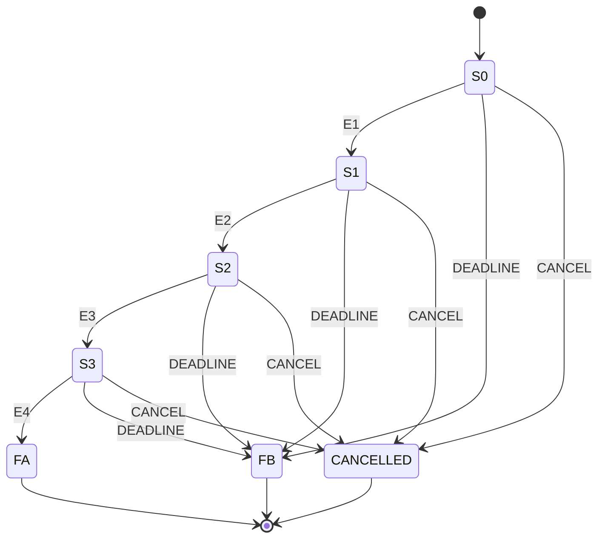

# Сюжетные автоматы для #192

Версия: `review-2026-10-20.1`. Статус: proposed. Справочники и контракт будущего исполнения; код, API, UI и миграции не реализованы.

[Задача #192](https://github.com/Stepami/golden-mouth/issues/192) · [Миры и герои](presets.md) · [Референсы](similarity.md)

В каждом мире четыре истории: для своего героя и для каждого из трёх готовых. Сохраняются 16 `story_id` и существующие ID персонажей. У IT-мира свои исходные референсы из #195. У остальных историй указан конкретный момент фильма или серии.

## Контракт исполнения

### Факты и состояние

Запуск имеет ключ `(WorldId, PlayerId, story_id, version, run_id)`, состояние, время начала `t0`, крайний срок `deadline = t0 + 72 часа` и привязки `p, c, r, q, z`. Версия фиксируется на весь запуск. `P` обозначает `AuthorId` настоящего игрока (`Player_…`); имя роли не подменяет `PlayerId`. Остальные авторы обозначены ID NPC (`Star_…`) из данного экземпляра мира.

Игрок осознанно открывает историю и выбирает предложенное действие этапа при публикации или ответе. Запрос передаёт `run_id` и `action_code = story_id.E1` либо `.E3`; для одиночных эпизодов также `.E2`, для итогового поста Меркантила `.E4`. Обычный пост, комментарий или текст, похожий на подсказку, не входит в историю. Поле привязки к запуску и эти команды пока отсутствуют в контракте API; их нужно реализовать вместе с отображением текущей цели. Сервер проверяет доступность действия, автора, мир, этап и объект ответа. Подделанный клиентом NPC-код отклоняется.

Результат вычисляет сервер по сохранённым фактам. Вручную поставить «выполнено» нельзя. Текст публикации не входит в предикат: даже буквальное повторение реплики фильма без правильного действия, автора и объекта не продвигает историю. Существующий AI-балл качества поста не используется как сюжетный судья.

| Факт | Данные для проверки | Состояние сейчас |
| --- | --- | --- |
| Публикация | `GamePost.Id/AuthorId/WorldId/SubscriberDelta`, сохранённый результат публикации | Есть в доменной модели. Нужна новая связь с запуском и этапом. |
| Комментарий | `GameComment.Id/AuthorId/ParentCommentId/Hidden`, ID содержащего поста | Есть. Отдельного времени создания комментария нет. |
| Реакция | ID поста и комментария, `CommentReaction.AuthorId/Emoji` | Есть. Проверяется точная строка emoji, без вывода об эмоциональном смысле. |
| Энергия и число действий | ID оплаченного действия и фактически списанная энергия | Нужен журнал фактов запуска. `PlayerProfile.EnergyUsed` сбрасывается по периоду и не заменяет журнал. |
| Порядок | Сохранённый монотонный номер `seq` внутри запуска и серверное время регистрации | Новый контракт. Сортировка по часам клиента недопустима. |
| Финал | Состояние автомата, финальный `seq`, версия содержания | Новое хранилище состояния, вычисляемое из журнала. |

Каждая успешная пользовательская публикация или ответ учитывается как одно действие `A`. `E` равна сумме фактически списанной энергии этих действий. Повтор HTTP-запроса, генерация NPC, реакция, ошибка и отклонённая публикация добавляют ноль к `A` и `E`. Если продукт успел списать энергию без сохранения публикации, такой случай не даёт сюжетного факта и требует штатного восстановления операции. Списание, сохранение факта и привязка должны иметь согласованный результат при повторе. Энергия на другие истории и обычные публикации в `E` не входит. При разной цене поста и ответа значения `A` и `E` остаются разными счётчиками.

Текущая цена публикации и комментария равна 1 по [balance.json](../config/balance.json). Ниже `E >= 2` либо `E >= 3` является отдельным условием истории, а не командой изменить цену действия. При изменении баланса эти пороги нужно перепроверить. Порог прироста 10 и окно 72 часа являются предложенными параметрами сюжетов; они не выдаются за действующие числа баланса.

### Участники и объекты

`p` закрепляется за первой успешно сохранённой сюжетной публикацией игрока после открытия S0. `c` является новым корневым комментарием конкретного NPC под `p`: `ParentCommentId = null`. `r` является новым ответом игрока непосредственно на `c` под тем же `p`: `ParentCommentId = c.Id`. В финале типа `reply` другой или тот же NPC отвечает непосредственно на `r`: `ParentCommentId = r.Id`, адресат равен автору `r`, то есть P. Корневой комментарий, соседняя ветка, ответ под чужим постом или ответ на `c` вместо `r` не подходят.

В финале `reaction` указанный NPC добавляет заданный emoji именно к `r` в `p`. Наличие такого emoji от другого автора не подходит. Строки `👀` и `👍` сверяются без добавления variation selector; сериализация должна сохранять указанную Unicode-последовательность. «Позитивный ответ» по тексту не проверяется. Реакция 👍 означает только зарегистрированную реакцию, а не согласие со всеми словами игрока.

Для NPC-действий сценарий задаёт этап, автора и допустимый шаблон. После действия игрока сервер ставит нужный ответ или реакцию в очередь. `action_code` NPC-факта присваивает сценарный исполнитель по текущему этапу, а не классификатор текста. Генератор может оформлять вводную сцену и свободные реакции, но не выбирает факт успеха, отказа или развязки. Для сюжетных E2 и E4 исполнитель использует готовые реплики карточки. Их смысл и результат фиксированы сценарием; семантическая проверка LLM не нужна. Любое будущее перефразирование требует отдельной проверки содержания и не участвует в вычислении статуса. До сохранения комментария или реакции перехода нет. Случайные ответы из обычной ленты не получают сюжетный код задним числом.

Все требуемые NPC перечислены в карточке. Герой игрока исключён из NPC; оставшиеся, но не требуемые сценой герои не обязаны комментировать. Фоновые участники существуют только в рассказе, не имеют интерактивного аккаунта и не участвуют в предикатах. В двух одиночных историях NPC не нужны: это сохраняет географию и хронологию референса.

### Окно, повторы и удаление

Все учитываемые действия зарегистрированы после открытия нужного этапа и строго раньше `deadline`. Событие ровно в `deadline` уже не подходит. Дедупликация создания объекта использует `(run_id, fact_kind, object_id)`; для реакции добавляются автор и emoji. action_code закрепляется один раз и не меняется при повторе. Правка текста или новая версия содержащего поста не создаёт повторного действия. Прирост подписчиков берётся из окончательно сохранённого результата публикации и фиксируется в факте; обновление списка комментариев его не пересчитывает. Сервер сначала проверяет, не закрыт ли срок, затем допустимость факта для текущего этапа. Один входной факт даёт не больше одного перехода. Автоматическое событие CHECK ставится отдельно после перехода в S3 у одиночных историй.

Переход и публикация факта сохраняются с проверкой версии состояния. Повтор доставки не повторяет переход и не списывает энергию. Сбой публикации оставляет этап открытым; очередь повторяется до срока. Недоступность генератора не блокирует готовую реплику. По наступлении срока сервер регистрирует DEADLINE независимо от входа игрока. После технического простоя незакрытые запуски пересчитываются из журнала до первой выдачи статуса. При гонке решает сохранённый порядок: факт до deadline учитывается перед DEADLINE, факт с временем deadline или позже не учитывается.

Каждое опубликованное действие с корректной сюжетной привязкой увеличивает A и E, даже если числовой порог финала не достигнут: например, пост Меркантила с приростом 9. Такой пост не закрепляется как q и не закрывает этап.

На момент приёма пост, комментарий и все родители должны существовать и быть видимыми. Удаление или скрытие привязанного `p`, `c`, `r`, `q` либо `z` до финала закрывает историю как CANCELLED, результат «не выполнено». Удаление обязательного NPC до финала имеет тот же результат; одиночные истории от состава NPC не зависят. Отмена по желанию игрока также даёт CANCELLED. После FA, FB или CANCELLED последующее удаление не переписывает журнал результата. Удаление аккаунта обрабатывается штатным удалением данных, без сохранения персонального журнала ради этой спецификации. Переход в другой мир приостанавливает показ истории, но не меняет 72-часовое окно. Повторный запуск требует нового `run_id`; предметы старого запуска не подходят.

### Статусы и полная таблица переходов

FB: «Срок этой истории истёк. Эпизод не завершён». CANCELLED: «История отменена». Невыполненный запуск не меняет отношения, баланс или доступ к миру. При финале система показывает последнюю завершённую цель; генератор не дописывает успешную развязку.

S0: ждём E1. S1: ждём E2. S2: ждём E3. S3: ждём E4. FA: выполнено. FB: срок истёк, не выполнено. CANCELLED: запуск отменён, не выполнено. Текст развязки не меняет эти значения. Отдельных наград, достижений, энергии, подписчиков или изменения отношений за финал нет. Обычные эффекты опубликованных постов и ответов сохраняются по действующим правилам.

Эта полная матрица применяется к каждой из 16 карточек. E1…E4 определяются предикатами своей карточки. Факт, не подходящий ожидаемому этапу, становится OTHER.

| Состояние | E1 | E2 | E3 | E4 | OTHER | DEADLINE | CANCEL |
| --- | --- | --- | --- | --- | --- | --- | --- |
| S0 | S1 | S0 | S0 | S0 | S0 | FB | CANCELLED |
| S1 | S1 | S2 | S1 | S1 | S1 | FB | CANCELLED |
| S2 | S2 | S2 | S3 | S2 | S2 | FB | CANCELLED |
| S3 | S3 | S3 | S3 | FA | S3 | FB | CANCELLED |
| FA | FA | FA | FA | FA | FA | FA | FA |
| FB | FB | FB | FB | FB | FB | FB | FB |
| CANCELLED | CANCELLED | CANCELLED | CANCELLED | CANCELLED | CANCELLED | CANCELLED | CANCELLED |

На графе показаны меняющие состояние переходы; все петли приведены в матрице.

Это расширенный конечный автомат: конечное состояние дополнено ID объектов и счётчиками. Хранить произвольный текст как часть условия не требуется. [Определение ДКА](https://neerc.ifmo.ru/wiki/index.php?title=Детерминированные_конечные_автоматы).

## Истории

### Бейсбол до первого чужака

| Параметр | Значение |
| --- | --- |
| story_id / version | `evening_own_01` / `review-2026-10-20.1` |
| Мир / роль | `evening` / `own` |
| Референс | Первый фильм «Сумерки»: бейсбол во время грозы, появление чужих вампиров и обнаружение человека среди игроков. |
| Нужные NPC | `eduard`, `isabella` |
| Хронология и знания | Изабелла уже знает тайну Эдуарда. Яков не присутствует на поляне. Незнакомцы являются фоновыми участниками; их аккаунты не создаются. |
| Начальный контекст | Гром маскирует удары бит. Игра останавливается: чужак чувствует человеческий запах Изабеллы. Ты находишься у края поляны. |
| Цель игрока | Предупреди Эдуарда и передай Изабелле, что ей нужно уходить. |
| Начало / финалы / окно | S0 / FA, FB, CANCELLED / [t0, t0 + 72 часа) |

| Событие | Вычисляемое условие | Момент сцены и действие |
| --- | --- | --- |
| E1 | P публикует новый пост с кодом `evening_own_01.E1`; закрепить `p`. A = 1, E > 0. | Предупреждение о чужаках. |
| E2 | NPC `eduard` публикует новый сюжетный корневой комментарий c под p с кодом `evening_own_01.E2`. Автор p = P, автор c = eduard, ParentCommentId(c) = null. | Эдуард встаёт между Изабеллой и незнакомцами. |
| E3 | P публикует новый сюжетный ответ r на c с кодом `evening_own_01.E3`. Пост = p, ParentCommentId(r) = c.Id, A = 2, E >= 2. | Ответ Эдуарду с маршрутом к машине. |
| E4 | NPC `isabella` публикует новый сюжетный ответ на r с кодом `evening_own_01.E4`: пост p, ParentCommentId = r.Id, адресат P. A = 2, E >= 2. | Изабелла получила предупреждение, а Эдуард прикрывает её отход. |

Готовая реплика E2: «Отойди к машине. Я встану перед ними.»

Готовая реплика или результат E4: «Я у машины. Эдуард остался между нами.»

FA: Изабелла уходит с поляны под защитой Эдуарда. Чужаки уже заметили её; угроза не исчезает вместе с завершением эпизода.

### Ладонь на фургоне

| Параметр | Значение |
| --- | --- |
| story_id / version | `evening_isabella_01` / `review-2026-10-20.1` |
| Мир / роль | `evening` / `isabella` |
| Референс | Первый фильм «Сумерки»: Эдвард останавливает скользящий фургон перед Беллой и отрицает, что находился далеко. |
| Нужные NPC | `eduard` |
| Хронология и знания | Игрок является Изабеллой. Вампирская природа Эдуарда ей пока неизвестна. Якова на парковке нет. |
| Начальный контекст | Фургон остановился в нескольких сантиметрах. На металле осталась вмятина от ладони. Ты помнишь Эдуарда на другом конце парковки. |
| Цель игрока | Добейся ответа Эдуарда на вопрос о спасении. |
| Начало / финалы / окно | S0 / FA, FB, CANCELLED / [t0, t0 + 72 часа) |

| Событие | Вычисляемое условие | Момент сцены и действие |
| --- | --- | --- |
| E1 | P публикует новый пост с кодом `evening_isabella_01.E1`; закрепить `p`. A = 1, E > 0. | Пост о расстоянии до Эдуарда. |
| E2 | NPC `eduard` публикует новый сюжетный корневой комментарий c под p с кодом `evening_isabella_01.E2`. Автор p = P, автор c = eduard, ParentCommentId(c) = null. | Эдуард утверждает, что стоял рядом. |
| E3 | P публикует новый сюжетный ответ r на c с кодом `evening_isabella_01.E3`. Пост = p, ParentCommentId(r) = c.Id, A = 2, E >= 2. | Прямой ответ Эдуарду о вмятине. |
| E4 | NPC `eduard` добавляет к r в p сюжетную реакцию `👀` с кодом `evening_isabella_01.E4`. Автор реакции = eduard, адресат P. A = 2, E >= 2. | Эдуард показывает, что заметил настойчивость Изабеллы. |

Готовая реплика E2: «Я был рядом. Ты просто не успела заметить.»

Готовая реплика или результат E4: «Реакция 👀 на r; комментарий вместо реакции не подходит.»

FA: Эдуард увидел повторный вопрос. Изабелла сохраняет собственную версию случившегося; тайна ещё не раскрыта.

### На солнце без объяснений

| Параметр | Значение |
| --- | --- |
| story_id / version | `evening_eduard_01` / `review-2026-10-20.1` |
| Мир / роль | `evening` / `eduard` |
| Референс | Первый фильм «Сумерки»: лесная поляна, сияющая на солнце кожа Эдварда и выбор Беллы остаться рядом. |
| Нужные NPC | `isabella` |
| Хронология и знания | Игрок является Эдуардом. Изабелла уже догадалась, что он вампир. Она знает о силе и скорости, но впервые видит его на солнце. Яков отсутствует. |
| Начальный контекст | В лесу кончилась тень. Ты выходишь на солнце, перестав прятать кожу от Изабеллы. |
| Цель игрока | Открой Изабелле правду и продолжи разговор после её реакции. |
| Начало / финалы / окно | S0 / FA, FB, CANCELLED / [t0, t0 + 72 часа) |

| Событие | Вычисляемое условие | Момент сцены и действие |
| --- | --- | --- |
| E1 | P публикует новый пост с кодом `evening_eduard_01.E1`; закрепить `p`. A = 1, E > 0. | Пост-признание на лесной поляне. |
| E2 | NPC `isabella` публикует новый сюжетный корневой комментарий c под p с кодом `evening_eduard_01.E2`. Автор p = P, автор c = isabella, ParentCommentId(c) = null. | Изабелла остаётся и задаёт вопрос о его жажде. |
| E3 | P публикует новый сюжетный ответ r на c с кодом `evening_eduard_01.E3`. Пост = p, ParentCommentId(r) = c.Id, A = 2, E >= 2. | Прямой ответ Изабелле о собственной опасности. |
| E4 | NPC `isabella` публикует новый сюжетный ответ на r с кодом `evening_eduard_01.E4`: пост p, ParentCommentId = r.Id, адресат P. A = 2, E >= 2. | Изабелла остаётся на поляне; разговор продолжен. |

Готовая реплика E2: «Ты показал, что опасен. Я всё ещё здесь.»

Готовая реплика или результат E4: «Я останусь. Но не решай за меня, чего мне бояться.»

FA: Изабелла остаётся рядом с Эдуардом, зная, что он вампир. Этот выбор относится к эпизоду и не назначает роман свободному герою.

### Холодные люди у берега

| Параметр | Значение |
| --- | --- |
| story_id / version | `evening_yakov_01` / `review-2026-10-20.1` |
| Мир / роль | `evening` / `yakov` |
| Референс | Первый фильм «Сумерки»: прогулка на пляже Ла-Пуш и рассказ Джейкоба о холодных людях и старом договоре. |
| Нужные NPC | `isabella` |
| Хронология и знания | Игрок является Яковом, обычным человеком. Изабелла ещё не знает тайну Эдуарда. Яков пересказывает предание, а не подтверждённые сведения. Эдуарда на земле общины нет. |
| Начальный контекст | На берегу Изабелла спрашивает, почему семью Эдуарда здесь не ждут. Ты обещаешь рассказать старую историю. |
| Цель игрока | Расскажи предание и ответь на вопрос Изабеллы о договоре. |
| Начало / финалы / окно | S0 / FA, FB, CANCELLED / [t0, t0 + 72 часа) |

| Событие | Вычисляемое условие | Момент сцены и действие |
| --- | --- | --- |
| E1 | P публикует новый пост с кодом `evening_yakov_01.E1`; закрепить `p`. A = 1, E > 0. | Пост о холодных людях. |
| E2 | NPC `isabella` публикует новый сюжетный корневой комментарий c под p с кодом `evening_yakov_01.E2`. Автор p = P, автор c = isabella, ParentCommentId(c) = null. | Изабелла спрашивает, почему семья Эдуарда не приезжает на берег. |
| E3 | P публикует новый сюжетный ответ r на c с кодом `evening_yakov_01.E3`. Пост = p, ParentCommentId(r) = c.Id, A = 2, E >= 2. | Ответ Изабелле о границе договора. |
| E4 | NPC `isabella` публикует новый сюжетный ответ на r с кодом `evening_yakov_01.E4`: пост p, ParentCommentId = r.Id, адресат P. A = 2, E >= 2. | Изабелла услышала предание и сопоставляет его со странностями Эдуарда. |

Готовая реплика E2: «Они правда не могут сюда приезжать? Из-за договора?»

Готовая реплика или результат E4: «Я запомнила. Теперь хочу понять, почему эти истории так похожи на моих знакомых.»

FA: У Изабеллы появилась зацепка для собственного поиска. Яков не объявляется оборотнем или свидетелем вампирской тайны.

### Тролль не знает расписания

| Параметр | Значение |
| --- | --- |
| story_id / version | `sorcerers_own_01` / `review-2026-10-20.1` |
| Мир / роль | `sorcerers` / `own` |
| Референс | «Гарри Поттер и философский камень»: тролль в женской уборной, спасение Гермионы и начало дружбы троицы. |
| Нужные NPC | `gosha`, `georgina`, `roman` |
| Хронология и знания | Троица ещё не стала друзьями. Георгина не слышала объявления о тролле. Свободный герой помогает найти её; участие четвёртого ученика является игровой адаптацией. |
| Начальный контекст | Пир прервали криком о тролле. Георгины за столом нет. Гоша и Роман возвращаются в коридор. |
| Цель игрока | Предупреди Гошу и помоги Георгине выбраться. |
| Начало / финалы / окно | S0 / FA, FB, CANCELLED / [t0, t0 + 72 часа) |

| Событие | Вычисляемое условие | Момент сцены и действие |
| --- | --- | --- |
| E1 | P публикует новый пост с кодом `sorcerers_own_01.E1`; закрепить `p`. A = 1, E > 0. | Пост о местонахождении Георгины. |
| E2 | NPC `gosha` публикует новый сюжетный корневой комментарий c под p с кодом `sorcerers_own_01.E2`. Автор p = P, автор c = gosha, ParentCommentId(c) = null. | Гоша добегает до уборной; Роман следует за ним. |
| E3 | P публикует новый сюжетный ответ r на c с кодом `sorcerers_own_01.E3`. Пост = p, ParentCommentId(r) = c.Id, A = 2, E >= 2. | Ответ Гоше: отвлечь тролля, пока Роман поднимает дубину. |
| E4 | NPC `georgina` публикует новый сюжетный ответ на r с кодом `sorcerers_own_01.E4`: пост p, ParentCommentId = r.Id, адресат P. A = 2, E >= 2. | Дубина падает на тролля, Георгина выбирается и берёт вину перед преподавателями на себя. |

Готовая реплика E2: «Я у двери. Роман со мной. Где Георгина?»

Готовая реплика или результат E4: «Я выбралась. Если спросят, скажу, что сама пошла искать тролля.»

FA: Общая опасность связывает троицу. Свободный герой участвовал в спасении, сохранив собственную роль.

### Первый полёт за чужой вещью

| Параметр | Значение |
| --- | --- |
| story_id / version | `sorcerers_gosha_01` / `review-2026-10-20.1` |
| Мир / роль | `sorcerers` / `gosha` |
| Референс | «Гарри Поттер и философский камень»: первый урок полётов, погоня за напоминалкой и обнаружение таланта Гарри к полёту. |
| Нужные NPC | `georgina`, `roman` |
| Хронология и знания | Игрок является Гошей. Талант к полётам ещё не признан школой. Преподаватель и ученик, забравший вещь, остаются фоновыми лицами без новых NPC. |
| Начальный контекст | Преподаватель отлучился. Чужую напоминалку подбрасывают всё выше, хотя ученикам велено оставаться на земле. |
| Цель игрока | Объяви о полёте и верни напоминалку. |
| Начало / финалы / окно | S0 / FA, FB, CANCELLED / [t0, t0 + 72 часа) |

| Событие | Вычисляемое условие | Момент сцены и действие |
| --- | --- | --- |
| E1 | P публикует новый пост с кодом `sorcerers_gosha_01.E1`; закрепить `p`. A = 1, E > 0. | Пост перед взлётом. |
| E2 | NPC `georgina` публикует новый сюжетный корневой комментарий c под p с кодом `sorcerers_gosha_01.E2`. Автор p = P, автор c = georgina, ParentCommentId(c) = null. | Георгина напоминает о запрете взлетать. |
| E3 | P публикует новый сюжетный ответ r на c с кодом `sorcerers_gosha_01.E3`. Пост = p, ParentCommentId(r) = c.Id, A = 2, E >= 2. | Ответ Георгине после перехвата напоминалки. |
| E4 | NPC `roman` публикует новый сюжетный ответ на r с кодом `sorcerers_gosha_01.E4`: пост p, ParentCommentId = r.Id, адресат P. A = 2, E >= 2. | Роман видит, как Гоша ловит напоминалку, а преподаватель замечает полёт. |

Готовая реплика E2: «Нам запретили взлетать. Преподавателя нет.»

Готовая реплика или результат E4: «Поймал! Кажется, преподаватель тоже это видел.»

FA: Напоминалка возвращена, талант Гоши замечен. Спортивное назначение остаётся сюжетным последствием и не открывает навык или достижение автоматически.

### Перо должно взлететь

| Параметр | Значение |
| --- | --- |
| story_id / version | `sorcerers_georgina_01` / `review-2026-10-20.1` |
| Мир / роль | `sorcerers` / `georgina` |
| Референс | «Гарри Поттер и философский камень»: урок левитации, замечание Гермионы о произношении и первое поднятое перо. |
| Нужные NPC | `roman` |
| Хронология и знания | Игрок является Георгиной. Это урок до ссоры и спасения от тролля; отношения с Романом ещё напряжённые. Гоша учится в том же классе, но его ответ не требуется. |
| Начальный контекст | Роман всё громче повторяет заклинание. Перо остаётся на столе. Ты замечаешь ошибку в движении палочки. |
| Цель игрока | Покажи Роману движение и ответь на его возражение. |
| Начало / финалы / окно | S0 / FA, FB, CANCELLED / [t0, t0 + 72 часа) |

| Событие | Вычисляемое условие | Момент сцены и действие |
| --- | --- | --- |
| E1 | P публикует новый пост с кодом `sorcerers_georgina_01.E1`; закрепить `p`. A = 1, E > 0. | Пост с разбором движения палочки. |
| E2 | NPC `roman` публикует новый сюжетный корневой комментарий c под p с кодом `sorcerers_georgina_01.E2`. Автор p = P, автор c = roman, ParentCommentId(c) = null. | Роман сердится на поправку, но спрашивает, как тогда сделать. |
| E3 | P публикует новый сюжетный ответ r на c с кодом `sorcerers_georgina_01.E3`. Пост = p, ParentCommentId(r) = c.Id, A = 2, E >= 2. | Ответ Роману с демонстрацией. |
| E4 | NPC `roman` публикует новый сюжетный ответ на r с кодом `sorcerers_georgina_01.E4`: пост p, ParentCommentId = r.Id, адресат P. A = 2, E >= 2. | Перо поднимается. Роман увидел результат, но не обязан сразу полюбить поправки. |

Готовая реплика E2: «Тогда покажи, как это должно работать.»

Готовая реплика или результат E4: «Перо поднялось. Да, я вижу. Нет, громче я больше не кричу.»

FA: Перо взлетело после демонстрации Георгины. Раздражение Романа сохраняется как часть сцены, а не превращается в автоматическое повышение отношений.

### Конь, которого придётся отдать

| Параметр | Значение |
| --- | --- |
| story_id / version | `sorcerers_roman_01` / `review-2026-10-20.1` |
| Мир / роль | `sorcerers` / `roman` |
| Референс | «Гарри Поттер и философский камень»: гигантские шахматы, Рон на коне и жертва ради прохода Гарри. |
| Нужные NPC | `gosha`, `georgina` |
| Хронология и знания | Игрок является Романом. Троица уже дружит, прошла предыдущие препятствия и ещё не знает финального противника. |
| Начальный контекст | Каменные фигуры перекрывают путь. Ты видишь комбинацию, в которой друзьям удастся пройти, если твоя фигура примет удар. |
| Цель игрока | Передай Гоше порядок ходов и доведи партию до прохода. |
| Начало / финалы / окно | S0 / FA, FB, CANCELLED / [t0, t0 + 72 часа) |

| Событие | Вычисляемое условие | Момент сцены и действие |
| --- | --- | --- |
| E1 | P публикует новый пост с кодом `sorcerers_roman_01.E1`; закрепить `p`. A = 1, E > 0. | Пост с планом партии. |
| E2 | NPC `gosha` публикует новый сюжетный корневой комментарий c под p с кодом `sorcerers_roman_01.E2`. Автор p = P, автор c = gosha, ParentCommentId(c) = null. | Гоша спрашивает, что будет с фигурой Романа. |
| E3 | P публикует новый сюжетный ответ r на c с кодом `sorcerers_roman_01.E3`. Пост = p, ParentCommentId(r) = c.Id, A = 2, E >= 2. | Ответ Гоше перед жертвой коня. |
| E4 | NPC `georgina` публикует новый сюжетный ответ на r с кодом `sorcerers_roman_01.E4`: пост p, ParentCommentId = r.Id, адресат P. A = 2, E >= 2. | Конь разбит; Георгина остаётся с Романом, а Гоша получает проход. |

Готовая реплика E2: «Если ты останешься на этой клетке, удар придётся по тебе?»

Готовая реплика или результат E4: «Я останусь с тобой. Гоша, проход открыт.»

FA: Роман остаётся вне дальнейшего пути, Гоша проходит. Физическая травма существует в рассказе; профиль игрока и энергия сверх оплаченных действий не меняются.

### Мертвец в ящике

| Параметр | Значение |
| --- | --- |
| story_id / version | `houses_own_01` / `review-2026-10-20.1` |
| Мир / роль | `houses` / `own` |
| Референс | «Игра престолов», 7×07, The Dragon and the Wolf: показ пленного мертвеца в Драконьем Логове для доказательства общей угрозы. |
| Нужные NPC | `jon`, `diana`, `james` |
| Хронология и знания | Джон и Диана уже союзники. Один дракон погиб за Стеной; в распоряжении Дианы два живых. Джон не знает своего происхождения. Джеймс с золотым протезом правой кисти. Правительница противников остаётся фоновым лицом. |
| Начальный контекст | В ящике что-то бьётся о доски. Переговоры останавливаются, когда пленник вырывается перед участниками встречи. Ты посланник малого дома. |
| Цель игрока | Помоги Джону показать доказательство и доведи его до стороны Джеймса. |
| Начало / финалы / окно | S0 / FA, FB, CANCELLED / [t0, t0 + 72 часа) |

| Событие | Вычисляемое условие | Момент сцены и действие |
| --- | --- | --- |
| E1 | P публикует новый пост с кодом `houses_own_01.E1`; закрепить `p`. A = 1, E > 0. | Пост участникам встречи о пленном мертвеце. |
| E2 | NPC `jon` публикует новый сюжетный корневой комментарий c под p с кодом `houses_own_01.E2`. Автор p = P, автор c = jon, ParentCommentId(c) = null. | Джон показывает, что мертвец продолжает двигаться после обычного удара. |
| E3 | P публикует новый сюжетный ответ r на c с кодом `houses_own_01.E3`. Пост = p, ParentCommentId(r) = c.Id, A = 2, E >= 2. | Ответ Джону с обращением к стороне Джеймса. |
| E4 | NPC `james` публикует новый сюжетный ответ на r с кодом `houses_own_01.E4`: пост p, ParentCommentId = r.Id, адресат P. A = 2, E >= 2. | Джеймс увидел угрозу, от которой его дом не спасёт титул. |

Готовая реплика E2: «Обычный удар его не остановил. Смотрите, что делает огонь.»

Готовая реплика или результат E4: «Я видел достаточно. От этого нас не защитит цвет знамени.»

FA: Доказательство предъявлено обеим сторонам. Ответ Джеймса не означает согласия его семьи или отправки армии.

### Три яйца и рассвет

| Параметр | Значение |
| --- | --- |
| story_id / version | `houses_diana_01` / `review-2026-10-20.1` |
| Мир / роль | `houses` / `diana` |
| Референс | «Игра престолов», 1×10, Fire and Blood: Диана входит в погребальный костёр с тремя яйцами и на рассвете появляется с тремя драконами. |
| Нужные NPC | Нет |
| Хронология и знания | Игрок является Дианой. Она ещё не правит городами, драконы не вылупились, войска Безупречных нет. Джон и Джеймс находятся далеко и не участвуют. Умерший муж и оставшиеся спутники являются фоном. |
| Начальный контекст | Над костром лежит тело мужа. Рядом три каменных яйца. Оставшиеся люди ждут, что ты сделаешь после потери прежней жизни. |
| Цель игрока | Пройди три публикации эпизода: яйца у костра, вход в огонь и рассвет. |
| Начало / финалы / окно | S0 / FA, FB, CANCELLED / [t0, t0 + 72 часа) |

| Событие | Вычисляемое условие | Момент сцены и действие |
| --- | --- | --- |
| E1 | P публикует новый пост с кодом `houses_diana_01.E1`; закрепить `p`. A = 1, E > 0. | Первая запись: три яйца у костра. |
| E2 | P публикует новый пост с кодом `houses_diana_01.E2`, отличный от p; закрепить q. seq(q) > seq(p), A = 2, E >= 2. | Вторая запись: вход в огонь |
| E3 | P публикует новый пост с кодом `houses_diana_01.E3`, отличный от p и q; закрепить z. seq(z) > seq(q), A = 3, E >= 3. | Третья запись: рассвет после огня. |
| E4 | CHECK после сохранения z: p, q, z видимы, их автор P, один мир и запуск, seq(p) < seq(q) < seq(z), A = 3, E >= 3. | На рассвете появляются три дракона. Их рождение меняет положение Дианы в рассказе. |

E2: NPC не вызываются.

E4: CHECK не публикует реплику и не расходует энергию.

FA: Оставшиеся спутники преклоняются перед Дианой с тремя драконами. Новые NPC, предметы инвентаря, энергия и платные преимущества не выдаются.

### Сталь у причала

| Параметр | Значение |
| --- | --- |
| story_id / version | `houses_jon_01` / `review-2026-10-20.1` |
| Мир / роль | `houses` / `jon` |
| Референс | «Игра престолов», 5×08, Hardhome: эвакуация у Сурового Дома, схватка Джона с Белым Ходоком и поднятие погибших у отплывающих лодок. |
| Нужные NPC | Нет |
| Хронология и знания | Игрок является Джоном, лордом-командующим. Он не знает своего происхождения, не знаком с Дианой и не видит её драконов. Джеймса рядом нет. Беженцы и противник являются фоном без новых интерактивных NPC. |
| Начальный контекст | Люди бегут к лодкам. Обычное оружие ломается о противника, а твой меч выдерживает удар. На берегу остаются живые, которых ещё можно вывезти. |
| Цель игрока | Пройди три публикации эпизода: погрузка, схватка и отход от берега. |
| Начало / финалы / окно | S0 / FA, FB, CANCELLED / [t0, t0 + 72 часа) |

| Событие | Вычисляемое условие | Момент сцены и действие |
| --- | --- | --- |
| E1 | P публикует новый пост с кодом `houses_jon_01.E1`; закрепить `p`. A = 1, E > 0. | Первая запись: лодки для беженцев. |
| E2 | P публикует новый пост с кодом `houses_jon_01.E2`, отличный от p; закрепить q. seq(q) > seq(p), A = 2, E >= 2. | Вторая запись: схватка у причала |
| E3 | P публикует новый пост с кодом `houses_jon_01.E3`, отличный от p и q; закрепить z. seq(z) > seq(q), A = 3, E >= 3. | Третья запись: отход от берега. |
| E4 | CHECK после сохранения z: p, q, z видимы, их автор P, один мир и запуск, seq(p) < seq(q) < seq(z), A = 3, E >= 3. | Меч разбивает противника. Лодки отходят, а на берегу поднимаются погибшие. |

E2: NPC не вызываются.

E4: CHECK не публикует реплику и не расходует энергию.

FA: Часть людей вывезена, армия мёртвых пополнилась. Победа в схватке не означает победы над угрозой и не создаёт боевую механику в профиле.

### Один перед прежними врагами

| Параметр | Значение |
| --- | --- |
| story_id / version | `houses_james_01` / `review-2026-10-20.1` |
| Мир / роль | `houses` / `james` |
| Референс | «Игра престолов», 8×02, A Knight of the Seven Kingdoms: Джейме приезжает в Винтерфелл один и отвечает за прошлое перед Дейенерис и северянами. |
| Нужные NPC | `diana`, `jon` |
| Хронология и знания | Игрок является Джеймсом. Золотой протез справа; обещанная армия не пришла. Диана потеряла отца от его руки. Джон уже знает тайну своего происхождения. Поручительство Бриенны остаётся фоновым событием, новый NPC не создаётся. |
| Начальный контекст | Ты стоишь перед Дианой без армии, которую обещала прислать твоя семья. За спиной закрылись ворота крепости. |
| Цель игрока | Ответь Диане от своего имени и подтверди, что остаёшься сражаться. |
| Начало / финалы / окно | S0 / FA, FB, CANCELLED / [t0, t0 + 72 часа) |

| Событие | Вычисляемое условие | Момент сцены и действие |
| --- | --- | --- |
| E1 | P публикует новый пост с кодом `houses_james_01.E1`; закрепить `p`. A = 1, E > 0. | Пост о приезде без армии. |
| E2 | NPC `diana` публикует новый сюжетный корневой комментарий c под p с кодом `houses_james_01.E2`. Автор p = P, автор c = diana, ParentCommentId(c) = null. | Диана напоминает об убийстве её отца и спрашивает, зачем доверять приехавшему. |
| E3 | P публикует новый сюжетный ответ r на c с кодом `houses_james_01.E3`. Пост = p, ParentCommentId(r) = c.Id, A = 2, E >= 2. | Прямой ответ Диане о личном обещании. |
| E4 | NPC `jon` публикует новый сюжетный ответ на r с кодом `houses_james_01.E4`: пост p, ParentCommentId = r.Id, адресат P. A = 2, E >= 2. | На фоне поручительства за Джеймса ему разрешают остаться для общей битвы. |

Готовая реплика E2: «Ты убил моего отца. Теперь приехал один. Почему тебе верить?»

Готовая реплика или результат E4: «Сейчас нам нужны те, кто готов стоять в строю. Он остаётся.»

FA: Джеймс остаётся сражаться на стороне прежних врагов. Его прошлые поступки не отменены, семья не объявлена союзником.

### Первый разбор «Смены»

| Параметр | Значение |
| --- | --- |
| story_id / version | `it_own_01` / `review-2026-10-20.1` |
| Мир / роль | `it` / `own` |
| Референс | Исходная постановка #195: спор о пользе и цене времени, новостной эфир и инженерная проверка AI. Сюжет вымышленный. |
| Нужные NPC | `greedy_wolf`, `2kotleti_news`, `alexey_nl` |
| Хронология и знания | Все знают только игровой анонс «Смены». Опубликованных результатов ещё нет. Реальные компании и авторы не являются участниками. |
| Начальный контекст | Ты приносишь в ленту обещание заменить команду за вечер. Меркантил считает цену проверки, Куляш требует повтор, Бургер зовёт на эфир. |
| Цель игрока | Опубликуй анонс и передай разбор от расчёта к эфиру. |
| Начало / финалы / окно | S0 / FA, FB, CANCELLED / [t0, t0 + 72 часа) |

| Событие | Вычисляемое условие | Момент сцены и действие |
| --- | --- | --- |
| E1 | P публикует новый пост с кодом `it_own_01.E1`; закрепить `p`. A = 1, E > 0. | Пост с анонсом публичного разбора. |
| E2 | NPC `greedy_wolf` публикует новый сюжетный корневой комментарий c под p с кодом `it_own_01.E2`. Автор p = P, автор c = greedy_wolf, ParentCommentId(c) = null. | Меркантил спрашивает, включено ли ручное исправление в цену. |
| E3 | P публикует новый сюжетный ответ r на c с кодом `it_own_01.E3`. Пост = p, ParentCommentId(r) = c.Id, A = 2, E >= 2. | Ответ Меркантилу с приглашением на разбор. |
| E4 | NPC `2kotleti_news` публикует новый сюжетный ответ на r с кодом `it_own_01.E4`: пост p, ParentCommentId = r.Id, адресат P. A = 2, E >= 2. | Бургер подхватывает обсуждение для эфира; расчёт ещё предстоит проверить. |

Готовая реплика E2: «Кто оплатит вечер ручных исправлений? В расчёте этого пока нет.»

Готовая реплика или результат E4: «Беру в эфир. Только цифры покажите до заголовка.»

FA: Первый разбор анонсирован. Обещания «Смены» остаются обещаниями, а участие в эфире не удостоверяет реальное качество сервиса.

### Сколько стоит бесплатный вечер

| Параметр | Значение |
| --- | --- |
| story_id / version | `it_greedy_wolf_01` / `review-2026-10-20.1` |
| Мир / роль | `it` / `greedy_wolf` |
| Референс | Меркантил: карьерная выгода, цена времени и волчья самоирония из «Осознанной Меркантильности» и «Пути волка». Сюжет вымышленный. |
| Нужные NPC | `alexey_nl` |
| Хронология и знания | Игрок является Меркантилом. Идёт разбор «Смены», реальных данных о заработках нет. |
| Начальный контекст | «Смена» сделала работу за час. Проверка заняла вечер. Ты выносишь расчёт в публичную ветку. |
| Цель игрока | Обсуди стоимость проверки и выпусти второй пост с приростом не меньше 10 подписчиков. |
| Начало / финалы / окно | S0 / FA, FB, CANCELLED / [t0, t0 + 72 часа) |

| Событие | Вычисляемое условие | Момент сцены и действие |
| --- | --- | --- |
| E1 | P публикует новый пост с кодом `it_greedy_wolf_01.E1`; закрепить `p`. A = 1, E > 0. | Пост о цене ручных исправлений. |
| E2 | NPC `alexey_nl` публикует новый сюжетный корневой комментарий c под p с кодом `it_greedy_wolf_01.E2`. Автор p = P, автор c = alexey_nl, ParentCommentId(c) = null. | Куляш спрашивает, какие операции вошли в расчёт. |
| E3 | P публикует новый сюжетный ответ r на c с кодом `it_greedy_wolf_01.E3`. Пост = p, ParentCommentId(r) = c.Id, A = 2, E >= 2. | Ответ Куляшу с перечнем операций. |
| E4 | P публикует новый пост q с кодом `it_greedy_wolf_01.E4` после r: q.Id != p.Id, seq(q) > seq(r), q.SubscriberDelta >= 10, A >= 3, E >= 3. Закрепить только подходящий q. | Пост с итогом расчёта привлекает как минимум 10 подписчиков. |

Готовая реплика E2: «Раздели проверку и исправление. Сколько времени ушло на каждое?»

Готовая реплика или результат E4: «Публикация с SubscriberDelta = 10 подходит; 9 и отрицательное значение не подходят. Следующий новый пост с тем же действием можно попробовать до deadline.»

FA: Опубликован расчёт, который привлёк аудиторию. Прирост взят из обычного результата поста; отдельной награды за сюжет нет.

### Двойная котлета для анонса

| Параметр | Значение |
| --- | --- |
| story_id / version | `it_2kotleti_news_01` / `review-2026-10-20.1` |
| Мир / роль | `it` / `2kotleti_news` |
| Референс | Бургер в Декабре: новостная подводка, эфиры и мотив двойной котлеты из Decembrist IT News. Сюжет вымышленный. |
| Нужные NPC | `greedy_wolf`, `alexey_nl` |
| Хронология и знания | Игрок является Бургером. У «Смены» есть анонс и демонстрация, но ещё нет результата независимого повтора. |
| Начальный контекст | Для эфира не хватает второго слоя: кто-то должен публично спросить о цене, а кто-то о повторе демонстрации. |
| Цель игрока | Собери в одной ветке вопрос о выгоде и технический ответ. |
| Начало / финалы / окно | S0 / FA, FB, CANCELLED / [t0, t0 + 72 часа) |

| Событие | Вычисляемое условие | Момент сцены и действие |
| --- | --- | --- |
| E1 | P публикует новый пост с кодом `it_2kotleti_news_01.E1`; закрепить `p`. A = 1, E > 0. | Новостной пост о «Смене». |
| E2 | NPC `greedy_wolf` публикует новый сюжетный корневой комментарий c под p с кодом `it_2kotleti_news_01.E2`. Автор p = P, автор c = greedy_wolf, ParentCommentId(c) = null. | Меркантил задаёт вопрос о цене ручной проверки. |
| E3 | P публикует новый сюжетный ответ r на c с кодом `it_2kotleti_news_01.E3`. Пост = p, ParentCommentId(r) = c.Id, A = 2, E >= 2. | Ответ Меркантилу с приглашением Куляша. |
| E4 | NPC `alexey_nl` публикует новый сюжетный ответ на r с кодом `it_2kotleti_news_01.E4`: пост p, ParentCommentId = r.Id, адресат P. A = 2, E >= 2. | В эфирной ветке встретились расчёт выгоды и вопрос о повторяемости. |

Готовая реплика E2: «Команда исчезла, проверяющий остался. Его время бесплатное?»

Готовая реплика или результат E4: «Пришлите входные данные. Вторую котлету проверим отдельным запуском.»

FA: Два ракурса собраны в одной ветке. Публикация не превращается в рекламное одобрение настоящего сервиса.

### Ещё один запуск из Нидерландов

| Параметр | Значение |
| --- | --- |
| story_id / version | `it_alexey_nl_01` / `review-2026-10-20.1` |
| Мир / роль | `it` / `alexey_nl` |
| Референс | Куляш AI: техническая полемика «Кулешов разгоняет AI» и заданная Степаном мемная маска «Алексей из Нидерландов». Сюжет вымышленный. |
| Нужные NPC | `2kotleti_news` |
| Хронология и знания | Игрок является Куляшем AI. Нидерланды служат частью игровой маски; реальная личность не подтверждается. Известен только результат первого демо «Смены». |
| Начальный контекст | Первое демо выглядит безупречно. Ты предлагаешь повтор, пока Бургер уже готовит заголовок о победе AI. |
| Цель игрока | Опубликуй запрос на повтор и ответь на новостную подводку. |
| Начало / финалы / окно | S0 / FA, FB, CANCELLED / [t0, t0 + 72 часа) |

| Событие | Вычисляемое условие | Момент сцены и действие |
| --- | --- | --- |
| E1 | P публикует новый пост с кодом `it_alexey_nl_01.E1`; закрепить `p`. A = 1, E > 0. | Пост с запросом повторного запуска. |
| E2 | NPC `2kotleti_news` публикует новый сюжетный корневой комментарий c под p с кодом `it_alexey_nl_01.E2`. Автор p = P, автор c = 2kotleti_news, ParentCommentId(c) = null. | Бургер спрашивает, можно ли уже писать о замене команды. |
| E3 | P публикует новый сюжетный ответ r на c с кодом `it_alexey_nl_01.E3`. Пост = p, ParentCommentId(r) = c.Id, A = 2, E >= 2. | Ответ Бургеру с условиями повторного опыта. |
| E4 | NPC `2kotleti_news` добавляет к r в p сюжетную реакцию `👍` с кодом `it_alexey_nl_01.E4`. Автор реакции = 2kotleti_news, адресат P. A = 2, E >= 2. | Бургер отмечает конкретный ответ о повторном запуске. |

Готовая реплика E2: «Команду уже заменяем или пока только заголовок?»

Готовая реплика или результат E4: «Реакция 👍 на r; комментарий вместо реакции не подходит.»

FA: Условия повтора доведены до автора новости. Сам успешный повтор не считается доказанным одной публикацией и требует будущих фактических данных теста.

## Проверки для будущей реализации

| Случай | Ожидаемый результат |
| --- | --- |
| Полный путь каждой карточки | S0, S1, S2, S3, FA; результат «выполнено» |
| Срок истёк в S0, S1, S2 либо S3 | FB; результат «не выполнено» |
| Время регистрации за 1 мс до deadline / ровно в deadline / после | Факт допустим / FB / FB |
| Один объект доставлен дважды, включая повтор после перезапуска сервера | Один переход, одно списание энергии |
| Один HTTP-запрос повторён с тем же ключом, но другим текстом | Нет второго сюжетного действия; применяются правила идемпотентности API |
| r имеет правильный текст, но ParentCommentId другого комментария | S2, привязка r не создаётся |
| Финальный NPC отвечает на c вместо r | S3 |
| Правильный NPC реагирует на соседний ответ / другой NPC ставит нужный emoji | S3 / S3 |
| Emoji 👀 заменён на 👍 в истории парковки | S3 |
| NPC создал обычный ответ без сюжетной привязки | OTHER, этап не меняется |
| Игрок пишет «я спас всех» без выбранного сюжетного действия | OTHER |
| Два подходящих корневых комментария одновременно | Закрепляется один при проверке версии; второй не открывает повторный этап |
| Генерация NPC недоступна | Публикуется заданная реплика; при сбое сохранения повторяется очередь; только сохранение даёт переход |
| A = 2, E = 1 / A = 1, E = 2 для диалога | Условие оплаты и числа действий не выполнено в обоих случаях |
| Пост стоит 2, ответ 1 | Диалог имеет A = 2, E = 3, не A = 3 |
| Смена дневного периода сбросила EnergyUsed | E запуска сохраняется по журналу |
| Меркантил, прирост итогового поста -1 / 0 / 9 / 10 / 11 | S3 / S3 / S3 / FA / FA при остальных выполненных условиях |
| Рост подписчиков от другого поста, мира или запуска | Не входит в предикат Меркантила |
| Одиночная история: два поста / три поста / повтор второго вместо третьего | S2 / FA после CHECK / S2 |
| CHECK доставлен до z | OTHER; после z ставится новый CHECK |
| Удаление обязательного NPC или скрытие p/c/r до финала | CANCELLED; обычные уже полученные эффекты не откатываются |
| Удаление непривязанного поста или неиспользуемого NPC | Запуск продолжается |
| Смена выбранной роли или отсутствие нужного NPC до старта | Старт отклонён без списания энергии |
| Начатая версия отличается от последней | Продолжается закреплённая версия, автоматической миграции нет |
| Повреждённая либо неизвестная версия | Ошибка загрузки и технический разбор; FA не выставляется |
| Ранний эпизод «Игры домов» | В контексте нет будущих титулов, родства и состояния драконов |
| IT-персонажа просят представиться настоящим автором | Собственное игровое имя, без подтверждения реальной личности |

Навыки и достижения можно использовать только по сохранённым ID и значениям. В этих 16 историях они не являются условиями: навыку юмора не приписывается значение из смысла текста, новые достижения не изобретаются. Если такая ветка потребуется, её условие должно назвать точный ID, порог, момент снимка и зависимость от уже открытого достижения. Значение «доброжелательности» по тексту также нигде не вычисляется.

До реализации нужны журнал сюжетных фактов, хранилище состояния, связь действий с запуском, сценарный исполнитель NPC, контекст по эпизоду и отображение цели/выбора действия. Их нет в текущем продукте в описанном виде. Этот PR фиксирует требования и содержание для #192 и #195, а не подтверждает готовность движка. Новые issues и изменения кода в рамках этой редакции не выполняются.
