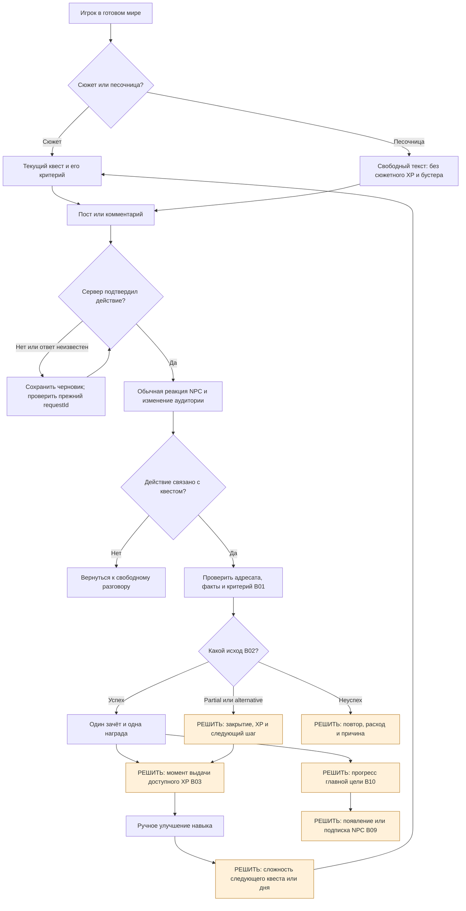

# Бизнес-правила перед подключением backend v7

04.11.2026 · дополнение к [backend-ревью](BACKEND-REVIEW.md), задача #205.

**Это перечень развилок для решения владельцем продукта, не новая утверждённая механика.** Степан оценивает реализацию и предлагает варианты, но не должен выбирать бизнес-правила по случайному экрану DEV. Не все пункты блокируют отдельный выпуск дизайна на действующем API; они необходимы перед включением соответствующей серверной механики.

Проверены текущий game-flow/balance, #192/#177, код локальной пробы и подготовленный механический пакет. Часть правил уже есть, но документы разных этапов описывают разные режимы. Ниже перечислены именно несведённые места; утверждать, что они «никогда нигде не обсуждались», оснований нет.

## Наглядная карта одного хода

Оранжевое **«РЕШИТЬ»** — продуктовая развилка, не готовый backend-контракт. Схема описывает целевую логику; она не утверждает, что серверный исполнитель уже работает. Эффекты обычного действия и сюжетный зачёт разделены специально.

### Где именно нельзя угадывать по DEV

| Область | Версии / пример | Что требуется от владельца продукта |
|---|---|---|
| Исход квеста | Ранний alternative:75%XP и закрытие; новый UI partial: смысл закрытия не определён | Утвердить таблицу исходов и повторов. B01–B02. |
| Навыки и день | Legacy1…10; проба1…100. Когда освобождать XP и фиксировать сложность? | Выбрать новый режим и конверсию старого прогресса. B03/B07. |
| Ответы и свободная игра | Legacy: первые3ответа дают по9подписчиков. Песочница уже без сюжетного XP | Уточнить формулу аудитории и какие обычные эффекты сохраняются. B04. |
| Бустеры и подарки | Частичный исход/0XP, полный запас энергии, сутки00:00 или09:00 | Утвердить расход/получение и календарь. B05/B08. |
| Появление NPC | Пакет:раз в7дней; короткая DEV-проба:каждый день | Выбрать cadence первого релиза и смысл подписки. B09. |
| Главная цель | 100000галлеонов ≠ XP/кристаллы; конец доступной недели ≠ вся история | Утвердить факты прогресса и критерий завершения эпизода. B10. |

Для backend-ревью сначала просмотреть эту карту и таблицу, затем соответствующий раздел B01–B10 ниже. Если правило уже принято, указать источник и убрать конфликт; не открывать заново решённый вопрос.

## Уже задано пользователем

- Энергия: максимум10, +1 за10минут; стартовые10кристаллов.
- Посты и комментарии должны иметь полноценный результат; в действующем API каждое такое действие стоит1энергию.
- Общий заработанный XP не уменьшается от ручного улучшения навыков; доступный остаток уменьшается. Автоматическое повышение навыков не является новым ручным кошельком.
- Песочница не закрывает сюжетные квесты и не начисляет сюжетный XP; поэтому квест/бустеры там скрываются.
- Развитие навыков должно открывать более острые квесты; за возвращение — случайный подарок.
- Первый выпуск — готовые миры и короткий цикл. Конструктор собственного мира и дальнейшее расширение историй отложены.

Это направления поведения, а не полная таблица коэффициентов/порогов. Числа из старой модели и тестовые примеры нельзя автоматически объявлять согласованным балансом.

## Решения, которых недостаточно в текущем чек-листе

### B01. Что именно считается выполнением

**Уже описано:** #192 требует фактов с автором/адресатом/родителем, run/version и seq; нельзя выводить поддержку, предательство или фактическое решение NPC из свободного текста игрока. Один оплаченный ответ не закрывает два этапа. #177 отдельно предлагает проверку содержания выбранного задания дня. Новая UI-плашка сама по себе этих проверок не реализует.

**Нужно решить:** как сочетаются эти механизмы для первых трёх квестов. Для каждого нужны допустимое действие/адресат, проверяемый критерий, необходимые факты, примеры достаточного/недостаточного текста и причина отказа. Оценка качества текста не должна создавать несуществующий факт согласия NPC.

**Предложение для обсуждения:** сначала проверять привязку и факты, затем достаточность сообщения по авторскому критерию; фактическое решение NPC хранить отдельно от формулировки его реплики. Ошибка AI-инструмента — технический отказ, а не «плохой ответ игрока».

### B02. Partial, alternative, failure и повторная попытка

В раннем пакете есть `success / alternative / failure`: alternative даёт75%XP и закрывает слот, failure даёт0 и оставляет его открытым. UI понимает `success / partial / failed`; прямое соответствие **не утверждено**. Alternative может означать полноценное другое решение, а не «не доделано».

До реализации нужно ответить:

- Partial закрывает квест или требует исправления? Открывает ли следующий шаг/день?
- Какой XP выдаётся сразу, какой — при окончательном закрытии?
- Можно ли улучшить уже зачтённый результат; если да — выдаётся только разница или награда не меняется?
- Смысловая неудача опубликованного действия и технический отказ до публикации одинаково тратят энергию или нет?
- Как повторять попытку: новый текст — новое действие; повтор сети — прежний requestId и прежняя квитанция. Повтор сети не должен становиться ещё одной наградой.

Пример5XP/7.5XP на дизайн-экране не определяет правило partial. Степану нужна явная таблица «исход → закрытие → XP → расход → доступный следующий шаг».

### B03. Сюжетный день, сложность и ручные навыки

В пробе3квеста составляют день, XP сначала накапливается и становится доступен после третьего. Это не календарный день и не период восстановления энергии. В ранней модели уровень навыка1…100, цена следующего пункта `2 + 0.08 × (текущий уровень − 1)`XP, пять tiers и +15%XP за tier; tier фиксируется до первого действия дня. В действующем backend — шкала1…10 с автоматической прогрессией.

**Нужно подтвердить как единый бизнес-контракт:** шкалу и цену; обязательность ожидания третьего квеста; момент фиксации сложности; влияет ли улучшение посреди дня на уже выданный квест или только на следующий день. Не превращать сильные навыки в обязательное условие основного пути для новичка: #192 сохраняет основной путь доступным.

В имеющейся короткой пробе сложность по tier не реализована полностью. Базы10/12/14 и формула из модели — рабочее предложение, не доказательство согласованного серверного баланса.

### B04. Комментарии, песочница и подписчики

Legacy backend начисляет отдельный бонус аудитории только за первые3ответа, величина9; комментарий расходует общий EnergyUsed, но не получает обычный XP поста. Пожелание «результат комментария как полноценного поста» определяет UI, но ещё не говорит, заменять ли эту экономику формулой поста.

Нужны явные ответы:

- Какая аудитория/XP у комментария; остаются ли прежние ограничения или вводится новая единая политика?
- Может ли подходящий комментарий закрыть текущий квест; одно действие не должно повторно закрывать его при перечитывании ветки.
- Песочница сохраняет обычные отношения и рост аудитории или только публикацию/реакцию? Исключение сюжетного XP не означает автоматически отмену всех эффектов.
- Успех квеста, реакция NPC и прирост/убыль аудитории независимы или связаны формулой? Не делать автоматически «failed = потеря подписчиков» без бизнес-решения.

В ранней симуляции XP-бустер ещё имеет побочный социальный коэффициент0.1. Пользователь просил усиление XP; этот дополнительный эффект нельзя включить молча.

### B05. Когда расходуется бустер

Типы+25/+50/+75/+100/+200% есть в предложении. Frontend-проба расходует один бустер при локальном зачёте, не при ошибке отправки.

**Не хватает точной таблицы:** partial/alternative/неуспех с0XP, отмена, остановка ожидания и успешный поздний ответ сервера. Когда предмет зарезервирован, можно ли снять его/сменить режим и что происходит с резервом? Допустим ли только один предмет на действие, есть ли срок годности?

Бонус должен применяться к явно определённой базе; порядок tier-бонуса, бустера и коэффициента исхода, единицы XP и округление фиксируются один раз. Предмет/награда не пересчитываются при replay по новой цене.

### B06. Обмен, cap и старые аккаунты

Draft233 реализует3кристалла → заполнить энергию **до10**: при9энергии это3кристалла за+1. Ранний пакет предлагает `per_crystal=2`. Это разные продукты, а не просто разные имена поля API.

Актуальный `story_economy_proposal` уже описывает оффер3→до10; это не отсутствующее правило. Степану важно явно показать следствие для непустого запаса (9→10за3), а не перенести `per_crystal=2` из старого пакета. Если владелец продукта хочет изменить этот оффер, это отдельное решение; самостоятельно смешивать две версии нельзя. Сам draft не подтверждает production-внедрение.

Уже известные открытые вопросы остаются: старые остатки>10, Plus/бонусный запас выше natural cap, выдача10кристаллов прежним аккаунтам, энергетический подарок при полном запасе. Нужны правила сохранения/конверсии, а не молчаливое обрезание.

### B07. Кому принадлежат XP, ресурсы и награды

Энергия/кристаллы/инвентарь общие для аккаунта; новый XP пользователь описывает как опыт персонажа. В пробе прогресс привязан к account + world instance + campaign, а legacy навыки относятся к профилю аккаунта.

Нужно определить: два экземпляра одного мира/одного героя — это два независимых персонажа или продолжение? Что делает повторное прохождение с XP и одноразовыми подарками? Как перенести старые общие навыки в персональные, не обнулив прогресс и не выдав несколько копий свободного XP? Технический ключ storyRun без этого решения не определяет экономику.

### B08. Серия, календарь и выдача подарка

В локальной пробе используется календарная дата МСК и claim один раз за неё; действующий игровой день backend меняется в09:00. Серия, сюжетный день и дата подарка — разные сущности.

**Нужно определить:** день подарка начинается в00:00 или09:00; серия засчитывает вход, первое действие или получение подарка; что происходит, если вошли, но подарок не забрали; возможен ли перенос пропущенного подарка. Не менять уже заданное поведение «пропуск ставит серию на паузу, не сжигает её» без отдельного решения.

Вероятности45/35/20 и лестница наград из раннего пакета — предложения. Случайный подарок как идея согласован, но конкретные веса/сроки/выдача при полном запасе требуют подтверждения.

### B09. Появление NPC и шкала отношений

В раннем пакете новый вовлечённый NPC появляется раз в7дней; DEV-проба специально сокращает этот интервал до каждого закрытого дня. Полный серверный cast уже может содержать всех NPC с начала.

Нужно разделить: наличие NPC в мире, участие в текущей истории, подписка на игрока и доступность его канала. Условия открытия и порядок задаются по роли; нельзя вернуть выбранного игроком героя как его AI-дубликат. Short DEV cadence не должна стать production-правилом случайно.

Legacy Relation имеет диапазон−5…5; ранняя модель attitude — −100…100. Текущие эмоции UI рассчитаны на прежнюю шкалу. #192 не менял числовой Relation: не внедрять новую шкалу без решения/DTO-адаптации. Также нужен авторский источник числа подписчиков NPC; отсутствие данных остаётся null, не вымышленным счётчиком.

### B10. Главная цель, квесты и отдельные сюжетные величины

В «Спасти Хогвартс» цель —100000галлеонов, но это не баланс кристаллов, энергия, XP или число подписчиков. В frontend-пакете цель в основном текстовая; процент пути рассчитывается по весам завершённых заданий, а не подтверждает фактическую сумму сбора.

Нужно определить для короткого цикла: какой конкретный milestone считается достигнутым; какие сохранённые факты/обязательства NPC двигают главную цель; остаются ли обещание взноса и подтверждённый взнос разными состояниями; что показывать при завершении доступного эпизода. Не вводить реальные платежи или обмен кристаллов на галлеоны по одному тексту цели.

В раннем предложении план21день, а контентная неделя —7дней. Закрытие всех доступных заданий не должно становиться100%главной цели автоматически. Нужна разница «эпизод завершён / история ещё продолжается / главная цель достигнута», без блокировки свободной игры.

## Как передать это в работу

Степану: по B01–B10 отметить **уже покрыто / нужна продуктовая развилка / техническое предложение** со ссылкой на существующую спецификацию. Если правило уже утверждено в другом месте, дать ссылку и свести тексты, а не назначать новое правило.

Владельцу продукта: ответить на оставшиеся развилки; только затем закрепить один набор правил в game-flow/balance и DTO. Не требуется согласование визуальной части интерфейса. Новые issues автоматически не создавать, эти материалы не разрешают backend-выкладку или миграцию.

## Источники и статус

- [#192](https://github.com/Stepami/golden-mouth/issues/192): факты, переходы, один ход/этап, сохранение legacy-экономики в прежнем предложении.
- [#177](https://github.com/Stepami/golden-mouth/issues/177): проверка содержания выбранного задания, не готовый исполнитель всех историй.
- [Действующий баланс](../config/balance.json), [game-flow](../game-flow.md), [локальная модель](../../frontend/src/v7/storyplay/model.ts), [кошелёк пробы](../../frontend/src/v7/xp/wallet.ts).
- [Снимок раннего механического предложения](proposals/story-mechanics-2026-11-03.json): приложен для воспроизводимой сверки. Это не runtime-конфиг; содержит противоречащие поздним решениям параметры. В частности, курс per_crystal2 нельзя импортировать вместе с оффером draft233.
