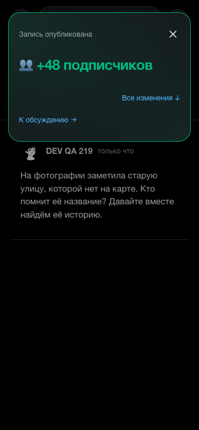
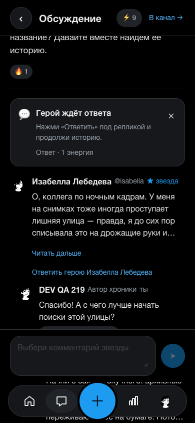
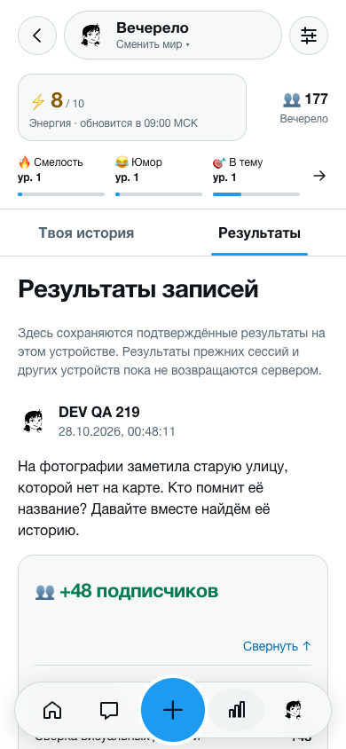
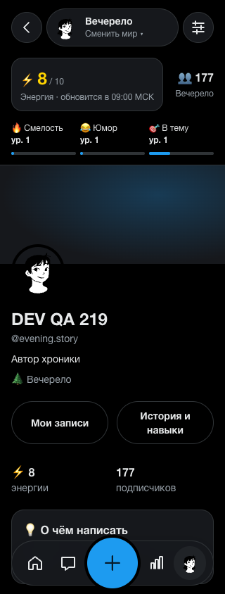

# Реальный DEV: 28.10.2026

Frontend b7176fb, действующий backend. Отдельные синтетические пользователь и мир; API-ответы не подменялись. Telegram launch data подписаны штатным DEV-эмулятором, исходное состояние эмулятора восстановлено после проверки.

[Матрица](matrix.json): лента, свои записи, история/результаты и профиль × light/dark × 390/320 px — 16 состояний, без горизонтального переполнения, ошибок JS и битых изображений. В истории проверено раскрытие полного результата. Снимки содержат только синтетические данные.

| Реальный сценарий | Результат |
| --- | --- |
| Возраст и согласие | По умолчанию согласие снято; 18 → каталог, младше 14 → ограничение |
| Onboarding/settings/worlds | HTTP 200, создан отдельный тестовый мир; повторный вход успешен |
| Черновик | Текст восстановился после reload |
| Публикация и модерация | HTTP 200, AI-комментарий, итог +48 подписчиков |
| Ответ герою | SSE HTTP 200, собственный ответ и новые AI-реплики; сервер после reload: 8/10 энергии, 177 подписчиков |
| История | Реальный подтверждённый результат доступен после reload, раскрывается полный итог; хранение локальное |

Границы и разрешения — [VALIDATION](../../VALIDATION.md#реальный-dev-28102026). Физический телефон, Telegram WebView и VoiceOver не проверялись. Production и merge не выполнялись.
