# Компактный переключатель миров и справка энергии

28.10.2026, frontend **6d91d39** на личном DEV. Дополнение #205/#219; полный visual parity не заявлен.

Источник: исполняемая цепочка app.html → tokens.css → app-base.css → app.css → components.css; catalog.js → app.js, функции worldPicker/energyPolicyInfo. [Хэши источника](../2026-10-28-own-unlock/source-manifest.json). В эталоне подготовлен один начатый мир с177 подписчиками как fixture сравнения; это не серверные данные прототипа.

DEV в основных парах использует настоящий API и отдельного синтетического QA-пользователя. Ответы не подменялись; существующий мир177, остаток8. Проверялись чтение/переходы, новых публикаций или миров не создавалось. [Результаты и измерения](real-results.json), [навигация и черновик](navigation.json).

| Sheet / ширина / тема | Эталон | DEV |
| --- | --- | --- |
| Миры /320/light |  | 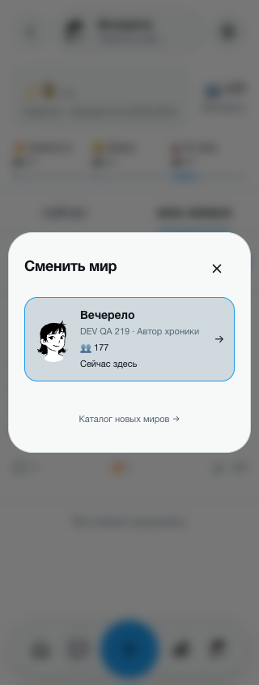 |
| Миры /390/light | 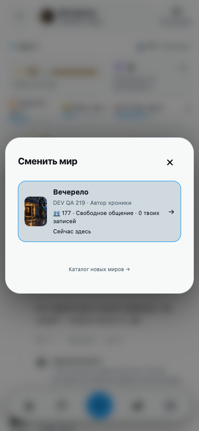 | 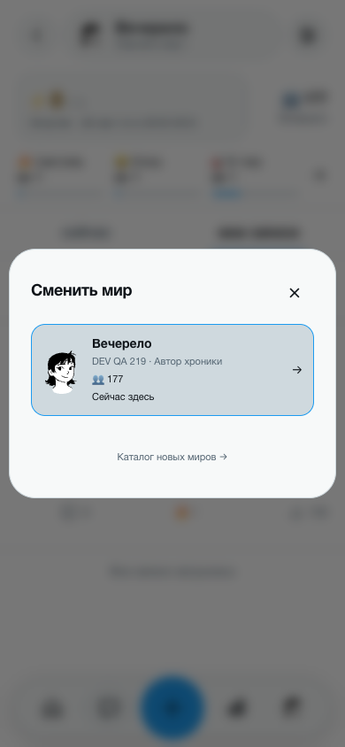 |
| Миры /320/dark | 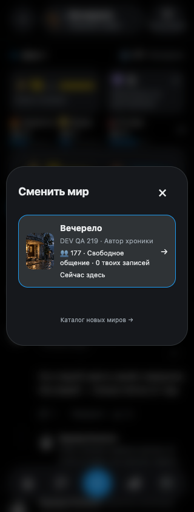 | 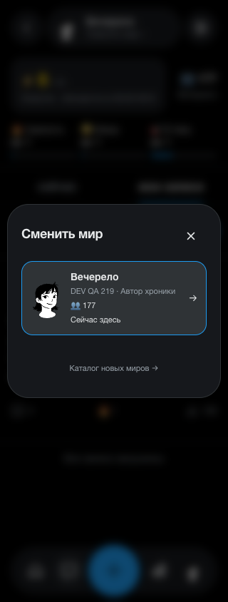 |
| Миры /390/dark | 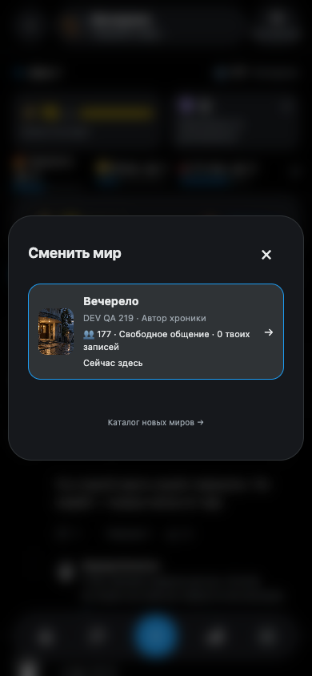 | 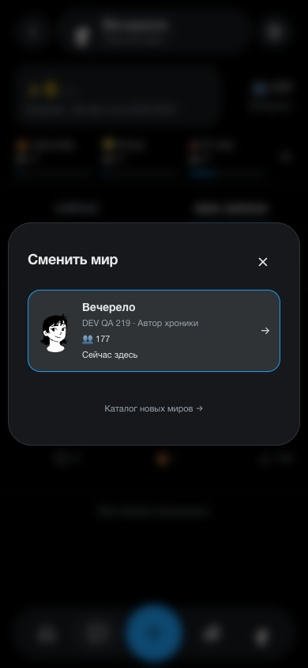 |
| Энергия /320/light | 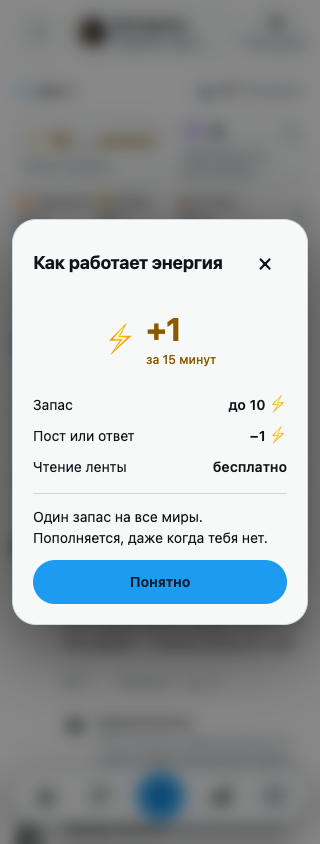 | 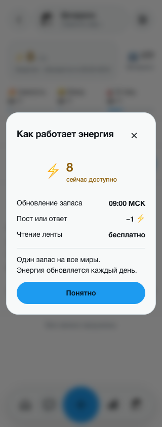 |
| Энергия /390/light | 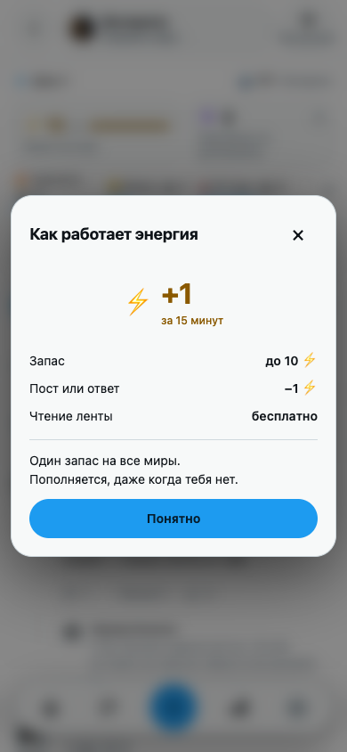 | 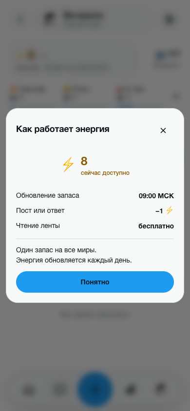 |
| Энергия /320/dark | 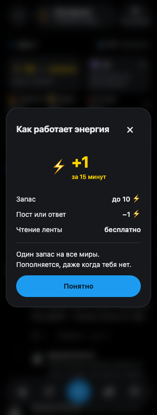 | 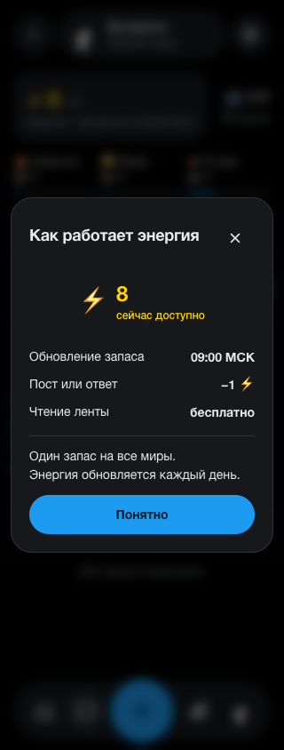 |
| Энергия /390/dark | 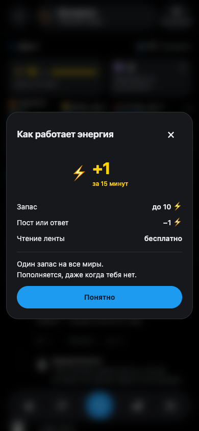 | 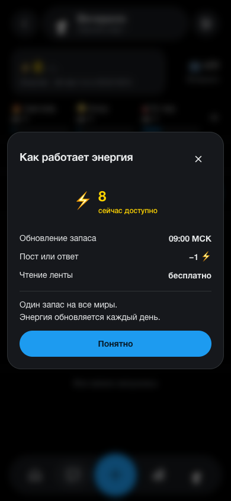 |

Совпадают ширина/padding/radius/title/theme: picker viewport−20/19или24/30/18; энергия viewport−24/20/24/18. Переполнения и page errors нет. Проверены «Понятно», текущий мир без перехода, каталог, Tab/Shift+Tab, Escape с возвратом фокуса и backdrop; черновик восстановлен после перехода к HUD и назад.

Отличия сохранены явно: API не даёт сюжетный статус мира; вместо неподтверждённой обложки — аватар. Поэтому picker ниже эталона на24px. Энергия показывает настоящий остаток и дневное обновление09:00МСК, стоимость поста/ответа1 и бесплатное чтение; обещание «+1 за15минут» не перенесено. Высота энергии400 против405.4px; тексты и центральное число адаптированы под действующую механику. Полноэкранный экран лимита не переработан. Закрытие использует общий доступный Sheet, не native dialog прототипа.

Смена на другой реальный мир не проверена: у QA-пользователя один экземпляр. Много миров, ошибки и нулевой остаток проверяются отдельно на UI fixtures; они не доказывают серверную интеграцию этих ветвей. Telegram WebView/телефон/VoiceOver этим проходом не проверены.

## Отдельные UI fixtures

[Семь ветвей](ui-results.json): loading, ошибка→повтор, пустой список,3из4→все4, ошибка смены без смены текущего мира, успешная смена, нулевая энергия. Серверные мутации заблокированы, ответы wire-контрактов управляемые; это проверка UI, не backend integration. Все прошли на320px без горизонтального overflow. Снимки `ui-*-320.png` сохранены отдельно от основных пар. В DEV StrictMode эффект загрузки выполняется повторно; fixtures учитывают оба запроса.
