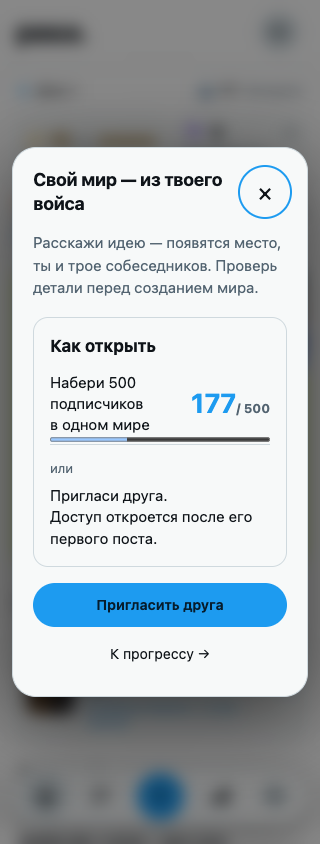
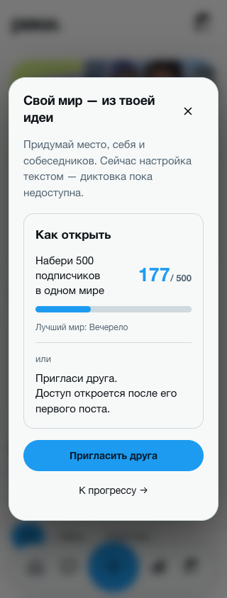
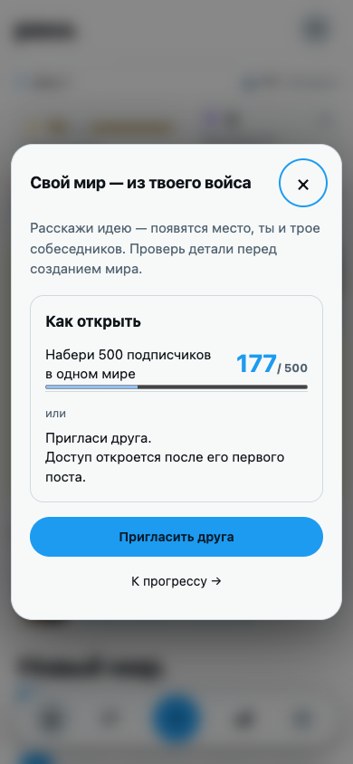
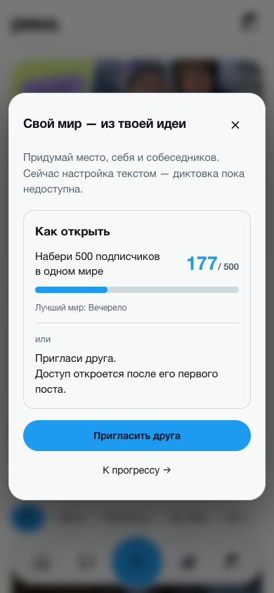
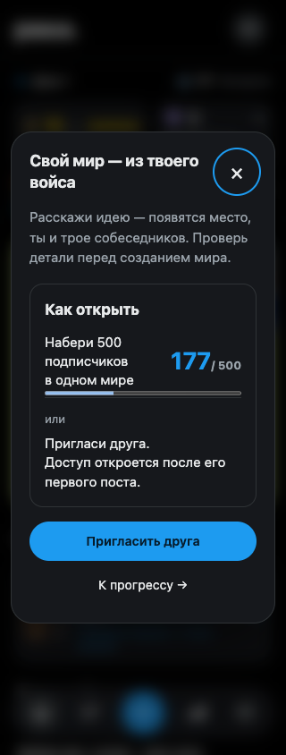
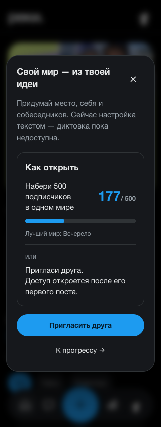
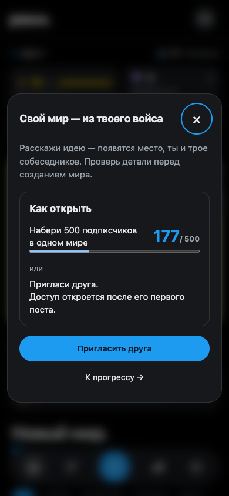
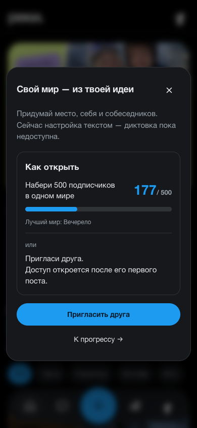

# Own-world sheet: актуальный эталон ↔ реальный DEV

28.10.2026. Основные пары: frontend **e5ac87a**; дополнительная публичная401-ветвь: **9133b2b**. Это адресная проверка модалки, не подтверждение переноса всех экранов.

Цепочка эталона: app.html → tokens.css → app-base.css → app.css → components.css; catalog.js → app.js, функция ownWorldInfo(). [SHA-256 исходников](source-manifest.json). Исторический README и маркетинговый reference.json не подменяют исполняемый экран.

В DEV использованы реальный backend и отдельный синтетический QA-пользователь/мир: **177 подписчиков**. API-ответы в этих четырёх парах не перехватывались. В эталоне установлен тот же177 **как fixture для сравнения**. Ни серверные права, ни чужие данные для кадра не менялись. Состояние Telegram DEV-эмулятора восстановлено после проверки.

| Размер / тема | Эталон | DEV |
| --- | --- | --- |
| 320 / light |  |  |
| 390 / light |  |  |
| 320 / dark |  |  |
| 390 / dark |  |  |

[Измерения](measurements.json): во всех парах width viewport−24, padding20, radius24, title18, lead15, фон темы совпали. Overflow и page errors отсутствуют. Дизайн адаптирован: название/подпись честно ведут в текстовый путь, указан реальный мир-источник счётчика. Поэтому окно выше эталона (625.5 против549.5 при320, 579.3 против525.8 при390); native progress эталона и стилизованная шкала также не pixel-identical. Встроенный autofocus native dialog может давать ring на кнопке эталона; в приложении фокус ставится на контейнер, Tab замыкается внутри.

Переходы на настоящем DEV: закрытие, Tab/Shift+Tab focus trap, приглашение и прогресс. Создание своего мира для заблокированного QA-пользователя не выполнялось.

## Отдельные UI fixtures

[Результаты](ui-states.json) — браузерные wire fixtures, серверные мутации заблокированы. Это не интеграционное доказательство права/разблокировки.

| Состояние | Что проверено | Кадр |
| --- | --- | --- |
| Гость | Нет фиктивного0/шкалы, «Выбрать первый мир» закрывает окно | [320](ui-guest-320.png) |
| Ошибка профиля | App error/retry, счётчик не появляется | summary JSON |
| Ошибка списка после успешного входа | Только текущий мир177 с оговоркой | [320](ui-worlds-error-320.png) |
| Лучший другой мир420 | Его имя/счётчик; «К прогрессу» выбирает именно этот мир | [320](ui-best-other-320.png) |
| 620 без server flag | Доступ остаётся locked; шкала ограничена500, число не выдумано | [320](ui-count-without-right-320.png) |
| Server flag при177 | «Можно создавать», CTA ведёт в ручную настройку без POST создания | [320](ui-unlocked-320.png) |

## Общие роли и тема

[System check](system-check.json): SkillHelp320/390 ×2темы — title18, body14/21, close/CTA44, без overflow и ошибок JS. [Светлая320](skill-dev-light-320.png), [тёмная390](skill-dev-dark-390.png). Системная тема отслеживает OS light/dark и сохраняется после reload; закрытие settings и Escape не меняли серверные настройки.

TypeScript/build и secret/diff checks проходят; текущий build предупреждает об основном чанке около511kB. Физический телефон, Telegram WebView и VoiceOver не проверены. [Полный инвентарь и остаток](../../INVENTORY.md).

## Реальный неавторизованный просмотр

[Проверка401](anonymous-real.json), [кадр320](anonymous-real-320.png): Authorization удалён только из исходящих API-запросов; ответы сервера не подменялись. Настоящий backend вернул `/me`401, публичный каталог templates200. Нет счётчика/шкалы/права создания; CTA возвращает к выбору первого мира, защищённый прогресс предлагает каталог. Это отличается от управляемого404 нового пользователя выше. JS-ошибок нет.
