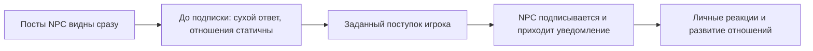
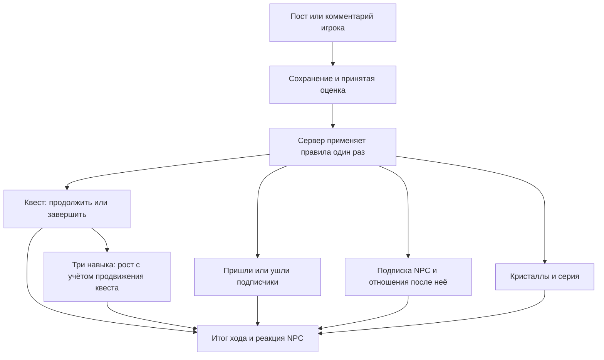

# Спецификация сюжетного автомата

Утверждённый редакторский пакет 08.11.2026 по #205. Числовые настройки и готовность приложения проверяются отдельно.

Утверждено 08.11.2026: 20 квестов, пять локальных развязок и условия фонда/инвестора. Главная цель своего героя — «Добиться решения о будущем Хогвартса, за которое ты готов отвечать сам». Сюжетные кристаллы выдаются за этапы 1, 3 и 4 каждой роли; суммы и повторное прохождение ещё не определены.

Задание на проработку сюжетных автоматов для «Рек». Я готовлю сценарии и проверки, Владелец продукта принимает продуктовые решения, Backend-разработчик делает backend, Frontend-разработчик — интерфейс. Ниже — общие правила автомата и отдельно требования к первому миру.

Первый образец — «Спасти Хогвартс», пять ролей. Достаточен короткий законченный эпизод за каждую: игрок понимает цель, характер героя и основной конфликт. Длинные кампании, конструктор миров, личка и отдельный журнал действий не входят в эту работу.

Результат — правила мира, ролевые линии, таблицы квестов и переходов, подписки NPC, отношения и финалы. Для обязательного действия указаны исходные сведения, проверяемые условия и доступное продолжение.

## Основания

Источники: [решения 05.11](https://github.com/Stepami/golden-mouth/blob/issue-205-v7-release/docs/redesign/CALL-2026-11-05.md), [game-flow](https://github.com/Stepami/golden-mouth/blob/3479ff141c733d813a30ea26a2a8bfd0f21614b9/docs/game-flow.md), [баланс](https://github.com/Stepami/golden-mouth/blob/3479ff141c733d813a30ea26a2a8bfd0f21614b9/docs/config/balance.json), [материалы первых автоматов до переработки](HOGWARTS.md) и комментарии владельца продукта 07.11 к этой странице.

## Проверка по расшифровке 05.11

Прочитаны протокол и исходная расшифровка встречи «Встреча по проекту Реки: дизайн, механики и план запуска». В начале показывали прежний вариант с XP, тремя квестами в день и картой; позднее от него отказались. Раннее описание не переносим как итоговое решение.

| Таймкод | Что подтверждено |
|---|---|
| 00:48:43 | Энергия: максимум 10, ход стоит 1, +1 за 10 минут. |
| 00:54:28–00:58:11 | Оценку и расчёты отделяют от LLM-генерации текста; выбор комментатора тоже не поручают генератору реплики. |
| 01:00:03–01:01:55 | Шкала навыка растёт автоматически от постов, порог повышает уровень, новый уровень даёт кристалл. |
| 01:04:39 | Квест может занять разное число ходов и календарных дней; карта не нужна. |
| 01:05:17–01:08:36 | Серия связана с нормой действий, этапы сюжета и серии дают кристаллы. Точные нормы обсуждались на примерах. |
| 01:10:31–01:12:19 | Показываем один текущий квест и назначаем следующий после выполнения. |
| 01:16:09 | Три навыка на персонажа рассчитываются автоматически, в том числе при незавершённом квесте. |

Связь размеров аудитории с наградами осталась открытой; это указано и в протоколе, 00:40:25. Формула сложности по уровню навыка не утверждена. Московские сутки и новые ролевые мотивы — твои более поздние решения 07.11.

При противоречии старого материала новым прямым решениям фиксируем расхождение и приводим источник правды в соответствие после утверждения. Ни экран, ни старый файл с XP, ни описание PR не заменяют продуктового решения.

[Оставшиеся вопросы](HOGWARTS-DECISIONS.md) — отдельно. Уже принятые правила там повторно не согласовываем.

# Согласованные игровые правила

| Правило | Требование |
|---|---|
| Одна цель на персонажа | Задана авторами на всё прохождение и не пересматривается. Игрок выбирает способ действия, а не новую главную цель. |
| Один текущий квест | Назначается системой. Условия накапливаются за несколько действий; достаточного одного хода тоже хватает. |
| Только посты и комментарии | Квесты про общественную позицию, спор, поддержку, репутацию и договорённости. Нет прогулок, осмотра комнат и личных чатов. |
| Три навыка на персонажа | Растут автоматически с учётом продвижения квеста: заметно при успехе или новом подтверждённом прогрессе; без нового прогресса — ноль. Нет ручного распределения, XP в интерфейсе и карты. |
| Общая энергия | Максимум 10, действие игрока стоит 1, восстановление +1 за 10 минут. |
| Единственная награда — кристаллы | За новые уровни навыков, сюжетные этапы и серии. Навыки, отношения и подписчики — отдельные результаты действий, не новые виды призов. |
| Серия | Ежедневные посты и комментарии; сутки 00:00–24:00 Europe/Moscow. |
| NPC видны сразу | Игрок видит их публикации без собственной подписки. До подписки NPC ответы сухие, личная динамика не развивается. |
| NPC подписывается на игрока | После заданного события. После подписки могут развиваться отношения и личное участие в ленте. |
| Уведомления | Новая подписка конкретного NPC — уведомление. Массовый прирост/отток — результат хода и счётчик аудитории. |
| Взрослая игра | 18+, без сексуальных тем и чрезмерно жестокого контента. Подробная граница прочего недопустимого — в оставшихся вопросах. |
| Результат считает сервер | Фиксированные критерии исхода и перехода; без произвольной смены условий моделью или клиентских начислений. |

## Наследуемые правила и места сверки

| Старая часть | Как использовать |
|---|---|
| Отношения −5…+5, лимит +1 за день | Сверить расчёт с кодом; применять личную динамику после подписки NPC. Новые числа пока не приняты. |
| Карточка звезды при +3 | Историческая функция, объяснена ниже. Её необходимость в новом цикле не подтверждена. |
| NPC каждые семь сюжетных дней | Не переносить. Публикации видны сразу; моменты подписки задаются событиями. |
| Кошелёк #233 и текущий постинг | Свести автомат с итоговым контрактом; не добавлять независимую экономику или ещё один способ отправки. |
| Старое 14+ и списки фильтров | Режим модерации 14+ должен быть полностью удалён из продукта, а не сохранён как вариант. У взрослого продукта 18+ остаются только отдельно согласованные ограничения контента; старые фильтры не наследуются. Это обязательная проверка выпуска. |
| Внутренние XP-пороги | Не выдавать за принятую формулу новой автоматической прокачки. Нужна сверка источника 05.11 и backend. |

# Мир и пять ролевых линий

## Паспорт мира

Для каждого мира подготовить: завязку, исходные факты, центральный конфликт, правила допустимых событий, действующих лиц и их полномочия. Магия, совет попечителей и галлеоны относятся только к Хогвартсу; в общей модели их нет.

Для каждого сведения указать источник и круг знающих. Различать произошедшее событие, заявление, слух и обещание. Скрытый мотив раскрывается через доступный пост или комментарий.

В «Спасти Хогвартс» события фильмов — прошлое героев. Сейчас они взрослые; специально подчёркивать возраст в репликах не нужно. Школа обанкротилась, за её будущее спорят сторонники школы и бизнеса. Решает совет попечителей. Люциус, как и совет, действует за сценой: о его предложениях говорят доступные NPC. У него нет отдельного канала, прямого ответа игроку или подписки.

## Пакет каждой роли

| Роль | Мотив и направление | Что нужно показать в коротком эпизоде |
|---|---|---|
| Гарри | Снова открыть Хогвартс и повторить свой прежний триумф над Волан-де-Мортом — снова стать спасителем, теперь в расцвете сил. | Желание помочь переплетается с потребностью вернуться в роль героя. Поддержка славного имени не равна убедительности плана. Его отдельный конфликт — заслуга спасителя и самостоятельный вклад других; доступность для бедных прежде всего определяет линию Рона. Если Гарри принимает условие бесплатности, это учитывается как его обещание, а не как автоматическое определение личной цели. |
| Гермиона | Добиться устойчивой школы, которая устроена этично и учитывает разные культуры. | Конфликт ценностей: полезное большинству решение может навредить части людей. Не сводить этику к единственной правильной реплике; не использовать ЛГБТ-тематику. |
| Рон | Отстоять интересы бедных и доступность школы. | Показать цену благих лозунгов и дилемму, в которой помощь одним не даёт простого решения для всех. |
| Драко | Закрыть школу и реализовать коммерческий проект; доказать себе, что расчётливость и предпринимательство — его сильная сторона. | Троица заранее видит в нём антигероя и настраивает окружающих. Он выдерживает коллективное давление, оставаясь неудобным, но честным перед собой. |
| Свой герой | Заданная линия наивного участника: сначала соглашается с обеими сторонами, затем распознаёт их скрытые стороны и в решающий момент выручает Драко. | Путь к собственной позиции и близким ему ценностям. Это авторская дуга; цель не меняется на ходу. Мастерская больше не является его целью. |

Для каждой роли нужны одна постоянная главная цель, личная ставка, начальная позиция, три навыка, связи с NPC и короткая драматическая дуга. Цель своего героя утверждена 08.11: «Добиться решения о будущем Хогвартса, за которое ты готов отвечать сам».

## Границы первой версии

Каждому персонажу нужен небольшой законченный сюжет: вход в конфликт, выбор с последствиями, столкновение интересов и локальная развязка. За этот эпизод игрок должен понять цель и характер игры. Точное число квестов определяется содержанием.

Большая цель может остаться впереди, но первый эпизод не обрывается на «продолжение следует» без собственного результата. Дальнейшие главы сейчас не пишем.

# Состояния и переходы

## Состояние прохождения

Сохраняются мир и версия сценария, роль и постоянная цель, текущий квест и его подтверждённые условия, видимые события и источники, ответы и обещания, подписки и отношения, незавершённые обязательства и уже выданные кристаллы. Каждое изменение связано с действием и применяется один раз. Клиент не ведёт вторую копию игровой экономики.

## Карточка каждого квеста

Узел — точка автомата: текущая ситуация, доступные действия и правила перехода дальше. Обычно это квест или событие. Для каждого узла заполнить:

1. Авторский идентификатор, версия, роль и связь с главной целью.

2. Условие назначения и исходное состояние.

3. Текст для игрока, видимые материалы и доступные собеседники.

4. Допустимые способы: собственный пост, комментарий, ответ в существующем треде; точный объект и адресат.

5. Проверяемые признаки результата и точные условия исходов: квест продолжается, завершён либо требует исправления.

6. Ответы мира: уточнение, частичное согласие, отказ, критика, ответ без решения.

7. Что именно меняется в сюжете, знаниях, отношениях, подписках и ресурсах; где изменений нет.

8. Однозначное правило выбора исхода и следующего узла; при совпадении условий — заранее заданный приоритет.

9. Приоритет следующего узла, когда подходят несколько веток.

10. Альтернативный путь при отказе, отсутствии участника или неожиданном решении.

11. Краткое объяснение результата игроку.

12. Положительные, отрицательные и пограничные примеры своими словами.

Таблица: **состояние → действие → проверенные признаки → исход → изменения → следующий шаг**. Для одинаковых сохранённых входных данных и версии правил исход один.

## Правила разветвления

Разделить оценку и генерацию текста. По решению 05.11 отдельные модели оценки дают измеримые признаки, сервер считает изменения навыков и аудитории и определяет комментатора, LLM генерирует текст его реплики (00:54:28–00:58:11). Для сюжетного зачёта нужен отдельный явный контракт признаков и критериев: генератор реплики не выбирает исход по своему усмотрению. Сервер применяет таблицу переходов; принятые входы и результат сохраняются, повтор не запускает новый выбор.

Принято 08.11: уже подтверждённые действия учитываются при назначении следующего квеста без повторного поста. Система проверяет переходы последовательно по известным фактам; новое предложение или ответ NPC сначала должны появиться в ленте. Один сохранённый ход не списывает энергию повторно. Повторного роста за тот же признак и повторной награды этапа нет.

## События мира и материалы

Для обязательного события указать: источник, условие появления, содержание, доступный ответ игрока и последствия. Предложение закадрового инвестора игрок видит в публикации NPC. Решение должно исходить от того, у кого есть соответствующее право; для разных миров это разные участники.

Участники за сценой влияют через сведения, переданные NPC, и последствия решений. Это отличие по роли в сюжете, а не деление персонажей на детей и взрослых. Магия и иные особенности сеттинга проверяются только по правилам конкретного мира.

# Подписки NPC и отношения

## Четыре разных события

До подписки сведения и общий конфликт могут продвигаться, но личные отношения с этим NPC не растут. Поэтому событие подписки нельзя замыкать на высокий уровень отношений с ещё не подписанным героем.

Игрок на NPC не подписывается: их публикации доступны изначально. Подписываются они на него, в разные моменты. Оппонент тоже может подписаться; это интерес, а не поддержка проекта.

## Матрица для каждой роли

Для каждой пары «роль игрока — доступный NPC» подготовить:

| Поле | Содержание |
|---|---|
| Старт | Что герои знают друг о друге; какие посты видны сразу. |
| До подписки | Примеры сухих ответов; нет прироста личных отношений и совместной линии. |
| Триггер подписки | Точное событие, критерий и мотив NPC. Не число прошедших сюжетных дней. |
| Другой путь | Возможна ли подписка после альтернативного действия; как проходит эпизод без неё. |
| Подтверждение | Сохранённое событие, одно уведомление и видимое изменение статуса. |
| После подписки | Какие действия развивают отношения, на что NPC реагирует и что помнит. |
| Конфликт | Ответ на спор, отказ и нарушенное обещание. Не считать несогласие автоматической враждой. |
| Отписка и возврат | Принято 08.11: в первом коротком эпизоде NPC не отписываются. Конфликты сохраняются в ответах, отношениях и отказе сотрудничать. |

Для своего героя доступны готовые герои мира; для готового героя — остальные, без его AI-дубликата. Люциус и совет не входят в контактную матрицу и не подписываются. Число вариантов выбора не равно числу NPC.

## Динамика отношений

После подписки описать для каждой пары: что вызывает уважение, раздражение, готовность сотрудничать и отказ. Это поведение, а не новые шкалы. Используем один согласованный показатель отношений.

Для содержательного ответа, критики, помощи и нарушения обещания указать: реакцию, изменение отношений и последствия. До подписки такое действие может раскрыть тему, но не создаёт личного прогресса.

Числа и дневные пределы сверить с кодом. Не начислять сюжетные «+2 доверия» поверх серверного лимита. После его исчерпания факты разговора сохраняются, но числовой прирост не обходится.

Драко не обязан получить одобрение Гарри. Троица может оставаться предвзятой, а он — продвигать свой проект. Подписка, уважение и согласие с конкретным предложением не подменяют друг друга.

«Карточка звезды» — старый экран с характером и личной линией при +3 отношений. Ты не поручал возвращать его; необходимость в новом цикле не подтверждена. Для текущей проработки новые сведения и личные реакции описываем через ленту и комментарии.

**К чему привязаны посты NPC.** К текущему состоянию мира, интересам и голосу героя, известным ему событиям и собственным прошлым публикациям. После подписки — также к истории его контактов с игроком: обещаниям, отказам, спорам и отношениям. До подписки NPC видит текущую публичную тему, но личная связь не развивается. Чужие закрытые сведения не становятся общим знанием.

**Что уже есть в проверенном master.** Фоновая генерация получает профиль мира и героев, до 20 собственных публикаций NPC и 10 последних постов общей ленты. При реакции на пост игрока добавляются сам пост и до 8 комментариев. Это ограниченный контекст истории, не долговременная память отдельного NPC: в WorldStar нет поля памяти, а память лички отключена. Явные подтверждённые факты автомата ещё нужно свести с этой генерацией. Правила исправления и удаления приняты 08.11: состоявшиеся события сохраняются, публичное исправление меняет действующее обещание, удаление поста само по себе не откатывает сюжет. Хранение и удаление данных нужно свести с backend отдельно; выход старого поста из контекстного окна не должен стирать важное сюжетное событие.

# Лента и действия вне квеста

## Жизнь мира

Подготовить стартовые и последующие посты NPC: повод, известные автору факты, содержание и доступные ответы игрока. Отдельно отметить обязательные события и необязательный фон.

Фон учитывает состоявшиеся решения и реальные ответы NPC. Для Хогвартса он не сообщает о продаже раньше принятого решения. В других мирах применяется тот же принцип без совета, замка и магии.

Принято 08.11: во время отсутствия игрока допустимы фоновые посты NPC, но ключевые сюжетные решения ждут его действий. Пауза сама по себе не отдаёт замок, не завершает прохождение и не вызывает необратимый проигрыш. Для каждого обязательного события указывается подготовленный источник запуска.

## Свободное действие

Для свободного поста, комментария к старой сцене, критики и неожиданной идеи отдельно проверить сюжет, три навыка, аудиторию и отношения после подписки.

Сюжет проверяет смысл действия в контексте текущего квеста; ручного выбора задания в редакторе не добавляем. Ранние действия учитываются по отдельно согласованному правилу.

Сохранённый пост может быть успешным по аудитории и не выполнить сюжетные условия. Пост с низкими охватами может содержать нужное предложение. Эти результаты не подменяют друг друга.

Цель закреплена на всё прохождение. Несогласное с ней действие не меняет её и не получает ложного сюжетного зачёта; свободные публикации остаются доступны.

## Способ действия и границы интерфейса

В игре только лента и комментарии. Предложение закадрового участника публикует или пересказывает доступный NPC. Просмотр и ответ NPC не расходуют ход игрока.

Квесты — социальные действия: высказать позицию, ответить на критику, сопоставить обещания, собрать поддержку, публично договориться. Не выдавать задания «сходи», «осмотри» и «перечисли деньги». События вне ленты могут быть сообщены NPC, но не становятся действиями игрока в бродилке.

Когда NPC подписался, приходит одно уведомление с переходом к событию. Изменения массовой аудитории показаны в итоге хода и счётчике подписчиков, без уведомления на каждого фаната. Вид и место счётчика сверить с frontend-разработчиком.

## Как отвечает массовая аудитория

**Решение владельца продукта.** Фанаты — массовые подписчики, не сюжетные NPC. Их комментарии примерно отражают тон ответивших NPC, но не повторяют реплики дословно. Если NPC несколько, делим реакции примерно поровну между их ответами и перемешиваем порядок.

Пример: один NPC поддержал, другой усомнился. Из восьми фанатских реплик примерно четыре поддерживают и четыре сомневаются; они идут вперемешку, а не двумя блоками. При нечётном количестве остаток может достаться любой группе. Если два NPC придерживаются похожей позиции, близких по тону реплик в сумме может быть больше: ориентир — доли ответивших NPC, не обязательные 50/50 между всеми возможными эмоциями.

Тон не подменяет предмет разговора: поддержка, сомнение, ирония или раздражение связаны с содержанием поста и известными событиями мира. Сухой ответ NPC до подписки не превращается в восторженную волну личной поддержки фанатов.

**Короткая ветка.** Игрок может ответить фанату; тот может уточнить или коротко отреагировать на ответ. Для этой реакции нужен только контекст поста и текущей ветки. У фаната нет отдельного профиля, перехода по имени или аватару, шкалы отношений и длительной персональной истории. Его короткую переписку не используем как замену отношениям с NPC.

Предел длины ещё нужно выбрать. **Предлагаю:** один-два ответных комментария фаната на реплики игрока, затем естественное окончание без нового вопроса. Это ограничение беседы, не глубины всех тредов с NPC. Ответ игрока стоит обычную 1 энергию; ответ фаната не создаёт дополнительного расхода.

Количество реплик, их распределение и порядок выбираются и сохраняются для конкретного действия. Обновление страницы не перетасовывает уже опубликованное и не даёт повторный результат. Случайность оформления не меняет критерии квеста, навыки или выдачу кристаллов.

Одобрение фанатов не означает согласия конкретного NPC, решения совета или успешного квеста. Прирост и отток аудитории рассчитываются отдельно; комментарии показывают реакцию, а не сами назначают цифры.

**Что свести с реализацией:** отдельное отображение автора-фаната без профиля и различение фанатских реплик и NPC в данных. Нельзя ради этого записывать фаната как одного из сюжетных героев. Число показываемых фанатов и предел ветки согласовать с frontend-разработчиком и backend-разработчиком; весь миллион подписчиков не превращается в миллион сгенерированных реплик.

**Дополнительные предложения, пока для ревью:**

- В одном тоне давать разные реакции: короткое согласие, конкретный аргумент, шутку, вопрос. Не делать пять пересказов одной реплики NPC.

- Иногда давать фанату точный уточняющий вопрос: он показывает, где позиция игрока непонятна, без выдачи нового обязательного квеста.

- Показывать ограниченную выборку комментариев. Масштаб популярности передавать также счётчиком и реакциями, а не бесконечной длиной треда.

# Навыки ресурсы и награды

## Результат действия

Результат и его отображение:

Рост навыков зависит от подтверждённого продвижения квеста. Охваты и массовые подписчики остаются отдельным результатом публикации: залёт сам по себе не даёт сюжетный успех или ускоренную прокачку. Текст NPC не начисляет награду.

## Навыки и сложность

У выбранного персонажа три автоматически растущих навыка. Принято 08.11: действия с новым подтверждённым прогрессом дают рост проявленных навыков; без нового прогресса рост равен нулю. Сам факт незавершённого квеста не означает провал: если новым действием подтверждена часть условий, навыки могут нормально расти уже на этом ходе. Принято 08.11: у каждой из пяти ролей Хогвартса своя тройка навыков. Названия, признаки, примеры и привязка к квестам собраны в разделе «Три навыка каждой роли» [основного документа](HOGWARTS.md). Общая тройка из раннего черновика отменена; расчёт роста и пороги отдельно не утверждены.

По созвону 05.11 сохраняются автоматическое заполнение шкал, повышение уровня на пороге и кристалл за новый уровень. Нынешнее уточнение меняет темп: больше недостаточно просто написать текст — рост зависит от результата относительно квеста. Для каждого навыка описать признаки проявления в действии и для каждого исхода квеста — правило начисления. Принято 08.11: при отсутствии нового прогресса рост равен нулю. Размеры положительных прибавок и пороги уровней ещё не заданы.

| Результат действия относительно квеста | Рост навыков |
|---|---|
| Условия выполнены, квест завершён | Заметный рост проявленных навыков по фиксированным правилам. Не обязательная прибавка всем трём. |
| Квест остаётся, но подтверждена новая часть условий | Рост за реальное продвижение уже сейчас, без ожидания финального закрытия. |
| Нового прогресса нет или действие противоречит условиям | Рост равен нулю. |
| Повтор уже зачтённого действия или той же подтверждённой части | Не выдавать обычную прибавку повторно. |
| Техническая ошибка, оценка ещё неизвестна | Не объявлять провалом. Восстановить тот же результат, не начисляя повторно. |

В каждом узле нужно различать «квест пока открыт» и «действие не продвинуло квест». Продвижение проверяется по новым сохранённым признакам, а не по скорости печати, числу сообщений или возврату по таймеру. Не создавать замок: «для квеста нужен уровень, который нельзя повысить без его завершения». Темп навыков в свободной игре и после конца эпизода определить отдельно.

В утверждённом эпизоде сложность растёт от понятного спора к нескольким несовпадающим интересам и последствиям обещаний. На созвоне предлагали связывать направления навыков с будущими ситуациями и «температурой» (00:33:58–00:34:57, 00:43:07), но согласованной формулы не появилось; в 00:54:28 обсуждение переключилось на разделение оценки и генерации. Не считать изменение параметра LLM или коэффициента сложности следствием роста навыка без отдельного решения.

**Расчёт масштаба массовой аудитории.** Новый ориентир: активный игрок может вырасти со 120 до 10 000 за два дня. Для калибровки предлагается ускорить существующий расчёт публикаций в 4,5 раза, сохранив степень аудитории N^0,6 и возможность оттока.

Проверочный режим — 10 собственных постов и 5 комментариев в день, всего 30 действий за два дня. Два захода в день: 10 действий, затем ещё 5 после восстановления энергии; для пяти единиц нужно 50 минут. Покупки энергии не нужны.

В изолированной модели: качество постов 0,65 из 1; вероятность неудачного исхода 15%; сложность normal с коэффициентом 1,1. Сохранены множитель собственного текста 1,3, ускорение ×2 до 1 000, затухание по дневному индексу расхода энергии 1/0,7/0,25 и бонус +9 за каждый из пяти комментариев под разными подходящими постами. Порядок — два поста и комментарий, пять раз за день. Нет залётов, приглашений, покупок, фоновых событий и роста качества от навыков.

| Аудитория перед постом | Положительный исход | Отрицательный исход |
|---|---:|---:|
| 120 | +262 | −30 |
| 1 000 | +467 | −108 |
| 10 000 | +1 859 | −429 |
| 100 000 | +7 400 | −1 708 |
| 1 000 000 | +29 461 | −6 799 |

Это один пост в начале дневного расхода энергии при качестве 0,65 и ускорении ×4,5. Положительный исход включает собственный текст и стартовый множитель; отрицательный — коэффициент −0,3, без положительных бонусов. Последующие действия уменьшаются действующим затуханием.

**Проверка двух дней: 10 000 прогонов, одинаковые начальные условия и номера генератора 0–9999 для сравнения.**

| Режим | После дня 1, медиана | После дня 2, медиана |
|---|---:|---:|
| Без ускорения, активный | 763 | 1 629 |
| ×4,5, активный, качество 0,65 | 3 952 | 12 388 |
| ×4,5, тот же объём, качество 0,45 | 2 907 | 8 622 |
| ×4,5, качество 0,25 и 30% неудач | 1 702 | 4 020 |
| ×4,5, 3 поста и 1 комментарий в день | 1 795 | 3 044 |

Активный сценарий достиг 10 000 в 77,81% прогонов; диапазон от 10-го до 90-го процентиля — 8 387–15 810. Это результат модели, не измеренная вероятность для реальных игроков. Цель достижима обычными действиями без обязательного залёта, но не гарантируется любым текстом.

×4,5 — предлагаемый общий ускоряющий множитель, а не дополнительный набор новых бонусов. В модели учитываются старые положительные множители и затухание; не нужно применять их повторно поверх приведённых чисел. Подписки NPC остаются событийными и к массовому расчёту не относятся. Перед внедрением свести расчёт с фактическим backend, проверить больший срок игры и утвердить числовую настройку. Игровой конфиг этим расчётом ещё не изменён.

## Энергия и сохранение результата

Сюжет подключается к принятому протоколу сохранения и оценки. Отклонённый до сохранения пост не считается ходом, не продвигает сюжет, навыки и серию и не расходует энергию. Если допустимое действие уже сохранено, технический сбой ответа AI обрабатывается отдельно и не объявляется сюжетным отказом.

Целевой контент по комментариям владельца продукта: взрослая игра без сексуальных тем, чрезмерной жестокости и ЛГБТ-тематики. Не наследовать весь старый список запретов как согласованное требование. Точный оставшийся список и отличие от действующих фильтров сверить отдельно; код модерации в этой работе не меняется.

При обрыве сохраняется известный статус действия. Повтор использует прежний результат и не даёт заново расход, кристаллы, подписку или отношения. Неясный статус — ожидание или техническая ошибка, а не придуманная реакция мира.

## Кристаллы и серии

Награда только одна — кристаллы. Источники, прозвучавшие в итоговой части созвона: новый уровень навыка (01:00:03–01:01:55), заданные этапы сюжета и выполнение серии действий (01:08:36). Автоматическое повышение навыка должно давать отдельное подтверждённое начисление. Для каждого события задать условие, величину и запрет повторной выдачи; генерация комментария сама кристаллы не начисляет. Пример «новый уровень — кристалл» зафиксирован, но общей числовой таблицы для всех событий нет.

Сутки серии — 00:00–24:00 Europe/Moscow, по твоему комментарию. Встреча уточняет: серия проверяет выполнение дневной нормы постов и комментариев, а не только вход в приложение (01:05:17–01:08:36). Числа вроде «два поста, три комментария» звучали как примеры; окончательная норма и таблица кристаллов не заданы. В разговоре предложен сброс серии при невыполнении нормы, а старый balance содержит burns=false. Это расхождение оставляем явным вопросом, без молчаливой смены правила.

Галлеоны и предполагаемая прибыль — сведения конкретной истории, не валюта наград. Они не конвертируются в кристаллы или энергию.

## Изоляция прохождений

Энергия и кристаллы общие в согласованном объёме. Сюжет, роль, подписки NPC, отношения и подтверждённые события должны быть привязаны к своему прохождению согласно принятой модели данных.

Внутри прохождения роль и цель постоянны. Для нового прохождения другой ролью определить сохранение старой истории и однократность кристаллов; существующий прогресс не сбрасывать.

# Завершение истории

## Эпизод и главная цель

Для любого мира: решение или обещание, подтверждение возможности и состоявшийся результат — разные факты. Для Хогвартса это, например, решение совета, финансирование и открытие школы. В другой истории будут свои подтверждающие события.

Описать успех, неполный результат, отказ и исправление. Принято 08.11: в первом коротком эпизоде неудачи исправимы. Отказ или неполный результат не завершают прохождение навсегда; игрок может уточнить или изменить позицию. Последствия, история и данные обещания сохраняются. Окончательных проигрышей в этом эпизоде нет.

## Горизонты пяти ролей

- Гарри: локальный результат спасения школы и проверка его попытки снова стать героем. Одних аплодисментов недостаточно.

- Гермиона: конкретный результат для школы и этический выбор, в котором показано, кому помогает её решение и кому оно обходится дорого.

- Рон: конкретно защищённый интерес бедных и столкновение его идеала с неудобным последствием.

- Драко: подтверждённый шаг к коммерческому проекту и отстаивание собственной позиции под предвзятым давлением троицы. Одобрение Гарри не обязательно.

- Свой герой: после первоначального согласия с обеими сторонами распознаёт их скрытые мотивы и в критический момент выручает Драко. Мастерская из старой редакции больше не определяет его финал.

## После окончания

После короткой сюжетки лента не замолкает. Принято 08.11: посты NPC связаны с её исходом и их интересами — реакция на решение, его последствия, собственные планы и продолжающиеся споры. В первом эпизоде запоминаются допуск проекта и защищённые условия конкретной роли. NPC не отменяют этот итог фоновым постом и не объявляют школу или отель уже открытыми: финансирование, передача замка и запуск проекта не происходят автоматически. После подписки NPC опирается и на известную ему историю с игроком. Свободные посты и комментарии, три навыка и аудитория остаются. Неподготовленные новые главы не генерируются под видом готового сюжета. Навыки продолжают расти за новые подтверждённые взаимодействия, без повторного роста за тот же разговор. Точный темп ещё не выбран.

Текущий квест заменяется состоянием «Эпизод завершён» с коротким итогом и возможностью свободной игры. Публикации учитывают финал и не запускают исходный конфликт заново. Кристаллы за завершённые этапы повторно не выдаются. Режим принят 08.11. Навыки продолжают расти за новые подтверждённые взаимодействия; повторы не дают нового роста. Точный темп определяется отдельно.

# Приёмка и передача команде

## Комплект материалов который я должен подготовить

| Материал | Что в нём |
|---|---|
| Мир и роли | Факты, правила, полномочия; пять целей, мотивов и исходных связей. |
| Автомат | Граф эпизода, карточки квестов и полные таблицы переходов. |
| NPC | Матрица подписок, ответов до подписки и отношений после неё. |
| Лента | Обязательные посты, фон и сведения от участников за сценой. |
| Результаты | Влияние действия на сюжет, навыки, аудиторию, отношения, кристаллы и серию. |
| Завершение | Локальные финалы и режим ленты после них. |
| Проверки | Ручные прохождения, открытые решения и соответствие коду и экранам. |

Материалы: краткие таблицы, граф переходов и примеры ходов. backend-разработчику должно быть понятно, что проверять; frontend-разработчику — что показывать. Конструктор сценариев не проектируем.

## Обязательные проверки

| Проверка | Ожидаемый результат |
|---|---|
| Пять ролей | У каждой свой мотив, локальная развязка и постоянная цель. |
| Первое знакомство | Все NPC видны в ленте. Игрок не должен на них подписываться. |
| До подписки NPC | Ответ по теме, без личного прогресса и роста отношений. |
| После подписки | Одна запись подписки и уведомление; возможна дальнейшая динамика отношений. |
| Достаточный ход | Закрывает квест без лишних сообщений. |
| Несколько ходов | Подтверждённые части не теряются. |
| Отказ и спор | Есть описанный путь дальше; несогласие не равно смене цели. |
| Детерминированность | Те же сохранённые признаки и версия правил дают тот же переход и кристаллы. |
| Ложное утверждение | Заявление игрока не создаёт деньги, полномочия или чужое согласие. |
| Свободный пост | Если нет нового прогресса по текущему квесту, рост навыков равен нулю; аудитория считается отдельно. Новая часть открытого квеста даёт рост сразу. После финала навыки растут за новые подтверждённые взаимодействия; повтор одного разговора не даёт новый рост. |
| Массовая аудитория | Приход и уход видны в результате и счётчике. Тон фанатских реплик распределён между ответами NPC, порядок перемешан и сохраняется при повторе. |
| Фанатская ветка | Профиль не открывается; ответ игрока может вызвать короткую реакцию, но не длительную личную историю. |
| За сценой | Люциус и совет не появляются как прямые собеседники. |
| Ошибка и повтор | Нет двойного расхода, кристаллов, подписки и отношений. |
| Разные миры | Общий кошелёк не смешивает их события и связи. |
| Завершение | Есть локальный итог, лента продолжается и помнит его. |
| Контент | В выпускаемом продукте нет режима модерации 14+ и автоматически унаследованного набора его фильтров. Возраст 18+, ограничения контента определены отдельно. Отклонённый до сохранения пост не считается ходом. |

Для каждого ручного прохождения записать роль, старт, действия, ответы, изменения и итог. Проверить прямой путь, отказ, комментарий вместо поста и возвращение после паузы.

Проверка таблиц — редакторская. Работа приложения подтверждается отдельно на совместимом DEV. Новые автотесты в этой документационной задаче не добавляются.

## Проверка соответствия игровым правилам

Для каждого правила указать источник и проверку. Различать универсальное правило автомата, условие конкретного мира и ещё не принятый числовой вариант.

После утверждения сверить и обновить game-flow, balance при изменении чисел, backend-spec, описание экранов, актуальные материалы #234 и связанную существующую задачу. Правки frontend согласовать с frontend-разработчиком, контракты и backend — со backend-разработчиком. Не трогать занятые ими файлы параллельно.

Проверить действующий контракт публикаций, чтобы сюжет не добавил ещё один способ отправки. Новое событие аналитики требует кода и строки в docs/analytics.md, при необходимости — графика в dashboards. Тексты игроков и личные данные в аналитику не включать.

## Порядок работы и владельцы

**Сейчас:** [утверждённый пакет первого эпизода](HOGWARTS.md) включён в документы PR 234: 20 узлов, 16 пар подписок, отношения, ролевые навыки, локальные итоги и свободная лента. Следующие этапы — числовые настройки, реализация и совместная проверка на DEV.

**Подготовлено и утверждено 08.11:** пять ролевых линий, 20 квестов, матрицы подписок и отношений, локальные финалы и свободная лента после них. Backend-разработчик и Frontend-разработчик сводят реализацию и отображение.

**Перед передачей в реализацию:** весь перечисленный комплект готов, обязательные пути связны, решения зафиксированы, нет обязательной отключённой функции и скрытого недоступного материала.

**Перед выпуском:** проверена конкретная совместная версия на DEV с настоящим backend. Сценарии подписки, отношений, навыков, расхода, повтора, нескольких миров и финала подтверждены. Мерж, production и общая БД требуют своей авторизации.

## Что уже есть и чего пока нет

| Часть | Текущее состояние |
|---|---|
| Мир, пять ролей, постоянные цели | Принцип и направления приняты. |
| Квесты | Подготовлены 20 узлов, игровые задания и локальные итоги; конкретные сцены утверждены 08.11. |
| Свой герой | Принята линия помощи Драко; стартовая формулировка цели утверждена 08.11. |
| Люциус и совет | За сценой; прямые диалоги Люциуса исключены из актуальных сцен. |
| Подписки и отношения | Подготовлена матрица всех 16 пар; до подписки личная динамика статична. Числовые пределы нужно сверить с backend. |
| Навыки | Приняты отдельные тройки ролей и нулевой рост без нового прогресса. Описаны признаки, примеры и повторы. Суммы роста и пороги открыты. |
| Массовая аудитория | Цель 120 → 10 000 за два активных дня принята. Ускорение ×4,5 — кандидат после моделирования, не действующий новый баланс. |
| Возраст и награды | 18+; награды только кристаллы. Суточная серия — по Москве. |
| После эпизода | Принята свободная лента с памятью финала и ростом навыков за новые взаимодействия. Точный темп роста ещё не выбран. |
| Репозиторий и DEV | Эти правки ещё не перенесены в код; совместная проверка впереди. |
