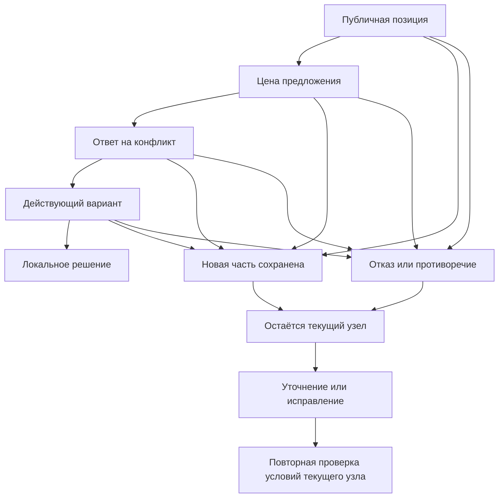

# Спасти Хогвартс

Утверждённый редакторский пакет 08.11.2026 по #205. Числовые настройки и готовность приложения проверяются отдельно.

Утверждено 08.11.2026: 20 квестов, пять локальных развязок и условия фонда/инвестора. Главная цель своего героя — «Добиться решения о будущем Хогвартса, за которое ты готов отвечать сам». Сюжетные кристаллы выдаются за этапы 1, 3 и 4 каждой роли; суммы и повторное прохождение ещё не определены. Переносится в документы PR 234; готовность приложения этим не утверждается.

Для замечания выдели нужную фразу и добавь комментарий. Общие замечания можно написать в этом чате. Проверь: интересна ли завязка, понятна ли роль и задача, естественны ли реплики и действия.

[Материалы ветки PR 234](https://github.com/Stepami/golden-mouth/tree/issue-205-v7-release/docs/redesign) содержат раннюю редакцию. Изменения на этой странице не переносятся в репозиторий автоматически.

# Какой опыт получает игрок

Хогвартс пытаются спасти, продать и присвоить в одной ленте. Игрок попадает в публичный спор, где у каждого есть сильный довод, личная выгода и слепое пятно. Задача — ответить на конкретную провокацию, а затем увидеть реакцию и последствия.

Игровой текст каждой сцены — название, повод в ленте и задание. Критерии, таблицы и правила ниже нужны авторам и разработчикам; их не показываем игроку как список требований к сочинению. Первый ответ может быть коротким. Если его недостаточно, NPC реагирует на сказанное и обозначает конкретный пробел, а не просит «раскрыть тему».

## Где работает абсурд

Комизм возникает из знакомых противоречий: спаситель превращается в рекламный бренд, бесплатное оказывается дорогим, равенство — удобным для одних, молодой предприниматель — зависимым от отца. Магический мир усиливает ситуацию, но случайная шутка не отменяет её последствий.

Смешными могут быть рекламные тексты, попытки сохранить лицо, комментарии и столкновения характеров. Бедность, культурные различия и цена отказа сами по себе не становятся мишенью насмешки. Не каждый NPC обязан острить; Рон может злиться, Гермиона — говорить всерьёз, Драко — защищаться.

Игрок может ответить смешно, резко или серьёзно. Засчитывается поступок по смыслу. Не требуем сленга, мема, заданной длины или повторения образца. Новые рекламные тексты и поводы ниже — часть редакторского предложения, не уже случившиеся события в приложении.

## Квесты одним взглядом

| Роль | Четыре ситуации |
|---|---|
| Гарри | Я вернулся → Поттер снова в продаже → Друзья идут мелким шрифтом → Спаситель без титров |
| Гермиона | Одинаково не значит удобно → Все смогут потом → Твой идеальный план мешает другим → Сдай неидеальный план |
| Рон | Бесплатно за ваш счёт → Помощь в обмен на жалость → Справедливости на всех не хватило → Бесплатно после отработки |
| Драко | Ночь в кабинете директора → Самостоятельный сын папы → Суд по фамилии → Без справки о хорошем Малфое |
| Свой герой | Очень хочется согласиться → У обоих красиво написано → Малфой виноват заранее → Неловко быть на его стороне |

# Основа мира и игрового цикла

«Спасти Хогвартс» — самостоятельный мир с собственной карточкой, завязкой и героями. Обычная «Школа чародеев» остаётся отдельным миром. Техническое использование прежнего шаблона не делает их одной историей. События фильмов — прошлое этих героев. Их возраст не нужно специально проговаривать в репликах. Магия, замок и совет относятся к этому миру, а не к универсальным правилам остальных миров.

Нет XP, ручного распределения и карты. Видны постоянная главная цель и один системный текущий квест. Посты и комментарии — игровые действия; квест может занимать несколько ходов. Три навыка растут автоматически при новом продвижении квеста, даже если он ещё открыт. Принято 08.11: без нового прогресса по текущему квесту рост навыков равен нулю. Энергия общая для миров: максимум 10, ход стоит 1, восстановление +1 за 10 минут. Кристаллы — за этапы, серии и новый уровень навыка; несогласованные суммы не задаём.

Для следующей реакции нужны состояние мира, интересы и голос NPC, известные ему события и собственные публикации. После подписки — также история контактов с игроком. Подтверждённые сюжетные факты не должны исчезать при выходе старого поста из короткого контекста генерации. Полную долговременную память в коде это описание не объявляет уже реализованной.

**Принято для сюжетного автомата.** Перед назначением квеста и реакцией система учитывает версию мира, роль игрока, знания и мотивы участников, уже случившиеся события. Квест должен быть возможен в этих условиях. Игрок предлагает действия через посты и комментарии; текст «Малфой отдал замок» сам по себе не превращает предложение в произошедшее событие. Реакция и подтверждённое изменение состояния должны согласовываться с миром. Альтернативное решение оценивается по цели квеста, без требования повторить образцовые слова.

Основа игрового цикла — решения созвона 05.11 и последующие уточнения владельца продукта к спецификации. Возраст продукта — 18+; прежний режим модерации 14+ не сохраняется. Личные отношения до подписки NPC статичны, после неё развиваются. Новая сюжетная цель вместо выбранной на ходу не назначается. Взрослая история допускает сложные темы, но исключает сексуальные темы, чрезмерную жестокость и ЛГБТ-тематику согласно заданным границам контента. Отклонённая до сохранения публикация не расходует энергию и не засчитывает ход.

[Оставшиеся вопросы](HOGWARTS-DECISIONS.md) вынесены отдельно. [Спецификация](HOGWARTS-SPEC.md) задаёт общие требования. Условия фонда, инвестора и локальные развязки утверждены 08.11. Условное предложение не означает поступления средств; числовые настройки остаются открытыми.

Источники: [решения созвона](https://github.com/Stepami/golden-mouth/blob/issue-205-v7-release/docs/redesign/CALL-2026-11-05.md), [отдельная карточка Хогвартса](https://github.com/Stepami/golden-mouth/blob/issue-205-v7-release/docs/redesign/v7-story-pilot.md#отдельная-карточка-хогвартса), [правила мира и AI](https://github.com/Stepami/golden-mouth/blob/3479ff141c733d813a30ea26a2a8bfd0f21614b9/docs/game-flow.md).

# Пять персонажей и разные ракурсы общего конфликта

Пять вариантов выбора: Гарри Поттер, Гермиона Грейнджер, Рон Уизли, Драко Малфой и свой персонаж. У каждого одна подготовленная авторами цель. Имя и внешность своего героя настраиваются, авторская дуга — нет. У готового героя доступны остальные три как NPC; у своего — все четыре. Люциус и совет остаются за сценой, без каналов, прямых ответов и подписок.

Общее событие — борьба за будущее Хогвартса. Гарри хочет вновь открыть школу и повторить свой прежний триумф спасителя. Гермиона — добиться устойчивой, этичной школы, учитывающей разные культуры. Рон — защитить интересы бедных и доступность обучения. Драко — закрыть школу и превратить замок в прибыльный бизнес, отстаивая себя под предвзятым давлением троицы. Свой герой сначала соглашается с обеими сторонами, затем замечает их скрытые мотивы, находит близкие себе ценности у Драко и выручает его в решающий момент. Это пять разных позиций в одном конфликте.

Направления всех пяти ролей заданы. Ниже — их текущая драматургическая проработка; формулировки квестов и конкретные события утверждены 08.11. Мастерская отменена. Бесплатность не определяет отдельную цель Гарри: его конфликт — возвращение в роль спасителя. Борьба за доступность для бедных — центр линии Рона. Условия школьного проекта и данные игроком обещания проверяются отдельно.

| Персонаж | Главная цель | Личная трудность | Навыки |
|---|---|---|---|
| Гарри | Снова открыть Хогвартс. | Желание помочь переплетено с потребностью опять стать спасителем. Сможет ли он признать самостоятельный вклад других? | Харизма · Лидерство · Самообладание |
| Гермиона | Добиться устойчивой и этичной школы, учитывающей разные культуры. | Полезный большинству выбор может навредить меньшинству; приходится открыто назвать цену. | Проницательность · Изобретательность · Убеждение |
| Рон | Сохранить доступ к обучению для небогатых семей. | Бесплатные уроки не убирают другие барьеры; благие лозунги не распределяют ограниченную помощь. | Смекалка · Солидарность · Напор |
| Драко | Закрыть школу и превратить замок в прибыльный бизнес. | Отделить собственный расчёт от условий отца и выдержать предвзятое давление троицы без обязательного примирения. | Расчёт · Переговоры · Независимость |
| Свой герой | добиться решения о будущем Хогвартса, за которое готов отвечать сам. | От согласия со всеми — к собственной позиции и решающей помощи Драко. Это подготовленная линия, не смена цели по ходу. | Наблюдательность · Критическое мышление · Решительность |

У каждой роли одна подготовленная цель. Кастомизация имени и внешности не меняет её произвольно. Финальные условия и квесты различаются по роли; банковские суммы, согласия и события не возникают из заявления игрока.

Репутация Гарри, этические требования Гермионы, опыт бедности Рона, предпринимательский расчёт Драко и первоначальная неуверенность своего героя меняют сам конфликт и квесты. Выбранного героя не дублируем среди NPC. Игрок не подписывается на NPC: их посты видны с начала, а они подписываются на него после определённых поступков.

Публичный проект отеля для Гарри — угроза возвращению школы и его собственной роли спасителя; для Гермионы — конкурирующее решение с другой ценой; для Рона — потеря доступа к обучению; для Драко — возможность реализовать свой талант; для своего героя — испытание привычки соглашаться со всеми. Изменение точки зрения не переписывает известные факты.

Ниже — текущие первые эпизоды. Различия Гарри и Рона отражены в квестах: Гарри разбирается с именем, заслугой и сотрудничеством; Рон — с барьерами доступа и ценой помощи.

# Первые сюжетные линии пяти персонажей

Короткий эпизод каждой роли проходит от первой позиции через цену предложения и конфликт к собственному локальному итогу. Открытие школы и работающий отель не возникают от одного поста. Конкретные сцены утверждены 08.11 на основе согласованных мотивов.

## Одна завязка для всех

Хогвартс обанкротился. За его будущее спорят школьное и коммерческое направления. Решает совет попечителей; Драко не представляет весь совет. Люциус влияет как заинтересованный инвестор, но не является доступным NPC. Его предложения и условия видны в пересказах доступных героев. Пока ни один проект не принят и финансирование не подтверждено.

Стартовое сообщение совета пересказывает Гермиона; в её прохождении — Рон: «Совет рассматривает возвращение школы и коммерческое использование замка. Пока не одобрен ни один вариант. Проекты можно поддержать или оспорить по существу». Прямой пост Люциуса, ответ ему и подписка с его стороны не предусмотрены.

Участники за сценой имеют разные интересы: сохранить учебное назначение, прекратить покрывать дефицит, получать доход от замка. Их влияние раскрывается через опубликованные условия и последствия. Совет не является единой марионеткой Люциуса.

Игрок действует постами и комментариями. Не нужны походы, осмотры, переписка в личке, поиск преподавателя как обязательное первое действие или переводы денег. Обещание участника и состоявшийся результат — разные события.

### Как читать сюжетные автоматы

Для каждого действия сохраняются подтверждённые признаки, текущий узел, известные события, обещания, подписки и отношения. Условия перехода проверяет система; генератор реплики не назначает деньги, чужое согласие или исход по своему усмотрению. Новая часть прогресса учитывается сразу. Состояние хранится отдельно для выбранного мира, роли и прохождения; общий кошелёк не смешивает их сюжетные события. Отдельный экран журнала действий не добавляется.

Реплики ниже — примеры, а строки таблиц — варианты переходов, не обязательная последовательность сообщений. Игрок сам пишет реакцию своего героя; система не публикует её за него. Один ход может выполнить несколько условий. Неожиданное решение проверяется по цели и фактам сцены, а не по совпадению с образцом.

Ясное исправление обязательства не требует дополнительного пустого хода: после обновления затронутых условий система проверяет завершение на том же действии. Уточнение нужно, если остаются несовместимые позиции. История и прежние ответы сохраняются.

В начале видны позиции доступных NPC. Гарри: «Я хочу снова открыть Хогвартс. Считайте это моим возвращением». Драко: «Я предлагаю отель, а не вечный сбор на воспоминания». Гермиона ставит вопрос о справедливости одинаковых правил; Рон — о доступе небогатых семей. Выбранный герой не публикует заготовленный AI-пост от собственного имени: его позицию пишет игрок.

## Гарри

**Постоянная главная цель:** «Снова открыть Хогвартс». Личная ставка — повторить прежний триумф: снова оказаться тем, кто спас всех. Бесплатность не определяет его отдельную ролевую цель; за доступность для бедных прежде всего борется Рон. Если Гарри публично принимает такое условие, оно становится его обещанием, которое нельзя забыть.

### Г1 Я вернулся

**Повод в ленте:** Драко уже рекламирует будущий отель. Под постом Гермионы спорят, не пора ли оставить от школы только сувенирную лавку. От тебя ждут очередного спасения.

**Квест для игрока:** Опубликуй пост о возвращении Хогвартса: зачем ему снова быть школой и за что берёшься лично?

**Обязательные признаки:** возвращение замка к обучению, а не замена школы отелем; понятный смысл этого возвращения; собственное публичное обязательство Гарри. Не нужно признавать тягу к славе словами игрока: она проявляется в конфликте.

«Я опять всех спасу» без того, что он возвращает и делает сам, не закрывает узел. «Хочу вернуть школу, где учился; возьму на себя публичное продвижение проекта и буду отвечать за свои обещания» выполняет условия. Часть признаков можно подтвердить несколькими действиями.

При завершении Гермиона подписывается: «Буду следить за тем, что именно ты пообещал». Сохранить школьную позицию и предел обязательства. Следующий узел — Г2.

### Г2 Поттер снова в продаже

**Повод в ленте:** Гермиона показывает предложенный фондом рекламный текст: «ПОТТЕР ВОЗВРАЩАЕТСЯ. Школа прилагается». Поддержку обещают в обмен на твоё имя; пока ничего не оплачено.

**Квест для игрока:** Ответь на предложение фонда: разрешишь использовать своё имя в рекламе? Укажи, что можно обещать от твоего имени, а что нельзя.

**Признаки:** выбран действующий вариант — разрешить рекламу с обозначенными границами или отказаться и продолжить переговоры без неё; признана условность ещё не предоставленной поддержки; реклама не выдаёт одобрение проекта за уже открытую школу.

Можно охотно стать лицом кампании: скромность не является условием зачёта. Можно отказаться от рекламы. «Я уже оплатил открытие своей славой» не создаёт средства.

После полного разбора Драко подписывается как конкурент: «Наконец-то у твоего возвращения появились условия». Сохранить выбранную роль имени, не начислять деньги. Следующий узел — Г3.

### Г3 Друзья идут мелким шрифтом

**Повод в ленте:** В предложенном фондом анонсе ты — спаситель, а Рон и Гермиона — «прочие участники». Рон публикует этот вариант: «Мы возвращаем школу или снимаемся в твоём продолжении?» Анонс ещё не согласован, даже если ты разрешил использовать имя.

**Квест для игрока:** Ответь Рону: останешься лицом кампании или разделишь внимание с друзьями? Признай их вклад и скажи, с какими условиями согласен. Не обещай за других.

**Признаки:** вклад Рона и Гермионы не присвоен Гарри; обозначено, какие из их условий он готов обсуждать, а какие не принимает; выбран публичный способ представить участие — общая команда или Гарри как лицо кампании с названными самостоятельными участниками.

Гарри не обязан передать лидерство или согласиться со всеми требованиями друзей. Но нельзя закрыть квест фразой «они просто сделают как я скажу»: готовность обсуждать предложение не равна согласию подчиниться.

Рон подписывается после предметного ответа на его самостоятельное участие: «Хорошо. Только не перепиши потом этот разговор так, будто я просто стоял рядом». Сохранить роли, принятые и непринятые условия. Следующий узел — Г4.

### Г4 Спаситель без титров

**Повод в ленте:** Гермиона публикует вопрос совета к твоему проекту: «Уберите имя Поттер. Что останется?» Драко добавляет: «Могу предложить номер с мемориальной табличкой».

**Квест для игрока:** Опубликуй ответ совету: что получит школа, кто участвует и что вы обещали? Покажи, как проект будет работать благодаря участникам, а не только твоему имени.

**Признаки:** проект возвращает обучение; выбранные условия использования имени сохранены или ясно исправлены; роли и обещания участников переданы без ложного согласия; объяснено, что останется от проекта помимо личного триумфа Гарри.

Любое уже данное обещание бесплатности проверяется на совместимость с итогом. Но новое требование сказать «бесплатно» не подменяет остальные признаки и не превращает Гарри в копию Рона.

**Локальный итог:** совет допускает школьный проект к подготовке и переговорам о поддержке. Гермиона сообщает решение с именами и оговорёнными ролями участников. Школа ещё не открыта, финансирование не подтверждено.

Если Гарри остался лицом кампании, итог сохраняет его заметную роль и зависимость от репутации. Если выбрал общее представительство, заслуга становится публично общей. Оба варианта продвигают его цель; система не требует обязательного нравственного перевоспитания.

Рон: «Это шаг для школы. Не только твой». Гермиона: «Теперь у нас есть проект и разные обязательства, а не одно спасительное имя». Драко: «Твоё возвращение допустили к рассмотрению. Школу пока не открыли». Эпизод завершён.

## Гермиона

**Постоянная главная цель:** «Вернуть устойчивый Хогвартс, в котором разные ученики могут учиться на справедливых условиях». Её испытание — признать цену полезного решения, не прикрыв её словами о всеобщем благе.

### ГМ1 Одинаково не значит удобно

**Повод в ленте:** Рон пересказывает красивый лозунг школьного проекта: «Одна программа. Один язык. Никаких различий». В обсуждении это уже называют идеальным равенством, хотя ученики приходят из разных традиций.

**Квест для игрока:** Объясни, кому единые правила помешают учиться и почему. Покажи, какие потребности разных учеников нужно учесть.

**Признаки:** поддержка жизнеспособной школы; конкретные разные потребности учеников; объяснение, почему одно одинаковое правило может их столкнуть.

«Нужно всё проверить» без названного противоречия не достаточно. «Единый учебный язык упрощает обучение, но новички из другой традиции могут не понимать занятия» выполняет критерий конфликта, если не выдаётся за уже произошедшее исключение.

Рон отвечает сухо: «Вот этот барьер имеет смысл разбирать» и подписывается после полного определения конфликта. Подтверждается предмет проверки, не дискриминация как свершившийся факт. Перейти к ГМ2.

### ГМ2 Все смогут потом

**Повод в ленте:** Рон публикует предложение фонда: первый набор поддержат по одной программе и на одном языке. Гарри хочет запускать сейчас. На подготовку переводов нужно время, отдельной поддержки на них нет.

**Квест для игрока:** Начать набор сейчас или сначала подготовить обучение для разных учеников? Выбери вариант и объясни, кому придётся ждать.

**Две допустимые ветки:** начать ограниченный набор сейчас, прямо признав барьер и предложив временную помощь без ложной гарантии; либо потребовать подготовить доступные материалы до набора, признав задержку и риск утраты нынешнего предложения.

**Общие признаки:** выбран один действующий вариант; названы получатели пользы и группа, несущая издержку; условие не маскируется словами «всем одинаково удобно». Нет автоматического бесплатного перевода заклинанием или обещанных денег из воздуха.

При полном ответе Гарри подписывается, потому что выбор меняет его план возвращения школы. Он может возражать против задержки. Сохранить ветку «ранний набор» либо «подготовка доступа». Перейти к ГМ3.

### ГМ3 Твой идеальный план мешает другим

**Повод в ленте:** Если выбран ранний набор, Рон спрашивает о тех, кто пока не сможет учиться. Если подготовка доступа — Гарри спрашивает о тех, кто ждёт открытия. Драко предлагает назвать презентацию «Всем хорошо, кроме некоторых».

**Квест для игрока:** Ответь тем, кому навредил твой выбор. Что предлагаешь сейчас? При каком условии пересмотришь решение?

**Признаки:** признана конкретная издержка выбранной ветки; предложен доступный сейчас ответ через условия проекта, а не выдуманное действие вне ленты; назван проверяемый повод пересмотра — например, отказ поддержки или невозможность обеспечить обещанную помощь.

Смена ветки допустима через публичное исправление; история выбора остаётся. Чистое «они потерпят ради большинства» без ответа не закрывает узел.

Драко подписывается после открытого признания цены и границы жизнеспособности: «Ты хотя бы оставляешь возможность признать ошибку». Сохранить условие пересмотра. Перейти к ГМ4.

### ГМ4 Сдай неидеальный план

**Повод в ленте:** Рон пересказывает вопрос совета: «Вы утверждаете, что условия справедливые. Почему тогда кто-то ждёт?» Это возражение к твоей выбранной ветке, не новая проверка документов.

**Квест для игрока:** Защити выбранный вариант в посте: кому он поможет, кому обойдётся дорого и когда его нужно пересмотреть.

**Признаки:** итог совместим с ГМ2 и ГМ3 либо явно заменяет их условия; названа издержка; нет заявления о полном равенстве уже сейчас; объяснено, почему при этих ограничениях проект остаётся приемлемым.

**Локальный итог:** совет принимает выбранные условия как основу школьного проекта. При раннем наборе сохраняется ограничение доступности, которое нельзя забыть в следующих постах. При подготовке доступа школьный проект продвигается с отсроченным набором, финансирование переходного периода ещё не обеспечено. Ни одна ветка не получает авторскую отметку «единственно нравственная».

Рон продолжает спор о тех, кто ждёт; Гарри — о темпе возвращения; Драко — о стоимости. Личная реакция каждого учитывает уже состоявшиеся подписки и обещания. Эпизод завершён, школа ещё не открыта.

При раннем наборе Рон: «Ты назвала тех, кому будет хуже. Теперь не дай им остаться с одной этой честностью». При подготовке доступа Гарри: «Я согласен ждать подготовки. Не согласен делать вид, что ожидание никому не стоит ничего». В обеих ветках Драко: «У твоего решения наконец появилась цена. Посмотрим, кто согласится её оплатить». Это реакции на выбранную ветку, не новые подтверждения финансирования.

## Рон

**Постоянная главная цель:** «Сохранить бесплатный Хогвартс для тех, кто не может купить другое образование». Его испытание — помочь людям, не назначив за помощь другую унизительную плату.

### Р1 Бесплатно за ваш счёт

**Повод в ленте:** Под обещанием вернуть школу Гарри обсуждают бесплатные уроки. Но принадлежности, дорога и время семьи от этого бесплатными не стали.

**Квест для игрока:** Ответь Гарри: какие расходы помешают бедной семье отправить ребёнка в школу, даже если уроки бесплатные?

**Признаки:** поддержка бесплатной школы; конкретная дополнительная нагрузка на бедную семью — учебные принадлежности, дорога или вынужденный отказ от заработка; объяснение связи с реальным доступом. Пример — довод о риске, не выдуманная история уже принятого ученика.

Гарри отвечает: «Согласен обсуждать это в проекте» и подписывается после всех признаков. «Богатые плохие» без барьера не закрывает квест. Сохранить выбранный барьер. Перейти к Р2.

### Р2 Помощь в обмен на жалость

**Повод в ленте:** Гермиона публикует условие фонда: помощь семьям в обмен на их публичные истории. В предложенном анонсе — «Расскажите, как вам тяжело. Нам нужен материал для доноров». Ни одна семья ещё не согласилась.

**Квест для игрока:** Предложи, как семье отказаться от публичного рассказа о бедности и сохранить право на помощь. Учти, что денег пока не хватает на всех.

**Признаки:** отказ от публичной истории не лишает базового рассмотрения помощи; объяснено, как добровольное участие отличается от принуждения; признано, что ограниченной поддержки может не хватить всем.

Можно допустить отдельные добровольные истории или потребовать обезличенную отчётность. «Каждый обязан рассказать, иначе денег не будет» не соответствует цели узла. «Фонд оплатит всем» без нового подтверждения не создаёт финансирование.

Гермиона подписывается после публичного разделения помощи и обязательной публичности. Сохранить действующее правило. Перейти к Р3.

### Р3 Справедливости на всех не хватило

**Повод в ленте:** Драко отвечает на твоё предложение: «Убрать обязательные истории можно. Увеличить этим фонд — нет. Кто получает помощь первым?» Его вопрос неудобный, но нехватка реальна.

**Квест для игрока:** Предложи правило: кому помогать первым, а кому ждать? Объясни его тем, кто не получил помощь. Деньги, публичная история и бесплатная работа не должны покупать место.

**Признаки:** понятный критерий очередности; названы ожидающие; нет скрытой платы; признано, что это распределение ограниченного предложения, не уже выданные средства.

Допустимы приоритет не имеющим альтернативы или очередь среди равных по нуждаемости. Не нужно считать доходы семей в игровом интерфейсе: игрок публично предлагает правило, не заполняет анкеты за NPC. Драко подписывается после ответа с признанной границей обещания, чтобы следить за расчётом.

Сохранить правило приоритета и непокрытый остаток потребности. Перейти к Р4.

### Р4 Бесплатно после отработки

**Повод в ленте:** Гермиона пересказывает предложение к школьному проекту: недостающую помощь заменить обязательными бесплатными сменами семей. На словах обучение остаётся бесплатным. Такое условие ещё не принято.

**Квест для игрока:** Объясни, почему обязательная отработка мешает бедным семьям учиться. Защити свой порядок помощи и укажи, на что средств пока не хватает.

**Признаки:** совместимы условия Р1–Р3; открыто обозначена непокрытая потребность; отсутствие помощи не объявляется решённым; перечислены недопустимые способы оплаты места — принудительная публичность и обязательный неоплачиваемый труд.

**Локальный итог:** совет включает эти ограничения в условия школьного проекта. Это подтверждённая защита правил, а не обещание денег каждой семье. Гермиона публикует решение. Кто-то всё ещё ждёт помощи; Рон добился важного ограничения, но не отменил нехватку ресурсов лозунгом.

Гарри связывает правило с бесплатной школой, Гермиона — с добровольным согласием, Драко напоминает о цене. Эпизод завершён.

Гарри: «Бесплатная школа — это и такое правило тоже». Гермиона: «Отказ рассказать о своей бедности больше не причина отказать в помощи». Драко: «Наконец-то ты перестал обещать всем всё. Дальше придётся искать средства, а не виноватых».

## Драко

**Постоянная главная цель:** «Закрыть школу и превратить Хогвартс в прибыльный бизнес». Личная ставка — отстоять свой талант и собственное решение, а не вновь стать удобным сыном Люциуса или назначенным злодеем троицы.

### Д1 Ночь в кабинете директора

**Повод в ленте:** Троица возмущена будущим отелем. Но спорят пока о слове «отель», а не о твоём предложении. В посте Гермионы о проектах замка есть место для твоего ответа.

**Квест для игрока:** Заинтересуй будущих гостей постом: кто и за что будет платить в отеле? Признай, что он заменит школу и что спрос ещё нужно проверить.

**Признаки:** коммерческое использование замка вместо школы; понятные будущие клиенты и предмет оплаты; отсутствие утверждения, что спрос или доход уже доказан. Например: проживание и экскурсионный опыт для состоятельных гостей, готовых платить за место и историю.

«Мой отец всё оплатит» без продукта не закрывает узел. «Бесплатная школа, а отель когда-нибудь» не продвигает постоянную цель.

Гермиона сухо спрашивает о проверяемом основании спроса и подписывается после сформулированного проекта как оппонент. Сохранить продукт и заявленную клиентскую группу. Перейти к Д2.

### Д2 Самостоятельный сын папы

**Повод в ленте:** Гермиона публикует выдержку из предложения Люциуса. Смысл простой: деньги его — ключевые решения тоже его. Гарри уже пишет: «Вот и весь молодой предприниматель». Люциус лично в обсуждение не входит.

**Квест для игрока:** Ответь на условие отца: примешь вложение с его контролем или будешь отстаивать своё управление? Назови выгоду и цену выбранного варианта.

**Признаки:** явно выбрать принятие контроля или требование самостоятельного управления; назвать выгоду и цену этого выбора; не приписать Люциусу уже принятое новое условие.

Оба варианта допустимы. Принять деньги и контроль с открытым признанием зависимости — не то же самое, что объявить полную независимость. Отказаться от контроля — не то же самое, что уже получить другого инвестора.

Гарри подписывается после отделения личной позиции от безличного «так решил отец»: он хочет публично оспаривать конкурента. Это не уважение и не согласие. Сохранить выбранный режим зависимости. Перейти к Д3.

### Д3 Суд по фамилии

**Повод в ленте:** Рон возражает против закрытия школы. Гарри приплетает фамилию. Гермиона требует проверить проект, но заранее подозревает обман. В одной ветке смешались неудобные вопросы и готовый приговор.

**Квест для игрока:** Ответь троице: какие последствия отеля они называют верно, а в чём обвиняют тебя без доказательств? Защити свой проект, не обещая сохранить школу.

**Признаки:** признано, что принятие коммерческого проекта означает закрытие школы и потерю для её сторонников; дан предметный ответ на вопрос доступа или дохода; указано, какое обвинение не следует из известных фактов; нет ложного обещания оставить всем бесплатную школу.

Можно жёстко спорить с троицей. Грубость сама по себе не делает расчёт неверным; угрозы или текст вне допустимого контента проверяются отдельно. «Вы завидуете, значит я прав» без предметного ответа не закрывает узел.

Рон подписывается после прямого признания цены, чтобы контролировать обещания о последствиях. Прибавка отношений на этом ходе не начисляется. Сохранить признанную потерю и границы ответственности. Перейти к Д4.

### Д4 Без справки о хорошем Малфое

**Повод в ленте:** Гермиона передаёт запрос совета о коммерческом варианте. Троица требует снять его с обсуждения, но единого решения ещё нет.

**Квест для игрока:** Защити проект отеля: кому он нужен, кто им управляет и чего ты пока не можешь гарантировать? Согласие Гарри для ответа не требуется.

**Признаки:** согласованы продукт Д1, управление Д2 и последствия Д3; неизвестный спрос не назван гарантированным; выбран один способ дальнейшего продвижения — с условием Люциуса либо с поиском иной поддержки без принятого контроля.

**Локальный итог:** совет допускает отельный проект к проверке спроса и условий коммерческого использования. При принятом контроле Люциуса зависимость сохраняется публично. При самостоятельном варианте финансирование остаётся открытым. Гермиона сообщает решение совета, даже если не согласна с ним.

Драко доказал право продвигать собственный коммерческий вариант, но отель ещё не запущен. Троица может оставаться против. Примирение, моральное перевоспитание и возвращение бесплатной школы не являются условиями финала.

Гарри: «Совет дал тебе право продолжить. Моей поддержки у тебя нет». Гермиона: «Я буду спорить с проектом по существу. С фамилией это оказалось слишком удобно». Рон: «Ты хотя бы не назвал закрытие школы подарком для нас. Я всё равно против». Это частичное признание честности, не внезапное примирение.

## Свой персонаж

**Постоянная главная цель:** «Добиться решения о будущем Хогвартса, за которое ты готов отвечать сам». Имя и внешность настраиваются, авторская дуга — нет. Формулировка утверждена 08.11.

Персонаж сначала готов видеть хорошее во всех, затем обнаруживает цену чужих красивых слов. В решающий момент он поддерживает право Драко на рассмотрение проекта и узнаёт в его позиции близкие себе ценности. Это помощь конкретному человеку и проекту, а не автоматическое согласие со всеми требованиями Люциуса.

### С1 Очень хочется согласиться

**Повод в ленте:** В ленте Гарри обещает вернуть школу, а Драко пересказывает предложение Люциуса о бизнесе. Оба звучат так, будто ответ очевиден.

**Квест для игрока:** Ответь Гарри или Драко: что нравится в его идее и какой вопрос нужно прояснить? Начать можно с любого.

Материалы — пост Гарри о возвращении школы и пост Драко с пересказом коммерческого предложения отца. Прямого поста Люциуса нет. Поиск преподавателя и мастерская здесь не нужны.

**Признаки:** названа конкретная привлекательная сторона выбранного направления; задан содержательный вопрос или условие, а не простое приветствие. Герой может сразу выразить симпатию Драко; наивность не означает обязательного восхищения Гарри.

Отвеченный NPC сухо уточняет свою позицию. Если выбран Гарри, он подписывается после вопроса о том, кому и на каких условиях вернётся школа. Если выбран Драко, он подписывается после вопроса о продукте или самостоятельности от Люциуса. Подтверждён первый предмет интереса. Перейти к С2.

### С2 У обоих красиво написано

**Повод в ленте:** После твоего первого ответа другая сторона предлагает свой вариант. Гермиона раскрывает условия фонда: имя Гарри в рекламе и единый порядок обучения. Драко говорит об условиях вложения отца. За красивыми обещаниями обнаружилась цена.

**Квест для игрока:** Сравни два предложения: чем привлекает другой вариант и какие обещания несовместимы? Объясни, что теперь поддерживаешь и на каких условиях.

**Признаки:** конкретный довод второй стороны; назван конфликт — возвращение школы и замена её отелем, либо самостоятельность проекта и контроль инвестора; признана собственная прежняя неполная оценка или новая граница поддержки. Не обязательно произносить «я наивен».

Второй из пары Гарри/Драко подписывается, когда игрок предметно ответил его стороне. Гермиона подписывается после сопоставления известного условия фонда с обещанием доступности, а не после общего «все вы правы».

Сохранить известные условия и противоречие. Слишком ранняя окончательная поддержка Драко не штрафуется, но не заменяет раскрытие цены обоих вариантов. Перейти к С3.

### С3 Малфой виноват заранее

**Повод в ленте:** Рон говорит о потере школы. Гарри требует исключить отель. Гермиона публикует такое же требование части совета — пока без решения. Драко ещё спорит, но его уже обсуждают так, будто разбираться не в чем.

Здесь почти проиграна возможность рассмотрения коммерческого проекта, не уже заключённая сделка и не финальное голосование.

**Квест для игрока:** Вмешайся в спор: какая претензия к Драко обоснована, а какая держится на фамилии? Признай последствия закрытия школы и оспорь обвинение без доказательств.

**Признаки:** признана действительная потеря школы; указано, что условие отца не доказывает любое приписанное Драко намерение; сформулирована собственная позиция против исключения по фамилии. Поддержка отеля может оставаться условной.

Рон подписывается после признания потери и ответа на её цену, даже если не согласен с защитой Драко. Уже подписанный Драко запоминает публичную защиту и реагирует лично: «Ты не обязан считать мой проект добрым. Достаточно прочитать, что я предложил».

Сохранить самостоятельную позицию и факт защиты. Перейти к С4. «Все трое злодеи, Драко всегда прав» не заменяет разделение фактов.

### С4 Неловко быть на его стороне

**Повод в ленте:** Гермиона сообщает: совет ещё готов услышать довод за рассмотрение коммерческого проекта. Драко почти вытеснили из обсуждения. Все привыкли, что ты стараешься никого не задеть.

**Квест для игрока:** Публично поддержи рассмотрение проекта Драко. Объясни, что в его позиции тебе близко, чем обернётся закрытие школы и где проходит граница твоей поддержки.

**Признаки:** явная защита продолжения рассмотрения коммерческого варианта; хотя бы один довод о самом проекте и объяснение, какая позиция Драко близка игроку — самостоятельная инициатива, честное признание выгоды или ответственность за расчёт; признание цены замены школы; обозначена личная граница поддержки — например, прозрачные условия контроля и отсутствие ложных обещаний доступа для всех.

Можно защищать Драко резкой репликой троице, собственным постом или ответом в ветке. Нельзя закрыть квест утверждением «я уже купил замок». Отказ поддержать Драко сохраняется как отказ от текущей задачи, но не превращает цель в спасение школы; вернуться можно публичным ответом позже.

**Локальный итог:** совет отклоняет требование исключить коммерческий проект по происхождению автора и оставляет его на рассмотрении с опубликованными условиями. Гермиона сообщает решение. Поддержка игрока — подготовленное условие этого сюжетного события; лайки фанатов не заменяют её.

Драко признаёт, что помощь изменила положение. Гарри воспринимает выбор как удар по общему делу; Гермиона разделяет право быть рассмотренным и согласие с отелем; Рон спорит о последствиях, помня, что игрок их признал. Троица не обязана примириться. Персонаж потерял удобную возможность нравиться всем и сделал собственный выбор. Эпизод завершён.

Драко: «Все обсуждали, кто я такой. Ты один заговорил о том, что я предложил. Я это запомню». Гарри: «Ты мог помочь вернуть школу. Ты выбрал помочь ему». Гермиона: «Его нельзя исключать по фамилии. Из этого ещё не следует, что отель — хорошее решение». Рон: «Ты говорил, что понимаешь тех, кто останется без школы. Я хочу увидеть, что это было не просто вступление к защите Малфоя».

# Совет попечителей и участники за сценой

В совете нет единой тайной воли. Сторонники сохранения учебного назначения боятся утратить школу навсегда. Финансовая сторона хочет перестать покрывать дефицит. Сторонники коммерческого использования видят доход от замка. Это интересы за сценой, без новых профилей.

Фонд допускает ограниченную поддержку школьного проекта, но хочет использовать имя Гарри и единые условия обучения. Для адресной помощи он предлагает публичные истории получателей. Эти условия раскрываются по ходу, не выдаются все сразу.

Люциус предлагает вложение в отель с контролем ключевых коммерческих решений. У Драко появляется выбор между удобной опорой на отца и ответственностью за собственный проект.

Люциус не публикует посты, не отвечает игроку и не подписывается. У него нет NPC-профиля. Условие инвестора сообщает доступный герой; например, в прохождении Драко — Гермиона из публичных материалов, в прохождении своего героя — Драко. Решение совета пересказывает доступный NPC после заданного события.

# Подписки и отношения всех пар

У каждого NPC есть событие, после которого он подписывается на игрока. Оно зависит от публичного поступка, а не от уровня отношений. Подписка и уведомление появляются один раз. Уважение, раздражение и готовность сотрудничать описывают поведение NPC, а не новые шкалы.

Уважение, раздражение и готовность сотрудничать описывают поведение NPC, не отдельные шкалы. Числовое изменение рассчитывается по одному согласованному показателю и серверным пределам; произвольные «+2 доверия» не вводятся. Разногласие без нарушенного обещания не обязано снижать отношения. Принято 08.11: в первом коротком эпизоде подписавшийся NPC не отписывается от игрока. Конфликт отражается в ответах, отношениях и готовности сотрудничать. Массовые подписчики по-прежнему могут уходить.

## Если игрок выбрал Гарри

| NPC | Первое событие подписки | После подписки |
|---|---|---|
| Гермиона | Г1: Гарри назвал школьное назначение, смысл возвращения и собственное обязательство. | Уважает согласованные условия. Спорит с подменой проекта именем. Помнит точные обещания Гарри; публичное исправление отличается от скрытого отказа. |
| Драко | Г2: Гарри выбрал границы использования имени и признал условность поддержки. | Следит как конкурент. Уважает признание цены; раздражается при ложном приписывании ему чужих обещаний. Реклама или отказ от неё сами по себе не требуют ухудшения. |
| Рон | Г3: Гарри ответил на самостоятельное участие друзей, не присвоил их вклад и назвал границы согласия. | Уважает признанный вклад. Конфликтует, когда его превращают в безусловного помощника. Помнит свои принятые и непринятые условия, а не выдуманное согласие со всем проектом. |

## Если игрок выбрал Гермиону

| NPC | Первое событие подписки | После подписки |
|---|---|---|
| Рон | ГМ1: названы разные потребности и барьер общего правила. | Уважает признание вреда ожидающим. Раздражается при разговоре о семьях как о статистической погрешности. Помнит её выбранную ветку и условие пересмотра. |
| Гарри | ГМ2: выбран порядок первого набора с открытой ценой. | Уважает ясную ответственность. Может спорить с задержкой без снижения отношения. Ухудшение при обещании раннего запуска с последующим молчаливым отказом. |
| Драко | ГМ3: признаны цена и условие пересмотра проекта. | Уважает проверяемую границу. Саркастичен при объяснении любого риска исключительно его происхождением. Помнит, при каком событии Гермиона обещала изменить план. |

## Если игрок выбрал Рона

| NPC | Первое событие подписки | После подписки |
|---|---|---|
| Гарри | Р1: бесплатность отделена от остальных барьеров доступа. | Поддерживает понятное решение для семей. Спорит с отрицанием любых ограничений. Помнит названный Роном барьер. |
| Гермиона | Р2: отказ от публичности отделён от права на помощь. | Уважает добровольность и последовательность. Отказывает в поддержке скрытому принуждению. Помнит обещание не обменивать помощь на обязательную историю. |
| Драко | Р3: предложена очередь и честно названа нехватка. | Следит за выполнимостью обещания. Уважает признанный дефицит, раздражается при объявлении ещё не выделенных средств уже доступными. Не обязан помогать школе деньгами. |

## Если игрок выбрал Драко

| NPC | Первое событие подписки | После подписки |
|---|---|---|
| Гермиона | Д1: названы продукт, клиенты и замена школы. | Следит как критик. Может признать расчёт, оставаясь против закрытия. Предвзятость не исчезает одним ответом; прямое указание на неё становится фактом спора. |
| Гарри | Д2: Драко занял собственную позицию по условию Люциуса и назвал её цену. | Публично противостоит проекту. Уважение возможно за честность, не за отказ от бизнеса. Выпад «ты такой же, как отец» — его предвзятая реплика, не системный факт. |
| Рон | Д3: Драко признал потерю школы и ответил о последствиях. | Спорит об интересах небогатых. Может признать границы обещания. Ухудшение при нарушении этих границ, не просто при сохранении коммерческой позиции. |

## Если игрок выбрал своего персонажа

| NPC | Первое событие подписки | После подписки |
|---|---|---|
| Гарри | С1 при первом обращении к нему либо С2 при первом предметном ответе школьной стороне. | Сначала рад поддержке; в С3–С4 воспринимает защиту Драко болезненно. Смена позиции, объяснённая публично, отличается от нарушенного обещания без объяснения. |
| Драко | С1 при первом обращении к его предложению либо С2 при первом предметном ответе коммерческой стороне. | Помнит границы первоначальной поддержки. В С3 впервые получает защиту без поклонения; в С4 отвечает на помощь лично. Не становится бесконечно благодарным союзником. |
| Гермиона | С2: игрок сопоставил условие фонда с обещанием доступности. | Уважает различение фактов и пожеланий. В С4 может признать справедливость процедуры, продолжая спорить об отеле. |
| Рон | С3: признана реальная потеря школы и дана самостоятельная позиция без общего обвинения по фамилии. | В С4 спорит с выбором игрока по существу. Уважение за честное признание цены не означает поддержки бизнеса. |

## Что происходит если подписка не состоялась

До события подписки NPC отвечает сухо, личные отношения не растут. Для продолжения квеста или решения совета проверяются публичные факты; сама подписка не служит пропуском. Если игрок уже совершил подходящий поступок, применяется то же правило зачёта. Повторять образцовую реплику не нужно.

Если игрок не выполняет обязательный сюжетный поступок, квест остаётся по содержательной причине. Интерфейс не предлагает «подними отношения, чтобы продолжить». Необязательные личные разговоры не задерживают основной эпизод.

# Как читать и исполнять узлы

Узел — описанная ситуация сюжета с условиями, реакциями и переходом дальше; здесь это текущий квест или событие. Обозначения Г, ГМ, Р, Д и С — Гарри, Гермиона, Рон, Драко и свой герой. Число обозначает узел, не ход и не день. Сценарий первого эпизода имеет одну фиксированную версию в каждом прохождении.

Каждый узел назначается после завершения предыдущего. Материалы узла публикуются один раз и доступны при возвращении. Игрок может действовать собственным постом, комментарием к указанному материалу или ответом в его ветке. Содержательный публичный пост с понятным предметом равноценен комментарию; тайных сообщений нет.

## Общая таблица переходов

Порядок проверки ниже учитывает принятые правила раннего зачёта, сохранения последствий и исправимых неудач первого эпизода. Конкретные сцены утверждены 08.11.

| Приоритет | Проверка | Состояние и ответ |
|---|---|---|
| 1 | Технически неизвестный результат | Ничего не переоценивать как сюжетный провал. Восстановить результат того же действия; повторно не списывать энергию. |
| 2 | Пост отклонён до сохранения | Не ход. Нет расхода, сюжетного события, навыков и серии. |
| 3 | После разбора действия остаются несовместимые действующие условия или неясно, какое прежнее обещание отменено | Сохранить высказанные позиции; не выбирать между ними случайно. Текущий узел требует уточнения. Ясное исправление само по себе не задерживает переход: обновить затронутые условия и на этом же ходе проверить строки 4–7. Историю не стирать. |
| 4 | Игрок ясно отказывается от задачи или действует против постоянной цели | Сохранить отказ; текущий квест остаётся с объяснением возможного исправления. Цель не подменяется. |
| 5 | Подтверждены все обязательные признаки текущего узла | Завершить узел, применить его события и подписки один раз, назначить следующий либо локальный итог. |
| 6 | Подтверждена новая часть обязательных признаков | Сохранить частичный прогресс, назвать недостающую часть. Узел остаётся. |
| 7 | Новых обязательных признаков нет | Ответ по теме без сюжетного зачёта. Свободная публикация остаётся в ленте. |

Чтобы завершить узел, нужно выполнить все перечисленные условия, если в карточке не указаны варианты на выбор. Если игрок предлагает несовместимые решения и не выбирает одно, система запрашивает уточнение. Оценка опирается на фрагмент действия, известный факт сцены и версию правил. Одной оценки «текст убедительный» недостаточно.

NPC даёт предусмотренную реакцию на подтверждённые признаки; генератор может перефразировать её, но не отменить исход. Предложение игрока, отличающееся словами и деталями, засчитывается при тех же существенных условиях. Новое устройство мира или договор с отсутствующим лицом не утверждается генератором по ходу. Одинаковые сохранённые признаки и версия правил дают одинаковый исход. Принятая оценка и результат сохраняются; повтор запроса не запускает новый выбор перехода или награды.

## Память и границы результата

Новый частичный прогресс сохраняется между ходами. Отказ NPC — публичное событие, не потеря всей истории. Исправление меняет действующее обязательство и сохраняет прежнюю реплику как прошлую позицию. Принято 08.11: исправление или удаление поста не откатывает уже состоявшиеся ответы NPC и сюжетные события. Публичное исправление меняет действующее обещание; удаление текста само по себе не отменяет чужую реакцию или решение. Техническое удаление текста и данных сверяется с backend отдельно.

Принято 08.11: уже подтверждённые действия учитываются при назначении следующего квеста без повторного поста. Система проверяет переходы последовательно по известным фактам; новое предложение или ответ NPC сначала должны появиться в ленте. Один сохранённый ход не списывает энергию повторно. Повторного роста за тот же признак и повторной награды этапа нет.

До подписки числовые отношения неподвижны. Сам ход первой подписки не получает задним числом личную прибавку. После подписки применяется один согласованный показатель с серверными пределами; события разговора хранятся и после исчерпания дневного лимита.

Каждый сохранённый пост или комментарий игрока расходует 1 общую энергию. Просмотры, публикации NPC и фанатские ответы не расходуют её. Необязательные ответы не нужны для искусственного растягивания квеста.

# Три навыка каждой роли

**Принято 08.11.** У каждой роли своя тройка навыков: Гарри — харизма, лидерство, самообладание; Гермиона — проницательность, изобретательность, убеждение; Рон — смекалка, солидарность, напор; Драко — расчёт, переговоры, независимость; свой герой — наблюдательность, критическое мышление, решительность. Эти названия заменяют предложенный ранее общий набор.

## Как работает рост

Навык растёт автоматически, когда действие подтверждает новую часть текущего квеста и содержит нужный приём. Полное завершение ждать не нужно. Один ответ может проявить несколько навыков, но прибавка всем трём за любой пост не предусмотрена.

В результате хода нужны конкретные основания: «Разобрано условие инвестора — проявлен расчёт», «Признан самостоятельный вклад Рона — проявлено лидерство». Это объяснения для игрока, а не обещание готового расчёта в приложении.

Принято 08.11: если действие не дало нового прогресса по текущему квесту, навыки не растут. Новая подтверждённая часть даёт рост сразу. Суммы прибавок и пороги уровней ещё не выбраны. Уровень повышается автоматически на согласованном пороге и даёт кристалл. Навыки развиваются автоматически; ручного распределения и XP нет.

## Гарри

| Навык | Что развивает | Пример в эпизоде |
|---|---|---|
| Харизма | Понятное обращение, которое связывает идею возвращения школы с причиной поддержать её и конкретным предложением. Одного громкого обещания мало. | Г1: объяснить, зачем школе возвращаться и за что берётся Гарри. Г2: предложить понятные границы кампании вместо пустого «я бренд». |
| Лидерство | Договорённость о ролях, признание чужого вклада и точное обозначение, с чем участники согласились. Не требует отдавать лидерство. | Г3: оставить Гарри лицом кампании, но назвать Рона и Гермиону самостоятельными участниками, а не безусловными помощниками. |
| Самообладание | Предметный ответ на критику, в котором герой сохраняет свою позицию и учитывает возражение. Не оценивает вежливость или отсутствие эмоций. | Г4: на выпад Драко ответить, что останется от проекта помимо фамилии Поттер. Можно ответить резко, если ответ по существу. |

Гарри может любить внимание и развиваться. Навыки не требуют признаться в тщеславии или отказаться от славы.

## Гермиона

| Навык | Что развивает | Пример в эпизоде |
|---|---|---|
| Проницательность | Обнаружение конкретного барьера: как известное условие помогает одной группе и мешает другой. | ГМ1: объяснить, почему единый учебный язык удобен организаторам, но мешает части учеников. |
| Изобретательность | Предложение нового выполнимого ответа на названный барьер с признанием ограничений. Не создаёт деньги, согласие или магическую возможность. | ГМ2–ГМ3: предложить временную помощь при раннем наборе либо другой порядок подготовки; указать, что этим ещё не решено. |
| Убеждение | Ответ на конкретное возражение с доводом, который согласуется с выбранным планом и его ценой. | ГМ4: объяснить, почему её вариант стоит принять, не скрывая тех, кому придётся ждать. Согласие всех NPC не требуется. |

Ни ранний набор, ни задержка не дают автоматическую прибавку за «правильную этику». Оценивается то, как разобран и продвинут выбор.

## Рон

| Навык | Что развивает | Пример в эпизоде |
|---|---|---|
| Смекалка | Обнаружение скрытой цены или обходного условия и предложение, как с ним разобраться. | Р1: показать, почему бесплатные уроки не отменяют расходы на принадлежности. Р4: распознать скрытую плату в обязательной отработке. |
| Солидарность | Предложение, которое защищает конкретный интерес нуждающихся, учитывает тех, кто ждёт, и не обещает всем невозможного. | Р2: отделить право на помощь от публичного рассказа о бедности. Р3: объяснить, кого предложенный порядок оставляет ждать. |
| Напор | Содержательный ответ на новое сопротивление: уточнить требование или защитить его новым доводом. Не измеряется количеством сообщений. | Р3: ответить на вопрос Драко о нехватке средств. Р4: оспорить принудительную отработку с объяснением её последствий. |

Злость Рона допустима. Повтор лозунга «всё должно быть бесплатно» без нового продвижения не заменяет ни один из этих приёмов.

## Драко

| Навык | Что развивает | Пример в эпизоде |
|---|---|---|
| Расчёт | Связь клиента, продукта и выгоды с признанием непроверенного спроса и цены решения. Наличие точных выдуманных сумм не требуется. | Д1: объяснить, за какой опыт гости захотят платить. Д4: отличить возможность дохода от гарантированного результата. |
| Переговоры | Разбор предложения: выгода, уступка, граница согласия; предметный ответ на возражение другой стороны. | Д2: публично ответить на условие Люциуса. Д3: отделить обоснованную критику от обвинения по фамилии. |
| Независимость | Собственный ясный выбор с признанием зависимости и последствий. Не требует автоматически отвергать помощь отца. | Д2: осознанно принять контроль ради вложения или отказаться и признать отсутствие другой поддержки. Д4: защитить выбранный вариант от своего имени. |

Независимость не означает отсутствие зависимости. Герой проявляет её, когда принимает решение сам и не выдаёт чужое условие за собственную полную свободу. Одобрение троицы не служит условием роста.

## Свой персонаж

| Навык | Что развивает | Пример в эпизоде |
|---|---|---|
| Наблюдательность | Замеченное существенное условие в доступной публикации и вопрос о его последствиях. Не даёт знания скрытых мотивов без источника. | С1: спросить Драко, кто будет управлять проектом при вложении Люциуса. С2: заметить условие фонда за лозунгом Гарри. |
| Критическое мышление | Сопоставление известных условий, отделение доказанного от предположения, объяснение изменения своей оценки. | С2: показать несовместимость двух обещаний. С3: отделить последствия отеля от коллективного обвинения Малфоя. |
| Решительность | Ясная публичная позиция с признанной ценой и границами поддержки. Резкость сама по себе не считается решительностью. | С3–С4: вмешаться в спор и поддержать рассмотрение проекта Драко, объяснив близкую ценность и предел согласия. |

Наивный старт не означает глупость игрока. Вопрос, сомнение и открытое исправление своей позиции могут продвигать подготовленную линию.

## В каких квестах проявляются навыки

| Роль | Квест 1 | Квест 2 | Квест 3 | Квест 4 |
|---|---|---|---|---|
| Гарри | Харизма | Харизма, самообладание | Лидерство, самообладание | Лидерство, самообладание |
| Гермиона | Проницательность | Проницательность, изобретательность | Изобретательность, убеждение | Убеждение |
| Рон | Смекалка | Солидарность | Солидарность, напор | Смекалка, напор |
| Драко | Расчёт | Переговоры, независимость | Переговоры, независимость | Расчёт, независимость |
| Свой герой | Наблюдательность | Наблюдательность, критическое мышление | Критическое мышление, решительность | Решительность |

Таблица задаёт ожидаемые возможности, а не автоматическую выдачу. Для каждого действия оценка должна подтвердить проявленный приём и новую часть прогресса. Если подходящий приём встречается в другом квесте, его нельзя отвергать только из-за этой таблицы.

## Повторы и сложные случаи

| Ситуация | Что учитываем |
|---|---|
| Половина условий выполнена одним комментарием | Новый прогресс и проявленный навык учитываются сразу; квест может оставаться открытым. |
| Игрок повторяет уже зачтённый довод другими словами | Повтор не даёт обычный рост за тот же факт. |
| Игрок отказывается от выгодного условия | Смотрим на содержательный выбор и продвижение квеста, а не на прибыльность или симпатию NPC. |
| Игрок отвечает грубо, но по существу | Тон не обнуляет проявленный навык. Проверка допустимого контента действует отдельно. |
| Игрок нарушает обещание, затем исправляет его | История сохраняется. Новое исправление проверяется по текущему квесту; один и тот же цикл нарушения и исправления не даёт повторный обычный рост за уже зачтённый факт. |
| Пост набрал аудиторию, но не продвинул квест | Популярность не заменяет сюжетный зачёт. При отсутствии нового прогресса рост навыков равен нулю. |
| Ошибка оценки или повтор запроса | Восстанавливается сохранённый результат; повторной прибавки нет. |

Ни один первый квест не требует уровня навыка. Сложность растёт через новые конфликтующие условия, а не через обязательное число постов. После эпизода навыки растут за новые подтверждённые взаимодействия; размер прибавок остаётся открытым.

## Что требуется для расчёта

Для каждого подтверждённого приёма сохраняются действие и фрагмент текста, связанный факт сцены, новая выполненная часть квеста, навык выбранной роли и версия правил оценки. Сервер рассчитывает рост по согласованной таблице; генератор реплики не назначает баллы.

Режимы расчёта различаются: при текущем квесте рост требует нового прогресса по нему; после финала — нового подтверждённого взаимодействия в свободной ленте. Отсутствие текущего квеста после финала само по себе не обнуляет навыки. Сохраняются основание взаимодействия, проявленный навык и однократность зачёта; новые главы или полномочия NPC из этого не возникают.

Набор навыков и правило роста приняты. Реализацию нужно свести с backend Backend-разработчика и отображением у Ромы; принятие текста не подтверждает готовность кода. Новые шкалы отношений и отдельные награды за приёмы не добавляются.

## Сверка с backend перед передачей

Проверен master a9006f19c8169f8a532c6459570fcf8c4b379cbf. [PostProgressionCalculator](https://github.com/Stepami/golden-mouth/blob/a9006f19c8169f8a532c6459570fcf8c4b379cbf/backend/src/Reki.Application/Posts/PublishPostCommand/PostProgressionCalculator.cs) использует brave, humor и topic. Метод AddSkillExperience выбирает основной навык и прибавляет опыт основному и побочным по конфигу; wantCompleted меняет множитель. Параметра с новым подтверждённым прогрессом квеста в этом методе нет.

[SkillId](https://github.com/Stepami/golden-mouth/blob/a9006f19c8169f8a532c6459570fcf8c4b379cbf/backend/src/Reki.Domain/Player/SkillId.cs) уже строковый, но это само по себе не делает расчёт ролевым. [SkillResponse](https://github.com/Stepami/golden-mouth/blob/a9006f19c8169f8a532c6459570fcf8c4b379cbf/backend/src/Reki.Application/Player/Responses/SkillResponse.cs) содержит уровень и прогресс; источник отображаемого названия нужно связать с выбранной ролью.

Для принятых правил необходимо свести с backend: набор трёх навыков роли; оценку проявленного приёма; новый прогресс квеста как обязательное условие роста; однократность зачёта; уровни и кристаллы. Прежнюю прибавку побочным навыкам нельзя автоматически сохранить как рост всем трём. Внутреннее поле Experience не означает возвращения XP в интерфейс.

В открытом [PR 260, HEAD 1766d93](https://github.com/Stepami/golden-mouth/blob/1766d93ea909e66337139d80808ddff7d1d08c48/backend/src/Reki.Application/Posts/CreatePostCommand/Progression/PostProgressionCalculator.cs) отдельно проверен перенесённый PostProgressionCalculator: там также остаются brave/humor/topic, основной и побочные приросты без параметра нового прогресса квеста. При переходе на новый постинг принятый сюжетный контракт всё равно нужно связать с расчётом. Эта сверка не заменяет проверку вызывающего кода и всего пути комментариев.

## Остальные результаты

Аудитория рассчитывается отдельно: популярный пост может не закрыть квест, непопулярный — закрыть. Целевой темп 120 → 10 000 за два активных дня сохраняется; предложенное ускорение ×4,5 не превращается в принятую настройку этим сценарием.

Принято 08.11. Сюжетные события для кристаллов: первая законченная публичная позиция — узел 1; защита своей позиции после раскрытого конфликта — узел 3; локальное решение — узел 4. Список этапов принят; суммы ещё нужно выбрать. Промежуточный комментарий, каждая подписка и каждая фанатская реплика не объявляются отдельной наградой.

Единственный тип награды — кристаллы: за новый уровень навыка, принятые сюжетные этапы и серии. Полная таблица сумм ещё не выбрана. Повтор действия, обновление страницы и пересказ финала не выдают награду этапа заново. Сутки серии — с 00:00 до 24:00 Europe/Moscow. Нужна дневная норма действий, а не просто вход; конкретная норма и правило сброса остаются в отдельных вопросах.

Все изменения связываются с одним сохранённым результатом действия: расход энергии, признаки прогресса, переход, подписки, отношения после подписки, расчёт аудитории, навыки и награды. Отдельная генерация текста не запускает их заново.

# Массовые подписчики и жизнь ленты

Фанатские реплики сопровождают реальные ответы NPC. При нескольких ответивших героях видимая выборка примерно поровну распределяется между их тонами; порядок перемешивается один раз и сохраняется. Это доли ответов героев, не гарантированные равные доли поддержки и критики.

Например, на защиту Драко в С4 Гарри отвечает с обидой, Гермиона — с холодным признанием процедурного аргумента, Драко — с личной благодарностью. Фанаты показывают эти три направления примерно поровну: «После всего встать на его сторону?», «Рассмотреть проект не значит его одобрить», «Хотя бы кто-то прочитал условия». Ни один такой комментарий не меняет решение совета.

До подписки сухая реакция NPC порождает сдержанную реакцию по теме, без выдуманной личной близости. Если именованный NPC на конкретное действие не отвечал, к нему не приписывается фанатская группа. Самостоятельная генерация фанатов без ответа NPC остаётся отдельным вопросом реализации; узлы не зависят от неё.

Игрок может ответить фанату. Для черновика берём короткую ветку — до двух ответов фаната, затем естественное завершение без нового вопроса. Контекст — пост и эта ветка. Профиль не открывается, отдельная память и отношения не возникают. Комментарий игрока стоит 1 энергию; ответы фаната бесплатны. Лайки и одобрение толпы не заменяют именованного участника.

Точное число видимых реплик не задано. Масштаб аудитории передают счётчик, реакции и ограниченная выборка комментариев. Обычные фанаты не записываются в список сюжетных NPC. О подписке именованного NPC приходит одно уведомление с переходом к событию. Рост и отток массовой аудитории показываются в результате хода и счётчике, без уведомления на каждого фаната. Вид и место счётчика сверяются с frontend-разработчиком.

## Фон между сюжетными событиями

| После события | О чём может написать NPC | Чего нельзя утверждать |
|---|---|---|
| Первой позиции | Гарри — о возвращении школы и собственной ответственности; Рон — о барьерах доступа; Гермиона — о разных потребностях; Драко — о том, за что платят гости. Выбранный герой исключён из генерации. | Что совет уже выбрал проект или деньги поступили. |
| Раскрытия условий | Обмен имени на поддержку, контроль инвестора, добровольность публичных историй, ограничения программы — только уже опубликованные в этой роли сведения. | Что скрытые условия из другой ролевой линии всем известны. |
| Публичного спора | Собственные доводы NPC и известные обещания игрока. После подписки — личная история разговора. | Что спор автоматически доказал преступление, дружбу или полное примирение. |
| Решения совета | Именно состоявшееся локальное решение и его открытые условия. | Что рассмотрение равно открытию школы, реальным выплатам или работающему отелю. |

Принято 08.11: во время отсутствия игрока допустимы фоновые посты NPC, но ключевые сюжетные решения ждут его действий. Пауза сама по себе не отдаёт замок, не завершает прохождение и не вызывает необратимый проигрыш. Ключевые материалы появляются по сюжетному переходу. Фоновый пост не запускает новый обязательный квест сам по себе.

## После эпизода

Принято 08.11: «Эпизод завершён», краткий итог и свободные посты с комментариями. Подписавшиеся NPC продолжают отношения и помнят условия решения. Остальные отвечают сухо. Короткие публичные ветки с фанатами не превращаются в новые главы; личных чатов нет. В фоновых постах остаются характеры и ирония: Гарри спорит, кому досталась заслуга; Рон замечает очередное «бесплатно, но»; Гермиона проверяет неудобное последствие своего выбора; Драко отвечает тем, кто всё ещё путает рассмотрение с открытием отеля. Эти поводы не запускают новый обязательный квест. Навыки растут за новые подтверждённые взаимодействия; повтор одного разговора не даёт новый рост. Аудитория продолжает меняться.

Для Гарри лента помнит допуск школьного проекта; для Гермионы — выбранную цену доступности; для Рона — запрет скрытой платы; для Драко — допуск коммерческого проекта и выбранные условия контроля инвестора; для своего героя — защиту Драко и изменившиеся отношения с троицей. Нельзя снова разыгрывать исходное исключение проекта как ещё не случившийся спор.

Неподготовленные главы и повторные сюжетные награды не генерируются. После финала навыки растут за новое подтверждённое взаимодействие: например, содержательный ответ на новое возражение или выполнение публичного обещания. Повтор знакомого довода не даёт новый рост. Точные прибавки ещё не выбраны и не приравниваются автоматически к темпу квестов.

### Примеры ленты после пяти финалов

Это примеры реплик для принятого свободного режима после эпизода. Они опираются на состоявшийся локальный итог; новые деньги, сделки и главы из них не возникают. Персональный тон доступен только подписавшимся NPC.

| Роль игрока | Что осталось фактом | Возможный пост NPC | На что может ответить игрок |
|---|---|---|---|
| Гарри | Школьный проект допущен к подготовке; роль имени и участие друзей определены. | Рон: «В варианте фонда мы были “прочими участниками”. Хорошо, что этот пункт хотя бы пришлось обсудить». | Как представить общий результат и вклад каждого. Если Гарри отказался от рекламы, обсуждают отклонённый вариант, а не уже запущенную кампанию. |
| Гермиона | Сохранена выбранная ветка и признанная цена. | При раннем наборе Рон: «Равные правила красиво звучат, пока тебе не нужен перевод». При подготовке доступа Гарри: «Доступность решили готовить до набора. Те, кто ждёт открытия, от этого ждать не перестали». | Как учитывать пострадавшую сторону. Переводы, поддержка и само открытие не объявляются уже обеспеченными. |
| Рон | Приняты ограничения против скрытой платы; нехватка помощи осталась. | Драко: «Реклама бедности больше не обязательна. Бедность, к сожалению, тоже не отменилась». | О приоритетах помощи и добровольном участии. NPC не выдумывает, что совет уже отменил защищённое правило. |
| Драко | Коммерческий проект допущен к проверке; выбран режим контроля инвестора. | Гермиона: «Проект отеля допустили. Если кто-то уже выбирает халат с гербом — это пока его личный бизнес-план». | О спросе и цене выбранного управления. При отказе от контроля отца не описывают Драко как уже принявшего этот контроль. |
| Свой герой | Игрок помог сохранить рассмотрение проекта Драко; отношения с троицей изменились. | Гарри: «Ты объяснил, почему его нельзя исключать. Я всё ещё хочу понять, почему ты поддержал сам проект». | Что именно близко игроку в позиции Драко и где проходит граница поддержки. Спор не возвращает завершённый квест и не отменяет решение совета. |

Фанаты могут подхватить тон ответивших NPC: «Проект допущен, халат уже заказан» или «Главный герой есть, теперь нужна школа». Это реакции на обсуждение, а не подтверждение покупки, открытия или нового сюжетного события. Игроку не назначают обязательный квест только потому, что появился такой комментарий.

# Передача в реализацию

## Состояние PR перед переносом

Проверка 08.11. PR [234](https://github.com/Stepami/golden-mouth/pull/234) открыт как draft: issue-205-v7-release, b8c620e, база issue-205-energy-wallet из открытого [233](https://github.com/Stepami/golden-mouth/pull/233). [256](https://github.com/Stepami/golden-mouth/pull/256) открыт поверх ветки 234 и касается DEV-входа.

По постингу прежние [254](https://github.com/Stepami/golden-mouth/pull/254) и [258](https://github.com/Stepami/golden-mouth/pull/258) закрыты без слияния. Текущий открытый вариант — [260](https://github.com/Stepami/golden-mouth/pull/260), проверенный HEAD 1766d93. [257](https://github.com/Stepami/golden-mouth/pull/257) и [259](https://github.com/Stepami/golden-mouth/pull/259) уже слиты; master проверен на a9006f1.

В [комментарии к 234](https://github.com/Stepami/golden-mouth/pull/234#issuecomment-6705576344) Frontend-разработчик запросил согласование файлов с работой над постингом. Перед изменениями нужно сверить это пересечение с актуальным 260. Подключение сюжета использует общий путь публикации и комментариев; второй протокол отправки не вводится. Статусы PR не подтверждают прохождение сюжетов на DEV.

Сюжетные события, цели и развязки утверждены 08.11. Пакет входит в документы PR 234; числовые настройки и реализация проверяются отдельно.

Согласованный пакет входит в материалы PR 234 и сверяется с источниками правил. frontend-разработчику передаём тексты цели, текущего квеста, частичного результата, подписки и финала. backend-разработчику — условия узлов, источники событий, сохранение признаков, зависимости памяти и однократное применение.

Проверка в приложении требует совместимой версии frontend и backend на DEV: публикация и комментарий, несколько ходов, подписка, отношения после неё, расход и повтор, память финала и переключение миров. Редакторский разбор выше не заменяет эту проверку.

# Проверка переходов на примерах

Это редакторские разборы подготовленных правил. Они не подтверждают работу backend или приложения на DEV.

## Граф эпизода

У всех ролей четыре последовательных узла с разным содержанием. В каждом возможны сохранение новой части, уточнение и исправление отказа. Произвольного числа обязательных ходов нет.

На этапе графа повторная проверка возвращает именно к сохранённому текущему узлу, не в начало эпизода. Локальное решение не возвращает первую сцену.

## Гарри

| Исходный узел и действие | Разбор | Результат |
|---|---|---|
| Г1: «Я отвечаю за продвижение возвращения Хогвартса»; затем — «Хочу вернуть обучение в замок, а не оставить от него туристический символ». | Второй ход добавляет смысл и назначение к личному обязательству. | Частичный прогресс, затем Г2 и одна подписка Гермионы. Не требуется повторять лозунг Рона о доступности. |
| Г2: «Разрешаю рекламу имени, но до решения и финансирования нельзя объявлять школу открытой». | Выбран вариант и граница; поддержка не выдана за уже состоявшийся результат. | Г3, одна подписка Драко. Нет выдуманных денег. |
| Г3: «Мои помощники поддержали всё, что я решил». | Вклад присвоен, предел согласия Рона и Гермионы искажён. | Нет зачёта; нужно предметно ответить на самостоятельное участие. |
| Г4: «Я остаюсь лицом кампании, Рон защищает предложенное им условие доступа, Гермиона — свой порядок обучения. Мы договорились обсуждать их; полного согласия ещё нет». | При сохранённых остальных условиях есть честное представление проекта и границ согласия. | Локальный допуск проекта, не открытие школы. |

## Гермиона

| Исходный узел и действие | Разбор | Результат |
|---|---|---|
| ГМ1: комментарий о том, что единый язык удобен преподавателям, но может исключить часть учеников. | Предметный конфликт без заявления о уже случившемся исключении. | ГМ2, подписка Рона. Свой пост вместо комментария дал бы тот же сюжетный зачёт. |
| ГМ2: «Готовим доступные материалы до набора; часть учеников будет ждать, а предложение фонда может уйти». | Выбран вариант, названы выгода и цена. | ГМ3, подписка Гарри. Нет штрафа лишь за неудобный для него выбор. |
| ГМ3: «Переведём всё магией, проблема решена». | Неподтверждённая возможность подменяет ответ ожидающим и правило пересмотра. | Нет полного зачёта. Можно исправить без смены главной цели. |
| ГМ4: защита раннего набора с признанным барьером и условием пересмотра; либо защита задержки с признанным риском потери поддержки. | Две разные связные ветки. | В каждой своё локальное условие школьного проекта; нет одной обязательной моральной развязки. |

## Рон

| Исходный узел и действие | Разбор | Результат |
|---|---|---|
| Р1: «Без платы за уроки семья всё равно не сможет купить принадлежности». | Назван дополнительный барьер, но нужно связать его с предложением бесплатной школы. | Частичный прогресс. После ясной позиции — Р2 и подписка Гарри. |
| Р2: «Истории только добровольные; отказ не влияет на помощь. Всем её пока не хватит». | Обязательные условия есть без запрета любой донорской коммуникации. | Р3, подписка Гермионы. |
| Р3: «Жеребьёвка между семьями с одинаковой подтверждённой нуждаемостью; другие ждут. Деньгами или историей место не купить». | Альтернативный способ очередности выполняет признаки. | Р4 и подписка Драко, без обязательного повторения образцовой очереди. |
| Р4: «Пока помощи мало, пусть отрабатывают бесплатными сменами». | Возвращает скрытую плату, противоречит действующему правилу. | Требуется исправление; прежний разговор не исчезает. Это не новый успешный этап. |

## Драко

| Исходный узел и действие | Разбор | Результат |
|---|---|---|
| Д1: коммерческое предложение экскурсионного проживания для платящих гостей вместо школы, с честным «спрос нужно проверить». | Названы продукт, покупатель и неопределённость. | Д2, подписка Гермионы без одобрения отеля. |
| Д2: «Принимаю контроль отца ради его вложения; окончательное решение по управлению будет не только моим». | Открыто принята зависимость, не провал самостоятельности как навыка. | Д3, подписка Гарри; зависимость сохраняется в следующих репликах. |
| Д3: «Да, бесплатной школы в моём варианте не будет. Это потеря для её сторонников. Но из моей фамилии не следует, что выручка уже украдена; проект ещё даже не принят». | Признаны последствия и отделено недоказанное обвинение. | Д4, подписка Рона. Одобрение троицы не требуется. |
| Д4: «Беру управление на себя, отказываюсь от предложенного контроля и ищу иную поддержку». | Если в Д2 был иной выбор, это изменение обязательства. | Если это ясная замена прежнего условия и остальные признаки Д4 уже подтверждены — локальное решение на том же ходе, без придуманного инвестора. Уточнение нужно только при оставшейся несовместимости. |

## Свой персонаж

| Исходный узел и действие | Разбор | Результат |
|---|---|---|
| С1: вопрос Драко, кто будет решать судьбу отеля при вложении Люциуса. | Старт с коммерческой стороны допустим; прямой ответ Люциуса не нужен. | С2, подписка Драко. Гарри пока отвечает сухо. |
| С2: «Мне близка бесплатная школа, но обмен имени Гарри на поддержку не делает её безусловной. Отель и школа не могут одновременно занять весь замок в этих вариантах». | Есть довод другой стороны и конфликт известных условий. | С3, подписки Гарри и Гермионы отдельными однократными событиями. |
| С3: «Драко прав во всём, потому что Гарри мне надоел». | Личная симпатия не отделяет цену закрытия от недоказанного обвинения. | Узел остаётся. Можно написать содержательный ответ позже. |
| С4: защита рассмотрения проекта с доводом о продукте, близкой игроку ценностью Драко и открытыми границами; затем повтор того же сообщения. | Первый ход выполняет признаки, второй не создаёт нового решения. | Локальный итог один раз. Повтор не выдаёт ещё подписку, отношения за тот же факт или кристаллы этапа. |

## Общие пограничные случаи

### Проверки раннего зачёта и роста навыков

Ниже — разборы по принятым правилам, не результаты тестирования приложения.

| Ситуация | Ожидаемый результат |
|---|---|
| Гарри одним постом выполнил все условия Г1 | Г1 закрывается. Гермиона подписывается один раз, появляется предложение фонда для Г2. Второй пост ради закрытия Г1 не нужен. |
| В том же посте Гарри приписал фонду ещё неизвестное согласие | Приписанное согласие не становится фактом. Это не отменяет подтверждённую часть Г1; дальнейший зачёт проверяется только по известным условиям. |
| На Р2 Рон одновременно предложил добровольную публичность и порядок очереди при нехватке помощи | Условия Р2 проверяются первыми. После назначения Р3 уже предложенная очередь учитывается без переписывания, если она отвечает всем его условиям. Если появилась новая существенная информация, проверяется совместимость с ней. |
| Одно действие последовательно выполнило два узла | Один расход энергии. Отдельные сюжетные события применяются по своим условиям. Рост за один и тот же признак не повторяется при переходе; разные новые признаки могут проявить разные навыки. Суммы ещё не выбраны. |
| Игрок повторил решение после того, как за него уже начислен рост | Старый факт не даёт новую прибавку, даже если он пригодился в следующем узле. Новый незачтённый приём и новая часть прогресса проверяются отдельно. |
| Драко принимает контроль отца, отказывается, затем снова принимает его ради повторной прибавки | История смены позиции сохраняется, действующий вариант меняется. Уже зачтённый выбор не становится новым прогрессом только из-за повторения; обычный рост за него не начисляется снова. |
| Старое обещание игрока противоречит его нынешнему плану | Факт прежней реплики сохраняется, но обещание не считается действующим условием успеха без проверки актуальности. Ясное исправление можно учесть на том же ходе. |
| Пост нравится NPC и фанатам, но не добавляет условий квеста | Рост навыков — ноль. Аудитория и отношения после подписки проверяются отдельно по своим правилам. |
| После публикации действие повторилось из-за обновления страницы | Восстанавливаются те же расход, переходы, подписки, рост и награды. Новый случайный исход не выбирается. |

Зачёт привязан к подтверждённому факту и части квеста в конкретном прохождении, а не только к новому идентификатору поста. Повторная отправка или смена формулировки не делают один поступок новым. Числовую таблицу роста и правила наград за повторное прохождение другой ролью эта проверка не заменяет.

Свободный пост о прошлом героев сохраняется в ленте. Если он не дал нового прогресса по текущему квесту, навыки не растут; аудитория может измениться независимо. После завершения эпизода действует принятое правило роста за новые подтверждённые взаимодействия.

Ответ фанату может содержать подходящий публичный аргумент текущего квеста: проверяются те же признаки, но согласие фаната не заменяет требуемого решения. Повторять довод отдельным постом только из-за вида автора не нужно.

Возвращение после паузы сохраняет узел, подтверждённые части и опубликованные материалы. Ключевое решение не произошло за игрока.

Взаимоисключающий пост «принимаю контроль и сохраняю полное самостоятельное управление» требует уточнения. Модель не выбирает любимую половину.

Если обязательный NPC-пост не доставлен из-за сбоя, материал должен восстановиться как то же событие. Нельзя заменить автора фанатом, скрыть исходное условие или считать неполученный ответ отказом.

Принято 08.11: в первом коротком эпизоде неудачи исправимы. Отказ или неполный результат не завершают прохождение навсегда; игрок может уточнить или изменить позицию. Последствия, история и данные обещания сохраняются. Окончательных проигрышей в этом эпизоде нет. При отказе от основной линии доступны свободные публикации и исправление позиции; подготовленная главная цель не меняется.

### Как продолжить после неудачного ответа

Это примеры исправления внутри текущих квестов. Игрок может написать другой ответ с тем же смыслом. Обязательного извинения или отдельной кнопки «начать заново» нет.

| Роль и ситуация | Понятный ответ NPC | Что можно сделать дальше | Что сохраняется |
|---|---|---|---|
| Гарри, Г3. Объявил, что друзья согласны со всем его проектом, хотя они готовы обсуждать только свои условия. | Рон: «Я предложил условие. Согласия на всё остальное не было». | Уточнить в посте или комментарии, чей вклад Гарри признаёт, какие условия принимает и о чём ещё нет договорённости. Гарри может остаться лицом кампании. | Первая самоуверенная реплика, настоящий предел согласия друзей и прежние подтверждённые части проекта. |
| Гермиона, ГМ3. Заявила, что выбранный порядок удобен всем, хотя уже назвала группу ожидающих. | Рон при раннем наборе: «А те, кому пока не подходит язык занятий?» Гарри при подготовке доступа: «А те, кто ждёт открытия?» | Назвать конкретную издержку своей ветки, предложить ответ пострадавшей стороне и условие пересмотра. Можно сохранить выбор или ясно изменить его. | Уже раскрытые условия фонда, выбранная ветка до исправления и вопрос той стороны, которая несёт издержку. |
| Рон, Р4. Предложил обязательные бесплатные смены семей, чтобы закрыть нехватку средств. | Гермиона: «Если без смен нельзя получить помощь, это тоже плата». | Отказаться от обязательной отработки, обозначить добровольную помощь отдельно и вернуть понятный порядок распределения ограниченных средств. | Нехватка средств не исчезает. Уже принятые запреты скрытой платы остаются условиями проекта. |
| Драко, Д4. Сначала принял контроль отца, затем объявил себя единственным управляющим без объяснения. | Гермиона: «В предложении Люциуса контроль остаётся у него. Ты принимаешь его условие или отказываешься?» | Выбрать действующий вариант: признать контроль инвестора либо отказаться от предложенного условия и признать отсутствие другого финансирования. | Предложение отца, прошлый выбор и конфликт с троицей. Драко не обязан отказаться от бизнеса или заслужить одобрение Гарри. |
| Свой герой, С3–С4. Вместо разбора обвинения написал «Драко всегда прав». | Гермиона: «Какая часть его предложения тебя убеждает? Закрытие школы от этого не перестаёт быть потерей». | Отделить обоснованную претензию от обвинения по фамилии; объяснить близкую ценность Драко и границу своей поддержки. Полную правоту всех его решений доказывать не нужно. | Прежняя симпатия к обеим сторонам, известные условия проектов и реакция на смену позиции. Цель не заменяется другой. |

После исправления проверяются условия текущего узла. Если ответ достаточен, узел завершается на этом же ходе. Если подтверждена только новая часть, она сохраняется; NPC указывает конкретный оставшийся пробел. Рост навыков возможен только за новый прогресс и проявленный приём. Повтор старого довода, нарушение и повторное восстановление того же обещания не дают бесконечный рост.

Исправление не делает NPC автоматически довольным и не обнуляет отношения. В первом эпизоде он остаётся подписанным, но может помнить спор, отвечать холоднее или не поддерживать предложение. До первой подписки личная динамика по-прежнему статична.
