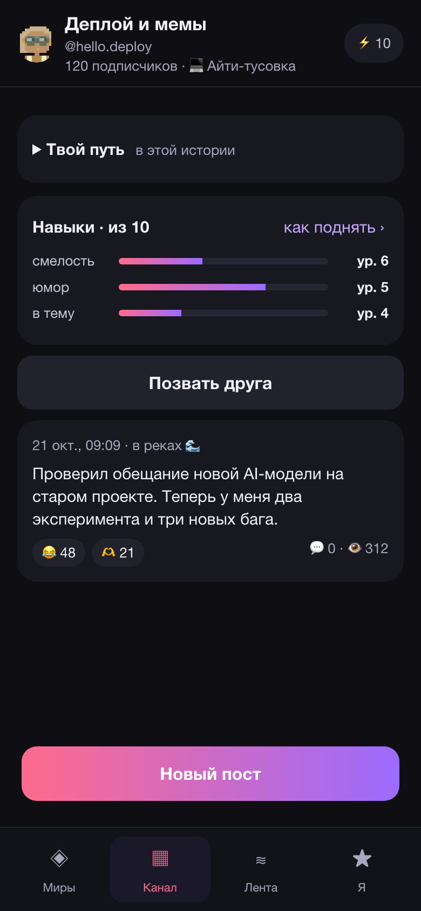
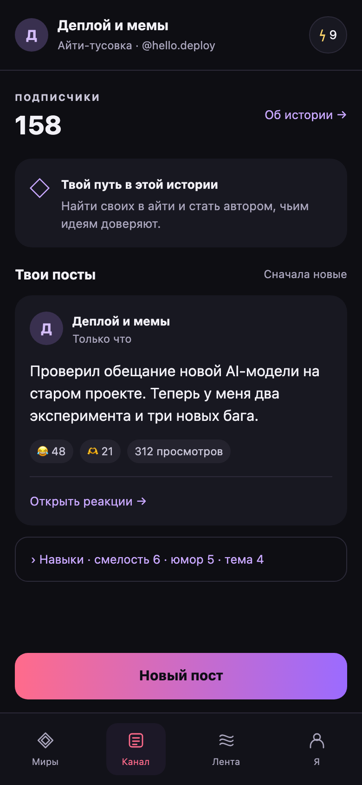
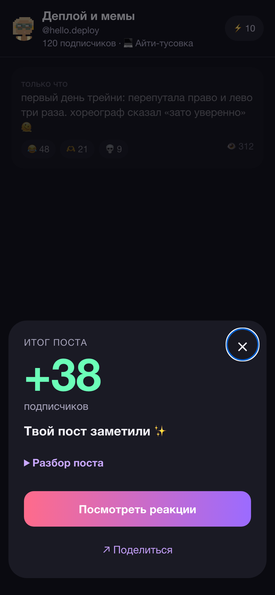
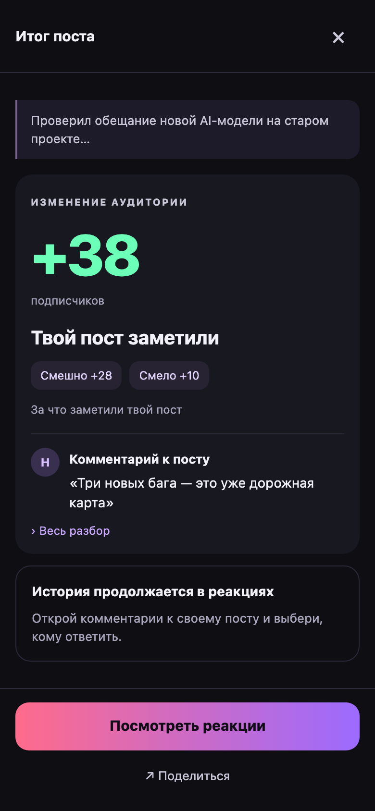
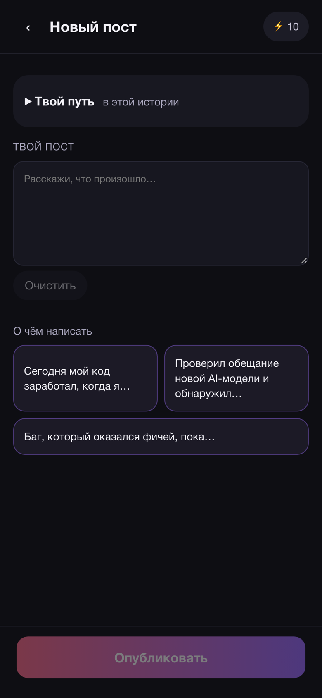
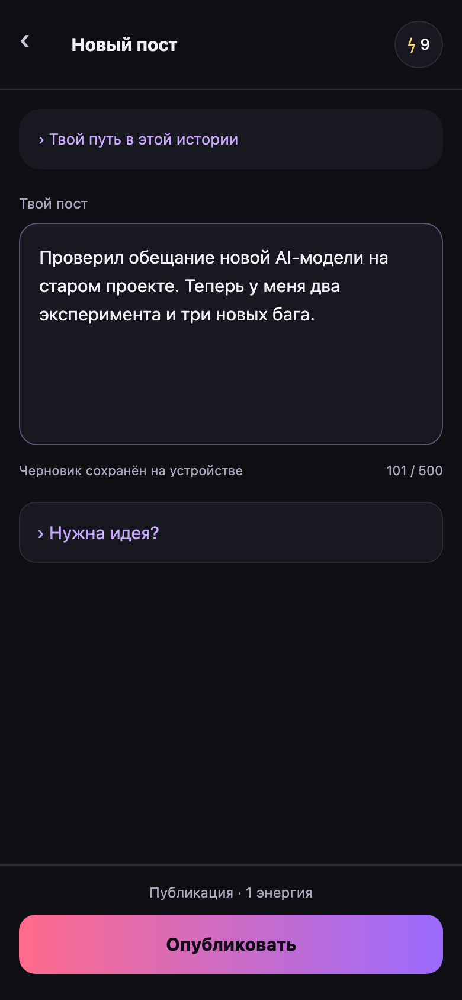
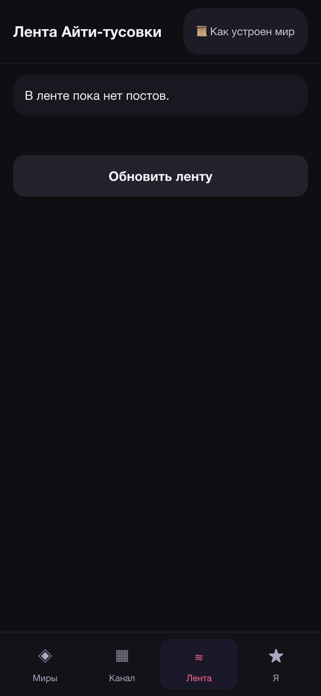
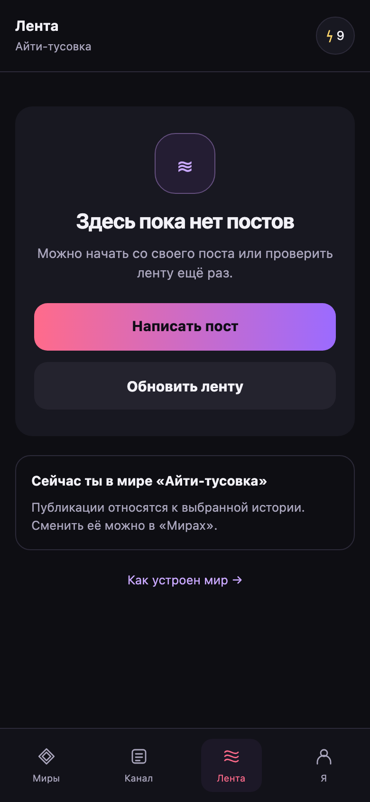
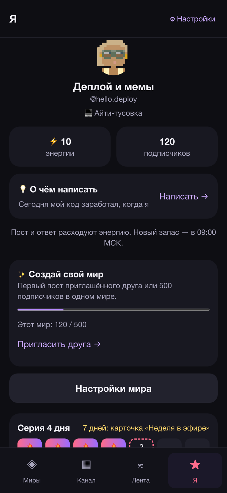
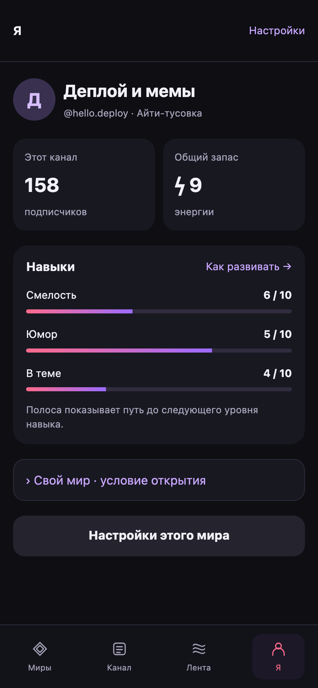

# Целостный цикл «Рек»: сравнение со Status и предложение для фронтенда

Дата: 21.10.2026. **Статус: Proposed.** Здесь исследование и эскизы; изменение приложения, баланса и механик не выполнено и не объявляется согласованным.

Главный приоритет — помочь продолжить игру после первого поста: увидеть, что изменилось, понять реакцию мира и выбрать следующий шаг. Для этого предлагается поднять публикации в канале, раскрыть полезную часть итога и согласовать редактор, ошибки и навигацию. Внешность «Рек» сохраняется: тёмные поверхности, розово-фиолетовый акцент, обложки и действующий генератор аватаров.

Задача для последующей реализации: [#205](https://github.com/Stepami/golden-mouth/issues/205). Документ и задача содержат предложения, а не разрешение на внедрение.

## Что открыть

- [Семь эскизов на одной странице](proposals.html): локально открыть HTML в браузере. Это документ с навигацией между примерами, не работающая Mini App; кнопки не обращаются к API и не публикуют посты.
- [PNG предложений](after/) доступны прямо в GitHub; [скриншоты текущей вёрстки](before/) — для сравнения.
- [Проверки и воспроизведение](VALIDATION.md).
- [Продуктовые агрегаты и точные SQL](evidence/product-aggregates.json): без текстов игроков и индивидуальных идентификаторов.
- [Навигация по 107 кадрам Status](https://github.com/edtechhackers-agents/reki-concept/blob/22a1f6d/research/screens-status-2026-10-16.md). Ниже каждый вывод привязан к конкретному кадру.

## Источники и границы проверки

1. Рабочая ветка создана от обновлённого `origin/master`, исходный коммит `cbc26b9ce5a47136cec1bf91e59061f2c565f61d`. Проверены корневой и фронтенд `AGENTS.md`, навыки `screen-check` и `issue-spec`.
2. Источник правил — [game-flow.md](../../game-flow.md), особенно «Главный экран миров» и «Сюжетный ориентир пресетов», и [balance.json](../../config/balance.json). Действующие договорённости о навигации — [navigation-chrome.md](../navigation-chrome.md). Исторические числа и экраны из видео Status не становятся правилами «Рек».
3. JS `index-CB6fouQL.js` и CSS `index-BeMlQ6aR.css` локальной сборки побайтово совпали с файлами production 21.10.2026. SHA-256 соответственно `dcc5f286a091305a3651c352f7c9a9f467c55ba9a5775eefd0dd261b3c32c8ea` и `52e67a41b8dd2454cae9bb572f7c9e4554884d96281ff0c11dde15c7198a242a`. Совпадение относится к сборке, не к пользовательским данным.
4. Снимки `before/` получены по `screen-check`: Chrome headless, 390×844, mock API. Для наполненного канала и ленты добавлена вымышленная публикация только в локальное хранилище тестового браузера. Обзор снят с `world=it`; без параметра он показывает корректный fallback, а не сломанный мир. `03-3_feed_empty.png` — отдельное пустое состояние. Остальные фикстуры могут содержать исторические демо-тексты: это не свидетельство смешения миров на сервере.
5. Эскизы `after/` — предложение, не результат запуска изменённого фронтенда. Аватары-буквы условные; менять существующий рендерер портретов не предлагается. Числа и комментарии вымышленные; вариации примеров не являются измеренным приростом. Уменьшенные картинки не заменяют оригинальные PNG.
6. Production runtime-конфигурация: `dm=false`, `friends=false`, `collection=false`. Личку, отношения в процентах, активности и магазин Status не выдаём за доступные возможности «Рек». Полноценное прохождение Telegram на реальном аккаунте и проверка реальных данных этим аудитом не выполнялись.
7. Обращение к GBrain не удалось (`Transport closed`); решения из памяти не использовались. Данные MCP получены отдельно и сохранены в агрегатах.

## Что подтверждают события

Источник — MCP `openobserve_prod`, stream `product`. Срез и SQL зафиксированы в JSON. Для базы используется 90-дневное окно поиска событий, внутри него когорта подтверждённых регистраций за последние 30 московских календарных дней, как в продуктовой вкладке дашборда: `cohort_origin=registered`, остальные фильтры `all`. Использованы текущие `v2-funnel.sql`, `v2-retention.sql`, `v2-history-coverage.sql` с зафиксированным временем вместо `now()`.

В выборке поведенческих событий только `activity_kind=real`; все профили с доставленным `player_deleted` исключены, включая их прошлую историю. Снимки inventory не считаются посещениями. Это профили, а не уникальные люди; отдельного признака исключения команды/тестировщиков нет. История начинается 07.10.2026, поэтому это не полный месяц наблюдения.

| Наблюдение | Число | Как влияет на приоритет | Чего не доказывает |
|---|---|---|---|
| Подтверждённые регистрации → первый / третий / десятый серверный пост | 71 → 49 / 11 / 1; 69,0% / 15,5% / 1,4% от единой базы | Основной фокус — продолжение после первого действия. До третьего поста дошли 11 из 49 опубликовавших | Нельзя назвать это последовательной сессионной воронкой или приписать отток конкретному экрану |
| Покрытие базы | 85 наблюдаемых профилей, 71 с регистрацией, 14 без неё | Не подмешивать старые ID к регистрации | Не число всех аккаунтов в Mongo |
| D1 на зрелых когортах | 7 / 67 = 10,4% | Сделать понятным смысл продолжения и возврата | Малый объём, разные релизы; не доказательство эффекта дизайна |
| Канал / редактор / тред | 470 / 240 / 192 просмотра, 79 / 73 / 52 профиля | Начать с часто используемых экранов цикла | Повторные просмотры не являются проблемой сами по себе |
| Экран ошибки публикации | 39 просмотров, 18 профилей | Понятное восстановление — часть основного UX, а не второстепенный случай | Не все визиты — уникальные ошибки сервера |
| Серверные `post_failed` | 29 событий, 29 разных `prop_id`, 16 профилей | Сохранить разграничение подтверждённого отказа и неизвестного исхода | Не делить на 197 клиентских `post_publish`: разные единицы, повторы и покрытие |
| `post_scored` / `post_result` | 157 / 154 события | Серверный результат и клиентский показ измерять раздельно | Разность 3 не доказывает ровно три потерянных результата |

В таблице экранов/ошибок показана доступная история за 90 дней, а не только зарегистрированная когорта. Все реальные события этой истории фактически укладываются в период с 07.10 по 21.10; сравнения не смешивают эти базы в одном проценте. D3 и D7 в JSON имеют малые зрелые базы; на них не основан выбор оформления.

## Сравнение по пути пользователя

| Участок | Что видно у Status | Что уже есть в «Реках» | Предлагаемое действие |
|---|---|---|---|
| Каталог и возврат | [S002][S002] — Continue playing; [S004][S004] — визуальные каталоги | `01-3_world`: продолжение текущей истории, свои экземпляры, карусель четырёх пресетов | Сохранить разделение продолжения и нового старта. Не добавлять Popular/Featured для четырёх пресетов и выдуманные счётчики популярности |
| Понимание мира | [S025][S025], [S051][S051] — цель, описание и персонажи | `01-3b_world_overview`: обложка, «Твой путь», состав; конкретный первый шаг уже есть в Home | Не добавлять ещё один обязательный экран. Длинное описание и персонажей сворачивать, действие «Выбрать персонажа» сохранять |
| Выбор роли | [S052][S052]–[S057][S057] — пресеты, своя роль, NPC, chemistry | `01-4_channel`, `01-4b_world_setup`: роль и драма, отдельный расширенный редактор | Согласовать шапки и подписи шагов, сохранить краткий путь. Chemistry Plus и создание NPC не добавлять в этот scope |
| Первый ход | [S062][S062]–[S068][S068] — завязка → навыки → конкретный первый квест | `01-6_home`: завязка и первый шаг; `02-1_compose`: текст и идеи | Упростить плотность редактора, не превращать ориентир в обязательный квест или автозачёт — P3 |
| Итог | [S070][S070] — XP и социальные изменения рядом с постом | `02-3_result`: большой прирост, причины и лучший комментарий скрыты в «Разборе» | Оставить отдельный итог и показать причину/комментарий без дополнительного раскрытия — P2 |
| Канал и лента | [S071][S071] — поток мира рядом с доступными действиями | `03-5_stage`: перед постами цель, навыки, приглашение; `03-3_feed` отдельно | Публикации поднять выше второстепенных блоков; не объединять ленту и канал — P1 |
| Цель и прогресс | [S072][S072]–[S073][S073] — milestones и требования навыков | Есть навыки и редакторский «Твой путь», но нет серверного прогресса сюжетной цели | Навыки поднять в «Я», сюжет объяснять без процентов и наград — P6/P7 |
| Ответы и отношения | [S076][S076]–[S077][S077], [S083][S083] — отдельные отношения и лимит лички | Тред доступен, личка отключена флагом; контракт результата не содержит delta отношений | Не рисовать изменение отношений в итоге. Сохранить цену ответа и выбор реплики; кнопку следующего поста не «добавлять заново», она уже есть |
| Активности | [S085][S085]–[S104][S104] — отдельный завершённый цикл сцены | Аналогичного работающего контура в текущем фронте нет | Это новая механика с backend-контрактом; не включать в оформление экранов |
| Лимит/монетизация | [S001][S001], [S080][S080], [S100][S100] — несколько ограничений и upsell | `04-1_limit`, `04-2_fake_door`: другой продуктовый договор | Сохранять правила «Рек», не копировать множественные валюты, принудительную рекламу и обрывы сцены |
| Пустота, ожидание и ошибка | [S092][S092] — ожидание сцены; серия не демонстрирует отказ публикации | `02-2_live`, `02-2b_publish_error`, пустая лента реализованы | Улучшить ясность трёх состояний, опираясь на собственный контракт «Рек», а не выдуманный аналог Status — P4/P5 |

## Конкретные замены

### P1. Канал: публикации — главный контент

**Сейчас:** [снимок](before/03-5_stage.png), `Stage` в [day.tsx](../../../frontend/src/screens/day.tsx). До списка постов стоят раскрытая карточка навыков и «Позвать друга», а после 1000 подписчиков ещё баннер этапа. Кнопка «Новый пост» и единое меню уже существуют.

**Предлагаю:** [эскиз](after/channel.png). Порядок: шапка текущей истории → аудитория → компактный сюжетный ориентир → посты → сворачиваемая сводка навыков. Приглашение остаётся доступно в существующем разделе и вторичной ссылкой, но не вытесняет публикации. Баннер этапа занимает один компактный блок и может быть закрыт; его появление по правилам не меняется. Основное действие — существующий «Новый пост» над меню.

**Пример:** на 390×844 первый пост начинается до середины экрана, а не после навыков и приглашения. Длинный пост продолжает прокручиваться; последние реакции доступны над dock. Переход к комментариям использует тот же `postId` и `returnTo=channel`.

### P2. Итог: показать связь действия и реакции

**Сейчас:** [снимок](before/02-3_result.png), `ResultCard` в [turn.tsx](../../../frontend/src/screens/turn.tsx). Крупное число видно сразу, причины и лучший комментарий внутри закрытого `
`. На фоне остаётся затемнённый пост.

**Предлагаю:** [эскиз](after/result.png). Убрать затемнённое дублирование поста и оформить один самостоятельный экран результата: короткая цитата поста → delta → одна фраза → до двух причин → лучший комментарий при наличии → «Весь разбор» для остального. Крестик возвращает в канал. Для обычного и отрицательного результата главная кнопка остаётся «Посмотреть реакции»; для залёта — действующее «Поделиться залётом». Награды только из `ribbons`.

**Пример:** `+38`, «смешно +28», «смело +10» и комментарий — вымышленные данные эскиза. В реализации выводятся `delta`, `whys`, `bestComment` текущего ответа. Числовые вклады показывать только при действующей проверке `explainsDelta`; иначе — названия факторов без ложного сложения. Отрицательный и нулевой прирост используют существующие формулировки. Нет процентов отношений, самостоятельного «XP +4» или проставленного выполнения сюжета: этих полей в `PostResult` нет.

### P3. Редактор: текст на первом месте

**Сейчас:** [снимок](before/02-1_compose.png). Текст, сюжетный ориентир и три развёрнутые идеи конкурируют за место. Черновик и подтверждение замены идеи уже реализованы.

**Предлагаю:** [эскиз](after/compose.png). Поле текста и читаемая стоимость у основной кнопки. Идеи по умолчанию раскрыты при пустом черновике; после ввода пользователь может свернуть их в «Нужна идея?». Не сворачивать/раскрывать блок при каждом символе и не терять фокус. Статус «Черновик сохранён на устройстве» только после успешного сохранения; при недоступном storage — существующее честное сообщение о текущей сессии. В эскизе показано заполненное состояние; примечание о реализации находится здесь, а не в продуктовом интерфейсе.

**Пример:** выбранная идея не перезаписывает ручной текст без подтверждения. `publicationId`, исходный текст и параметры восстановления не меняются. Уже отправленная неизвестная попытка блокирует новый publish; цена берётся из действующего `energy.post_cost`, не из нового баланса. Клавиатура не перекрывает поле, ошибки и действие.

### P4. Лента: различать пусто, загружается и ошибка

**Сейчас:** [пустая лента](before/03-3_feed_empty.png), [наполненная фикстура](before/03-3_feed.png). При пустом успешном ответе есть «В ленте пока нет постов» и «Обновить ленту». Начать свой пост можно через другой раздел.

**Предлагаю:** [эскиз](after/empty.png). Для `ready + []`: «Здесь пока нет постов», «Написать пост», вторично «Обновить ленту». При нулевой энергии переход по первой кнопке в существующий экран лимита. Для ошибки — сообщение о невозможности загрузить и повтор; сохранённые карточки не стирать. Для загрузки — ненавязчивый skeleton/status с зарезервированной высотой. Не показывать пустое состояние до завершения запроса и не подмешивать демо-посты.

**Пример:** написание поста из пустой ленты открывает тот же Compose, а не публикует готовый текст. Обычные непустые карточки и тред сохраняют `postId`, автора и текущий экземпляр мира. Не обещаем, что каждое обновление создаст новый контент.

### P5. Публикация: единый язык восстановления

**Сейчас:** [снимок отказа по умолчанию](before/02-2b_publish_error.png), `PublishError` и `Live` в [turn.tsx](../../../frontend/src/screens/turn.tsx). Типизированные причины, сохранение черновика и проверка неизвестного исхода уже существуют. Снимок отказа и эскиз неизвестного исхода — разные состояния, а не смена текста одной и той же ошибки.

**Предлагаю:** [эскиз неизвестного исхода](after/error.png). Общий визуальный шаблон статуса, но разные действия:

| Состояние | Сообщение и действие |
|---|---|
| Генерация / модерация | «Готовим публикацию» / «Проверяем публикацию», циклический индикатор без фиктивного процента; нейтральный текст, не обещание «через 3 секунды» |
| Подтверждённый отказ | Безопасная причина из текущей политики, сохранённый текст, «Изменить текст», ссылка на правила; без технических сообщений и ответа модели |
| Неизвестный исход | «Результат пока неизвестен», «Проверить статус» той же попытки; новая отправка недоступна |
| Подтверждённый успех | Существующий результат; повторное открытие не начисляет ничего локально |

**Пример:** потеря сети после отправки не превращается в «Отправить ещё раз». Эскиз не исправляет серверные `post_failed`; он делает восстановление понятным. API, таймауты, модерация и семантика списания не меняются.

### P6. «Я»: прогресс выше предложения открыть мир

**Сейчас:** [снимок](before/05-5_collection.png), `Me` в [day.tsx](../../../frontend/src/screens/day.tsx). Навыки находятся ниже вдохновения, приглашения, настроек мира и серии. Они уже есть, но не на первом экране.

**Предлагаю:** [эскиз](after/profile.png). Профиль → аудитория этого канала и общая энергия → три навыка с пояснением → настройки мира/серия/условие своего мира. Сохранить все существующие разделы ниже по прокрутке. Эскиз показывает верх экрана; отсутствие блока в первом viewport не означает удаление.

**Пример:** подписи различают «Этот канал» и «Общий запас». Полоса навыка — `progress` до следующего уровня, число — `level` из десяти. Не вводить ещё один общий уровень персонажа и не показывать вымышленные пустые слоты коллекции при выключенном флаге.

### P7. Новый лист «Об истории», без обязательного перехода

**Предлагаю:** [эскиз](after/story.png). Необязательный `StorySummarySheet` из компактного ориентира в канале: название текущего экземпляра, редакторская цель при её применимости, объяснение свободного продолжения, ссылка на существующий `05-11_world_rules`. Это новый UI на существующих данных, без нового API и без нового обязательного экрана первого входа.

Данные — `Player.worldInstanceId` и актуальный `worldDocumentOf(p.world)` / выбранный экземпляр; цель — только через существующий `presetGoalFor` с проверкой неизменённого лора. Свой мир или изменённый пресет получает заголовок «Об истории», собственную завязку и настройки, без навязанной редакторской цели. Если шаблон недоступен, цель не придумывается. Использовать существующий `Sheet`: закрытие кнопкой/назад/Escape, возврат фокуса, без потери черновика и переключения мира. Никакого «цель выполнена на 1%».

## Единые правила оформления в этой задаче

- Использовать текущие цвета `theme.css`, общие `TopBar`, `EnergyBadge`, `Card`, `Button`, `BottomCTA`, `Sheet`; извлечь повторяющиеся варианты карточек и статусов, вместо новых inline-стилей на каждом экране. Шаг сетки: 4/8/12/16/24; внешние отступы 16, карточки 18 radius, кнопки 14. Длинные тексты не ограничивать фиксированной высотой.
- Одна основная кнопка на текущий контекст. На главных экранах сохранять Миры/Канал/Лента/Я и активный `aria-current`; в редакторе и треде вместо tabbar — панель действия. Результат закрывается в канал. Не создавать пятую вкладку цели/активности.
- Декоративные emoji мира можно оставить, но у навигационных и управляющих иконок одна семья SVG с одинаковыми размерами и толщиной. Обложки и рендерер аватаров не перерисовывать. В эскизах SVG лишь пример формы, не новый бренд.
- **Исправить контраст основного действия:** белый `#fff` на концах текущего градиента даёт 2,72:1 и 3,53:1. Тёмный текст `#100d17` на том же градиенте даёт 7,08:1 и 5,44:1; его показывает эскиз. При реализации проверить весь градиент и состояния. Это изменение токена подписи основной кнопки, а не всей текстовой палитры. Вторичные кнопки сохраняют светлый текст. Для 15–16 px требуется не менее 4,5:1.
- Интерактивная область минимум 44×44, контрастный focus-visible, текстовые подписи ключевых действий, не один цвет для состояния. Учесть reduced-motion, safe-area и экранную клавиатуру. На 320 px подписи переносятся без горизонтального скролла.
- Состояния загрузки/пустоты/ошибки используют одинаковый ритм: заголовок, короткое объяснение, одно основное действие. Никаких технических деталей генерации, моков или API в интерфейсе игрока.

## Приоритет и границы одной задачи

**Первый проход:** P1, P2, P3, P5 и общий контраст/навигационные компоненты. Это основной цикл и частое восстановление. **Второй проход той же задачи:** P4, P6, P7 — контекст и пустые состояния. Все семь предложений остаются проверяемыми пунктами; при согласовании можно явно сократить scope, но не считать полную задачу реализованной после первого прохода.

Не входят: backend, миграции, баланс, новые валюты, реальные проценты отношений, milestones с наградами, текстовые сюжетные автоматы, активация dm/friends/collection, новые обязательные шаги, переписывание контента миров, мерж или деплой. Существующие #192/#195/#177 относятся к другим, серверным/контентным изменениям; этот документ не обход их согласования.

## Критерии приёмки будущей реализации

1. P1: до вторичных блоков видна первая публикация при наличии постов; пустой канал сохраняет существующий первый шаг. Возврат из треда сохраняет текущую историю, посты не смешиваются.
2. P2: в обычном результате до раскрытия видны delta, причины при наличии и лучший комментарий при наличии. Для отсутствующих полей нет заглушек. Flop/zero/viral используют правдивые состояния и действующие CTA. Закрытие ведёт в канал; новый рост не начисляется локально.
3. P3: пустой/заполненный/сохранённый/недоступный storage/неизвестная попытка проверены отдельно. Reload сохраняет свой черновик и параметры публикации. Идея не перезаписывает текст без подтверждения. Ширина и клавиатура не скрывают действие.
4. P4: loading, empty, cached + error, retry, ready различимы. Пустое состояние не мелькает перед загрузкой. «Написать пост» учитывает энергию и не отправляет текст самостоятельно.
5. P5: ошибка до отправки, отказ модерации, обрыв после отправки, сохранённый успех и всё ещё неизвестный исход не смешиваются. Проверяется тот же `publicationId`; нет повторного списания/автопубликации/утраты текста. Кризисный маршрут сохраняется.
6. P6: навыки находятся выше промо-блоков; номер и progress не смешаны. Серия и настройки доступны. Выключенные возможности не получают обещающих пустых разделов.
7. P7: лист необязателен; свои и изменённые миры не наследуют чужую цель; закрытие возвращает контекст и фокус. Нет нового запроса/поля для сюжетного процента.
8. Внешняя система применена к четырём главным экранам, Compose/Thread/Result и новым состояниям. Контраст текста CTA ≥4,5:1; controls ≥44 px; есть focus/reduced-motion. Длинное имя, текст до 500 символов, крупный шрифт, 320/390 px и safe-area не ломают вёрстку.
9. Снять новые реальные screenshots будущего фронтенда по `screen-check`, сравнить с утверждёнными примерами, обновить `docs/screens` и его индекс только после реализации. Текущие proposal PNG не выдавать за production.
10. Перед будущим PR с кодом: `npx tsc -b`, `npm run build`, проверка секретов и целевые сценарии восстановления/черновика. В этой документальной работе уже выполнены сборка исходной версии, визуальная проверка снимков/эскизов и проверка ссылок; это не проверка будущей реализации.

## Как проверять эффект после реализации

Основная метрика — доля ≥3 уникальных серверных постов среди профилей с ≥1 постом в одинаково зрелом окне после регистрации, с исключением `player_deleted`. Дополнительно: первый пост/регистрация, D1 с отдельной зрелой базой и частота повторного входа в редактор после ошибки. Не сравнивать текущие исторические проценты напрямую с новой недельной когортой без одинаковых условий.

Для действий использовать существующий `tap` с фиксированными ID, например `result_open_thread`, `compose_ideas`, `story_summary_open`; при реализации описать их в `docs/analytics.md`. Это план, вызовы ещё не добавлены. Текущих событий недостаточно, чтобы связать каждую кнопку с последующим постом или отличить эффект дизайна от качества генерации. Не логировать текст поста, комментарии, имена, initData и личные данные. Отдельных новых backend-событий эта задача не требует.

## Иллюстрации для просмотра в GitHub

| Текущая вёрстка | Предлагаемое оформление |
|---|---|
|  |  |
|  |  |
|  |  |
|  |  |
|  |  |

Отказ публикации и неизвестный исход иллюстрируют разные ветки: [текущий отказ](before/02-2b_publish_error.png), [предложение неизвестного исхода](after/error.png). Новый лист: [Об истории](after/story.png). Это не сравнение двух одинаковых ошибок.

[S001]: https://github.com/edtechhackers-agents/reki-concept/blob/22a1f6d/research/refs/status/capture-2026-10-16/01-plus/001_plus__IMG_9382.PNG
[S002]: https://github.com/edtechhackers-agents/reki-concept/blob/22a1f6d/research/refs/status/capture-2026-10-16/02-home/002_home-continue__IMG_9383.PNG
[S004]: https://github.com/edtechhackers-agents/reki-concept/blob/22a1f6d/research/refs/status/capture-2026-10-16/03-featured/004_featured-top__IMG_9385.PNG
[S025]: https://github.com/edtechhackers-agents/reki-concept/blob/22a1f6d/research/refs/status/capture-2026-10-16/04-world-preview/025_stranger-expanded__IMG_9406.PNG
[S051]: https://github.com/edtechhackers-agents/reki-concept/blob/22a1f6d/research/refs/status/capture-2026-10-16/06-setup/051_singer-universe__IMG_9432.PNG
[S052]: https://github.com/edtechhackers-agents/reki-concept/blob/22a1f6d/research/refs/status/capture-2026-10-16/06-setup/052_choose-role__IMG_9433.PNG
[S057]: https://github.com/edtechhackers-agents/reki-concept/blob/22a1f6d/research/refs/status/capture-2026-10-16/06-setup/057_first-follower-alex__IMG_9438.PNG
[S062]: https://github.com/edtechhackers-agents/reki-concept/blob/22a1f6d/research/refs/status/capture-2026-10-16/08-first-post/062_intro-start__IMG_9443.PNG
[S068]: https://github.com/edtechhackers-agents/reki-concept/blob/22a1f6d/research/refs/status/capture-2026-10-16/08-first-post/068_quest-draft__IMG_9449.PNG
[S070]: https://github.com/edtechhackers-agents/reki-concept/blob/22a1f6d/research/refs/status/capture-2026-10-16/08-first-post/070_post-outcome__IMG_9451.PNG
[S071]: https://github.com/edtechhackers-agents/reki-concept/blob/22a1f6d/research/refs/status/capture-2026-10-16/09-world-state/071_feed-day1__IMG_9452.PNG
[S072]: https://github.com/edtechhackers-agents/reki-concept/blob/22a1f6d/research/refs/status/capture-2026-10-16/09-world-state/072_goal-milestone__IMG_9453.PNG
[S073]: https://github.com/edtechhackers-agents/reki-concept/blob/22a1f6d/research/refs/status/capture-2026-10-16/09-world-state/073_quests-skills__IMG_9454.PNG
[S076]: https://github.com/edtechhackers-agents/reki-concept/blob/22a1f6d/research/refs/status/capture-2026-10-16/09-world-state/076_profile-relationship__IMG_9457.PNG
[S077]: https://github.com/edtechhackers-agents/reki-concept/blob/22a1f6d/research/refs/status/capture-2026-10-16/09-world-state/077_selena-profile__IMG_9458.PNG
[S080]: https://github.com/edtechhackers-agents/reki-concept/blob/22a1f6d/research/refs/status/capture-2026-10-16/10-day2/080_ads-upsell__IMG_9461.PNG
[S083]: https://github.com/edtechhackers-agents/reki-concept/blob/22a1f6d/research/refs/status/capture-2026-10-16/10-day2/083_dm-refill__IMG_9464.PNG
[S085]: https://github.com/edtechhackers-agents/reki-concept/blob/22a1f6d/research/refs/status/capture-2026-10-16/11-activity-setup/085_activities-empty__IMG_9466.PNG
[S092]: https://github.com/edtechhackers-agents/reki-concept/blob/22a1f6d/research/refs/status/capture-2026-10-16/12-activity-play/092_activity-generating__IMG_9473.PNG
[S100]: https://github.com/edtechhackers-agents/reki-concept/blob/22a1f6d/research/refs/status/capture-2026-10-16/13-activity-result/100_activity-limit__IMG_9481.PNG
[S104]: https://github.com/edtechhackers-agents/reki-concept/blob/22a1f6d/research/refs/status/capture-2026-10-16/13-activity-result/104_activity-complete__IMG_9485.PNG
