# Сюжеты для четырёх миров

Черновик к [#192](https://github.com/Stepami/golden-mouth/issues/192), 18.10.2026. Четыре мира × свой персонаж и три готовых героя = 16 сюжетов. У каждого — два исхода, таблицы и граф.

Учитываем уточнение по встрече: пресеты должны напоминать по жанру «Сумерки», «Гарри Поттера», «Игру престолов» и «Кремниевую долину», но иметь собственных героев и истории. Предложения по мирам, биографиям и голосам — в разделе «Предлагаемые пресеты» ниже. Смена имён сама по себе эту задачу не решает.

Это материал для согласования. Сюжеты рассчитаны на **предлагаемую новую версию пресетов**, а не на старые биографии. Каталог, существующие миры, экономика, API и БД не менялись. Автоматического зачёта сюжетов в игре сейчас нет; действующий «Твой путь» остаётся необязательной подсказкой без прогресса и наград.

## Все 16 вариантов

В скобках — ключ действующего каталога. Имена справа — предложения для новой версии, а не выполненные переименования.

| Мир | Выбор игрока | Сюжет | Что решает игрок |
| --- | --- | --- | --- |
| Вечерело | Свой персонаж | [Улица на чужом снимке](#evening_own_01) | Публиковать ли маршрут на основании неполных свидетельств |
| Вечерело | Ася Лебедева (`isabella`) | [Фотография с пустым местом](#evening_isabella_01) | Где заканчивается реставрация и начинается выдуманное прошлое |
| Вечерело | Марк Калинин (`eduard`) | [Последний звук сеанса](#evening_eduard_01) | Как связать звук и снимок, не раскрывая частную запись |
| Вечерело | Яков Чернов (`yakov`) | [Две дороги к одному дому](#evening_yakov_01) | Можно ли пользоваться старой памятью как современной картой |
| Школа чародеев | Свой персонаж | [Урок, который был вчера](#sorcerers_own_01) | Как встретиться, если расписание и здание расходятся |
| Школа чародеев | Гоша Гончаров (`gosha`) | [Компас чужой комнаты](#sorcerers_gosha_01) | Исправен ли прибор, если неверно понято его назначение |
| Школа чародеев | Георгина Гречихина (`georgina`) | [Прогноз для закрытого двора](#sorcerers_georgina_01) | Ошибся прогноз или изменилось место измерения |
| Школа чародеев | Роман Ласкин (`roman`) | [Чьи воспоминания останутся](#sorcerers_roman_01) | Как сохранить противоречащие свидетельства без ложного победителя |
| Игра домов | Свой персонаж | [Две печати одного совета](#houses_own_01) | Кто вправе созвать совет и чем это подтверждается |
| Игра домов | Диана Речная (`diana`) | [Цена открытой переправы](#houses_diana_01) | Как признать выгоду своего дома и не скрыть её в обещании |
| Игра домов | Ян Северин (`jon`) | [Письмо вместо обозов](#houses_jon_01) | Чем обещание поставки отличается от обеспеченного маршрута |
| Игра домов | Мартен Гран (`james`) | [Архив против собственной подписи](#houses_james_01) | Как проверить документ независимо от репутации хранителя |
| Айти-тусовка | Свой персонаж | [Демо, которое можно повторить](#it_own_01) | Что команда вправе обещать после узкого теста |
| Айти-тусовка | Вера Сметина (`greedy_wolf`) | [Пилот без обещанной выручки](#it_greedy_wolf_01) | Как отличить интерес пользователя от продажи |
| Айти-тусовка | Мирон Кедр (`2kotleti_news`) | [Скриншот быстрее продукта](#it_2kotleti_news_01) | Как исправить ожидание готового сервиса без нового преувеличения |
| Айти-тусовка | Лев Соль (`alexey_nl`) | [Красивый результат на знакомых данных](#it_alexey_nl_01) | Что действительно доказал тест на знакомых примерах |

Готовый герой, выбранный игроком, не появляется отдельным NPC. Его действия проверяются по ID игрока; ключ героя определяет только выбранную роль. Для собственного персонажа биография, пол, родство и романтические отношения заранее не назначаются.

## Как читать справочник

В каждом справочнике: паспорт → состояния → события → переходы → полная матрица → граф → проверочные прогоны. Состояние хранит накопленные факты и новый факт этапа. Результат перехода описывает изменение истории, а не добавочную реплику, деньги или ачивку.

`catalog.json` — источник этих таблиц. Формат нужен для проверки черновика; он **не утверждает контракт импорта** будущего движка. Документ `stories.md` собирается из `catalog.json` и `introduction.txt`. Для обновления:

```sh
python3 docs/story-automata/render.py
python3 docs/story-automata/render.py --check
```

Проверка охватывает состав вариантов и NPC, ссылки, привязки к ранее сохранённым объектам, достижимость состояний, полные матрицы, оба исхода и отсутствие повторного продвижения от той же категории. Она не проверяет художественное качество, правовую допустимость или работу будущей классификации текста.

## Общие условия событий

Таблицы задают расширенный автомат: конечные состояния плюс память ID постов и комментариев. Не создаём отдельное состояние на каждый ID.

| Вид | Подтверждённый источник | Условие связи | Что запоминаем |
| --- | --- | --- | --- |
| `player_post` | Успешно сохранённый пост игрока | Текущий экземпляр мира; автор — игрок; факт возник после начала нужного этапа | ID поста в указанную переменную |
| `npc_comment` | Сохранённый видимый комментарий нужного героя | Пост равен привязке `p0`; автор входит в NPC этого экземпляра. Это может быть корневой комментарий или потомок в том же посте | ID комментария |
| `player_reply` | Сохранённый ответ игрока | `parentCommentId` равен указанной привязке `c0`/`c1`; тот же пост и мир | ID ответа |
| `npc_reply` | Сохранённый ответ нужного героя | `parentCommentId` равен указанному ответу игрока; тот же пост и мир. В этих 16 сюжетах пока не требуется | ID комментария героя |
| `OTHER` | Подтверждённое неподходящее событие | Иной автор, пост, ветка, время либо неподходящий смысл | Ничего |

К этим проверкам добавляется критерий по смыслу из строки конкретного события. Фраза игрока «Марк подтвердил» не заменяет сохранённого комментария Марка. Цитата или пересказ не считаются собственным решением игрока. Полного совпадения формулировки не требуется; нужны все перечисленные факты и отсутствие противоречащего утверждения.

Классификатор должен вернуть сохранённый результат проверки по версии критерия и ссылке на исходный текст. Это новое требование, а не действующий API. Автомат выполняет переход по проверенному результату, а не по свободному решению модели. Факты, которые должны сообщить герои, заданы таблицами; генерация может менять выражение, но не придумывать другую улику вместо нужной.

Для двух исходов требуется одно ясно выбранное решение. Если текст поддерживает оба несовместимых решения либо ни одного, это `OTHER`: остаёмся на этапе и просим уточнить итог. Правила «первое совпадение» нет. Неопределённый результат или ошибка классификации — **ожидание проверки**, а не `OTHER`; факт не теряется и повторно проверяется после восстановления.

## Порядок, повторы и ошибки

- Сначала подтверждение сохранения, затем проверка автора и связей, затем смысла, затем переход. Предпросмотр генерации не двигает сюжет.
- Под одним постом могут сохраниться пост и несколько комментариев за один ход. Их нужно обработать в причинном порядке: пост раньше его комментариев, родитель раньше ответа. Внутри экземпляра истории переходы выполняются последовательно; способ хранения порядка согласуется для движка. Один сохранённый комментарий не закрывает два этапа.
- Событие до открытия его этапа не засчитывается задним числом. В ранней реплике уже могла прозвучать нужная мысль: после открытия этапа нужен новый подтверждённый ответ. Будущая генерация должна учитывать текущий этап, чтобы не выдавать все улики заранее.
- Повтор доставки того же факта не запускает переход или эффект заново. Ключ факта должен отличать публикацию от комментария и учитывать ID объекта. Отдельный общий `event_id` в текущем контракте не подтверждён.
- Новое похожее событие имеет другой ID, но тоже проходит полную проверку текущего этапа. Уже закрытый этап от этого не повторяется.
- Неподходящий текст оставляет состояние. Игроку нужна короткая подсказка, чего не хватает, без штрафа, отката и подмены его текста. Свободные посты остаются частью обычной игры.
- Ошибка генерации, отказ модерации или несохранённый текст не создают сюжетный факт. Сюжет не добавляет расход энергии поверх действующих правил публикаций и ответов.
- В F1/F2 любые события оставляют завершённый сюжет. Итог показывается один раз; обычная игра продолжается. Перезапуск и повторные награды здесь не предусмотрены.
- При смене мира история остаётся у своего экземпляра. Сюжеты старой версии не переводятся на новые биографии посреди прохождения; политика выдачи новой версии ещё требует согласования.

## Что есть в коде, а чего не хватает

Проверено по `master` на коммите `0875680` и по шаблонам DEV 18.10.2026. Это проверка структуры данных, а не доказательство работающего сюжетного движка.

| Возможность | Сейчас | Основание / что нужно |
| --- | --- | --- |
| ID мира, поста, автор, текст, комментарии | Есть в серверной модели | [GamePost](../../backend/src/Reki.Domain/Posts/GamePost.cs) |
| ID, автор, текст, родитель, скрытость комментария | Есть | [GameComment](../../backend/src/Reki.Domain/Posts/GameComment.cs). Время отдельного комментария не хранится в этой модели |
| Публикация с комментарием героя; ответы в ветке | Есть | [PublishPostHandler](../../backend/src/Reki.Application/Posts/PublishPostHandler.cs), [AddReplyStreamHandler](../../backend/src/Reki.Application/Posts/AddReplyStreamHandler.cs) |
| Привязки `p0`, `c0`, версия и состояние истории | Не реализованы как сюжетный механизм | Нужны отдельное хранение и проверка принадлежности экземпляру истории |
| Проверка критериев по смыслу и её сохранённый результат | Не реализована для этих сюжетов | Нужны критерии, примеры, контрпримеры и согласование результата проверки |
| Реплика нужного героя на нужном этапе | Не гарантирована | Сейчас герой публикации выбирается генерацией; дополнительный участник ответа необязателен. Нужны сюжетный контекст и способ получить нужную реплику без бесконечных случайных попыток |
| Порядок, повторная доставка и однократный сюжетный эффект | Не подтверждены для сюжетов | Идемпотентность публикаций/ответов сама по себе не обеспечивает однократность нового сюжетного перехода |
| Показывать этап, подсказку и два итога | Не реализовано | Текущий ориентир пресета не проверяет прохождение. Интерфейс обсуждается после согласования данных |

В первую версию не включены личка, подписки на NPC, новые статусы отношений, задания по расписанию, пороги подписчиков и новые награды. Счётчик подписчиков не заменяет конфликт истории. Простая проверка «оставлен любой комментарий» тоже не заменяет проверку того, что он означает.

## Перед реализацией

Нужно согласовать предложенные миры, биографии, истории и спорные критерии; затем со Степаном определить поддержку событий, привязок и версий. Отдельно проверить обложки, аватары и публичные названия: замена текста не меняет изображения автоматически и не гарантирует правовую допустимость всего пресета.

Изменения движка, каталога и БД требуют отдельной согласованной работы. Этот PR не применяет их и не закрывает #192: в задаче остаётся содержательное ревью справочников.

Основание: описание #192; уточнение пользователя 18.10.2026 о жанровых ориентирах и самостоятельности миров; встреча от 16.10.2026 — таблицы переходов, варианты по роли игрока, проверяемые события и версии. Действующие правила: [путь пресетов](../game-flow.md#сюжетный-ориентир-пресетов), [баланс](../config/balance.json).


## Предлагаемые пресеты

Черновик к #192 от 18.10.2026. Это самостоятельные истории с жанровыми ориентирами; изменения работающего каталога не применены. Сходство атмосферы не подтверждает правовую допустимость конкретного исполнения. До публикации проверить также названия, внешность, обложки и рекламные материалы.

Сохраняем технические ключи для сопоставления. Это не решение переименовать героев в существующих мирах: новые биографии и сюжеты относятся только к новой согласованной версии пресета.

### Вечерело (`evening`)

| Поле | Предложение |
| --- | --- |
| Жанровый ориентир | Сумерки |
| Что сохраняем от жанра | Дождливый город, скрытая жизнь его жителей, близость и недоверие. |
| Описание мира | В приморском городе после дождя проступают исчезнувшие улицы. Некоторые жители умеют удерживать чужие воспоминания, но теряют собственные детали прошлого. Хроника в общей ленте помогает сверять память. Симпатия возможна, но не служит пропуском к разгадке. |
| Первая ситуация | На твоём снимке появилась улица, которой нет на современной карте. На витрине виден знак в виде разомкнутого круга. |
| Первый вопрос | Что ты расскажешь об этом в первом посте? |
| Свой персонаж | Своя биография и голос. Участие добровольное; герой не получает заранее назначенную судьбу, родство или симпатию. |

#### Границы мира

- Нельзя изменить прошлое: можно только сопоставлять оставшиеся свидетельства.
- Каждая способность имеет узкое ограничение; герои могут ошибаться.
- Нет обязательного любовного треугольника, обращения в сверхъестественное существо или выбора партнёра ради прохождения.

#### Три готовых героя

| Ключ | Сейчас в каталоге | Предлагаемое имя | Роль | Биография и конфликт | Голос |
| --- | --- | --- | --- | --- | --- |
| isabella | Изабелла Лебедева | Ася Лебедева | Реставратор фотографий | Замечает на снимках следы стёртой памяти, но не умеет определить их дату. Ведёт мастерскую, хочет собрать городской фотоархив и боится приписать людям выдуманное прошлое. | Точные детали снимков, осторожные выводы, суховатые шутки. |
| eduard | Эдуард Калинин | Марк Калинин | Хранитель кинотеатра | Может удержать последний звук в пустом зале до рассвета. Звук исчезает с первым дневным сеансом. Хочет сохранить кинотеатр как место встреч, однако не готов публиковать личные записи посетителей без согласия. | Спокойно, коротко, с вниманием к тому, кто разрешил рассказать свою историю. |
| yakov | Яков Чернов | Яков Чернов | Смотритель городских троп | Слышит отголоски прежних названий на перекрёстках. Отголосок даёт название, но не безопасный путь. Составляет доступные пешие маршруты и спорит с теми, кто превращает городскую тайну в аттракцион. | Тепло и прямо; сначала практический вопрос, потом шутка. |

### Школа чародеев (`sorcerers`)

| Поле | Предложение |
| --- | --- |
| Жанровый ориентир | Гарри Поттер |
| Что сохраняем от жанра | Учёба магии, дружба, школьные открытия и тайна старого здания. |
| Описание мира | Школа на острове в Ладоге учит работать с памятью вещей, погодой и потерянным временем. Ночью помещения меняют расположение, а бумажные расписания подстраиваются под новое здание. Только записи общей ленты сохраняют вчерашнюю версию. Ученики выясняют, как учиться вместе, если даже место встречи ненадёжно. |
| Первая ситуация | В расписании появился урок, отменённый сто лет назад. В списке есть твоё имя, а вчерашняя запись в ленте указывает другую аудиторию. |
| Первый вопрос | Что ты расскажешь об этом в первом посте? |
| Свой персонаж | Своя биография и голос. Участие добровольное; герой не получает заранее назначенную судьбу, родство или симпатию. |

#### Границы мира

- Нет избранного ученика, пророчества, шрама-знака, тёмного властелина, узнаваемых заклинаний и деления на знакомые факультеты.
- Магические опыты требуют наблюдений и согласия участников; опасная вылазка не обязательна.
- Изменение здания не переписывает уже опубликованную хронику.

#### Три готовых героя

| Ключ | Сейчас в каталоге | Предлагаемое имя | Роль | Биография и конфликт | Голос |
| --- | --- | --- | --- | --- | --- |
| gosha | Гоша Гончаров | Гоша Гончаров | Реставратор учебных приборов | Вырос в семье речных механиков. Хорошо чинит зачарованные инструменты, но часто доверяет прибору раньше, чем проверяет условия опыта. Хочет открыть общую мастерскую. За ремонты берётся охотно, за скучную проверку — с трудом. | Говорит предметно, рисует устройство на словах, спокойно признаёт неудачную сборку. |
| georgina | Георгина Гречихина | Георгина Гречихина | Ученица островной метеостанции | Приехала из степного посёлка наблюдать островную погоду. Быстро придумывает полевые опыты и не любит отчёты, пока нет живого наблюдения. Учится отличать удачную догадку от воспроизводимого результата. Её лучшие открытия начинаются с ошибки в прогнозе. | Живо и образно, предлагает проверить на месте, честно отмечает сомнения. |
| roman | Роман Ласкин | Роман Ласкин | Хранитель ученической хроники | Записывает, как ученики помнят меняющуюся школу. Осторожен с чужими свидетельствами, любит сопоставлять версии. Хочет, чтобы в хронике оставались голоса тихих учеников. Его слабость — долго собирать версии и откладывать собственное решение. | Неторопливо, уточняет источник и время; юмор в примечаниях, а не вместо ответа. |

### Игра домов (`houses`)

| Поле | Предложение |
| --- | --- |
| Жанровый ориентир | Игра престолов |
| Что сохраняем от жанра | Соперничество домов, публичные обещания, союзы и цена власти. |
| Описание мира | После исчезновения хранителя общей печати речные дома спорят, кто имеет право созвать совет. Торговля зависит от шлюзов, переправ и старых договоров. Публичная хроника делает обещания проверяемыми: можно получить союзника, но придётся назвать свою уступку. Нет единственного законного спасителя. |
| Первая ситуация | В общей ленте два письма с печатью совета: право созвать собрание обещано разным домам. Дата одна, подписи разные. |
| Первый вопрос | Что ты расскажешь об этом в первом посте? |
| Свой персонаж | Своя биография и голос. Участие добровольное; герой не получает заранее назначенную судьбу, родство или симпатию. |

#### Границы мира

- Нет драконов, ледяной стены, армии мёртвых, знакомых династий и повторения борьбы за Железный трон.
- Конфликты первой истории решаются свидетельствами и соглашениями, без сцен жестокости.
- Поддержка героя не передаёт игроку титул, войско или экономическую награду.

#### Три готовых героя

| Ключ | Сейчас в каталоге | Предлагаемое имя | Роль | Биография и конфликт | Голос |
| --- | --- | --- | --- | --- | --- |
| diana | Диана ШтормоРождённая | Диана Речная | Представительница дома переправ | Избрана речными поселениями на один сезон, а не наследует власть. Добивается свободного прохода через шлюзы, но её дом получает доход с пошлин. Должна публично объяснить это противоречие. Потеряет должность, если поселения отзовут её мандат. | Уверенно, называет обязательство и то, чем готова поступиться. |
| jon | Джон Винтер | Ян Северин | Распорядитель зерновых складов | Отвечает перед несколькими домами за зимние запасы. Умеет договариваться, но скрывает нехватку перевозчиков, опасаясь паники. Ни один дом не считает его полностью своим. | Коротко и практично: маршрут, срок и последствия для жителей. |
| james | Джеймс Левлистер | Мартен Гран | Хранитель копий договоров | Разорвал выгодный договор своего дома, когда нашёл подмену приложения. Теперь ему не доверяют обе стороны. Хочет вернуть вес архиву, разрешив проверять документы независимо от его слова. Он помнит, что архив однажды уже послужил удобной ширмой его дому. | Учтиво, иногда колко; отделяет текст договора от своей трактовки. |

### Айти-тусовка (`it`)

| Поле | Предложение |
| --- | --- |
| Жанровый ориентир | Кремниевая долина |
| Что сохраняем от жанра | Небольшая команда, технологические амбиции, демо, деньги и неловкие компромиссы. |
| Описание мира | В бывшей типографии команды готовят проекты к открытому дню прототипов. Блоги заменяют презентации: здесь проверяют заявления, делятся провалами и спорят, кому достанется право рассказать об общем результате. В центре история команды, а не новости настоящих блогеров. |
| Первая ситуация | Твой техноблог открыт. На дне прототипов обещают показать сервис поиска потерянных рабочих заметок, но у команды пока только локальный тест. |
| Первый вопрос | Что ты расскажешь об этом в первом посте? |
| Свой персонаж | Своя биография и голос. Участие добровольное; герой не получает заранее назначенную судьбу, родство или симпатию. |

#### Границы мира

- Все компании, продукты, цифры тестов и персонажи вымышлены.
- Нет реальных ников блогеров, копий команды сериала, её продукта, диалогов и фирменных шуток.
- Успех — проверяемая договорённость или честный результат, а не обязательная оценка стартапа в деньгах.

#### Три готовых героя

| Ключ | Сейчас в каталоге | Предлагаемое имя | Роль | Биография и конфликт | Голос |
| --- | --- | --- | --- | --- | --- |
| greedy_wolf | Меркантил | Вера Сметина | Продакт кооперативной мастерской | Сводит расходы на общий стенд и работает с первыми пользователями. Умеет остановить ненужную разработку, но иногда слишком рано отбрасывает непривычную идею. Хочет, чтобы команда могла объяснить, за что люди будут платить. | Короткие вопросы о затратах и пользе; спорит с расчётом, не с человеком. |
| 2kotleti_news | Бургер в Декабре | Мирон Кедр | Автор демо и редактор команды | Делает сложный прототип понятным и собирает отзывы. Иногда анонс у него убедительнее самого продукта. Хочет научиться привлекать внимание, не обещая готовность, которой нет. | Живо и с сухим юмором; конкретный пример вместо рекламного лозунга. |
| alexey_nl | Куляш AI | Лев Соль | Инженер поиска | Разрабатывает локальный поиск по заметкам. Воспроизводимость для него важнее эффектного демо, однако он склонен бесконечно расширять тест. Учится выпускать ограниченный, но честно описанный прототип. | Объясняет условия опыта обычными словами, отдельно говорит об ограничениях. |

### Общие ограничения

- Не использовать узнаваемые эмблемы, костюмы, внешность актёров, цитаты и сцены оригиналов. Обложки и аватары требуют отдельной сверки перед выпуском.
- Возрастная рамка и правила безопасности действующей игры сохраняются. Никаких обязательных романтических отношений или сцен жестокости.
- Отдельный конфликт каждого героя важнее комплекта «главный герой — умная подруга — смешной друг». Выбранный герой становится игроком и исключается из NPC.
- Новые способности и должности объясняют сюжет, но не дают бонусов энергии, подписчиков, отношений или иных наград.
- Старые никнеймы IT-героев не показывать как ники новых героев. Поля публичных никнеймов, обложек и аватаров до выпуска нужно заполнить и согласовать отдельно; стабильный ключ здесь нужен только для сопоставления.


<a id="evening_own_01"></a>

## evening_own_01: Улица на чужом снимке

Вечерело · Свой персонаж. Черновик для обсуждения в [#192](https://github.com/Stepami/golden-mouth/issues/192).

Биографии и общие условия обработки событий приведены выше в этом документе.

### Паспорт

| Поле | Значение |
| --- | --- |
| story_id | evening_own_01 |
| version | 0.1-draft |
| world_key | evening |
| player_role | own — Свой персонаж |
| actors | isabella — Ася Лебедева, eduard — Марк Калинин, yakov — Яков Чернов |
| Завязка | На фотографии проступила исчезнувшая улица со знаком разомкнутого круга. Нужно выяснить, что именно вернулось: место или чьё-то воспоминание. |
| Цель | Собрать независимые свидетельства и решить, можно ли публиковать маршрут к улице. |
| Начало | S0 |
| Исходы | F1, F2 |

### Состояния

Факты предыдущих этапов сохраняются; в строке указан новый факт. Подсказки — предлагаемые тексты, интерфейс их показа здесь не задаётся.

| ID | Название | Новый факт истории | Дальше | Подсказка игроку | Конечное |
| --- | --- | --- | --- | --- | --- |
| S0 | Начало | На фотографии проступила исчезнувшая улица со знаком разомкнутого круга. Нужно выяснить, что именно вернулось: место или чьё-то воспоминание. | Показать находку | Опиши знак на витрине и спроси, кто видел его раньше. | Нет |
| S1 | Показать находку | Снимок описан в хронике. | Найти след реставрации | Следующий собеседник — Ася Лебедева. Посмотри ответы под постом. | Нет |
| S2 | Найти след реставрации | У снимка два временных слоя, а не одна дата. | Попросить независимый источник | Спроси Асю, что можно проверить независимо от фотографии. | Нет |
| S3 | Попросить независимый источник | Игрок запросил независимую проверку без чужих личных данных. | Узнать знак кинотеатра | Сопоставь снимок с публичной историей кинотеатра. | Нет |
| S4 | Узнать знак кинотеатра | Киоск относился к кинотеатру; координаты ещё не проверены. | Проверить проход | Проверь у Якова, существует ли доступный проход сейчас. | Нет |
| S5 | Проверить проход | Подтверждена только вывеска; за ней частный двор. | Опубликовать один из двух итогов | Подведи итог: показать только публичную часть пути или отложить карту целиком. | Нет |
| F1 | Публичная точка | В хронике есть проверяемая точка без вторжения во двор. | Сюжет завершён; обычная игра продолжается | В хронике есть проверяемая точка без вторжения во двор. | Да |
| F2 | Архив без маршрута | Тайна зафиксирована; карту ждёт дополнительная проверка. | Сюжет завершён; обычная игра продолжается | Тайна зафиксирована; карту ждёт дополнительная проверка. | Да |

### События

Каждое условие включает общие проверки мира, автора, связи с сохранённым объектом и смысла из README. Для всех строк, кроме OTHER, проверка смысла и сюжетная привязка ещё требуют серверной реализации.

| Код | Сохранённый факт | Автор | Связь | Критерий по смыслу | Сохранить |
| --- | --- | --- | --- | --- | --- |
| E01 | Сохранённый пост игрока | Игрок | channel | Есть знак разомкнутого круга и вопрос о месте; автор не объявляет снимок доказательством существования улицы сегодня. | p0 |
| E02 | Сохранённый комментарий героя под связанным постом | Ася Лебедева | p0 | Ася различает на снимке два слоя эмульсии; нижний старше верхнего. Она не называет точную дату. | c0 |
| E03 | Сохранённый ответ игрока на связанный комментарий | Игрок | c0 | Игрок спрашивает о внешнем свидетельстве и не просит раскрыть личность владельца снимка. | r0 |
| E04 | Сохранённый комментарий героя под связанным постом | Марк Калинин | p0 | Марк узнаёт знак старого билетного киоска и отделяет это воспоминание от точного местоположения. | c1 |
| E05 | Сохранённый комментарий героя под связанным постом | Яков Чернов | p0 | Яков подтверждает проход к старой вывеске, но за ним частный двор; улицу целиком он не подтверждает. | c2 |
| END_1 | Сохранённый пост игрока | Игрок | channel | Итог ограничен доступной вывеской; частный двор исключён, существование всей улицы не утверждается. | final_post_1 |
| END_2 | Сохранённый пост игрока | Игрок | channel | Игрок прямо откладывает публикацию любого маршрута и оставляет сопоставленные свидетельства в хронике. | final_post_2 |
| OTHER | Другое событие | any | any | Любой подтверждённый факт, не отнесённый ровно к одной категории выше в текущем состоянии. | — |

### Переходы

| ID | Из | Событие | В | Память | Результат для игрока |
| --- | --- | --- | --- | --- | --- |
| T01 | S0 | E01 | S1 | p0 | Снимок описан в хронике. |
| T02 | S1 | E02 | S2 | c0 | У снимка два временных слоя, а не одна дата. |
| T03 | S2 | E03 | S3 | r0 | Игрок запросил независимую проверку без чужих личных данных. |
| T04 | S3 | E04 | S4 | c1 | Киоск относился к кинотеатру; координаты ещё не проверены. |
| T05 | S4 | E05 | S5 | c2 | Подтверждена только вывеска; за ней частный двор. |
| T_END_1 | S5 | END_1 | F1 | final_post_1 | В хронике есть проверяемая точка без вторжения во двор. |
| T_END_2 | S5 | END_2 | F2 | final_post_2 | Тайна зафиксирована; карту ждёт дополнительная проверка. |

### Полная матрица

`—` — сохранить состояние без действий. Коды вне разрешённого перехода не засчитываются задним числом.

| Состояние | E01 | E02 | E03 | E04 | E05 | END_1 | END_2 | OTHER |
| --- | --- | --- | --- | --- | --- | --- | --- | --- |
| S0 | S1 / T01 | S0 / — | S0 / — | S0 / — | S0 / — | S0 / — | S0 / — | S0 / — |
| S1 | S1 / — | S2 / T02 | S1 / — | S1 / — | S1 / — | S1 / — | S1 / — | S1 / — |
| S2 | S2 / — | S2 / — | S3 / T03 | S2 / — | S2 / — | S2 / — | S2 / — | S2 / — |
| S3 | S3 / — | S3 / — | S3 / — | S4 / T04 | S3 / — | S3 / — | S3 / — | S3 / — |
| S4 | S4 / — | S4 / — | S4 / — | S4 / — | S5 / T05 | S4 / — | S4 / — | S4 / — |
| S5 | S5 / — | S5 / — | S5 / — | S5 / — | S5 / — | F1 / T_END_1 | F2 / T_END_2 | S5 / — |
| F1 | F1 / — | F1 / — | F1 / — | F1 / — | F1 / — | F1 / — | F1 / — | F1 / — |
| F2 | F2 / — | F2 / — | F2 / — | F2 / — | F2 / — | F2 / — | F2 / — | F2 / — |

### Граф

Петли без действий из полной матрицы опущены для читаемости.

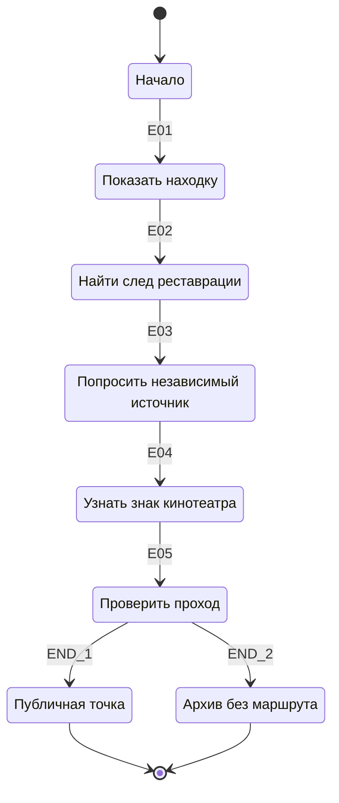

### Прогоны для проверки

| Сценарий | Начало | События / факты | Ожидаемое состояние |
| --- | --- | --- | --- |
| Исход 1 | S0 | E01 → E02 → E03 → E04 → E05 → END_1 | F1 |
| Исход 2 | S0 | E01 → E02 → E03 → E04 → E05 → END_2 | F2 |
| Чужой мир / автор / ветка / непроверенный смысл | S0 | OTHER | S0 |
| Преждевременный итог | S0 | END_1 | S0 |
| Не тот герой | S1 | Текст E02 от другого автора → OTHER | S1 |
| Не тот пост | S1 | Текст E02 под другим постом → OTHER | S1 |
| Не тот родитель | Перед player_reply | Нужный текст с другим parentCommentId → OTHER | То же состояние |
| Фраза без действия | Перед END_1/END_2 | Пересказ чужого решения без своего предложения → OTHER | То же состояние |
| Оба несовместимых итога | Перед END_1/END_2 | Подтверждены оба решения либо ни одно → OTHER | То же состояние; нужна ясная формулировка |
| Нет подтверждения смысла | Любое | Классификация не завершена / ошибка | Событие ожидает проверки, продвижения нет |
| Повтор доставки | После любого T | Тот же идентификатор факта | Без повторного эффекта |
| После завершения | F1 / F2 | Любые новые события | То же F1 / F2; один итог |

Критерии по смыслу нужно проверить отдельно на примерах и контрпримерах. Автоматическая проверка справочника проверяет ссылки и переходы, а не качество классификации или реплик.


<a id="evening_isabella_01"></a>

## evening_isabella_01: Фотография с пустым местом

Вечерело · Ася Лебедева. Черновик для обсуждения в [#192](https://github.com/Stepami/golden-mouth/issues/192).

Биографии и общие условия обработки событий приведены выше в этом документе.

### Паспорт

| Поле | Значение |
| --- | --- |
| story_id | evening_isabella_01 |
| version | 0.1-draft |
| world_key | evening |
| player_role | isabella — Ася Лебедева |
| actors | eduard — Марк Калинин, yakov — Яков Чернов |
| Завязка | Ты играешь за Асю. После реставрации на снимке остаётся белый прямоугольник. Заказчик разрешил рассказать о дефекте, но не раскрывать его имя. |
| Цель | Отличить дефект от следа утраченной памяти и сохранить доверие заказчика. |
| Начало | S0 |
| Исходы | F1, F2 |

### Состояния

Факты предыдущих этапов сохраняются; в строке указан новый факт. Подсказки — предлагаемые тексты, интерфейс их показа здесь не задаётся.

| ID | Название | Новый факт истории | Дальше | Подсказка игроку | Конечное |
| --- | --- | --- | --- | --- | --- |
| S0 | Начало | Ты играешь за Асю. После реставрации на снимке остаётся белый прямоугольник. Заказчик разрешил рассказать о дефекте, но не раскрывать его имя. | Описать дефект | Расскажи о пустом месте, не раскрывая заказчика. | Нет |
| S1 | Описать дефект | Дефект вынесен на публичную проверку без имени. | Сопоставить рамку | Следующий собеседник — Марк Калинин. Посмотри ответы под постом. | Нет |
| S2 | Сопоставить рамку | Белое место совпало с окном кассы. | Отделить наблюдение от догадки | Уточни у Марка, что он помнит точно, а что предполагает. | Нет |
| S3 | Отделить наблюдение от догадки | Граница свидетельства обозначена. | Найти след креплений | Попроси Якова сверить окно с доступной частью фасада. | Нет |
| S4 | Найти след креплений | Крепления объясняют форму пропуска, но не его содержание. | Опубликовать один из двух итогов | Реши, достаточно ли данных для осторожной подписи к снимку. | Нет |
| F1 | Подпись с границей знания | Снимок получает честную подпись без выдуманного воспоминания. | Сюжет завершён; обычная игра продолжается | Снимок получает честную подпись без выдуманного воспоминания. | Да |
| F2 | Повторная реставрация | Снимок остаётся без расшифровки; заказчику не приписано новое прошлое. | Сюжет завершён; обычная игра продолжается | Снимок остаётся без расшифровки; заказчику не приписано новое прошлое. | Да |

### События

Каждое условие включает общие проверки мира, автора, связи с сохранённым объектом и смысла из README. Для всех строк, кроме OTHER, проверка смысла и сюжетная привязка ещё требуют серверной реализации.

| Код | Сохранённый факт | Автор | Связь | Критерий по смыслу | Сохранить |
| --- | --- | --- | --- | --- | --- |
| E01 | Сохранённый пост игрока | Игрок | channel | Описан белый прямоугольник после реставрации; нет имени заказчика и обещания восстановить чужую память. | p0 |
| E02 | Сохранённый комментарий героя под связанным постом | Марк Калинин | p0 | Марк узнаёт рамку старого окна кассы; внутри окна раньше висело сменное объявление, а не портрет. | c0 |
| E03 | Сохранённый ответ игрока на связанный комментарий | Игрок | c0 | Игрок просит различить память о рамке и содержание объявления; не выдаёт отсутствие портрета за доказанный факт. | r0 |
| E04 | Сохранённый комментарий героя под связанным постом | Яков Чернов | p0 | Яков описывает сменные крепления на фасаде; текст объявления восстановить по ним нельзя. | c1 |
| END_1 | Сохранённый пост игрока | Игрок | channel | Игрок предлагает подпись: вероятно место сменного объявления; содержание неизвестно, догадка отмечена. | final_post_1 |
| END_2 | Сохранённый пост игрока | Игрок | channel | Игрок прямо откладывает подпись и выбирает повторную проверку эмульсии, не обещая её результат. | final_post_2 |
| OTHER | Другое событие | any | any | Любой подтверждённый факт, не отнесённый ровно к одной категории выше в текущем состоянии. | — |

### Переходы

| ID | Из | Событие | В | Память | Результат для игрока |
| --- | --- | --- | --- | --- | --- |
| T01 | S0 | E01 | S1 | p0 | Дефект вынесен на публичную проверку без имени. |
| T02 | S1 | E02 | S2 | c0 | Белое место совпало с окном кассы. |
| T03 | S2 | E03 | S3 | r0 | Граница свидетельства обозначена. |
| T04 | S3 | E04 | S4 | c1 | Крепления объясняют форму пропуска, но не его содержание. |
| T_END_1 | S4 | END_1 | F1 | final_post_1 | Снимок получает честную подпись без выдуманного воспоминания. |
| T_END_2 | S4 | END_2 | F2 | final_post_2 | Снимок остаётся без расшифровки; заказчику не приписано новое прошлое. |

### Полная матрица

`—` — сохранить состояние без действий. Коды вне разрешённого перехода не засчитываются задним числом.

| Состояние | E01 | E02 | E03 | E04 | END_1 | END_2 | OTHER |
| --- | --- | --- | --- | --- | --- | --- | --- |
| S0 | S1 / T01 | S0 / — | S0 / — | S0 / — | S0 / — | S0 / — | S0 / — |
| S1 | S1 / — | S2 / T02 | S1 / — | S1 / — | S1 / — | S1 / — | S1 / — |
| S2 | S2 / — | S2 / — | S3 / T03 | S2 / — | S2 / — | S2 / — | S2 / — |
| S3 | S3 / — | S3 / — | S3 / — | S4 / T04 | S3 / — | S3 / — | S3 / — |
| S4 | S4 / — | S4 / — | S4 / — | S4 / — | F1 / T_END_1 | F2 / T_END_2 | S4 / — |
| F1 | F1 / — | F1 / — | F1 / — | F1 / — | F1 / — | F1 / — | F1 / — |
| F2 | F2 / — | F2 / — | F2 / — | F2 / — | F2 / — | F2 / — | F2 / — |

### Граф

Петли без действий из полной матрицы опущены для читаемости.

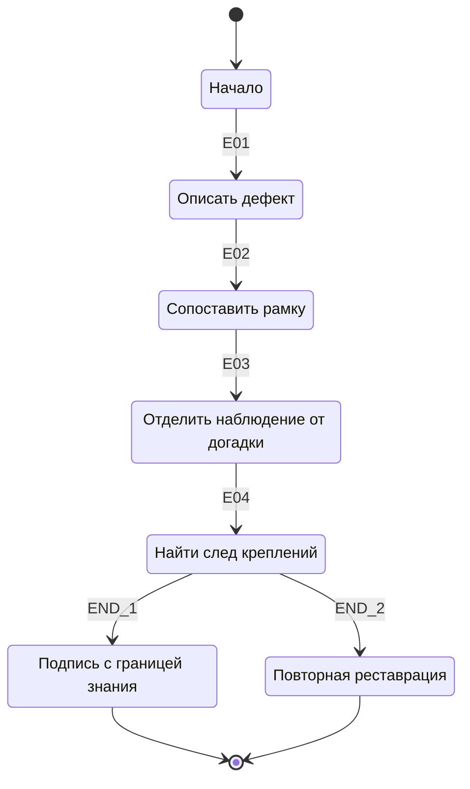

### Прогоны для проверки

| Сценарий | Начало | События / факты | Ожидаемое состояние |
| --- | --- | --- | --- |
| Исход 1 | S0 | E01 → E02 → E03 → E04 → END_1 | F1 |
| Исход 2 | S0 | E01 → E02 → E03 → E04 → END_2 | F2 |
| Чужой мир / автор / ветка / непроверенный смысл | S0 | OTHER | S0 |
| Преждевременный итог | S0 | END_1 | S0 |
| Не тот герой | S1 | Текст E02 от другого автора → OTHER | S1 |
| Не тот пост | S1 | Текст E02 под другим постом → OTHER | S1 |
| Не тот родитель | Перед player_reply | Нужный текст с другим parentCommentId → OTHER | То же состояние |
| Фраза без действия | Перед END_1/END_2 | Пересказ чужого решения без своего предложения → OTHER | То же состояние |
| Оба несовместимых итога | Перед END_1/END_2 | Подтверждены оба решения либо ни одно → OTHER | То же состояние; нужна ясная формулировка |
| Нет подтверждения смысла | Любое | Классификация не завершена / ошибка | Событие ожидает проверки, продвижения нет |
| Повтор доставки | После любого T | Тот же идентификатор факта | Без повторного эффекта |
| После завершения | F1 / F2 | Любые новые события | То же F1 / F2; один итог |

Критерии по смыслу нужно проверить отдельно на примерах и контрпримерах. Автоматическая проверка справочника проверяет ссылки и переходы, а не качество классификации или реплик.


<a id="evening_eduard_01"></a>

## evening_eduard_01: Последний звук сеанса

Вечерело · Марк Калинин. Черновик для обсуждения в [#192](https://github.com/Stepami/golden-mouth/issues/192).

Биографии и общие условия обработки событий приведены выше в этом документе.

### Паспорт

| Поле | Значение |
| --- | --- |
| story_id | evening_eduard_01 |
| version | 0.1-draft |
| world_key | evening |
| player_role | eduard — Марк Калинин |
| actors | isabella — Ася Лебедева, yakov — Яков Чернов |
| Завязка | Ты играешь за Марка. В пустом зале до рассвета держится звук старой трамвайной остановки. Он может связать кинотеатр с исчезнувшей улицей. |
| Цель | Сопоставить звук с городскими свидетельствами, не публикуя запись с чужими голосами. |
| Начало | S0 |
| Исходы | F1, F2 |

### Состояния

Факты предыдущих этапов сохраняются; в строке указан новый факт. Подсказки — предлагаемые тексты, интерфейс их показа здесь не задаётся.

| ID | Название | Новый факт истории | Дальше | Подсказка игроку | Конечное |
| --- | --- | --- | --- | --- | --- |
| S0 | Начало | Ты играешь за Марка. В пустом зале до рассвета держится звук старой трамвайной остановки. Он может связать кинотеатр с исчезнувшей улицей. | Описать звук | Опиши слышимое, не публикуя запись целиком. | Нет |
| S1 | Описать звук | Звук описан словами в хронике. | Найти старое название | Следующий собеседник — Яков Чернов. Посмотри ответы под постом. | Нет |
| S2 | Найти старое название | Появилось название старой остановки. | Проверить предел способности | Спроси Якова, по какому признаку он отличает название от нынешнего маршрута. | Нет |
| S3 | Проверить предел способности | Исторический адрес отделён от современного пути. | Найти остановку на снимке | Сверь название с фотографией Аси. | Нет |
| S4 | Найти остановку на снимке | Название подтверждено вторым источником, дата не установлена. | Опубликовать один из двух итогов | Выбери форму публичного итога, не раскрывающую голоса посетителей. | Нет |
| F1 | Звуковая заметка | В хронике связаны два свидетельства без частного аудио. | Сюжет завершён; обычная игра продолжается | В хронике связаны два свидетельства без частного аудио. | Да |
| F2 | Открытая проверка | Появляется добровольная проверка без раскрытия записи и обещаний разгадки. | Сюжет завершён; обычная игра продолжается | Появляется добровольная проверка без раскрытия записи и обещаний разгадки. | Да |

### События

Каждое условие включает общие проверки мира, автора, связи с сохранённым объектом и смысла из README. Для всех строк, кроме OTHER, проверка смысла и сюжетная привязка ещё требуют серверной реализации.

| Код | Сохранённый факт | Автор | Связь | Критерий по смыслу | Сохранить |
| --- | --- | --- | --- | --- | --- |
| E01 | Сохранённый пост игрока | Игрок | channel | Есть описание звонка трамвая и шума дождя без загрузки частной записи и без имён посетителей. | p0 |
| E02 | Сохранённый комментарий героя под связанным постом | Яков Чернов | p0 | Яков связывает звонок с бывшей остановкой «Стекольная»; не утверждает, что трамвай ходит сегодня. | c0 |
| E03 | Сохранённый ответ игрока на связанный комментарий | Игрок | c0 | Игрок уточняет, что отголосок даёт прежнее название, но не расписание и не сегодняшние координаты. | r0 |
| E04 | Сохранённый комментарий героя под связанным постом | Ася Лебедева | p0 | Ася находит читаемую часть таблички «Стекольная» на старом снимке и указывает, что дата снимка неизвестна. | c1 |
| END_1 | Сохранённый пост игрока | Игрок | channel | Игрок публикует словесное сопоставление звука и таблички с оговоркой о неизвестной дате; саму запись не публикует. | final_post_1 |
| END_2 | Сохранённый пост игрока | Игрок | channel | Игрок откладывает вывод о связи с улицей и приглашает сравнивать только публичные звуки у кинотеатра. | final_post_2 |
| OTHER | Другое событие | any | any | Любой подтверждённый факт, не отнесённый ровно к одной категории выше в текущем состоянии. | — |

### Переходы

| ID | Из | Событие | В | Память | Результат для игрока |
| --- | --- | --- | --- | --- | --- |
| T01 | S0 | E01 | S1 | p0 | Звук описан словами в хронике. |
| T02 | S1 | E02 | S2 | c0 | Появилось название старой остановки. |
| T03 | S2 | E03 | S3 | r0 | Исторический адрес отделён от современного пути. |
| T04 | S3 | E04 | S4 | c1 | Название подтверждено вторым источником, дата не установлена. |
| T_END_1 | S4 | END_1 | F1 | final_post_1 | В хронике связаны два свидетельства без частного аудио. |
| T_END_2 | S4 | END_2 | F2 | final_post_2 | Появляется добровольная проверка без раскрытия записи и обещаний разгадки. |

### Полная матрица

`—` — сохранить состояние без действий. Коды вне разрешённого перехода не засчитываются задним числом.

| Состояние | E01 | E02 | E03 | E04 | END_1 | END_2 | OTHER |
| --- | --- | --- | --- | --- | --- | --- | --- |
| S0 | S1 / T01 | S0 / — | S0 / — | S0 / — | S0 / — | S0 / — | S0 / — |
| S1 | S1 / — | S2 / T02 | S1 / — | S1 / — | S1 / — | S1 / — | S1 / — |
| S2 | S2 / — | S2 / — | S3 / T03 | S2 / — | S2 / — | S2 / — | S2 / — |
| S3 | S3 / — | S3 / — | S3 / — | S4 / T04 | S3 / — | S3 / — | S3 / — |
| S4 | S4 / — | S4 / — | S4 / — | S4 / — | F1 / T_END_1 | F2 / T_END_2 | S4 / — |
| F1 | F1 / — | F1 / — | F1 / — | F1 / — | F1 / — | F1 / — | F1 / — |
| F2 | F2 / — | F2 / — | F2 / — | F2 / — | F2 / — | F2 / — | F2 / — |

### Граф

Петли без действий из полной матрицы опущены для читаемости.

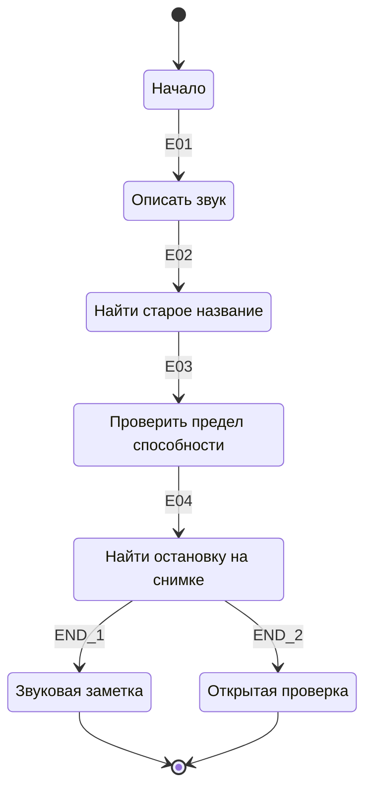

### Прогоны для проверки

| Сценарий | Начало | События / факты | Ожидаемое состояние |
| --- | --- | --- | --- |
| Исход 1 | S0 | E01 → E02 → E03 → E04 → END_1 | F1 |
| Исход 2 | S0 | E01 → E02 → E03 → E04 → END_2 | F2 |
| Чужой мир / автор / ветка / непроверенный смысл | S0 | OTHER | S0 |
| Преждевременный итог | S0 | END_1 | S0 |
| Не тот герой | S1 | Текст E02 от другого автора → OTHER | S1 |
| Не тот пост | S1 | Текст E02 под другим постом → OTHER | S1 |
| Не тот родитель | Перед player_reply | Нужный текст с другим parentCommentId → OTHER | То же состояние |
| Фраза без действия | Перед END_1/END_2 | Пересказ чужого решения без своего предложения → OTHER | То же состояние |
| Оба несовместимых итога | Перед END_1/END_2 | Подтверждены оба решения либо ни одно → OTHER | То же состояние; нужна ясная формулировка |
| Нет подтверждения смысла | Любое | Классификация не завершена / ошибка | Событие ожидает проверки, продвижения нет |
| Повтор доставки | После любого T | Тот же идентификатор факта | Без повторного эффекта |
| После завершения | F1 / F2 | Любые новые события | То же F1 / F2; один итог |

Критерии по смыслу нужно проверить отдельно на примерах и контрпримерах. Автоматическая проверка справочника проверяет ссылки и переходы, а не качество классификации или реплик.


<a id="evening_yakov_01"></a>

## evening_yakov_01: Две дороги к одному дому

Вечерело · Яков Чернов. Черновик для обсуждения в [#192](https://github.com/Stepami/golden-mouth/issues/192).

Биографии и общие условия обработки событий приведены выше в этом документе.

### Паспорт

| Поле | Значение |
| --- | --- |
| story_id | evening_yakov_01 |
| version | 0.1-draft |
| world_key | evening |
| player_role | yakov — Яков Чернов |
| actors | isabella — Ася Лебедева, eduard — Марк Калинин |
| Завязка | Ты играешь за Якова. Два перекрёстка отзываются одним прежним названием. Вести людей наугад нельзя: один путь проходит по размытой тропе. |
| Цель | Отделить память о маршруте от безопасного современного прохода. |
| Начало | S0 |
| Исходы | F1, F2 |

### Состояния

Факты предыдущих этапов сохраняются; в строке указан новый факт. Подсказки — предлагаемые тексты, интерфейс их показа здесь не задаётся.

| ID | Название | Новый факт истории | Дальше | Подсказка игроку | Конечное |
| --- | --- | --- | --- | --- | --- |
| S0 | Начало | Ты играешь за Якова. Два перекрёстка отзываются одним прежним названием. Вести людей наугад нельзя: один путь проходит по размытой тропе. | Показать расхождение | Расскажи о двух отголосках и не зови людей на непроверенный путь. | Нет |
| S1 | Показать расхождение | Расхождение опубликовано без приглашения идти по тропе. | Увидеть две эпохи | Следующий собеседник — Ася Лебедева. Посмотри ответы под постом. | Нет |
| S2 | Увидеть две эпохи | Два отголоска могут вести к разным входам одного здания. | Связать фасады | Спроси Асю, какой признак связывает фасады. | Нет |
| S3 | Связать фасады | Арка выбрана ориентиром для дальнейшего сравнения. | Указать действующий вход | Найди у Марка публичный ориентир рядом с нынешним входом. | Нет |
| S4 | Указать действующий вход | Подтверждён только вход с площади. | Опубликовать один из двух итогов | Подведи итог: ограниченный маршрут или карта расхождения без прогулки. | Нет |
| F1 | Путь с площади | В хронике есть ограниченный проверенный проход. | Сюжет завершён; обычная игра продолжается | В хронике есть ограниченный проверенный проход. | Да |
| F2 | Карта воспоминаний | История двух входов сохранена без совета идти по непроверенному пути. | Сюжет завершён; обычная игра продолжается | История двух входов сохранена без совета идти по непроверенному пути. | Да |

### События

Каждое условие включает общие проверки мира, автора, связи с сохранённым объектом и смысла из README. Для всех строк, кроме OTHER, проверка смысла и сюжетная привязка ещё требуют серверной реализации.

| Код | Сохранённый факт | Автор | Связь | Критерий по смыслу | Сохранить |
| --- | --- | --- | --- | --- | --- |
| E01 | Сохранённый пост игрока | Игрок | channel | Описаны два отголоска одного названия и предупреждение, что это не готовый маршрут. | p0 |
| E02 | Сохранённый комментарий героя под связанным постом | Ася Лебедева | p0 | Ася различает на двух снимках одинаковый фасад до и после переноса входа, но не делает вывода о состоянии тропы. | c0 |
| E03 | Сохранённый ответ игрока на связанный комментарий | Игрок | c0 | Игрок просит проверить характерную арку, не подменяя этим обследование дороги. | r0 |
| E04 | Сохранённый комментарий героя под связанным постом | Марк Калинин | p0 | Марк подтверждает арку у кинотеатральной площади и сообщает, что вход со стороны площади открыт; лесную тропу он не проверял. | c1 |
| END_1 | Сохранённый пост игрока | Игрок | channel | Игрок рекомендует только открытый вход с площади, явно исключая размытую тропу и неизвестные участки. | final_post_1 |
| END_2 | Сохранённый пост игрока | Игрок | channel | Игрок не рекомендует ни одного маршрута и публикует лишь схему прежних входов с пометкой «не для навигации». | final_post_2 |
| OTHER | Другое событие | any | any | Любой подтверждённый факт, не отнесённый ровно к одной категории выше в текущем состоянии. | — |

### Переходы

| ID | Из | Событие | В | Память | Результат для игрока |
| --- | --- | --- | --- | --- | --- |
| T01 | S0 | E01 | S1 | p0 | Расхождение опубликовано без приглашения идти по тропе. |
| T02 | S1 | E02 | S2 | c0 | Два отголоска могут вести к разным входам одного здания. |
| T03 | S2 | E03 | S3 | r0 | Арка выбрана ориентиром для дальнейшего сравнения. |
| T04 | S3 | E04 | S4 | c1 | Подтверждён только вход с площади. |
| T_END_1 | S4 | END_1 | F1 | final_post_1 | В хронике есть ограниченный проверенный проход. |
| T_END_2 | S4 | END_2 | F2 | final_post_2 | История двух входов сохранена без совета идти по непроверенному пути. |

### Полная матрица

`—` — сохранить состояние без действий. Коды вне разрешённого перехода не засчитываются задним числом.

| Состояние | E01 | E02 | E03 | E04 | END_1 | END_2 | OTHER |
| --- | --- | --- | --- | --- | --- | --- | --- |
| S0 | S1 / T01 | S0 / — | S0 / — | S0 / — | S0 / — | S0 / — | S0 / — |
| S1 | S1 / — | S2 / T02 | S1 / — | S1 / — | S1 / — | S1 / — | S1 / — |
| S2 | S2 / — | S2 / — | S3 / T03 | S2 / — | S2 / — | S2 / — | S2 / — |
| S3 | S3 / — | S3 / — | S3 / — | S4 / T04 | S3 / — | S3 / — | S3 / — |
| S4 | S4 / — | S4 / — | S4 / — | S4 / — | F1 / T_END_1 | F2 / T_END_2 | S4 / — |
| F1 | F1 / — | F1 / — | F1 / — | F1 / — | F1 / — | F1 / — | F1 / — |
| F2 | F2 / — | F2 / — | F2 / — | F2 / — | F2 / — | F2 / — | F2 / — |

### Граф

Петли без действий из полной матрицы опущены для читаемости.

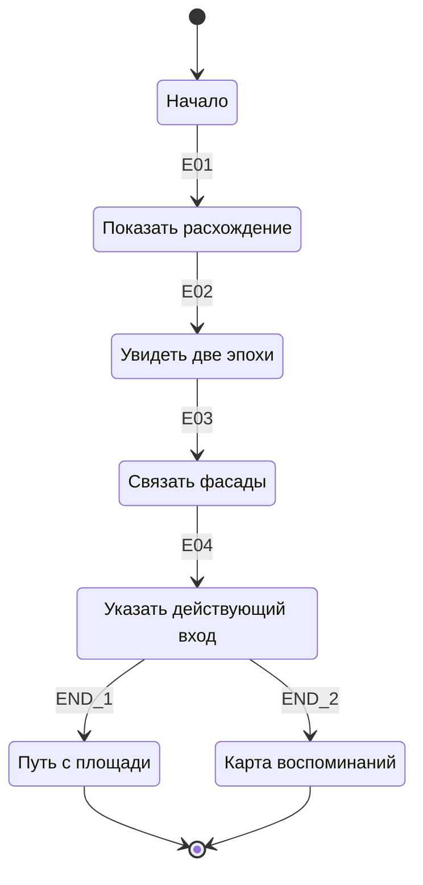

### Прогоны для проверки

| Сценарий | Начало | События / факты | Ожидаемое состояние |
| --- | --- | --- | --- |
| Исход 1 | S0 | E01 → E02 → E03 → E04 → END_1 | F1 |
| Исход 2 | S0 | E01 → E02 → E03 → E04 → END_2 | F2 |
| Чужой мир / автор / ветка / непроверенный смысл | S0 | OTHER | S0 |
| Преждевременный итог | S0 | END_1 | S0 |
| Не тот герой | S1 | Текст E02 от другого автора → OTHER | S1 |
| Не тот пост | S1 | Текст E02 под другим постом → OTHER | S1 |
| Не тот родитель | Перед player_reply | Нужный текст с другим parentCommentId → OTHER | То же состояние |
| Фраза без действия | Перед END_1/END_2 | Пересказ чужого решения без своего предложения → OTHER | То же состояние |
| Оба несовместимых итога | Перед END_1/END_2 | Подтверждены оба решения либо ни одно → OTHER | То же состояние; нужна ясная формулировка |
| Нет подтверждения смысла | Любое | Классификация не завершена / ошибка | Событие ожидает проверки, продвижения нет |
| Повтор доставки | После любого T | Тот же идентификатор факта | Без повторного эффекта |
| После завершения | F1 / F2 | Любые новые события | То же F1 / F2; один итог |

Критерии по смыслу нужно проверить отдельно на примерах и контрпримерах. Автоматическая проверка справочника проверяет ссылки и переходы, а не качество классификации или реплик.


<a id="sorcerers_own_01"></a>

## sorcerers_own_01: Урок, который был вчера

Школа чародеев · Свой персонаж. Черновик для обсуждения в [#192](https://github.com/Stepami/golden-mouth/issues/192).

Биографии и общие условия обработки событий приведены выше в этом документе.

### Паспорт

| Поле | Значение |
| --- | --- |
| story_id | sorcerers_own_01 |
| version | 0.1-draft |
| world_key | sorcerers |
| player_role | own — Свой персонаж |
| actors | gosha — Гоша Гончаров, georgina — Георгина Гречихина, roman — Роман Ласкин |
| Завязка | Тебя записали на отменённый урок. В ленте осталось вчерашнее описание аудитории, но нынешнее расписание ведёт в другое место. |
| Цель | Собрать проверяемый способ встретиться на уроке, не доверяя одной меняющейся табличке. |
| Начало | S0 |
| Исходы | F1, F2 |

### Состояния

Факты предыдущих этапов сохраняются; в строке указан новый факт. Подсказки — предлагаемые тексты, интерфейс их показа здесь не задаётся.

| ID | Название | Новый факт истории | Дальше | Подсказка игроку | Конечное |
| --- | --- | --- | --- | --- | --- |
| S0 | Начало | Тебя записали на отменённый урок. В ленте осталось вчерашнее описание аудитории, но нынешнее расписание ведёт в другое место. | Сравнить записи | Сравни аудиторию в расписании и вчерашней записи. | Нет |
| S1 | Сравнить записи | Несовпадение записей стало публичным. | Зафиксировать вчерашнюю версию | Следующий собеседник — Роман Ласкин. Посмотри ответы под постом. | Нет |
| S2 | Зафиксировать вчерашнюю версию | Сохранён вчерашний ориентир аудитории. | Проверить окно | Попроси Георгину проверить, что видно снаружи сегодня. | Нет |
| S3 | Проверить окно | Окно осталось, назначение комнаты изменилось. | Предложить безопасный опыт | Уточни у Георгины, что можно проверить без опасной вылазки. | Нет |
| S4 | Предложить безопасный опыт | Выбран доступный способ наблюдения. | Найти общий ориентир | Спроси Гошу о переносимом ориентире для встречи. | Нет |
| S5 | Найти общий ориентир | Есть ориентир, который не зависит от номера аудитории. | Опубликовать один из двух итогов | Реши, встречаться у звонка или сначала повторить наблюдение. | Нет |
| F1 | Встреча у мастерской | Участники договорились, как найти друг друга несмотря на разные расписания. | Сюжет завершён; обычная игра продолжается | Участники договорились, как найти друг друга несмотря на разные расписания. | Да |
| F2 | Наблюдение ещё на сутки | У хроники есть план повторной проверки без ложного обещания урока. | Сюжет завершён; обычная игра продолжается | У хроники есть план повторной проверки без ложного обещания урока. | Да |

### События

Каждое условие включает общие проверки мира, автора, связи с сохранённым объектом и смысла из README. Для всех строк, кроме OTHER, проверка смысла и сюжетная привязка ещё требуют серверной реализации.

| Код | Сохранённый факт | Автор | Связь | Критерий по смыслу | Сохранить |
| --- | --- | --- | --- | --- | --- |
| E01 | Сохранённый пост игрока | Игрок | channel | Игрок называет расхождение между расписанием и вчерашней записью, просит свидетелей; не утверждает, что побывал на уроке. | p0 |
| E02 | Сохранённый комментарий героя под связанным постом | Роман Ласкин | p0 | Роман приводит прежний ориентир: окно с расколотой ручкой; отмечает, что запись старше сегодняшнего расписания. | c0 |
| E03 | Сохранённый комментарий героя под связанным постом | Георгина Гречихина | p0 | Георгина видит такое окно со двора; за ним теперь мастерская. Наблюдение не подтверждает проведение урока. | c1 |
| E04 | Сохранённый ответ игрока на связанный комментарий | Игрок | c1 | Игрок предлагает сверить окно с доступного двора и не предлагает лезть в окно или проникать в закрытую комнату. | r0 |
| E05 | Сохранённый комментарий героя под связанным постом | Гоша Гончаров | p0 | Гоша предлагает вывесить у действующей мастерской переносной звонок; он не обещает остановить перестройку школы. | c2 |
| END_1 | Сохранённый пост игрока | Игрок | channel | Игрок предлагает добровольную встречу у действующей мастерской и звонка; не объявляет старый урок восстановленным. | final_post_1 |
| END_2 | Сохранённый пост игрока | Игрок | channel | Игрок откладывает встречу и предлагает сравнить две датированные записи окна; не приглашает на старый урок. | final_post_2 |
| OTHER | Другое событие | any | any | Любой подтверждённый факт, не отнесённый ровно к одной категории выше в текущем состоянии. | — |

### Переходы

| ID | Из | Событие | В | Память | Результат для игрока |
| --- | --- | --- | --- | --- | --- |
| T01 | S0 | E01 | S1 | p0 | Несовпадение записей стало публичным. |
| T02 | S1 | E02 | S2 | c0 | Сохранён вчерашний ориентир аудитории. |
| T03 | S2 | E03 | S3 | c1 | Окно осталось, назначение комнаты изменилось. |
| T04 | S3 | E04 | S4 | r0 | Выбран доступный способ наблюдения. |
| T05 | S4 | E05 | S5 | c2 | Есть ориентир, который не зависит от номера аудитории. |
| T_END_1 | S5 | END_1 | F1 | final_post_1 | Участники договорились, как найти друг друга несмотря на разные расписания. |
| T_END_2 | S5 | END_2 | F2 | final_post_2 | У хроники есть план повторной проверки без ложного обещания урока. |

### Полная матрица

`—` — сохранить состояние без действий. Коды вне разрешённого перехода не засчитываются задним числом.

| Состояние | E01 | E02 | E03 | E04 | E05 | END_1 | END_2 | OTHER |
| --- | --- | --- | --- | --- | --- | --- | --- | --- |
| S0 | S1 / T01 | S0 / — | S0 / — | S0 / — | S0 / — | S0 / — | S0 / — | S0 / — |
| S1 | S1 / — | S2 / T02 | S1 / — | S1 / — | S1 / — | S1 / — | S1 / — | S1 / — |
| S2 | S2 / — | S2 / — | S3 / T03 | S2 / — | S2 / — | S2 / — | S2 / — | S2 / — |
| S3 | S3 / — | S3 / — | S3 / — | S4 / T04 | S3 / — | S3 / — | S3 / — | S3 / — |
| S4 | S4 / — | S4 / — | S4 / — | S4 / — | S5 / T05 | S4 / — | S4 / — | S4 / — |
| S5 | S5 / — | S5 / — | S5 / — | S5 / — | S5 / — | F1 / T_END_1 | F2 / T_END_2 | S5 / — |
| F1 | F1 / — | F1 / — | F1 / — | F1 / — | F1 / — | F1 / — | F1 / — | F1 / — |
| F2 | F2 / — | F2 / — | F2 / — | F2 / — | F2 / — | F2 / — | F2 / — | F2 / — |

### Граф

Петли без действий из полной матрицы опущены для читаемости.

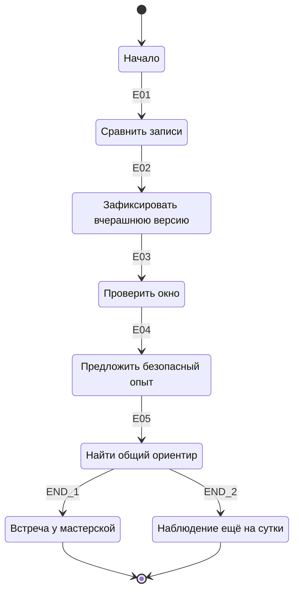

### Прогоны для проверки

| Сценарий | Начало | События / факты | Ожидаемое состояние |
| --- | --- | --- | --- |
| Исход 1 | S0 | E01 → E02 → E03 → E04 → E05 → END_1 | F1 |
| Исход 2 | S0 | E01 → E02 → E03 → E04 → E05 → END_2 | F2 |
| Чужой мир / автор / ветка / непроверенный смысл | S0 | OTHER | S0 |
| Преждевременный итог | S0 | END_1 | S0 |
| Не тот герой | S1 | Текст E02 от другого автора → OTHER | S1 |
| Не тот пост | S1 | Текст E02 под другим постом → OTHER | S1 |
| Не тот родитель | Перед player_reply | Нужный текст с другим parentCommentId → OTHER | То же состояние |
| Фраза без действия | Перед END_1/END_2 | Пересказ чужого решения без своего предложения → OTHER | То же состояние |
| Оба несовместимых итога | Перед END_1/END_2 | Подтверждены оба решения либо ни одно → OTHER | То же состояние; нужна ясная формулировка |
| Нет подтверждения смысла | Любое | Классификация не завершена / ошибка | Событие ожидает проверки, продвижения нет |
| Повтор доставки | После любого T | Тот же идентификатор факта | Без повторного эффекта |
| После завершения | F1 / F2 | Любые новые события | То же F1 / F2; один итог |

Критерии по смыслу нужно проверить отдельно на примерах и контрпримерах. Автоматическая проверка справочника проверяет ссылки и переходы, а не качество классификации или реплик.


<a id="sorcerers_gosha_01"></a>

## sorcerers_gosha_01: Компас чужой комнаты

Школа чародеев · Гоша Гончаров. Черновик для обсуждения в [#192](https://github.com/Stepami/golden-mouth/issues/192).

Биографии и общие условия обработки событий приведены выше в этом документе.

### Паспорт

| Поле | Значение |
| --- | --- |
| story_id | sorcerers_gosha_01 |
| version | 0.1-draft |
| world_key | sorcerers |
| player_role | gosha — Гоша Гончаров |
| actors | georgina — Георгина Гречихина, roman — Роман Ласкин |
| Завязка | Ты играешь за Гошу. Починенный компас указывает на отменённый урок, хотя должен искать последнюю мастерскую владельца. Возможно, исправна стрелка, а неверно исходное назначение. |
| Цель | Проверить границы прибора и решить, где его можно применять. |
| Начало | S0 |
| Исходы | F1, F2 |

### Состояния

Факты предыдущих этапов сохраняются; в строке указан новый факт. Подсказки — предлагаемые тексты, интерфейс их показа здесь не задаётся.

| ID | Название | Новый факт истории | Дальше | Подсказка игроку | Конечное |
| --- | --- | --- | --- | --- | --- |
| S0 | Начало | Ты играешь за Гошу. Починенный компас указывает на отменённый урок, хотя должен искать последнюю мастерскую владельца. Возможно, исправна стрелка, а неверно исходное назначение. | Описать испытание | Опиши, что должен искать компас и куда он показывает. | Нет |
| S1 | Описать испытание | Неожиданный результат описан с условиями опыта. | Сменить место наблюдения | Следующий собеседник — Георгина Гречихина. Посмотри ответы под постом. | Нет |
| S2 | Сменить место наблюдения | Выявлена зависимость от условий, а не от номера комнаты. | Удержать одно условие | Предложи Георгине повторить проверку при одинаковой влажности. | Нет |
| S3 | Удержать одно условие | Подготовлено сопоставимое испытание. | Найти старую подпись | Проверь в хронике Романа прежнее назначение компаса. | Нет |
| S4 | Найти старую подпись | Исходная функция прибора уточнена по записи. | Опубликовать один из двух итогов | Реши, вернуть узкое назначение или оставить прибор на испытаниях. | Нет |
| F1 | Узкий инструмент | Прибор получает честное описание и ограниченную область применения. | Сюжет завершён; обычная игра продолжается | Прибор получает честное описание и ограниченную область применения. | Да |
| F2 | Открытые испытания | Неисследованный прибор остаётся учебным опытом, а не готовым проводником. | Сюжет завершён; обычная игра продолжается | Неисследованный прибор остаётся учебным опытом, а не готовым проводником. | Да |

### События

Каждое условие включает общие проверки мира, автора, связи с сохранённым объектом и смысла из README. Для всех строк, кроме OTHER, проверка смысла и сюжетная привязка ещё требуют серверной реализации.

| Код | Сохранённый факт | Автор | Связь | Критерий по смыслу | Сохранить |
| --- | --- | --- | --- | --- | --- |
| E01 | Сохранённый пост игрока | Игрок | channel | Игрок указывает назначение компаса и фактическое направление, не объявляет его проводником к старому уроку. | p0 |
| E02 | Сохранённый комментарий героя под связанным постом | Георгина Гречихина | p0 | Георгина сравнивает показания во дворе и под навесом: направление меняется вместе с влажностью. | c0 |
| E03 | Сохранённый ответ игрока на связанный комментарий | Игрок | c0 | Игрок предлагает сравнивать места при одной влажности и явно отделяет это от поиска урока. | r0 |
| E04 | Сохранённый комментарий героя под связанным постом | Роман Ласкин | p0 | Роман находит публичную запись: компас использовали для поиска сушильной мастерской, не любой комнаты. | c1 |
| END_1 | Сохранённый пост игрока | Игрок | channel | Игрок ограничивает компас поиском условий сушильной мастерской и не рекомендует его для поиска урока. | final_post_1 |
| END_2 | Сохранённый пост игрока | Игрок | channel | Игрок не рекомендует использование и публикует план дополнительных сравнений с одинаковой влажностью. | final_post_2 |
| OTHER | Другое событие | any | any | Любой подтверждённый факт, не отнесённый ровно к одной категории выше в текущем состоянии. | — |

### Переходы

| ID | Из | Событие | В | Память | Результат для игрока |
| --- | --- | --- | --- | --- | --- |
| T01 | S0 | E01 | S1 | p0 | Неожиданный результат описан с условиями опыта. |
| T02 | S1 | E02 | S2 | c0 | Выявлена зависимость от условий, а не от номера комнаты. |
| T03 | S2 | E03 | S3 | r0 | Подготовлено сопоставимое испытание. |
| T04 | S3 | E04 | S4 | c1 | Исходная функция прибора уточнена по записи. |
| T_END_1 | S4 | END_1 | F1 | final_post_1 | Прибор получает честное описание и ограниченную область применения. |
| T_END_2 | S4 | END_2 | F2 | final_post_2 | Неисследованный прибор остаётся учебным опытом, а не готовым проводником. |

### Полная матрица

`—` — сохранить состояние без действий. Коды вне разрешённого перехода не засчитываются задним числом.

| Состояние | E01 | E02 | E03 | E04 | END_1 | END_2 | OTHER |
| --- | --- | --- | --- | --- | --- | --- | --- |
| S0 | S1 / T01 | S0 / — | S0 / — | S0 / — | S0 / — | S0 / — | S0 / — |
| S1 | S1 / — | S2 / T02 | S1 / — | S1 / — | S1 / — | S1 / — | S1 / — |
| S2 | S2 / — | S2 / — | S3 / T03 | S2 / — | S2 / — | S2 / — | S2 / — |
| S3 | S3 / — | S3 / — | S3 / — | S4 / T04 | S3 / — | S3 / — | S3 / — |
| S4 | S4 / — | S4 / — | S4 / — | S4 / — | F1 / T_END_1 | F2 / T_END_2 | S4 / — |
| F1 | F1 / — | F1 / — | F1 / — | F1 / — | F1 / — | F1 / — | F1 / — |
| F2 | F2 / — | F2 / — | F2 / — | F2 / — | F2 / — | F2 / — | F2 / — |

### Граф

Петли без действий из полной матрицы опущены для читаемости.

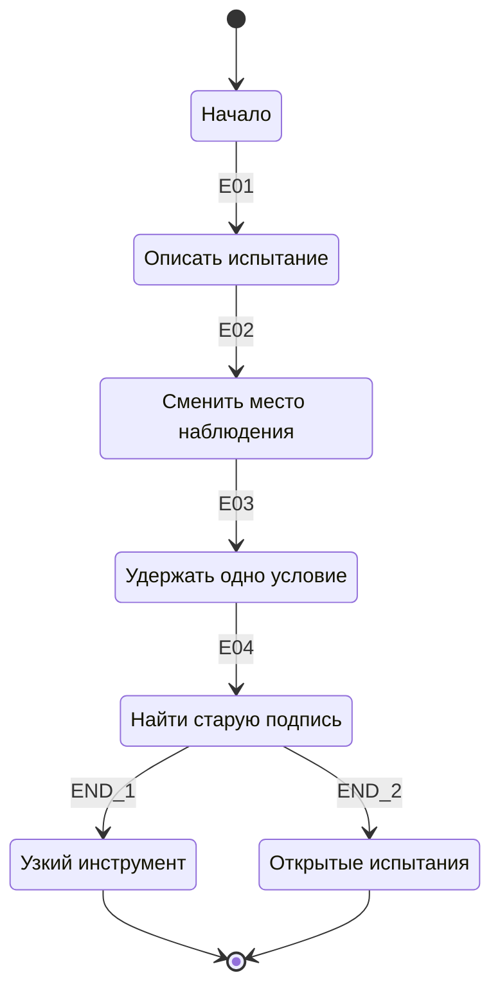

### Прогоны для проверки

| Сценарий | Начало | События / факты | Ожидаемое состояние |
| --- | --- | --- | --- |
| Исход 1 | S0 | E01 → E02 → E03 → E04 → END_1 | F1 |
| Исход 2 | S0 | E01 → E02 → E03 → E04 → END_2 | F2 |
| Чужой мир / автор / ветка / непроверенный смысл | S0 | OTHER | S0 |
| Преждевременный итог | S0 | END_1 | S0 |
| Не тот герой | S1 | Текст E02 от другого автора → OTHER | S1 |
| Не тот пост | S1 | Текст E02 под другим постом → OTHER | S1 |
| Не тот родитель | Перед player_reply | Нужный текст с другим parentCommentId → OTHER | То же состояние |
| Фраза без действия | Перед END_1/END_2 | Пересказ чужого решения без своего предложения → OTHER | То же состояние |
| Оба несовместимых итога | Перед END_1/END_2 | Подтверждены оба решения либо ни одно → OTHER | То же состояние; нужна ясная формулировка |
| Нет подтверждения смысла | Любое | Классификация не завершена / ошибка | Событие ожидает проверки, продвижения нет |
| Повтор доставки | После любого T | Тот же идентификатор факта | Без повторного эффекта |
| После завершения | F1 / F2 | Любые новые события | То же F1 / F2; один итог |

Критерии по смыслу нужно проверить отдельно на примерах и контрпримерах. Автоматическая проверка справочника проверяет ссылки и переходы, а не качество классификации или реплик.


<a id="sorcerers_georgina_01"></a>

## sorcerers_georgina_01: Прогноз для закрытого двора

Школа чародеев · Георгина Гречихина. Черновик для обсуждения в [#192](https://github.com/Stepami/golden-mouth/issues/192).

Биографии и общие условия обработки событий приведены выше в этом документе.

### Паспорт

| Поле | Значение |
| --- | --- |
| story_id | sorcerers_georgina_01 |
| version | 0.1-draft |
| world_key | sorcerers |
| player_role | georgina — Георгина Гречихина |
| actors | gosha — Гоша Гончаров, roman — Роман Ласкин |
| Завязка | Ты играешь за Георгину. Прогноз обещает дождь в аудитории отменённого урока, а двор остаётся сухим. Нельзя понять, ошиблась карта помещений или сам опыт. |
| Цель | Развести ошибку измерения и изменение школы, чтобы не отменять занятия по догадке. |
| Начало | S0 |
| Исходы | F1, F2 |

### Состояния

Факты предыдущих этапов сохраняются; в строке указан новый факт. Подсказки — предлагаемые тексты, интерфейс их показа здесь не задаётся.

| ID | Название | Новый факт истории | Дальше | Подсказка игроку | Конечное |
| --- | --- | --- | --- | --- | --- |
| S0 | Начало | Ты играешь за Георгину. Прогноз обещает дождь в аудитории отменённого урока, а двор остаётся сухим. Нельзя понять, ошиблась карта помещений или сам опыт. | Разделить два наблюдения | Покажи прогноз и место реального наблюдения отдельно. | Нет |
| S1 | Разделить два наблюдения | Расхождение прогноза и наблюдения описано без обвинения. | Проверить датчик | Следующий собеседник — Гоша Гончаров. Посмотри ответы под постом. | Нет |
| S2 | Проверить датчик | Датчик связан со старым номером, а не с подтверждённой точкой. | Привязать опыт к месту | Спроси Гошу, как отметить реальное место измерения. | Нет |
| S3 | Привязать опыт к месту | Для опыта выбран физический ориентир. | Сопоставить планы | Попроси Романа сравнить старую и новую привязку комнаты. | Нет |
| S4 | Сопоставить планы | Появилась локальная версия прогноза вместо общей тревоги. | Опубликовать один из двух итогов | Выбери локальное предупреждение или повторную проверку датчика. | Нет |
| F1 | Локальное предупреждение | В хронике есть локальное предупреждение с границей применимости. | Сюжет завершён; обычная игра продолжается | В хронике есть локальное предупреждение с границей применимости. | Да |
| F2 | Прогноз на проверке | Сомнительный прогноз не стал общешкольной тревогой. | Сюжет завершён; обычная игра продолжается | Сомнительный прогноз не стал общешкольной тревогой. | Да |

### События

Каждое условие включает общие проверки мира, автора, связи с сохранённым объектом и смысла из README. Для всех строк, кроме OTHER, проверка смысла и сюжетная привязка ещё требуют серверной реализации.

| Код | Сохранённый факт | Автор | Связь | Критерий по смыслу | Сохранить |
| --- | --- | --- | --- | --- | --- |
| E01 | Сохранённый пост игрока | Игрок | channel | Есть прогноз для аудитории и факт сухого двора; игрок не называет одно из них доказательством лжи другого. | p0 |
| E02 | Сохранённый комментарий героя под связанным постом | Гоша Гончаров | p0 | Гоша замечает, что датчик подписан старым номером комнаты; его исправность пока не доказывает совпадение места. | c0 |
| E03 | Сохранённый ответ игрока на связанный комментарий | Игрок | c0 | Игрок предлагает ориентир окна или двора и время записи, не только номер аудитории. | r0 |
| E04 | Сохранённый комментарий героя под связанным постом | Роман Ласкин | p0 | Роман показывает в хронике: старый номер теперь относится к крытой оранжерее, где возможна внутренняя сырость; это не дождь по всему острову. | c1 |
| END_1 | Сохранённый пост игрока | Игрок | channel | Игрок ограничивает вывод о сырости оранжереей, не отменяет все занятия и отмечает источник привязки. | final_post_1 |
| END_2 | Сохранённый пост игрока | Игрок | channel | Игрок не рекомендует применять прогноз до повторного измерения у выбранного ориентира. | final_post_2 |
| OTHER | Другое событие | any | any | Любой подтверждённый факт, не отнесённый ровно к одной категории выше в текущем состоянии. | — |

### Переходы

| ID | Из | Событие | В | Память | Результат для игрока |
| --- | --- | --- | --- | --- | --- |
| T01 | S0 | E01 | S1 | p0 | Расхождение прогноза и наблюдения описано без обвинения. |
| T02 | S1 | E02 | S2 | c0 | Датчик связан со старым номером, а не с подтверждённой точкой. |
| T03 | S2 | E03 | S3 | r0 | Для опыта выбран физический ориентир. |
| T04 | S3 | E04 | S4 | c1 | Появилась локальная версия прогноза вместо общей тревоги. |
| T_END_1 | S4 | END_1 | F1 | final_post_1 | В хронике есть локальное предупреждение с границей применимости. |
| T_END_2 | S4 | END_2 | F2 | final_post_2 | Сомнительный прогноз не стал общешкольной тревогой. |

### Полная матрица

`—` — сохранить состояние без действий. Коды вне разрешённого перехода не засчитываются задним числом.

| Состояние | E01 | E02 | E03 | E04 | END_1 | END_2 | OTHER |
| --- | --- | --- | --- | --- | --- | --- | --- |
| S0 | S1 / T01 | S0 / — | S0 / — | S0 / — | S0 / — | S0 / — | S0 / — |
| S1 | S1 / — | S2 / T02 | S1 / — | S1 / — | S1 / — | S1 / — | S1 / — |
| S2 | S2 / — | S2 / — | S3 / T03 | S2 / — | S2 / — | S2 / — | S2 / — |
| S3 | S3 / — | S3 / — | S3 / — | S4 / T04 | S3 / — | S3 / — | S3 / — |
| S4 | S4 / — | S4 / — | S4 / — | S4 / — | F1 / T_END_1 | F2 / T_END_2 | S4 / — |
| F1 | F1 / — | F1 / — | F1 / — | F1 / — | F1 / — | F1 / — | F1 / — |
| F2 | F2 / — | F2 / — | F2 / — | F2 / — | F2 / — | F2 / — | F2 / — |

### Граф

Петли без действий из полной матрицы опущены для читаемости.

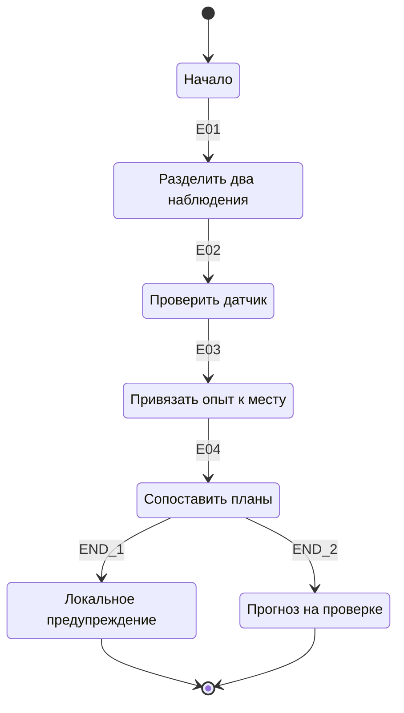

### Прогоны для проверки

| Сценарий | Начало | События / факты | Ожидаемое состояние |
| --- | --- | --- | --- |
| Исход 1 | S0 | E01 → E02 → E03 → E04 → END_1 | F1 |
| Исход 2 | S0 | E01 → E02 → E03 → E04 → END_2 | F2 |
| Чужой мир / автор / ветка / непроверенный смысл | S0 | OTHER | S0 |
| Преждевременный итог | S0 | END_1 | S0 |
| Не тот герой | S1 | Текст E02 от другого автора → OTHER | S1 |
| Не тот пост | S1 | Текст E02 под другим постом → OTHER | S1 |
| Не тот родитель | Перед player_reply | Нужный текст с другим parentCommentId → OTHER | То же состояние |
| Фраза без действия | Перед END_1/END_2 | Пересказ чужого решения без своего предложения → OTHER | То же состояние |
| Оба несовместимых итога | Перед END_1/END_2 | Подтверждены оба решения либо ни одно → OTHER | То же состояние; нужна ясная формулировка |
| Нет подтверждения смысла | Любое | Классификация не завершена / ошибка | Событие ожидает проверки, продвижения нет |
| Повтор доставки | После любого T | Тот же идентификатор факта | Без повторного эффекта |
| После завершения | F1 / F2 | Любые новые события | То же F1 / F2; один итог |

Критерии по смыслу нужно проверить отдельно на примерах и контрпримерах. Автоматическая проверка справочника проверяет ссылки и переходы, а не качество классификации или реплик.


<a id="sorcerers_roman_01"></a>

## sorcerers_roman_01: Чьи воспоминания останутся

Школа чародеев · Роман Ласкин. Черновик для обсуждения в [#192](https://github.com/Stepami/golden-mouth/issues/192).

Биографии и общие условия обработки событий приведены выше в этом документе.

### Паспорт

| Поле | Значение |
| --- | --- |
| story_id | sorcerers_roman_01 |
| version | 0.1-draft |
| world_key | sorcerers |
| player_role | roman — Роман Ласкин |
| actors | gosha — Гоша Гончаров, georgina — Георгина Гречихина |
| Завязка | Ты играешь за Романа. Два ученика описывают отменённый урок по-разному. Тебя просят выбрать одну версию для хроники, хотя время наблюдений не указано. |
| Цель | Сохранить различие свидетельств и найти минимальный общий факт без назначения победителя. |
| Начало | S0 |
| Исходы | F1, F2 |

### Состояния

Факты предыдущих этапов сохраняются; в строке указан новый факт. Подсказки — предлагаемые тексты, интерфейс их показа здесь не задаётся.

| ID | Название | Новый факт истории | Дальше | Подсказка игроку | Конечное |
| --- | --- | --- | --- | --- | --- |
| S0 | Начало | Ты играешь за Романа. Два ученика описывают отменённый урок по-разному. Тебя просят выбрать одну версию для хроники, хотя время наблюдений не указано. | Оставить обе версии | Запиши обе версии и укажи, чего в них не хватает. | Нет |
| S1 | Оставить обе версии | В хронике сохранено противоречие. | Найти разное время | Следующий собеседник — Георгина Гречихина. Посмотри ответы под постом. | Нет |
| S2 | Найти разное время | Одно свидетельство привязано к вечеру. | Добавить ориентир | Попроси уточнить внешний ориентир, чтобы время не стало единственным доказательством. | Нет |
| S3 | Добавить ориентир | Проверка опирается на наблюдаемый ориентир. | Найти общий предмет | Сверь с Гошей, что он видел до дождя. | Нет |
| S4 | Найти общий предмет | Общий факт — один переносной звонок, место и время различаются. | Опубликовать один из двух итогов | Реши, оставить две версии или опубликовать только общий факт. | Нет |
| F1 | Две датированные версии | Хроника позволяет сравнивать память, не стирая расхождение. | Сюжет завершён; обычная игра продолжается | Хроника позволяет сравнивать память, не стирая расхождение. | Да |
| F2 | Минимальная запись | В общей записи остаётся проверенное пересечение свидетельств. | Сюжет завершён; обычная игра продолжается | В общей записи остаётся проверенное пересечение свидетельств. | Да |

### События

Каждое условие включает общие проверки мира, автора, связи с сохранённым объектом и смысла из README. Для всех строк, кроме OTHER, проверка смысла и сюжетная привязка ещё требуют серверной реализации.

| Код | Сохранённый факт | Автор | Связь | Критерий по смыслу | Сохранить |
| --- | --- | --- | --- | --- | --- |
| E01 | Сохранённый пост игрока | Игрок | channel | Игрок кратко разделяет две версии урока и прямо отмечает отсутствие времени, не объявляя одну ложной. | p0 |
| E02 | Сохранённый комментарий героя под связанным постом | Георгина Гречихина | p0 | Георгина уточняет: её наблюдение сделано после вечернего дождя, чужую версию она не опровергает. | c0 |
| E03 | Сохранённый ответ игрока на связанный комментарий | Игрок | c0 | Игрок просит описать окно или вход и не требует признать вторую версию ошибкой. | r0 |
| E04 | Сохранённый комментарий героя под связанным постом | Гоша Гончаров | p0 | Гоша до дождя видел тот же звонок у другого входа; подтверждает предмет, но не тождество двух уроков. | c1 |
| END_1 | Сохранённый пост игрока | Игрок | channel | Игрок сохраняет обе версии с временем и общим предметом, не объединяет их в доказанный единый урок. | final_post_1 |
| END_2 | Сохранённый пост игрока | Игрок | channel | Игрок публикует только факт переносного звонка и явно откладывает восстановление хода урока. | final_post_2 |
| OTHER | Другое событие | any | any | Любой подтверждённый факт, не отнесённый ровно к одной категории выше в текущем состоянии. | — |

### Переходы

| ID | Из | Событие | В | Память | Результат для игрока |
| --- | --- | --- | --- | --- | --- |
| T01 | S0 | E01 | S1 | p0 | В хронике сохранено противоречие. |
| T02 | S1 | E02 | S2 | c0 | Одно свидетельство привязано к вечеру. |
| T03 | S2 | E03 | S3 | r0 | Проверка опирается на наблюдаемый ориентир. |
| T04 | S3 | E04 | S4 | c1 | Общий факт — один переносной звонок, место и время различаются. |
| T_END_1 | S4 | END_1 | F1 | final_post_1 | Хроника позволяет сравнивать память, не стирая расхождение. |
| T_END_2 | S4 | END_2 | F2 | final_post_2 | В общей записи остаётся проверенное пересечение свидетельств. |

### Полная матрица

`—` — сохранить состояние без действий. Коды вне разрешённого перехода не засчитываются задним числом.

| Состояние | E01 | E02 | E03 | E04 | END_1 | END_2 | OTHER |
| --- | --- | --- | --- | --- | --- | --- | --- |
| S0 | S1 / T01 | S0 / — | S0 / — | S0 / — | S0 / — | S0 / — | S0 / — |
| S1 | S1 / — | S2 / T02 | S1 / — | S1 / — | S1 / — | S1 / — | S1 / — |
| S2 | S2 / — | S2 / — | S3 / T03 | S2 / — | S2 / — | S2 / — | S2 / — |
| S3 | S3 / — | S3 / — | S3 / — | S4 / T04 | S3 / — | S3 / — | S3 / — |
| S4 | S4 / — | S4 / — | S4 / — | S4 / — | F1 / T_END_1 | F2 / T_END_2 | S4 / — |
| F1 | F1 / — | F1 / — | F1 / — | F1 / — | F1 / — | F1 / — | F1 / — |
| F2 | F2 / — | F2 / — | F2 / — | F2 / — | F2 / — | F2 / — | F2 / — |

### Граф

Петли без действий из полной матрицы опущены для читаемости.

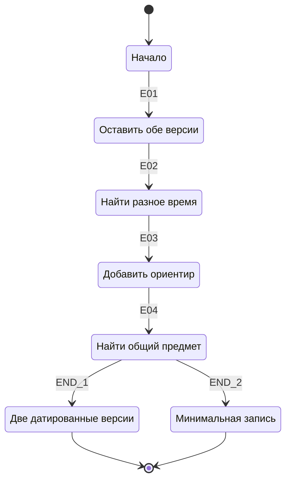

### Прогоны для проверки

| Сценарий | Начало | События / факты | Ожидаемое состояние |
| --- | --- | --- | --- |
| Исход 1 | S0 | E01 → E02 → E03 → E04 → END_1 | F1 |
| Исход 2 | S0 | E01 → E02 → E03 → E04 → END_2 | F2 |
| Чужой мир / автор / ветка / непроверенный смысл | S0 | OTHER | S0 |
| Преждевременный итог | S0 | END_1 | S0 |
| Не тот герой | S1 | Текст E02 от другого автора → OTHER | S1 |
| Не тот пост | S1 | Текст E02 под другим постом → OTHER | S1 |
| Не тот родитель | Перед player_reply | Нужный текст с другим parentCommentId → OTHER | То же состояние |
| Фраза без действия | Перед END_1/END_2 | Пересказ чужого решения без своего предложения → OTHER | То же состояние |
| Оба несовместимых итога | Перед END_1/END_2 | Подтверждены оба решения либо ни одно → OTHER | То же состояние; нужна ясная формулировка |
| Нет подтверждения смысла | Любое | Классификация не завершена / ошибка | Событие ожидает проверки, продвижения нет |
| Повтор доставки | После любого T | Тот же идентификатор факта | Без повторного эффекта |
| После завершения | F1 / F2 | Любые новые события | То же F1 / F2; один итог |

Критерии по смыслу нужно проверить отдельно на примерах и контрпримерах. Автоматическая проверка справочника проверяет ссылки и переходы, а не качество классификации или реплик.


<a id="houses_own_01"></a>

## houses_own_01: Две печати одного совета

Игра домов · Свой персонаж. Черновик для обсуждения в [#192](https://github.com/Stepami/golden-mouth/issues/192).

Биографии и общие условия обработки событий приведены выше в этом документе.

### Паспорт

| Поле | Значение |
| --- | --- |
| story_id | houses_own_01 |
| version | 0.1-draft |
| world_key | houses |
| player_role | own — Свой персонаж |
| actors | diana — Диана Речная, jon — Ян Северин, james — Мартен Гран |
| Завязка | В ленте два письма с общей печатью и разными подписями. Оба обещают разным домам право созвать совет. Если выбрать по красивой речи, спор только закрепится. |
| Цель | Выяснить предел полномочий подписантов и предложить процедуру, которую стороны могут проверить. |
| Начало | S0 |
| Исходы | F1, F2 |

### Состояния

Факты предыдущих этапов сохраняются; в строке указан новый факт. Подсказки — предлагаемые тексты, интерфейс их показа здесь не задаётся.

| ID | Название | Новый факт истории | Дальше | Подсказка игроку | Конечное |
| --- | --- | --- | --- | --- | --- |
| S0 | Начало | В ленте два письма с общей печатью и разными подписями. Оба обещают разным домам право созвать совет. Если выбрать по красивой речи, спор только закрепится. | Сопоставить письма | Покажи противоречие в письмах без обвинения в подделке. | Нет |
| S1 | Сопоставить письма | Противоречие документов стало предметом обсуждения. | Найти раздел полномочий | Следующий собеседник — Мартен Гран. Посмотри ответы под постом. | Нет |
| S2 | Найти раздел полномочий | Печать не равна полномочию созвать совет. | Уточнить обещание переправ | Проверь, что обещает каждый дом и на каком основании. | Нет |
| S3 | Уточнить обещание переправ | У дома переправ нет единоличного полномочия. | Попросить проверяемое условие | Спроси Диану, какую уступку она готова зафиксировать публично. | Нет |
| S4 | Попросить проверяемое условие | Переговоры привязаны к условию, а не к происхождению. | Узнать условие складов | Уточни у Яна, что нужно складам для участия в совете. | Нет |
| S5 | Узнать условие складов | У сторон есть совместимая основа общего созыва. | Опубликовать один из двух итогов | Предложи общий созыв или публикацию копий до следующего решения. | Нет |
| F1 | Общий созыв | В хронике есть проверяемое предложение совместного совета. | Сюжет завершён; обычная игра продолжается | В хронике есть проверяемое предложение совместного совета. | Да |
| F2 | Сначала проверка копий | Спор о подлинности отделён от права принимать решение. | Сюжет завершён; обычная игра продолжается | Спор о подлинности отделён от права принимать решение. | Да |

### События

Каждое условие включает общие проверки мира, автора, связи с сохранённым объектом и смысла из README. Для всех строк, кроме OTHER, проверка смысла и сюжетная привязка ещё требуют серверной реализации.

| Код | Сохранённый факт | Автор | Связь | Критерий по смыслу | Сохранить |
| --- | --- | --- | --- | --- | --- |
| E01 | Сохранённый пост игрока | Игрок | channel | Игрок указывает одну дату, разные подписи и одинаковое обещание, не объявляет письмо поддельным без проверки. | p0 |
| E02 | Сохранённый комментарий героя под связанным постом | Мартен Гран | p0 | Мартен приводит копию правила: общая печать подтверждает получение письма, а право созыва требует согласия двух домов. | c0 |
| E03 | Сохранённый комментарий героя под связанным постом | Диана Речная | p0 | Диана подтверждает свою подпись, но согласие второго дома не получено; готова обсуждать общий созыв. | c1 |
| E04 | Сохранённый ответ игрока на связанный комментарий | Игрок | c1 | Игрок просит назвать уступку и способ её проверки, не признавая исключительное право дома. | r0 |
| E05 | Сохранённый комментарий героя под связанным постом | Ян Северин | p0 | Ян согласен на общий созыв при публикации повестки до распределения перевозок; не отдаёт всё право одному дому. | c2 |
| END_1 | Сохранённый пост игрока | Игрок | channel | Игрок предлагает созыв двумя домами с заранее открытой повесткой, не объявляя его уже состоявшимся. | final_post_1 |
| END_2 | Сохранённый пост игрока | Игрок | channel | Игрок прямо откладывает созыв и предлагает открыть копии правила и писем для проверки обеими сторонами. | final_post_2 |
| OTHER | Другое событие | any | any | Любой подтверждённый факт, не отнесённый ровно к одной категории выше в текущем состоянии. | — |

### Переходы

| ID | Из | Событие | В | Память | Результат для игрока |
| --- | --- | --- | --- | --- | --- |
| T01 | S0 | E01 | S1 | p0 | Противоречие документов стало предметом обсуждения. |
| T02 | S1 | E02 | S2 | c0 | Печать не равна полномочию созвать совет. |
| T03 | S2 | E03 | S3 | c1 | У дома переправ нет единоличного полномочия. |
| T04 | S3 | E04 | S4 | r0 | Переговоры привязаны к условию, а не к происхождению. |
| T05 | S4 | E05 | S5 | c2 | У сторон есть совместимая основа общего созыва. |
| T_END_1 | S5 | END_1 | F1 | final_post_1 | В хронике есть проверяемое предложение совместного совета. |
| T_END_2 | S5 | END_2 | F2 | final_post_2 | Спор о подлинности отделён от права принимать решение. |

### Полная матрица

`—` — сохранить состояние без действий. Коды вне разрешённого перехода не засчитываются задним числом.

| Состояние | E01 | E02 | E03 | E04 | E05 | END_1 | END_2 | OTHER |
| --- | --- | --- | --- | --- | --- | --- | --- | --- |
| S0 | S1 / T01 | S0 / — | S0 / — | S0 / — | S0 / — | S0 / — | S0 / — | S0 / — |
| S1 | S1 / — | S2 / T02 | S1 / — | S1 / — | S1 / — | S1 / — | S1 / — | S1 / — |
| S2 | S2 / — | S2 / — | S3 / T03 | S2 / — | S2 / — | S2 / — | S2 / — | S2 / — |
| S3 | S3 / — | S3 / — | S3 / — | S4 / T04 | S3 / — | S3 / — | S3 / — | S3 / — |
| S4 | S4 / — | S4 / — | S4 / — | S4 / — | S5 / T05 | S4 / — | S4 / — | S4 / — |
| S5 | S5 / — | S5 / — | S5 / — | S5 / — | S5 / — | F1 / T_END_1 | F2 / T_END_2 | S5 / — |
| F1 | F1 / — | F1 / — | F1 / — | F1 / — | F1 / — | F1 / — | F1 / — | F1 / — |
| F2 | F2 / — | F2 / — | F2 / — | F2 / — | F2 / — | F2 / — | F2 / — | F2 / — |

### Граф

Петли без действий из полной матрицы опущены для читаемости.

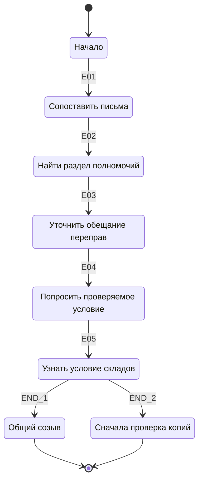

### Прогоны для проверки

| Сценарий | Начало | События / факты | Ожидаемое состояние |
| --- | --- | --- | --- |
| Исход 1 | S0 | E01 → E02 → E03 → E04 → E05 → END_1 | F1 |
| Исход 2 | S0 | E01 → E02 → E03 → E04 → E05 → END_2 | F2 |
| Чужой мир / автор / ветка / непроверенный смысл | S0 | OTHER | S0 |
| Преждевременный итог | S0 | END_1 | S0 |
| Не тот герой | S1 | Текст E02 от другого автора → OTHER | S1 |
| Не тот пост | S1 | Текст E02 под другим постом → OTHER | S1 |
| Не тот родитель | Перед player_reply | Нужный текст с другим parentCommentId → OTHER | То же состояние |
| Фраза без действия | Перед END_1/END_2 | Пересказ чужого решения без своего предложения → OTHER | То же состояние |
| Оба несовместимых итога | Перед END_1/END_2 | Подтверждены оба решения либо ни одно → OTHER | То же состояние; нужна ясная формулировка |
| Нет подтверждения смысла | Любое | Классификация не завершена / ошибка | Событие ожидает проверки, продвижения нет |
| Повтор доставки | После любого T | Тот же идентификатор факта | Без повторного эффекта |
| После завершения | F1 / F2 | Любые новые события | То же F1 / F2; один итог |

Критерии по смыслу нужно проверить отдельно на примерах и контрпримерах. Автоматическая проверка справочника проверяет ссылки и переходы, а не качество классификации или реплик.


<a id="houses_diana_01"></a>

## houses_diana_01: Цена открытой переправы

Игра домов · Диана Речная. Черновик для обсуждения в [#192](https://github.com/Stepami/golden-mouth/issues/192).

Биографии и общие условия обработки событий приведены выше в этом документе.

### Паспорт

| Поле | Значение |
| --- | --- |
| story_id | houses_diana_01 |
| version | 0.1-draft |
| world_key | houses |
| player_role | diana — Диана Речная |
| actors | jon — Ян Северин, james — Мартен Гран |
| Завязка | Ты играешь за Диану. В письме от твоего дома обещан свободный проход, но пошлина остаётся в приложении. Оппоненты считают обещание обманом. |
| Цель | Разобрать противоречие и сделать предложение, в котором выгода дома видна открыто. |
| Начало | S0 |
| Исходы | F1, F2 |

### Состояния

Факты предыдущих этапов сохраняются; в строке указан новый факт. Подсказки — предлагаемые тексты, интерфейс их показа здесь не задаётся.

| ID | Название | Новый факт истории | Дальше | Подсказка игроку | Конечное |
| --- | --- | --- | --- | --- | --- |
| S0 | Начало | Ты играешь за Диану. В письме от твоего дома обещан свободный проход, но пошлина остаётся в приложении. Оппоненты считают обещание обманом. | Признать расхождение | Покажи обе части обещания, включая неудобное приложение. | Нет |
| S1 | Признать расхождение | Противоречие своего дома признано публично. | Уточнить текст приложения | Следующий собеседник — Мартен Гран. Посмотри ответы под постом. | Нет |
| S2 | Уточнить текст приложения | Уточнено, что именно расходится между письмом и приложением. | Запросить открытую поправку | Спроси Мартена, как исправить обещание без скрытой оговорки. | Нет |
| S3 | Запросить открытую поправку | Предложена открытая правка, а не удаление следа. | Назвать потребность складов | Узнай у Яна, кому и для каких поставок нужен проход. | Нет |
| S4 | Назвать потребность складов | Выявлена узкая потребность, отделённая от общего торгового режима. | Опубликовать один из двух итогов | Выбери узкую льготу или честное платное условие. | Нет |
| F1 | Проход для зерна | Предложение имеет границы и не маскирует доход дома. | Сюжет завершён; обычная игра продолжается | Предложение имеет границы и не маскирует доход дома. | Да |
| F2 | Прозрачная пошлина | Громкое обещание заменено честным предметом переговоров. | Сюжет завершён; обычная игра продолжается | Громкое обещание заменено честным предметом переговоров. | Да |

### События

Каждое условие включает общие проверки мира, автора, связи с сохранённым объектом и смысла из README. Для всех строк, кроме OTHER, проверка смысла и сюжетная привязка ещё требуют серверной реализации.

| Код | Сохранённый факт | Автор | Связь | Критерий по смыслу | Сохранить |
| --- | --- | --- | --- | --- | --- |
| E01 | Сохранённый пост игрока | Игрок | channel | Игрок называет свободный проход и сохранившуюся пошлину в приложении; не обвиняет оппонентов за обнаружение. | p0 |
| E02 | Сохранённый комментарий героя под связанным постом | Мартен Гран | p0 | Мартен подтверждает: пошлина относится к грузам, но слово «свободный» в письме не имеет этой оговорки. | c0 |
| E03 | Сохранённый ответ игрока на связанный комментарий | Игрок | c0 | Игрок предлагает вынести исключение в основной текст и не просит убрать неудобное приложение из архива. | r0 |
| E04 | Сохранённый комментарий героя под связанным постом | Ян Северин | p0 | Ян просит отдельный беспошлинный проход для зерна до совета, не требует бесплатного прохода для всех грузов. | c1 |
| END_1 | Сохранённый пост игрока | Игрок | channel | Игрок предлагает ограниченное освобождение зерновых перевозок до совета и явно оставляет остальные пошлины предметом переговоров. | final_post_1 |
| END_2 | Сохранённый пост игрока | Игрок | channel | Игрок отказывается называть проход свободным и предлагает открыто обсуждать платную ставку; не обещает льготу для зерна. | final_post_2 |
| OTHER | Другое событие | any | any | Любой подтверждённый факт, не отнесённый ровно к одной категории выше в текущем состоянии. | — |

### Переходы

| ID | Из | Событие | В | Память | Результат для игрока |
| --- | --- | --- | --- | --- | --- |
| T01 | S0 | E01 | S1 | p0 | Противоречие своего дома признано публично. |
| T02 | S1 | E02 | S2 | c0 | Уточнено, что именно расходится между письмом и приложением. |
| T03 | S2 | E03 | S3 | r0 | Предложена открытая правка, а не удаление следа. |
| T04 | S3 | E04 | S4 | c1 | Выявлена узкая потребность, отделённая от общего торгового режима. |
| T_END_1 | S4 | END_1 | F1 | final_post_1 | Предложение имеет границы и не маскирует доход дома. |
| T_END_2 | S4 | END_2 | F2 | final_post_2 | Громкое обещание заменено честным предметом переговоров. |

### Полная матрица

`—` — сохранить состояние без действий. Коды вне разрешённого перехода не засчитываются задним числом.

| Состояние | E01 | E02 | E03 | E04 | END_1 | END_2 | OTHER |
| --- | --- | --- | --- | --- | --- | --- | --- |
| S0 | S1 / T01 | S0 / — | S0 / — | S0 / — | S0 / — | S0 / — | S0 / — |
| S1 | S1 / — | S2 / T02 | S1 / — | S1 / — | S1 / — | S1 / — | S1 / — |
| S2 | S2 / — | S2 / — | S3 / T03 | S2 / — | S2 / — | S2 / — | S2 / — |
| S3 | S3 / — | S3 / — | S3 / — | S4 / T04 | S3 / — | S3 / — | S3 / — |
| S4 | S4 / — | S4 / — | S4 / — | S4 / — | F1 / T_END_1 | F2 / T_END_2 | S4 / — |
| F1 | F1 / — | F1 / — | F1 / — | F1 / — | F1 / — | F1 / — | F1 / — |
| F2 | F2 / — | F2 / — | F2 / — | F2 / — | F2 / — | F2 / — | F2 / — |

### Граф

Петли без действий из полной матрицы опущены для читаемости.

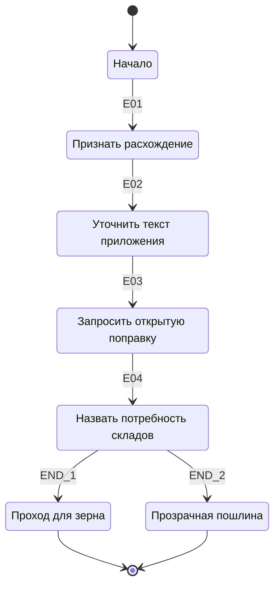

### Прогоны для проверки

| Сценарий | Начало | События / факты | Ожидаемое состояние |
| --- | --- | --- | --- |
| Исход 1 | S0 | E01 → E02 → E03 → E04 → END_1 | F1 |
| Исход 2 | S0 | E01 → E02 → E03 → E04 → END_2 | F2 |
| Чужой мир / автор / ветка / непроверенный смысл | S0 | OTHER | S0 |
| Преждевременный итог | S0 | END_1 | S0 |
| Не тот герой | S1 | Текст E02 от другого автора → OTHER | S1 |
| Не тот пост | S1 | Текст E02 под другим постом → OTHER | S1 |
| Не тот родитель | Перед player_reply | Нужный текст с другим parentCommentId → OTHER | То же состояние |
| Фраза без действия | Перед END_1/END_2 | Пересказ чужого решения без своего предложения → OTHER | То же состояние |
| Оба несовместимых итога | Перед END_1/END_2 | Подтверждены оба решения либо ни одно → OTHER | То же состояние; нужна ясная формулировка |
| Нет подтверждения смысла | Любое | Классификация не завершена / ошибка | Событие ожидает проверки, продвижения нет |
| Повтор доставки | После любого T | Тот же идентификатор факта | Без повторного эффекта |
| После завершения | F1 / F2 | Любые новые события | То же F1 / F2; один итог |

Критерии по смыслу нужно проверить отдельно на примерах и контрпримерах. Автоматическая проверка справочника проверяет ссылки и переходы, а не качество классификации или реплик.


<a id="houses_jon_01"></a>

## houses_jon_01: Письмо вместо обозов

Игра домов · Ян Северин. Черновик для обсуждения в [#192](https://github.com/Stepami/golden-mouth/issues/192).

Биографии и общие условия обработки событий приведены выше в этом документе.

### Паспорт

| Поле | Значение |
| --- | --- |
| story_id | houses_jon_01 |
| version | 0.1-draft |
| world_key | houses |
| player_role | jon — Ян Северин |
| actors | diana — Диана Речная, james — Мартен Гран |
| Завязка | Ты играешь за Яна. Один из домов обещал склады в обмен на поддержку созыва совета. Но в письме нет обязательства дать перевозчиков. |
| Цель | Показать, почему обещание запасов ещё не решает задачу доставки, и собрать реалистичное предложение. |
| Начало | S0 |
| Исходы | F1, F2 |

### Состояния

Факты предыдущих этапов сохраняются; в строке указан новый факт. Подсказки — предлагаемые тексты, интерфейс их показа здесь не задаётся.

| ID | Название | Новый факт истории | Дальше | Подсказка игроку | Конечное |
| --- | --- | --- | --- | --- | --- |
| S0 | Начало | Ты играешь за Яна. Один из домов обещал склады в обмен на поддержку созыва совета. Но в письме нет обязательства дать перевозчиков. | Отделить запас от доставки | Сопоставь обещание зерна и отсутствие перевозчиков. | Нет |
| S1 | Отделить запас от доставки | Недостающее звено поставки вынесено в обсуждение. | Проверить переправу | Следующий собеседник — Диана Речная. Посмотри ответы под постом. | Нет |
| S2 | Проверить переправу | Переправа возможна, перевозка ещё не обеспечена. | Записать предел обещания | Уточни у Дианы, что её дом действительно берёт на себя. | Нет |
| S3 | Записать предел обещания | Условия переправы отделены от транспорта. | Найти срок предложения | Попроси Мартена проверить транспортное приложение. | Нет |
| S4 | Найти срок предложения | Есть условная возможность доставки по подтверждённому маршруту. | Опубликовать один из двух итогов | Реши, предложить ограниченный рейс или сначала пересобрать обязательства. | Нет |
| F1 | Пробный обоз | Стороны получили ограниченный план с явными незакрытыми условиями. | Сюжет завершён; обычная игра продолжается | Стороны получили ограниченный план с явными незакрытыми условиями. | Да |
| F2 | Новая ведомость обязательств | Необеспеченное обещание не выдано за готовую поставку. | Сюжет завершён; обычная игра продолжается | Необеспеченное обещание не выдано за готовую поставку. | Да |

### События

Каждое условие включает общие проверки мира, автора, связи с сохранённым объектом и смысла из README. Для всех строк, кроме OTHER, проверка смысла и сюжетная привязка ещё требуют серверной реализации.

| Код | Сохранённый факт | Автор | Связь | Критерий по смыслу | Сохранить |
| --- | --- | --- | --- | --- | --- |
| E01 | Сохранённый пост игрока | Игрок | channel | Игрок указывает, что зерно обещано, а перевозчики не названы; не заявляет, что голод уже начался. | p0 |
| E02 | Сохранённый комментарий героя под связанным постом | Диана Речная | p0 | Диана готова открыть переправу для согласованного обоза, но не предоставляет лодки автоматически. | c0 |
| E03 | Сохранённый ответ игрока на связанный комментарий | Игрок | c0 | Игрок различает доступ к переправе и предоставление транспорта; не приписывает Диане второе обязательство. | r0 |
| E04 | Сохранённый комментарий героя под связанным постом | Мартен Гран | p0 | Мартен находит предложение перевозчиков, действующее только после подтверждения маршрута; это предложение, не заключённый договор. | c1 |
| END_1 | Сохранённый пост игрока | Игрок | channel | Игрок предлагает один согласованный маршрут с отдельным подтверждением перевозчиков; не объявляет поставку уже выполненной. | final_post_1 |
| END_2 | Сохранённый пост игрока | Игрок | channel | Игрок откладывает рейс и предлагает раздельно подтвердить зерно, транспорт и переправу. | final_post_2 |
| OTHER | Другое событие | any | any | Любой подтверждённый факт, не отнесённый ровно к одной категории выше в текущем состоянии. | — |

### Переходы

| ID | Из | Событие | В | Память | Результат для игрока |
| --- | --- | --- | --- | --- | --- |
| T01 | S0 | E01 | S1 | p0 | Недостающее звено поставки вынесено в обсуждение. |
| T02 | S1 | E02 | S2 | c0 | Переправа возможна, перевозка ещё не обеспечена. |
| T03 | S2 | E03 | S3 | r0 | Условия переправы отделены от транспорта. |
| T04 | S3 | E04 | S4 | c1 | Есть условная возможность доставки по подтверждённому маршруту. |
| T_END_1 | S4 | END_1 | F1 | final_post_1 | Стороны получили ограниченный план с явными незакрытыми условиями. |
| T_END_2 | S4 | END_2 | F2 | final_post_2 | Необеспеченное обещание не выдано за готовую поставку. |

### Полная матрица

`—` — сохранить состояние без действий. Коды вне разрешённого перехода не засчитываются задним числом.

| Состояние | E01 | E02 | E03 | E04 | END_1 | END_2 | OTHER |
| --- | --- | --- | --- | --- | --- | --- | --- |
| S0 | S1 / T01 | S0 / — | S0 / — | S0 / — | S0 / — | S0 / — | S0 / — |
| S1 | S1 / — | S2 / T02 | S1 / — | S1 / — | S1 / — | S1 / — | S1 / — |
| S2 | S2 / — | S2 / — | S3 / T03 | S2 / — | S2 / — | S2 / — | S2 / — |
| S3 | S3 / — | S3 / — | S3 / — | S4 / T04 | S3 / — | S3 / — | S3 / — |
| S4 | S4 / — | S4 / — | S4 / — | S4 / — | F1 / T_END_1 | F2 / T_END_2 | S4 / — |
| F1 | F1 / — | F1 / — | F1 / — | F1 / — | F1 / — | F1 / — | F1 / — |
| F2 | F2 / — | F2 / — | F2 / — | F2 / — | F2 / — | F2 / — | F2 / — |

### Граф

Петли без действий из полной матрицы опущены для читаемости.

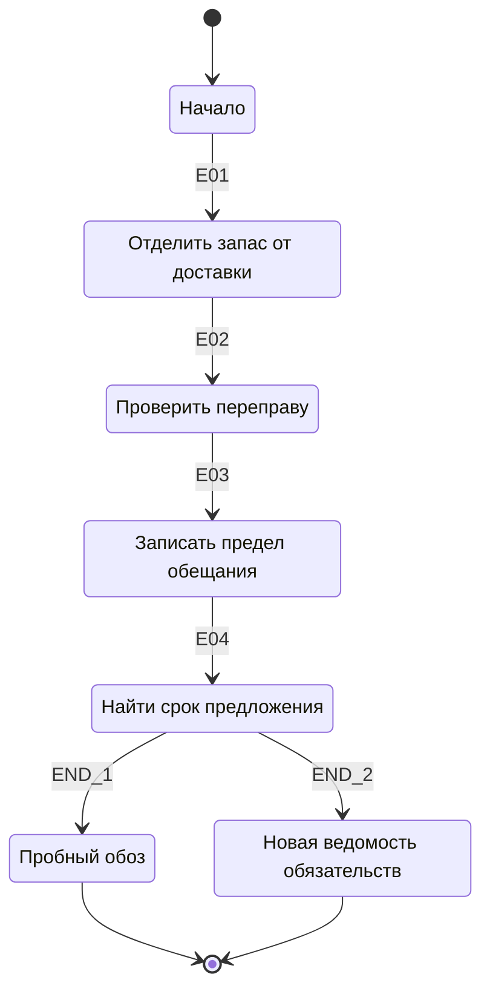

### Прогоны для проверки

| Сценарий | Начало | События / факты | Ожидаемое состояние |
| --- | --- | --- | --- |
| Исход 1 | S0 | E01 → E02 → E03 → E04 → END_1 | F1 |
| Исход 2 | S0 | E01 → E02 → E03 → E04 → END_2 | F2 |
| Чужой мир / автор / ветка / непроверенный смысл | S0 | OTHER | S0 |
| Преждевременный итог | S0 | END_1 | S0 |
| Не тот герой | S1 | Текст E02 от другого автора → OTHER | S1 |
| Не тот пост | S1 | Текст E02 под другим постом → OTHER | S1 |
| Не тот родитель | Перед player_reply | Нужный текст с другим parentCommentId → OTHER | То же состояние |
| Фраза без действия | Перед END_1/END_2 | Пересказ чужого решения без своего предложения → OTHER | То же состояние |
| Оба несовместимых итога | Перед END_1/END_2 | Подтверждены оба решения либо ни одно → OTHER | То же состояние; нужна ясная формулировка |
| Нет подтверждения смысла | Любое | Классификация не завершена / ошибка | Событие ожидает проверки, продвижения нет |
| Повтор доставки | После любого T | Тот же идентификатор факта | Без повторного эффекта |
| После завершения | F1 / F2 | Любые новые события | То же F1 / F2; один итог |

Критерии по смыслу нужно проверить отдельно на примерах и контрпримерах. Автоматическая проверка справочника проверяет ссылки и переходы, а не качество классификации или реплик.


<a id="houses_james_01"></a>

## houses_james_01: Архив против собственной подписи

Игра домов · Мартен Гран. Черновик для обсуждения в [#192](https://github.com/Stepami/golden-mouth/issues/192).

Биографии и общие условия обработки событий приведены выше в этом документе.

### Паспорт

| Поле | Значение |
| --- | --- |
| story_id | houses_james_01 |
| version | 0.1-draft |
| world_key | houses |
| player_role | james — Мартен Гран |
| actors | diana — Диана Речная, jon — Ян Северин |
| Завязка | Ты играешь за Мартена. В копии письма твоего дома отсутствует приложение, которое меняет полномочия совета. Твоя подпись заверяет копию, а не содержание договора. |
| Цель | Открыть проверку архива так, чтобы исход не зависел от личного доверия к тебе. |
| Начало | S0 |
| Исходы | F1, F2 |

### Состояния

Факты предыдущих этапов сохраняются; в строке указан новый факт. Подсказки — предлагаемые тексты, интерфейс их показа здесь не задаётся.

| ID | Название | Новый факт истории | Дальше | Подсказка игроку | Конечное |
| --- | --- | --- | --- | --- | --- |
| S0 | Начало | Ты играешь за Мартена. В копии письма твоего дома отсутствует приложение, которое меняет полномочия совета. Твоя подпись заверяет копию, а не содержание договора. | Показать неполную копию | Опубликуй, чего именно нет в копии и что означает твоя подпись. | Нет |
| S1 | Показать неполную копию | Недостаток архива признан самим хранителем. | Найти след приложения | Следующий собеседник — Ян Северин. Посмотри ответы под постом. | Нет |
| S2 | Найти след приложения | Подтверждено существование отдельного приложения. | Ограничить доказательство | Попроси Яна отделить факт получения от текста условий. | Нет |
| S3 | Ограничить доказательство | Свидетельство не расширено сверх источника. | Получить независимую копию | Попроси Диану дать доступ к копии со стороны другого дома. | Нет |
| S4 | Получить независимую копию | Есть предложение независимого сравнения, без удаления неудобной версии. | Опубликовать один из двух итогов | Реши, сопоставить копии публично или временно отозвать заверение. | Нет |
| F1 | Сопоставление копий | Предложена процедура проверки, не зависящая от слова хранителя. | Сюжет завершён; обычная игра продолжается | Предложена процедура проверки, не зависящая от слова хранителя. | Да |
| F2 | Заверение приостановлено | Неполный документ больше не представлен как надёжная основа решения. | Сюжет завершён; обычная игра продолжается | Неполный документ больше не представлен как надёжная основа решения. | Да |

### События

Каждое условие включает общие проверки мира, автора, связи с сохранённым объектом и смысла из README. Для всех строк, кроме OTHER, проверка смысла и сюжетная привязка ещё требуют серверной реализации.

| Код | Сохранённый факт | Автор | Связь | Критерий по смыслу | Сохранить |
| --- | --- | --- | --- | --- | --- |
| E01 | Сохранённый пост игрока | Игрок | channel | Игрок признаёт отсутствие приложения в заверенной копии и отделяет заверение копирования от согласия с условиями. | p0 |
| E02 | Сохранённый комментарий героя под связанным постом | Ян Северин | p0 | Ян показывает запись о получении приложения на складе; содержание из этой записи восстановить нельзя. | c0 |
| E03 | Сохранённый ответ игрока на связанный комментарий | Игрок | c0 | Игрок прямо различает регистрацию приложения и его содержание; не объявляет содержание доказанным. | r0 |
| E04 | Сохранённый комментарий героя под связанным постом | Диана Речная | p0 | Диана согласна открыть свою копию для сопоставления при сохранении обеих версий и истории исправлений. | c1 |
| END_1 | Сохранённый пост игрока | Игрок | channel | Игрок предлагает открыто сравнить обе копии с историей исправлений, не объявляет архив уже проверенным. | final_post_1 |
| END_2 | Сохранённый пост игрока | Игрок | channel | Игрок отзывает своё заверение полноты до сравнения и сохраняет обе версии; не называет ни одну подделкой. | final_post_2 |
| OTHER | Другое событие | any | any | Любой подтверждённый факт, не отнесённый ровно к одной категории выше в текущем состоянии. | — |

### Переходы

| ID | Из | Событие | В | Память | Результат для игрока |
| --- | --- | --- | --- | --- | --- |
| T01 | S0 | E01 | S1 | p0 | Недостаток архива признан самим хранителем. |
| T02 | S1 | E02 | S2 | c0 | Подтверждено существование отдельного приложения. |
| T03 | S2 | E03 | S3 | r0 | Свидетельство не расширено сверх источника. |
| T04 | S3 | E04 | S4 | c1 | Есть предложение независимого сравнения, без удаления неудобной версии. |
| T_END_1 | S4 | END_1 | F1 | final_post_1 | Предложена процедура проверки, не зависящая от слова хранителя. |
| T_END_2 | S4 | END_2 | F2 | final_post_2 | Неполный документ больше не представлен как надёжная основа решения. |

### Полная матрица

`—` — сохранить состояние без действий. Коды вне разрешённого перехода не засчитываются задним числом.

| Состояние | E01 | E02 | E03 | E04 | END_1 | END_2 | OTHER |
| --- | --- | --- | --- | --- | --- | --- | --- |
| S0 | S1 / T01 | S0 / — | S0 / — | S0 / — | S0 / — | S0 / — | S0 / — |
| S1 | S1 / — | S2 / T02 | S1 / — | S1 / — | S1 / — | S1 / — | S1 / — |
| S2 | S2 / — | S2 / — | S3 / T03 | S2 / — | S2 / — | S2 / — | S2 / — |
| S3 | S3 / — | S3 / — | S3 / — | S4 / T04 | S3 / — | S3 / — | S3 / — |
| S4 | S4 / — | S4 / — | S4 / — | S4 / — | F1 / T_END_1 | F2 / T_END_2 | S4 / — |
| F1 | F1 / — | F1 / — | F1 / — | F1 / — | F1 / — | F1 / — | F1 / — |
| F2 | F2 / — | F2 / — | F2 / — | F2 / — | F2 / — | F2 / — | F2 / — |

### Граф

Петли без действий из полной матрицы опущены для читаемости.

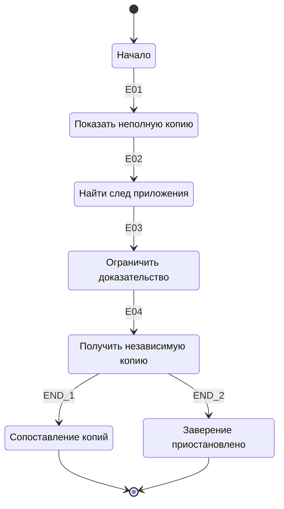

### Прогоны для проверки

| Сценарий | Начало | События / факты | Ожидаемое состояние |
| --- | --- | --- | --- |
| Исход 1 | S0 | E01 → E02 → E03 → E04 → END_1 | F1 |
| Исход 2 | S0 | E01 → E02 → E03 → E04 → END_2 | F2 |
| Чужой мир / автор / ветка / непроверенный смысл | S0 | OTHER | S0 |
| Преждевременный итог | S0 | END_1 | S0 |
| Не тот герой | S1 | Текст E02 от другого автора → OTHER | S1 |
| Не тот пост | S1 | Текст E02 под другим постом → OTHER | S1 |
| Не тот родитель | Перед player_reply | Нужный текст с другим parentCommentId → OTHER | То же состояние |
| Фраза без действия | Перед END_1/END_2 | Пересказ чужого решения без своего предложения → OTHER | То же состояние |
| Оба несовместимых итога | Перед END_1/END_2 | Подтверждены оба решения либо ни одно → OTHER | То же состояние; нужна ясная формулировка |
| Нет подтверждения смысла | Любое | Классификация не завершена / ошибка | Событие ожидает проверки, продвижения нет |
| Повтор доставки | После любого T | Тот же идентификатор факта | Без повторного эффекта |
| После завершения | F1 / F2 | Любые новые события | То же F1 / F2; один итог |

Критерии по смыслу нужно проверить отдельно на примерах и контрпримерах. Автоматическая проверка справочника проверяет ссылки и переходы, а не качество классификации или реплик.


<a id="it_own_01"></a>

## it_own_01: Демо, которое можно повторить

Айти-тусовка · Свой персонаж. Черновик для обсуждения в [#192](https://github.com/Stepami/golden-mouth/issues/192).

Биографии и общие условия обработки событий приведены выше в этом документе.

### Паспорт

| Поле | Значение |
| --- | --- |
| story_id | it_own_01 |
| version | 0.1-draft |
| world_key | it |
| player_role | own — Свой персонаж |
| actors | greedy_wolf — Вера Сметина, 2kotleti_news — Мирон Кедр, alexey_nl — Лев Соль |
| Завязка | На дне прототипов готовят сервис поиска рабочих заметок. В анонсе он уже «находит всё», а опубликован только локальный тест. |
| Цель | Помочь команде договориться, что именно она вправе обещать на демо. |
| Начало | S0 |
| Исходы | F1, F2 |

### Состояния

Факты предыдущих этапов сохраняются; в строке указан новый факт. Подсказки — предлагаемые тексты, интерфейс их показа здесь не задаётся.

| ID | Название | Новый факт истории | Дальше | Подсказка игроку | Конечное |
| --- | --- | --- | --- | --- | --- |
| S0 | Начало | На дне прототипов готовят сервис поиска рабочих заметок. В анонсе он уже «находит всё», а опубликован только локальный тест. | Попросить условия проверки | Спроси, на каких заметках проверяли сервис и что считали успехом. | Нет |
| S1 | Попросить условия проверки | Вопрос к обещанию сформулирован через условия опыта. | Открыть границы теста | Следующий собеседник — Лев Соль. Посмотри ответы под постом. | Нет |
| S2 | Открыть границы теста | Тест ограничен короткими текстовыми заметками. | Найти полезный сценарий | Узнай у Веры, нужен ли такой ограниченный сценарий пользователям. | Нет |
| S3 | Найти полезный сценарий | Есть узкий сценарий, но не доказанный рынок. | Ограничить вывод о спросе | Попроси Веру отделить потребность от обещания выручки. | Нет |
| S4 | Ограничить вывод о спросе | Обещания о рынке не подменяют данные теста. | Исправить обещание | Сверь с Мироном формулировку анонса. | Нет |
| S5 | Исправить обещание | Есть согласованная ограниченная формулировка демо. | Опубликовать один из двух итогов | Выбери открытое демо с ограничениями или сначала повторный тест. | Нет |
| F1 | Ограниченное демо | Команда получила честный сценарий демонстрации. | Сюжет завершён; обычная игра продолжается | Команда получила честный сценарий демонстрации. | Да |
| F2 | Сначала воспроизведение | Команда получила конкретное условие готовности вместо общего запрета выпускать продукт. | Сюжет завершён; обычная игра продолжается | Команда получила конкретное условие готовности вместо общего запрета выпускать продукт. | Да |

### События

Каждое условие включает общие проверки мира, автора, связи с сохранённым объектом и смысла из README. Для всех строк, кроме OTHER, проверка смысла и сюжетная привязка ещё требуют серверной реализации.

| Код | Сохранённый факт | Автор | Связь | Критерий по смыслу | Сохранить |
| --- | --- | --- | --- | --- | --- |
| E01 | Сохранённый пост игрока | Игрок | channel | Игрок сопоставляет обещание «находит всё» с локальным тестом, спрашивает про данные и ограничение; не объявляет сервис мошенничеством. | p0 |
| E02 | Сохранённый комментарий героя под связанным постом | Лев Соль | p0 | Лев уточняет: проверяли только собственные короткие заметки, без сканов; результат нельзя обобщать на любые документы. | c0 |
| E03 | Сохранённый комментарий героя под связанным постом | Вера Сметина | p0 | Вера описывает запрос команды мастерской: найти договорённость в собственных текстовых заметках; готовность платить ещё не проверена. | c1 |
| E04 | Сохранённый ответ игрока на связанный комментарий | Игрок | c1 | Игрок различает описанную потребность и подтверждённую оплату, не выдаёт одно за другое. | r0 |
| E05 | Сохранённый комментарий героя под связанным постом | Мирон Кедр | p0 | Мирон готов заменить «находит всё» на поиск по коротким текстовым заметкам и пометить показ как прототип. | c2 |
| END_1 | Сохранённый пост игрока | Игрок | channel | Игрок предлагает показать прототип только на коротких текстовых заметках и явно назвать исключённые форматы; не заявляет проверенный спрос. | final_post_1 |
| END_2 | Сохранённый пост игрока | Игрок | channel | Игрок откладывает открытое демо до независимого повторения теста на том же формате заметок. | final_post_2 |
| OTHER | Другое событие | any | any | Любой подтверждённый факт, не отнесённый ровно к одной категории выше в текущем состоянии. | — |

### Переходы

| ID | Из | Событие | В | Память | Результат для игрока |
| --- | --- | --- | --- | --- | --- |
| T01 | S0 | E01 | S1 | p0 | Вопрос к обещанию сформулирован через условия опыта. |
| T02 | S1 | E02 | S2 | c0 | Тест ограничен короткими текстовыми заметками. |
| T03 | S2 | E03 | S3 | c1 | Есть узкий сценарий, но не доказанный рынок. |
| T04 | S3 | E04 | S4 | r0 | Обещания о рынке не подменяют данные теста. |
| T05 | S4 | E05 | S5 | c2 | Есть согласованная ограниченная формулировка демо. |
| T_END_1 | S5 | END_1 | F1 | final_post_1 | Команда получила честный сценарий демонстрации. |
| T_END_2 | S5 | END_2 | F2 | final_post_2 | Команда получила конкретное условие готовности вместо общего запрета выпускать продукт. |

### Полная матрица

`—` — сохранить состояние без действий. Коды вне разрешённого перехода не засчитываются задним числом.

| Состояние | E01 | E02 | E03 | E04 | E05 | END_1 | END_2 | OTHER |
| --- | --- | --- | --- | --- | --- | --- | --- | --- |
| S0 | S1 / T01 | S0 / — | S0 / — | S0 / — | S0 / — | S0 / — | S0 / — | S0 / — |
| S1 | S1 / — | S2 / T02 | S1 / — | S1 / — | S1 / — | S1 / — | S1 / — | S1 / — |
| S2 | S2 / — | S2 / — | S3 / T03 | S2 / — | S2 / — | S2 / — | S2 / — | S2 / — |
| S3 | S3 / — | S3 / — | S3 / — | S4 / T04 | S3 / — | S3 / — | S3 / — | S3 / — |
| S4 | S4 / — | S4 / — | S4 / — | S4 / — | S5 / T05 | S4 / — | S4 / — | S4 / — |
| S5 | S5 / — | S5 / — | S5 / — | S5 / — | S5 / — | F1 / T_END_1 | F2 / T_END_2 | S5 / — |
| F1 | F1 / — | F1 / — | F1 / — | F1 / — | F1 / — | F1 / — | F1 / — | F1 / — |
| F2 | F2 / — | F2 / — | F2 / — | F2 / — | F2 / — | F2 / — | F2 / — | F2 / — |

### Граф

Петли без действий из полной матрицы опущены для читаемости.

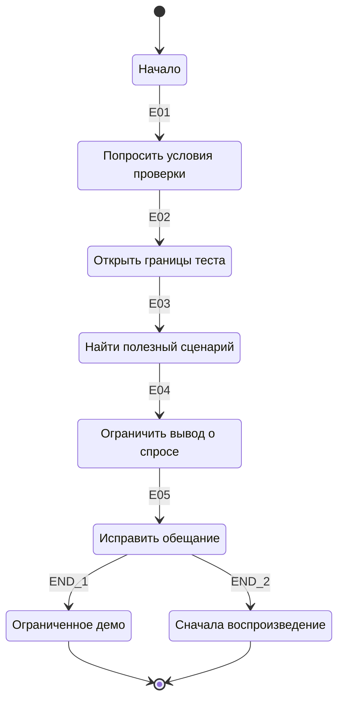

### Прогоны для проверки

| Сценарий | Начало | События / факты | Ожидаемое состояние |
| --- | --- | --- | --- |
| Исход 1 | S0 | E01 → E02 → E03 → E04 → E05 → END_1 | F1 |
| Исход 2 | S0 | E01 → E02 → E03 → E04 → E05 → END_2 | F2 |
| Чужой мир / автор / ветка / непроверенный смысл | S0 | OTHER | S0 |
| Преждевременный итог | S0 | END_1 | S0 |
| Не тот герой | S1 | Текст E02 от другого автора → OTHER | S1 |
| Не тот пост | S1 | Текст E02 под другим постом → OTHER | S1 |
| Не тот родитель | Перед player_reply | Нужный текст с другим parentCommentId → OTHER | То же состояние |
| Фраза без действия | Перед END_1/END_2 | Пересказ чужого решения без своего предложения → OTHER | То же состояние |
| Оба несовместимых итога | Перед END_1/END_2 | Подтверждены оба решения либо ни одно → OTHER | То же состояние; нужна ясная формулировка |
| Нет подтверждения смысла | Любое | Классификация не завершена / ошибка | Событие ожидает проверки, продвижения нет |
| Повтор доставки | После любого T | Тот же идентификатор факта | Без повторного эффекта |
| После завершения | F1 / F2 | Любые новые события | То же F1 / F2; один итог |

Критерии по смыслу нужно проверить отдельно на примерах и контрпримерах. Автоматическая проверка справочника проверяет ссылки и переходы, а не качество классификации или реплик.


<a id="it_greedy_wolf_01"></a>

## it_greedy_wolf_01: Пилот без обещанной выручки

Айти-тусовка · Вера Сметина. Черновик для обсуждения в [#192](https://github.com/Stepami/golden-mouth/issues/192).

Биографии и общие условия обработки событий приведены выше в этом документе.

### Паспорт

| Поле | Значение |
| --- | --- |
| story_id | it_greedy_wolf_01 |
| version | 0.1-draft |
| world_key | it |
| player_role | greedy_wolf — Вера Сметина |
| actors | 2kotleti_news — Мирон Кедр, alexey_nl — Лев Соль |
| Завязка | Ты играешь за Веру. Мастерская согласилась попробовать поиск заметок, а в черновике анонса уже появилась фраза «первый платящий клиент». Оплаты ещё нет. |
| Цель | Зафиксировать реальное обязательство пользователя и не продать команде вымышленный успех. |
| Начало | S0 |
| Исходы | F1, F2 |

### Состояния

Факты предыдущих этапов сохраняются; в строке указан новый факт. Подсказки — предлагаемые тексты, интерфейс их показа здесь не задаётся.

| ID | Название | Новый факт истории | Дальше | Подсказка игроку | Конечное |
| --- | --- | --- | --- | --- | --- |
| S0 | Начало | Ты играешь за Веру. Мастерская согласилась попробовать поиск заметок, а в черновике анонса уже появилась фраза «первый платящий клиент». Оплаты ещё нет. | Разделить пилот и оплату | Расскажи, что согласовано на самом деле, без чужой переписки. | Нет |
| S1 | Разделить пилот и оплату | Фактический статус пилота назван без завышения. | Исправить анонс | Следующий собеседник — Мирон Кедр. Посмотри ответы под постом. | Нет |
| S2 | Исправить анонс | Рекламная формулировка приведена к статусу пилота. | Отказаться от гарантии | Спроси Мирона, что он готов убрать из обещаний о результате. | Нет |
| S3 | Отказаться от гарантии | Убрано ещё одно непроверенное обещание. | Подготовить сравнение | Уточни у Льва, как сравнить результат с обычным поиском. | Нет |
| S4 | Подготовить сравнение | Есть план сравнения без выдуманного результата. | Опубликовать один из двух итогов | Выбери бесплатный проверочный пилот или обсуждение платного этапа после замера. | Нет |
| F1 | Проверочный пилот | Пилот описан как проверка, а не продажа. | Сюжет завершён; обычная игра продолжается | Пилот описан как проверка, а не продажа. | Да |
| F2 | Условия платного этапа | Команда разделила проверку пользы и будущий коммерческий договор. | Сюжет завершён; обычная игра продолжается | Команда разделила проверку пользы и будущий коммерческий договор. | Да |

### События

Каждое условие включает общие проверки мира, автора, связи с сохранённым объектом и смысла из README. Для всех строк, кроме OTHER, проверка смысла и сюжетная привязка ещё требуют серверной реализации.

| Код | Сохранённый факт | Автор | Связь | Критерий по смыслу | Сохранить |
| --- | --- | --- | --- | --- | --- |
| E01 | Сохранённый пост игрока | Игрок | channel | Игрок прямо пишет: согласие попробовать есть, оплаты нет; не раскрывает частную переписку клиента. | p0 |
| E02 | Сохранённый комментарий героя под связанным постом | Мирон Кедр | p0 | Мирон признаёт преждевременную фразу и предлагает «пробный запуск» без утверждения об оплате. | c0 |
| E03 | Сохранённый ответ игрока на связанный комментарий | Игрок | c0 | Игрок просит убрать гарантированную экономию времени до замера и оставить проверяемую задачу поиска. | r0 |
| E04 | Сохранённый комментарий героя под связанным постом | Лев Соль | p0 | Лев предлагает один набор разрешённых заметок и одинаковые запросы для обычного и нового поиска; замер ещё не проведён. | c1 |
| END_1 | Сохранённый пост игрока | Игрок | channel | Игрок предлагает неоплачиваемую проверку на согласованных заметках, без обещания будущей оплаты. | final_post_1 |
| END_2 | Сохранённый пост игрока | Игрок | channel | Игрок предлагает сначала замер, затем отдельное согласование оплаты; не называет клиента уже платящим. | final_post_2 |
| OTHER | Другое событие | any | any | Любой подтверждённый факт, не отнесённый ровно к одной категории выше в текущем состоянии. | — |

### Переходы

| ID | Из | Событие | В | Память | Результат для игрока |
| --- | --- | --- | --- | --- | --- |
| T01 | S0 | E01 | S1 | p0 | Фактический статус пилота назван без завышения. |
| T02 | S1 | E02 | S2 | c0 | Рекламная формулировка приведена к статусу пилота. |
| T03 | S2 | E03 | S3 | r0 | Убрано ещё одно непроверенное обещание. |
| T04 | S3 | E04 | S4 | c1 | Есть план сравнения без выдуманного результата. |
| T_END_1 | S4 | END_1 | F1 | final_post_1 | Пилот описан как проверка, а не продажа. |
| T_END_2 | S4 | END_2 | F2 | final_post_2 | Команда разделила проверку пользы и будущий коммерческий договор. |

### Полная матрица

`—` — сохранить состояние без действий. Коды вне разрешённого перехода не засчитываются задним числом.

| Состояние | E01 | E02 | E03 | E04 | END_1 | END_2 | OTHER |
| --- | --- | --- | --- | --- | --- | --- | --- |
| S0 | S1 / T01 | S0 / — | S0 / — | S0 / — | S0 / — | S0 / — | S0 / — |
| S1 | S1 / — | S2 / T02 | S1 / — | S1 / — | S1 / — | S1 / — | S1 / — |
| S2 | S2 / — | S2 / — | S3 / T03 | S2 / — | S2 / — | S2 / — | S2 / — |
| S3 | S3 / — | S3 / — | S3 / — | S4 / T04 | S3 / — | S3 / — | S3 / — |
| S4 | S4 / — | S4 / — | S4 / — | S4 / — | F1 / T_END_1 | F2 / T_END_2 | S4 / — |
| F1 | F1 / — | F1 / — | F1 / — | F1 / — | F1 / — | F1 / — | F1 / — |
| F2 | F2 / — | F2 / — | F2 / — | F2 / — | F2 / — | F2 / — | F2 / — |

### Граф

Петли без действий из полной матрицы опущены для читаемости.

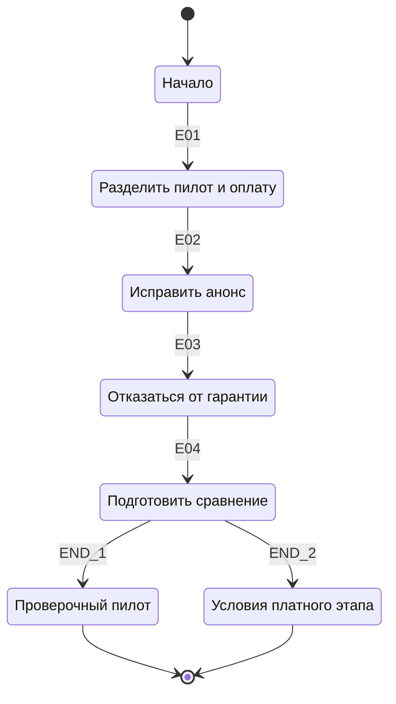

### Прогоны для проверки

| Сценарий | Начало | События / факты | Ожидаемое состояние |
| --- | --- | --- | --- |
| Исход 1 | S0 | E01 → E02 → E03 → E04 → END_1 | F1 |
| Исход 2 | S0 | E01 → E02 → E03 → E04 → END_2 | F2 |
| Чужой мир / автор / ветка / непроверенный смысл | S0 | OTHER | S0 |
| Преждевременный итог | S0 | END_1 | S0 |
| Не тот герой | S1 | Текст E02 от другого автора → OTHER | S1 |
| Не тот пост | S1 | Текст E02 под другим постом → OTHER | S1 |
| Не тот родитель | Перед player_reply | Нужный текст с другим parentCommentId → OTHER | То же состояние |
| Фраза без действия | Перед END_1/END_2 | Пересказ чужого решения без своего предложения → OTHER | То же состояние |
| Оба несовместимых итога | Перед END_1/END_2 | Подтверждены оба решения либо ни одно → OTHER | То же состояние; нужна ясная формулировка |
| Нет подтверждения смысла | Любое | Классификация не завершена / ошибка | Событие ожидает проверки, продвижения нет |
| Повтор доставки | После любого T | Тот же идентификатор факта | Без повторного эффекта |
| После завершения | F1 / F2 | Любые новые события | То же F1 / F2; один итог |

Критерии по смыслу нужно проверить отдельно на примерах и контрпримерах. Автоматическая проверка справочника проверяет ссылки и переходы, а не качество классификации или реплик.


<a id="it_2kotleti_news_01"></a>

## it_2kotleti_news_01: Скриншот быстрее продукта

Айти-тусовка · Мирон Кедр. Черновик для обсуждения в [#192](https://github.com/Stepami/golden-mouth/issues/192).

Биографии и общие условия обработки событий приведены выше в этом документе.

### Паспорт

| Поле | Значение |
| --- | --- |
| story_id | it_2kotleti_news_01 |
| version | 0.1-draft |
| world_key | it |
| player_role | 2kotleti_news — Мирон Кедр |
| actors | greedy_wolf — Вера Сметина, alexey_nl — Лев Соль |
| Завязка | Ты играешь за Мирона. Скриншот демо разошёлся как изображение готового сервиса, хотя поиск работает только на заранее подготовленных заметках. |
| Цель | Исправить ожидания аудитории, сохранив интерес к реальному прототипу. |
| Начало | S0 |
| Исходы | F1, F2 |

### Состояния

Факты предыдущих этапов сохраняются; в строке указан новый факт. Подсказки — предлагаемые тексты, интерфейс их показа здесь не задаётся.

| ID | Название | Новый факт истории | Дальше | Подсказка игроку | Конечное |
| --- | --- | --- | --- | --- | --- |
| S0 | Начало | Ты играешь за Мирона. Скриншот демо разошёлся как изображение готового сервиса, хотя поиск работает только на заранее подготовленных заметках. | Признать ограничение скриншота | Уточни, что на скриншоте действительно работает, а что ещё нет. | Нет |
| S1 | Признать ограничение скриншота | Статус изображения исправлен публично. | Назвать рабочую часть | Следующий собеседник — Лев Соль. Посмотри ответы под постом. | Нет |
| S2 | Назвать рабочую часть | Граница готовности описана инженером. | Выбрать честный показ | Спроси Льва, что можно показать без выдуманной функции загрузки. | Нет |
| S3 | Выбрать честный показ | Предложен показ работающего фрагмента. | Уточнить ожидание аудитории | Проверь у Веры, какое ожидание пользователя нужно исправить первым. | Нет |
| S4 | Уточнить ожидание аудитории | Главное ложное ожидание — доступ к самостоятельной загрузке. | Опубликовать один из двух итогов | Реши, заменить приглашение на просмотр или собрать запросы без обещания доступа. | Нет |
| F1 | Показ вместо доступа | Анонс ведёт к тому, что действительно можно показать. | Сюжет завершён; обычная игра продолжается | Анонс ведёт к тому, что действительно можно показать. | Да |
| F2 | Сбор запросов | Интерес аудитории превращён в исследование задач, а не фиктивную очередь готового продукта. | Сюжет завершён; обычная игра продолжается | Интерес аудитории превращён в исследование задач, а не фиктивную очередь готового продукта. | Да |

### События

Каждое условие включает общие проверки мира, автора, связи с сохранённым объектом и смысла из README. Для всех строк, кроме OTHER, проверка смысла и сюжетная привязка ещё требуют серверной реализации.

| Код | Сохранённый факт | Автор | Связь | Критерий по смыслу | Сохранить |
| --- | --- | --- | --- | --- | --- |
| E01 | Сохранённый пост игрока | Игрок | channel | Игрок объясняет, что показано подготовленное демо, а не общедоступный сервис; не удаляет контекст прежнего обещания. | p0 |
| E02 | Сохранённый комментарий героя под связанным постом | Лев Соль | p0 | Лев подтверждает локальный поиск по подготовленным заметкам; загрузка чужого архива и открытый доступ не готовы. | c0 |
| E03 | Сохранённый ответ игрока на связанный комментарий | Игрок | c0 | Игрок предлагает демонстрировать готовый локальный сценарий и явно исключает загрузку чужого архива. | r0 |
| E04 | Сохранённый комментарий героя под связанным постом | Вера Сметина | p0 | Вера сообщает: люди ждут самостоятельной загрузки, поэтому приглашение «попробовать сейчас» вводит в заблуждение. | c1 |
| END_1 | Сохранённый пост игрока | Игрок | channel | Игрок заменяет приглашение попробовать на просмотр ограниченного демо и прямо пишет об отсутствии самостоятельной загрузки. | final_post_1 |
| END_2 | Сохранённый пост игрока | Игрок | channel | Игрок снимает приглашение к использованию и предлагает описывать задачи для будущей проверки, без обещанной даты запуска. | final_post_2 |
| OTHER | Другое событие | any | any | Любой подтверждённый факт, не отнесённый ровно к одной категории выше в текущем состоянии. | — |

### Переходы

| ID | Из | Событие | В | Память | Результат для игрока |
| --- | --- | --- | --- | --- | --- |
| T01 | S0 | E01 | S1 | p0 | Статус изображения исправлен публично. |
| T02 | S1 | E02 | S2 | c0 | Граница готовности описана инженером. |
| T03 | S2 | E03 | S3 | r0 | Предложен показ работающего фрагмента. |
| T04 | S3 | E04 | S4 | c1 | Главное ложное ожидание — доступ к самостоятельной загрузке. |
| T_END_1 | S4 | END_1 | F1 | final_post_1 | Анонс ведёт к тому, что действительно можно показать. |
| T_END_2 | S4 | END_2 | F2 | final_post_2 | Интерес аудитории превращён в исследование задач, а не фиктивную очередь готового продукта. |

### Полная матрица

`—` — сохранить состояние без действий. Коды вне разрешённого перехода не засчитываются задним числом.

| Состояние | E01 | E02 | E03 | E04 | END_1 | END_2 | OTHER |
| --- | --- | --- | --- | --- | --- | --- | --- |
| S0 | S1 / T01 | S0 / — | S0 / — | S0 / — | S0 / — | S0 / — | S0 / — |
| S1 | S1 / — | S2 / T02 | S1 / — | S1 / — | S1 / — | S1 / — | S1 / — |
| S2 | S2 / — | S2 / — | S3 / T03 | S2 / — | S2 / — | S2 / — | S2 / — |
| S3 | S3 / — | S3 / — | S3 / — | S4 / T04 | S3 / — | S3 / — | S3 / — |
| S4 | S4 / — | S4 / — | S4 / — | S4 / — | F1 / T_END_1 | F2 / T_END_2 | S4 / — |
| F1 | F1 / — | F1 / — | F1 / — | F1 / — | F1 / — | F1 / — | F1 / — |
| F2 | F2 / — | F2 / — | F2 / — | F2 / — | F2 / — | F2 / — | F2 / — |

### Граф

Петли без действий из полной матрицы опущены для читаемости.

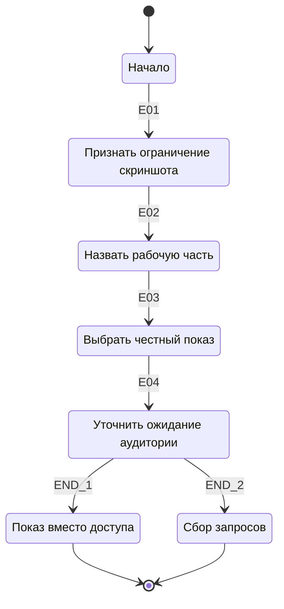

### Прогоны для проверки

| Сценарий | Начало | События / факты | Ожидаемое состояние |
| --- | --- | --- | --- |
| Исход 1 | S0 | E01 → E02 → E03 → E04 → END_1 | F1 |
| Исход 2 | S0 | E01 → E02 → E03 → E04 → END_2 | F2 |
| Чужой мир / автор / ветка / непроверенный смысл | S0 | OTHER | S0 |
| Преждевременный итог | S0 | END_1 | S0 |
| Не тот герой | S1 | Текст E02 от другого автора → OTHER | S1 |
| Не тот пост | S1 | Текст E02 под другим постом → OTHER | S1 |
| Не тот родитель | Перед player_reply | Нужный текст с другим parentCommentId → OTHER | То же состояние |
| Фраза без действия | Перед END_1/END_2 | Пересказ чужого решения без своего предложения → OTHER | То же состояние |
| Оба несовместимых итога | Перед END_1/END_2 | Подтверждены оба решения либо ни одно → OTHER | То же состояние; нужна ясная формулировка |
| Нет подтверждения смысла | Любое | Классификация не завершена / ошибка | Событие ожидает проверки, продвижения нет |
| Повтор доставки | После любого T | Тот же идентификатор факта | Без повторного эффекта |
| После завершения | F1 / F2 | Любые новые события | То же F1 / F2; один итог |

Критерии по смыслу нужно проверить отдельно на примерах и контрпримерах. Автоматическая проверка справочника проверяет ссылки и переходы, а не качество классификации или реплик.


<a id="it_alexey_nl_01"></a>

## it_alexey_nl_01: Красивый результат на знакомых данных

Айти-тусовка · Лев Соль. Черновик для обсуждения в [#192](https://github.com/Stepami/golden-mouth/issues/192).

Биографии и общие условия обработки событий приведены выше в этом документе.

### Паспорт

| Поле | Значение |
| --- | --- |
| story_id | it_alexey_nl_01 |
| version | 0.1-draft |
| world_key | it |
| player_role | alexey_nl — Лев Соль |
| actors | greedy_wolf — Вера Сметина, 2kotleti_news — Мирон Кедр |
| Завязка | Ты играешь за Льва. Поиск отлично отвечает на заметки, которыми команда пользовалась при настройке. Непонятно, проверен ли поиск или только знакомые примеры. |
| Цель | Предложить независимую проверку и сохранить полезный результат, не обобщая его раньше времени. |
| Начало | S0 |
| Исходы | F1, F2 |

### Состояния

Факты предыдущих этапов сохраняются; в строке указан новый факт. Подсказки — предлагаемые тексты, интерфейс их показа здесь не задаётся.

| ID | Название | Новый факт истории | Дальше | Подсказка игроку | Конечное |
| --- | --- | --- | --- | --- | --- |
| S0 | Начало | Ты играешь за Льва. Поиск отлично отвечает на заметки, которыми команда пользовалась при настройке. Непонятно, проверен ли поиск или только знакомые примеры. | Раскрыть пересечение данных | Расскажи, какие примеры использовали и для настройки, и для проверки. | Нет |
| S1 | Раскрыть пересечение данных | Ограничение исходного теста признано. | Выделить настоящую задачу | Следующий собеседник — Вера Сметина. Посмотри ответы под постом. | Нет |
| S2 | Выделить настоящую задачу | Есть отдельный пользовательский сценарий для проверки. | Определить проверку без утечки | Уточни, что проверять на новых заметках и как не раскрыть их содержание. | Нет |
| S3 | Определить проверку без утечки | Проверка учитывает согласие и границы публикации данных. | Подготовить честный отчёт | Спроси Мирона, как сообщить об ограниченном результате. | Нет |
| S4 | Подготовить честный отчёт | Формат отчёта не скрывает различие наборов. | Опубликовать один из двух итогов | Выбери отдельную новую проверку или отчёт только о старом ограниченном тесте. | Нет |
| F1 | Независимый прогон | Сформулирован воспроизводимый следующий опыт без придуманного результата. | Сюжет завершён; обычная игра продолжается | Сформулирован воспроизводимый следующий опыт без придуманного результата. | Да |
| F2 | Ограниченный отчёт | Команда сохранила результат как предварительный, а не как доказательство универсальности. | Сюжет завершён; обычная игра продолжается | Команда сохранила результат как предварительный, а не как доказательство универсальности. | Да |

### События

Каждое условие включает общие проверки мира, автора, связи с сохранённым объектом и смысла из README. Для всех строк, кроме OTHER, проверка смысла и сюжетная привязка ещё требуют серверной реализации.

| Код | Сохранённый факт | Автор | Связь | Критерий по смыслу | Сохранить |
| --- | --- | --- | --- | --- | --- |
| E01 | Сохранённый пост игрока | Игрок | channel | Игрок указывает, что примеры настройки вошли в проверку, и не объявляет полученный результат независимым. | p0 |
| E02 | Сохранённый комментарий героя под связанным постом | Вера Сметина | p0 | Вера предлагает новые разрешённые заметки мастерской и конкретный запрос найти прошлую договорённость; не обещает оплату за успех. | c0 |
| E03 | Сохранённый ответ игрока на связанный комментарий | Игрок | c0 | Игрок предлагает одинаковые запросы и обезличенный отчёт; не просит публиковать частные заметки. | r0 |
| E04 | Сохранённый комментарий героя под связанным постом | Мирон Кедр | p0 | Мирон согласен разделить знакомые и новые примеры и не складывать их в один рекламный показатель. | c1 |
| END_1 | Сохранённый пост игрока | Игрок | channel | Игрок предлагает отдельный прогон на новых разрешённых заметках и раздельный отчёт; не утверждает, что прогон уже успешен. | final_post_1 |
| END_2 | Сохранённый пост игрока | Игрок | channel | Игрок пока публикует только ограничение старого теста и прямо откладывает вывод о новых данных. | final_post_2 |
| OTHER | Другое событие | any | any | Любой подтверждённый факт, не отнесённый ровно к одной категории выше в текущем состоянии. | — |

### Переходы

| ID | Из | Событие | В | Память | Результат для игрока |
| --- | --- | --- | --- | --- | --- |
| T01 | S0 | E01 | S1 | p0 | Ограничение исходного теста признано. |
| T02 | S1 | E02 | S2 | c0 | Есть отдельный пользовательский сценарий для проверки. |
| T03 | S2 | E03 | S3 | r0 | Проверка учитывает согласие и границы публикации данных. |
| T04 | S3 | E04 | S4 | c1 | Формат отчёта не скрывает различие наборов. |
| T_END_1 | S4 | END_1 | F1 | final_post_1 | Сформулирован воспроизводимый следующий опыт без придуманного результата. |
| T_END_2 | S4 | END_2 | F2 | final_post_2 | Команда сохранила результат как предварительный, а не как доказательство универсальности. |

### Полная матрица

`—` — сохранить состояние без действий. Коды вне разрешённого перехода не засчитываются задним числом.

| Состояние | E01 | E02 | E03 | E04 | END_1 | END_2 | OTHER |
| --- | --- | --- | --- | --- | --- | --- | --- |
| S0 | S1 / T01 | S0 / — | S0 / — | S0 / — | S0 / — | S0 / — | S0 / — |
| S1 | S1 / — | S2 / T02 | S1 / — | S1 / — | S1 / — | S1 / — | S1 / — |
| S2 | S2 / — | S2 / — | S3 / T03 | S2 / — | S2 / — | S2 / — | S2 / — |
| S3 | S3 / — | S3 / — | S3 / — | S4 / T04 | S3 / — | S3 / — | S3 / — |
| S4 | S4 / — | S4 / — | S4 / — | S4 / — | F1 / T_END_1 | F2 / T_END_2 | S4 / — |
| F1 | F1 / — | F1 / — | F1 / — | F1 / — | F1 / — | F1 / — | F1 / — |
| F2 | F2 / — | F2 / — | F2 / — | F2 / — | F2 / — | F2 / — | F2 / — |

### Граф

Петли без действий из полной матрицы опущены для читаемости.

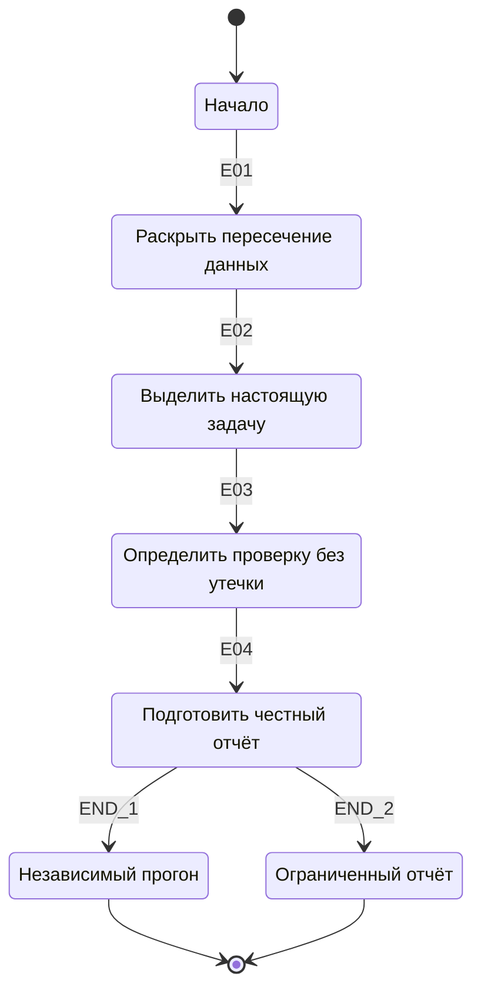

### Прогоны для проверки

| Сценарий | Начало | События / факты | Ожидаемое состояние |
| --- | --- | --- | --- |
| Исход 1 | S0 | E01 → E02 → E03 → E04 → END_1 | F1 |
| Исход 2 | S0 | E01 → E02 → E03 → E04 → END_2 | F2 |
| Чужой мир / автор / ветка / непроверенный смысл | S0 | OTHER | S0 |
| Преждевременный итог | S0 | END_1 | S0 |
| Не тот герой | S1 | Текст E02 от другого автора → OTHER | S1 |
| Не тот пост | S1 | Текст E02 под другим постом → OTHER | S1 |
| Не тот родитель | Перед player_reply | Нужный текст с другим parentCommentId → OTHER | То же состояние |
| Фраза без действия | Перед END_1/END_2 | Пересказ чужого решения без своего предложения → OTHER | То же состояние |
| Оба несовместимых итога | Перед END_1/END_2 | Подтверждены оба решения либо ни одно → OTHER | То же состояние; нужна ясная формулировка |
| Нет подтверждения смысла | Любое | Классификация не завершена / ошибка | Событие ожидает проверки, продвижения нет |
| Повтор доставки | После любого T | Тот же идентификатор факта | Без повторного эффекта |
| После завершения | F1 / F2 | Любые новые события | То же F1 / F2; один итог |

Критерии по смыслу нужно проверить отдельно на примерах и контрпримерах. Автоматическая проверка справочника проверяет ссылки и переходы, а не качество классификации или реплик.
